# 20 光合磷酸化

原始 PDF 第 257–283 页。

## 20

# 光合磷酸化

我们今天对光合作用过程在分子水平上的认识已经达到了一个相当深入的层次。这样的认识过程，正如对任何其他生命活动的认识过程一样，都是漫长而曲折的。

人们对光合作用的科学探究开始于 18 世纪。在那之前，人们大多接受亚里士多德的观点，即植物从土壤中获得它们所需要的所有营养物质，而完全没有考虑空气和光对植物生长的影响。

在 1770 年代，英国学者约瑟夫·普里斯特利（Joseph Priestley，1733—1804）等就观察到:在一个封闭容器里，一棵薄荷植株可使蜡烛燃烧时间延长，这表明薄荷植株产生了  $O_{2}$ 。大约 10 年后，荷兰学者扬·英根豪斯（Jan Ingen-Housz，1730—1799）等观察到绿色植物的这种作用只有在阳光照射下才会发生。具体而言，他们观察到，置于水下的植物叶子或其他绿色部位，当进行光照时可产生气泡（被证明为  $O_{2}$ ），而当置于黑暗中时，气泡将停止产生。他们还观察到，尽管植物在黑暗中也产生  $CO_{2}$ ，但其产量远低于光照时产生的  $O_{2}$  的量。这标志着在分子水平上对植物光合作用认识的开始。

在 18 世纪，人们普遍（错误地）认为，植物所释放出来的  $O_{2}$  来自  $CO_{2}$ ，而且其中的碳通过同化作用将形成糖类。然而，1800 年代，瑞士学者泰奥多尔·索叙尔（Théodore de Saussure，1767—1845）通过定量实验观察到，植物所产生的有机物和  $O_{2}$  的量远超过可利用的  $CO_{2}$  的量，而实验只涉及植物、水和空气。因此他推断，水也是植物进行光合作用的原料。这体现了定量分析对于科学探究的重要性。

1860 年代，德国学者尤利乌斯·萨克斯（Julius Sachs，1832—1897）观察到，如果将植物叶子置于黑暗中一段时间，以尽量消耗其细胞内含的有机物，然后将叶子用太阳光照射一段时间，则未遮挡的叶

---

20 光合磷酸化

241

子能使碘液变蓝色（表明产生了淀粉），而被遮挡的叶子却不能使碘液变蓝（即未产生淀粉）。这表明，光合作用可产生糖类物质。

1890 年代，人们开始使用光合作用（photosynthesis）这个词。其定义为:在叶绿素存在和光的作用下，植物利用  $CO_{2}$  合成复杂含碳化合物的生物学过程。在那之前，人们一般使用同化（assimilation）来描述植物依赖光将  $CO_{2}$  还原为有机物，同时释放  $O_{2}$  的过程。但原有定义无法将细菌不生氧的光合作用包括在内。

因此，光合作用的总反应式从原来反映产氧的形式:

$$
6 \mathrm{CO} _ {2} + 6 \mathrm{H} _ {2} \mathrm{O} + \text {光能} \longrightarrow \mathrm{C} _ {6} \mathrm{H} _ {1 2} \mathrm{O} _ {6} (\text {葡萄糖}) + 6 \mathrm{O} _ {2}
$$

调整为更为通用的形式:

$$
\mathrm{CO} _ {2} + 2 \mathrm{H} _ {2} \mathrm{A} + \text {光能} \longrightarrow [ \mathrm{CH} _ {2} \mathrm{O} ] (\text {碳水化合物即糖类}) + 2 \mathrm{A} + \mathrm{H} _ {2} \mathrm{O}
$$

其中的  $H_{2}A$  可以是  $H_{2}O$ 、 $H_{2}S$ 、 $H_{2}$  或其他电子供体。

尽管总体的光合作用反应式看似简单，但其所代表的物质和能量转换过程却是一个极其复杂的分子过程。光合作用主要涉及光能捕获和碳固定两个阶段。

光能的捕获过程被称作光合磷酸化（photophosphorylation）。它是1950年代开始出现的一种概念。最初是为解释分离的植物叶绿体和紫细菌载色体在光照下产生ATP（不释放 $O_{2}$ ）、但无需 $CO_{2}$ 的存在和固定的过程（即所谓的环式光合磷酸化）。后来推广至光能的捕获以及将这样的能量最终储存于ATP和NADPH分子中的过程。而无机碳固定（carbon fixation）则涉及利用上述捕获的能量将 $CO_{2}$ 转化为糖类的过程（图20-1）。

本章仅介绍光合磷酸化部分，碳固定过程将在第 21 章中介绍。

作为光合作用的第一个阶段，与氧化磷酸化类似，光合磷酸化也由存在于生物膜

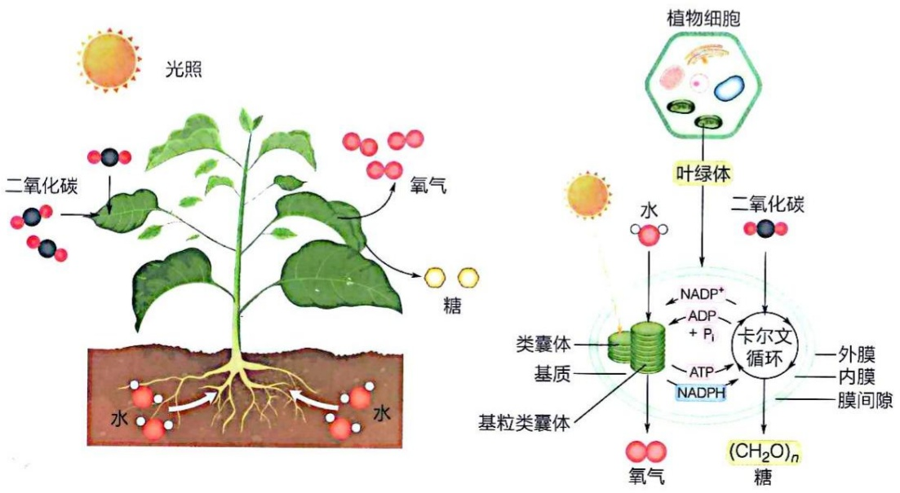

图20-1 光合作用涉及光合磷酸化和碳固定两个相关的阶段

---

242

20 光合磷酸化

(如叶绿体的类囊体膜)中的蛋白质复合物完成。以此, 光合作用细胞将太阳光中的能量捕获, 用以驱动细胞中 ATP 和 NADPH 的生成。在光合作用的第二个阶段, 储存于这些分子中的化学能可被用于将 $\mathrm{CO}_{2}$ 固定成葡萄糖等有机分子 (第 21 章), 为光合生物自身 (在缺乏太阳光时) 或异养生物提供能量和碳源。

有趣的是，光能自养生物中发生的光合磷酸化过程的基本策略与异养生物（和自养生物）中发生的氧化磷酸化过程高度可比，这反映了生物演化在分子水平发生的事实。动物和异养微生物等的生命活动需利用有机燃料分子氧化分解释放的能量和提供的碳骨架用于生物合成。植物和藻类等自养生物则可以通过光合作用过程直接利用太阳光的能量，将无机的碳固定为有机的碳。

光合磷酸化过程中所涉及的光能捕获和转化的过程，具体涉及光系统的反应中心在光子诱发下发生的电荷分离以及随后的电子传递过程，这样的电子传递过程将与跨膜质子梯度的形成和 NADPH 的合成等事件偶联。光合磷酸化过程中负责催化 ATP 生成的 ATP 合酶在结构和机制方面与氧化磷酸化过程中的 ATP 合酶高度相似，再次体现生物演化在分子水平上的保守性。

## 20.1 光合作用发生于叶绿体等亚细胞结构中

作为植物叶肉细胞中的一种绿色小球状结构，叶绿体可能早在1670年代就通过光学显微镜被观察到。直到1880年代，德国学者特奥多尔·恩格尔曼（Theodor Engelmann，1843—1909）才通过实验确认光合作用在植物和藻类细胞的叶绿体中发生。

具体而言，恩格尔曼主要使用两种实验材料开展光合作用实验。一是一种被称作水绵（Spirogyra）的丝状绿藻，其每个细胞呈柱状，内含螺旋状叶绿体（以及细胞核和液泡等），不同细胞彼此连接成丝状体。二是他鉴定到的一种能被很低浓度氧气所吸引的趋氧细菌。他利用显微镜观察到，只有当照射绿藻的叶绿体部分时，这种绿藻才会吸引趋氧细菌，如果照射细胞的其他部分，则不会吸引细菌。这表明，叶绿体是植物细胞中发生光合作用，即产生 $O_{2}$ 的场所。

此外，恩格尔曼在1880年代推断一种紫细菌也可以发生光合作用。主要证据是它含吸光色素，生长依赖光，而且在约 $850\mathrm{nm}$ 的红外光区间生长最有效，其吸光色素吸收光谱的最大吸收峰也正好在 $850\mathrm{nm}$ 。但因为它不产生 $\mathrm{O}_2$ ，导致长期的争论（早期的观念认为，光合作用必须产生 $\mathrm{O}_2$ )。后来，其他光合细菌被发现，分为不产生氧气的（anoxygenic）紫细菌、绿硫菌、绿色丝状细菌、日光杆菌（Heliobacteria）等和产生氧气的（oxygenic）蓝细菌（cyanobacteria）。对原核细胞中存在的光合作用系统的探究为我们认识光合作用的总体机制提供了重要的模式系统。

---

20.1 光合作用发生于叶绿体等亚细胞结构中

243

## 20.1.1 叶绿体为一种具三个膜体系和三个腔室的植物细胞器

作为植物细胞中光合作用发生的场所，叶绿体一般呈椭球体形，但在不同类型生物中形态差异很大（如一些丝状绿藻中呈螺旋形）。

叶绿体含有外膜、内膜和类囊体膜三个膜体系（图 20-2A）。其外膜和内膜与革兰氏阴性细菌和线粒体中的可比；但其内膜并不形成类似线粒体内膜的嵴结构，而是与外膜基本平行排列，形成由内外膜组成的一种被膜（envelope）结构，包围在叶绿体的周边。类囊体（thylakoid）是在叶绿体内膜包围的空间内存在的另一种独立、封闭的膜系统。

类囊体膜上存在多种蛋白质复合物，参与并完成光合磷酸化的各个步骤，这包括进行光能捕获和电子传递的光系统Ⅱ（photosystem Ⅱ，PS Ⅱ）和光系统Ⅰ（photosystem Ⅰ，PS Ⅰ）、进行电子传递和质子泵送等的细胞色素 $b_{6}f$ 复合物（cytochrome $b_{6}f$，Cyt $b_{6}f$）以及进行ATP合成的ATP合酶（ATP synthase）等（图20-2B）。

类囊体的结构可以粗略分为两部分:由多层类囊体膜被压缩堆积在一起形成的圆

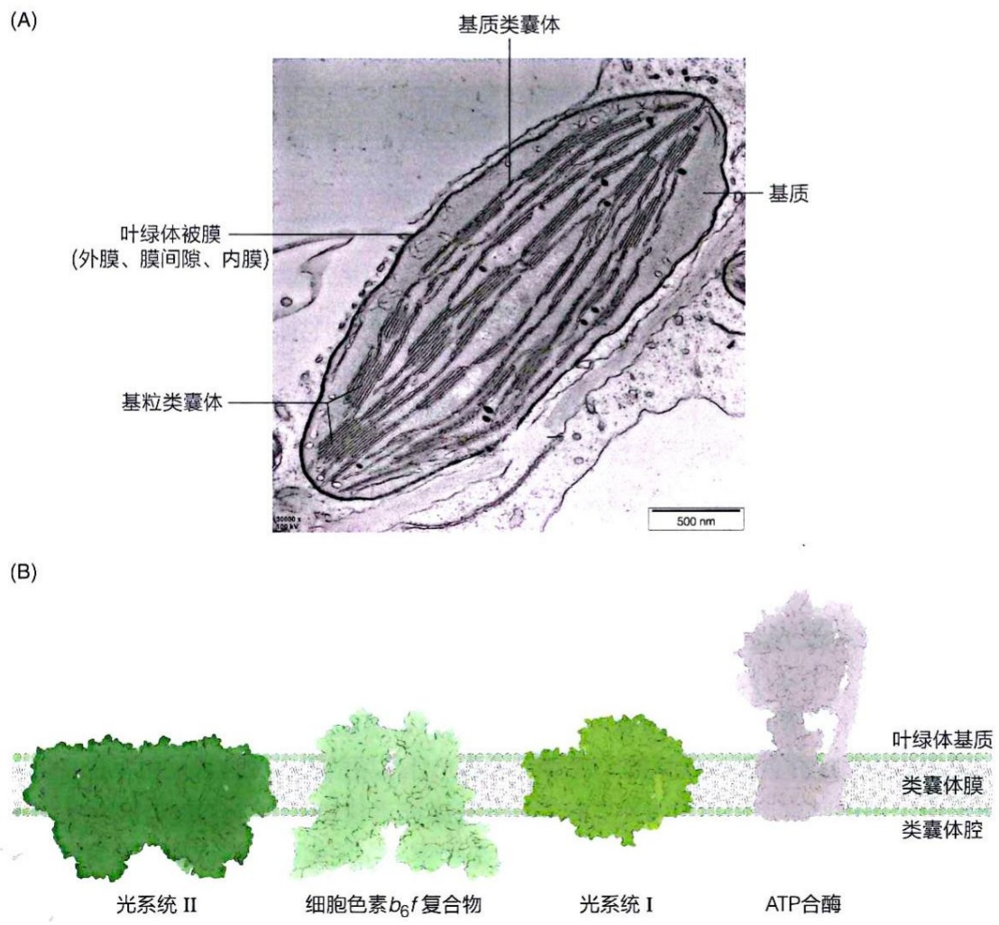

图20-2 拟南芥叶绿体的电子显微镜照片（A）和类囊体膜上分布的光系统、电子传递复合物和ATP合酶等（B）电镜照片由中国科学院生物物理研究所柳振峰实验室单建宇提供。

---

244

20 光合磷酸化

柱状基粒类囊体（granal thylakoid）和未被压缩以单层形式存在的基质类囊体（stromal thylakoid）（图20-2A）。基粒类囊体膜富含光系统Ⅱ和细胞色素 $b_{6}f$ 复合物，而基质类囊体膜则富含光系统Ⅰ和ATP合酶。这些复合物的结构和功能将在后面详细描述。

存在于类囊体和内膜之间的非膜部分被称作叶绿体基质（stroma）。光合作用中将$\mathrm{CO}_{2}$转化为糖类的碳固定阶段（包括淀粉合成等）即发生于叶绿体基质中，相关内容见第21章。

## 20.1.2 细菌光合作用发生于特化的胞质内膜上

在各类光合细菌中，光合磷酸化也发生在其细胞质膜内陷特化形成的膜系统内，这些膜系统被统称为胞质内膜（intracytoplasmic membrane，也称光合内膜）。尽管在不同光合细菌中，这样的胞质内膜系统具有不同的结构形态，但它们的功能均与叶绿体类囊体膜类似，是光合磷酸化发生之地。这里以不产氧的紫细菌中的载色体（chromatophore）和产氧的蓝细菌中存在的类囊体为例进行说明（图20-3）。

在紫细菌的载色体膜上分布着捕获光的捕光复合物1（light-harvesting complex I，LH1）和2（LH2）、光反应中心（reaction center，RC）、进行电子传递和质子泵送的细胞色素 $bc_{1}$ 复合物、ATP合酶以及完成循环电子传递的细胞色素 $c_{2}$ 等蛋白质成分（图20-3A）。而在蓝细菌的类囊体膜上则分布着捕获光的藻胆体（phycobilisome）、光系统Ⅰ和Ⅱ、传递电子的细胞色素 $b_{6}f$ 、ATP合酶以及两种呼吸链复合物，即NADH脱氢酶和细胞色素氧化酶。另外，其细胞质中还含进行固碳的羧酶体（carboxysome）（图20-3B）。

## 20.2 光合磷酸化依赖不同色素捕获光能

长期以来，人们观察到不同光合细菌的生长依赖特定波长光的存在。比如紫细菌在大约 $850\mathrm{nm}$ 波长光照射下表现出最佳生长状态。通过对不同光合生物产生氧气或产生碳水化合物等的效率进行分析，描述其作用光谱，并将这种作用光谱与其所含不同色素的吸收光谱进行对应，是认识不同生物光合作用的一个重要方面。

## 20.2.1 绿藻光合作用在红光波段最为有效

在证实叶绿体为光合作用场所的几年后，恩格尔曼还通过其建立的水绵-趋氧细菌实验体系，并借助光学系统，观察到绿藻光合作用的最有效波段是可见光中的红色波段。具体而言，他利用一种当时先进的显微光谱仪（其中包含棱镜），将太阳光（或煤气灯光）分散成不同波长的光谱。他观察到，在细胞中叶绿体均匀分布的水绵附近，趋氧细菌主要聚集在红色光照射区域，也有部分细菌聚集在蓝色波段照射的区

---

20.2 光合磷酸化依赖不同色素捕获光能

245

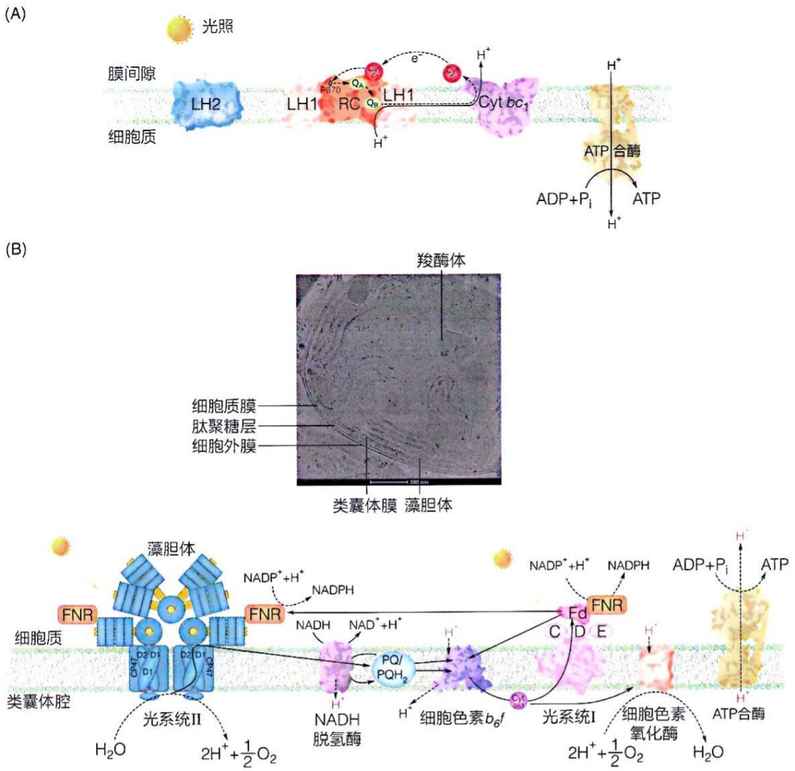

图 20-3 光合细菌中光合磷酸化发生的场所

（A）紫细菌中的载色体。（B）蓝细菌中的类囊体（电镜照片由北京大学赵进东实验室郑正高博士提供）。C:PsaC蛋白；D:PsaD蛋白；E:PsaE蛋白；Fd:ferredoxin，铁氧还蛋白；FNR:ferredoxin-NADP$^{+}$oxidoreductase，铁氧还蛋白-NADP$^{+}$氧化还原酶。

域，而绿色波段照射区则很少有趋氧细菌聚集（图 20-4）。这些结果提示，绿藻中的光合色素对红光和蓝光的吸收效率很高，而对绿光的吸收效率则很低。

## 20.2.2 叶绿素是光合生物中的主要捕光色素

1810年代后期，两位法国学者约瑟夫·佩尔蒂埃（Joseph Pelletier，1788—1842）和约瑟夫·卡文图（Joseph Caventou，1795—1877）对植物中的绿色色素进行了分离鉴定，并将之命名为叶绿素（chlorophyll）。之后，人们对植物叶片内的各种色素的光吸收特征及结构差异进行了详细分析。1900年代，俄国学者米哈伊尔·茨维特（Mikhail Tsvet，1872—1919）首次利用层析技术将植物中的色素进行了有效分离（故

---

246

20 光合磷酸化

图20-4 绿藻最有效光合作用发生于红色和蓝色波段

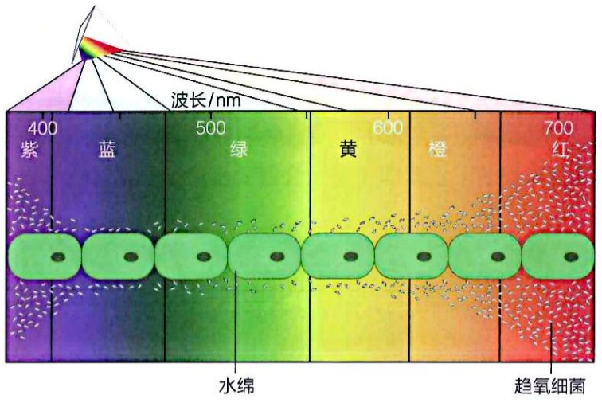

text_image

波长/nm
400
紫
蓝
500
绿
600
黄
橙
700
红
水绵
趋氧细菌

层析技术也被称作色谱技术），观察到多种形式的光合色素（包括对两种叶绿素分子的分离）；1910年代，德国学者里夏德·维尔施泰特（Richard Willstätter，1872—1942）等测定了叶绿素的化学结构；1940年代德国学者汉斯·费歇尔（Hans Fischer，1881—1945）对叶绿素分子进行了人工合成，令人惊讶的是，它与血红蛋白中存在的b型血红素结构高度类似。1960年代至1970年代间，叶绿素的空间结构也被完全测定。

叶绿素是一种含卟啉环、镁离子和一种长疏水侧链的分子。叶绿素的化学和立体结构如图20-5所示。

高等植物中的叶绿素主要分为 $a$ 和 $b$ 两种。其中，最主要也最常见的是叶绿素 $a$，为植物中的主要色素。在不同藻类中还存在其他结构稍有差异的叶绿素（被称作叶绿素 $c$、$d$、$e$、$f$ 等），这里不做介绍。

就叶绿素 $a$ 而言，其所含卟啉环（由I、II、III和IV四个吡咯环连接而成）与血红素中的完全相同。但是，与血红素化学结构不同的是:①叶绿素分子中含有以下结构:一条由20个碳原子组成的叶绿醇（phytol；一种多萜醇）侧链，由四个异戊二烯单位连接而成，其中三个双键被还原而仅保留一个双键，该疏水性侧链帮助将叶绿素分子锚定在类囊体膜中；②一个额外五元环，它与吡咯环III融合、环中含一个羰基、环上连接一个甲氧甲酰基；③共轭环平面的中心螯合的是一个镁离子（而非二价铁离子）；④吡咯环IV被还原（在细菌叶绿素 $a$ 中，吡咯环II和吡咯环IV均被还原），且其环上连接的丙酸基与叶绿醇缩合成酯。

值得注意的是，叶绿素分子中的四个吡咯杂环构成一个单双键交替排列形成的环状共轭系统。在这个多烯环的上面和下面形成离域的 $\pi$ 电子云；由于其电子轨道的裂分，叶绿素分子的能级差与可见光光子的能量相近，因此叶绿素分子表现出对可见光（波长为 $380\sim 750~\mathrm{nm}$ ）的极强吸收能力，具有极高的摩尔消光系数（$\varepsilon$ 可达$10^{5}\mathrm{L}\cdot \mathrm{mol}^{-1}\cdot \mathrm{cm}^{-1}$）。如图20-5所示，叶绿素 $a$ 和 $b$ 的结构差异很小，仅叶绿素 $a$ 分子中连接在卟啉环上的一个C7位甲基，在叶绿素 $b$ 分子中被甲醛基所取代。它们的吸收光谱稍有差异:叶绿素 $a$ 的两个最强吸收峰分别位于大约 $660~\mathrm{nm}$ 的红光区和$430~\mathrm{nm}$ 的蓝光区，而叶绿素 $b$ 的吸收峰则分别位于大约 $640~\mathrm{nm}$ 和 $450~\mathrm{nm}$ 。叶绿素 $a$

---

20.2 光合磷酸化依赖不同色素捕获光能

247

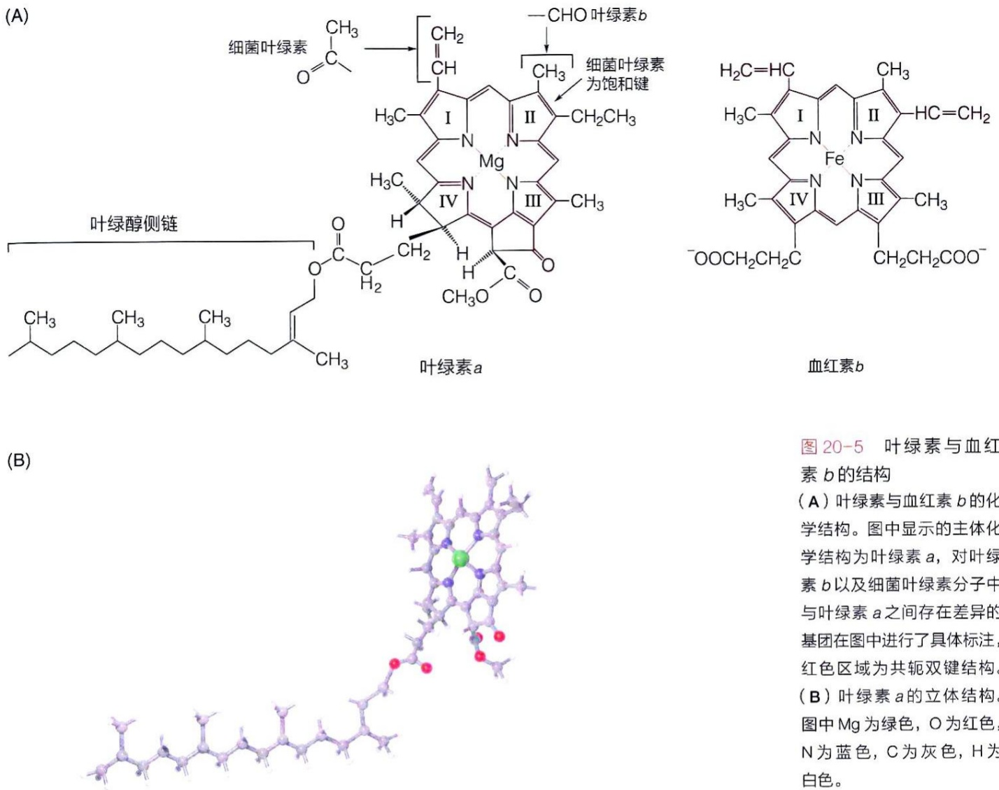

和 b 都吸收蓝光和红光，但不吸收绿光，这是植物叶片呈现绿色的原因。也就是说，二者在可见光区的吸光范围具有一定的互补性，它们的同时存在可以拓宽吸收的入射光能谱。细菌叶绿素（bacteriochlorophyll）与叶绿素 a 的结构也很类似，仅仅是吡咯环 I 上的乙烯基被一个乙酰基取代以及吡咯环 II 上一个烯键被还原（图 20-5A）。细菌叶绿素存在于不产氧光合细菌中（如紫细菌和绿硫菌）。

作为植物中最主要的一种叶绿素分子，叶绿素 a 还存在于包括藻类和蓝细菌在内的所有放氧生物中。但叶绿素 b 只存在于植物和藻类中，不存在于蓝细菌中。高等植物中叶绿素 a 和 b 存在的通常比例大约为 3:1。

## 20.2.3 光合细胞中还存在其他类型的捕光色素

除叶绿素外，光合细胞中还存在其他类型的捕光色素。这包括高等植物中的类胡萝卜素（carotenoid）和蓝细菌中的藻胆素（phycobilin）等（图20-6）。

---

248

20 光合磷酸化

图 20-6 β胡萝卜素、藻蓝素和藻红素的化学结构红色区域为共轭双键结构。

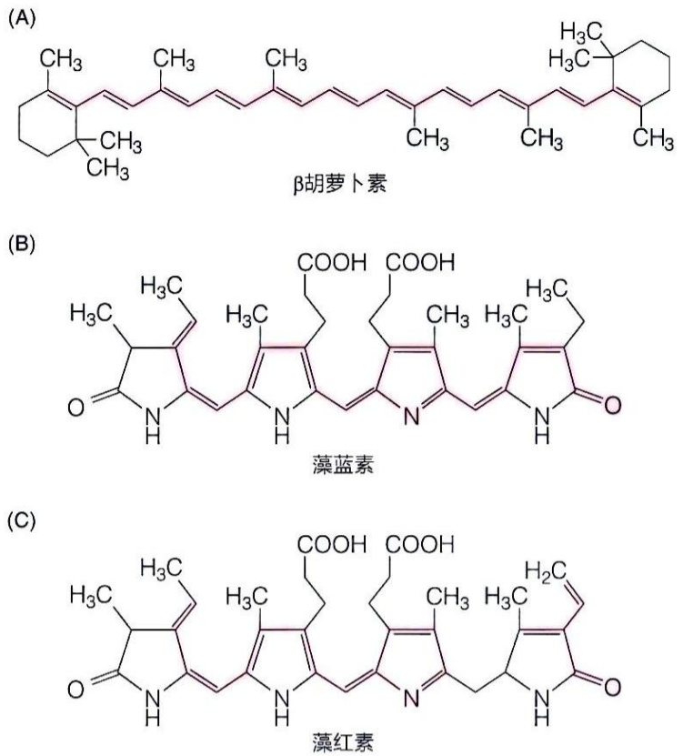

类胡萝卜素是一大类广泛存在于各种光合细胞中、重要性仅次于叶绿素的光合色素。从化学本质而言，类胡萝卜素是一类含多个共轭双键、吸收可见光的碳氢化合物[如β胡萝卜素（β-carotene）]或其加氧衍生物[如叶黄素类（xanthophyll）]。它们均含有8个类异戊二烯单位，其中两侧各4个类异戊二烯单位在分子中间发生逆转，使得中间的两个甲基处于1,6-位置，而其他非末端甲基处于1,5-位置。所有类胡萝卜素均通过氢化、去氢化、环化和氧化等反应，或这些反应的组合，由8个异戊二烯单位连接而成的线性结构（分子式为 $C_{40}H_{56}$ ）衍生而来。类胡萝卜素中的一种代表性分子是β胡萝卜素（图20-6A）。在光合细胞中，类胡萝卜素为一类辅助色素（accessory pigment），主要发挥辅助光吸收、光保护等功能。而在非光合细胞中，则发挥缓解氧化损伤等功能。

藻胆素为一类存在于蓝细菌和红藻等光合细胞中的光合色素。藻蓝素（phycocyanobilin；最大吸收峰约为 $560\mathrm{nm}$ ）和藻红素（phycoerythrobilin；最大吸收峰约为 $620\mathrm{nm}$ ）是典型的藻胆素，其结构如图20-6B、C所示。就化学本质而言，它们也含有四个吡咯单位，形成开链结构（而非像叶绿素那样的闭环卟啉结构）；其结构与哺乳动物胆汁中存在的胆红素（bilirubin；由血红素降解形成）相似，故名藻胆素。

在光合细胞中，藻胆素分子一般均以硫醚键与蛋白质共价结合形成藻胆蛋白（藻蓝蛋白和藻红蛋白）。不同的藻胆蛋白再组装形成大的被称作藻胆体（phycobilisome）的捕光复合物（如图20-3B中所示）。

从能量角度看，叶绿素 $a$ （或细菌叶绿素）吸收红端波段的光，所需激发能较低。

---

20.3 光合色素与蛋白质结合形成捕光复合物和光反应中心

249

因此，辅助色素所收集的光能传递给主要色素叶绿素 $a$ 后，可激发光化学反应。也就是说，辅助色素的功能是收集光能，但不直接参与光反应。类胡萝卜素可呈黄色、橙色、红色和紫色多种颜色，但在植物叶片中往往被叶绿素所掩盖。在深秋季节，当叶绿素减少后，叶片就可显露出它们特有的红、橙和黄等多彩颜色。

## 20.3 光合色素与蛋白质结合形成捕光复合物和光反应中心

光合色素并非以游离形式捕获光能，而是需要与特异的蛋白质结合后才可发挥生物学功能。对于光合生物将光能转化为化学能过程的分子认识开始于20世纪上半叶。

1930年代初，美国学者罗伯特·埃默森（Robert Emerson，1903—1959）等利用小球藻（Chlorella）对光合作用过程中的产氧效率（量子效率）进行了探究。具体而言，他们通过分析入射光的量子数（光强度）、叶绿素含量与放氧量之间的定量关系，试图估算出产生每个 $\mathrm{O}_2$ 分子需要吸收的光子数量以及参与反应的色素分子数量。他们利用重复的短暂闪光激发小球藻悬浮液，并测定其放氧量。结果表明，即使用足够强度（至少使每个叶绿素分子激发一次）的短暂闪光照射，仍需激发约2500个叶绿素分子才可产生1个 $\mathrm{O}_2$ 分子。该结果暗示，光合细胞内有大量（天线）色素分子将所吸收的光子（photon）转移至一种可产生 $\mathrm{O}_2$ 的反应中心。后续研究表明，无论是植物还是光合细菌细胞中的光能吸收和传递正是通过这样的捕光复合物而实现的。

## 20.3.1 光合色素与蛋白质结合形成捕光复合物

所有光合细胞（包括植物、藻类及光合细菌，无论产氧与否），均依赖捕光色素捕获光能。上面介绍的代表性捕光色素（图20-5和图20-6），都不是以其游离形式存在于生物膜中，而是与蛋白质特异结合形成不同的捕光复合物。紫细菌、蓝细菌和植物光合细胞中代表性捕光复合物的结构如图20-7所示。

对不同光合细胞中的捕光复合物的结构分析结果表明，每个蛋白质单体上往往结合多个色素分子。这些色素-蛋白质单体再组装成大的捕光复合物。比如，在图20-7A中展示的紫细菌光合复合物中存在大量细菌叶绿素和脱镁细菌叶绿素等色素分子；图20-7B所展示的蓝细菌光系统中，结合叶绿素 $a$ 、 $\beta$ 胡萝卜素、脱镁叶绿素、血红素等多种色素分子和质体醌；而在图20-7C所展示的植物的捕光复合物中，每个蛋白质亚基非共价结合8个叶绿素 $a$ 和6个叶绿素 $b$ ，以及2个叶黄素（lutein）、1个新黄质（neoxanthin）和1个紫黄质（violaxanthin）等类胡萝卜素分子。

---

250

20 光合磷酸化

图 20-7 代表性捕光复合物的结构

（A）紫细菌核心天线-反应中心复合物（PDB:1PYH）的膜平面俯视图（左）和侧视图（右）。（B）蓝细菌光系统Ⅱ核心天线复合物及反应中心（PDB:3WU2）的类囊体膜平面俯视图（左）和侧视图（右）。（C）菠菜PSII-LHCⅡ超级复合物（PDB:3JCU）俯视图（左）和侧视图（右）。绿色:叶绿素a；深绿色:叶绿素b；青色:脱镁叶绿素；黄色:各种类胡萝卜素。

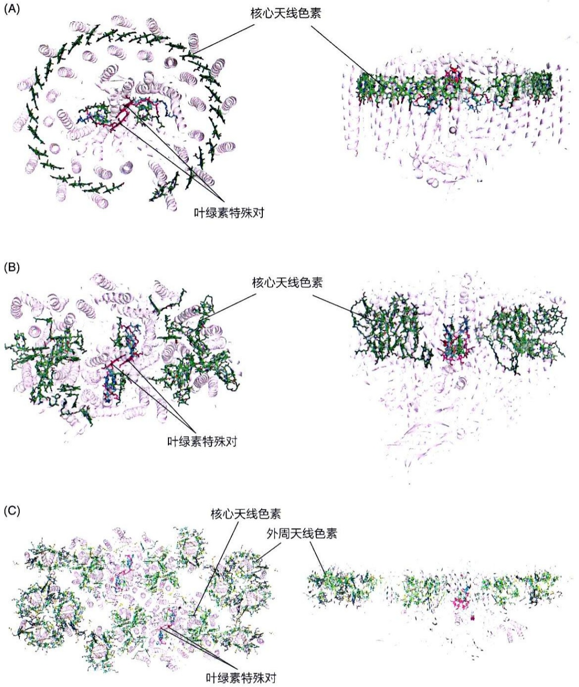

## 20.3.2 非产氧光合细菌中存在两种不同类型的光反应系统

在非产氧的光合细菌中，人们鉴定到两种光反应系统。其中一类存在于紫细菌中，另一类存在于绿硫菌内（图20-8）。下面分别进行简单介绍。

## (1) 紫细菌中的Ⅱ型光反应中心参与循环式电子传递过程

这种光合细菌的光合磷酸化涉及三个基本模块:P870 光反应中心，细胞色素  $bc_{1}$  复合物及 ATP 合酶。其光反应中心是由两个细菌叶绿素分子组成的特殊对（special pair），最强吸收峰出现在 870 nm 波长处，故被称作 P870（P 来自 pigment）反应中心。

依据紫细菌光反应中心的晶体结构，其光激发的电子传递路径可描述如下:捕光

---

20.3 光合色素与蛋白质结合形成捕光复合物和光反应中心

251

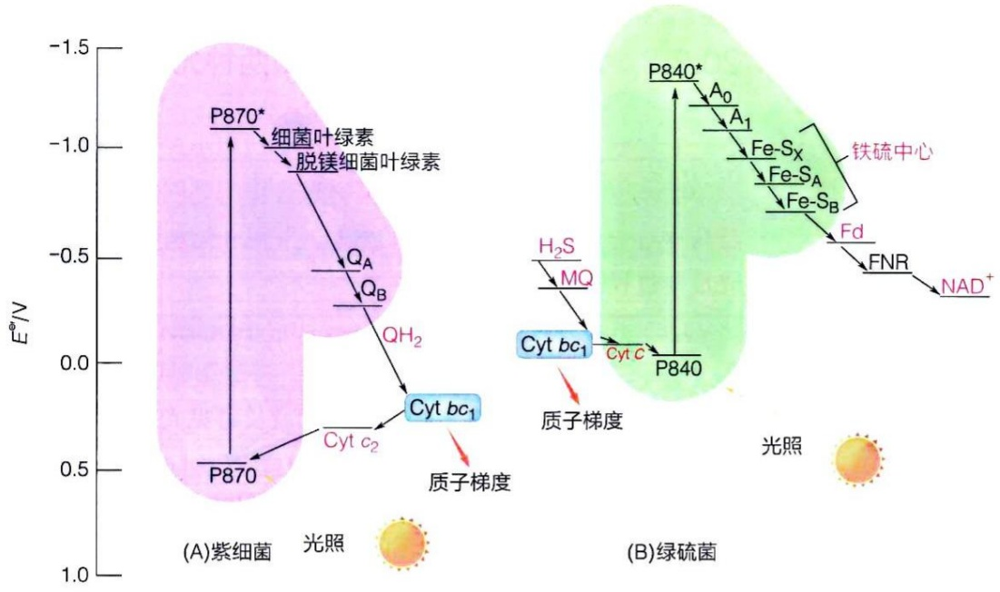

图 20-8 非产氧光合细菌中存在的两类光反应系统示意图

(A) 存在于紫细菌中的光反应系统。(B) 存在于绿硫菌中的光反应系统。

复合物吸收的光子传递至反应中心，激发叶绿素特殊对（标记为 P870\*）发生电荷分离，释放出的高能电子依次通过细菌叶绿素、脱镁细菌叶绿素、不可移动的初级醌 A（ $Q_{A}$ ）分子、可移动的次级醌 B（ $Q_{B}$ ）分子。被还原的  $QH_{2}$  移动至载色体膜中的细胞色素  $bc_{1}$  复合物，并将电子传递至可移动的细胞色素  $c_{2}$，期间将质子从细胞质泵送到膜间隙。细胞色素  $c_{2}$  再通过几个 c 型细胞色素将电子传回至反应中心的自由基阳离子（P870+），使其还原并恢复至光照前的基态（P870），完成电子传递的一轮循环。紫细菌中的 P870 光反应中心被称作Ⅱ型光反应中心，其特征是实施循环式电子传递。

值得注意的是，光合细菌中的细胞色素  $bc_{1}$  复合物的结构和功能与线粒体中的复合物Ⅲ高度相似，也通过 Q 循环进行电子传递和质子泵送。

## （2）绿硫菌的Ⅰ型光反应中心参与线性电子传递

绿硫菌的光合反应中心与紫细菌中的很类似，但其细菌叶绿素特殊对的最强吸收峰在 $840\mathrm{nm}$ （而非 $870\mathrm{nm}$ ）。绿硫菌的反应中心复合物的受体侧含铁硫中心，主要进行线性电子传递，被称作I型反应中心。特殊对细菌叶绿素经光子激发的电子依次传递经过叶绿素 $a(\mathrm{A}_0)$ 、叶绿醌（phylloquinone， $\mathrm{A}_{1}$ ）、三个铁硫中心（ $\mathrm{Fe - S_x}$ 、 $\mathrm{Fe - S_A}$ 和$\mathrm{Fe - S_B}$ ）、铁氧还蛋白（ferredoxin，Fd）、铁氧还蛋白-NAD还原酶（FNR），最后使$\mathrm{NAD^{+}}$ 还原为NADH。

绿硫菌的P840反应中心失去电子后，新的电子由 $\mathrm{H}_2\mathrm{S}$ 提供。电子流经甲基萘醌（menaquinone，MQ）、细胞色素 $bc_{1}$ 复合物和一种细胞色素 $c$ 之后至被氧化的 $\mathrm{P840^{+}}$ ，使其恢复还原态并进入下一轮电子传递过程。

---

252

20 光合磷酸化

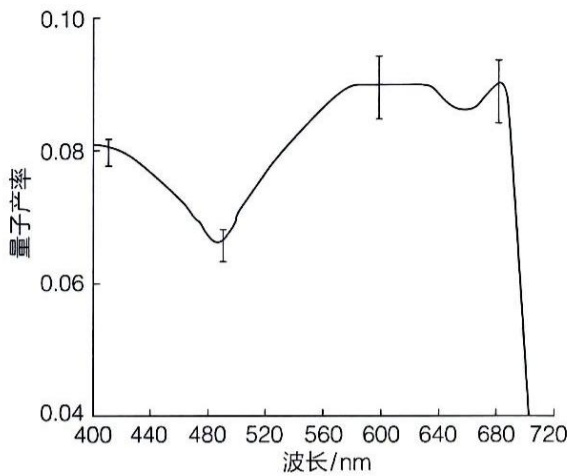

line

| 波长/nm | 量子产率 |
| --- | --- |
| ~410 | ~0.081 |
| ~490 | ~0.067 |
| ~595 | ~0.090 |
| ~685 | ~0.090 |

图20-9 小球藻光合作用效率的红降现象

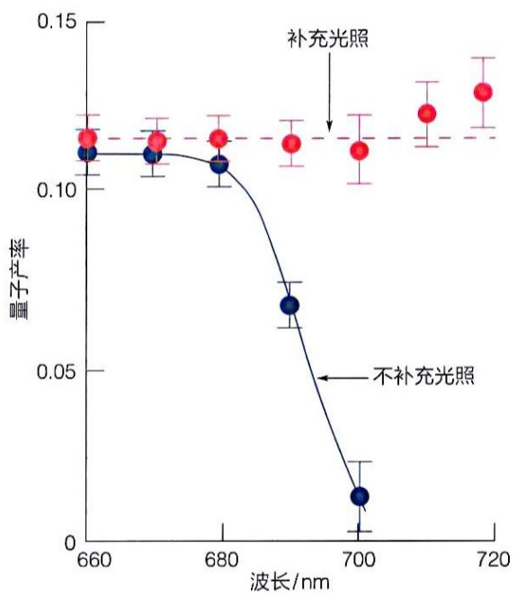

scatter

| 波长 (nm) | 量子产率 (不补充光照) | 量子产率 (补充光照) |
| --- | --- | --- |
| 660 | ~0.115 | ~0.120 |
| 670 | ~0.115 | ~0.120 |
| 680 | ~0.110 | ~0.120 |
| 690 | ~0.070 | ~0.115 |
| 700 | ~0.015 | ~0.125 |
| 710 | — | ~0.135 |

图 20-10 光合作用的增益效应

## 20.3.3 植物光合作用同时利用两种光反应中心

对植物光反应中心的早期探究也是利用小球藻开展的。美国学者埃默森等的研究表明，植物光合作用需同时利用两种光反应中心，即光系统Ⅱ和光系统Ⅰ。下面介绍植物体中发生的光反应过程。

（1）利用 $685\mathrm{nm}$ 以上波长光线照射小球藻时其光合效率出现显著下降

1940年代，埃默森等在探究不同波长可见光对小球藻光合效率的影响时，观察到一种有趣的“红降”（red drop）现象。具体而言，当使用波长大于 $680\mathrm{nm}$ 的单波长光线照射小球藻时，其量子产率（quantum yield；即每吸收一个光子所释放的氧气的量或产生的碳水化合物的量）出现急剧下降现象（图20-9）。也就是说，当照射的波长大于 $685\mathrm{nm}$ （红外区）时，尽管叶绿素在 $680\sim 700\mathrm{nm}$ 波长范围内还可吸收光能，但其光合作用效率却突然大幅下降，该现象被称为红降。

对于这样的红降现象究竟意味着什么，当时人们难以提出合理的解释。比较简单的推测是，这可能与某种辅助色素的特殊功能有关。

（2）利用更短波长光线同时照射存在红降效应的小球藻出现光合作用效率的增益效应

1950 年代，埃默森等在上述红降实验基础上观察到了光合作用的“增益效应”（enhancement effect）。具体而言，尽管小球藻受 680～700 nm 波长光线单独照射时，存在效率急剧降低的红降现象，但当同时利用另外一种短波长光线（利用汞镉灯）进行附加照射时，其光合作用效率却大幅提高（图 20-10）。

基于小球藻等光合作用的这种增益效应，人们提出了植物中可能存在两种光反应/色素系统的假说。这为后续揭示两个光系统的存在提供了重要的理论框架和研究方向。

## 20.3.4 捕光复合物将吸收的光能传递至光化学反应中心

植物光合作用的光能捕获和转换发生于叶绿体的类囊体膜中。光能捕获装置的结构以光系统形式存在，一个光系统包含两部分:捕光复合物和光反应中心（图20-11）。每个捕光复合物一般含有 $100\sim 300$ 个由叶绿素和其他色素分子组成的天线色素，而光反应中心则含一对紧密偶联在一起的叶绿素 $a$ 特殊对。光系统中所有的

---

20.3 光合色素与蛋白质结合形成捕光复合物和光反应中心

253

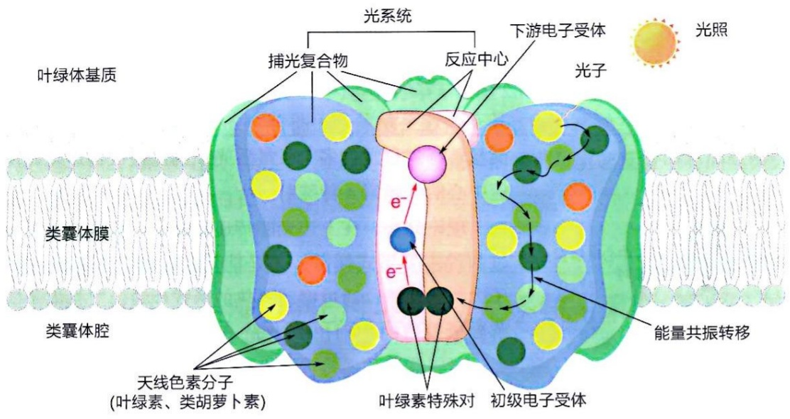

text_image

光系统
捕光复合物
反应中心
下游电子受体
光子
光照
叶绿体基质
类囊体膜
类囊体腔
天线色素分子
(叶绿素、类胡萝卜素)
e⁻
e⁻
e⁻
初级电子受体
能量共振转移

图 20-11 存在于类囊体膜中的捕光复合物为反应中心复合物传递能量示意图

反应中心的电子传递链为简化模型，完整的请参考图20-14A。

天线色素分子均可吸收光子，并通过共振能量转移（resonance energy transfer）机制快速有效地将激发能汇聚至反应中心，随后，反应中心将光能转化为化学能。因此，大多数叶绿素和辅助色素主要发挥集光天线的作用，而只有叶绿素 a 特殊对才参与直接将光能转化为化学能的过程。不同的光反应中心均由 2 个叶绿素 a 特殊对分子组成，但由于所结合的蛋白质分子的差异，其吸收峰稍有差别。一般都以其最强吸光波长命名，如光系统 I 中为 P700 和光系统 II 中为 P680。

色素分子和蛋白质共同组成捕光复合物，亦称“天线复合物”。植物、藻类、蓝细菌和紫细菌等不同光合生物来源的捕光复合物中的蛋白质和色素组成差异较大，吸收光谱也各不相同，总体结构也有较大的差异（见图20-7）。尽管如此，不同类型捕光复合物的主要功能均为吸收和传递光能，它们分布在光系统或反应中心复合物周围，在光合作用中收集光能并传递至光合反应中心。其中，色素分子（叶绿素、类胡萝卜素等）可以吸收多种波长的光能，而脱辅基蛋白（膜蛋白或水溶性蛋白）则负责维持这些色素分子的正确排列和取向，并可以通过与色素分子相互作用改变其构象和光谱特征。

在光能捕获过程中，光合复合物中大量天线色素分子通过吸收光子所获能量，都可以通过共振能量转移机制传递至反应中心。最后，这些能量汇集到处于中心位置的叶绿素 a 特殊对，使其激发并发生电荷分离，从而启动电子传递过程（图 20-11）。

## （1）光能通过诱导光化学反应中心发生电荷分离而实现光能到化学能的转换

从天线色素吸收光子到诱发光反应中心电子传递是光能转化为化学能的关键过程。该过程如图 20-12 所示。

在一个存在于类囊体膜中的光合单位内（图 20-11），光能的吸收和传递过程如下:光能的吸收开始于 1 个天线色素分子吸收 1 个适当能量光子（photon）的事件。这使得该天线色素（叶绿素或其他辅助色素）分子（天线分子 1）中的 1 个电子从基态跃迁至更高能级的激发态（图 20-12，第①步，激发态以 \* 表示）。当被激发的天

---

254

20 光合磷酸化

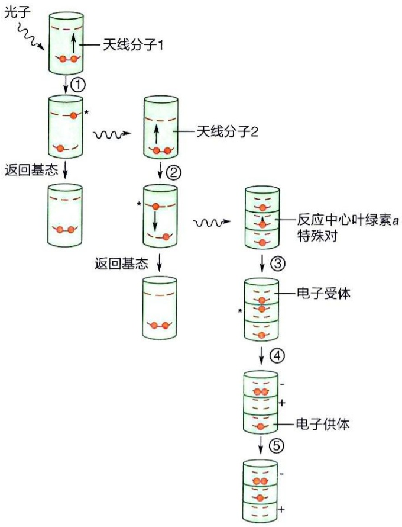

flowchart

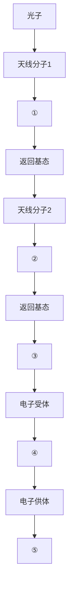

图20-12 能量通过共振方式从天线色素传递至光反应中心后诱发电荷分离

线色素分子中的能量通过共振方式激发空间上邻近的另外一个天线色素分子（天线分子2），供体分子高能轨道电子转移能量后返回基态。受体分子中的一个电子从基态跃迁至激发态（图20-12，第②步）。这样的共振能量转移过程发生多轮，最后光子的能量被传递至光反应中心的叶绿素 $a$ 特殊对。

理论而言，在上述光能传递过程中，能量也可能通过两种主要形式耗散:一是能量被重新分配给色素分子内部的原子，通过振动以热的形式耗散；二是电子回落到低轨道时发射出荧光光子，使能量以光的形式散失。对于能量传递过程在光合细胞内发生的具体机制还有待深入探究。光能在邻近色素分子之间的传递除了共振能量转移外，也通过激子传递（exciton transfer）机制实现。尽管这两种机制都要求供体和受体色素分子在空间上相互邻近，且它们的能级差需要匹配，以确保能量的有效转移，但在作用距离和作用强度上，它们存在差异。具体而言，共振能量转移依赖的是供体分子内部高能电子的振动，从而通过非辐射的方式诱导邻近的受体分子中的电子达到高能态。这一过程不涉及光子的发射或吸收，且可在相对较长的距离（接近或大于2 nm）内发生。因此适合于供受体分子间距离较远或相互作

用较弱的情况。共振能量转移可以发生于相同或不同种类的色素分子之间。激子传递则涉及供体分子中高能电子在返回至其基态能级时，所释放的能量直接激发相邻分子中的电子跃迁至高能态。这一过程通常发生在同类色素分子之间，并且适用于短距离（小于2 nm）和相互作用较强的场景。

当激发能通过共振或激子传递机制被传递至反应中心时，叶绿素 $a$ 特殊对中的1个电子将被提升至更高能级（图20-12，第③步）。这将显著改变该叶绿素分子的氧化还原势，使其成为有效的电子供体，将电子传递给一个邻近的初级电子受体分子（这可以是叶绿素分子或脱镁叶绿素分子），电子受体因获得一个电子而带负电（图20-12，第④步）。反应中心的一个叶绿素 $a$ 分子变成阳离子自由基 $\mathrm{Chl^{+}}$ ，也即具有一个空轨道（“电子空穴”，图20-12中以“+”号标示）。反应中心叶绿素 $a$ 失去的电子被来自邻近的电子供体的一个电子所补充（图20-12，第⑤步）。当反应中心空缺的电子被邻近的电子供体补充上时，在反应中心就产生了正负电荷的分离，因而成功实现了光合作用过程中光能到化学能的转换。

## （2）与蛋白质结合的邻近色素分子之间可以有效传递能量

在光合作用体系中，叶绿素等光合色素总是与特定的蛋白质结合，形成捕光复合物。与游离的色素分子相比，捕光复合物中的色素分子在光吸收性质上有所区别，而

---

20.4 植物光合磷酸化过程涉及光系统Ⅱ和光系统Ⅰ的共同参与

255

且相同色素分子与不同蛋白质结合时，其吸光特性也会有所不同。游离色素分子在被光照后，吸收的能量可能迅速以光或热的形式耗散，并在浓度升高时会发生荧光猝灭现象。与此不同的是，光合细胞中的色素分子（如图20-12中的天线分子1）受光子激发后，几乎不会发生上述能量耗散现象，而是将光能有效传递至邻近的天线分子（天线分子2，图20-12，第①步）。最终，通过光子的激发可引起反应中心的电荷分离，继而启动电子传递过程。

## 20.4 植物光合磷酸化过程涉及光系统Ⅱ和光系统Ⅰ的共同参与

植物是光合作用的主要执行者，下面介绍发生于植物中的光合磷酸化过程。

1960 年代，荷兰学者路易斯·杜森（Louis Duysens，1921—2015）等在对一种紫球藻（Porphyridium）开展光合作用研究时观察到:当用 680 nm 光（红光，被称作光线 I）照射紫球藻时，细胞色素 f 发生氧化；如果随后再用 562 nm 光（被称作光线 II）照射时，之被前氧化的细胞色素 f 又发生还原。参考埃默森等观察到的增益效应，杜森等提出了植物光合作用存在两个光化学系统的概念。后续研究进一步证实，在植物和蓝细菌中均存在光系统 II 和光系统 I，它们以串联的方式起作用。

与植物和蓝细菌中复杂的光合作用体系相比，不产氧光合细菌的光能转换机制相对简单，只含有一种光合反应中心（见图20-3A和图20-8）。具体而言，紫细菌中存在的脱镁叶绿素-醌型反应中心与植物光系统Ⅱ相似，可能与光系统Ⅱ同源；而绿硫菌中存在的Fe-S型反应中心与植物光系统Ⅰ有相似之处，被认为可能与光系统Ⅰ同源。

## 20.4.1 光系统Ⅱ和光系统Ⅰ的先后作用使得产氧光合细胞中传递电子能量水平的变化呈Z形

蓝细菌和光合植物在进行光合作用的过程中都产生氧气，这是因为其最终电子供体是水分子。在蓝细菌和光合植物中，均存在两套串联的光系统（即存在两个光反应中心），前后两次提升电子能量水平，以促进高能电子的产生和传递。

这里以植物光合细胞为例，说明光合作用过程中利用两个光系统所完成的电子传递和能量释放过程（图 20-13）。光系统Ⅱ的光反应中心叶绿素 a 特殊对的最强吸收波长为 680 nm，按照惯例，其中的光反应中心被称作 P680；而相应地，光系统Ⅰ中的光反应中心被称作 P700。

值得注意的是，光系统Ⅱ和光系统Ⅰ中的叶绿素a特殊对在化学结构上完全相同或相近，然而，由于它们所结合的蛋白质不同，使得它们的光吸收特征呈现差异。这与相同的铁硫中心或相同的血红素因子结合的蛋白质不同而表现出不同特性的现象是可比的。

---

256

20 光合磷酸化

总体而言，植物光合细胞中的电子传递过程始于光系统Ⅱ中水分子在放氧复合物（oxygen-evolving complex）中裂解并释放电子（同时产生 $\mathrm{O}_2$ 和 $\mathrm{H^{+}}$ ）的步骤，终止于 $\mathrm{NADP^{+}}$ 最终接受电子（被还原成NADPH）的步骤，与氧化磷酸化过程中电子从NADH传递到 $\mathrm{O}_2$ 的方向正好相反。正是光系统Ⅱ和光系统I对传递电子的两次能量提升，才使得这种“逆向”传递得以实现。在这样的电子传递过程中，细胞色素 $b_{6}f$ 复合物发挥了与氧化磷酸化电子传递过程中复合物Ⅲ（即细胞色素 $bc_{1}$ 复合物）相似的作用，将电子传递与质子跨膜泵送相偶联，从而建立跨膜质子梯度，驱动ATP合酶合成ATP。在光合电子传递过程中，也利用醌类分子和铁硫蛋白作为电子载体，并且也利用分子量较低的质体蓝素（plastocyanin）蛋白在大的蛋白质复合物之间传递电子。

在将1个电子从水分子传递至 $\mathrm{NADP^{+}}$ 的过程中，光系统Ⅱ和光系统I各需被1个光子激活，以驱动电子的有效传递。也就是说，电子传递可分为两个阶段:首先，电子从光系统Ⅱ途经细胞色素 $b_{6}f$ 复合物传递到光系统I；随后，电子再从光系统I传递至 $\mathrm{NADP^{+}}$ 。参与每个阶段传递的电子载体均按氧化还原势依次增加（即电子亲和力依次提高）的顺序排列。当按照传递途径中电子载体的氧化还原势排列时，我们将得到一种Z形（Z-scheme）方案（图20-13）。值得注意的是，这里说的Z形仅反映了电子载体的氧化还原势的高低，与电子载体之间的空间分布无关。在这样的光合电子传递过程中，电子除了进行上述从水到 $\mathrm{NADP^{+}}$ 的线性传递外，还可进行仅涉及光系统I的循环式电子传递（图20-13中虚线箭头所示）。在循环式电子传递过程中，电子将

图20-13 叶绿体类囊体膜中的光系统Ⅱ和光系统Ⅰ共同参与传递电子的能量水平呈Z形

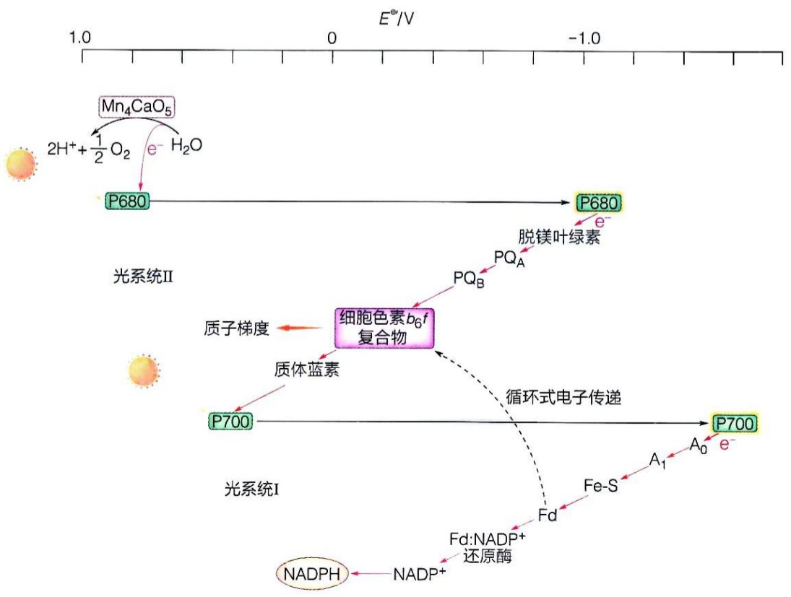

flowchart

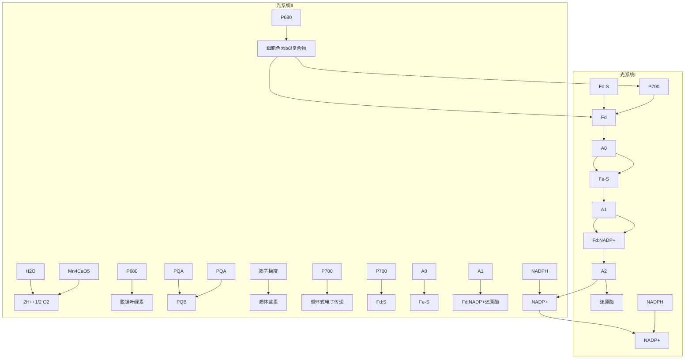

---

20.4 植物光合磷酸化过程涉及光系统Ⅱ和光系统Ⅰ的共同参与

257

从铁氧还蛋白（Fd）返回至细胞色素  $b_{6}f$  复合物，而不是用于还原 NADP $^{+}$ 。这样传递的结果是促进跨膜质子梯度的形成和 ATP 的合成，最终使得生成的 ATP 和 NADPH 分子之间维持一定的比例，以满足第二阶段碳固定过程对它们非相等比例的需求。

## 20.4.2 光系统Ⅱ中的  $H_{2}O$  裂解释放电子被传递至光反应中心 P680

产氧光合作用均涉及  $H_{2}O$  的裂解并提供电子的过程。这由特异的放氧复合物完成，发生于光合电子传递的起始端，即光系统Ⅱ中。植物中的光系统Ⅱ为二聚体，每一部分含至少20种亚基。其中的D1和D2亚基含有P680反应中心和放氧复合物（图20-14）。光系统Ⅱ中P680反应中心的叶绿素a分子特殊对被光能激发后发生电荷分离（图20-12），失去电子后变成 $P680^{+}$ 。随后 $P680^{+}$ 需由上游 $H_{2}O$ 分子裂解所释放的电子还原，恢复为P680。

放氧复合物利用  $Mn_{4}CaO_{5}$  金属簇络合物作为辅因子催化  $H_{2}O$  的裂解。放氧复合物的晶体结构测定结果表明，其催化水分子裂解所依赖的核心辅因子是一种含 4 个锰原子、1 个钙离子和 5 个氧原子的独特金属簇络合物  $Mn_{4}CaO_{5}$ （图 20-14）。该辅因子存在于从蓝细菌到高等植物的所有产氧光合生物中，可见水分子的这种裂解机制是高度保守的。

水分子释放的电子经由光系统Ⅱ中D1亚基的一个特异酪氨酸残基（$\mathrm{Tyr}_{\mathrm{Z}}$）被传递至光系统Ⅱ中P680叶绿素 $a$ 分子特殊对上（图20-14A）。

从化学角度而言，产生1个 $O_{2}$ 必须裂解2个 $H_{2}O$ 分子，转移4个电子，同时释放4个 $H^{+}$ 。因为光系统Ⅱ中的光反应中心产生的 $P680^{+}$ 一次只能接收1个电子，所以

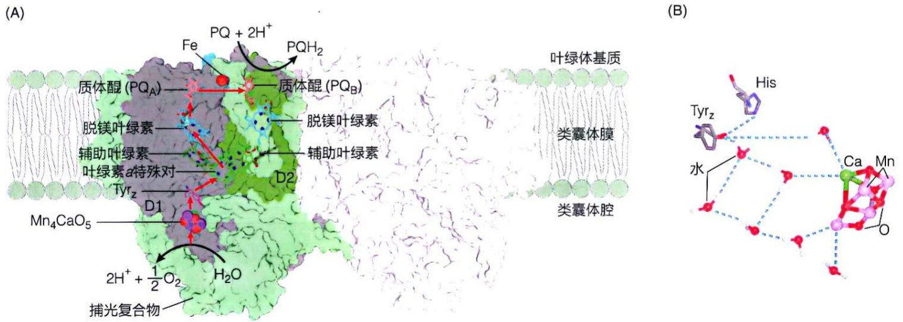

图 20-14 水分子在光系统Ⅱ中发生裂解和电子传递的结构基础（A）蓝细菌光系统Ⅱ电子传递模式图（PDB:3WU2）。光系统Ⅱ二聚体的两个单体分别以浅灰色和灰绿色显示。在灰绿色单体中，深灰色是D1核心亚基，深绿色是D2核心亚基。灰绿色部分为捕光蛋白复合物。D1/D2反应中心的P680叶绿素a分子特殊对、辅助叶绿素、

脱镁叶绿素、质体醌（PQ）以及酪氨酸残基（Tyr $_{z}$ ）分别以不同颜色的棍状模型展示，棍状模型中红色是氧原子，蓝色是N原子。（B）Mn $_{4}$ CaO $_{5}$ 辅因子的三维结构示意图，其中不同原子分别显示为红色（O）、紫色（Mn $^{2+}$ ）和绿色（Ca $^{2+}$ ）。

---

258

20 光合磷酸化

$\mathrm{H}_2\mathrm{O}$ 分子中的电子只能从放氧复合物中逐个释放，通过 $\mathrm{Tyr_Z}$ 传递至 $\mathrm{P680^{+}}$。

一种可能的水分子裂解机制如下。光反应中心 $\mathrm{P680^{+}}$ 从 $\mathrm{Tyr_Z}$ 获取1个电子，$\mathrm{Tyr_Z}$ 在失去一个电子的同时也失去1个质子，从而转变为酪氨酸自由基（$\mathrm{Tyr_Z} \cdot$）。$\mathrm{Tyr_Z} \cdot$ 从 $\mathrm{Mn_4CaO_5}$ 结合的水分子中获取1个电子和1个质子后恢复到基态，这就使得 $\mathrm{Mn_4CaO_5}$ 结合的某个水分子发生氧化。当 $\mathrm{Mn_4CaO_5}$ 参与的氧化过程使得2分子水失去4个电子后，就会导致1个 $\mathrm{O_2}$ 的形成。由于放氧复合物定位于光系统Ⅱ中的类囊体腔侧，其裂解水分子所产生的质子可直接进入类囊体腔中，参与跨膜质子梯度的形成。

放氧复合物的晶体结构显示，$\mathrm{Mn_4CaO_5}$ 呈椅式结构（图20-14B）。在 $\mathrm{Mn_4CaO_5}$ 附近可观察到多个结合的水分子，其中某些水分子可能作为底物参与反应并最终被氧化而产生 $\mathrm{O}_2$ 。然而，究竟哪两个与 $\mathrm{Mn_4CaO_5}$ 结合的水分子被裂解，裂解过程是如何发生的，目前仍然未知。

## 20.4.3 水分子裂解释放的电子在光系统Ⅱ中被传递至质体醌PQ

高等植物的光系统Ⅱ是一种多亚基蛋白质色素复合物。它一般以二聚体形式存在于叶绿体的类囊体膜中，总分子量约为700 kDa。每个部分均含两个核心天线复合物（CP43和CP47）和反应中心复合物（PSⅡ-RC）、 $Mn_{4}CaO_{5}$ 复合物、电子传递路径上的各种电子载体（图20-14A）以及多种其他蛋白质亚基。

蓝细菌光系统Ⅱ的核心组成与植物光系统Ⅱ的核心组成高度相似。各自都由两

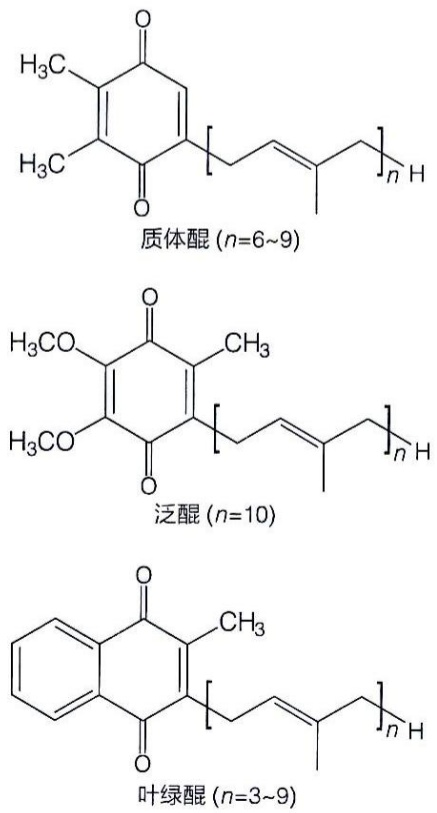

图20-15 三种不同醌分子的化学结构

种被分别称为 D1 和 D2 的膜蛋白形成反应中心；都含有光化学反应初级电荷分离和电子传递所需的氧化还原辅因子（图 20-14A），包括放氧辅因子  $Mn_{4}CaO_{5}$  、叶绿素 a 分子特殊对组成的 P680 、两个辅助叶绿素和两个脱镁叶绿素（分别与 D1 和 D2 亚基结合）、一个稳定结合的质体醌  $\left(\mathrm{PQ}_{\mathrm{A}}\right)$  和一个可以移动的质体醌  $\left(\mathrm{PQ}_{\mathrm{B}}\right)$ ，以及位于  $PQ_{A}$  和  $PQ_{B}$  之间的非血红素铁（Fe；该非血红素铁原子可能并不直接参与电子传递过程）。

值得注意的是，在植物光合磷酸化过程中发挥电子载体作用的质体醌（plastoquinone，PQ）与氧化磷酸化过程中使用的泛醌（ubiquinone，Q或CoQ）分子的结构和特征都高度类似。就化学结构而言:仅仅是苯醌环上的取代基稍有差异——质体醌含两个相邻的甲基，而泛醌含两个相邻的甲氧基和一个甲基；其余部分基本相同。

此外在植物光系统I中还使用叶绿醌（phylloquinone；它也存在于细菌中）作为电子载体（图20-17中的 $\mathrm{Q_K}$）。这三种醌分子的结构如图20-15所示。

蓝细菌中也使用质体醌，而其他光合细菌都使用泛醌。它们均作为疏水性的电子载体发挥作用。

根据晶体结构数据，光系统Ⅱ中的电子传递路径如图20-14A所示。当天线色素捕获的光子能量传递至P680时，P680转变为激发态 $\mathrm{P680^{*}}$ 。

---

20.4 植物光合磷酸化过程涉及光系统Ⅱ和光系统Ⅰ的共同参与

259

之后，P680\* 将被激发的电子传递至初级电子受体脱镁叶绿素，此电子传递过程预计在约 3 ps 内完成。在失去电子之后，P680\* 转变为阳离子自由基 P680•⁺，其具有生物界已知最高的氧化还原势（E 为 1.2 V 甚至更高）。这赋予它极强的电子获取能力，可有效地从 D1 蛋白的一个酪氨酸残基 Tyr$_{z}$ 上夺取电子，被重新还原为 P680；失去电子的 Tyr$_{z}$ 则在 Mn$_{4}$CaO$_{5}$ 辅因子的催化下，从裂解的水分子中获取电子，同时产生氧气和质子。

被还原的脱镁叶绿素进一步将其电子传递给下游的一个不可移动的质体醌  $PQ_{A}$  电子受体，形成  $PQ_{A}H_{2}$ 。该电子转移步骤大约需要 250 ps。随后，还原型  $PQ_{A}H_{2}$  的电子将被转移至  $PQ_{B}$，生成  $PQH_{2}$，后者与类囊体膜中一分子氧化型  $PQ_{B}$  发生交换后，移动至细胞色素  $b_{6}f$  复合物，继续进行电子传递。

## 20.4.4 细胞色素 $b_{6}f$ 复合物在将 $\mathrm{PQH}_{2}$ 中的电子传递至质体蓝素的同时通过 Q 循环形成跨膜质子梯度

离开光系统Ⅱ的 $\mathrm{PQH}_2$ 将电子传递至细胞色素 $b_{6}f$ 复合物。在该复合物中电子最终被传至质体蓝素（图20-16）。细胞色素 $b_{6}f$ 复合物与氧化磷酸化过程中的复合物Ⅲ（即细胞色素 $bc_{1}$ 复合物）从结构和功能上都高度类似。质体蓝素则与氧化磷酸化过程中的细胞色素 $c$ 的功能高度类似，只是前者利用铜离子携带电子，后者则利用铁离子。

就电子传递而言，细胞色素 $b_{6}f$ 复合物介于光系统Ⅱ和光系统I之间（图20-13），也通过Q循环机制形成跨类囊体膜的质子梯度。该Q循环与发生于线粒体细胞色素 $bc_{1}$ 复合物中的Q循环（见图19-9）具有惊人的相似性。

具体而言，每轮 Q 循环将来自光系统Ⅱ的  $PQH_{2}$  分子中的 1 个电子传至质体蓝素，而将另外 1 个电子传至一个氧化型的 PQ（图 20-16）。最终的结果是，通过细胞色素

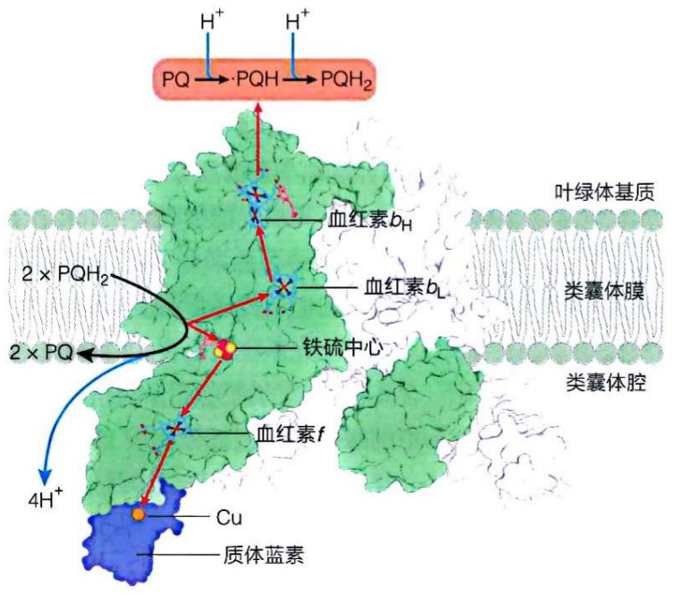

flowchart

This diagram illustrates the biochemical pathway of iron sulfate (铁硫中心) in tissue, showing the conversion of phosphorus (PQ) into various components such as calcium (Cu), magnesium blue (Cu), and phosphorus hydroxide (pH2).

图20-16 细胞色素 $b_{6}f$ 复合物（PDB:7QRM）通过Q循环进行电子传递和质子跨膜泵送

---

260

20 光合磷酸化

$b_{6}f$ 复合物中的Q循环，每2个 $\mathrm{PQH}_2$ 中的2个电子先后经铁硫中心、细胞色素 $f$ （也属于 $c$ 型细胞色素，与细胞色素 $bc_{1}$ 复合物中的细胞色素 $c_{1}$ 高度可比）传递至质体蓝素中的铜离子（使之从 $\mathrm{Cu^{2+}}$ 变为 $\mathrm{Cu^{+}}$ ）；而另外2个电子则先后经血红素 $b_{\mathrm{L}}$ 、血红素$b_{\mathrm{H}}$ 传递至结合于另一位点的PQ分子（使之经由半醌自由基·PQH转变成 $\mathrm{PQH}_2$ ）。

经过每轮Q循环，细胞色素 $b_{6}f$ 复合物将2个电子分别传递至2个质体蓝素分子，将另外2个电子传递至PQ，同时将4个 $\mathrm{H^{+}}$ 释放到类囊体腔中，并从叶绿体基质中摄取2个 $\mathrm{H^{+}}$ 。这是光合磷酸化过程中产生跨膜质子梯度的一个主要步骤。

## 20.4.5 质体蓝素将电子从细胞色素 $b_{6}f$ 复合物传递至光系统I

质体蓝素是一种分子量仅为 $10.5\mathrm{kDa}$ 的水溶性含铜蛋白质，因氧化时呈蓝色而得名。这种蛋白质定位于叶绿体的类囊体腔内，在细胞色素 $b_{6}f$ 复合物和光系统I的P700之间转移电子。质体蓝素的新生肽链在胞质溶胶中合成，在靶向信号转运肽的引导下被运送至叶绿体的类囊体腔中（转运肽最终将被切除）。

质体蓝素是一种典型的 $\beta$ 桶蛋白，结合一个铜离子。该铜离子以扭曲的四面体几何形状连接两个组氨酸、一个甲硫氨酸和一个半胱氨酸残基。铜离子的氧化还原状态变化使其既可作为电子受体，也可作为电子供体发挥作用（类似于细胞色素或铁硫中心中的铁离子）。在高等植物中，光系统I复合物主要定位于基质类囊体膜中，而细胞色素 $b_{6}f$ 复合物则主要分布于基粒类囊体膜中（见图20-2）。因此，质体蓝素可能通过在类囊体腔内的扩散，将电子从细胞色素 $b_{6}f$ 复合物传递至光系统I。

## 20.4.6 光系统Ⅰ在捕获光能的同时将质体蓝素携带的电子经由P700等传递至铁氧还蛋白

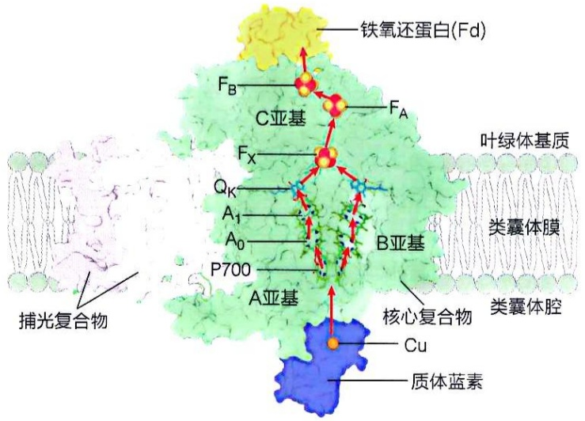

flowchart

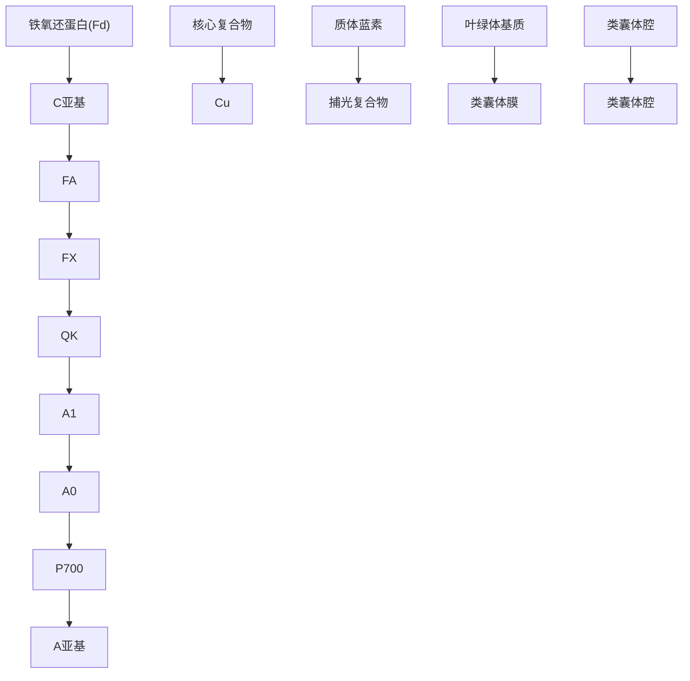

图20-17 光系统I复合物（PDB:4RKU）中的电子传递过程示意图

与光系统Ⅱ类似，光系统Ⅰ也是一种可以捕获光能的蛋白质复合物。在光能的驱动下，光系统Ⅰ将电子从质体蓝素最终传递至铁氧还蛋白（Fd）这种小蛋白质分子。与光系统Ⅱ类似，光系统Ⅰ也可完成光能吸收转换和电子传递两种功能，因此含有结合色素分子的捕光蛋白质和结合有电子载体的电子传递蛋白质（图20-17）。

植物光系统Ⅰ由含12种亚基的核心复合物和含4种亚基的捕光复合物组成（分别由图20-17中的绿色和灰色部分代表）。4个捕光亚基位于核心复合物的一侧（形成半月形结构）。整个光系统Ⅰ的辅因子组成为:167个叶绿素、3个铁硫中心和2个叶绿醌等。

---

20.4 植物光合磷酸化过程涉及光系统Ⅱ和光系统Ⅰ的共同参与

261

植物光系统 I 中的电子传递由核心亚基介导。根据结构测定结果，电子在光系统 I 中的可能传递过程如下:P700 叶绿素 a 分子特殊对被光能激发成 P700\*（图 20-17 中未展示该过程），所释放的电子经电子载体叶绿素 A₀、叶绿素 A₁、叶绿醌 Qₖ、铁硫中心 Fₓ、铁硫中心 Fₐ 和铁硫中心 Fₑ 依次传递，最后传至位于类囊体膜基质侧的铁氧还蛋白中的 2Fe-2S 铁硫中心，形成还原型铁氧还蛋白。

结构测定结果也表明，从P700到 $\mathrm{F_X}$ 的电子传递可以沿着分别位于A、B两种不同亚基中的两条平行路径进行，在 $\mathrm{F_X}$ 之后再汇集到C亚基中的同一路径上（图20-17）。

失去电子的 P700 从质体蓝素获取电子后恢复到基态。依据结构测定结果，质体蓝素到 P700 之间的电子传递可能涉及两个色氨酸残基的参与。值得注意的是，上述电子传递路径是根据结构测定结果提出的假说，具体情况尚需深入探究。

## 20.4.7 还原型铁氧还蛋白将电子传递至 $\mathrm{NADP}^{+}$ 或细胞色素 $b_{6}f$ 复合物

处于叶绿体基质中（类囊体膜的基质侧）的还原型铁氧还蛋白可继续传递电子。它既可以将电子线性传递至 NADP $^{+}$ ，也可以进行环式电子传递，下面分别简单介绍。

(1) 还原型铁氧还蛋白可通过线性路径将电子传递至 NADP$^{+}$

铁氧还蛋白 $-\mathrm{NADP^{+}}$ 还原酶（FNR）中含有分别结合FAD和 $\mathrm{NADP^{+}}$ 的两个结构域。还原型铁氧还蛋白先与该酶的FAD结构域结合，使得铁氧还蛋白中的2Fe-2S辅因子靠近FAD（二者之间的最近距离只有大约 $6\sim 7\AA$）。铁氧还蛋白 $-\mathrm{NADP^{+}}$ 还原酶中的 $\mathrm{NADP^{+}}$ 结合位点离FAD很近， $\mathrm{NADP^{+}}$ 的烟酰胺环与黄素的异咯嗪环以接近平行的小角度（约 $30^{\circ}$ ）靠近并发生直接相互作用（二者最近的距离只有大约 $3\AA$ ）；这样，FAD通过两个连续的步骤从两个还原型铁氧还蛋白中获得2个电子，之后再将这2个电子通过一个氢负离子传递至 $\mathrm{NADP^{+}}$ ，生成NADPH，为光合作用的碳固定阶段提供还原力。

（2）还原型铁氧还蛋白可通过环式路径将电子传递至细胞色素 $b_{6}f$ 复合物

除了上述电子从水传递至 $\mathrm{NADP^{+}}$ 的线性路径之外，在植物细胞中还存在一条循环式电子传递路径。1950年代美国学者丹尼尔·阿尔农（Daniel Arnon，1910—1994）等观察到:分离的叶绿体可以在缺乏水裂解和碳固定的条件下，通过光照产生ATP但不产生NADPH。后续研究揭示，该循环式电子传递过程只涉及光系统I，也需要铁氧还蛋白的参与，并且也存在于藻类和蓝细菌等产氧光合生物中。在环式电子传递链中，电子从P700传递到铁氧还蛋白后，不再传递给 $\mathrm{NADP^{+}}$ ，而是传递给类NADPH脱氢酶复合物（NADPH dehydrogenase-like complex，NDH）或质子梯度调控蛋白5（proton gradient regulation 5，PGR5）等。这两种蛋白质复合物都发挥铁氧还蛋白-质体醌还原酶（ferredoxin-plastoquinone reductase）的功能，将电子从还原型铁氧还蛋白传递至质体醌（PQ），生成 $\mathrm{PQH_2}$ ；后者再将电子传递至细胞色素 $b_{6}f$ 复合物，

---

262

20 光合磷酸化

然后通过质体蓝素再传回P700，完成循环式电子传递过程（见图20-13）。

在该循环式电子传递过程中，电子每完成一次传递循环，都将被光子激发。尽管环式电子传递过程既不产生NADPH，也不释放氧气，但它通过细胞色素 $b_{6}f$ 复合物（和类NADPH脱氢酶复合物）产生跨膜质子梯度，从而驱动ATP的合成。

通过调节用于NADPH合成的电子数和进行循环式电子传递的电子数，植物可调节所合成的ATP和NADPH的相对比例。在后续的碳固定反应过程中，ATP和NADPH所需比例是 $3:2$ ；也就是说需要光合磷酸化提供更多的ATP分子。这可能是循环式电子传递的生理功能之一。此外，当强光照射时，循环式电子传递将增强，维持较高的跨膜质子梯度，类囊体腔中的酸性条件将导致光系统Ⅱ中的天线色素产生非光化学猝灭效应，这就使得过量的激发能最终以热的方式耗散，因此传递至光反应中心的能量下降，这就可以避免光系统Ⅱ被过度还原（继而避免光系统I被过度还原）。

## 20.5 跨类囊体膜质子梯度的能量驱动 ATP 的合成

无论是发生于细菌中还是发生于植物叶绿体中的光合磷酸化过程，均涉及相似的基本过程。这包括光能被叶绿素等天线色素的捕获、位于反应中心的色素分子特殊对被光能激发后发生电荷分离而产生高能态电子、高能态电子的传递和能量的逐步释放、驱动质子泵将质子从膜的一侧转运至另一侧形成跨膜质子浓度梯度，然后跨膜质子梯度驱动ATP合酶合成ATP。

因此，光合磷酸化的基本过程与氧化磷酸化高度可比，也遵循米切尔提出的化学渗透假说，只是光合磷酸化中的高能态电子的产生和传递由捕获的光能驱动。

## 20.5.1 光系统Ⅱ和细胞色素 $b_{6}f$ 复合物等负责产生跨类囊体膜的质子浓度梯度

在植物等的光合磷酸化过程中，电子传递伴随着质子跨膜转运，具体总结如图20-18所示。一方面，光系统Ⅱ每裂解1个 $\mathrm{H}_2\mathrm{O}$ 分子（产生 $1 / 2\mathrm{O}_2$ 分子）时，将2个 $\mathrm{H^{+}}$ 释放至类囊体腔中；另一方面，细胞色素 $b_{6}f$ 复合物每净氧化1个 $\mathrm{PQH_2}$，类囊体腔中将多获得4个 $\mathrm{H^{+}}$ 。这两部分产生的质子在类囊体腔中累积，形成跨类囊体膜的质子浓度梯度。光系统I并不驱动质子的跨膜泵送。

## 20.5.2 叶绿体 ATP 合酶在跨膜质子动力势的驱动下合成 ATP

跨膜质子梯度是一种能量的储存形式，被称为质子动力势，是一种电化学势能或电化学梯度。其跨膜总自由能差 $\Delta G$ 来自于质子在膜的一侧累积所产生的两方面物

---

20.5 跨类囊体膜质子梯度的能量驱动 ATP 的合成

263

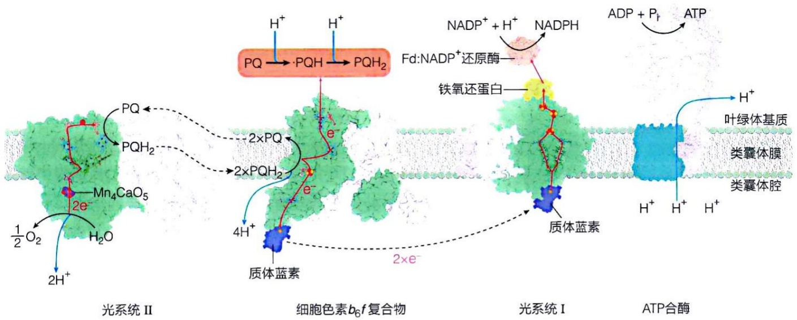

flowchart

This diagram illustrates the biochemical pathway of a protein complex, showing how light and cell systems (II and I) interact with various metal ions to form intermediate compounds like pyrophosphate, nitrogen, phosphorus, and ATP.

图 20-18 跨类囊体膜形成的质子梯度驱动 ATP 合酶（PDB:6FKF）生成 ATP

理化学效应，即浓度梯度（$\Delta \mathrm{pH}$）和电势差（$\Delta \psi$）。这个自由能差可以用来驱动叶绿体ATP合酶催化ATP合成。类囊体腔内的质子可以通过ATP合酶的跨膜区，从浓度高的一侧转移到浓度低的一侧，释放的电化学势能被用来推动ATP合酶位于基质侧的催化结构域将ADP磷酸化，生成ATP（图20-18）。其作用机制与线粒体内膜上的ATP合酶高度类似:二者都通过基于某些亚基的旋转而发生的结合变构机制，具体请参考第19章的相关内容（图19-22和19-23）。

植物叶绿体类囊体膜上的 ATP 合酶的亚基组成为  $\alpha_{3}\beta_{3}\gamma\delta\varepsilon abb'c_{14}$ ，与细菌中的 ATP 合酶的亚基组成高度类似（见图 19-19），只是细菌中的 2 个 b 亚基被这里的 b 和 b' 所代替。绿色植物的 c 亚基数目比较固定，都是 14 个，而光合细菌的 c 亚基数量较少且多变。

与线粒体和细菌 ATP 合酶类似，叶绿体 ATP 合酶也具有催化 ATP 合成和水解两种相反的活性。为了防止 ATP 水解造成的能量浪费，叶绿体 ATP 合酶的活性受到光和氧化还原状态的调控，在光照条件下，ATP 合酶处于 ATP 合成状态，而在黑暗条件下，则处于既不合成 ATP 也不水解 ATP 的锁定状态。

这样的活性调控机制是通过硫氧还蛋白（thioredoxin）等使 $\gamma$ 亚基中的一个二硫键处于氧化（以—S—S—形式存在）或还原（以2个—SH形式存在）状态而实现的。具体而言，$\gamma$ 亚基内部存在一对可在氧化条件下形成二硫键的高度保守的半胱氨酸残基。在黑暗中，两个半胱氨酸之间形成二硫键，所形成的一种稳定的 $\beta$ 发卡构象可与 $\beta$ 亚基上一个保守的氨基酸序列模体（DELSEED）结合，阻止 $\gamma$ 亚基（以及ATP合酶中的 $\gamma \varepsilon c_{14}$ 部分）的逆向旋转，从而抑制其ATP水解酶活性。这种自抑制过程可以有效防止因ATP合酶在黑暗中水解ATP而造成能量浪费。

此外，与线粒体 ATP 合酶类似，叶绿体的 ATP 合酶也是部分亚基由细胞核基因编码，部分亚基由叶绿体基因编码（图 20-19）。

---

264

20 光合磷酸化

图20-19 叶绿体ATP合酶亚基的基因编码来源叶绿体ATP合酶的部分亚基由叶绿体基因编码，部分亚基由细胞核基因编码。

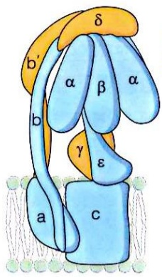

text_image

b'
α β α
γ ε
a c

叶绿体基因编码
细胞核基因编码

具体而言，叶绿体ATP合酶中的 $\gamma$ 、δ和b'亚基均由细胞核基因编码，而其他亚基均由叶绿体基因编码。由细胞核基因编码的 $\gamma$ 、δ和b'亚基的新生肽链在由胞质溶胶中的游离核糖体合成后需被转运至叶绿体中，与由叶绿体基质核糖体合成的其他亚基的新生肽链进行组装，形成ATP合酶。叶绿体ATP合酶在光合细胞中的生成组装过程是一个复杂而重要的生物过程，还需进行深入探究。

## ※展望

对于光合磷酸化的探究，还存在多方面的科学问题有待回答。

在理想条件下，光合作用反应中心的量子效率可以接近 $100\%$ 。然而，即使是温带和热带地区的农作物，太阳能转化效率通常都不会超过 $1\%$ 。我们还需要认识是什么因素导致这样的能量损耗:是捕光过程中发生的热耗散？是核酮糖-1,5-二磷酸羧化酶/加氧酶（Rubisco）固定 $\mathrm{O}_2$ （而非 $\mathrm{CO}_{2}$ ）所导致的光呼吸效应？是细胞生长和呼吸作用？或是由一些其他因素和以上几种因素综合导致的结果？

光合磷酸化（及后续的碳固定）过程的各个关键环节由何种蛋白因子调控，又是如何调控的？光合磷酸化不同步骤之间如何协调运转？自然界的光照（光强和光质）、温度和水分等理化条件会发生动态变化，光合生物如何响应外界环境的变化，并对光合作用过程进行调节从而维持光合机器的正常运转？参与光合磷酸化的不同蛋白质复合物之间如何有效地实现功能偶联？它们在类囊体膜上的相对位置和排布与光合作用过程调控之间存在什么样的内在联系？

植物细胞叶绿体中类囊体膜上存在的光系统Ⅱ、细胞色素 $b_{6}f$ 复合物、光系统I，以及ATP合酶之间是否会进一步组装形成某种更高阶的超分子复合物？

我们能否应用光合作用过程调控的原理和知识来改造农作物，从而提高其光合作用的能量转化效率和作物的产量？此外，我们能否构建高效的人工体系来模拟光合作用并实现太阳能的高效利用？

## ※ 本章小结

在植物中，光合磷酸化发生在叶绿体类囊体膜上，由光系统Ⅱ、细胞色素 $b_{6}f$ 和光系统Ⅰ等按顺序连续工作，通过光能的吸收和传递、电荷分离等将电子从水分子中提取并传递给NADP$^{+}$，生成NADPH，同时产生跨膜质子梯度，驱动ATP合酶合成ATP。

捕光复合物通过结合在蛋白质骨架上的叶绿素和类胡萝卜素等色素分子吸收光能和传递激发能。

---

推荐阅读

265

含有反应中心的核心复合物（如 PSⅡ或 PSI）与外周捕光复合物组装形成超分子复合物，相邻复合物之间界面上的叶绿素分子介导激发能从外周传递给核心，用于诱导反应中心的叶绿素分子特殊对发生电荷分离，实现光能到化学能的转换。

植物、藻类和蓝细菌通过PSⅡ的放氧复合物将水分子裂解，产生氧气和质子，释放出的电子用于还原光反应中心P680（$\mathrm{P680^{+}}$）。

在光能的激发下，PSⅡ反应中心P680释放出的高能电子经过传递链辅因子传给末端电子受体PQ分子并将其还原为 $\mathrm{PQH}_2$ ， $\mathrm{PQH}_2$ 携带的电子继续被传递至细胞色素 $b_{6}f$ 复合物，再经由PC传递至PSI，最终到达铁氧还蛋白: $\mathrm{NADP^{+}}$ 还原酶（FNR）并将$\mathrm{NADP^{+}}$ 还原为NADPH。

细胞色素  $b_{6}f$  复合物在介导电子传递的过程中将质子从基质侧转移到类囊体腔中，这部分质子与水分子裂解产生的质子一起，形成跨类囊体膜的质子梯度。

在植物、藻类和蓝细菌中，基于PSI和细胞色素 $b_{6}f$ 所形成的循环式电子传递过程不产生NADPH，只形成跨膜质子梯度（进而产生ATP）。对于只含有一种反应中心的紫细菌等光合细菌而言，反应中心与细胞色素 $bc_{1}$ 复合物之间形成循环式电子传递。

## ※ 思考题

1. 在光合作用过程中，光子的能量被色素分子吸收后有哪些不同的去向？
2. 光合磷酸化过程中跨膜质子浓度梯度的建立包括哪些具体的步骤？
3. 光系统Ⅱ能够在光能驱动下氧化水分子并将质体醌还原的基本原理是什么？
4. 光系统 | 如何在光能的驱动下将质体蓝素的电子传递给 NADP $^{+}$ ?
5. 根据光合磷酸化过程的原理，如何在一个脂质体中重建可以在光能驱动下合成ATP的人工体系？请用卡通图和文字描述的方式简要介绍重建该人工脂质体系统所需要的不同光合作用复合物和氧化还原因子等。

## ※ 推荐阅读

1. BJÖRN L O, SHEVELA D, GOVINDJEE G. What is photosynthesis? —A broader and inclusive view [M] //DALAL V K, MISRA A N. A Closer Look at Photosynthesis. Hauppauge, NY: Nova Science Publisher Inc., 2023.

以跨学科视角系统介绍最新研究成果，对光合作用提供全面且前沿的理解。

2. STIRBET A, LAZÁR D, GUO Y, et al. Photosynthesis: basics, history and modelling [J]. Ann Bot, 2020, 126 (4): 511-537.

综述光合作用的反应机制、历史发现及数学模型应用。

3. CROCE R, VAN AMERONGEN R. Natural strategies for photosynthetic light harvesting [J]. Nat Chem Biol, 2014, 10 (7): 492-501.

综述光合生物通过分子结构、动态调节和空间组织实现光能高效捕获与分配的自然

---

266

20 光合磷酸化

- 优化策略。
- 4. YOU X, ZHANG X, CHENG J, et al. In situ structure of the red algal phycobilisome-PSII-PSI-LHC megacomplex [J]. Nature, 2023, 616 (7955): 199–206.
- 利用冷冻电子断层扫描和原位单颗粒分析技术，首次解析红藻藻胆体-光系统Ⅱ-光系统I-捕光复合物超大复合物的原位结构，为理解光合作用中光能捕获、传递及分配的分子机制提供结构基础。
- 5. ALLEN J F, DE PAULA W B M, PUTHIYAVEETIL S, et al. A structural phylogenetic map for chloroplast photosynthesis [J]. Trends Plant Sci, 2011, 16 (12): 645–655.
- 通过结构生物学和比较基因组学方法，首次为陆地植物、红藻和绿藻的类囊体膜光合作用装置绘制结构系统发育图谱，揭示各组分在亚细胞层面的基因来源。
- 6. YAMORI W, SHIKANAI T. Physiological functions of cyclic electron transport around photosystem I in sustaining photosynthesis and plant growth [J]. Annu Rev Plant Biol, 2016, 67: 81–106.
- 系统阐述循环式电子传递在光合作用中的生理功能及其分子机制。
- (撰写: 周丛照, 柳振峰, 李珍, 秦咏梅; 审修: 张立新, 李森, 杨广笑, 丁智)
