# 23 脂质合成

原始 PDF 第 347–396 页。

## 23

## 脂质合成

脂质是一类广泛存在且结构多样的疏水性生物分子。它们不仅储存能量、构成细胞膜，还锚定蛋白质、合成寡糖、抗氧化、提供颜色、作为酶的辅因子、传递信号、调节激素、传递电子，并帮助哺乳动物乳化食物（见第15章）。然而，当脂质合成代谢出现问题时，其影响同样是深远的。例如，患有一种脂肪代谢障碍（lipodystrophy）的患者，其皮肤松弛等现象主要是由于结缔组织异常所致，会出现类似“早衰症”的症状，十几岁时看上去像六十几岁。研究表明，这主要是因为机体无法产生维持健康所需的脂肪。此外，脂质合成代谢的异常还与肥胖、糖尿病和心血管疾病等密切相关。因此，正常的脂质合成代谢对个体的生命活动至关重要。

本章将介绍生物体内脂质分子的生成过程，重点关注的脂质分子包括饱和与不饱和脂肪酸、甘油三酯、甘油磷脂、鞘脂、胆固醇及其衍生物、类二十烷酸及其衍生物等。同时，本章还将介绍脂质合成代谢的调控机制以及脂质在血液中的运输机制等。

---

23.1 脂肪酸合成与分解过程虽有相似之处但并非简单逆转

331

## 23.1 脂肪酸合成与分解过程虽有相似之处但并非简单逆转

脂肪酸  $\beta$  氧化途径涉及多轮四步反应，每轮脱去 1 个二碳单位（形成乙酰辅酶 A）（见第 22 章）。类似地，脂肪酸从头合成包含多轮五步反应，每次增加 1 个二碳单位，但脂肪酸合成过程并非脂肪酸氧化的简单逆转。在真核细胞中，饱和脂肪酸的分解与合成过程存在显著差异，这些差异的主要内容总结于图 23-1。

具体而言，脂肪酸分解的每轮反应依次为氧化、水合、氧化和裂解（图 23-1 左）。相比之下，脂肪酸合成的每轮反应依次为装载、缩合、还原、脱水和还原（图 23-1 右，装载步骤未标注）。

脂肪酸合成与分解的主要差异体现在以下方面:反应发生的亚细胞部位（分别为胞质溶胶和线粒体基质）、脂酰基的载体（分别为酰基载体蛋白 ACP 和辅酶 A）、电子供体 / 受体（分别为 NADPH/NAD$^{+}$ 和 FAD）、产物手性碳的构型（分别为 D 型与 L 型）、二碳单位的存在形式（分别为丙二酸单酰辅酶 A 和乙酰辅酶 A）、转运形式（分别为柠檬酸和脂酰肉碱）等。此外，碳链合成与分解的方向也不相同:合成是从甲基端开始，而分解则是从羧基端开始。同时，脂肪酸合成需要消耗 ATP，而分解过程则产生 ATP。

与糖酵解和糖异生不同的是，脂肪酸合成与分解之间不存在任何共同的酶促反应。然而，脂肪酸合成与分解途径之间也存在类似糖代谢的两条途径之间的交互调节机制，使得它们通常不会在同一细胞内同时发生，以避免无效循环。

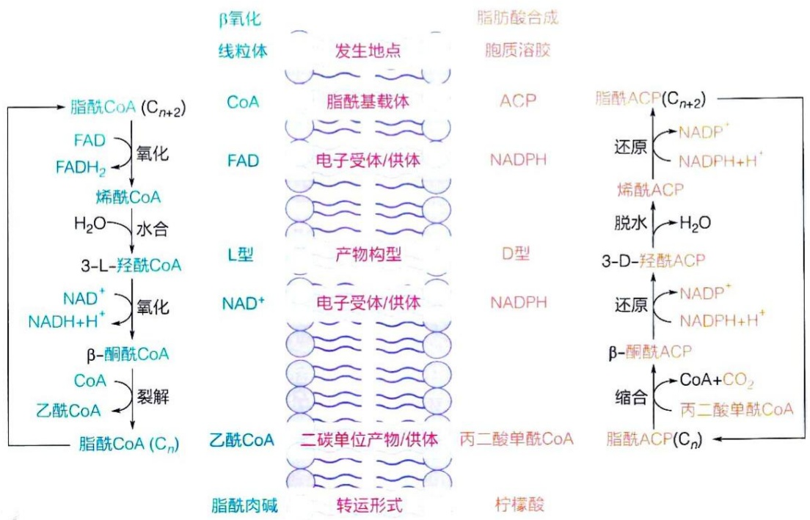

<details>
<summary>flowchart</summary>

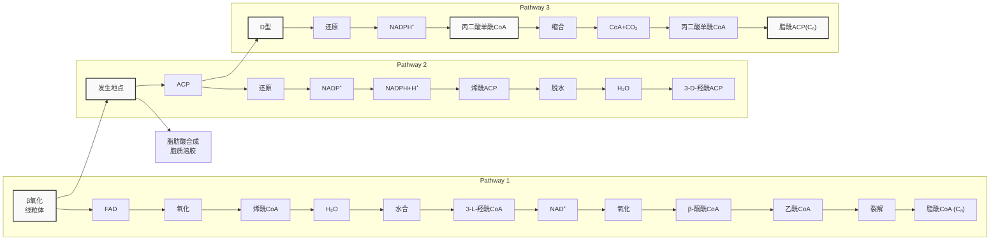
</details>

图 23-1 真核细胞中脂肪酸合成与分解途径之间的比较

---

332

23 脂质合成

## 23.1.1 线粒体基质中产生的乙酰辅酶 A 需被转运至胞质溶胶才可用于合成脂肪酸

作为脂肪酸合成原料的乙酰辅酶A主要源自葡萄糖的氧化分解，少量源自氨基酸的分解。葡萄糖经胞质溶胶中的糖酵解过程转化为丙酮酸，后者需跨过线粒体内膜进入线粒体基质，然后在丙酮酸脱氢酶复合物的作用下，转化为乙酰辅酶A（见第18章）。体内过量的氨基酸在脱氨后，其碳骨架大多也在线粒体基质中进行氧化分解，其中许多分解过程也产生乙酰辅酶A。值得注意的是，这些乙酰辅酶A需要被转运至胞质溶胶，方能作为脂肪酸合成的原料。

细胞利用柠檬酸循环的中间体柠檬酸，通过一种柠檬酸穿梭（citrate shuttle）策略，将乙酰辅酶A间接地从线粒体基质跨膜转运至胞质溶胶（图23-2）。存在于线粒体内膜上的柠檬酸转运蛋白（citrate transporter）（作为一种易位酶）负责该转运工作。

具体而言，在线粒体基质中，乙酰辅酶A与草酰乙酸缩合成柠檬酸（由柠檬酸合酶催化）。随后，柠檬酸由线粒体内膜上的柠檬酸转运蛋白转运至胞质溶胶①。在胞质

图 23-2 乙酰辅酶 A 通过柠檬酸穿梭策略由线粒体基质转运至胞质溶胶

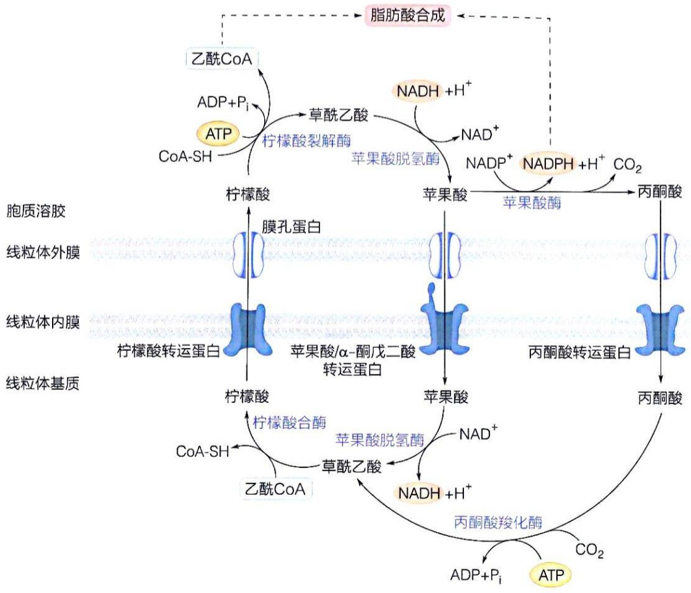

<details>
<summary>flowchart</summary>

This flowchart illustrates the metabolic pathway of fatty acids in plant tissue, showing how ATP is converted into various metabolites (Lactate, NADH, NADP) and their conversion to form carbohydrates.
</details>

<small><span class="docvortex-page-footnote" data-block-type="page_footnote" style="color:#6b7280">① 尽管线粒体外膜上的孔蛋白协助小分子通过，但它们对带负电的小分子具有一定的选择性，故也被称为电压依赖性阴离子通道。</span></small>

---

23.1 脂肪酸合成与分解过程虽有相似之处但并非简单逆转

333

溶胶中，柠檬酸在依赖 ATP 的柠檬酸裂解酶（ATP-dependent citrate lyase，ACL）催化下发生裂解，重新形成乙酰辅酶 A 和草酰乙酸。因缺乏特异转运蛋白，草酰乙酸无法直接通过线粒体内膜，也需以“穿梭”形式返回线粒体基质。为此，草酰乙酸先由胞质溶胶中的苹果酸脱氢酶同工酶催化，发生还原反应（由 NADH 提供电子），生成苹果酸。苹果酸可通过内膜上的苹果酸 /α- 酮戊二酸转运蛋白进入线粒体基质（见图 19-16A），然后在线粒体基质中的苹果酸脱氢酶同工酶催化下，重新生成草酰乙酸，完成一轮穿梭循环。

此外，胞质溶胶中的苹果酸也可由苹果酸酶（malate enzyme）催化，生成丙酮酸。丙酮酸通过线粒体内膜上的丙酮酸转运蛋白返回至线粒体基质，再经丙酮酸羧化酶催化，生成草酰乙酸，也完成一轮穿梭循环。通过该路径每转运1分子乙酰辅酶A至胞质溶胶，尽管需消耗2分子ATP和1分子NADH，但在胞质溶胶中可产生1分子NADPH，后者为脂肪酸合成提供还原力。

## 23.1.2 乙酰辅酶 A 在胞质溶胶中被活化为丙二酸单酰辅酶 A

在 1950 年代，伊拉克裔美国学者萨利赫·瓦基勒（Salih Wakil，1927—2019）观察到，参与脂肪酸合成的乙酰辅酶 A 必须先羧化形成丙二酸单酰辅酶 A。这步反应由乙酰辅酶 A 羧化酶（acetyl-CoA carboxylase，ACC）催化，是脂肪酸合成的限速步骤。

在原核生物中，乙酰辅酶 A 羧化酶为由三种蛋白质组成的复合物。这包括与生物素共价结合的生物素羧基载体蛋白（biotin carboxyl carrier protein, BCCP）、催化生物素发生羧基化的生物素羧化酶（biotin carboxylase, BC）和将生物素携带的羧基转移至乙酰辅酶 A 底物的羧基转移酶（carboxyltransferase, CT）。动物和真菌等真核生物中的乙酰辅酶 A 羧化酶以同源二聚或多聚形式存在，每个亚基均含三个结构域，分别具有上述三种功能（即共价结合生物素，催化生物素羧基化，催化生物素上的羧基转移至乙酰辅酶 A）。植物细胞中存在这两种类型的乙酰辅酶 A 羧化酶。

具体而言，真核细胞中乙酰辅酶A羧化酶的单亚基结构如图23-3所示:辅因子生物素的羧基与生物素羧基载体蛋白结构域上一个保守的赖氨酸残基的 $\varepsilon-$ 氨基通过酰胺键共价结合。共价结合的生物素形成一个总长度约为 $16\AA$ 的长臂，在相隔约$80\AA$ 的生物素羧化酶和羧基转移酶两个活性中心之间摆动（图23-3），依次催化后续的两步反应:①在生物素羧化酶活性中心，碳酸氢盐转化为 $\mathrm{CO}_{2}$ （通过形成羧基磷酸中间体）后，被转移至生物素脲基环的N1（非N3），形成羧基化生物素。随后，羧基化的生物素移至羧基转移酶活性中心。②在羧基转移酶活性中心，羧基化的生物素将其羧基转移至乙酰辅酶A的甲基上，形成丙二酸单酰辅酶A（图23-3A）。

乙酰辅酶 A 羧化酶的结构和催化机制与丙酮酸羧化酶（见图 21-6）及丙酰辅酶 A 羧化酶（见图 22-12）非常类似，它们均利用共价连接的生物素作为辅因子，并且均包含生物素羧基载体蛋白结构域、生物素羧化酶活性中心和羧基转移酶活性中心。这里的生物素辅因子相当于在两个活性中心之间形成了一个底物通道。

---

334

23 脂质合成

图 23-3 乙酰辅酶 A 羧化酶中生物素参与的羧基化反应

（A）乙酰辅酶A羧化酶催化反应机制的示意图。BCCP:生物素羧基载体蛋白结构域。（B）酿酒酵母乙酰辅酶A羧化酶的结构（PDB:5CSL）。图中所示为同源二聚体中的一个单体蛋白，三个参与催化的结构域分别是生物素羧化酶结构域（浅蓝色），生物素羧基载体蛋白结构域（绿色），羧基转移酶结构域（浅黄色）。生物素羧化酶结构域中结合ADP、生物素相关的氨基酸以红色展示，生物素羧化酶结构域与羧基转移酶结构域的酶活中心相距80Å。

(A)

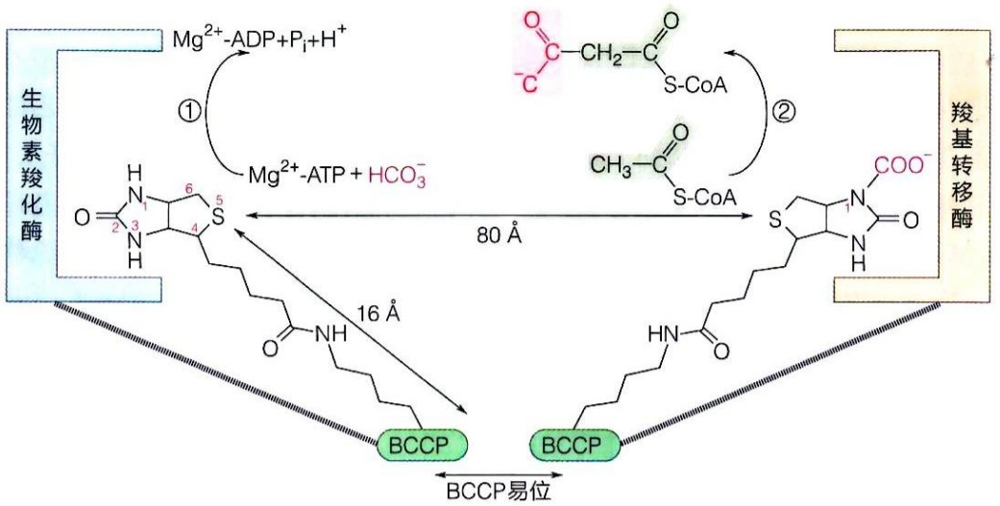

<details>
<summary>flowchart</summary>


</details>

(B)

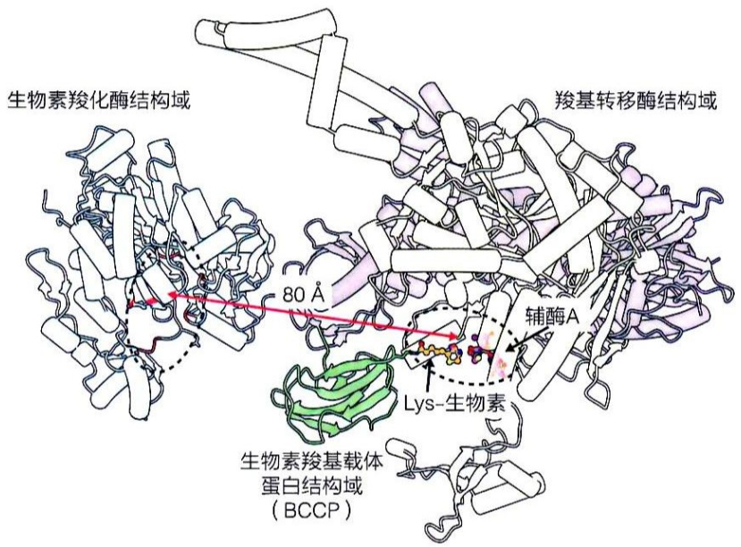

<details>
<summary>text_image</summary>

生物素羧化酶结构域
羧基转移酶结构域
80 Å
辅酶A
Lys-生物素
生物素羧基载体
蛋白结构域
(BCCP)
</details>

## 23.1.3 多结构域（或多亚基）脂肪酸合酶催化脂肪酸的生成

来自不同生物体的催化脂肪酸生成过程的脂肪酸合酶（fatty acid synthase，FAS）总体可分为Ⅰ型和Ⅱ型两大类。Ⅰ型脂肪酸合酶（FAS I）主要存在于脊椎动物和真菌中。在脊椎动物中，Ⅰ型脂肪酸合酶是由一条多肽链形成多个不同结构域的多功能酶；真菌中的酶尽管也属于Ⅰ型，但却由两条不同的多肽链组成，形成异源二聚体功能单位，每个亚基上分布着不同的结构域，需相互协同发挥作用。Ⅱ型脂肪酸合酶（FAS II）主要存在于植物和细菌中，是由多种功能各不相同亚基组成的蛋白质复合物，因此，Ⅰ型脂肪酸合酶可能是演化过程中由多个不同基因融合的产物。

存在于脊椎动物中的Ⅰ型脂肪酸合酶是由两个完全相同的多功能亚基组成的同源二聚体，大致排列呈X形（图23-4）。

脊椎动物 I 型脂肪酸合酶的单个亚基含 7 个功能不同的结构域。从 N 端到 C 端依

---

23.1 脂肪酸合成与分解过程虽有相似之处但并非简单逆转

335

次具有以下功能:β-酮酰合酶（ketoacyl synthase, KS）、丙二酸单酰/乙酰转酰基酶（malonyl/acetyl transacylase, MAT）、β-羟酰脱水酶（dehydratase, DH）、烯酰还原酶（enoyl reductase, ER）、β-酮酰还原酶（ketoacyl reductase, KR）、酰基载体蛋白（acyl carrier protein, ACP）及硫酯酶（thioesterase, TE）。

在脂肪酸合酶催化过程中，所有的底物、中间体和产物均通过与酰基载体蛋白共价结合的形式存在，并无自由扩散的中间体存在。这种催化方式显著提高了反应效率。

## 23.1.4 酰基载体蛋白携带合成中间体在不同活性中心之间穿梭

在 1950 年代末，约翰·康福思（John Cornforth，1917—2013）等在细菌中发现一种对脂肪酸合酶活性至关重要的“辅因子”。这种“辅因子”具有一定的热稳定性和可透析性（透析膜一般可

将分子量低于 14 kDa 的分子透析除去）。由于该组分在反应中传递酰基（如丙二酸单酰基），且分子量较小，他们推测它是一种辅因子（类似辅酶 A 的功能）而非独立蛋白质，这一“错误”推动了对其结构和功能的深入研究。他们从大肠杆菌细胞中分离并纯化了这种“辅因子”，鉴定为酰基载体蛋白（ACP）:由 77 个氨基酸残基组成，该小分子量蛋白质后被揭示含有共价连接的辅因子 4'-磷酸泛酰巯基乙胺（4'-phosphopantetheine）。该辅因子通过其一端的磷酸基团与酰基载体蛋白中一个高度保守的丝氨酸残基以磷酸酯键相连，而另一端的巯基（—SH）为其功能基团，能够与脂肪酸合成中间体以硫酯键相连（图 23-5）。泛酸（pantothenic acid）是合成 4'-磷酸泛酰巯基乙胺的前体，人体无法自身合成，必须从食物中获取，被称为维生素 B$_{5}$。

在脂肪酸合成过程中，ACP作为关键的中间体载体，其共价连接的4'-磷酸泛酰巯基乙胺能够携带酰基链穿梭于脂肪酸合酶的不同活性中心。ACP的功能类似于一个“摆臂”，将脂肪酸合成的中间体从一个催化中心转移到下一个，完成多轮反应，每轮反应使脂肪酸碳链延长两个碳原子。值得注意的是，所有合成的中间体均被束缚于脂肪酸合酶复合物中，从而显著提升了合成反应的效率。这里的磷酸泛酰巯基乙胺辅因子与丙酮酸脱氢酶复合物中的硫辛酸辅因子（在三个活性中心之间穿梭）的作用方式具有一定的可比性。

在细菌和植物细胞 FASⅡ中，ACP 以单个亚基形式存在。但在动物和酵母细胞 FASⅠ中，ACP 仅作为一个结构域存在。ACP 在脂肪酸合成过程中的作用，可类比于脊椎动物Ⅰ型脂肪酸合酶为同源二聚体，其单条肽链含2505个氨基酸残基（分子量约为270 kDa）；在晶体结构的轮廓上叠加显示脂肪酸合酶中功能不同的结构域。对称结构两侧的多个活性位点共同组成一个脂肪酸合酶反应室。β-酮酰还原酶结构域旁边的电子密度（灰色）可能为酰基载体蛋白和硫酯酶结构域。

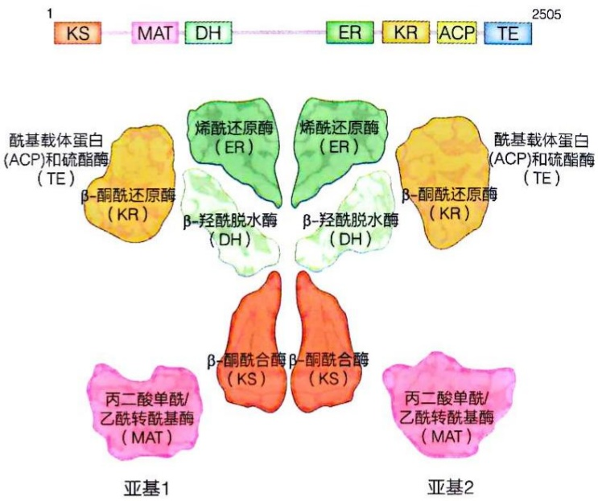

<details>
<summary>flowchart</summary>

This diagram illustrates the molecular structure and functional domains of a protein complex, showing interactions between proteins (KS, MAT, DH, ER, KR, ACP, TE) and their associated enzymes or enzymes.
</details>

图 23-4 脊椎动物 I 型脂肪酸合酶结构示意图

---

336

23 脂质合成

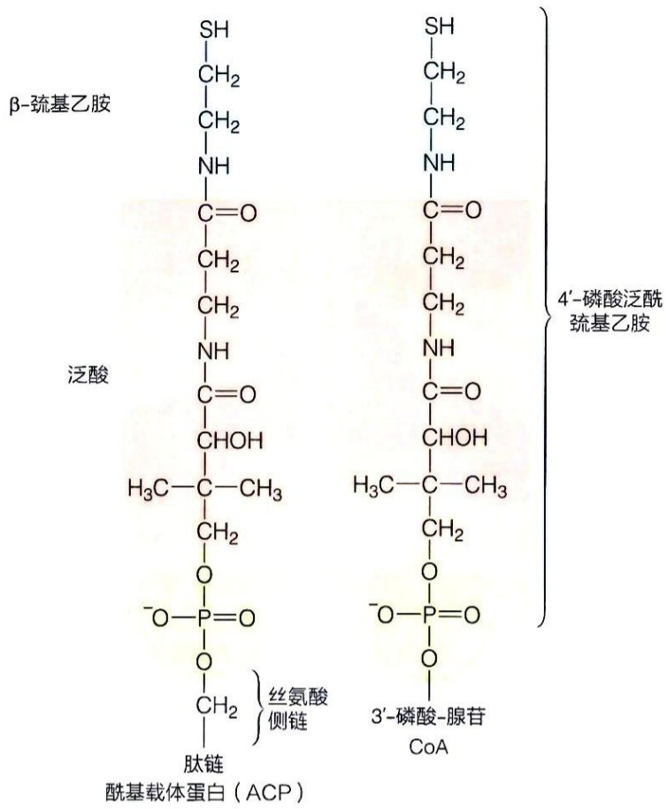

<details>
<summary>chemical</summary>

肽链与羧基乙胺的结构式，展示β-巯基乙胺、泛酸及4'-磷酸泛酰巯基乙胺的分子结构
</details>

图23-5 磷酸泛酰巯基乙胺是酰基载体蛋白（ACP）和辅酶A的共同功能基团

辅酶A在脂肪酸分解过程中的作用，而且它们的功能基团完全相同，均利用磷酸泛酰巯基乙胺末端的巯基。

## 23.1.5 脂肪酸合成涉及起始、延长和终止等阶段

脂肪酸的合成大致可分为起始、延长和终止三个阶段（图 23-6）。在进入延长阶段的多轮五步反应之前，必须先完成起始阶段的反应。

（1）脂肪酸合成起始于丙二酸单酰/乙酰转酰基酶催化的反应

在丙二酸单酰/乙酰转酰基酶催化下，乙酰辅酶A中的乙酰基被转移至ACP辅因子末端的巯基，形成乙酰ACP；随后，乙酰基再被转至β-酮酰合酶中一个特异半胱氨酸侧链的巯基，同时，释放辅酶A。这个过程完成了起始反应。这是每个脂肪酸分子合成的起始阶段，即在第一轮的五步反应之前发生。这个乙酰基将成为最终合成脂肪酸分子甲基末端的两个碳原子。

(2) 脂肪酸合成的每一轮涉及底物装载、缩

## 合、还原、脱水和还原五步反应

随着起始反应的完成，脂肪酸合成的第一轮反应便开始了。

第一步是底物装载（substrate loading）反应（图23-6，①），这步反应只发生于上述起始步完成之后（即β-酮酰合酶发生了乙酰化之后）；也由丙二酸单酰/乙酰转酰基酶催化，此时，结合于活性中心的丙二酸单酰辅酶A中的丙二酸单酰基被转移至ACP辅因子末端的巯基（同时也释放辅酶A），完成底物的装载。

第二步是缩合（condensation）反应（图23-6，②）。由β-酮酰合酶催化，结合于起始阶段ACP辅因子上的丙二酸单酰基与β-酮酰合酶上的乙酰基发生缩合，生成乙酰乙酰ACP，并释放 $CO_{2}$ 。丙二酸单酰基可视作乙酰基的活化状态，而脱羧过程释放的能量使缩合反应的自由能变化为负值，从而驱动缩合反应的有效进行，并使其不可逆。可以认为，丙二酸单酰辅酶A形成时消耗的ATP（图23-3）间接推动了缩合反应的进行。尽管 $HCO_{3}^{-}$ 是脂肪酸合成过程所必需的，但其碳原子并不出现在最终产物中，而是在缩合过程中以 $CO_{2}$ 的形式被释放。因此，合成偶数碳脂肪酸的所有碳原子均来自乙酰辅酶A所提供的二碳单位。在糖异生途径中，在由丙酮酸经草酰乙酸生成磷酸烯醇式丙酮酸的反应过程中，也利用了类似的“羧化-脱羧”策略，表明羧基化修饰也是活化底物的一种有效方式。

---

23.1 脂肪酸合成与分解过程虽有相似之处但并非简单逆转

337

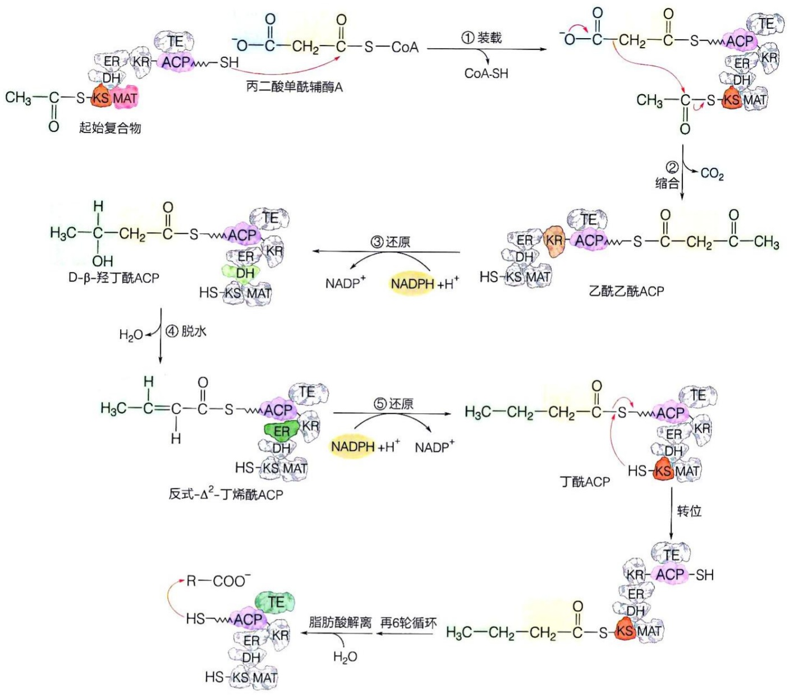

<details>
<summary>flowchart</summary>


</details>

乙酰乙酰 ACP 也可被称为  $\beta-$  酮丁酰 ACP。通过接下来的三步反应， $\beta-$  酮基将被还原为亚甲基。

第三步是还原（reduction）反应（图23-6，③），由β-酮酰还原酶催化，将β-酮丁酰ACP还原为D-β-羟丁酰ACP。这步反应与脂肪酸β氧化对应步骤的逆过程存在两方面的差异:其一，使用NADPH作为电子供体，而脂肪酸β氧化中对应的电子受体是 $NAD^{+}$ ；其二，产物中的不对称碳为D构型，而非L构型。

第四步是脱水（dehydration）反应（图23-6，④）。由β-羟酰脱水酶催化。D-β-羟基丁酰ACP从C2和C3分别脱去H和OH，形成反式- $\Delta^{2}$ -丁烯酰ACP，同时释放1分子水。

第五步是还原反应（图23-6，⑤）。这是第二次还原反应，由烯酰还原酶催化，反式 $-\Delta^{2}-$ 丁烯酰ACP还原为丁酰ACP。这步还原反应的电子供体也是NADPH（而

图 23-6 由脂肪酸合酶催化的脂肪酸从头合成每轮的五步反应

---

338

23 脂质合成

在对应的脂肪酸 $\beta$ 氧化步骤中，电子受体是FAD）。在细菌中，烯酰还原酶是脂肪酸合成途径的限速酶之一。广谱抗菌剂三氯生（tricloson）通过抑制烯酰还原酶的活性而抑制细菌的生长和繁殖，被广泛添加于牙膏、香皂、护肤霜、除臭剂等日化用品中。

经过上述五步反应，乙酰基通过接受丙二酸单酰基的二碳单位而最终生成丁酰ACP，完成第一轮使脂肪酸碳骨架延长两个碳原子的反应。

在丙二酸单酰/乙酰转酰基酶的催化下，第一轮反应形成的丁酰基将从ACP转移至 $\beta-$ 酮酰合酶的特异半胱氨酸侧链的巯基上（类似于起始阶段发生的反应）。随后，第二轮及后续多轮反应依次进行，生成碳链长度分别为6、8、10、12、14和16个碳的脂肪酸中间体。当生成含16个碳的脂肪酸（棕榈酸）后，脊椎动物的脂肪酸合酶无法继续催低碳链的延长。此时，I型脂肪酸合酶的硫酯酶活性催化棕榈酰基与ACP之间的硫酯键水解，释放棕榈酸，从而终止脂肪酸合成过程。

合成1分子棕榈酸需要消耗7分子丙二酸单酰辅酶A。这由7分子乙酰辅酶A羧化形成:

$$
7 \text {乙酰} \mathrm{CoA} + 7 \mathrm{CO} _ {2} + 7 \mathrm{ATP} \longrightarrow 7 \text {丙二酸单酰} \mathrm{CoA} + 7 \mathrm{ADP} + 7 \mathrm{P} _ {\mathrm{i}}
$$

从起始物乙酰辅酶A到终产物棕榈酸的化学计量总反应式为:

$$
1 \text {乙酰} \mathrm{CoA} + 7 \text {丙二酸单酰} \mathrm{CoA} + 1 4 \mathrm{NADPH} + 1 4 \mathrm{H} ^ {+} \longrightarrow
$$

$$
1 \text {棕榈酸（} 16 \text {碳}) + 7 \mathrm{CO} _ {2} + 8 \mathrm{CoA} + 1 4 \mathrm{NADP} ^ {+} + 6 \mathrm{H} _ {2} \mathrm{O}
$$

因此，合成 1 分子棕榈酸需消耗 7 分子 ATP 用于生成 7 分子丙二酸单酰辅酶 A。

## 23.1.6 动物细胞中棕榈酸的碳链可在光面内质网膜中继续延长

在动物细胞的胞质溶胶中，脂肪酸合酶催化合成的最终产物通常是含16个碳原子的棕榈酸。然而，细胞中也存在对更长碳链脂肪酸的需求，这可通过脂肪酸碳链的继续延长而满足。

真核细胞中脂肪酸碳链的延长主要发生于光面内质网膜中。

光面内质网膜的胞质溶胶侧中发生的脂肪酸碳链延长过程与脂肪酸合酶催化过程类似，使用丙二酸单酰辅酶A作为二碳单位的供体，也以NADPH作为还原剂。尽管催化的反应均类似，但催化脂肪酸碳链延长的酶均位于内质网膜上，且被延长的脂酰基以辅酶A（而非ACP）的形式存在。通过缩合、还原、脱水和再还原四步反应，脂肪酸碳链每次延长两个碳单位。例如，从棕榈酸开始，经过这四步反应生成硬脂酸（含18个碳原子）。

在光面内质网膜上，脂肪酸碳链可延长至36个碳原子，并用于合成多种结构脂质。此外，经碳链延长后的脂肪酸还可在光面内质网中发生去饱和反应（具体见后）。

---

23.1 脂肪酸合成与分解过程虽有相似之处但并非简单逆转

339

## 知识延展 23- 1

## 动物细胞线粒体中也存在脂肪酸合成途径

在 20 世纪五六十年代，研究者发现被分离的线粒体中存在脂肪酸合酶的活性，揭示了线粒体可能具备合成脂肪酸的能力。后续研究进一步表明，线粒体中的脂肪酸合成途径属于 FASⅡ系统。无论在蛋白质水平还是基因水平，线粒体 FASⅡ均表现出与细菌中的对应酶之间的同源性。这一发现与线粒体起源于好氧细菌的内共生假说相契合。

到七八十年代，参与线粒体脂肪酸合成途径的关键蛋白质组分被分离纯化。这包括线粒体酰基载体蛋白。到八九十年代，研究者对线粒体脂肪酸合成的酶促步骤有了更多认识，揭示它参与合成硫辛酸等重要辅因子。具体而言，线粒体脂肪酸合成途径产生的辛酰ACP中间体中的一部分被释放，进入硫辛酸辅因子合成途径；另一部分则可进一步延长为14碳或16碳的脂肪酸。在硫辛酸合成途径中，辛酰基从线粒体酰基载体蛋白转移至另一种载体蛋白，即甘氨酸裂解系统蛋白H（glycine cleavage system H protein, GCSH），这一过程由辛酰转移酶2（lipoyl transferase 2, LIPT2）催化。随后，硫辛酸合酶（lipoic acid synthase, LIAS）借助辅因子S-腺苷-L-甲硫氨酸（SAM）产生的5'-脱氧腺苷自由基，通过[4Fe-4S]获取2个硫原子，插入到与GCSH结合的辛酰基团的6号和8号碳上（图23-7）。接着，硫辛酸通过另一种辛酰转移酶（lipoyl transferase 1，LIPT1）被转移至靶蛋白上；与蛋白质中特定赖氨酸残基的侧链氨基形成酰胺键，共价连接到蛋白质分子，如丙酮酸脱氢酶复合物中的 $E_{2}$ 亚基（PDH- $E_{2}$ ）上。当蛋白质被降解或在脂酰酰胺酶的作用下，共价结合在蛋白质上的硫辛酸得以释放。

硫辛酸是一种重要的辅因子，对于线粒体中的几种关键酶复合物的功能至关重要。除丙酮酸脱氢酶复合物外，还包括α-酮戊二酸脱氢酶复合物以及支链α-酮酸脱氢酶复合物。这些酶复合物在细胞能量代谢过程中扮演核心角色。此外，硫辛酸还具有强效抗氧化能力。线粒体脂肪酸合成途径，特别是硫辛酸的合成，可能对保持线粒体的正常功能以及细胞内能量的有效生成至关重要。线粒体脂肪酸合成途径或硫辛酸合成途径的异常可能导致严重的代谢紊乱。

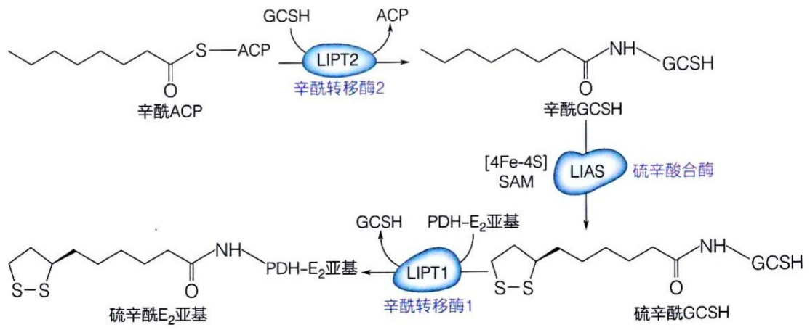

<details>
<summary>flowchart</summary>

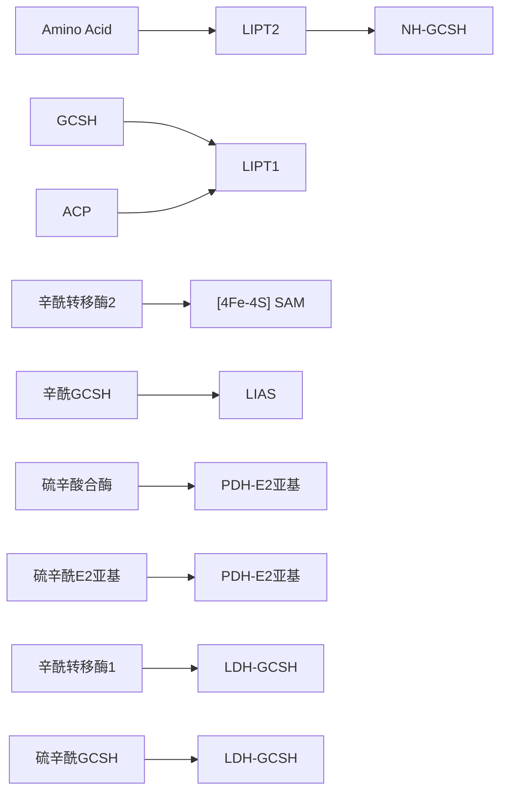
</details>

图23-7 线粒体中经由辛酰ACP合成硫辛酸的过程SAM:S-腺苷-L-甲硫氨酸；GCSH:甘氨酸裂解系统蛋白H； $\mathrm{PDH - E_2}$ :丙酮酸脱氢酶复合物中的 $\mathsf{E}_2$ 亚基。

---

340

23 脂质合成

## 23.1.7 不饱和脂肪酸在光面内质网膜中生成

动植物细胞中的饱和脂肪酸可进一步发生去饱和反应，形成含碳碳双键的不饱和脂肪酸。

## (1) 棕榈酸和硬脂酸可在动物细胞中去饱和形成 $\Delta^{9}$ 顺式碳碳双键

由位于光面内质网膜中的硬脂酰辅酶A去饱和酶（stearoyl-CoA desaturase，也称$\Delta^{9}-$去饱和酶）催化。该酶催化的氧化反应依赖它与细胞色素$b_{5}$以及细胞色素$b_{5}$还原酶的共同作用，最终将棕榈酸（16:0）和硬脂酸（18:0）去饱和，分别生成棕榈油酸（16:1）和油酸（18:1）（图23-8A）。

硬脂酰辅酶 A 去饱和酶利用氧气，同时使 NADPH 和脂酰基发生氧化。NADPH 提供 1 对电子，经由细胞色素  $b_{5}$  还原酶中的 FAD 和细胞色素  $b_{5}$  中的血红素传递，最终到达分子氧。另 1 对电子从脂酰基的单键中释放，也传递给氧，最终生成 2 分子水。去饱和酶的活性中心利用由 2 个铁离子构成的双核中心进行催化，使脂肪酸碳链中 C9 位和 C10 位之间的单键发生氧化，形成  $\Delta^{9}$  双键（图 23-8B、C）。

在植物细胞中，上述去饱和反应主要发生于叶绿体基质中，其中的一种水溶性硬

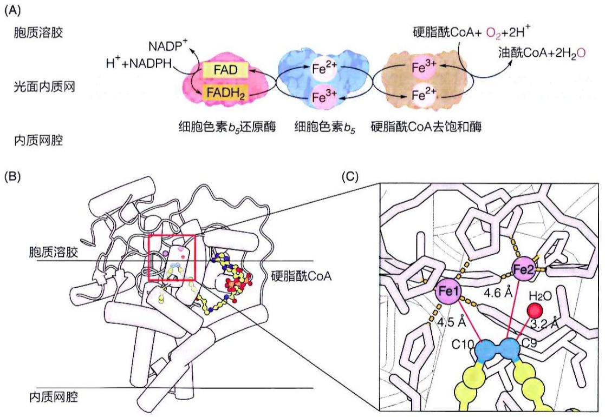

图23-8 内质网膜上三种蛋白质组成的电子传递链参与脂肪酸去饱和反应

（A）硬脂酰辅酶 A 去饱和酶位于光面内质网膜上，其催化脂肪酸去饱和反应时，需依赖细胞色素  $b_{5}$  和细胞色素  $b_{5}$  还原酶组成的电子传递系统。（B）鼠源硬脂酰辅酶 A 去饱和酶的结构（PDB:6WF2）。酶活性中心分别结合硬脂酰辅酶 A（球棍模式展示其原子结构）和两个金属铁离子（紫色，其中一个铁离子周围的水分子用红色圆球表示）。脂肪酸碳链中的 C9 和 C10 使用草青色展示。（C）硬脂酰辅酶 A 去饱和酶活性中心的放大展示。脂肪酸碳链中的 C9 和 C10 位于一个转折处，两个铁离子（Fe1、Fe2）组成双核中心。橙色虚线表示两个铁离子与周围 9 个组氨酸残基相互作用，Fe1 与 C10 相距为 4.5 Å，Fe2 与距 C9 相距为 4.6 Å， $H_{2}O$  与 C9 相距为 3.2 Å。

---

23.1 脂肪酸合成与分解过程虽有相似之处但并非简单逆转

341

脂酰 ACP 去饱和酶（stearoyl-ACP desaturase）催化硬脂酰 ACP 转化为油酰 ACP。

（2）植物细胞可将油酸进一步去饱和生成亚油酸和  $\alpha-$  亚麻酸

哺乳动物细胞自身能够合成如棕榈油酸（16:1 $\Delta^{9}$ ）和油酸（18:1 $\Delta^{9}$ ）这种 $\Delta^{9}$ 单不饱和脂肪酸。然而，由于缺乏在 $\Delta^{9}$ 双键之后的位置（如 $\Delta^{12}$ 和 $\Delta^{15}$ ）引入双键所需的去饱和酶，它们无法合成亚油酸（18:2 $\Delta^{9,12}$ ）和α-亚麻酸（18:3 $\Delta^{9,12,15}$ ）。亚油酸和α-亚麻酸是哺乳动物合成多种具有重要生理功能的不饱和脂肪酸（如含20个碳原子的花生四烯酸）的前体，故为必需脂肪酸（essential fatty acid），须从食物中获取。

在植物细胞中，油酸等单不饱和脂肪酸可进一步去饱和，生成多不饱和脂肪酸。这一过程发生于它们被掺入到甘油磷脂或半乳糖甘油酯分子中之后。去饱和反应分别由整合于内质网膜或叶绿体内膜上的不同去饱和酶催化。 $\Delta^{12}$ -去饱和酶催化其中的油酸分子C12位引入双键，生成亚油酸，再经 $\Delta^{15}$ -去饱和酶催化C15去饱和反应形成 $\alpha$ -亚麻酸。这样的去饱和过程可以发生于磷脂酰胆碱C2位连接的油酰基上，油酰基被氧化成亚油酰基，再经去饱和形成亚麻酰基（图23-9）。

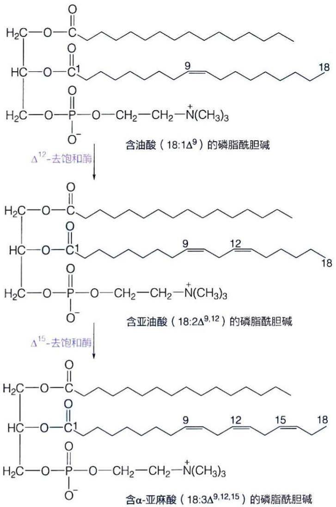

<details>
<summary>chemical</summary>

Chemical reaction pathway showing the conversion of phosphate to phosphorus and amino acids using acid and thiol glycolysis enzymes
</details>

图 23-9 植物多不饱和脂肪酸在甘油磷脂中的生成过程

## 23.1.8 脂肪酸合成途径通过调节乙酰辅酶 A 羧化酶活性进行调控

脂肪酸的合成速率受内源和外源多种因素调控。一般而言，动物体内充足的葡萄糖供应将通过胰岛素信号通路促进细胞合成脂肪酸，而葡萄糖的缺乏将通过胰高血糖素信号通路抑制脂肪酸的合成。

催化脂肪酸合成限速步骤的乙酰辅酶 A 羧化酶在调节动物体内脂肪酸合成中发挥重要作用。脊椎动物体内乙酰辅酶 A 羧化酶活性通过别构效应和可逆磷酸化修饰两种方式调节。

(1) 柠檬酸和棕榈酰辅酶 A 可分别激活和抑制乙酰辅酶 A 羧化酶的活性

在 1950 年代，研究人员发现，柠檬酸能够显著提高无细胞系统（使用肝细胞提取物）中脂肪酸的合成速率。到 1960 年代，借助密度梯度离心技术，研究者揭示了这一现象的机制:柠檬酸的激活效应与乙酰辅酶 A 羧化酶形成多聚体密切相关，电子显微镜亦观察到了纤维状的多聚体。后续研究揭示，柠檬酸可促使低活性的乙酰辅酶

---

342

23 脂质合成

图23-10 脊椎动物乙酰辅酶A羧化酶的活性通过别构效应调节

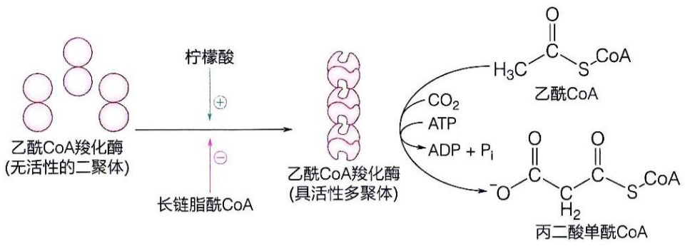

<details>
<summary>chemical</summary>

Reaction pathway of 乙酰CoA and its conjugated form, showing enzymatic conversion to acyl-CoA and its subsequent hydrolysis.
</details>

A 羧化酶二聚体组装成高活性的多聚体。作为提供乙酰辅酶 A 的前体，柠檬酸的这种调节作用属于前馈激活。相反，棕榈酰辅酶 A 则通过将乙酰辅酶 A 羧化酶从高活性的多聚体解聚为低活性的二聚体或单体，实现对其活性的反馈抑制（图 23-10）。结构测定结果表明，二聚体中活性中心被遮蔽，阻止底物乙酰辅酶 A 与  $HCO_{3}^{-}$  的进入；而在多聚体中活性中心被暴露，而且生物素载体蛋白结构域可自由摆动（图 23-3）。

此外，棕榈酰辅酶A或其他长链脂酰辅酶A还可通过抑制柠檬酸裂解酶而抑制脂肪酸合成。

## (2) 乙酰辅酶 A 羧化酶活性可通过可逆磷酸化修饰调节

动物体内的脂肪酸合成过程在高血糖状态下活跃进行，而在低血糖状态下则受到抑制（图23-11）。具体而言，高血糖诱导胰岛素的分泌，胰岛素与细胞表面受体结合后，通过信号转导过程，激活靶细胞内的一种磷酸酶，即蛋白磷酸酶2A（protein phosphatase 2A，PP2A），导致乙酰辅酶A羧化酶发生去磷酸化而激活。相反，低血糖诱导胰高血糖素的释放，后者通过信号转导激活靶细胞内的蛋白激酶A（PKA），导致乙酰辅酶A羧化酶发生磷酸化而失活。肾上腺素产生的效应与胰高血糖素相似（即通过磷酸化作用降低乙酰辅酶A羧化酶活性），但其分泌主要是在应激条件下由神经信号触发。

## (3) AMP 激活的蛋白激酶通过诱发乙酰辅酶 A 羧化酶磷酸化而使其失活

1970年代，在探究乙酰辅酶A羧化酶的过程中，人们观察到一种可以被AMP激

图 23-11 脂肪酸合成和分解途径之间的关联调节
①含碳水化合物的食物通过升高血糖水平诱导胰岛素的分泌；②胰岛素信号激活蛋白磷酸酶2A，使乙酰辅酶A羧化酶发生去磷酸化而激活；
③乙酰辅酶A羧化酶催化乙酰辅酶A发生羧化反应生成丙二酸单酰辅酶A；④丙二酸单酰辅酶A通过抑制肉碱棕榈酰基转移酶Ⅰ而阻止脂肪酸分解；⑤低血糖促进胰高血糖素的释放，而胰高血糖素信号激活蛋白激酶A（PKA）；
⑥蛋白激酶A通过磷酸化乙酰辅酶A羧化酶而降低其活性；⑦肉碱棕榈酰基转移酶Ⅰ介导胞质溶胶中的脂酰辅酶A转运至线粒体基质；⑧脂酰辅酶A在线粒体基质内进行β氧化。

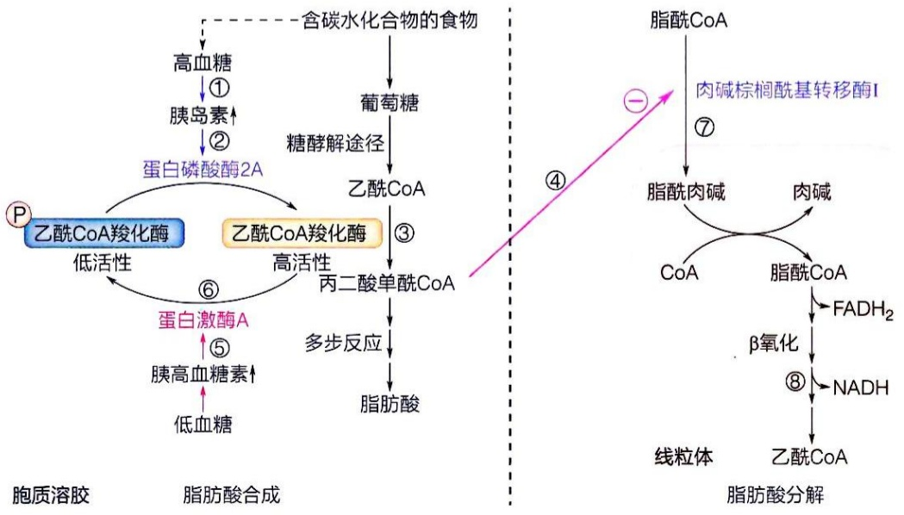

<details>
<summary>flowchart</summary>

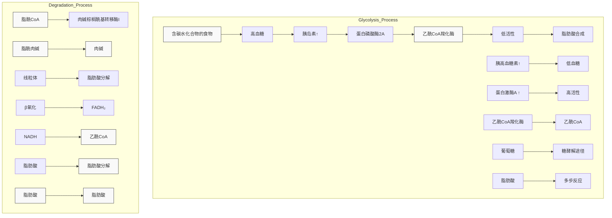
</details>

---

23.2 脂肪酸以甘油三酯形式长期储存

343

活的蛋白质激酶。它能够催化依赖 ATP 的乙酰辅酶 A 羧化酶的磷酸化修饰，导致酶的活性显著下降；而当这种磷酸化被去除后，乙酰辅酶 A 羧化酶的活性大幅上升。这种酶被命名为 AMP 活化蛋白激酶（AMP-activated protein kinase，AMPK）。

总体而言，当机体细胞处于低能量供给状态时，将由腺苷酸激酶（adenylate kinase）催化可逆反应: $ADP + ADP \rightleftharpoons ATP + AMP$ 。该反应在生成ATP供细胞利用的同时，使AMP的水平大幅升高。AMP结合于AMPK的γ亚基，诱导其构象改变。AMPK是一种丝氨酸/苏氨酸蛋白激酶，是由一个催化亚基（α）

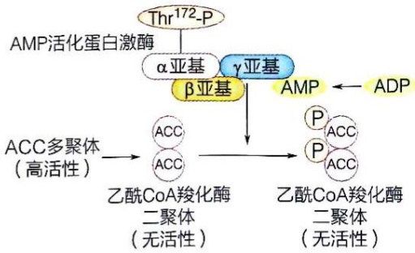

<details>
<summary>flowchart</summary>

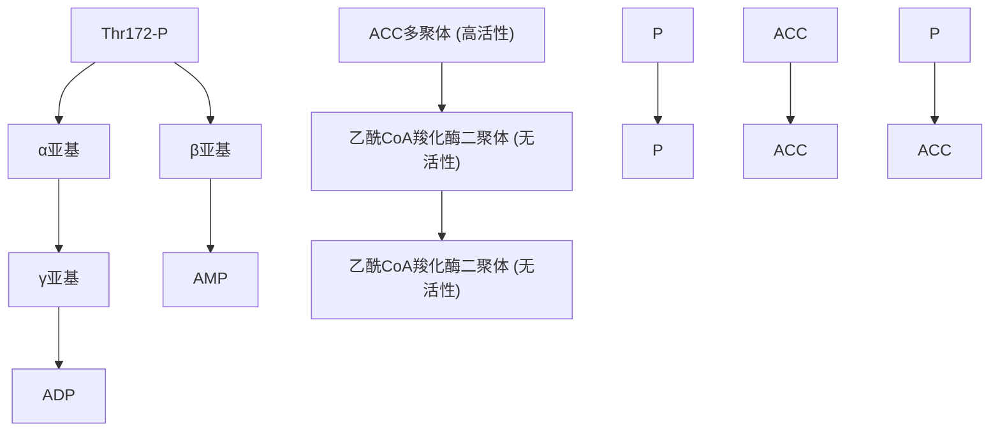
</details>

图 23-12 AMPK 通过磷酸化乙酰辅酶 A 羧化酶抑制脂肪酸合成

和两个调节亚基（β 和 γ）组成的异源三聚体。AMP 与 γ 亚基的结合一方面促进了上游激酶（如 LKB1）对 α 亚基苏氨酸 172 位点（Thr $^{172}$ ）的磷酸化修饰，并抑制磷酸酶对该位点的去磷酸化，从而“从零到一”地激活 AMPK；另一方面还可进一步对已经被磷酸化的 AMPK 产生直接的别构激活作用，迅速提升其活性。通过这两种机制的协同作用，AMP 的结合高效地激活了 AMPK。激活后的 AMPK 进而催化下游底物，例如使乙酰辅酶 A 羧化酶发生磷酸化修饰。未磷酸化的 ACC 可聚合形成有活性的多聚体；而 AMPK 介导的磷酸化使 ACC 倾向于以无活性的二聚体形式存在，从而抑制其多聚化（图 23-12）。后续的研究还表明，当葡萄糖水平下降（营养匮乏）或组织内钙离子浓度升高（通常出现在具有促分解代谢作用的激素的分泌时）也能通过激活 AMPK，引起其对乙酰辅酶 A 羧化酶的修饰（见第 27 章）。

乙酰辅酶A羧化酶活性的降低会减少丙二酸单酰辅酶A的生成，从而解除其对肉碱棕榈酰基转移酶I的抑制作用，使大量脂酰辅酶A得以转运至线粒体基质进行β氧化。相反，当乙酰辅酶A羧化酶活性增强时，丙二酸单酰辅酶A的增加会有效抑制肉碱棕榈酰基转移酶I的活性。因此，当脂肪酸合成减少时，一般β氧化将加速；而当脂肪酸合成活跃时，β氧化则受到抑制。这种机制实现了脂肪酸合成与分解代谢的协同调节（图23-11），避免了无效循环。这也是一种调节机制，是细胞协调生物分子合成与分解代谢的一种有效策略。

植物细胞中的脂肪酸合成主要发生于叶绿体中。其中的乙酰辅酶 A 羧化酶活性受到叶绿体基质 pH 和  $Mg^{2+}$  浓度变化的调节:在碱性 pH（如 pH = 8.0）时被激活，在酸性 pH（如 pH = 6.5）时被抑制，在高浓度  $Mg^{2+}$  存在时被激活。

## 23.2 脂肪酸以甘油三酯形式长期储存

机体一般将脂肪酸转化为惰性的甘油三酯形式以实现长期储存。脂肪酸的羧基与甘油的羟基通过酯化反应缩合，使得羧基和羟基的化学反应活性均大幅降低，生成的甘油三酯（俗称脂肪）更适合在机体内长期储存。一个70公斤重的个体通常储存约15公斤的脂肪，足以支持个体生存大约3个月，而所储存的糖原仅能提供大约12小

---

344

23 脂质合成

时所需的能量。

在发芽的种子中，甘油三酯不仅作为能量来源，还为生成内源性葡萄糖提供前体:脂肪酸通过乙醛酸循环生成的琥珀酸先被转化为延胡索酸，再被转化为草酰乙酸进入糖异生途径（见图18-17）。生成的葡萄糖通过代谢，为植物早期发育所需的多种生物合成提供前体，并通过提高胚细胞的渗透压，帮助种子吸取水分。在哺乳动物体内，

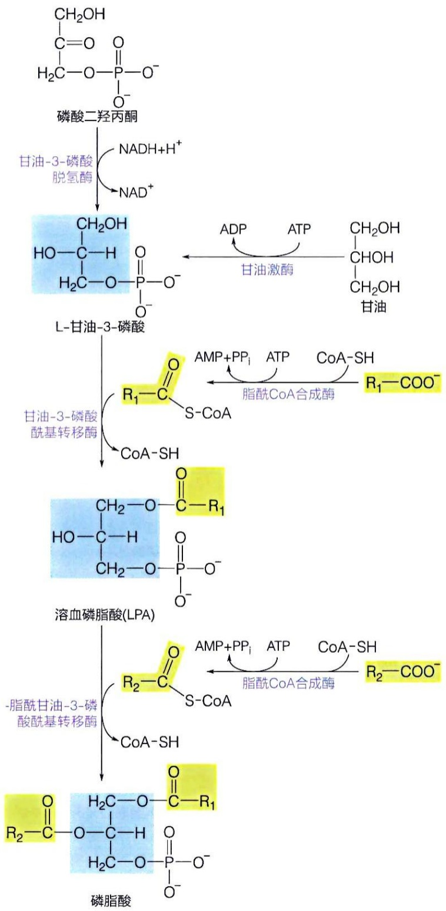

<details>
<summary>flowchart</summary>

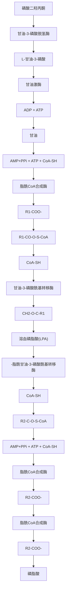
</details>

图 23-13 磷脂酸的合成途径

肝脏、小肠和脂肪组织是甘油三酯合成最为活跃的场所。其中，肝脏不仅利用自身从头合成的脂肪酸（由多余的葡萄糖等转化而来），还利用从食物中摄取并通过血液循环运输来的脂肪酸作为合成甘油三酯的原料。小肠则主要利用从食物中吸收的脂肪酸合成甘油三酯（见图22-2）。脂肪组织将各种来源的脂肪酸转化为甘油三酯，进行长期储存。这包括从食物中摄取的、肝脏中从头合成的，以及脂肪组织自身储存的甘油三酯水解获得的脂肪酸（这一过程称为脂解，具体见后）。

甘油三酯的合成主要发生于真核细胞内质网的胞质侧。此外，线粒体和脂滴间接参与甘油三酯的合成。甘油三酯合成途径主要有两条，即广泛发生的甘油磷酸途径（glycerol phosphate pathway，又称甘油三酯从头合成途径）和小肠上皮细胞中发生的甘油单酯途径（monoacylglycerol pathway）。

甘油磷酸途径的中间体为含有两个脂酰基单位的1,2-甘油二酯-3-磷酸，也被简称为磷脂酸（phosphatidic acid）。磷脂酸同时也是合成甘油磷脂的前体（具体见后），所以它代表合成代谢的一个分叉点。

## 23.2.1 磷脂酸由 L-甘油 -3-磷酸脂酰化生成

在合成磷脂酸之前，需先生成L-甘油-3-磷酸。糖酵解途径的中间产物磷酸二羟丙酮在甘油-3-磷酸脱氢酶（glycerol-3-phosphate dehydrogenase）的催化下，利用NADH提供的电子即可还原为L-甘油-3-磷酸。此外，在肝脏和肾脏等组织中，少量的甘油通过甘油激酶（glycerol kinase）转化为L-甘油-3-磷酸（图23-13）。

---

23.2 脂肪酸以甘油三酯形式长期储存

345

随后，1 分子由脂肪酸活化形成的脂酰辅酶 A 在一种脂酰转移酶（acyl transferase）的催化下，将一个脂酰基转移到 L-甘油-3-磷酸的 C1 羟基上，生成溶血磷脂酸（lysophosphatidic acid，LPA），并释放 1 分子辅酶 A。脂酰辅酶 A 的形成过程与脂肪酸在氧化前通过脂酰辅酶 A 合成酶在胞质溶胶中活化的过程完全相同，均需消耗 ATP，生成 AMP 和焦磷酸（见第 22 章）。此外，某些细胞或细胞碎片（如血小板）释放的溶血磷脂酸还具有信号分子的功能。

接下来，另一种脂酰转移酶催化溶血磷脂酸的 C2 羟基与 1 分子脂酰辅酶 A 缩合，生成磷脂酸。值得注意的是，催化 C1 和 C2 羟基酰基化的脂酰转移酶并不相同。通常，磷脂酸的 C1 羟基连接饱和脂肪酸，而 C2 羟基则连接不饱和脂肪酸，这表明两种酰基转移酶具有不同的特异性。具体而言，催化 C1 羟基酰基化的酶为甘油 -3- 磷酸酰基转移酶（glycerol-3-phosphate acyltransferase，GPAT），而催化 C2 羟基酰基化的酶则为 1- 脂酰甘油 -3- 磷酸酰基转移酶（1-acylglycerol-3-phosphate acyltransferase，AGPAT）。此外，真核细胞中还存在一种甘油二酯激酶（diacylglycerol kinase），它能够催化甘油二酯在 C3 位羟基发生磷酸化，生成磷脂酸:

$$
1, 2 - \text {甘油二酯} + \mathrm{ATP} \longrightarrow \text {磷脂酸} + \mathrm{ADP}
$$

甘油二酯和磷脂酸均为信号分子。由催产素等激素诱发产生的甘油二酯为第二信使，是蛋白激酶 C（PKC）的关键激活剂；磷脂酸也参与和营养物感应等有关的信号转导过程。作为信号分子的磷脂酸产生于质膜，而作为甘油三酯合成中间体的磷脂酸则产生于内质网膜，故互不干扰。

## 23.2.2 磷脂酸经去磷酸化后再脂酰化即生成甘油三酯

磷脂酸经两步反应，即去磷酸化和脂酰化，生成甘油三酯（图 23-14）。

第一步由磷脂酸磷酸酶 [phosphatidic acid phosphatase，也称脂素（lipin）] 催化，磷脂酸脱磷酸，生成甘油二酯，同时释放无机磷酸。

第二步由甘油二酯酰基转移酶（diacylglycerol acyltransferase）催化，甘油二酯发生脂酰化，生成甘油三酯。脂酰基仍由脂酰辅酶A提供（图23-14）。在真核细胞中，甘油三酯主要在内质网中合成。甘油二酯酰基转移酶有两种同工酶:甘油二酯酰基转移酶1对单不饱和脂酰辅酶A（如油酰辅酶A）有偏好，而对饱和脂酰辅酶A的活性较低；甘油二酯酰基转移酶2则对中链脂酰辅酶A的活性较高，但对长链脂酰辅酶A的活性较低。利用单颗粒冷冻电镜技术，研究者解析了人源甘油二酯酰基转移酶1的同源二聚体结构（图23-15A），结果显示，两个单体各结合1分子脂酰辅酶A底物，

图 23-14 从磷脂酸生成甘油三酯的过程

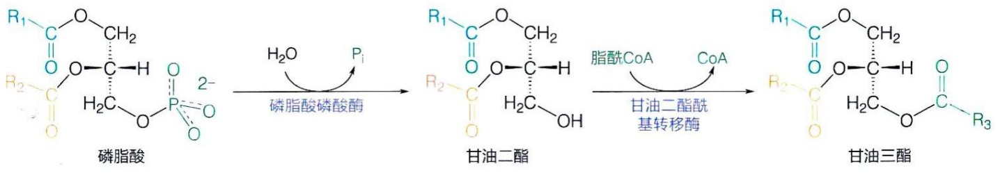

<details>
<summary>chemical</summary>

Reaction pathway showing the conversion of phosphatidic acid to guanidine and then to guanidine triacrylate via intermediate compounds
</details>

---

346

23 脂质合成

图 23-15 结合底物油酰辅酶 A 的甘油二酯酰基转移酶结构

（A）人源甘油二酯酰基转移酶1的二聚体结构（PDB:6VP0）。其中仅可见脂酰辅酶A底物，但未见甘油二酯底物，跨膜α螺旋TM4与TM6之间的距离较大，可能形成甘油二酯底物结合及甘油三酯产物离开的通道。TM:跨膜α螺旋。（B）人源甘油二酯酰基转移酶催化机制示意图。其单体显示为浅蓝色梯形，反应室显示为灰色倒置烧瓶形状。

(A)

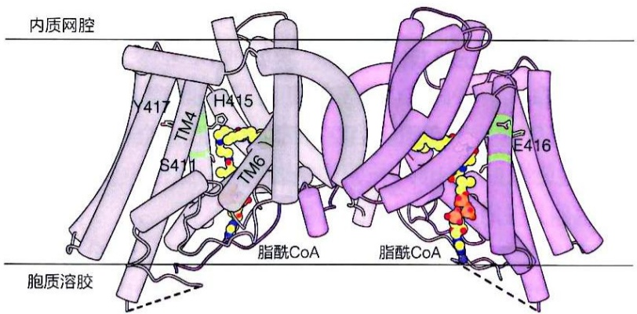

<details>
<summary>text_image</summary>

内质网腔
Y417 TM4 H415
S411 TM6
脂酰CoA 脂酰CoA E416
胞质溶胶
</details>

(B)

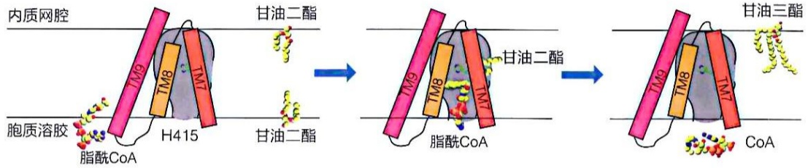

<details>
<summary>flowchart</summary>

This diagram illustrates the biochemical pathway of glutamine (甘油二酯) and its subsequent conversion into glutamine (甘油三酯), showing the mechanism of protein binding to H415 and its subsequent enzymatic transformation.
</details>

每个单体由9个跨膜α螺旋（TM）组成，并在内质网膜中形成一个反应室（reaction chamber）。甘油二酯酰基转移酶1的活性中心H415/E416位于TM7。脂酰辅酶A由甘油二酯酰基转移酶1反应室底部（近胞质溶胶侧，TM7-TM8之间形成的入口）进入反应室，而甘油二酯从TM4与TM6形成的较大入口进入反应室。反应后，产物甘油三酯扩散至内质网腔（图23-15B）。

在脂肪细胞中，新合成的甘油三酯释放至内质网膜的脂双层之间。当积累量超过某一阈值后，新生脂滴以出芽方式从内质网膜释放至胞质溶胶。在肝细胞中，新合成的甘油三酯被引入至新生的脂蛋白颗粒中，最终被分泌到细胞外，进入血液循环。一种可能的脂滴或脂蛋白颗粒形成机制如图23-16所示，一般认为脂滴和脂蛋白颗粒分别在内质网的胞质溶胶侧和内质网腔侧形成。

## 23.2.3 脊椎动物体内甘油三酯的合成受胰岛素等激素促进

在正常成年人体内，储备的脂肪通常可保持长期稳定。然而，当短期内摄入的热量超过机体能量需求时，多余的糖、蛋白质以及脂肪酸会被转化为甘油三酯进行长期储存。机体主要通过分泌胰岛素等激素调节甘油三酯的合成与分解，维持能量供需平衡。

胰岛素将促进摄入过量的糖转化为甘油三酯（图 23-17），同时也抑制脂肪组织中储存的甘油三酯的分解。在饱食状态下，胰岛素分泌增加，通过提高细胞膜中葡萄糖转运蛋白 GLUT4 的含量，促进肌肉和脂肪细胞摄取血液中的葡萄糖（但肝细胞膜中的 GLUT2 含量不受胰岛素调节）。同时，胰岛素还促使肝细胞和脂肪细胞中的葡萄糖转化为甘油三酯（肌肉细胞虽可摄取葡萄糖，但主要将其用于糖原合成或氧化供能，而非大量合成甘油三酯）。具体而言，一方面，胰岛素促进通过膳食摄入的糖通

---

23.2 脂肪酸以甘油三酯形式长期储存

347

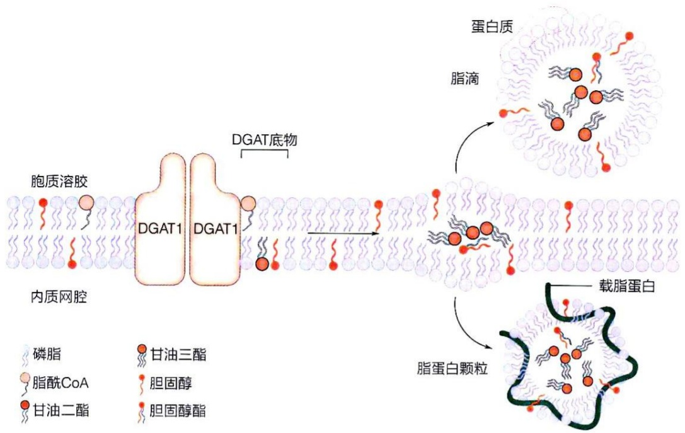

<details>
<summary>flowchart</summary>


</details>

图 23-16 内质网膜上形成的甘油三酯可被引入脂滴或脂蛋白颗粒中

过脂肪酸从头合成途径转化为脂肪酸，进而合成甘油三酯；另一方面，胰岛素通过激活糖酵解途径中的关键调节酶，如磷酸果糖激酶-1（PFK-1）和丙酮酸激酶，促进糖酵解。产生的丙酮酸进入线粒体后转化为乙酰辅酶A，随后与草酰乙酸缩合形成柠檬酸。柠檬酸通过柠檬酸穿梭机制转运至胞质溶胶，为脂肪酸合成提供乙酰辅酶A前体。胰岛素同时通过促使乙酰辅酶A羧化酶去磷酸化，提高其活性（通过形成多聚体），促进脂肪酸合成。此外，胰岛素还可通过激活特异的转录因子，促进许多基因的转录，增加这些基因所编码蛋白质如乙酰辅酶A羧化酶、脂肪酸合酶、柠檬酸裂解酶等酶的含量，促进脂肪酸的从头合成和甘油三酯合成。

胰岛素在促进脂肪合成的同时，也通过抑制脂滴包被蛋白的磷酸化（促进其去磷酸化）而抑制脂肪组织中脂肪的动用。

因此，对于缺乏胰岛素或对胰岛素不敏感的糖尿病患者而言，取其体细胞合成脂肪的能力显著降低，体细胞内多余的乙酰辅酶A被转化为酮体。患者因此逐渐消瘦，并出现酮症酸中毒等严重代谢紊乱。

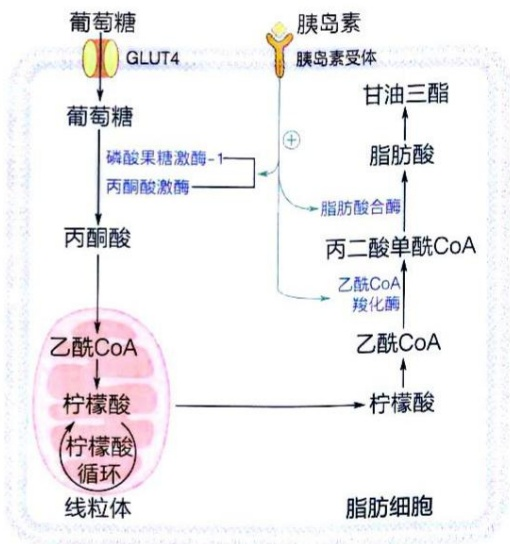

<details>
<summary>flowchart</summary>

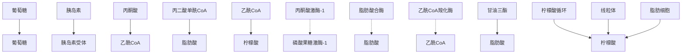
</details>

图 23-17 胰岛素促进脂肪细胞对葡萄糖的摄取和甘油三酯的合成

## 23.2.4 动物体内存在甘油三酯周转现象

1960 年代，人们观察到以下有趣现象。动物组织中发生持续、自发的甘油三酯的水解（脂解）和重新合成这种“无效循环”。分解所释放脂肪酸的大约 75% 并不氧化分解，而是被重新酯化为甘油三酯，形成一种脂肪酸的再酯化（re-esterification）过程，这种现象被称作甘油三酯周转（triacylglycerol cycling）或甘油三酯-脂肪酸循环，

---

348

23 脂质合成

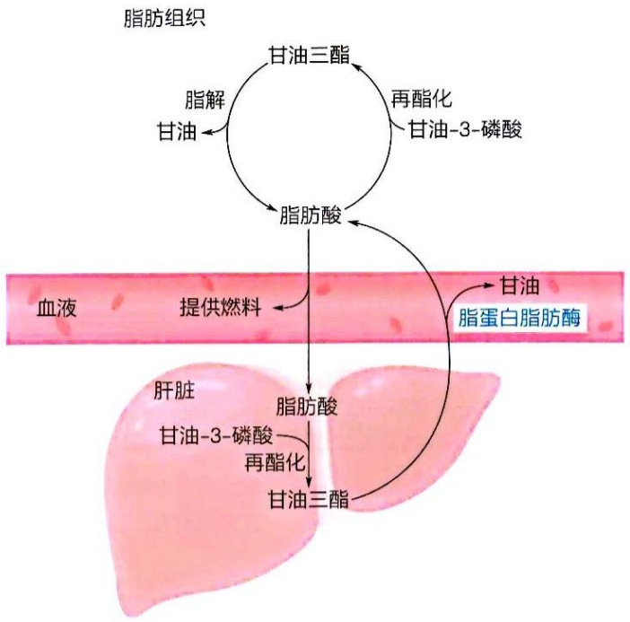

<details>
<summary>flowchart</summary>

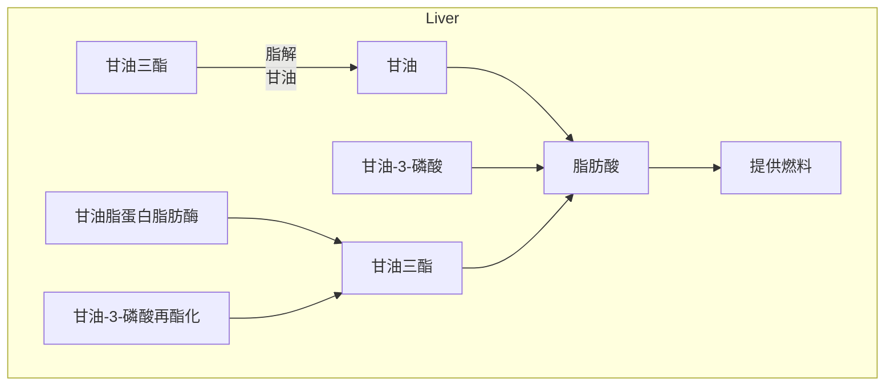
</details>

图 23-18 发生于动物体内的甘油三酯周转现象

如图 23-18 所示。无论动物处于饥饿（甘油三酯的动用量非常高）还是饱食（甘油三酯的动用量非常低）状态，这种甘油三酯的周转现象均以相似比例发生。

具体而言，当脂肪组织中动用的甘油三酯水解所产生的脂肪酸经血液循环运输至肝脏后，在肝脏中可重新酯化为甘油三酯。随后，肝脏将甘油三酯、磷脂、胆固醇与载脂蛋白结合，以脂蛋白颗粒的形式释放到血液中。在脂肪组织毛细血管中，甘油三酯在脂蛋白脂肪酶的作用下再次分解为脂肪酸，被脂肪组织摄取后进行再酯化，所形成的甘油三酯储存于脂肪组织。这种甘油三酯周转过程的主要功能是使脂肪酸处于能量储存和供应的动态平衡状态，维持其代谢灵活性。

甘油三酯周转所释放的脂肪酸大部分最终重新转化为甘油三酯。从表面上看，这是一种“无效”循环，然而，即使在饥饿状态也维持甘油三酯周转的事实表明:它的存在对机体代谢应该是必要的，因而被

演化保留下来。例如，血液中随时存在一定水平的游离脂肪酸，可以更快满足机体对能量的爆发式需求；在遇到“战或逃（fight or flight）”的紧急状态时，动物机体需通过分泌肾上腺素促进脂肪组织中的甘油三酯水解而这需要一定的时间才可发生。在此过程中，已经存在的游离脂肪酸可以被立即使用，以应对紧迫情况。此外，甘油三酯周转可作为棕色脂肪细胞的一种产热机制，周转过程中“浪费”的能量以热的形式释放。甘油三酯周转还可能与脂质多样性的产生和脂质信号传导等过程有关，但其生理意义尚需进一步探究。

## 23.2.5 饥饿状态下肝脏和脂肪组织通过甘油异生途径产生甘油-3-磷酸

在葡萄糖供应充足的条件下，肝脏和脂肪组织等可以将糖酵解途径中的磷酸二羟丙酮还原为甘油-3-磷酸，用于甘油三酯的合成（图23-13）。如前所述，脂肪组织中因缺乏甘油激酶，甘油三酯水解释放的甘油无法被重新转化为甘油-3-磷酸，通常被运输至肝脏用于糖异生过程。在饥饿状态下，尽管脂肪组织中缺乏糖酵解途径，无法直接获得甘油-3-磷酸，但甘油三酯的周转依然能够有效进行。

1960 年代，美国学者理查德·汉森（Richard Hanson，1935—2014）等在非糖异生组织，即脂肪组织中观察到了丙酮酸羧化酶和磷酸烯醇式丙酮酸羧激酶的存在。它们的表达量比进行糖异生的肝脏组织还要高。他们还观察到，在脂肪组织中， $^{14}$ C 标记的丙酮酸可转化为甘油三酯中的甘油骨架。这种利用非甘油和非葡萄糖前体从头生成甘油三酯中甘油的过程被定义为甘油异生（glyceroneogenesis）途

---

23.3 作为膜组分的甘油磷脂也以磷脂酸为前体生成

349

径，具体如图 23-19 所示。

饥饿状态下的脂肪组织中存在的甘油异生途径相当于一条缩短的糖异生途径。具体过程如下:由乳酸或丙氨酸转化而来的丙酮酸在丙酮酸羧化酶催化下，转化为草酰乙酸；后者再在磷酸烯醇式丙酮酸羧激酶催化下生成磷酸烯醇式丙酮酸；然后经过糖异生途径中的五步反应，生成磷酸二羟丙酮，后者还原生成甘油-3-磷酸。

后续研究表明，这种甘油异生途径也发生于肝脏中。

随着我们对甘油三酯周转现象生理学意义的进一步认识，尤其是其在动物饥饿状态下的作用，从某种意义上说，这种甘油异生途径将糖代谢与脂质代谢进行了衔接和平衡，可能对动物应对饥饿等生理状态具有重要意义。

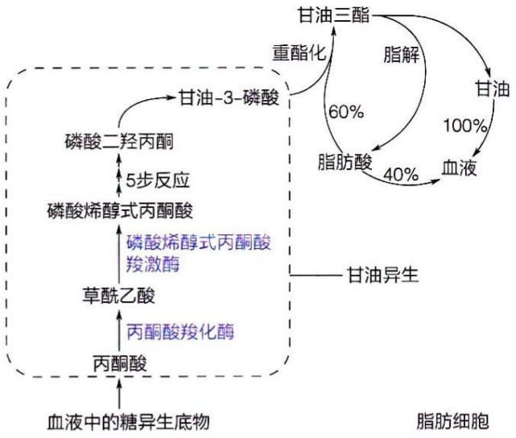

<details>
<summary>flowchart</summary>

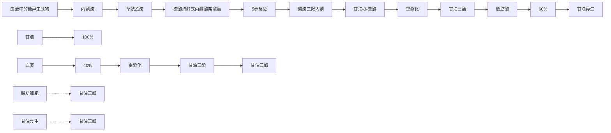
</details>

图 23-19 脂肪细胞甘油异生途径

值得注意的是，肝脏和脂肪组织中的甘油异生过程同样存在一种反向调节机制。具体而言，当肝脏中的甘油异生活性较高时，脂肪组织中的相应活性则较低，反之亦然。这种精细的调节过程是通过激素介导而实现的。例如，皮质醇（cortisol）作为一种糖皮质激素，可以上调肝细胞中磷酸烯醇式丙酮酸羧激酶的表达水平，从而增强肝细胞甘油异生活性，导致肝细胞中的甘油三酯合成增加。然而，皮质醇在脂肪细胞中却表现出相反的作用，它抑制脂肪细胞中磷酸烯醇式丙酮酸羧激酶基因的表达（主要因为肝脏和脂肪细胞转录因子差异所致），从而降低其中的甘油异生活性，使得未被重新酯化的脂肪酸进入血液，进而被其他组织利用。这种反向调节的生物学意义在于:当血糖水平低时，肝脏加速糖异生过程，脂肪组织中脂肪酸的再酯化被抑制，提供更多脂肪酸作为替代能源；而当血糖水平高时，肝脏糖异生减慢，但脂肪组织中脂肪酸再酯化活性则增强。

## 23.3 作为膜组分的甘油磷脂也以磷脂酸为前体生成

膜脂是细胞所有膜结构的重要组分。膜脂的主要结构特征是具有两亲性，即含一个亲水的、极性头部基团，也含一个或多个疏水的碳氢链尾部基团。膜脂主要包括甘油磷脂、鞘磷脂以及胆固醇三大类，甘油磷脂以甘油为骨架，鞘磷脂则以鞘氨醇为骨架。下面先介绍甘油磷脂和鞘磷脂的生物合成途径，后面将介绍胆固醇的合成途径。

## 23.3.1 甘油磷脂的生成利用核苷酸活化的前体

1950年代初，美国学者尤金·肯尼迪利用放射性同位素（${}^{32}\mathrm{P}$ 和 ${}^{14}\mathrm{C}$）标记的磷酸

---

350

23 脂质合成

胆碱等开展实验，其研究结果揭示，动物肝细胞先将磷酸胆碱转化为 CDP- 胆碱后再用于合成磷脂酰胆碱。1960 年代，他们在细菌细胞中还鉴定到了 CDP- 甘油二酯作为甘油磷脂生成的中间体。这些发现开启了人们对甘油磷脂在细胞中合成途径的认识。

甘油磷脂由甘油骨架、两条疏水性脂肪酸碳链（分别位于C1和C2）以及一个含有磷酸基团的亲水头部基团组成。其中的两条脂肪酸碳链经常是不同的。因此，任何一种甘油磷脂其实代表的是一类分子，因为所结合的脂肪酸碳链一般都是多样而非均一。基于此，哺乳动物细胞中可存在数千种不同的磷脂分子，因为脂肪酸碳链的长度、不饱和度以及连接在磷酸基团的官能团的不同，使得甘油磷脂的种类繁多。

## （1）真核细胞从磷脂酸生成甘油磷脂利用两种策略

磷脂酸不仅是合成甘油三酯的一种中间体，也是合成甘油磷脂的一种中间体。因此，磷脂酸可被视作这两条合成途径的分叉点。总体而言，后续合成步骤涉及磷脂酸与一种含羟基的亲水分子（即头基）之间的缩合，形成磷酸酯键连接。但总体策略可分为两种（图23-20）。

图 23-20 真核细胞中甘油磷脂生成的两种策略

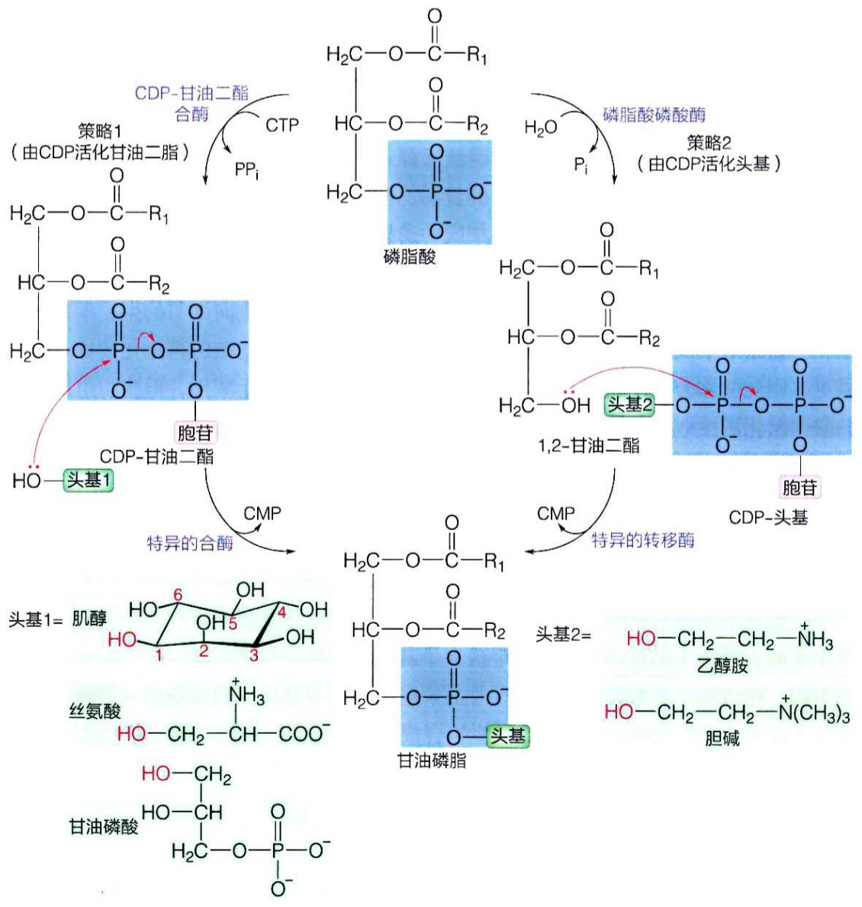

<details>
<summary>flowchart</summary>

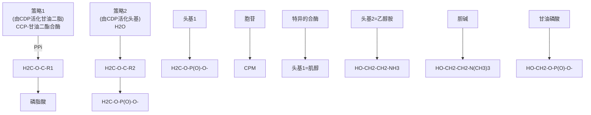
</details>

---

23.3 作为膜组分的甘油磷脂也以磷脂酸为前体生成

351

在第一种策略中，由 CDP-甘油二酯合酶催化磷脂酸通过与 CTP 反应，被活化为 CDP-甘油二酯，后者由特异的合酶催化再被头基的羟基亲核进攻，经缩合形成甘油磷脂分子，同时释放 CMP。在第二种策略中，由磷脂酸磷酸酶催化磷脂酸脱去磷酸基转变为 1,2-甘油二酯，极性亲水头基分子利用其羟基与 CTP 反应，被活化为 CDP-头基，再由特异的转移酶催化 1,2-甘油二酯的羟基亲核进攻 CDP-头基分子中的磷酸基，经缩合形成甘油磷脂分子，同时释放 CMP。上述两种策略的共同原则是:一种底物通过与核苷酸缩合而被活化，而另一种底物则利用其羟基对磷酸基进行亲核进攻（图 23-20）。

原核细胞甘油磷脂的合成（一般利用形成 CDP-甘油二酯的策略）发生于质膜上，而真核细胞甘油磷脂的合成发生于光面内质网膜或线粒体内膜上。某些甘油磷脂，如磷脂酰肌醇、磷脂酰乙醇胺、磷脂酰胆碱等在光面内质网膜上生成，另一些甘油磷脂，如磷脂酰甘油（合成心磷脂的前体）、心磷脂等则在线粒体内膜上合成。总体而言，光面内质网膜是通用膜磷脂的合成场所，而线粒体内膜则是特异磷脂（如心磷脂）的特化合成场所。

CDP-甘油二酯合酶（CDP-diacylglycerol synthase，CDP-DAG 合酶）为一种结合于内质网膜、线粒体内膜或细菌质膜上的蛋白质。其催化过程如图 23-21 所示:底物分别来自生物膜中的磷脂酸和胞质溶胶中的 CTP，生成的 CDP-甘油二酯保留于膜内，参与后续反应。

CDP-甘油二酯为活化的磷脂酸，它通过与形成头基的亲水分子的羟基缩合，完成甘油磷脂的合成过程。与许多其他生物合成反应一样，焦磷酸继续水解释放更多的自由能，有效驱动反应的正向进行。这里 CTP 发挥的活化作用与寡糖或多糖合成过

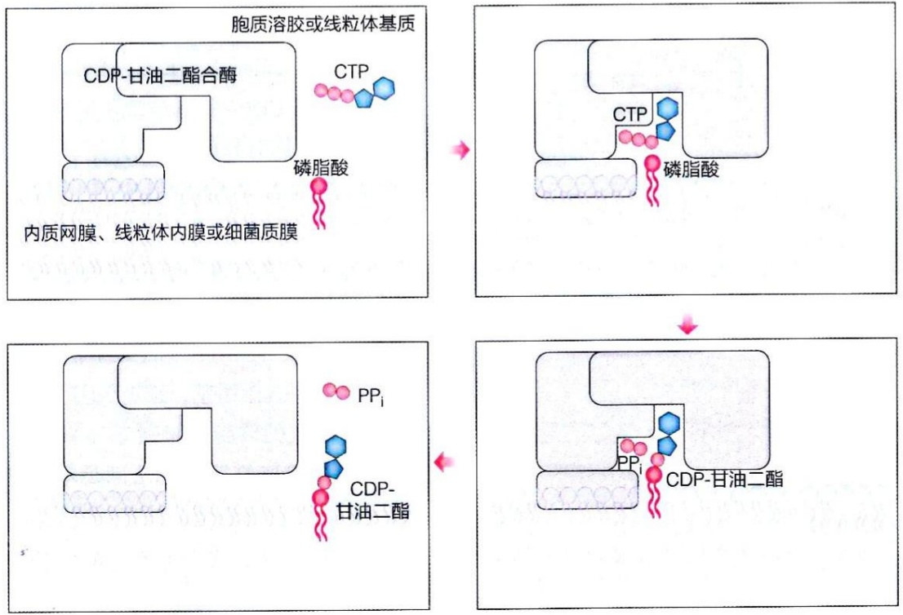

图 23-21 CDP-甘油二酯合酶催化反应示意图

---

352

23 脂质合成

程中 UTP 等发挥的活化作用具有高度可比性。CDP 常用作脂质分子的活化基团，而 UDP 则用作糖类分子的活化基团。活化的前体再与另外一种分子的羟基缩合形成甘油磷脂或寡糖、多糖等产物。

## (2) 真核生物中的多种甘油磷脂利用 CDP- 甘油二酯生成

原核生物中的甘油磷脂均利用 CDP- 甘油二酯合成。在真核生物中，磷脂酰肌醇、磷脂酰丝氨酸、磷脂酰甘油等均利用 CDP- 甘油二酯前体生成（图 23-20）。催化它们生成的酶分别被称为磷脂酰肌醇合酶、磷脂酰丝氨酸合酶和磷脂酰甘油合酶。

磷脂酰肌醇的脂肪酸组成相对而言具有较高保守性，即硬脂酸和花生四烯酸通常分别占据甘油的C1位和C2位。磷脂酰肌醇可以在特异性激酶的催化下，被磷酸化生成磷脂酰肌醇-4,5-二磷酸（$\mathrm{PIP}_2$）。$\mathrm{PIP}_2$ 位于质膜中，是一种重要的信号分子，同时也是信号分子的前体。此外，$\mathrm{PIP}_2$ 还可以被进一步水解，生成肌醇-1,4,5-三磷酸

$(\mathrm{IP}_3)$，后者是细胞内的第二信使。

## （3）真核细胞的其他一些甘油磷脂利用 CDP-头基生成

这包括磷脂酰乙醇胺和磷脂酰胆碱等，主要发生于内质网膜上。以磷脂酰胆碱合成为例说明如下（图23-22）。

首先，胆碱在胆碱激酶催化下，被ATP磷酸化生成磷酸胆碱。然后，在磷酸胆碱胞苷酰转移酶（phosphocholine cytidylyltransferase）催化下，磷酸胆碱被转化形成CDP-胆碱。磷酸胆碱胞苷酰转移酶是磷脂酰胆碱生物合成过程中的关键酶，催化的反应是磷脂酰胆碱合成途径的限速步骤。最后，在胆碱磷酸转移酶（cholinephosphotransferase）催化下，磷酸胆碱基团从CDP-胆碱被转移至甘油二酯，生成磷脂酰胆碱，同时释放CMP。

磷脂酰胆碱在哺乳动物细胞中是一种含量最丰富的磷脂，占膜脂质中甘油磷脂总量约50%。胆碱主要通过食物获得。肝细胞能以磷脂酰乙醇胺为底物，在磷脂酰乙醇胺甲基转移酶（phosphatidylethanolamine methyltransferase）催化下，由S-腺苷甲硫氨酸提供3个甲基，经过3次甲基化反应，最终生成一定量的磷脂酰胆碱（图23-23）。但这样内源性合成的磷脂酰胆碱无法满足动物的需求，仍需依赖外源性食物胆碱的补充。

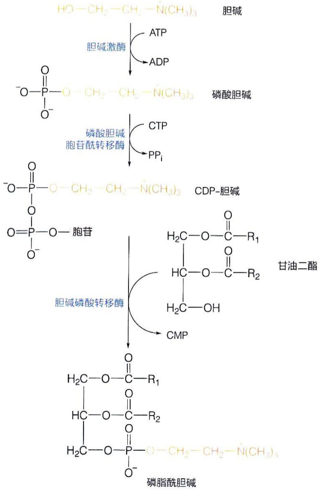

<details>
<summary>flowchart</summary>

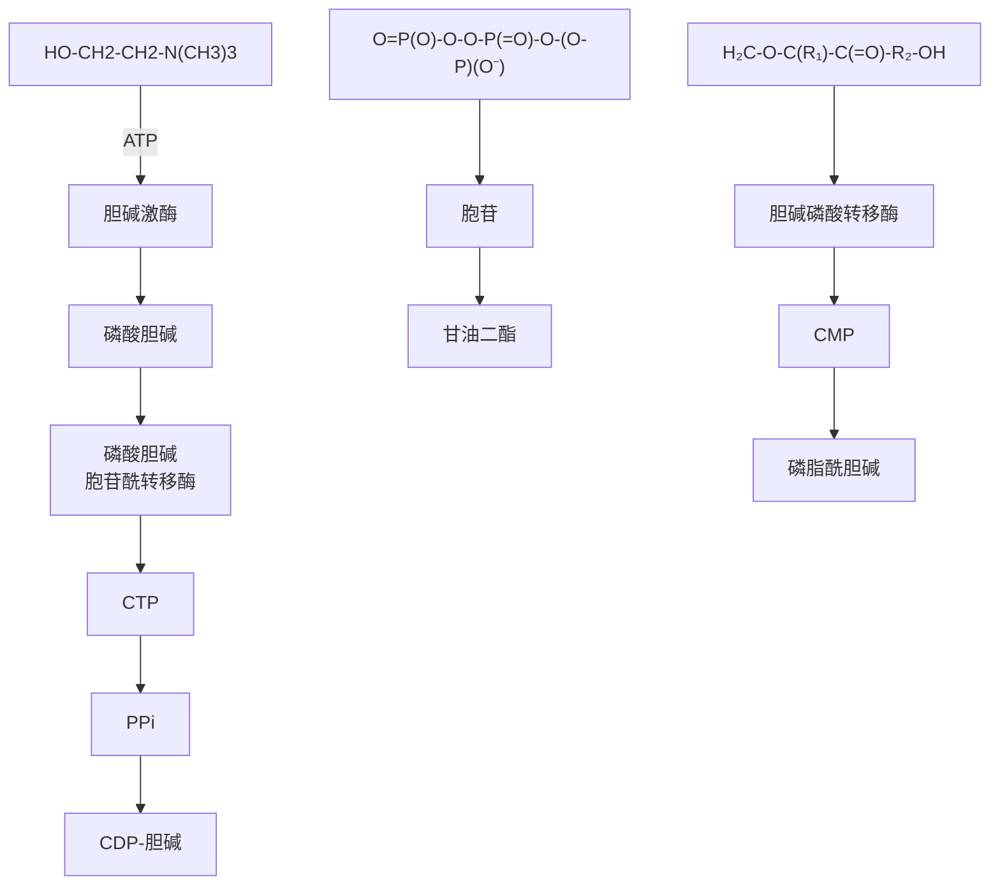
</details>

图 23-22 哺乳动物磷脂酰胆碱的合成

---

23.3 作为膜组分的甘油磷脂也以磷脂酸为前体生成

353

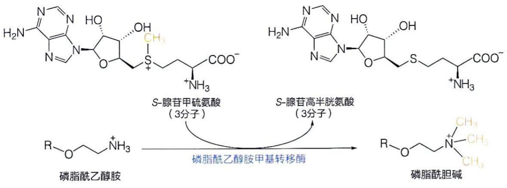

<details>
<summary>chemical</summary>

Chemical reaction pathway showing conversion of phosphatidylpropan-2-aminobutyric acid to phosphatidylpropan-3-aminobutyric acid via S-adenosylamine and S-adenosylamine hydrolysis steps
</details>

图 23-23 磷脂酰乙醇胺经三次甲基化可转变为磷脂酰胆碱

## 23.3.2 哺乳动物中甘油磷脂可通过头基交换而转化

这是 1970 年代观察到的一种现象。典型的例子是从磷脂酰胆碱和磷脂酰乙醇胺生成磷脂酰丝氨酸的过程。

磷脂酰丝氨酸在哺乳动物甘油磷脂总量中占比约为 10%。在正常细胞中，磷脂酰丝氨酸分布于质膜的内侧。然而，在细胞凋亡过程中，它通过翻转机制暴露于质膜的外侧，释放信号并吸引吞噬细胞清除自身。磷脂酰丝氨酸的合成主要由磷脂酰丝氨酸合酶（phosphatidylserine synthase）催化完成，它以两种同工酶形式存在，通过将丝氨酸分别替换磷脂酰胆碱中的胆碱（磷脂酰丝氨酸合酶 1）或磷脂酰乙醇胺中的乙醇胺（磷脂酰丝氨酸合酶 2）来合成（图 23-24）。

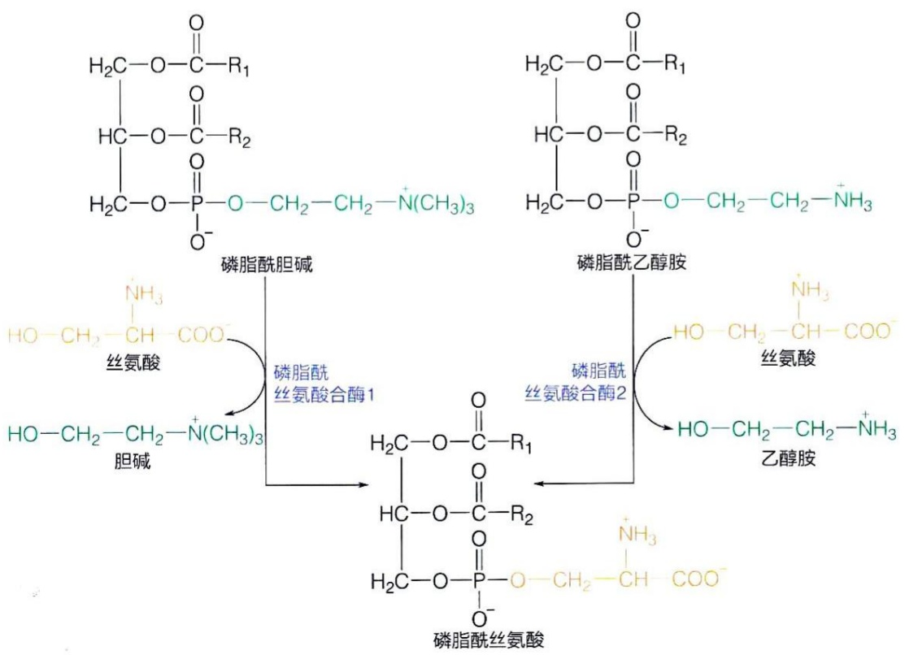

<details>
<summary>chemical</summary>

化学反应式图，展示丙氨酸、乙醇胺及其合成酶的磷酸酯反应路径
</details>

图 23-24 哺乳动物通过头基转换合成磷脂酰丝氨酸的过程

---

354

23 脂质合成

这两种磷脂酰丝氨酸合酶同工酶的活性均依赖钙离子的存在。这种合成途径无须消耗能量，利用已有的甘油磷脂，可快速响应生理需求，调节膜脂质的组成。甘油磷脂在体内通过多种途径合成，以维持它们在体内的动态变化和稳态。

## 23.3.3 含醚键的甘油磷脂的合成利用脂肪醇作为前体

在含醚键的甘油磷脂中，其甘油骨架的 C1 位通过醚键与脂肪醇碳链连接，而其 C2 位通过酯键与一个长短不一的脂肪酸碳链连接。缩醛磷脂（plasmalogen）和血小板活化因子（platelet-activating factor）均属于甘油醚脂。缩醛磷脂和血小板活化因子的合成过程与甘油磷脂合成既存在相似之处，也存在不同之处。以缩醛磷脂的合成为例说明如下（图 23-25）。

缩醛磷脂的合成过程起始于糖酵解中间物磷酸二羟丙酮与脂酰辅酶A的缩合反应，生成1-脂酰-二羟丙酮-3-磷酸。这一反应与磷脂酸的合成过程不同，由磷酸二羟丙酮酰基转移酶催化。随后，由1分子长链脂肪醇取代甘油骨架C1位的脂酰基。长链脂肪醇是从脂酰辅酶A经两步还原反应（由NADPH提供电子，先后由脂酰辅酶A还原酶和脂肪醛还原酶催化）生成的。取代后生成1-烷基-二羟丙酮-3-磷酸（1-烷基醚）。后者分子甘油骨架C2酮基被还原成羟基（也由NADPH提供电子），并发生脂酰化后，即生成1-烷基-2-脂酰甘油-3-磷酸，相当于磷脂酸的1-烷基醚衍生物。该中间体再与乙醇胺进行缩合（加入头基，与磷脂酰乙醇胺中的头基完全相同），在所形成中间物的C1位连接的脂肪链中引入双键，生成缩醛磷脂。最后一步反应为去饱和反应，也由一种混合功能氧化酶（细胞色素P450单加氧酶）催化，需 $\mathrm{O}_2$ 参与，NADPH提供电子，这与脂肪酸去饱和酶的作用机制高度类似（图23-8）。

缩醛磷脂的合成过程起始于过氧化物酶体（前三步反应），生成的1-烷基-甘油-3-磷酸中间体，随后被转运至内质网，在内质网中完成后续的脂酰化、头基的添加以及去饱和反应，最终形成缩醛磷脂。

## 23.3.4 细菌通常通过 CDP- 甘油二酯途径合成甘油磷脂

尽管真核细胞利用两种策略合成甘油磷脂（图23-20），但在细菌中，甘油磷脂均利用活化的CDP-甘油二酯作为前体生成（图23-26A）。

具体简单描述如下。磷脂酰丝氨酸由磷脂酰丝氨酸合酶催化，经活化的 CDP-甘油二酯与丝氨酸缩合生成，同时释放 CMP。磷脂酰乙醇胺则由磷脂酰丝氨酸脱羧酶催化磷脂酰丝氨酸脱羧后生成。磷脂酰甘油由磷脂酰甘油磷酸合酶催化，使 CDP-甘油二酯与甘油 -3- 磷酸缩合生成磷脂酰甘油 -3- 磷酸，后者再在一种磷酸酶的作用下水解，脱去磷酸基团，即生成磷脂酰甘油。心磷脂因最早从新鲜的牛心肌中分离出来而得名，广泛存在于动植物和微生物中。在原核细胞中，由心磷脂合酶（cardiolipin synthase）催化 2 分子磷脂酰甘油缩合而成，同时释放 1 分子甘油。它含 2 分子磷脂

---

23.3 作为膜组分的甘油磷脂也以磷脂酸为前体生成

355

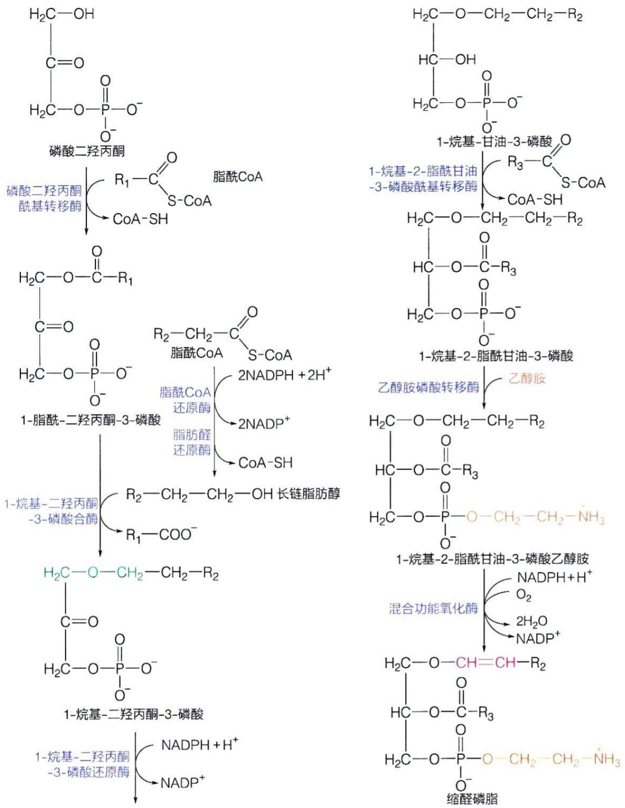

图 23-25 缩醛磷脂合成的过程

酰基和1分子甘油，故又名双磷脂酰甘油。

在真核细胞中，线粒体内膜上合成心磷脂的过程与原核生物稍有差异。真核细胞心磷脂合酶催化1分子磷脂酰甘油与1分子CDP-甘油二酯（非2分子磷脂酰甘油）缩合生成心磷脂。心磷脂分子独特的锥状结构（图23-26B），对于维持呼吸链中细胞色素 $c$ 氧化酶等膜蛋白复合物结构和活性是必需的。

---

356

23 脂质合成

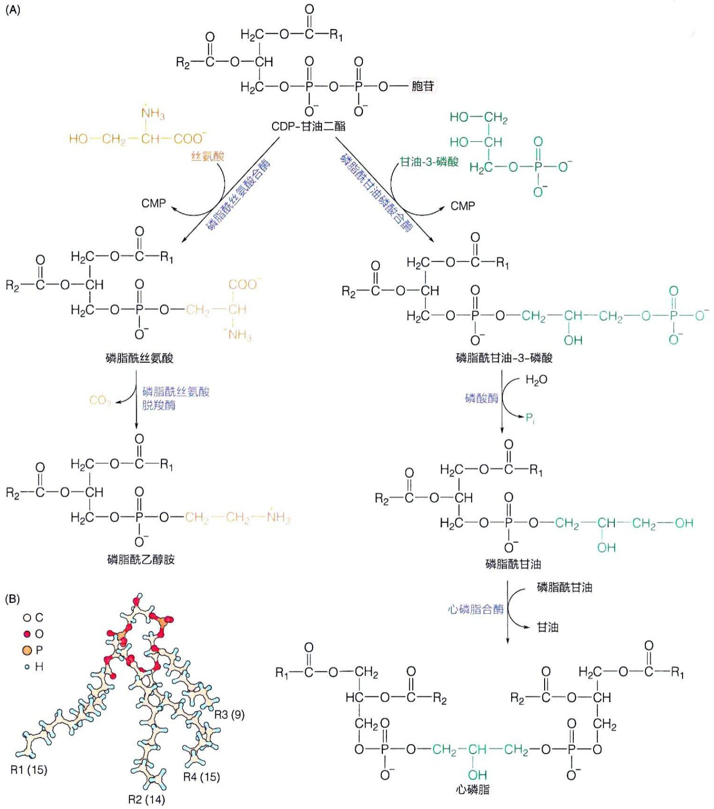

图 23-26 细菌中以 CDP-甘油二酯为前体合成几种甘油磷脂的过程（A）和心磷脂结构（B）
在类球红细菌（Rb. sphaeroides）光反应中心结合的心磷脂结构（PDB:1QOV）中，四个酰基碳链（R1—R4）长度均短于常见的 18 个碳原子，其碳原子个数分别在 R1—R4 后面的括号中标注。

---

23.4 鞘脂的生成始于棕榈酰辅酶A与丝氨酸之间的缩合

357

## 23.4 鞘脂的生成始于棕榈酰辅酶 A 与丝氨酸之间的缩合

鞘脂（sphingolipid）是生物膜脂质中与甘油磷脂并列的另一大类，其骨架为鞘氨醇（sphingosine）。典型的鞘脂包括鞘磷脂和鞘糖脂等。它们的结构特征与甘油磷脂类似，含一个疏水尾部和一个亲水头部。神经酰胺（ceramide）是合成鞘磷脂和鞘糖脂的共同前体。本节介绍鞘磷脂和代表性鞘糖脂的从头合成过程（图23-27）。

## (1) 神经酰胺由棕榈酰辅酶 A 与丝氨酸缩合后衍生而成

鞘脂的合成途径涉及多种细胞器，主要发生于内质网和高尔基体。相比之下，甘油磷脂的合成主要发生在光面内质网膜和线粒体内膜上。尽管两类脂质的合成过程在某些方面相似，但也存在显著差异。

鞘脂合成起始于棕榈酰辅酶A与丝氨酸之间的缩合脱羧。该反应由位于光面内质网膜上的丝氨酸棕榈酰转移酶（serine palmitoyltransferase）催化，利用磷酸吡哆醛（PLP）为辅因子，生成β-酮鞘氨醇（β-ketosphinganine），同时释放辅酶A和 $CO_{2}$

图 23-27 从棕榈酰辅酶 A 和丝氨酸经由神经酰胺生成鞘磷脂和鞘糖脂的过程

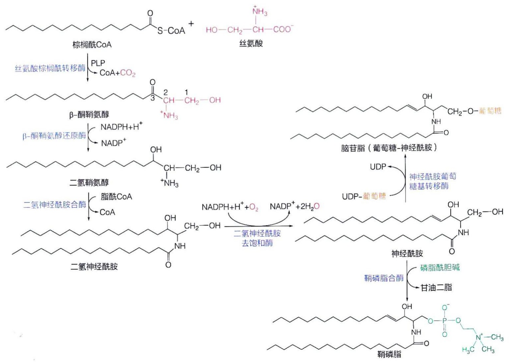

<details>
<summary>flowchart</summary>

This flowchart illustrates the metabolic pathway of a glycosaminoglycan, showing the conversion of amino acids and alcohols to various organic compounds like glucose, glucose-cholesterol, and phosphate.
</details>

---

358

23 脂质合成

(源自丝氨酸的羧基)。这步反应是鞘脂合成的限速步骤。

β-酮鞘氨醇经 β-酮鞘氨醇还原酶催化，被还原为二氢鞘氨醇（sphinganine），该反应由 NADPH 提供电子。随后，由二氢神经酰胺合酶（dihydroceramide synthase）催化，二氢鞘氨醇中 C2 位氨基与一分子脂酰基以酰胺键连接，生成二氢神经酰胺。该中间体再由二氢神经酰胺去饱和酶（一种混合功能氧化酶）催化，发生去饱和反应（类似于脂肪酸碳链去饱和反应，见图 23-8）生成神经酰胺。

## （2）从神经酰胺衍生鞘磷脂或鞘糖脂等

在高尔基体中，神经酰胺 C1 位羟基通过加入不同的头基生成不同类型的鞘脂，如鞘磷脂或鞘糖脂。

由位于高尔基体膜上的鞘磷脂合酶（sphingomyelin synthase）催化，将磷脂酰胆碱分子中的头基磷酸胆碱转移至神经酰胺C1位羟基，则生成鞘磷脂，同时释放一分子甘油二酯。最初，人们认为磷酸胆碱基团也是由CDP-胆碱提供的。然而，1970年代的同位素标记示踪研究揭示，磷脂酰胆碱才是鞘磷脂合成的头基供体，纠正了先前的错误。

由同样位于高尔基体膜中的神经酰胺葡萄糖基转移酶（ceramide glucosyltransferase）催化，UDP-葡萄糖中的葡萄糖基被转移至神经酰胺C1位羟基，则生成鞘糖脂中的葡萄糖脑苷脂（glucocerebroside）。神经酰胺C1位羟基也可连接其他单糖或寡糖基（这包括决定ABO血型的鞘糖脂所含有的三种寡糖基），生成其他类型的鞘糖脂。例如，当神经酰胺C1位羟基连接半乳糖基（由UDP-半乳糖提供）时，则生成半乳糖脑苷脂（galactocerebroside）。

神经节苷脂（ganglioside）是一类更为复杂的鞘糖脂，其特征是在神经酰胺分子C1位羟基上连接有一个或多个唾液酸（sialic acid）糖基，如N-乙酰神经氨酸（N-acetylneuraminate）或N-羟乙酰神经氨酸（N-glycolylneuraminate）。这些携带寡糖链的分子位于细胞表面，在细胞识别、黏附和信号转导过程中发挥作用。迄今为止，已鉴定大约200种不同的神经节苷脂，它们的多样性主要源于寡糖链的组成差异。神经节苷脂的合成是一个有序的过程，涉及在神经酰胺分子上顺序添加活化的单糖。每一步添加反应由位于高尔基体膜中特异的糖基转移酶催化。不同类型的神经节苷脂的糖基组成因其类型而异，这种差异由细胞中表达的糖基转移酶的种类所决定。糖基转移酶的糖基供体包括UDP-葡萄糖、UDP-半乳糖、UDP-N-乙酰半乳糖胺以及CMP-N-乙酰神经氨酸等。

## 23.5 动物胆固醇由乙酰辅酶 A 提供的二碳单位经缩合反应合成

胆固醇也是构成真核细胞生物膜的重要脂质成分，尤其在哺乳动物细胞中发挥重要作用。此外，它还是合成类固醇激素和胆汁酸等的前体物质。从分离纯化、元素分

---

23.5 动物胆固醇由乙酰辅酶 A 提供的二碳单位经缩合反应合成

359

析、结构测定、生物合成途径以及含量调控等多方面，人们对胆固醇的研究已持续数百年，但相关研究仍在不断深入。

胆固醇的化学结构涉及四个融合在一起的环（即环戊烷多氢菲），总共含27个碳原子。尽管胆固醇的结构看似复杂，但它能被包括人类在内的几乎所有动物合成。其中，肝脏是胆固醇合成的主要场所，大约70%\~80%的胆固醇由肝脏合成，大约10%由小肠合成。

早在 1920 年代，英国学者哈罗德·钱农（Harold Channon, 1897—1979）就观察到，给大鼠饲喂角鲨烯（squalene；一种于 1910 年代从鲨鱼肝脏中分离的非皂化脂肪）时，其

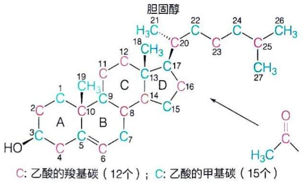

<details>
<summary>chemical</summary>

Chemical structure of a complex organic molecule with labeled carbon atoms and functional groups
</details>

图23-28 胆固醇分子中的所有碳原子均由乙酸中的相应碳原子提供

组织中的胆固醇含量显著增加。在1930年代，美国学者鲁道夫·舍恩海默（Rudolf Schoenheimer，1898—1941）等观察到，胆固醇合成在小鼠体内是按需进行的:当从食物中摄取足量胆固醇时，体内胆固醇的合成会相应减少。在同期，舍恩海默和戴维·里滕伯格（David Rittenberg，1906—1970）等人利用氘（${}^{2}\mathrm{H}$，即重氢）标记的重水（$\mathrm{D}_2\mathrm{O}$）饲喂大鼠，发现在胆固醇分子中的所有氢原子均可被氘标记。这一结果表明，胆固醇可能是由小分子单位缩合而成的。在1940年代，里滕伯格和康拉德·布洛赫（Konrad Bloch，1912—2000）等使用氘标记的乙酸分别饲喂大鼠和小鼠，发现氘存在于胆固醇的侧链和甾核中，排除了琥珀酸等是胆固醇合成直接中间体的可能性；而且，氘主要是从乙酸的甲基部分进入胆固醇分子中。随后，布洛赫等利用稳定重同位素$^{13}\mathrm{C}$和放射性同位素$^{14}\mathrm{C}$分别标记乙酸的甲基碳和羧基碳，然后饲喂大鼠，并对被标记的碳原子出现在胆固醇分子中的精确位置进行了鉴定。他们发现胆固醇分子中的所有碳原子均分别源自乙酸分子的甲基碳和羧基碳（图23-28）。也就是说，乙酸（在体内以乙酰辅酶A的形式存在）是胆固醇合成的唯一前体。

## 23.5.1 动物体内的胆固醇合成大约涉及 30 步酶促化学反应

长期研究表明，机体内的胆固醇既可从食物摄取，也可由自身细胞从头合成。在哺乳动物体内，胆固醇的合成主要发生于肝脏，其合成过程起始于胞质溶胶，最终在内质网膜上完成。

该合成过程大约涉及30步酶促反应，可人为划分为四个阶段（图23-29）。第①阶段:由3分子乙酰辅酶A经缩合、还原形成含6个碳原子的中间物甲羟戊酸。第②阶段:甲羟戊酸转化为活化的异戊二烯中间物，即异戊烯基焦磷酸和二甲烯丙基焦磷酸。第③阶段:由6分子异戊二烯活化中间体聚合形成含30个碳的鲨烯中间体。第④阶段:鲨烯环化形成羊毛固醇中间体，再经多步反应生成胆固醇。

与脂肪酸合成（见图23-6）类似，胆固醇合成的所有碳原子也均来源于乙酰辅酶A，同时合成反应所需的还原当量也由NADPH提供。胆固醇合成是一个高度耗能的过程:每合成1分子胆固醇需消耗36分子ATP及16分子NADPH。

---

360

23 脂质合成

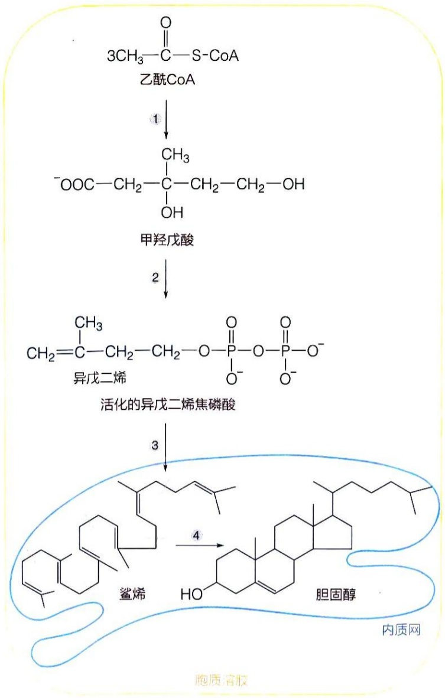

<details>
<summary>flowchart</summary>

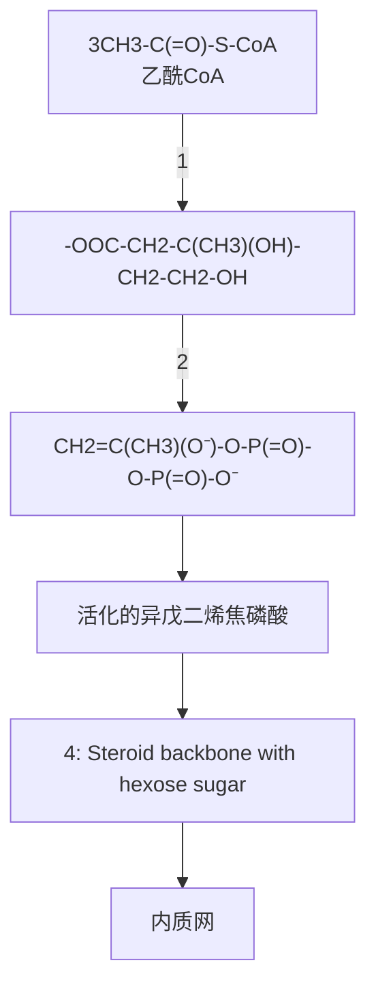
</details>

图23-29 胆固醇的合成可被划分为四个阶段

①由3分子乙酰辅酶A缩合成1分子甲羟戊酸；②由甲羟戊酸转化为活化的异戊二烯；③由6分子活化的异戊二烯缩合生成1分子鲨烯；④由鲨烯转化为胆固醇。

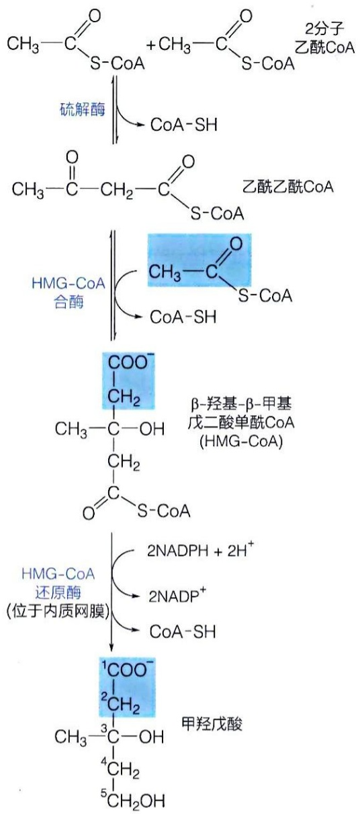

<details>
<summary>flowchart</summary>

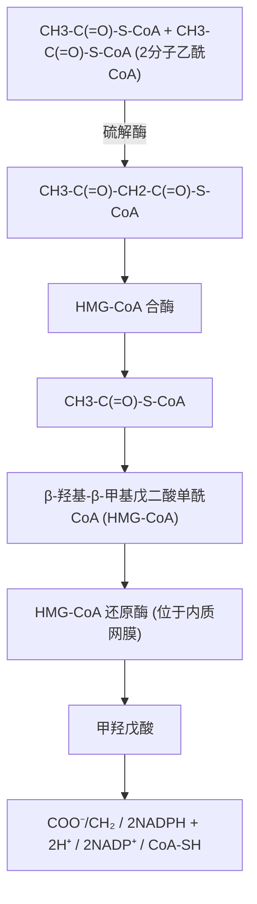
</details>

图23-30 由乙酰辅酶A合成甲羟戊酸的过程

## (1) 胆固醇合成第一阶段 (由 3 分子乙酰辅酶 A 缩合成 1 分子甲羟戊酸)

如图 23-30 所示，胆固醇的合成始于 2 分子乙酰辅酶 A 之间缩合形成乙酰乙酰辅酶 A 的酶促反应。该反应由硫解酶（thiolase）催化，是脂肪酸 β 氧化途径最后一步反应（见图 22-6），也与酮体生成的第一步反应（见图 22-20）完全相同。值得注意的是，胆固醇合成始于肝细胞的胞质溶胶，而脂肪酸 β 氧化和酮体生成则均发生于线粒体基质中；因此，催化胆固醇合成的硫解酶实际上为另外两条代谢途径中所使用酶的同工酶，并非完全相同。

随后，乙酰乙酰辅酶 A 再与 1 分子乙酰辅酶 A 缩合，生成 β-羟基 -β-甲基戊二酸单酰辅酶 A（β-hydroxy-β-methylglutaryl-CoA，HMG-CoA）。该反应由胞质溶胶中

---

23.5 动物胆固醇由乙酰辅酶 A 提供的二碳单位经缩合反应合成

361

的 HMG-CoA 合酶催化，线粒体基质中催化酮体合成的 HMG-CoA 合酶是其同工酶。在位于光面内质网膜上的 HMG-CoA 还原酶（HMG-CoA reductase；其活性中心位于胞质溶胶侧）的作用下，由 2 分子 NADPH 提供 4 个电子，HMG-CoA 被还原为 3,5-二羟基-3-甲基戊酸，简称为甲羟戊酸（mevalonate），反应释放 1 分子辅酶 A。HMG-CoA 还原酶作为一种调节酶，催化胆固醇合成的限速步骤（具体见后）。

（2）胆固醇合成的第二阶段（由甲羟戊酸生成活化的异戊二烯）

如图23-31所示，经前三步反应生成的甲羟戊酸将经历两次磷酸化，分别由甲羟戊酸-5-磷酸转移酶（mevalonate 5-phosphotransferase）和磷酸甲羟戊酸激酶（phosphomevalonate kinase）催化，生成5-焦磷酸甲羟戊酸。随后，在焦磷酸甲羟戊酸脱羧酶（pyrophosphomevalonate decarboxylase）的催化下，形成一种不稳定的中间体3-磷酸-5-焦磷酸甲羟戊酸（C3位羟基通过磷酸化成为一个易离去基团）之后，迅速发生脱羧和脱磷酸反应，生成含5个碳原子的 $\Delta^3$ -异戊烯基焦磷酸（$\Delta^3$-isopentenyl pyrophosphate）。后者中有一部分发生自发异构反应，生成二甲烯丙基焦磷酸（dimethylallyl pyrophosphate）。

这里生成的两种活化异戊二烯形式，将作为下一阶段缩合反应的共同前体。值得注意的是，植物也通过生成甲羟戊酸中间体的途径合成固醇类（即甾醇类）化合物，细菌则一般不合成胆固醇或其他固醇类物质。

（3）胆固醇合成的第三阶段（由6分子活化异戊二烯缩合成1分子鲨烯）

如图23-32所示，该阶段始于1分子二甲烯丙基焦磷酸与1分子 $\Delta^3$ -异戊烯基焦磷酸进行的“首尾”缩合，生成1分子含10个碳原子的牻牛儿基焦磷酸（geranyl pyrophosphate），释放1分子焦磷酸。该反应由牻牛儿基焦磷酸合酶催化。

随后，1 分子牻牛儿焦磷酸再与 1 分子  $\Delta^{3}$ -异戊烯基焦磷酸进行 “首尾” 缩合，生成含 15 个碳原子的法尼基焦磷酸（farnesyl pyrophosphate），释放 1 分子焦磷酸。催化这步反应的是法尼基焦磷酸合酶。在此基础上，在鲨烯合酶（squalene synthase）的催化下，2 分子法尼焦磷酸

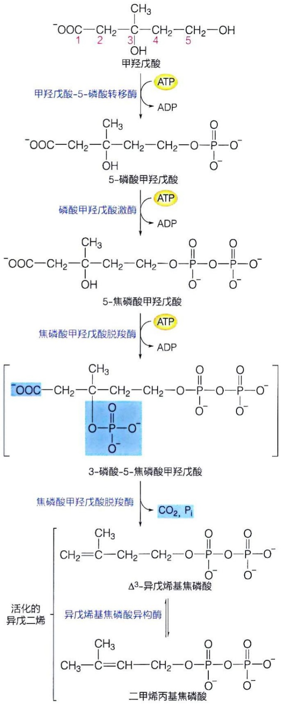

<details>
<summary>flowchart</summary>

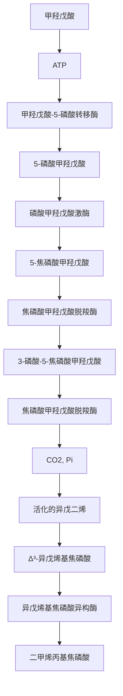
</details>

图 23-31 甲羟戊酸生成活化的异戊二烯的过程

---

362

23 脂质合成

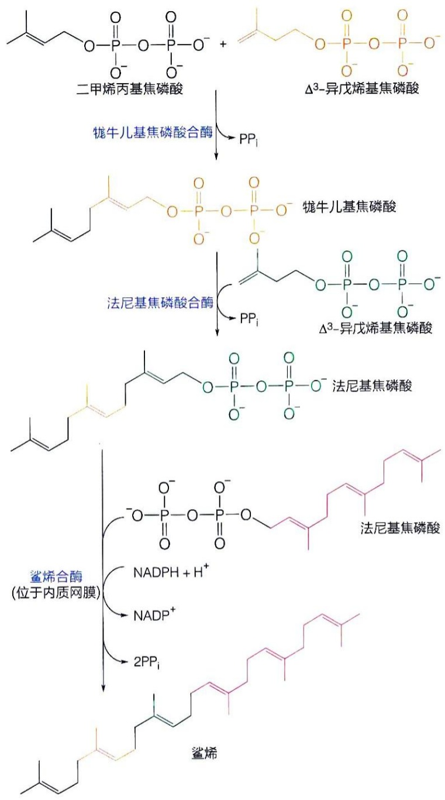

<details>
<summary>flowchart</summary>

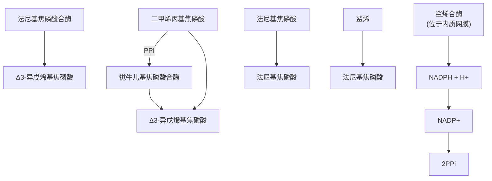
</details>

图 23-32 六分子活化异戊二烯缩合形成鲨烯中间体

进行“头对头”缩合，生成含30个碳原子的鲨烯（squalene）。该反应需要1分子NADPH参与，并释放2分子焦磷酸。鲨烯又名三十碳六烯，属萜类化合物。其中的主链含24个碳原子，另外6个碳原子以甲基支链形式存在，分子中的6个碳碳双键全为反式构型。这些中间物的命名均与最初分离得到它们的物种名称有关，如鲨烯最初是从鲨鱼的肝脏中分离纯化的。

值得注意的是，鲨烯合酶位于内质网膜上，但其活性中心位于胞质溶胶侧，使其可以直接利用胞质溶胶中生成的法尼基焦磷酸，而生成的疏水性鲨烯，则可在膜上参与后续的胆固醇生成反应。

（4）胆固醇合成的第四阶段（鲨烯转化为胆固醇）

此阶段涉及的反应发生于内质网膜上，鲨烯这种线性前体将被转变为胆固醇的四环结构（图23-33）。因此，闭环是这一阶段的主要特征。

在动物肝细胞中，含30个碳原子的鲨烯先由鲨烯单加氧酶（squalene monooxygenase）催化，为环化做准备。该酶也被称为鲨烯环氧化酶（squalene epoxidase），是一种位于内质网膜上的混合功能氧化酶:分子氧中的1个氧原子被加到碳链末端的双键上，形成鲨烯2,3-环氧化物（squalene-2,3-epoxide）活性中间体；而分子氧中的另1个氧原子接受NADPH传递的电子被还原为 $H_{2}O$ ；该酶含FAD辅因子。与其他单加氧酶相比，该酶具有以下特点:催化过氧化（非羟基化）反应；存在一条疏水性通道，可供底物进出；不

含血红素铁。鲨烯单加氧酶也是胆固醇从头合成的调节酶之一。

随后，鲨烯2，3-环氧化物在动物体内羊毛固醇合酶（lanosterol synthase）——一种鲨烯2，3-环氧化物环化酶——的催化下，发生一种独特的系列闭环反应，生成羊毛固醇。该酶无需任何辅因子，仅依赖活性位点酸性氨基酸触发环化反应。羊毛固醇通过一系列大约19步反应，最后转化为胆固醇。这涉及侧链上1个碳碳双键的还原，固醇环上另1个碳碳双键位置的改变及3个甲基的去除等。其中的脱甲基反应依赖于NADPH、氧气以及细胞色素 $b_{5}$ 家族成员的协同作用（通过电子传递）。动物、植物、酵母细胞生成固醇的途径有所不同:动物体内环化反应形成的产物是羊毛固

---

23.5 动物胆固醇由乙酰辅酶 A 提供的二碳单位经缩合反应合成

363

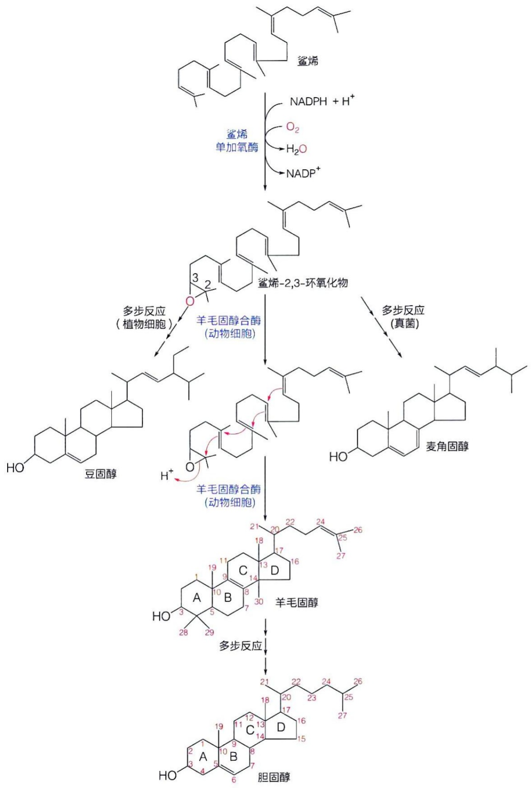

<details>
<summary>flowchart</summary>

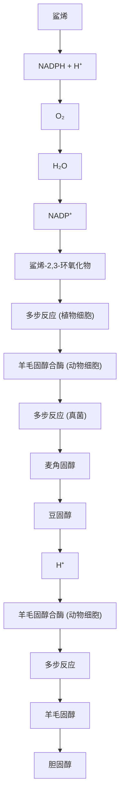
</details>

图 23-33 鲨烯经由羊毛固醇转化为胆固醇的过程

醇（lanosterol），并最终转化为胆固醇；在植物中，鲨烯2,3-环氧化物经多步反应生成豆固醇（stigmasterol）；在酵母中，环化后的最终产物为麦角固醇（ergosterol）（图23-33）。

---

364

23 脂质合成

异戊烯基焦磷酸是生物体合成多种类异戊二烯化合物的前体。这些类异戊二烯化合物（isoprenoid）包括脂溶性维生素、植物色素、多萜醇（dolichol）和泛醌等（图23-34），具有多种生物学作用（见第7章）。它们可能代表了一类最古老且结构最多样化的天然化合物。迄今为止，在自然界中已发现超过20000种不同的类异戊二烯化合物。

## 23.5.2 动物细胞通过对 HMG-CoA 还原酶等的调节维持胆固醇的稳态

舍恩海默等在1930年代进行的小鼠喂食实验表明:当小鼠摄入不含胆固醇的食物时，其体内会合成胆固醇；而当小鼠被喂富含胆固醇的食物时，其体内的胆固醇合成则显著减少。无论饲喂含胆固醇食物与否，其体内均维持一定水平的胆固醇。这表明，动物体内不仅能够合成胆固醇，而且其合成量的高低受到食物中胆固醇含量的调节:摄取多则合成少，反之亦然。当动物摄入大量富含胆固醇的食物后，体内的胆固醇从头合成将被抑制。

动物细胞内的胆固醇主要来源于两条途径:一是从血液中摄取来自食物或其


<details>
<summary>flowchart</summary>


</details>

图 23-34 异戊烯基焦磷酸是合成大量类异戊二烯化合物的前体


<details>
<summary>flowchart</summary>


</details>

图 23-35 HMG-CoA 还原酶的活性可通过可逆磷酸化修饰调节

他组织中的胆固醇；二是细胞本身通过大约30步反应从头合成的胆固醇。从血液中摄取主要通过细胞表面的低密度脂蛋白（low density lipoprotein，LDL）受体介导的内吞作用，将LDL颗粒中的胆固醇摄入细胞内（具体见后），从而提高细胞内的胆固醇水平。

1960 年代，HMG-CoA 还原酶被确定为细胞内胆固醇从头合成途径中的主要调节酶。然而，HMG-CoA 还原酶的活性并不被任何下游代谢物直接别构抑制，其活性可通过磷酸化 / 去磷酸化修饰、酶的降解、转录和翻译等多种方式调节，下面分别简单介绍。

（1）HMG-CoA 还原酶活性可因磷酸化修饰而被抑制

HMG-CoA 还原酶的可逆磷酸化修饰主要受 AMP 活化蛋白激酶（AMPK）和胰岛素的调节（图 23-35）。当细胞内 AMP 的浓度很高（即 ATP 浓度很低）时，积累的 AMP 与 AMPK 结合而使后者激活，催化 HMG-CoA 还原酶一个特定丝氨酸残基侧链发生磷酸化修饰，使其活性降低，从而减慢胆固醇的合成速率。

---

23.5 动物胆固醇由乙酰辅酶 A 提供的二碳单位经缩合反应合成

365

胰岛素通过诱发 HMG-CoA 还原酶的去磷酸化而提高其活性。具体而言，胰岛素通过激活蛋白磷酸酶 2A（PP2A），导致 HMG-CoA 还原酶去磷酸化而被激活，最终促进细胞内胆固醇的合成。胰岛素还可通过促进糖酵解途径而提高细胞内 ATP 水平，降低 AMP 水平，从而降低 AMPK 活性。

## (2)当胆固醇水平升高时 HMG-CoA 还原酶可被降解

在细胞内，HMG-CoA 还原酶的半衰期通常为 2～4 小时，而在内质网膜中存在的其他蛋白质的半衰期则显著更长，约为其 10 倍。这表明，细胞内的 HMG-CoA 还原酶可被有效降解。具体而言，HMG-CoA 还原酶的降解是一种由胰岛素诱导基因蛋白（insulin-induced gene protein, Insig 蛋白；也位于内质网膜上）介导，并受固醇类化合物促进的过程（图 23-36）。


<details>
<summary>flowchart</summary>

This diagram illustrates the biochemical pathway of HMG-CoA还原酶 in response to oxygen fixation, showing how internal proteins (gp78 and Insig) are converted into a complex form that is then combined with胆固醇.
</details>

胆固醇衍生物氧固醇（oxysterol；如24-羟基胆固醇）和胆固醇合成途径的中间体羊毛固醇，可诱发HMG-CoA还原酶的降解。在血液或组织细胞中，胆固醇含量是氧固醇的 $10^{4} \sim 10^{6}$ 倍。

存在于内质网膜上的 HMG-CoA 还原酶可分为两个结构域:具有催化活性的胞质溶胶结构域和感知胆固醇前体或衍生物信号的膜结合结构域。氧固醇或羊毛固醇通过促进 Insig 蛋白与 HMG-CoA 还原酶结合，并招募如 gp78 等泛素连接酶（E3），触发 HMG-CoA 还原酶的泛素化修饰而促进其降解，进而降低 HMG-CoA 还原酶的活性，最终抑制细胞内胆固醇的合成（图 23-36）。

此外，氧固醇还可抑制 LDL 受体介导的外源性胆固醇摄入过程，但其具体作用机制目前还不十分清楚。

## (3) HMG-CoA 还原酶的活性还可通过转录和翻译过程调节

参与胆固醇合成和摄取等过程的蛋白质，如HMG-CoA合酶、HMG-CoA还原酶和LDL受体，它们编码基因的表达受到固醇调节元件结合蛋白（sterol regulatory element-binding protein，SREBP）调控。SREBP蛋白的转录活性受细胞内固醇类化合物（如胆固醇和氧固醇）水平的精细调节:当这些化合物水平较高时，SREBP蛋白不具有转录活性；只有当固醇类化合物水平较低时，SREBP蛋白才转变为具有活性的转录因子，从而促进相关基因的表达。

图 23-36 在高水平胆固醇前体或衍生物存在时，HMG-CoA 还原酶降解加速

Insig: 胰岛素诱导基因蛋白; gp78: 一种泛素连接酶 (E3); Ub: 泛素。

---

366

23 脂质合成

## 23.5.3 胆固醇可衍生成多种具有其他功能的生命分子

无论是从外源摄取的还是自身从头合成的胆固醇，都可转化为多种具有其他功能的重要生命分子。这包括胆汁酸（或胆汁盐）、类固醇激素及维生素 $D_{3}$ 等。

## (1) 胆固醇在肝细胞中可被转化为胆汁酸和胆汁盐等

从胆固醇到胆汁酸的转化是一个复杂的过程，涉及多个羟基的引入、碳碳双键的还原以及侧链的氧化等。这些转化增加了固醇分子中极性基团的数量，从而提高了其水溶性，使胆汁酸能更有效地被运输。从胆固醇合成胆酸（一种典型的胆汁酸）的过程如图23-37A所示。参与胆汁酸合成的羟化酶，如固醇 $7\alpha-$ 羟化酶（即CYP7A1，cytochrome P450 family 7 subfamily A member 1）、固醇 $12\alpha-$ 羟化酶（即CYP8B1）和固醇27-羟化酶（即CYP27A1），均属于细胞色素P450类混合功能氧化酶家族成员（因此名称中含CYP）。导致胆固醇侧链缩短的氧化过程发生于过氧化物酶体中，最终侧链断裂并释放1分子丙酰辅酶A后，生成含24个碳原子的胆酸。这些酶通过催化一系列复杂的氧化反应，将疏水性的胆固醇转化为具有较高亲水性的胆汁酸。胆酸可与甘氨酸或牛磺酸（taurine，2-氨基乙磺酸）分别形成酰胺键，即生成甘氨胆酸盐和牛磺胆酸盐（图23-37B）。

## （2）从胆固醇合成7-脱氢胆固醇中间体后，再生成维生素 $D_{3}$ 依赖紫外光照射

维生素  $D_{3}$ ，也称为胆钙化醇（cholecalciferol），是利用胆固醇从头合成途径的最后一种中间体——7-脱氢胆固醇（7-dehydrocholesterol，也称维生素  $D_{3}$  原）合成的。它经过一步还原反应即可转变成胆固醇。但是，通过动物皮肤表皮中的光化学反应，7-脱氢胆固醇被转化为维生素  $D_{3}$ ；通过先后在肝脏和肾脏细胞中的继续转化，最终形成 1,25-二羟胆钙化醇，也称骨化三醇（calcitriol）（图 23-38）。

这一转化过程发生于皮肤、肝脏和肾脏。第一步发生于皮肤表皮细胞的质膜中，无需酶的催化，但需紫外线照射（最有效波长为295～300 nm），在7-脱氢胆固醇分子C9位和C10位之间断开，形成维生素 $D_{3}$ 。第二步发生于肝细胞的内质网中，由CYP2R1催化，生成25-羟基维生素 $D_{3}$ 。第三步发生于肾脏细胞线粒体内膜，由1α-羟化酶（CYP27B1）催化，生成骨化三醇。骨化三醇发挥激素作用，促进小肠对钙的吸收以及骨骼的矿化。

## （3）胆固醇经简单的羟基化反应生成氧固醇

氧固醇是一种在1900年代发现的胆固醇衍生物，它调节胆固醇合成的作用直到1970年代才逐渐明朗。当时，人们注意到，直接加入胆固醇并不能有效调节其合成过程，从而推测氧固醇可能是一种调节胆固醇生成的效应分子。典型的氧固醇包括24-羟基和27-羟基胆固醇等。它们在肝细胞中由少量胆固醇经线粒体或微粒体中的羟化酶催化形成。与胆汁酸或骨化三醇生成过程中的羟化酶类似，这些羟化酶也属于细胞色素P450家族成员。因为增加的羟基，使氧固醇比胆固醇更易溶于水。目前认为氧固醇是调控胆固醇合成的效应分子，可通过促进HMG-CoA还原酶的降解

---

23.5 动物胆固醇由乙酰辅酶 A 提供的二碳单位经缩合反应合成

367


图 23-37 胆酸和胆酸盐由胆固醇衍生而成

---

368

23 脂质合成


图 23-38 动物体内从 7- 脱氢胆固醇生成 1, 25-二羟基维生素 ${\mathrm{D}}_{3}$ 的过程

（图 23-36）、抑制 LDL 的内吞以及抑制胆固醇合成有关基因的转录而抑制细胞内胆固醇含量的增加。然而，其确切的调控机制尚未完全阐明。

（4）胆固醇分子中的羟基与脂酰基缩合生成高度疏水的胆固醇酯

胆固醇分子中的 C3 位羟基可与一个脂酰基（倾向于选择不饱和的油酰基等）缩合形成固醇酯（cholesteryl ester）。胆固醇酯是一种高度疏水的分子，不再具有胆固醇或脂肪酸分子的两亲性特征，这有利于胆固醇分子在不同器官之间以脂蛋白颗粒的方式进行运输以及在脂滴中的长期储存。

机体内存在两种方式将游离胆固醇转化为胆固醇酯。其一，发生于肝细胞的内质网膜上，胆固醇在脂酰辅酶A:胆固醇酰基转移酶（acyl-CoA:cholesterol acyltransferase，ACAT）催化下，由脂酰辅酶A提供脂酰基通过酯化反应生成。该酶被胆固醇别构激活，但被胆固醇酯别构抑制。其二，发生于血液中，在高密度脂蛋白（HDL）颗粒摄取肝外细胞释放的游离胆固醇进行反向运输的过程中，由附着于HDL颗粒表面的卵磷脂-胆固醇酰基转移酶（lecithin-cholesterol acyltransferase，LCAT）催化，将磷脂酰胆碱C2位连接的不饱和脂肪酸转移至胆固醇的羟基（图23-39）。生成的胆固醇酯形成HDL的疏水核心，同时形成的溶血卵磷脂保留在脂蛋白颗粒表面并改变颗粒形态。结合胆固醇酯的HDL经血液循环，将其运输至肝脏、肾脏及生殖腺等组织。

(5) 多种类固醇激素在肾上腺皮质、性腺和胎盘等组织中生成

胆固醇在肾上腺皮质、睾丸、卵巢和胎盘等组织中可转化为多种类固醇激素。其中的醛固酮和皮质醇在肾上腺皮质中合成；雄性激素睾酮（testosterone）主要在雄性生殖腺睾丸中合成，但肾上腺皮质和雌性卵巢也能合成少量；雌性激素雌二醇在雌性生殖腺卵巢中合成。所有固醇类激素均以含21个碳的孕烯醇酮（pregnenolone）为前体合成（图23-40）。

从胆固醇到孕烯酮醇的转化涉及从侧链去除6个碳原子，催化该反应的酶——胆固醇侧链裂解酶（CYP11A1），先分别在胆固醇分子的C20位和C22位上（图23-33）加上羟基，然后断裂碳碳键，并在C20位形成羰基。这发生于所有可以产生固醇类激素细胞的线粒体内膜上。

在卵巢细胞内，孕烯醇酮离开线粒体内膜进入内质网膜，并进一步在 $3\beta-$ 羟基类固醇脱氢酶 $\Delta^{5}-\Delta^{4}$ 异构酶这种双功能酶催化下，转化为孕酮（progesterone，也称黄体酮；含 $\Delta^{4}-3-$ 酮结构）。在肾上腺皮质中，孕酮继续在四种酶的催化下，转化为醛固酮（aldosterone；含

---

23.6 哺乳动物以花生四烯酸为前体生成不同的类二十烷酸局部激素

369


<details>
<summary>chemical</summary>

Chemical structures of phospholipid-alkyltransferase enzyme showing its conversion to fibrinol and fibrinol with labeled functional groups
</details>

图 23-39 卵磷脂-胆固醇酰基转移酶所催化的反应

C11位羟基、C18位羰基、C21位羟基)，后者为一种盐皮质激素，调节机体的水盐平衡，如促进肾脏对钠的重吸收、钾的排泄以及 $\mathrm{H^{+}}$ 排泄等。在肾上腺皮质中，孕酮也可转化为皮质醇（cortisol；在C11、C17、C21位上增加一个羟基），这种糖皮质激素具有促进糖异生，促进蛋白质分解以及促进脂解等功能。在睾丸中，孕酮转化为睾酮（C17位含一个羟基，侧链被去除），促进雄性特征的发育。在卵巢中，孕酮转化为睾酮后，最终转化为雌二醇（estradiol；C19位被脱去，A环转变为苯环，C3位连接一个羟基），促进雌性特征的发育。

## 23.6 哺乳动物以花生四烯酸为前体生成不同的类二十烷酸局部激素

动物体内的前列腺素（prostaglandin）、血栓烷（thromboxane）和白三烯（leukotriene）等类二十烷酸激素（eicosanoid）均以花生四烯酸（arachidonic acid,  $20:4\Delta^{5,8,11,14}$ ）为前体生成。

前面已经介绍过，动物细胞将硬脂酸通过单次去饱和反应可生成油酸（18:1 $\Delta^{9}$ ）（见图23-8）。然而，只有植物等可以在甘油磷脂分子中进一步使油酸碳链发生


<details>
<summary>flowchart</summary>

```mermaid
graph TD
  A["A"] -->|胆固醇| B["胆固醇侧链裂解酶 (CYP11A1)"]
  B --> C["醛固酮 (盐皮质激素)"]
  C --> D["3β-羟基类固醇脱氢酶/Δ⁵-Δ⁴异构酶"]
  D --> E["孕烯醇酮"]
  E --> F["(4步反应)"]
  F --> G["(3步反应)"]
  G --> H["(3步反应)"]
  H --> I["睾酮 (主要雄激素)"]
  I --> J["(4步反应)"]
  J --> K["雌二醇 (主要雌激素)"]
```
</details>

图 23-40 胆固醇转化形成的孕烯醇酮是所有其他固醇类激素的前体

---

370

23 脂质合成

去饱和反应生成亚油酸（18:2$\Delta^{9,12}$）等多不饱和脂肪酸（见图23-9）。植物不能合成花生四烯酸，而动物则可利用必需脂肪酸亚油酸作为前体合成花生四烯酸。此处，我们先介绍动物从亚油酸合成花生四烯酸的过程，然后介绍花生四烯酸生成类二十烷酸局部激素的过程。

## (1) 从亚油酸合成花生四烯酸需进行碳链的去饱和及延伸

并非所有器官都能从亚油酸合成花生四烯酸，例如神经细胞则无法合成。这一生物合成过程主要在哺乳动物肝细胞的内质网膜上进行。合成完成之后，花生四烯酸被掺入甘油磷脂分子中，再并被运输至其他组织中。

首先，亚油酸从位于细胞质膜中的甘油磷脂分子中（一般位于C2，由磷脂酶 $\mathrm{A}_2$ 催化）水解产生，经脂酰辅酶A合成酶催化，被活化为亚油酰辅酶A。随后，亚油酰辅酶A经去饱和（由 $\Delta^6$ -去饱和酶催化）、延伸（丙二酸单酰辅酶A提供两个碳原子，生成二高- $\gamma$ -亚麻酰辅酶A）及再次去饱和（由 $\Delta^5$ -去饱和酶催化）的三步反应生成花生四烯酰辅酶A（图23-41）。最后，花生四烯酰辅酶A将其脂酰基再次用于合成甘油磷脂（一般连接于甘油的C2位），被运输至不同组织，并储存于生物膜中以备后续利用。

## （2）自甘油磷脂释放的花生四烯酸被用于合成类二十烷酸化合物

在白细胞介素（interleukin；由免疫细胞产生和释放）等特定信号的诱导下，特异的磷脂酶 $\mathrm{A}_2$ 被激活，催化甘油磷脂水解，释放连接在甘油骨架C2位的花生四烯酸。这一由磷脂酶 $\mathrm{A}_2$ 催化的步骤，正是类二十烷酸合成途径中的关键限速步骤。根据最终产物的结构特征（环形或线性），以花生四烯酸为前体的类二十烷酸的合成可分为两条途径:环加氧酶（cyclooxygenase，COX）途径生成含环的前列

图 23-41 动物体内从亚油酸合成花生四烯酸的过程


<details>
<summary>flowchart</summary>

```mermaid
graph TD
  A["Acyl ester"] -->|"18:2Δ9,12\n亚油酸\nCoA-SH+ATP\nAMP + PPi"| B["S-CoA"]
  B -->|"18:2Δ9,12\n亚油酰CoA\nO2 + NADPH + H+"| C["S-CoA"]
  C -->|"18:3Δ6,9,12\nγ-亚麻酰CoA\n延长酶"| D["S-CoA"]
  D -->|"20:3Δ8,11,14\n二高-γ-亚麻酰CoA\nO2 + NADPH + H+"| E["S-CoA"]
  E -->|"20:4Δ5,8,11,14\n花生四烯酰CoA\nO2 + NADPH + H+"| F["S-CoA"]
```
</details>

---

23.6 哺乳动物以花生四烯酸为前体生成不同的类二十烷酸局部激素

371

腺素和血栓烷，而脂加氧酶（lipoxygenase）途径则生成线性的白三烯和脂氧素等分子。

在人体内，前列腺素发挥着多种关键的生理作用，如调节炎症、感知疼痛、控制血液流动和调节生殖过程。不同类型的前列腺素分子均在其脂肪酸碳链的大约中间位置形成一个戊烷环。依据戊烷环上是否存在双键及取代官能团的不同，前列腺素被进一步细分为不同的亚类。

位于内质网膜的环加氧酶是一种“双功能酶”，既具有环加氧酶活性，也具有过氧化物酶（peroxidase）活性，催化花生四烯酸转化为前列腺素（图23-42）。

在环加氧酶的加氧酶活性催化下，2 分子氧被引入到花生四烯酸分子中，形成前列腺素  $G_{2}$ （ $PGG_{2}$ ）中间体（C8 与 C2 连接而形成五碳环，C9 与 C11 之间形成过氧桥，在 C15 位上加过氧羟基）。阿司匹林（aspirin）可共价修饰环加氧酶的加氧酶活性中心一个丝氨酸残基而不可逆地抑制其活性。随后，经环加氧酶的过氧化物酶活性催化，C15 位过氧羟基被还原为羟基， $PGG_{2}$  被转化为其他前列腺素和血栓烷的


<details>
<summary>flowchart</summary>

This flowchart illustrates the biochemical pathway of converting glutamine phosphate to various fatty acids and blood glucose, detailing the conversion steps involving intermediates like PUFAs, PGG2, PGH2, and PGF2.
</details>

---

372

23 脂质合成

图 23-43 从花生四烯酸合成白三烯分子的过程


<details>
<summary>flowchart</summary>

```mermaid
graph TD
  A["甘油磷脂"] --> B["甘油磷脂酶A₂"]
  B --> C["花生四烯酸"]
  C --> D["5-脂氧合酶"]
  D --> E["5-氢过氧基二十碳四烯酸"]
  E --> F["5-脂氧合酶"]
  F --> G["白三烯A₄"]
  G --> H["白三烯A₄水解酶"]
  G --> I["白三烯C₄合酶"]
  H --> J["白三烯B₄"]
  I --> K["白三烯C₄"]
  J --> L["Glucocyanate-Glycine"]
  K --> M["Sulfonamide-SO₂-COO⁻"]
```
</details>

共同前体，即前列腺素  $H_{2}$ （ $PGH_{2}$ ）。在形成其他前列腺素时，C9 与 C11 之间的过氧桥将被打开，形成羟基和羰基等。在血小板中， $PGH_{2}$  经血栓烷合酶（thromboxane synthase）催化形成含一个六元醚环的血栓烷。血栓烷具有促进血小板凝集和平滑肌收缩等功能。

由 5- 脂氧合酶（5-lipoxygenase）催化，花生四烯酸可在其 C5 位引入过氧基，形成 5- 氢过氧基二十碳四烯酸（5-hydroperoxy eicosatetraenoate）（图 23-43）；经 5- 脂氧合酶催化，生成白三烯 A$_{4}$，然后，再生成白三烯 B$_{4}$ 和 C$_{4}$。白三烯 C$_{4}$ 是白三烯 A$_{4}$ 与谷胱甘肽结合产物（图 23-43）。脂氧合酶存在于心、脑、肺、脾等组织，属于混合功能加氧酶。

## 23.7 脂质分子以脂蛋白颗粒的形式在血清中运输

由于胆固醇、胆固醇酯和甘油三酯等脂质分子都几乎不溶于水，它们无法直接经血液循环运输。因此，这些分子必须依赖特异蛋白质的帮助，才能通过血液在不同组

---

23.7 脂质分子以脂蛋白颗粒的形式在血清中运输

373

织之间进行转运。

在血浆中，脂质分子与载脂蛋白（apolipoprotein，Apo）组合成脂蛋白（lipoprotein）颗粒。这里的载脂蛋白可被看作是“脂质专车”。具体而言，脂蛋白颗粒是以胆固醇酯和甘油三酯等为疏水核心、以胆固醇和磷脂等形成的单分子层包被于外层、并镶嵌着载脂蛋白的颗粒。

当载脂蛋白和脂质成分的组成及所占比例不同时，脂蛋白颗粒的密度也不同，它们在离心力作用下的沉降速度也不同。据此，脂蛋白被大致分为四类:乳糜微粒（chylomicron，CM）、极低密度脂蛋白（very low density lipoprotein，VLDL）、低密度脂蛋白（low density lipoprotein，LDL）和高密度脂蛋白（high density lipoprotein，HDL）。一般而言，甘油三酯含量越高，脂蛋白的密度越低；但蛋白质含量越高，则脂蛋白的密度也越高。

脂质分子以不同脂蛋白形式在血液中循环，将胆固醇和甘油三酯等脂质分子分配于不同组织中，满足机体对脂质的需求（图 23-44）。

这些不同类型的脂蛋白颗粒，因为形态和大小的差异，可通过电镜负染制备方法进行有效区分。具体而言，从乳糜微粒至高密度脂蛋白颗粒，随着密度的依次增高，颗粒直径也依次减小。这些脂蛋白颗粒的带电情况也不同，故也可以通过电泳技术将它们有效分离。

下面简单介绍四类脂蛋白颗粒的组成和功能特征。

## (1) 乳糜微粒

这种脂蛋白颗粒的主要功能是将肠道吸收的脂质转运至肌肉、脂肪和肝脏等组织。它在小肠上皮细胞中生成，是人体血浆中体积最大而密度最小的一类脂蛋白颗粒。其中的甘油三酯含量可高达90%以上，而蛋白质的占比仅为2%。其结


<details>
<summary>flowchart</summary>

```mermaid
graph TD
  A["小肠"] --> B["淋巴系统"]
  C["乳糜微粒"] --> D["血液循环"]
  E["SR-BI"] --> F["胆固醇"]
  G["HDL"] --> H["胆固醇"]
  I["①"] --> J["②"]
  K["③"] --> L["④"]
  M["⑤"] --> N["⑥"]
  O["⑦"] --> P["⑧"]
  
  subgraph Protein_Pathway
    direction TB
  Q["胆固醇酯"] --> R["肝脏"]
  S["VLDL"] --> T["肝外组织"]
  U["LDL"] --> V["肝外组织"]
  W["胆固醇"] --> X["肝内组织"]
  Y["LDLR"] --> Z["肝内组织"]
  AA["脂肪组织"] --> AB["反向运输"]
  end
  
  B -.-> Q
  D -.-> Q
  N -.-> Q
  P -.-> Q
  Q --> R
  R --> S
  S --> T
  T --> U
  U --> V
  V --> W
  W --> X
  X --> Y
  Y --> Z
  Z --> AA
  AA --> AB
```
</details>

图 23-44 人体内脂质以脂蛋白颗粒形式运输

①小肠形成的乳糜微粒（CM）进入淋巴管后再进入血液循环系统。②乳糜微粒在血液中经过脂蛋白脂肪酶的作用，逐渐释放其核心的甘油三酯后，转变为乳糜微粒残体。③乳糜微粒残体经内吞作用进入肝细胞。④肝细胞合成的甘油三酯，胆固醇、胆固醇酯与载脂蛋白组装成极低密度脂蛋白（VLDL）。⑤VLDL经水解释放游离脂肪酸后形成低密度脂蛋白（LDL）。⑥LDL通过受体（LDLR）介导的内吞作用将胆固醇摄入肝外组织细胞。⑦肝脏合成高密度脂蛋白（HDL）的结构蛋白（如载脂蛋白A-I），并以新生HDL颗粒的形式将其分泌到血液中。⑧巨噬细胞等外周细胞中的胆固醇通过HDL收集转运至肝脏，这一过程称为胆固醇反向运输。⑨HDL通过与清道夫受体B类I型（SR-BI）识别、结合而被转运至肝内。

---

374

23 脂质合成


<details>
<summary>text_image</summary>

Apo B-48
Apo A-IV
Apo C-III
游离的胆固醇
Apo C-II
甘油三酯
磷脂单层膜
Apo E
</details>

图23-45 乳糜微粒的结构示意图


<details>
<summary>text_image</summary>

磷脂单层膜
甘油三酯
胆固醇酯
游离的胆固醇
Apo E
Apo C-III
Apo C-II
VLDL
Apo B-100
LDL
</details>

图 23-46 极低密度脂蛋白（VLDL）和低密度脂蛋白（LDL）
颗粒的结构示意图

构组成如图 23-45 所示。

膳食中的甘油三酯经消化后产生的脂肪酸和 C2 甘油单酯，在小肠中与胆汁酸等形成胶束（见图 22-1），然后被小肠上皮细胞吸收，并在其光面内质网中重新酯化成甘油三酯。甘油三酯与少量胆固醇、胆固醇酯及磷脂与在粗面内质网上合成的载脂蛋白组装成乳糜微粒。这些乳糜微粒经高尔基体分泌至细胞外，先进入淋巴系统，最终进入血液循环系统。

乳糜微粒中的主要载脂蛋白为 Apo B-48（乳糜微粒特异性标志物），但也含有 Apo C-Ⅱ、Apo C-Ⅲ和 Apo A-Ⅳ等载脂蛋白。分泌后的乳糜微粒可从高密度脂蛋白获取载脂蛋白 Apo C 和 Apo E，形成成熟的乳糜微粒。乳糜微粒表面所含 Apo C-Ⅱ可激活毛细血管中的脂蛋白脂肪酶，使得微粒中的甘油三酯水解为甘油和脂肪酸。脂肪酸被心肌、骨骼肌及脂肪组织等摄入和利用，而甘油则在肝脏中用于糖异生。这样，血液循环中的乳糜微粒逐渐变小，形成以含胆固醇和胆固醇酯为主的乳糜微粒残体，并被肝细胞质膜表面的 Apo E 受体所识别，内吞进入肝细胞。在肝细胞中，包含乳糜微粒残体的内体与溶酶体融合，载脂蛋白被水解为氨基酸，胆固醇酯分解为胆固醇和脂肪酸，被肝细胞利用。至此，乳糜微粒完成了将食物中的外源性胆固醇等转运至肝脏，同时将外源性甘油三酯转运至心肌、骨骼肌及脂肪组织等任务。

## (2) 极低密度脂蛋白颗粒

这类脂蛋白颗粒主要在肝脏中生成，将肝细胞中的甘油三酯、胆固醇和胆固醇酯转运至肝外组织。这些脂质分子由定位于肝细胞内质网上的甘油三酯转运蛋白转移至Apo B-100上，形成极低密度脂蛋白颗粒（图23-46）。

肝细胞中的 Apo B-100 与小肠上皮细胞中的 Apo B-48 是由同一个基因编码的。小肠的 Apo B-48 是通过对同一种 mRNA 分子中的碱基编辑后翻译生成的，是 Apo B-100 的截短形式，因分子量大概为 Apo B-100 的 48% 而得名。新生的 VLDL 分泌进入血液后，从 HDL 获取 Apo C-Ⅱ 和 Apo E 等载脂蛋白，转变为成熟的 VLDL。

VLDL 约含 50%\~70% 的甘油三酯和约 10% 的胆固醇。血液中成熟的 VLDL 经由被 Apo C-Ⅱ 激活的脂蛋白脂肪酶催化，其中的甘油三酯分解为脂肪酸和甘油，被肝外组织摄取和利用。白色脂肪细胞吸收这样的脂肪酸后，将其重新转化为甘油三酯，并储存于脂滴中。肌肉细胞也将吸收的脂肪酸转化为甘油三酯，并储存于脂滴中。与白色脂肪不同的是，肌肉细胞分解脂滴中的甘油三酯后，产生的脂肪酸进入线粒体被氧

---

23.7 脂质分子以脂蛋白颗粒的形式在血清中运输

375

化而提供运动所需能量。因此，VLDL 是体内转运内源性甘油三酯的主要脂蛋白颗粒形式。

## (3) 低密度脂蛋白颗粒

这是 VLDL 在血液循环中释放大量脂肪酸之后，剩余的含高比例胆固醇和胆固醇酯的一种脂蛋白颗粒（图 23-46）。低密度脂蛋白几乎只含载脂蛋白 Apo B-100。人体血浆中大约 70% 的胆固醇由 LDL 所携带，它通过血液循环将胆固醇转运至肝外组织，如肌肉、肾上腺和脂肪组织；通过细胞表面的 LDL 受体内吞（图 23-47）。LDL 还可将胆固醇转运到动脉壁巨噬细胞中，使之转变为泡沫细胞，可诱发动脉粥样硬化（atherosclerosis），进而诱发心血管疾病等。不被外周组织吸收利用的 LDL 经血液循环返回肝脏，也由肝细胞表面的 LDL 受体介导内吞。进入肝细胞的胆固醇可转化为胆汁酸，或由脂酰辅酶 A- 胆固醇酰基转移酶催化，酯化成胆固醇酯而储存于肝细胞的脂滴中。这样，由肝脏合成的 VLDL 经 LDL 返回肝脏，完成内源性胆固醇的转运过程。

在哺乳动物中，大多数细胞的质膜上均携带 LDL 受体。LDL 受体在内质网合成，经过高尔基体的加工修饰后，被运送至质膜。血浆中的 LDL 颗粒表面的 Apo B-100 与质膜上的 LDL 受体特异结合，诱发内吞过程。一旦 LDL 及其受体进入早期内体，其酸性环境使 LDL 与受体分离，受体通过再循环内体返回至质膜。所形成的晚期内体则与溶酶体融合，其中的 LDL 在脂肪酶和蛋白酶的作用下被降解，释放出游离的胆固醇、脂肪酸和氨基酸等物质，供细胞利用。

LDL 受体的遗传缺陷将导致肝脏及肝外组织对 LDL 的正常摄取过程受到显著影响。这导致血浆中 LDL 的水平大幅升高，可诱发或加速动脉粥样硬化等疾病的发生。具体而言，LDL 的氧化在动脉粥样硬化的形成过程中可能扮演关键角色。当 LDL 在动脉内皮下被氧化后，将吸引单核细胞浸润。这些单核细胞随后分化为巨噬细胞，并


<details>
<summary>flowchart</summary>

```mermaid
graph TD
  LDL["LDL受体"] --> A["高尔基体"]
  LDL --> B["内质网"]
  LDL --> C["内体"]
  LDL --> D["网格蛋白包被的囊泡"]
  LDL --> E["溶酶体"]
  LDL --> F["游离的胆固醇"]
  LDL --> G["脂肪酸"]
  LDL --> H["氨基酸"]
  A --> I["细胞核"]
  B --> I
  C --> I
  D --> I
  D --> J["网格蛋白包被的囊泡"]
  D --> K["内质网"]
```
</details>

图 23-47 低密度脂蛋白受体介导血浆低密度脂蛋白的内吞过程

---

376

23 脂质合成

通过受体介导的内吞作用，吸收氧化的 LDL，导致细胞脂滴中游离胆固醇逐渐积累，最终形成泡沫细胞。这些细胞经历凋亡或坏死，它们在动脉内皮下释放胆固醇，进而形成脂质条纹。随着这些脂纹的扩大和炎症反应的加剧，最终形成纤维斑块，导致动脉狭窄和硬化。

值得注意的是，动物细胞内的 LDL 受体和 HMG-CoA 还原酶两者的基因表达受到协调控制，以维持细胞内胆固醇水平的相对稳定。当细胞内胆固醇水平较低时，细胞合成 LDL 受体和 HMG-CoA 还原酶；而当细胞内胆固醇水平较高时，这两种蛋白质的合成均被抑制。LDL 受体由美国学者约瑟夫·戈尔茨坦（Joseph Goldstein）和迈克尔·布朗（Michael Brown）等于 1970 年代发现。两种蛋白质均为降低体内胆固醇水平的重要药物靶点。


<details>
<summary>flowchart</summary>

```mermaid
graph LR
  A["泡沫细胞"] --> B["游离的胆固醇"]
  B --> C["ABCA1"]
  D["APO A-I"] --> E["CE TAG\n成熟的HDL"]
  F["ABCG1"] --> E
  E --> G["SR-B1受体"]
  G --> H["胆固醇"]
```
</details>

图 23-48 高密度脂蛋白将胆固醇从外周逆向转运回肝脏 CE: 胆固醇酯; TAG: 甘油三酯; SR-B I: 清道夫受体 B 类 I 型。

## (4) 高密度脂蛋白颗粒

高密度脂蛋白颗粒的结构蛋白主要由肝脏合成，小部分由小肠细胞产生，其主要成分是载脂蛋白 Apo A-I。HDL 颗粒的直径最小，密度最高。新生的 HDL 含有极低量的胆固醇和胆固醇酯。其主要功能是将外周组织、包括泡沫细胞中的胆固醇，通过逆向运输途径经血液循环运回肝脏（图 23-48）。三磷酸腺苷结合盒转运体 A1（ATP-

binding cassette subfamily A member 1, ABCA1) 和 G1 (ATP-binding cassette subfamily G member 1, ABCG1) 均属于 ATP 结合盒转运蛋白超家族成员。ABCA1 通过水解 ATP 释放能量，将细胞内的胆固醇从细胞质膜转运至新生的 HDL 上；ABCG1 采用相同的方式，将胆固醇转运至成熟的 HDL 上。

在HDL被肝细胞摄取之后，它会将所携带的胆固醇和胆固醇酯带入细胞内部。这些胆固醇经由特异性酶的催化作用，转化为胆汁酸。随后，这些胆汁酸排出体外或转入胆囊中储存。这一摄取过程由特异性受体介导，该受体称为清道夫受体B类I型（scavenger receptor class B type I，SR-BI）。值得注意的是，SR-BI受体与LDL受体不同，它并不引发胞吞作用。在卸载其脂质后，HDL颗粒与受体分离，重新回到血液循环中。此外，HDL还能通过胆固醇酯转运蛋白（cholesteryl ester transfer protein）与VLDL和LDL进行胆固醇酯和甘油三酯的双向交换。胆固醇酯转运蛋白是一种疏水性糖蛋白。由于胆固醇酯通常源自HDL，而甘油三酯则是VLDL颗粒的组成部分，胆固醇酯转运蛋白的活性促进了胆固醇酯从HDL向VLDL和LDL的转移，同时甘油三酯则从VLDL向LDL和HDL的转移。

综上所述，HDL 将外周组织中的胆固醇转运至肝脏，并由肝脏转化为胆汁酸，通过肠道排出体外。因而维持细胞内胆固醇的稳态，防止胆固醇在血液中的浓度过高。

---

展望

377

## 知识延展 23- 2

## 他汀类药物竞争性抑制 HMG-CoA 还原酶的活性

在 1970 年代，日本学者远藤章（Akira Endo，1933—2024）推测真菌不仅含有抗生素，还可能含可抑制胆固醇合成的分子。1972 年，通过筛选 6000 多种真菌，他们发现橘青霉菌（Penicillium Citrinum）培养液可有效抑制胆固醇的合成。1973 年，他们从橘青霉菌培养液中分离出一种新的化合物 ML-236B，因它与甲羟戊酸结构相似，可作为 HMG-CoA 还原酶的竞争性抑制剂。这种化合物被命名为美伐他汀（Mevastatin，又称 Compactin）。

1979年，德国默克（Merk）公司的研究团队从土曲霉菌（Aspergillus terreus）中分离出一种与美伐他汀结构相似的化合物，称为美维林素（Mevinolin）。这种化合物后来被开发为降脂药物洛伐他汀（Lovastatin），商品名为Mevacor，洛伐他汀属于他汀类药物。后续的临床研究表明，洛伐他汀和他汀类药物家族的其他成员能够有效治疗杂合型家族性高胆固醇血症（heterozygous familial hypercholesterolaemia）等高胆固醇血症。杂合型患者通常携带一个发生了突变的 LDL 受体基因，从而影响血液中胆固醇的清除。然而，洛伐他汀对于纯合型患者的效果有限。纯合型家族性高胆固醇血症，是一种更为严重的遗传性疾病，患者体内两个 LDL 受体基因都存在缺失突变，导致 LDL 受体完全或几乎完全失去功能。由于洛伐他汀的作用机制依赖于 LDL 受体的存在，因此在纯合子型患者中，洛伐他汀的治疗效果并不显著。这种治疗效果的差异与 LDL 受体在胆固醇代谢中的作用机制是一致的。LDL 受体负责从血液中清除 LDL，后者是胆固醇的主要载体。当 LDL 受体功能受损或缺失时，血液中胆固醇水平升高。因此，洛伐他汀和其他他汀类药物在治疗杂合子型家族性高胆固醇患者时有效，但对纯合子型患者则需其他疗法。

## ※展望

活细胞内生命分子的可视化是近期生命科学研究的一个活跃领域。通过利用荧光蛋白标记特异蛋白质而对后者进行可视化观察的技术已较为成熟，但对于包括脂质在内的其他分子的可视化观察手段还比较有限。鉴于脂质分子的疏水特性、且多以单体形式存在，对其进行可视化改造、实现对其在活细胞内的动态分布和运输的观察，存在更大的挑战。相关技术仍需进一步开发。

目前，研究人员对甘油磷脂和鞘脂等脂质分子的结构多样性与生物膜结构特征的多样性之间的对应关系认识不够。这可能与不同序列蛋白质折叠形成不同构象和不同功能的蛋白质的策略存在可比性。现在我们已能够通过计算机程序从氨基酸序列准确预测蛋白质的三维空间结构，未来是否能通过生物膜的脂质组成来预测其结构特征？

脂质代谢与肥胖、心血管疾病、脂肪肝等人类健康问题密切相关。这些疾病均以脂质过量储存为特征。那么，我们如何有效避免这些疾病的发生？这需要我们深入理解脂质合成与分解代谢途径之间的动态平衡机制是如何调整和维持的。这是基础科学研究中的难题，对人类健康具有重要的应用潜力，亟待解决。

---

378

23 脂质合成

## ※ 本章小结

发生于胞质溶胶中的脂肪酸合成过程利用来自线粒体基质的乙酰辅酶A所携带的二碳单位。它以柠檬酸的形式被转运至胞质溶胶后，先在乙酰辅酶A羧化酶催化下生成丙二酸单酰辅酶A，然后在每轮合成反应过程中提供一个二碳单位。

在脊椎动物中，脂肪酸的合成由一种包含七个活性中心的I型多功能脂肪酸合酶同源二聚体催化。每轮合成使碳链延长两个碳原子，中间体通过共价键连接到酰基载体蛋白结构域上。这一过程涉及五个步骤:装载、缩合、还原、脱水和再还原。通常，经过7轮这样的循环，从甲基端开始延伸，最终形成棕榈酸（C16），由硫酯酶活性中心催化释放。

在动物细胞中，棕榈酸可在光面内质网膜中继续延长其碳链；棕榈酸和硬脂酸可由内质网膜上的去饱和酶催化分别转化为棕榈油酸和油酸；植物可使油酸进一步去饱和生成亚油酸和 $\alpha-$ 亚麻酸等多不饱和脂肪酸。

乙酰辅酶 A 羧化酶是动物脂肪酸合成的关键调节酶。

甘油三酯或甘油磷脂的合成均源自共同的前体——磷脂酸。在动物体内，甘油三酯的合成过程受到激素的严格调控。

脂肪组织甘油三酯动用所产生的游离脂肪酸可重新酯化为甘油三酯；脂肪组织通过甘油异生过程产生甘油-3-磷酸，用于合成甘油三酯。

大肠杆菌甘油磷脂合成一般均起始于 CDP- 甘油二酯。真核细胞甘油磷脂则可遵循两种合成策略:利用 CDP- 甘油二酯或 CDP- 头部基团活化前体；缩醛磷脂和血小板活化因子等醚脂的形成则需要脂肪醇前体。

鞘磷脂和鞘糖脂的生成始于棕榈酰辅酶A和丝氨酸的缩合，以神经酰胺为关键中间体。

动物可利用食物中摄取的必需脂肪酸亚油酸合成花生四烯酸，后者是合成前列腺素、血栓烷和白三烯等局部激素的前体。

胆固醇合成可分为四个阶段:3 分子乙酰辅酶 A 缩合形成甲羟戊酸阶段；甲羟戊酸转化为活化的异戊二烯阶段；6 分子活化的异戊二烯缩合形成鲨烯阶段；鲨烯转化为胆固醇阶段。胆固醇可转化为其他功能分子，如胆酸盐、固醇类激素、维生素 D、氧固醇等；胆固醇及其他脂质需以脂蛋白颗粒形式通过血液转运；胆固醇的合成和运输被有效调控；血液中胆固醇过多可引起动脉粥样硬化。

以异戊二烯为前体可合成大量结构和功能各异的生物活性分子。

## ※ 思考题

1. 比较脂肪酸  $\beta$  氧化和脂肪酸生物合成的异同。
2. 脂肪酸碳链的延长有何要点？
3. 乙酰 CoA 羧化酶在脂肪酸合成中起什么作用？
4. 胰岛素如何调节甘油三酯的合成？

---

推荐阅读

379

5. 胆固醇合成是一个严格调控的过程，描述 SREBP 通路如何调控胆固醇的合成。
6. 血浆脂蛋白在脂质代谢中有何重要作用？

## ※ 推荐阅读

- 1. MUNDAY M R. Regulation of mammalian acetyl-CoA carboxylase [J]. Biochem Soc Trans, 2002, 30 (6): 1059-1064.
- 该文综述了乙酰辅酶 A 羧化酶（ACC）调控脂肪酸代谢的功能及其分子机制，特别是 AMPK 与 PKA 激酶介导的磷酸化调控通路。
- 2. LANDS W E. Biosynthesis of prostaglandins [J]. Annu Rev Nutr, 1991, 11: 41-60.
- 该文综述了前列腺素等类二十烷酸的生物合成途径，重点分析了多不饱和脂肪酸在其中的调控作用及其对健康的动态影响。
- 3. ZHANG Y M, ROCK C O. Membrane lipid homeostasis in bacteria [J]. Nat Rev Microbiol, 2008, 6 (3): 222-233.
- 该文综述了细菌通过调控脂肪酸合成途径、重塑磷脂结构以及循环利用磷脂中间产物等多种机制，以动态维持其细胞质膜的脂质稳态与稳定性。
- 4. SINGH K, GRAF B, LINDEN A, et al. Discovery of a regulatory subunit of the yeast fatty acid synthase [J]. Cell, 2020, 180 (6): 1130-1143.
- 该研究首次在酵母脂肪酸合酶中发现了一个 $\gamma$ 亚基，它通过稳定脂肪酸合酶构象并重新定位酰基载体蛋白结构域，形成一个内部的反应室。
- 5. BROWN M S, GOLDSTEIN J L. A proteolytic pathway that controls the cholesterol content of membranes, cells, and blood [J]. Proc Natl Acad Sci USA, 1999, 96 (20): 11041-11048.
- 该文综述了细胞质膜完整性的维持依赖于胆固醇与磷脂中饱和与不饱和脂肪酸之间的动态平衡，并受内质网膜蛋白 SREBP 的转录调控。
- 6. LU X Y, SHI X J, HU A, et al. Feeding induces cholesterol biosynthesis via the mTORC1-USP20-HMGCR axis [J]. Nature, 2020, 588 (7838): 479-484.
- 该研究首次发现在进食状态下，mTORC1 通过磷酸化激活去泛素化酶 USP20，使其结合并稳定胆固醇合成的限速酶 HMG-CoA 还原酶，从而揭示了从营养感知到胆固醇合成的 mTORC1-USP20-HMGCR 调控轴。
- 7. LUO J, YANG H Y, SONG B L. Mechanisms and regulation of cholesterol homeostasis [J]. Nat Rev Mol Cell Biol, 2020, 21 (4): 225-245.
- 该文综述了胆固醇稳态对于细胞及机体功能的重要性，其稳态失调是引发心血管疾病、神经退行性疾病及癌症等多种疾病的重要病理生理基础。

（撰写:秦咏梅，李珍，陈晓伟；审修:宋保亮，李森，杨广笑，丁智）
