24.3 哺乳动物肝脏将氨转变为尿素 389
24.4 肝细胞通过尿素循环将氨基酸脱去的氨基转化为尿素 399
24.5 氨基酸的碳骨架可经柠檬酸循环彻底氧化或用于糖异生等 406
24.6 携带一碳单位的辅因子是许多合成和分解代谢酶所必需的 418

## 25 生物固氮及氨基酸生成 426

25.1 氨基酸等生物分子中的有机氮源自某些微生物的固氮作用 427
25.2 固氮细菌产生的氨主要经由谷氨酸和谷氨酰胺进入其他生物分子 432
25.3 核心代谢通路为 20 种 L-氨基酸的合成提供前体 437
25.4 氨基酸合成代谢主要通过反馈抑制调节 462
25.5 氨基酸是合成多种生物分子的重要前体 465

## 26 核苷酸的合成与分解代谢 476

26.1 细胞通过从头合成途径或补救合成途径生成核苷酸 477
26.2 嘌呤核苷酸的从头合成是以核糖-5-磷酸为起点逐步组装嘌呤环 479
26.3 嘧啶核苷酸的从头合成是先合成嘧啶环再与核糖磷酸缩合 486
26.4 核苷或碱基经补救途径可直接转化为核苷酸 490
26.5 核苷酸还是衍生其他重要生物分子的前体 494
26.6 细胞内的脱氧核苷酸由核糖核苷酸还原生成 499
26.7 动物可将体内多余的嘌呤和嘧啶碱基进行代谢分解 508

## 27 哺乳动物代谢整合与激素调控 519

27.1 动物体内代谢过程的可调节性特征被逐渐揭示 520
27.2 哺乳动物个体的不同器官各具独特代谢特征 525
27.3 哺乳动物通过神经系统和内分泌系统实现对不同组织器官代谢的协调和整合 537
27.4 激素通过与特异受体结合而诱发靶细胞中的信号转导和生理响应 544
27.5 外周组织分泌的多种激素通过下丘脑调节哺乳动物个体的进食行为 552
27.6 哺乳动物通过胰岛素、胰高血糖素和肾上腺素等整合不同器官对燃料分子的供给、使用和储存 557

后记 562

索引 565

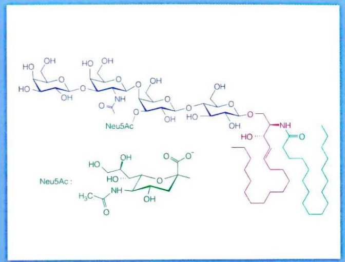

chemical

Chemical structure of Neu5Ac, showing its glycosidic backbone and its corresponding peptide fragment

## 第Ⅲ篇

## 糖类和脂质的结构与功能

翻开生命画卷的分子篇章，糖类与脂质以其独特的化学结构与多样的生物学功能，构成了生命大厦不可或缺的基石。它们看似迥异，却协同奏响维持生命活动的精密交响曲。糖类，大多以 $\left(\mathrm{CH}_{2}\mathrm{O}\right)_{n}$ 为基本骨架，从单糖的简约到多糖的复杂，不仅作为生物体最直接的“能量货币”（如葡萄糖驱动ATP合成），还充当细胞识别和信息传递的“分子身份证”（如细胞表面糖蛋白、糖脂决定血型与免疫应答）。糖原作为动物体的“能量银行”，淀粉与纤维素支撑植物世界。糖胺聚糖（如透明质酸）则形成亲水海绵，构建细胞外基质，其与核心蛋白共价结合形成的蛋白多糖更是组织稳态的重要调节者。这些多糖的多样性和复杂性，无不彰显其在结构支撑与能量储备方面的双重智慧。

脂质则以疏水性为共性，展现出惊人的功能多样性。甘油三酯作为高效的“能量储备库”，其疏水特性允许其在有限空间存储大量化学能。磷脂与固醇凭借其独特的“两亲性”，能够自组装成流动的细胞膜屏障，精确调控物质交换并形成细胞器边界，构成了生命“区室化”的化学基础。鞘脂（如鞘磷脂和鞘糖脂）作为膜脂的关键组分，不仅参与膜结构域的组装（如脂筏），其衍生物还承担着重要的信号转导功能。类二十烷酸和固醇激素等信号脂质则如同微小的分子信使，调控着从炎症反应到生长发育的众多生理过程。此外，脂溶性维生素的运载与吸收亦依赖于脂质的疏水环境。

更为重要的是，糖与脂并非孤立存在。糖脂（包括鞘糖脂）作为两者的复合物，在细胞膜结构和信号识别中扮演着关键角色。糖类代谢产生的磷酸二羟丙酮可转化为甘油骨架，而乙酰辅酶A则成为连接糖代谢与脂肪酸合成的核心枢纽。它们共同参与了细胞的能量稳态、结构构建与信息传递，构成了生命化学网络中既独立又交织的精密模块。理解糖类与脂质精巧的结构及其广泛的功能，不仅是解读生命基本运作原理的起点，更是探索代谢疾病、开发药物和新型生物材料的基石。

本篇将深入解析这两类分子的化学奥秘及其在生命交响曲中的核心乐章——它们如何塑造了生命，又如何维系着生命的律动？

## 糖类

糖类（sugar/carbohydrate/saccharide）是地球上最丰富的一类生命分子。在植物中，糖类占其干重的90%；在细菌中，这一比例约为15%\~30%。人类对糖类的结构认识较早，已知它们主要由碳（C）、氢（H）和氧（O）三种元素构成。然而，关于糖类功能的深入研究则较为滞后。人们长期认为糖类主要以结构成分和能量储存者身份存在于生物体内。但近年来的研究表明，糖类还具有其他的重要生物学功能。例如，细胞表面的糖类分子作为独特的信息形式，参与细胞间的通信。

糖类的甜味使其在远古时期便为人类所知。蔗糖是最早被发现的糖类之一，以其显著的甜味闻名，广泛存在于甘蔗茎等植物组织中。尽管人们早在1740年代便从葡萄干中分离出葡萄糖，但直到19世纪早期，糖类才作为一类化学物质被广泛认识。德国学者安德烈亚斯·西吉斯蒙德·马格拉夫（Andreas Sigismund Marggraf，1709—1782）首次分离出葡萄糖，而葡萄糖的化学式（$\mathrm{C_6H_{12}O_6}$）直到1850年代才得以确定。随后，蔗糖的化学式被确定为 $\mathrm{C_{12}H_{22}O_{11}}$。当时，这类化合物的化学式通常可以写作 $\mathrm{C_m(H_2O)_n}$，因此它们被称为碳水化合物（carbohydrate），这一名称至今仍被广泛使用。

根据现代定义，糖类是多羟基醛或多羟基酮及其衍生物与聚合物的总称。本章将重点介绍糖类分子的结构特点、物理化学性质及其生物学功能。

# 14

## 14.1 糖类分子可被分为单糖、寡糖、多糖和糖缀合物等不同类型

根据糖类分子的复杂程度，可将糖类分子分为单糖、寡糖、多糖和糖缀合物四种类型。前三类可以类比成氨基酸、寡肽和多肽（或蛋白质），最后一类是由前三类与蛋白质分子或脂质分子共价结合后形成的分子。

单糖（monosaccharide）代表糖类分子的最小结构单元。自然界中最丰富的单糖是葡萄糖（glucose）这种六碳糖。几个单糖单位共价连接在一起即形成寡糖（oligosaccharide），寡糖通常含两个到十个单糖单位，分别被称作二糖（disaccharide）、三糖（trisaccharide）、四糖（tetrasaccharide）等。其中的二糖是自然界中最常见的寡糖，大多以游离形式存在于生物体内。含两个以上单糖单位的寡糖一般都共价连接于蛋白质或脂质分子，形成糖蛋白和糖脂等生物分子。多糖（polysaccharide）则是由多个单糖或单糖衍生物单位共价连接而成的聚合物。但与氨基酸连接成寡肽或多肽方式不同的是，寡糖或多糖分子中的单糖单位可以线性连接，也可以形成分支。多糖可能含有数百甚至数千个单糖单位，分子量可高达100万甚至更高。

糖类分子所发挥的生物学功能主要包括以下方面:作为生物体内贮存能量的物质；作为细胞外的结构和保护组分（如纤维素、肽聚糖、壳多糖、蛋白聚糖）；为合成其他类型生物分子（如氨基酸、核苷酸、脂肪酸）提供碳骨架前体；作为信息分子参与细胞间的特异相互识别和黏附等。

糖的主要化学特征主要反映在以下方面:存在一个或多个手性碳；单糖单位能够以线性或环状结构存在；单糖单位通过简单的糖苷键连接成聚合结构或连接于其他类型生物分子。

## 14.2 生物体内的单糖分子一般具有特定的开链结构与环状结构

满足基本定义的单糖分子很多，但作为生物体内寡糖和多糖组成单位的单糖种类是有限的。单糖分子作为糖类分子的基本单位，对其基本特征的认识是人们认识糖类分子的基础。这里先介绍单糖的结构、分类和物理化学特性等。

## 14.2.1 单糖因含手性碳而产生数量不等的立体异构体

单糖可以自由存在，也可通过共价连接形成其他糖类分子。尽管根据定义，只要含有两个或以上羟基的醛或酮类分子皆可被称作糖，但生物体内存在的单糖一般含有3～7个碳原子。

按照糖类定义，含有两个羟基的甘油醛（glyceraldehyde）和二羟丙酮（dihydroxy-

acetone）为最简单的糖分子；它们都含有三个碳原子，故被统称为三碳糖（triose）。

类似地，含有四、五、六、七个碳原子的单糖被分别称为四碳糖（tetrose）、五碳糖（pentose）、六碳糖（hexose）、七碳糖（heptose）。就像酶的英文名称以“-ase”结尾一样，糖分子的英文名称多以“-ose”结尾。按照中文习惯，我们一般将含3\~7个碳原子的单糖分别称作为丙糖、丁糖、戊糖、己糖、庚糖。但需要注意的是，正如氨基酸一样，每种单糖（以及二糖）最常被使用的名称还是其俗名，这往往反映其最初被发现时的材料来源。对于被修饰的单糖而言，则一般使用系统命名和俗名相结合的方式命名（具体见后）。

生物体内最为常见的单糖是含有六个碳原子的己糖，如葡萄糖、果糖（fructose）和半乳糖（galactose）等。其中的葡萄糖是生物体内最为重要也最为广泛存在的单糖；它既以游离形式存在，也以结合形式存在。作为一种重要的能源提供者和合成其他分子的碳骨架提供者，葡萄糖分子的代谢转换广泛发生于几乎所有生物体内，在后面的学习中将被反复提及。果糖是这些单糖中甜度最高的一种，故常被用作甜味剂。

作为生物体内的一类含五个碳原子的戊糖，核糖（ribose）和脱氧核糖（deoxyribose）分别是 RNA 和 DNA 分子的重要组成成分。

此外丙糖、丁糖和庚糖都主要以参与分解和合成代谢过程的代谢物形式存在，后面会在讨论相关代谢过程时提及。

## (1) 单糖一般被分为醛糖和酮糖两大类

这一般根据单糖分子以开链形式存在时羰基所在位置而定。如果羰基位于碳链的末端，则称为醛糖，如甘油醛和葡萄糖等；如果羰基位于其他位置（一般为紧邻末端碳的位置），则称为酮糖，如二羟丙酮和果糖等（图14-1）。

## (2) 单糖大多含手性碳, 故以两种或多种立体异构体形式存在

单糖分子中除了二羟丙酮缺乏手性碳以外，其他单糖都含有至少1个手性碳。这使得每种单糖都以两种或更多的立体异构体形式存在。如果一个单糖分子（或任何其他分子）中含有 $n$ 个不对称碳，则它可形成 $2^{n}$ 种化学式完全相同但空间结构不同的立体异构体。比如，己醛糖和己酮糖分别含4个和3个不对称碳原子，因此可分别产生16（即 $2^{4}$ ）种和8（即 $2^{3}$ ）种立体异构体。

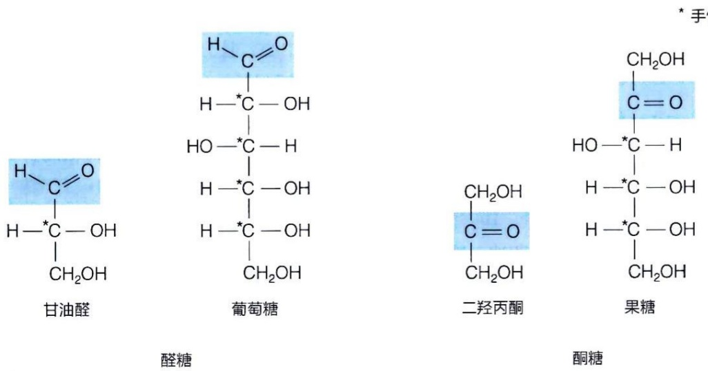

chemical

四种糖类化合物结构式：甘油醛、葡萄糖、二羟丙酮和果糖，各含水键与基团结构

图14-1 常见醛糖和酮糖的结构式及所含手性碳的数目和位置

含有4个手性碳的葡萄糖分子的结构究竟是16种可能的立体异构体中的哪一种呢？这是由德国学者埃米尔·费歇尔（Emil Fischer，1852—1919）于1890年代通过复杂的化学分析而确定的（更准确地说，是根据其线性结构确定的）。他因此设计了费歇尔投影式（Fischer projection），即在纸面上以线性结构方式简单显示这种立体结构:以两条水平线代表指向读者的两个原子，而以两条垂直线代表背离读者的两个原子。

需要注意的是，一种单糖的构型描述的仅仅是分子中离羰基最远的那个手性碳的构型，而非其他手性碳的构型。而且参照的是费歇尔为甘油醛所规定的D和L两种构型:以费歇尔投影式表示甘油醛时，将手性碳置于中间，醛基置于上方，当羟基位于右方时为D构型，而羟基位于左方时，则为L构型。

据此，自然界中的单糖大多数为 D 构型（即其离羰基最远的手性碳中的羟基位于右方）。但也存在少量的 L 构型分子，如 L-阿拉伯糖。同一单糖分子的 D 构型和 L 构型互为镜像，即互为对映异构体（enantiomer）（图 14-2）。需要说明的是，这里的镜像是指整个分子中的所有手性碳，不只是离羰基最远的那个手性碳。也就是说，在 D-葡萄糖和 L-葡萄糖分子之间，不仅第 5 号碳之间处于镜像对映结构，第 2、3、4 号碳之间也处于镜像结构。

图 14-2 对映异构体

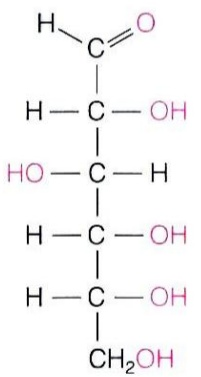

chemical

Structural formula of a branched alkane with multiple hydroxyl and methoxy groups

D-葡萄糖

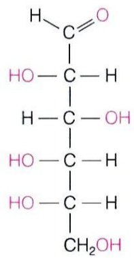

chemical

Structural formula of a branched hydrocarbon molecule with carboxylic acid and hydroxyl groups

L-葡萄糖

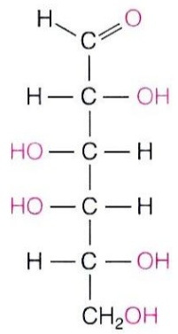

chemical

Structural formula of a branched alkane with multiple hydroxyl and methoxy groups

D-半乳糖

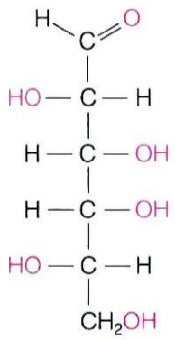

chemical

Structural formula of a branched hydrocarbon with carboxylic acid and hydroxyl groups

L-半乳糖

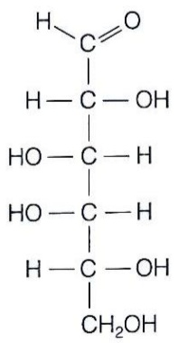

chemical

Structural formula of a branched hydrocarbon with multiple carboxylic acid groups and hydroxyl substituents

D-半乳糖

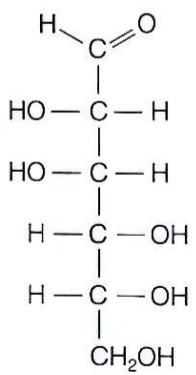

chemical

Structural formula of a branched hydrocarbon with carboxylic acid and hydroxyl groups

D-甘露糖

图 14-3 非对映异构体

对于具有两个或两个以上手性中心，且分子间为非镜像关系的两种立体异构体，则可互称为非对映异构体（diastereoisomer）；如D-半乳糖与D-甘露糖（图14-3）。在这样的非对映异构体中，如果两个单糖分子之间仅有一个手性碳的构型不同（而其他的都相同），则它们之间互为差向异构体（epimer，也称表异构体）；如D-葡萄糖与D-甘露糖、D-葡萄糖与D-半乳糖（图14-4）。

综上所述，除二羟丙酮之外，单糖均具有多种立体异构体，以葡萄糖为代表的己醛糖由于含4个不对称碳原子，可具有 $16(2^{4})$ 种立体异构体，其中一半具有D构型，一半具有L构型，D-葡萄糖只是其中的一种。戊醛糖、丁醛糖、丙醛糖则分别具有8、4、2种立体异构体，酮糖的立体异构体数目为具有相同碳原子数的醛糖的一半。具有 D 构型的三碳糖、四碳糖、五碳糖、六碳糖的结构如图 14-5 所示。

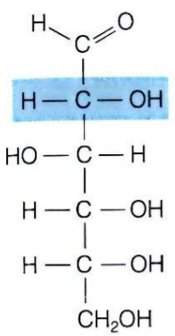

chemical

Structural formula of a branched hydrocarbon with carboxylic acid and hydroxyl groups

D-葡萄糖

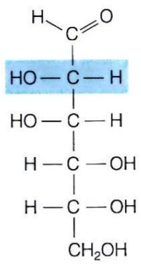

chemical

Chemical structure of a fatty acid with carboxylic acid and hydroxyl groups

D-甘露糖

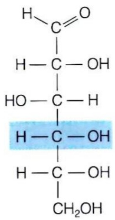

chemical

Structural formula of a branched hydrocarbon with carboxylic acid and hydroxyl groups

D-葡萄糖

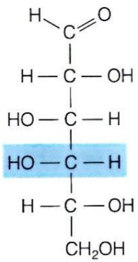

chemical

Structural formula of a branched hydrocarbon molecule with carboxylic acid and hydroxyl groups

D-半乳糖

图 14-4 差向异构体

这里需要强调的是，一种含不对称碳的单糖的旋光活性（方向和程度）是整个分子不对称性的反映，并非由任何一个不对称碳原子所决定。目前尚无法将一种单糖的旋光活性与其分子的构型进行关联。

另外，我们知道两个镜像对映体之间的旋光活性方向相反，但程度相同。两个非

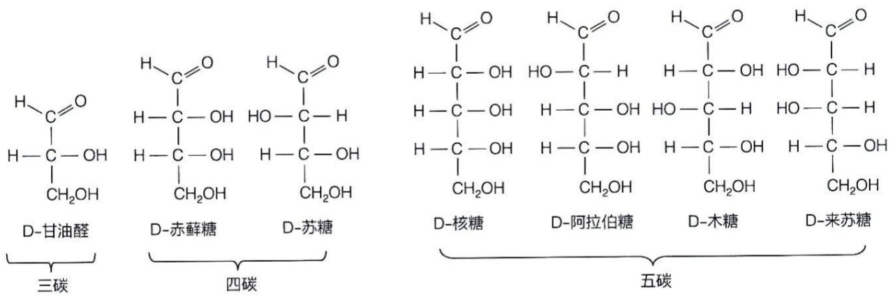

chemical

Structural formulas of D-alkanes with carbon chain, showing hydrocarbon chains and their derivatives

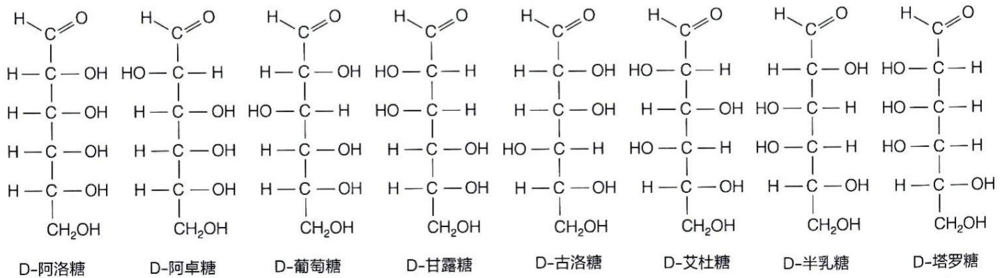

chemical

Structural formulas of various sugar derivatives including D-alkaldehyde, D-arabinose, and D-alanine

六碳

醛糖

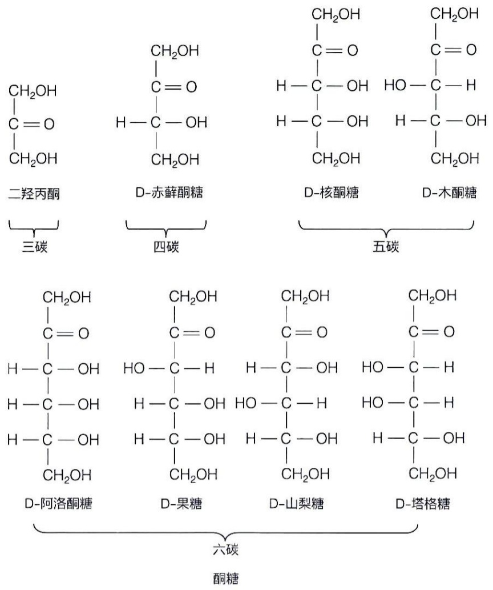

chemical

六碳酮糖结构示意图，展示二羟丙酮、D-赤藓酮糖、D-核酮糖、D-木酮糖及五碳五碳的化学组成与结构关系

图 14-5 具有 D 构型的单糖结构

对映异构体之间的物理和化学特性皆不同，即它们在旋光活性、分子形状、反应活化能、反应速率、沸点、熔点等方面的特性皆不同，因此它们之间可通过层析等技术有效分离开。

## 14.2.2 很多单糖在水溶液中主要以环状结构形式存在

1840年代法国学者奥古斯丁-皮埃尔·迪布兰福（Augustin-Pierre Dubrunfaut，1797—1881）意外观察到糖的变旋现象（mutarotation）:新鲜配制的结晶葡萄糖溶液的旋光率，从最初的 $110^{\circ}$ 逐渐降低，最后稳定在大约 $52^{\circ}$ 。后来另外一种结晶葡萄糖溶液的旋光率被观察到从最初的大约 $19^{\circ}$ 逐渐上升，最后也稳定在大约 $52^{\circ}$ 。类似现象在多种其他单糖或二糖中观察到。经过多年的探究，人们理解到这是葡萄糖等糖类分子两种环状结构异构体相互转变，并最终达到平衡的结果。

（1）糖分子中的羰基通过与同一分子中的羟基形成半缩醛或半缩酮而形成环状结构

就化学本质而言，上述变旋现象跟羰基与醇羟基之间可有效地进行可逆加成反应，形成两种异构体形式的半缩醛（hemiacetal）或半缩酮（hemiketal）这一现象有关。这样的加成反应一般发生于分子之间，而且所形成的半缩醛或半缩酮可以与另一分子醇的羟基继续加成，最终形成缩醛或缩酮（图 14-6）。

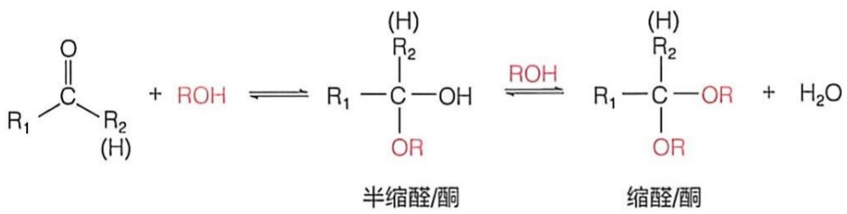

chemical

Chemical reaction equations showing the formation of acyl halides from aldehyde and water using ROH under different conditions

图 14-6 缩醛和缩酮的形成

含6个碳原子的葡萄糖（有时简称为葡糖）分子的成环现象是在1900年代至1930年代由两位英国学者弗兰克兰·阿姆斯特朗（Frankland Armstrong，1878—1945）和沃尔特·诺曼·霍沃斯（Walter Norman Haworth，1883—1950）确定的。他们利用酶促反应和有机化学反应对葡萄糖甲苷的两种立体异构体的结构进行分析之后，得出葡萄糖以两种六元环结构存在的结论。霍沃斯还因此而提出了一种展示环状糖分子立体结构的霍沃斯投影式。其主要操作是将费歇尔投影式中位于右侧的羟基置于环的下方，左侧置于环的上方；将C4—C5单键旋转约 $109^{\circ}$ ；如果是D构型糖，则糖分子C6位的一 $\mathrm{CH}_2\mathrm{OH}$ 基团置于环的上方，如果是L构型，则位下方；接近读者的线条画为粗线，而远离读者的画为细线（图14-7）。

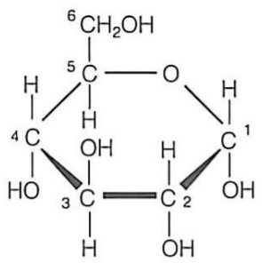

chemical

Chemical structure of a cyclic carbohydrate with numbered carbon atoms and hydroxyl groups

α-D-吡喃葡萄糖

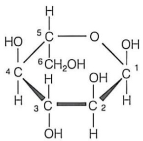

chemical

Chemical structure of a cyclic carbohydrate with numbered carbon atoms and hydroxyl groups

α-L-吡喃葡萄糖

图 14-7 葡萄糖的霍沃斯投影式

后续研究表明，含 4 个碳的丁醛糖及含 5 个或更多碳的其他单糖皆可通过分子内的加成反应而形成五元或六元环状半缩醛或半缩酮。在水溶液中的单糖，主要以这种环状结构存在，也就是说它们具有相当的稳定性（图 14-8）。

实际上，水溶液中的葡萄糖几乎（99%）都以环状形式存在。大多数单糖分子中含有多个羟基，理论上可以形成不止一种大小的环。但这些不同的环状结构因稳定性不同而以不同比例存在。天然的游离单糖或寡糖和多糖中的单糖单位（残基）主要以两种环状结构形式存在:以五元环形式存在的呋喃糖（furanose）和以六元环形式存在的吡喃糖（pyranose）（图 14-9），这是因为五元环和六元环代表了较为稳定的结构。

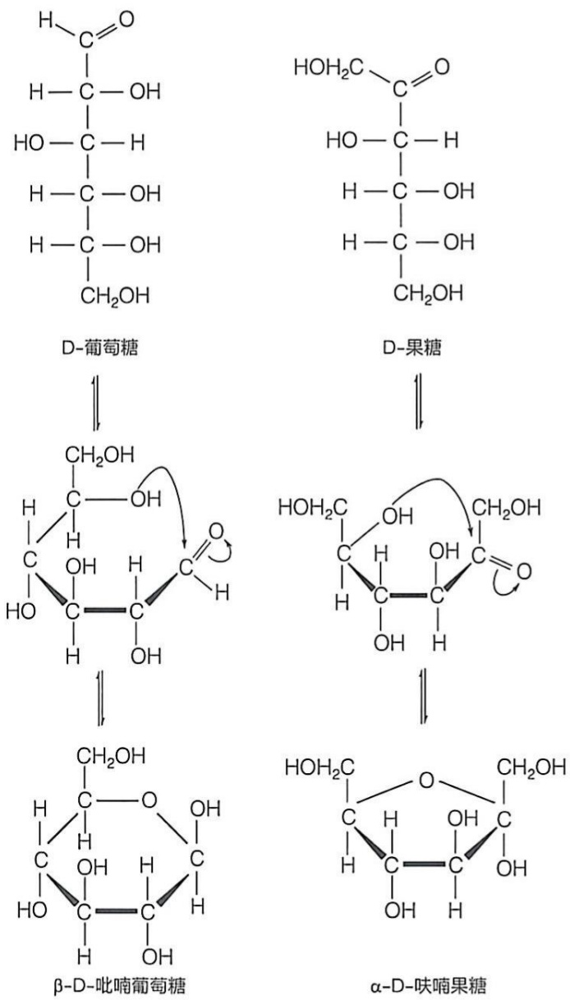

图 14-8 D-葡萄糖的半缩醛形式和 D-果糖的半缩酮形式

含 5 个或更多碳原子的单糖都可形成这两种环状结构，但往往是其中的一种更为稳定，从而更占优势。有趣的是，当以游离形式存在时，葡萄糖和果糖皆以吡喃糖为优势结构，而核糖则是吡喃糖和呋喃糖共存（比例接近 1:1）。但当果糖和核糖处于衍生物中（如处于 RNA 分子中的核糖单位）时则主要以呋喃糖结构形式存在。

（2）单糖成环过程所产生的异头碳为不对称碳并具有 $\alpha$ 或 $\beta$ 构型

在单糖分子从开链结构形成环状结构的过程中，羟基可从上方或下方对羰基进行亲核进攻，产生 $\alpha$ 或$\beta$ 两种异构体。原来的羰基碳原子因此而被转变成不对称碳，称为异头碳（anomeric carbon）。传统上，如果异头碳所连接羟基与C6位碳原子分别处于六元环的异侧，所形成的异构体被称为 $\alpha$ 异头物，如处同侧，则被称为 $\beta$ 异头物（图14-10）。对于D-吡喃果糖而言，如果其C2异头碳上羟基位于环的下方（即与C5羟基同侧），则为 $\alpha$ 构型（图14-9），否则为 $\beta$ 构型。这样的 $\alpha$ 和 $\beta$ 异头物在水溶液中可通过开链形式进行相互转变，最终达到一种平衡状态，根据两种异头物稳定性的差异而各自以特定比例存在（比如 $\alpha -\mathrm{D}-$ 吡喃葡萄糖和 $\beta -\mathrm{D}-$ 吡喃葡萄糖的占比分别为$36\%$ 和 $64\%$），这就是19世纪中期所观察到的变旋现象的本质。

（3）单糖形成的五元环和六元环结构一般分别以信封式和椅式构象形式存在

由于成键碳原子的四面体结构特征以及 C—C 单键的自由旋转特性，使得单糖所形成的五元环或六元环可形成不同的构象。

热力学研究表明，呋喃糖的五元环以形成的信封式构象（envelope form）最为稳定。其中的3个碳原子与氧原子接近共平面，而环中的另一碳原子则折起。哪个碳原子处于折起位置，则需看具体情况，比如游离核糖的呋喃糖环可以是C3折起，也可以是C2折起，分别被称作C3内向型或C2内向型信封式构象。值得注意的是，在五元环处于C3内向型或C2内向型信封式构象状态时，单糖分子的C5分别与C3或C2在同一侧突出于平面。在游离状态下，这两种信封式构象之间可快速转换（图14-11A），但在B型DNA中的脱氧核糖则以C2内向型构象形式存在。

吡喃糖的六元环则以椅式构象（chair form）最为稳定。理论上，这种六元环也能以船式构象（boat form）存在。但因为只有当处椅式构象状态时，C—C 单键的扭张强度才可降到最小，基团之间的空间位阻也最小，因此椅式构象远比船式构象稳定。处于椅式构象时，环上所连接的基团可处于两种可能的方位:一种是与环平面处于基本垂直位置的直立键（axial bond），另一种则是与环平面基本平行的平伏键（equatorial bond）。一般而言，与环中碳原子连接的比氢原子大的基团会尽可能处于平伏键位置，从而使其空间位阻降到最小，形成最稳定构象；如果处于直立键位置，则空间位阻更大，更不稳定（图 14-11B）。

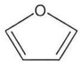

呋喃

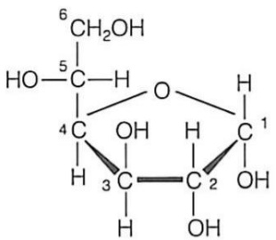

chemical

Chemical structure of a cyclic carbohydrate with hydroxyl and carboxylic acid groups

α-D-呋喃葡萄糖

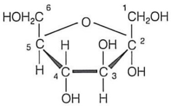

chemical

Chemical structure of a cyclic carbohydrate with hydroxyl and carboxylic acid groups

α-D-呋喃果糖

图 14-9 呋喃糖和吡喃糖

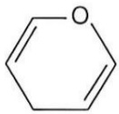

吡喃

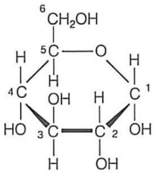

chemical

Chemical structure of a cyclic carbohydrate with numbered carbon atoms and hydroxyl groups

α-D-吡喃葡萄糖

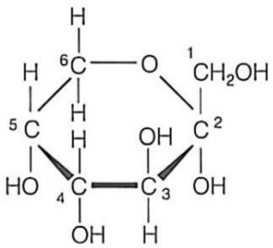

chemical

Chemical structure of a cyclic carbohydrate with labeled carbon, hydrogen, and oxygen atoms

α-D-吡喃果糖

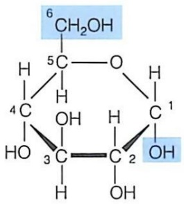

chemical

Chemical structure of a cyclic carbohydrate with hydroxyl and methyl groups

α-D-吡喃葡萄糖

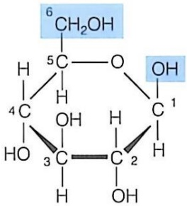

chemical

Chemical structure of a cyclic carbohydrate with labeled carbon, hydrogen, and hydroxyl groups

β-D-吡喃葡萄糖

图 14-10 葡萄糖的 $\alpha$ 异头物和 $\beta$ 异头物

## 14.2.3 单糖具有特征性物理化学性质

单糖作为糖类化合物的基本单位，具有一系列特定的物理化学性质。就物理性质而言，单糖一般为无色晶体，但也有以黏稠性液体状态存在的，如纯净的果糖由于易吸湿，通常为黏稠性液体，不易结晶。单糖普遍有甜味，但甜度各异。果糖的甜度是蔗糖的1.8倍，是所有天然糖中甜度最高的糖之一。而葡萄糖的甜度相对较低，不如蔗糖甜。特别的是，单糖极易溶于水，但难溶于乙醇，不溶于乙醚。除二羟丙酮外，大多数单糖含有手性碳原子，具有旋光性。就单糖的化学性质而言，单糖含有醛基，具有还原性。例如葡萄糖能与银氨溶液（含 $\left[\mathrm{Ag}\left(\mathrm{NH}_{3}\right)_{2}\right]^{+}$ ）发生银镜反应（生成肉眼可见的单质银），被氧化成葡萄糖酸。此外，单糖分子中的半缩醛羟基可以与其他含羟基的化合物失水缩合形成糖苷键，从而生成糖苷（即缩醛）。单糖的半缩醛羟基和其他羟基可与酸发生酯化反应，生成相应的酯类化合物。

图 14-11 呋喃糖环的信封式构象（A）和吡喃糖环的船式和椅式构象（B）

(A)

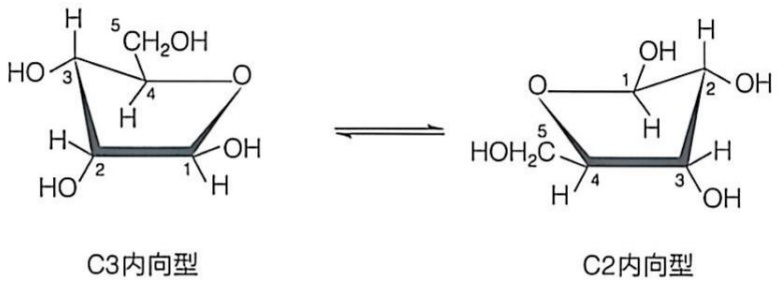

chemical

Chemical structures of C3 and C2 internal isomers showing stereochemistry with numbered carbon atoms

(B)

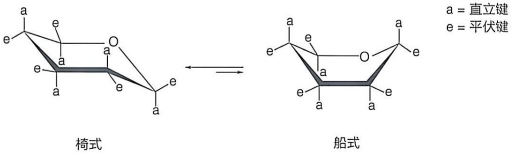

chemical

Chemical structures of chondrolysis and bifurcation forming a cyclic compound with labeled axes (a, e) and symmetry types (直立键, 平伏键)

## 14.2.4 生物体内存在多种己糖衍生物

除了上面介绍的这些简单单糖之外，生物体内还存在一系列重要的单糖衍生物。它们通过各种酶促修饰反应形成，衍生方式涉及羟基被氨基、氢、磷酸等取代或末端碳原子（如己糖的 C1 或 C6）被氧化等。这些衍生物存在于寡糖和多糖分子中，也存在于糖蛋白和糖脂分子中。

当单糖分子中的一个羟基被氨基取代时，则生成氨基糖衍生物。最常见的氨基糖衍生物是己醛糖分子 C2 上的羟基被氨基取代所形成，如葡萄糖胺（glucosamine）、半乳糖胺（galactosamine）和甘露糖胺（mannosamine）。在此基础上，氨基上的氢原子可以被乙酰基取代，形成 N-乙酰葡萄糖胺（N-acetylglucosamine）和 N-乙酰半乳糖胺（N-acetylgalactosamine）等。如果葡萄糖胺和 N-乙酰葡萄糖胺分子的 C3 位置分别与乳酸的 C2 位置以醚键连接，则分别形成胞壁酸（muramic acid）和 N-乙酰胞壁酸（N-acetylmuramic acid），后者被用于合成细菌细胞壁中的肽聚糖分子。

当葡萄糖分子的 C1 或 C6 被氧化成羧基时，则会产生糖酸衍生物。如果葡萄糖等糖分子中的 C1 醛基处于开链形式（即未形成半缩醛）时，具有较高的还原性，易被氧化成羧基，形成葡萄糖酸（gluconic acid），为一种醛糖酸（aldonic acid）。这样的羧基可与分子中羟基 [如 C5（也称 δ 碳）位置上的] 缩合形成稳定的分子内酯，即葡萄糖酸内酯（gluconolactone；如葡萄糖酸 -δ- 内酯）。此外，葡萄糖的 C6 位也可被氧化成羧基，形成带负电荷的葡萄糖醛酸（glucuronic acid）；类似地，半乳糖的 C6 也可氧化成半乳糖醛酸（galaturonic acid）（图 14-12）。还有一类带负电荷的酸性糖是唾液酸(sialic acid, Sia)，也被称作 N-乙酰神经氨酸（N-acetylneuraminic acid, Neu5Ac）。它可以被看作是一种含有九个碳的单糖衍生物:它的 C1 位为羧基，C2 上的羰基与 C6 羟基缩合形成半缩酮，形成一个六元吡喃环；C3 发生了脱氧；C5 结合一个乙酰氨基（图 14-13）。人的脑组织存在高浓度的唾液酸，它是神经节苷脂的一种组分，参与突触生成和神经传递过程。

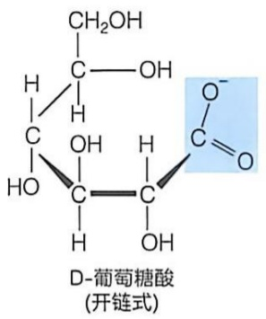

chemical

Chemical structure of D-glucose (chain type) with labeled carbon and hydrogen atoms

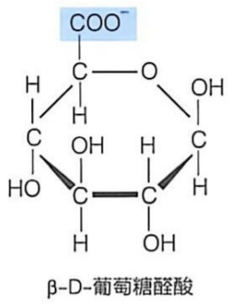

chemical

Chemical structure of β-D-葡萄糖醛酸, showing carboxylate group and multiple hydroxyl groups

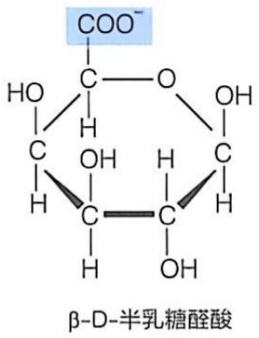

chemical

Chemical structure of β-D-半乳糖醛酸, showing its carbon chain with carboxylate group

图 14-12 糖酸衍生物

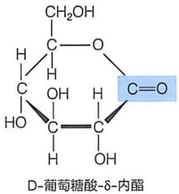

chemical

Chemical structure of D-glucose-δ-amino acid with labeled carbon and hydrogen atoms

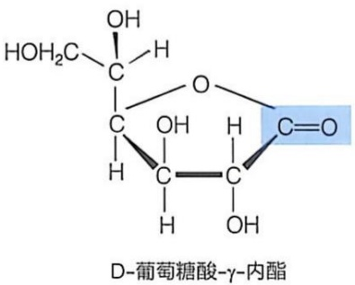

chemical

Chemical structure of D-glucose-γ-nitric acid with labeled carbon and hydrogen atoms

如果单糖中的某个羟基被氢原子取代，则生成一种脱氧糖。它也广泛分布于植物、动物和细菌中。比如2-脱氧核糖是DNA的组成成分，L-岩藻糖（L-fucose，6-脱氧-L-半乳糖）是海藻细胞壁和某些重要寡糖的成分，L-鼠李糖（L-rhamnose，6-脱氧-L-甘露糖）是细菌胞外多糖的重要组分（图14-14）。

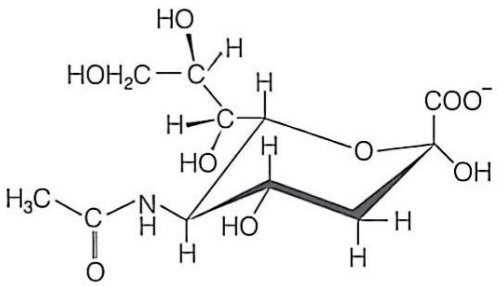

chemical

Molecular structure of a nucleoside derivative with carboxylic acid and hydroxyl groups

图 14-13 唾液酸

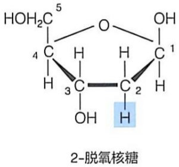

chemical

Chemical structure of 2-deoxybutyric acid (脱氧核糖)

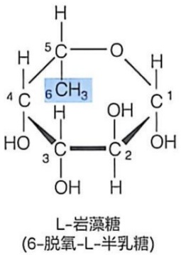

chemical

Chemical structure of L-alkane and its derivatives with labeled carbon positions and functional groups

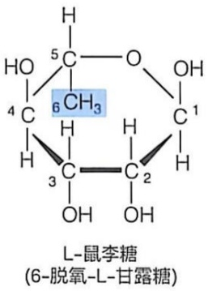

chemical

Chemical structure of L-rabbit sugar with labeled carbon atoms and functional groups

图14-14 脱氧糖

## 知识延展 14- 1

## 为什么很多糖可以产生甜觉？

人类具有甜、酸、苦、咸、鲜五种味觉。甜味是糖等物质刺激人体舌头表面味蕾细胞膜上的蛋白质受体而产生的一种神经响应。研究表明，人体的甜味由特异的G蛋白质偶联受体（GPCR）所感应。当具有特异结构的分子结合到甜味受体的细胞外结构域时，将触发味蕾细胞中一系列分子事件的发生（包括GTP结合蛋白的激活），进而向大脑传递电信号，产生甜觉响应。

人类在演化过程中，其舌头产生了用于选择具有营养价值食物而避免有害物质的能力，这就是味觉。大多数单糖或二糖分子，包括葡萄糖、果糖和蔗糖等，都可产生甜觉。通常蔗糖的甜度被定为100，作为舌头感受甜味的参照；据此，葡萄糖的甜度为70，而果糖为175（为甜度最强的单糖）。

但自然界还有糖类之外的其他物质也可以产生甜觉。一些氨基酸，如甘氨酸、丙氨酸、丝氨酸可以产生微甜感觉；甜菊苷（stevioside）是从甜叶菊的叶子中分离出来的一种糖衍生物，其甜度是蔗糖的数百倍。人们还从植物中鉴定到多种具有很高甜度的小分子蛋白质，如从非洲植物中分离出的布拉泽甜蛋白（brazzein；由54个氨基酸组成）和莫内甜蛋白（monelin；由两条肽链共95个氨基酸组成），其甜度分别是蔗糖的大约1000和3000倍。另外一种人工合成的二肽阿斯巴甜（aspartame；天冬氨酸-苯丙氨酸-甲酯）的甜味大约是蔗糖的150倍。当然也有一些物质，如硝基苯和乙二醇，尽管具有强烈的甜味，但却有毒。

在肥胖已成为一个主要健康问题的当今社会，赋予食物甜味但不会提供能量的甜味剂是常见的食品添加剂。比如，阿斯巴甜就被用作食品和饮料中的甜味剂。有趣的是，阿斯巴甜分子中含有一个不对称碳原子，它所产生的两种对映异构体中，只有一种具有甜味，另外一种是苦味。这表明，味蕾细胞表面的 GPCR 感应甜觉物质是具有立体特异性的精确分子事件！

## 14.3 单糖分子通过糖苷键共价连接成寡糖和多糖

正如确定氨基酸或核苷酸之间的连接方式对于认识蛋白质或核酸分子的结构和功能至关重要一样，确定单糖之间连接形成寡糖和多糖的方式对于认识糖类分子的结构和功能的重要性亦是如此。尽管单糖之间的连接方式被归纳为简单的缩醛形成反应，但其具体形式却远比此复杂。在单糖的环状结构特征被揭示之后的1930年代，科学家首先对糖原中的游离羟基进行化学修饰（比如利用二甲基硫酸进行甲基化修饰），再将多糖水解，分析出未被修饰的羟基。这些羟基很可能因为参与了糖苷键的形成而处于被保护状态，这样就可以判断出糖苷键形成的位置。

## 14.3.1 单糖通过糖苷键形成寡糖

单糖形成环状结构后所产生的半缩醛或半缩酮的  $\alpha$  或  $\beta$  异头碳连接的羟基可继续与另一羟基发生缩合，脱去一分子水后形成糖苷键（glycosidic bond），产生缩醛或缩酮类化合物（图 14-15）。

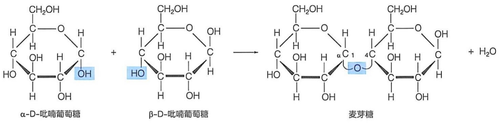

chemical

Chemical reaction diagram showing the conversion of α-D-吡喃葡萄糖 to β-D-吡喃葡萄糖 and finally to 麦芽糖 with water addition

图 14-15 糖苷键形成反应

单糖分子之间所形成的糖苷键通过氧原子连接，故被称作 O- 糖苷键。但在生物体内，半缩醛或半缩酮形式的糖分子也可与其他含有羟基或氨基的化合物缩合形成糖苷键。如果糖苷键是通过氮原子连接，则被称作 N- 糖苷键。在后面学习糖蛋白和核苷酸时，我们会进一步介绍 N- 糖苷键，这里不做详细描述。

显然，每一种半缩醛或半缩酮形式的单糖分子既可通过其  $\alpha$  异头碳构型，也可通过其  $\beta$  异头碳构型参与糖苷键的形成。我们将它们分别称作  $\alpha-$  糖苷键和  $\beta-$  糖苷键。后面我们将看到，通过这两种糖苷键连接的多糖分子会具有完全不同的结构特征。在酸性条件下，糖苷键中的 O 或 N 原子都容易在发生质子化后断键进而发生水解反应。但在碱性条件下，糖苷键中的 O 或 N 原子无法发生质子化，故相对稳定。

## (1) 生物体内某些成环单糖之间可通过 O-糖苷键形成自由形式的二糖

我们一般将由 2～10 个单糖分子通过糖苷键形成的糖分子称为寡糖。其中由两个单糖形成的二糖比较独特，因为它们可以在生物体内稳定存在。我们知道肽类分子具有由氨基端和羧基端定义的方向性。与此类似，大部分情况下，寡糖或多糖分子中的单糖也按照一定的规律连接形成具有方向性的糖链分子:其一端为非还原端（non-reducing end），另一端为还原端（reducing end）。还原端的单糖残基仍保留具有还原性的羰基（以半缩醛或半缩酮形式存在，开链时即以羰基形式存在），而非还原端的单糖残基则不具备这样的还原性羰基。在书写寡糖结构时，一般将非还原端置于左边，还原端置于右边（图 14-16）；有的二糖没有还原端（如蔗糖和海藻糖），也就无须按照这样的惯例书写了。

作为简单的寡糖，二糖的两个单糖单位可以相同（如麦芽糖和海藻糖），也可以不同（如乳糖和蔗糖）（图14-16）。如果其中的一个单糖保留了其还原端，则为还原性二糖，如乳糖（lactose）和麦芽糖（maltose）（图14-16）。具体而言，麦芽糖是由1分子α-D-葡萄糖的异头碳C1与另1分子D-葡萄糖（异头碳为α或β构型）的C4羟基通过（α1→4）（或α-1,4-）糖苷键连接而成；海藻糖是由1分子α-D-葡萄糖的异头碳C1与另1分子α-D-葡萄糖异头碳C1通过（α1→1）糖苷键连接而成；乳糖是由1分子β-D-吡喃半乳糖的异头碳C1与1分子β-D-葡萄糖的C4羟基通过（β1→4）糖苷键连接而成；蔗糖是由1分子α-D-葡萄糖的异头碳C1与1分子β-D-果糖的异头碳C2的羟基通过（α1→2）糖苷键连接而成。需要注意的是糖苷键一般是先写异头碳通过逗号或一个箭头与提供非异头碳羟基的碳原子连接，异头