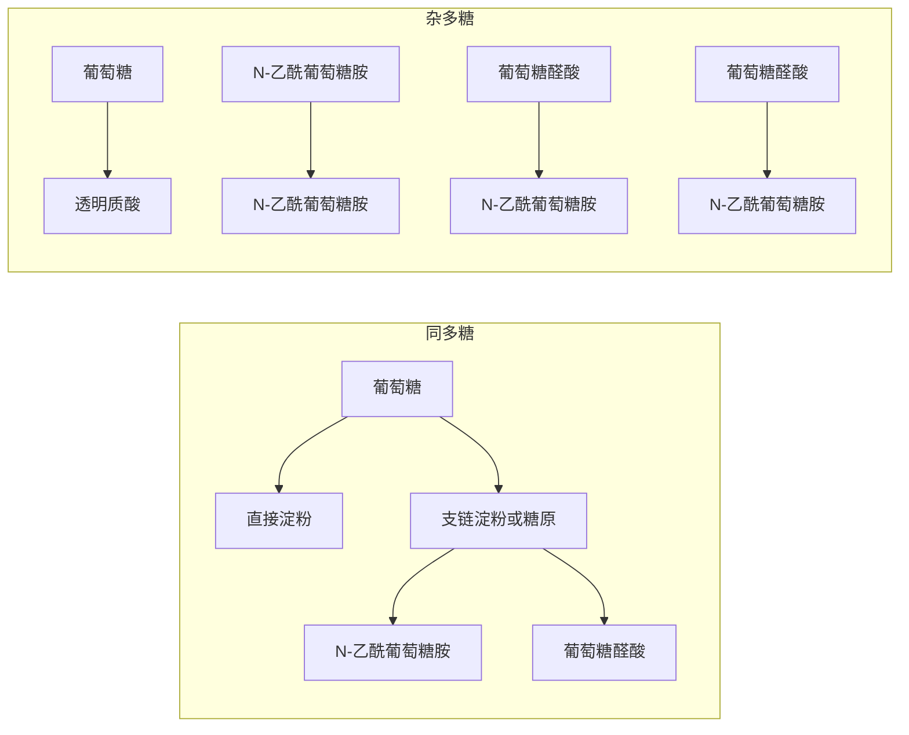
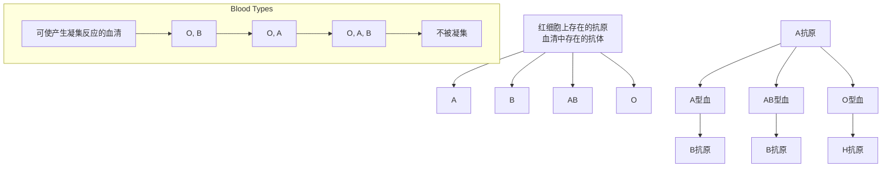

chemical

Chemical structure of a glycoside derivative with β-D-吡喃半乳糖基-(1→4)-β-D-吡喃葡萄糖 (Gal β1→4 Glc)

chemical

Chemical structure of glucose (α1→4) showing alpha-D-glucosidase-4-dicarboxylic acid and glucose (α1→4) glycoside with hydroxyl groups

chemical

Glycoside structure of α-D-glucosamine-β-D-fluorouracil, showing glucose chain with alpha and beta sugar moieties

chemical

Chemical structure of hexose sugar showing alpha-D-glucosidase and glucose chain with labeled carbon positions

图 14-16 还原性和非还原性寡糖

碳的构型是  $\alpha$  还是  $\beta$  须写出。但是蔗糖中的糖苷键是由两个不同的单糖的异头碳连接而成，所以除了上面的写法之外，也可以描写成由 1 分子  $\beta-D-$  果糖的异头碳 C2 与 1 分子  $\alpha-D-$  葡萄糖的异头碳 C1 通过  $(\beta2 \rightarrow 1\alpha)$  糖苷键连接。

为了书写方便，与组成蛋白质的20种氨基酸类似，每种单糖都有一个缩写（表14-1），如葡萄糖、半乳糖和果糖的三字母缩写分别为Glc、Gal和Fru。因此，麦芽糖的结构可以简单地表示为Glc（$\alpha 1 \rightarrow 4$）Glc，海藻糖为Glc（$\alpha 1 \rightarrow 1\alpha$）Glc，乳糖为Gal（$\beta 1 \rightarrow 4$）Glc，蔗糖为Glc（$\alpha 1 \rightarrow 2\beta$）Fru或Fru（$\beta 2 \rightarrow 1\alpha$）Glc。此外，为了更为有效地反映寡糖和多糖中的单糖组成情况，每种单糖还被分配了一种独特的颜色和形状符号（其中一些如表14-1所示）。

值得指出的是，还原性二糖（如麦芽糖和乳糖）仍具变旋现象。它们的还原端单糖仍可以通过开链方式改变异头碳的构型。因此，我们在书写这样的二糖结构式时，非还原端单糖的异头碳构型无须清楚写出是 $\alpha$ 还是 $\beta$ ，而是可以中性化处理（既可以是 $\alpha$ 也可以是 $\beta$ )。当然如果两个单糖分子各自通过其半缩醛（或半缩酮）羟基缩合形成二糖，该二糖不具还原性末端，为非还原性二糖，如蔗糖（sucrose）和海藻糖（trehalose）（图14-16）。由于不存在游离的半缩醛（半缩酮）羟基，因此非还原性二糖不存在变旋现象。

表 14-1 部分单糖及单糖衍生物的缩写及图形符号

<table><tr><td>单糖</td><td>缩写</td><td>图形符号</td><td>单糖衍生物</td><td>缩写</td><td>图形符号</td></tr><tr><td>半乳糖</td><td>Gal</td><td></td><td>葡萄糖胺</td><td>GlcN</td><td></td></tr><tr><td>葡萄糖</td><td>Glc</td><td></td><td>N-乙酰葡萄糖胺</td><td>GlcNAc</td><td></td></tr><tr><td>甘露糖</td><td>Man</td><td></td><td>N-乙酰半乳糖胺</td><td>GalNAc</td><td></td></tr><tr><td>木糖</td><td>Xyl</td><td></td><td>N-乙酰神经氨酸(唾液酸)</td><td>Neu5Ac(Sia)</td><td>[4AWB]</td></tr><tr><td>岩藻糖</td><td>Fuc</td><td>[BHCT]</td><td>葡萄糖醛酸</td><td>GlcA</td><td>[GTBK]</td></tr></table>

## 知识延展 14- 2

## 母乳中所含的寡糖可能具有抗感染等功能

母乳中存在多种生物活性物质，如寡糖、活性蛋白质、共生微生物、生长因子和细胞因子等。大量研究表明，母乳中的生物活性成分在婴儿的生长发育过程中发挥着抗菌、抗病毒、促进婴儿生长发育和机体免疫成熟等重要功能。

母乳寡糖（human milk oligosaccharide，HMO）是母乳中除了乳糖和脂质之外，含量最高的一类成分，在成熟乳液中平均含量为 12.9 g/L。自 1930 年代被最初鉴定以来，母乳中已知有 200 多种不同类型的寡糖，由三到十种单糖组成。构成这些寡糖的单糖包括 L- 岩藻糖、 D- 葡萄糖、 D- 半乳糖、 N- 乙酰葡萄糖胺和 N- 乙酰神经氨酸等。其中含量最丰富的寡糖是 2'- 岩藻糖基乳糖（2'-fucosyllactose）（图 14-17）。所有母乳寡糖的还原末端都含有乳糖。

chemical

Chemical structure diagram of L-alkane starch showing D-glucose chain with labeled components and stereochemistry

图 14-17 2'-岩藻糖基乳糖

母乳寡糖可能为婴儿提供了一种抗病毒和抗细菌的机制。母乳寡糖作为细胞表面的糖链结构类似物，可以模拟宿主细胞表面的糖链受体，抑制病毒黏附于婴儿肠道表面，阻断病毒进入肠道细胞，从而达到直接抗感染的效果。此外，研究发现母乳寡糖还可以作为免疫调节剂，通过调节细胞生长、促进肠上皮细胞增殖来改善婴儿的肠道环境。

## (2) 三糖或更大的寡糖皆通过共价键与蛋白质或脂质以糖缀合物形式存在

与二糖不同的是，细胞中的三糖或更大的寡糖很少以游离形式存在，大多通过糖苷键与蛋白质分子或脂质分子等共价连接，形成糖蛋白或糖脂。这样的寡糖基大多暴露于细胞的表面，成为重要的信号基团，能被特异蛋白质分子（统称为凝集素）所识别，是细胞间相互识别等生物过程的基础。具体我们将在介绍糖蛋白和糖脂时讲述。

## 14.3.2 单糖通过糖苷键聚合形成多糖

当大量单糖单位通过糖苷键连接时，则形成多糖。与寡糖的结构特征相比，多糖的结构特征不仅存在单糖数量的变化，而且发生了质的改变。

## (1) 多糖可分为同多糖和杂多糖两大类

多个单糖分子（>10个）通过糖苷键连接形成多糖。尽管单糖和寡糖在特定生理过程中不可或缺，但是自然界的糖类主要以多糖形式存在。由同一种单糖单位连接而成的多糖为同多糖（homopolysaccharide），如直链淀粉、支链淀粉和糖原；而由两种或多种单糖分子连接而成的多糖为杂多糖（heteropolysaccharide），如透明质酸（图14-18）。

图 14- 18 同多糖和杂多糖

flowchart

同多糖具有贮存能量或提供结构支持等生物学功能。如植物细胞中的淀粉（starch）和动物细胞中的糖原（glycogen），都是仅由葡萄糖聚合而成的同多糖，作为葡萄糖的储存形式，二者主要发挥贮存能量的功能。

多糖也可作为生物体细胞外的结构成分发挥作用。植物中的纤维素（cellulose）和动物中的几丁质（chitin）分别只含葡萄糖和N-乙酰葡萄糖胺，它们分别是组成植物细胞壁和甲壳类动物外骨骼的重要结构多糖，均为同多糖（图14-19）。

细菌细胞壁的主要成分是肽聚糖（peptidoglycan），其中的多糖分子是由 N-乙酰葡萄糖胺和 N-乙酰胞壁酸通过（ $\beta1\rightarrow4$ ）糖苷键交替连接而成的杂多糖（图 14-20）；而在动物组织的细胞外间隙则存在糖胺聚糖等多种类型的杂多糖（图 14-18），参与

chemical

Chemical structure of a polymeric molecule with labeled functional groups and reaction condition (β1→4)

几丁质

图 14-19 几丁质和纤维素

chemical

Chemical structure of polyester polymer chain showing repeating units with hydroxyl and carboxyl groups

N-乙酰葡萄糖胺

N-乙酰胞壁酸

chemical

肽链结构示意图，展示肽桥、四肽尾及L-Ala、D-Glu等分子连接

N-乙酰葡萄糖胺

chemical

Chemical structure of a polymeric polymer with repeating units and functional groups labeled

肽聚糖杂多糖链的重复二糖单位

图 14-20 肽聚糖结构

形成细胞外基质（extracellular matrix），发挥结构支持和调节作用。

（2）葡萄糖单位通过（ $\alpha1\rightarrow4$ ）和（ $\alpha1\rightarrow6$ ）糖苷键形成卷曲形糖原和淀粉分子

糖原是动物体内葡萄糖的主要储存形式，主要分布于肝脏、骨骼肌和肾脏等器官中。其中，以肝脏中的糖原丰度最高，占肝脏湿重的 $7\%$ 左右，负责为整个动物机体贮存葡萄糖，用于维持血液中的葡萄糖稳态。从分子结构而言，糖原是在 $\alpha -\mathrm{D}-$ 葡萄糖分子通过（ $\alpha 1\rightarrow 4$ ）糖苷键连接形成线性聚合体的基础上，依靠（ $\alpha 1\to 6$ ）糖苷键连接来产生分支链（图14-21）。食物中的糖原可以在动物消化道中被 $\alpha-$ 淀粉酶水解，产生葡萄糖单糖和麦芽糖二糖等；而储存于动物肝脏和肌肉细胞中的糖原则是在其中的糖原磷酸化酶的催化下降解，产生葡萄糖供机体利用。

糖原分子的分支程度非常高，平均每8～12个葡萄糖单位就出现一个分支。每条分支糖链的末端都是一个非还原端，这就使得一个糖原分子仅含一个还原端，但含有大量的非还原端。而非还原端是葡萄糖单位可以被快速移除或加入的位置。这使得糖原分子的降解和合成可以有效地响应机体的需求，以维持血糖水平的基本稳定:水平高时储存葡萄糖，水平低时释放葡萄糖。糖原一般以大颗粒（直径10～40 nm）形式存在，这种大颗粒其实是很多小颗粒的聚簇，而每个小颗粒都代表一个具有高度分支的糖原分子。糖原的合成和降解过程将在后续有关糖代谢的章节中进一步介绍。

植物中的淀粉可细分为直链淀粉（α-amylose）和支链淀粉（amylopectin）两种（图14-22）。在大多数形式的淀粉颗粒中，直链淀粉仅占 $10\% \sim 30\%$ ，而支链淀粉则占 $70\% \sim 90\%$ 。

直链淀粉基本只含（$\alpha 1 \rightarrow 4$）糖苷键，很少分支，分子相对较小。其糖链一般具有一个还原端和一个非还原端。虽然直链淀粉在水中的溶解度不高，但它可形成微胶团，其中多糖链呈螺旋构象。碘与直链淀粉反应会产生特征性的蓝色，这是由于碘分

chemical

糖苷键的支链与主链结构示意图，展示多链糖苷酸分子的转化过程

图 14-21 糖原分子结构

糖原

图 14-22 直链淀粉和支链淀粉

子插入淀粉螺旋的疏水中心所致。

支链淀粉既含（ $\alpha1\rightarrow4$ ）糖苷键也含（ $\alpha1\rightarrow6$ ）糖苷键，分子相对较大。支链淀粉的分支程度低于糖原，平均每20～30个葡萄糖单元才会出现一个分支。支链淀粉分子在水溶液中也形成螺旋结构，并能进一步形成更致密的聚簇结构，与碘作用会呈紫红色等。淀粉在淀粉酶的作用下可逐步降解，生成大小不一的中间物，被统称为糊精（dextrin）。

淀粉在植物细胞的质体（plastid；一种植物特有的细胞器，叶绿体是质体中专司光合作用的一类）中合成后往往以颗粒的形式储存于其中，淀粉颗粒中既有直链淀粉也有支链淀粉。当植物需要动用储存的淀粉时，淀粉会在淀粉磷酸化酶催化下分解成单糖单位（葡萄糖-1-磷酸）。当淀粉颗粒悬浮液被加热时，会吸收水分，引起颗粒膨胀，这样的葡萄糖聚合物更容易被酶催化降解。因此，煮熟的淀粉更易消化。尽管淀粉的消化开始于口腔中的唾液淀粉酶的作用，但主要发生在小肠中，在其中的胰淀粉酶的催化下进行。唾液淀粉酶和胰淀粉酶均属于  $\alpha-$  淀粉酶，水解（ $\alpha1\rightarrow4$ ）糖苷键。在动物消化道中，由异麦芽糖酶（isomaltase）特异水解（ $\alpha1\rightarrow6$ ）糖苷键。

## (3) 葡萄糖分子通过 ( $\beta_{1} \rightarrow 4$ ) 糖苷键连接形成线性的纤维素分子

纤维素是自然界含量最丰富的天然高聚物，它是植物细胞壁的重要结构成分，在维持植物细胞的正常形态方面发挥着重要作用。与直链淀粉类似，纤维素也是由葡萄糖单位形成的不分支的线性同多糖；每个纤维素分子含有 $10000 \sim 15000$ 个葡萄糖单位。但与直链淀粉不同的是，葡萄糖单体之间并非通过（$\alpha 1 \rightarrow 4$）糖苷键连接，而是通过（$\beta 1 \rightarrow 4$）糖苷键连接形成的（图14-23）。也就是说，直链淀粉和纤维素的差异仅仅在于使用了葡萄糖的 $\alpha$ 或 $\beta$ 异头物；而糖苷键的微小差异最终导致了纤维素和淀粉整体分子结构的巨大差异，这是生物分子的结构决定功能的一个极佳例子。

具体而言，淀粉中的葡萄糖因为通过（$\alpha 1 \rightarrow 4$）糖苷键连接，而呈螺旋形构象，而纤维素中的葡萄糖则因为通过（$\beta 1 \rightarrow 4$）糖苷键连接而呈完全伸展的构象，这是因为纤维素中相邻的葡萄糖环各自相对旋转 $180^{\circ}$ 所致。因为形成的是平行的葡萄糖链，使得链上的羟基之间除了可以形成分子内氢键之外，还可形成分子间氢键，进而形成纤维素特有的微纤丝（microfibril）结构。微纤丝内部分子因（$\beta 1 \rightarrow 4$）糖苷键的键角约束而呈锯齿状构象，并可通过疏水相互作用和范德瓦耳斯相互作用来进一步维系（图14-23），因此而形成高强度的植物纤维素结构，为植物细胞提供了坚实的结构支持。

值得注意的是，大多数动物都缺乏水解（$\beta 1 \rightarrow 4$）糖苷键的糖苷酶，所以不能直接分解纤维素。但是白蚁和某些反刍动物（如牛、羊和长颈鹿）却能利用纤维素作为食物，这是因为它们的消化道内所栖息的微生物能分泌水解（$\beta 1 \rightarrow 4$）糖苷键的纤维素酶（cellulase），将所食用的纤维素降解为可被动物吸收的葡萄糖。

图 14-23 植物纤维素

chemical

Diagram illustrating the molecular structure of microfibers and its internal components including ribose sugar and glycerol chains

（4）结构极其多样的由荷负电的重复二糖单位连接而成的线性糖胺聚糖存在于动物细胞外基质中

糖胺聚糖（glycosaminoglycans）是一大类由含有氨基单糖的重复二糖单位组成的、通常带负电荷的直链杂多糖，主要存在于动物组织的细胞外基质中，形成一种胶状结构。早期研究认为它们仅仅是存在于细胞外基质中的惰性黏胶，但后来发现它们在细胞的生长发育、相互识别及信号分子响应等过程中都发挥重要作用。

糖胺聚糖的二糖基本结构单位的通式可表示为:己糖醛酸→己糖胺。其所带的负电荷除了来自所存在的己糖醛酸中的羧基外，也来自修饰特定羟基和氨基的硫酸基团（图 14-24）。某些糖胺聚糖中发生硫酸化的位置及数目似乎为特定蛋白质提供了专一性的识别和结合信息，与其发挥生物学功能密切相关，有时甚至被称作硫酸化密码（sulfation code）。由于高密度负电荷之间的相互排斥作用，糖胺聚糖在细胞外基质中呈现高度伸展的构象。

图 14-24 常见的糖胺聚糖的二糖单位

chemical

Chemical structures of glucose A and glucose NAc, showing glycosidic linkages and functional groups

透明质酸 $(n = 1000\sim 15000)$

chemical

Chemical structures of glucose and N-ethylamine glycerol (GlcA) and galNAc4S (GalNAc4S), showing sugar backbone with labeled functional groups and reaction steps.

4-硫酸软骨素 (n = 100 \~ 600)

chemical

Chemical structure comparison of galactose and glycosylated glucose-6-O-sulfate (GlcNAc6S) showing sugar chain with beta-1 and beta-3 oxidation states

硫酸角质素 $\left( {n = {20} \sim  {60}}\right)$

chemical

Chemical structures of L-IdoA2S and D-GlcNS3S6S enzymes showing sugar phosphate chains with labeled amino acid residues and alpha helices

肝素 $(n = 25\sim 50)$

现已被鉴定的糖胺聚糖有多种。代表性的如透明质酸（hyaluronic acid）、硫酸软骨素（chondroitin sulfate）、肝素（heparin）和硫酸角质素（keratan sulfate）。透明质酸是这些糖胺聚糖中分子量最高的，由1000～15000个二糖单位组成，它也是这四种糖胺聚糖中唯一不含硫酸基团的。透明质酸能结合大量的水分子，形成透明的高黏稠溶液，被广泛用于多种保湿护肤品中，并在整容手术中用作皮肤填充剂。在动物体内，透明质酸主要存在于软骨、肌腱和眼球玻璃体等结缔组织中。肝素是临床上广泛应用的一种抗凝血剂，它能使凝血酶（thrombin）失活，从而防止血液凝固。

## （5）糖胺聚糖可进一步与蛋白质共价连接形成蛋白聚糖

这些不同的糖胺聚糖分子除了透明质酸外都可以与细胞表面的特异性核心蛋白共价结合形成巨大的蛋白聚糖（proteoglycan）复合体。它们以附着于细胞表面或分泌的形式存在于细胞外基质中:一般由一个核心蛋白质分子与多个硫酸化糖胺聚糖共价结合而成，其中的糖组分可占总质量的 $50\% \sim 95\%$ 。糖胺聚糖一般通过一个四糖接头-GlcA-Gal-Gal-Xyl中木糖（Xyl）的异头碳与核心蛋白质中的Ser-Gly-X-Gly模体中的丝氨酸残基的侧链羟基形成O-糖苷键（图14-25A）。

蛋白聚糖是胞外基质的重要成分。蛋白聚糖中的糖胺聚糖组分是其发挥生物活性的主要部位。一个核心蛋白上可以共价结合多种糖胺聚糖；这样的蛋白聚糖被称为多配体蛋白聚糖（图 14-25B）。蛋白聚糖中的核心蛋白可通过多种方式锚定在细胞质膜上。典型的包括通过单次跨膜  $\alpha$  螺旋或通过共价结合于其 C 端的糖基磷脂酰肌醇（glycosylphosphatidylinositol，GPI）锚定（图 14-25B）。这两种形式的蛋白聚糖的膜外部分可分别通过蛋白质水解酶和磷脂酶切割而成为分泌形式。

糖胺聚糖 [如硫酸乙酰肝素（heparan sulfate）] 可通过其所含糖基模体与胞外的多种蛋白质配体结合进而产生不同的生理效应。硫酸乙酰肝素中的一种五糖模体与抗凝血酶（antithrombin）蛋白质因子结合，使后者通过结合而抑制凝血因子  $X_{a}$  和凝血酶的活性，从而防止血液凝固形成血栓；蛋白聚糖中的某种糖基模体可以与细胞生长因子及其在细胞表面的受体同时发生相互作用，进而促进生长因子的生理效应；蛋白聚糖中另外的糖基模体与脂蛋白脂酶结合，使后者在特定细胞的表面有效定位和集中。很多蛋白聚糖与蛋白质的相互作用都是通过静电相互作用实现的，即在带正电的蛋白质分子表面与带负电的糖基之间发生静电相互作用。

## (6) 某些蛋白聚糖在细胞外基质中可进一步组装成巨大的超分子聚集体

在细胞外基质中，某些蛋白聚糖可通过非共价相互作用进一步组装成巨大的超分子聚集体。一个典型的例子是:一个透明质酸分子可通过特异性连接蛋白的介导，与上百个多配体蛋白聚糖（每个由1个核心蛋白共价连接一百多个糖胺聚糖分子所形成）实现分子间的非共价结合；这样的超分子聚集体可以在电子显微镜下清晰观察到。

图 14-25 糖胺聚糖和蛋白聚糖

在细胞外基质中，这样的超分子聚集体通过与存在于细胞表面的整连蛋白（integrin）受体、纤连蛋白（fibronectin）以及胶原蛋白等分子间的相互作用来发挥润滑、支撑及组织细胞等多种功能。

## 14.4 与蛋白质共价连接的特异寡糖基是重要的信息分子

含有两个以上糖基的寡糖基很少游离存在，一般都是通过共价键与位于细胞表面的特异性蛋白质分子（或脂质分子）连接。一个或多个不同复杂程度的寡糖基可与特定蛋白质共价结合形成为糖蛋白（glycoprotein）。这类寡糖基大多以非线性结构存在，具有分支；这类具有分支的寡糖基是重要的信号分子，参与质膜表面发生的细胞-细胞识别。这里将对这类寡糖基与蛋白质的共价连接方式进行介绍。

## 14.4.1 寡糖基可与蛋白质共价结合成 $N-$ 糖蛋白和 $O-$ 糖蛋白

与蛋白聚糖相比，糖链在糖蛋白中一般所占比例较低，仅仅是“修饰”或“点缀”而已，而蛋白质才是维持结构和发挥功能的主体。但是，寡糖基的含量占糖蛋白总质量的比例差异较大，从1%到60%不等，且呈现高度的异质性（heterogeneity），即在同一种糖蛋白的不同个体分子上的寡糖基组成并非完全相同。糖蛋白大多为膜蛋白或分泌蛋白，寡糖基一般存在于细胞质膜外表面、细胞外基质和血液中。

糖蛋白一般分为两大类。凡是寡糖基通过其还原端（即含异头碳的一端）与蛋白质中的天冬酰胺（Asn）残基侧链酰胺基以糖苷键连接的均被称为 $N-$ 糖蛋白，而以糖苷键与丝氨酸或苏氨酸残基侧链羟基连接的则被称为 $O-$ 糖蛋白（图14-26）。

(1) 所有 $N$-糖蛋白中的寡糖基皆通过一个相同的核心五糖与蛋白质共价连接

真核细胞中的所有 N-糖蛋白均通过一个由 2 个 N-乙酰葡萄糖胺（GlcNAc）和 3 个甘露糖（Man）残基组成的核心五糖分子与肽链相连。这种核心五糖在肽链翻译过程中通过相同方式被加上。N-糖蛋白在核心五糖分子的基础上再进一步连接不同的额外单糖残基，如甘露糖、半乳糖（Gal）、N-乙酰半乳糖胺（GalNAc）、N-乙酰葡萄糖胺和唾液酸（Sia）等，进而形成最后的不同寡糖基分子。这类外围糖基是 N-糖蛋白被凝集素等蛋白质识别的主要结构特征。

(2) O-糖蛋白中的寡糖基不存在相同的核心糖基且更加多样

尽管 O-寡糖基的链长和分支通常比 N-寡糖基更短、更简单，但其连接方式、核心结构及修饰类型远比 N-寡糖基更加多样，且不受保守序列限制。目前已知的直接与丝氨酸或苏氨酸残基形成糖苷键连接的糖基包括 N-乙酰半乳糖胺、N-乙酰葡萄糖胺、甘露糖和岩藻糖等。

糖蛋白上的寡糖基均在内质网和高尔基体中被添加和加工。糖蛋白中的寡糖基不仅对蛋白质的折叠、稳定性、水溶解度具有重要影响，而且还参与多种生物学过程，如分子识别（糖基被凝集素类蛋白质特异性识别）、蛋白质的分选、折叠、定位以及蛋白质的降解、信号转导等。

此外，存在于胞质溶胶中的某些信号转导蛋白和存在于细胞核中的某些转录因子的活性可通过 N-乙酰葡萄糖胺的单糖基可逆修饰来调节。

图14-26 $O-$ 糖蛋白和$N-$ 糖蛋白

## 14.4.2 位于细胞表面的寡糖基大多携带重要信息

通过与蛋白质分子或脂质分子相连接、位于细胞表面的分支寡糖基可形成极其多样的结构。如果单糖、氨基酸和核苷酸的残基数相同，可形成的寡糖种类将远多于寡肽和寡核苷酸。也就是说，相较于寡肽和寡核苷酸，寡糖具有更强大的信息编码能力。

寡糖基结构多样性的成因主要包括以下几点:

（1）单体（残基）的种类多:包括各种五碳糖、六碳糖及其衍生物（如氨基糖、糖醛酸和唾液酸）。

（2）单体之间连接的方式多样:异头碳的  $\alpha/\beta$  构型及多样的连接位点（如  $\alpha1 \rightarrow 2$ ， $\alpha1 \rightarrow 3$ ， $\alpha1 \rightarrow 6$ ），形成线性或分支结构。

## 知识延展 14- 3

## N-乙酰葡萄糖胺单糖基化修饰参与细胞代谢等多种重要生物学过程

N-乙酰葡萄糖胺（O-GlcNAc）修饰是近年来发现的一种发生在细胞内蛋白质丝氨酸或苏氨酸羟基上的高度动态单糖修饰。细胞内约有2%\~5%流量的葡萄糖进入己糖胺合成途径（hexosamine-biosynthesis pathway）进行代谢，经一系列的酶催化产生O-GlcNAc糖基化的供体UDP-N-乙酰氨基葡萄糖（UDP-GlcNAc）。细胞内的O-GlcNAc转移酶（O-linked N-acetylglucosamine transferase, OGT）负责将GlcNAc添加到目标蛋白质的相应位点上，O-GlcNAc水解酶（O-GlcNAcase, OGA）则负责移除该糖基。鉴于己糖胺合成途径与细胞内多种代谢途径紧密相关，如葡萄糖、谷氨酰胺、核酸和脂肪酸代谢，O-GlcNAc糖基化修饰被视为一种独特的“营养感应器”。据报道，约有上万种蛋白质上均存在O-GlcNAc糖基化修饰；这些蛋白质的糖基化参与调控细胞内重要的生物学过程，包括基因转录、蛋白质翻译、信号转导、细胞周期调控以及代谢重编程等。因此O-GlcNAc糖基化的失调与肿瘤，糖尿病以及神经退行性疾病的发生发展密切相关，深入研究O-GlcNAc糖基化的调控机制可为开发针对上述疾病的新型治疗策略提供潜在的思路。

## 知识延展 14- 4

## 免疫球蛋白 G（IgG）的糖基化修饰特征和功能

IgG 的糖基化修饰主要发生在 Fc 区保守的 Asn $^{297}$  位点（N-糖基化），形成高度异质的 N-寡糖结构。其中，核心岩藻糖（在核心五糖结构的首个 GlcNAc 残基的 C6 位置上，通过（α1→6）糖苷键连接的岩藻糖）、平分型 GlcNAc [在核心五糖结构的（β1→4）甘露糖残基上额外连接一个（β1→4）-N-乙酰葡萄糖胺] 和唾液酸等修饰是调控功能的关键。此外，约 15%\~25% 的 IgG 在 Fab 区也存在糖基化，进一步增加了结构多样性。这些糖链通过直接参与相互作用或间接影响抗体构象，精确调控免疫应答。

IgG糖基化对其效应功能具有决定性影响。Fc区核心岩藻糖的缺失可显著增强抗体依赖性细胞介导的细胞毒性活性（antibody-dependent cell-mediated cytotoxicity, ADCC），而平分型 GlcNAc 则通过空间位阻抑制岩藻糖化，同时延长抗体半衰期。唾液酸化修饰能诱导抗炎信号，而半乳糖缺失与自身免疫疾病有关。此外，Fab 区糖基化可能直接参与抗原结合或调节抗体稳定性，这凸显糖链在免疫识别中的多功能性。

IgG 糖基化模式与感染、肿瘤和自身免疫病等多种疾病密切相关，已成为疾病诊断的新兴标志物。在治疗领域，糖工程技术（如去岩藻糖化、平分型 GlcNAc 引入）可优化抗体药物的效应功能、半衰期和安全性，已成功应用于奥妥珠单抗等药物。深入研究 IgG 糖基化为开发新一代免疫疗法提供了重要方向。

## 知识延展 14-5

## ABO 血型取决于红细胞表面寡糖基抗原的简单结构差异

ABO 血型系统是人类最早认识也是最为重要的血型系统，由美国学者卡尔·兰德施泰纳（Karl Landsteiner，1868—1943）等人于 1900 年代揭示。兰德施泰纳观察到，人体血液中存在几种不同类型的抗原和抗体:如果一种类型人体的红细胞被加入到另外一种类型人体的血液中，就可能会诱发红细胞的聚集。基于这种红细胞凝集现象，他识别出了 A、B 和 O 三种血型；后来其他人鉴定出了第四种血型，即 AB 型。

如图 14-27 所示，A、B、AB 和 O 四种血型个体的红细胞（及其他细胞）表面分别携带有 A（血清中存在抗 B 抗原的抗体）、B（血清中存在抗 A 抗原的抗体）、A+B（血清中不存在任何抗体）和 H $^{①}$ （血清中既存在抗

A 也存在抗 B 的抗体）型的寡糖抗原。根据免疫学基本知识可知:抗原将通过特异的抗原-抗体相互作用而被特异抗体识别，进而产生抗原的凝集（agglutination）现象。因此，当含有一种特异寡糖抗原的红细胞与含有针对该抗原的抗体的血清混合时，红细胞将因为抗原-抗体相互作用而发生凝集。例如将 B 型和 O 型血个体的血液输入到 A 型血个体会引起 A 型血个体血液的凝集，其他情况可依此类推。因此，在进行输血前，必须进行正确的血型配对，这一操作攸关生死，具有重要的临床意义。

通过众多科学家半个多世纪的努力，决定 ABO 血型的寡糖基的化学结构才被最终阐明。相关研究涉及从非血细胞组织（如良性卵巢囊肿、胃分泌液；细胞表面的这种血型决定成分其实广泛存在于个体的不同类型的组织细胞中）中纯化有关的特异性抗原，测试不同单糖对红细胞聚集的抑制效果，观察糖苷酶处理后的效果，到最后对寡糖基的直接纯化、结构测定及化学合成等实验。最终结果表明，四种血型所对应的寡糖基组成差异很小，即导致四种血型出现的寡糖基抗原的结构基本相同，仅仅是末端的单糖基有所不同而已（图14-27）。具体而言，所有寡糖基抗原皆含有一个Fuc→Gal→GlcNAc→Gal→Glc五糖单位（通过Glc单糖残基）与红细胞表面的蛋白质或鞘脂（详见第15章）共价连接。O血型中的H抗原就是这个五糖。在此基础上，A抗原在五糖单位的末端再增加1个N-乙酰半乳糖胺单位（与Gal残基形成糖苷键），而 B 抗原则增加 1 个 Gal 单位（同样与 Gal 残基形成糖苷键）（图 14-27，下）。

flowchart

图 14-27 ABO 血型

<small>① 因历史原因，O型血中的抗原被称作H抗原，而非O抗原。</small>

合成这些寡糖基时，需由不同的糖基转移酶（glycosyltransferase）催化每一种糖苷键的形成。如前所述，形成三种血型的抗原（即A、B和H）高度类似，其中O型血个体只含产生H抗原的几种糖基转移酶，而A型血个体还可产生一种N-乙酰半乳糖基转移酶，将1分子N-乙酰半乳糖胺转移至H抗原的半乳糖残基上，形成A抗原；而B型血个体则另产生一种半乳糖基转移酶，将1分子半乳糖转移至H抗原的相同半乳糖残基上，形成B抗原。

（3）分支结构的可塑性:每个单体具有多个羟基，支持多位点连接，使得寡糖基可以有多种分支结构。

结构的多样性赋予寡糖极高的信息编码容量，使糖缀合物作为关键的信息分子参与多种重要的生命过程。

寡糖基中的信息由其独特的三维立体结构承载，这种立体结构可被与其相互作用的蛋白质精确识别，从而实现传递信息的功能。

研究表明，生物体内存在一大类能特异性识别和结合寡糖基的蛋白质。1950年代，人们将这类能识别糖结构、但既非免疫球蛋白又非酶的蛋白质统一命名为凝集素（lectin），其名称最初主要指植物来源的凝集素——agglutinin。19世纪末以来，凝集素作为一类可使红细胞凝集的植物蛋白质，典型的如蓖麻毒素（ricin）和相思豆毒素（abrin），被陆续发现。因为这种性质，早期发现的凝集素都是以毒素身份被鉴定的（并被试图用作生物武器）。后续研究表明，这些植物凝集素在诱发不同个体的红细胞凝集方面表现出高度的特异性；这与同一时期对ABO不同血型的发现相一致，因而这些凝集素所表现出的特异性也被认为与抗体的特异性相类似。到了1950年代，人们观察到特异性凝集素诱发的不同血型红细胞凝集过程可以被加入的糖成分所抑制。这不仅暗示血型的差异与糖组分有关，同时也暗示了凝集素可能通过与糖组分的相互作用而实现特异性识别。从此，凝集素被广泛应用于针对糖蛋白等含糖生物分子的亲和层析分离、纯化和表征等过程。

后续研究表明，凝集素不仅存在于植物中，也存在于动物和微生物中。蛋白质结构解析结果表明，不同凝集素的结构中都含有特异的糖识别结构域；其中的氨基酸残基与特异的寡糖基结构之间存在着高度的分子互补性，只与处于特定立体构型的糖基发生相互作用，因此凝集素对糖基的识别具有高度的专一性。

值得注意的是，凝集素的单糖识别结构域与单个寡糖基结合的解离常数（ $K_{d}$ ）一般处于微摩尔每升（μmol/L）至毫摩尔每升（mmol/L）范围，表明其固有亲和力较低。为了解释凝集素与糖缀合物之间的高亲和力，人们提出了多价（multivalent）结合的概念，即一个凝集素蛋白分子可以通过其多个结构域或多个亚基同时与多个寡糖基的结合来提高其整体亲和力。比如存在于巨噬细胞等抗原呈递细胞表面的甘露糖受体（mannose receptor）属于C型（即钙依赖型）凝集素受体家族，其所含8个C型凝集素样结构域中的第4和第5两个结构域可识别甘露糖、N-乙酰葡萄糖胺等糖基（图14-28）。该受体可介导细菌等病原体的内吞和清除。

寡糖链与凝集素之间的特异性结合参与细胞间识别和黏附的另一个经典例子是免疫应答中白细胞穿过毛细血管壁从血液进入组织，并在炎症部位聚集的过程。该过程依赖于炎症部位毛细血管内皮细胞膜表面的P-选择素（P-selectin）与白细胞表面P-选择素糖蛋白配体-1（PSGL-1）所携带的唾液酸路易斯X（sialyl-Lewis X）四糖基之间的特异性结合，其中sialyl-Lewis X作为末端非还原性糖基与P-选择素的凝集素结构域相互作用。该寡糖基能被毛细血管内皮细胞表面的P-选择素识别和结合（图14-29），进而减慢白细胞沿毛细血管壁内皮衬膜滚动

text_image

富含半胱氨酸的结构域
纤连蛋白II型结构域
C型凝集素样结构域
1
2
3
4
5
6
7
8
H₃N⁺
甘露糖
(或N-乙酰葡萄糖胺等)
细菌
COO⁻
巨噬细胞

图 14-28 甘露糖受体

chemical

Chemical structures of three glycoside compounds: Neu5Ac, Gal, and GlcNAc, showing sugar backbone with multiple hydroxyl groups and ester linkages.

唾液酸路易斯X(四糖基)

text_image

毛细血管
内皮细胞
凝集素结构域
含唾液酸路易斯X
的O-寡糖
P-选择素
P-选择素糖蛋白配体-1
(PSGL-1)
白细胞

图 14-29 免疫应答过程中白细胞识别并结合 P-选择素