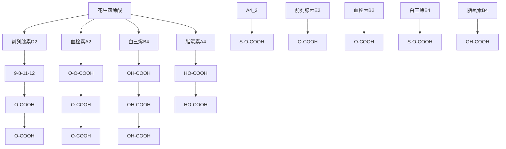

chemical

Chemical structures of acetic acid, sulfuric acid, and S-acyl-CoA functional groups with Chinese labels

图15-2 酯键与硫酯键的化学结构比较

外，脂肪酸羧基的质子也可以被金属离子替换，使脂肪酸转变为脂肪酸盐；传统肥皂即是通过甘油三酯与氢氧化钠发生皂化反应形成的脂肪酸盐。脂肪酸的羧基还能够与巯基（来自蛋白质中半胱氨酸侧链或其他分子）脱水缩合，形成硫酯键（thioester bond）；通过这样的缩合，可生成S-脂酰化蛋白质（S-acylated protein）（图15-2）。值得注意的是，蛋白质的S-脂酰化反应一般都是可逆的，可调节该蛋白以锚定于生物膜上的形式存在，或者以非锚定形式存在。

脂肪酸的 C=C 双键具有重要化学反应活性，既可以加氢还原为单键，也可以加水形成羟基脂肪酸。在生物体特异酶的催化下，脂肪酸分子中可以形成或消除 C=C 双键。

特别需要注意的是，多不饱和脂肪酸中的 C=C 双键在高温条件下与空气中的氧气发生自发氧化反应。这一过程始于双键邻位亚甲基碳氢键的均裂，随后与氧分子反应形成过氧化物自由基，引发链式反应，最终降解产生醛类（如丙二醛）、酮类等有害物质。这些氧化产物不仅降低食品营养价值、产生不良风味，还可能对人体健康造成危害。因此，富含多不饱和脂肪酸的植物油（以甘油三酯形式存在，如亚麻籽油、葵花籽油）应避免高温烹调，煎炸等烹饪宜选择热稳定性更好的油脂（如棕榈油、高油酸葵花籽油）。

## (2) 脂肪酸的物理性质主要由碳链长度、不饱和度及双键构型决定

脂肪酸的物理性质主要受碳链长度和顺式 C=C 双键数量的影响。作为典型的两亲性分子，脂肪酸的溶解行为表现出明显的碳数依赖性:短链脂肪酸因羧基占比高而具有强极性和完全水溶性；随着碳链增长（≥12 个 C），分子非极性增强，水溶性显

line

| 碳原子数目 | 熔点 \(({}^{\circ}C)\) |
| --- | --- |
| 4 | ~-3 |
| 6 | 0 |
| 8 | ~17 |
| 10 | ~32 |
| 12 | ~45 |
| 14 | ~58 |
| 16 | ~64 |
| 18 | ~71 |
| 20 | ~76 |
| 22 | ~80 |
| 24 | ~90 |

图 15-3 脂肪酸的熔点与碳链长度和不饱和度的相关性

著降低，但在有机溶剂中的溶解性相应提高。这种溶解特性转变的临界点通常出现在五碳或六碳脂肪酸。

脂肪酸的相变行为同样遵循明确的结构依赖性:熔点随碳链延长而升高（每增加一个 $CH_{2}$ 基团提高约5\~7℃），但顺式双键的引入会通过破坏分子规整堆积，使熔点骤降（图15-3）。例如，18碳脂肪酸系列中，饱和的硬脂酸（18:0）熔点为70℃，而含1个双键的油酸（18:1 $\Delta^{9}$ ）降至4℃，含3个双键的α-亚麻酸（18:3 $\Delta^{9,12,15}$ ）更降至-11℃。值得注意的是，当碳链超过18个原子时，不饱和度对熔点的调控作用会超越链长效应，这为通过油脂凝固温度快速评估其不饱和度提供了理论依据。

## (3) 脂肪酸分子的空间结构具有多样性

脂肪酸的空间结构具有显著的三维特性。成键碳原子的四面体结构特征（见图1-8A）使得烃链呈现三维结构，而非简单的平面锯齿形（图15-1）。C—C单键的自由旋转（能垒约12 kJ/mol）赋予分子构象灵活性，而C=C双键则形成刚性平面结构——顺式双键使碳链产生约30°的弯折，显著影响分子堆积（图15-1）。这种结构差异直接导致不饱和脂肪酸的分子间作用力减弱，较饱和脂肪酸增加15%\~20%的分子间隙。

在生物膜系统中，顺式不饱和脂肪酸的弯折结构对膜性质具有关键调控作用。含油酸（18:1 $\Delta^{9}$ ）的磷脂双分子层相变温度较硬脂酸（18:0）降低约50℃（图15-3），膜流动性提升3\~5倍。这种效应使细胞能通过调节脂肪酸去饱和酶活性，动态改变膜脂组成以应对温度变化。例如，低温条件下大肠杆菌可将其膜脂不饱和度从20%提升至50%，以维持膜的正常功能状态。这种适应性调节机制在真核生物（如酵母耐冷突变体）中同样保守存在。

## (4) 脂肪酸的高还原态碳链使其可通过氧化分解释放大量自由能

甘油三酯作为生物体最高效的能量储存形式，其能量密度（37 kJ/g）约为糖原的2.5倍，这主要源于脂肪酸碳链的高度还原特性。在真核细胞中，脂肪酸主要通过线粒体β氧化逐步裂解为乙酰辅酶A，经柠檬酸循环和氧化磷酸化彻底氧化。以1分子棕榈酸（16:0）为例，完全氧化可净生成大约106分子ATP，显著高于1分子葡萄糖彻底氧化产生的ATP产量（约30～32分子）。值得注意的是，甘油三酯的能量产出效率受脂肪酸结构影响:碳链越长、饱和度越高，其理论ATP产量越大，如硬脂酸（18:0）比油酸（18:1Δ⁹）多产生1.5个ATP分子，这种差异使生物体能通过调节脂肪组成来优化能量储备策略。

## 15.2.4 哺乳动物必须从饮食中获取某些不饱和脂肪酸

所有哺乳动物均需亚油酸（18:2 $\Delta^{9,12}$ ）和α-亚麻酸（18:3 $\Delta^{9,12,15}$ ）这两种多不饱和脂肪酸以维持生理功能。由于哺乳动物缺乏 $\Delta^{12}$ 和 $\Delta^{15}$ 去饱和酶，无法在脂肪酸的 $\Delta^{12}$ 或 $\Delta^{15}$ 位引入双键，因此无法从头合成这两种脂肪酸，必须依赖膳食摄入，故被称作必需脂肪酸（essential fatty acid）。

根据传统，亚油酸和  $\alpha-$  亚麻酸被分别称作  $\omega-6$  和  $\omega-3$  脂肪酸。与前面的系统命名法从羧基端对碳原子编号不同，这种  $\omega$ （希腊字母中的最后一个字母）命名法是从脂肪酸的另一端，即甲基碳（ $\omega$  端）开始对碳原子编号。在多不饱和脂肪酸分子中，距羧基最远端的双键在倒数第 3 个碳原子上（即位于倒数第 3 和第 4 个碳原子之间）的脂肪酸称为  $\omega-3$  脂肪酸；在第 6 个碳原子上（即第 6 和第 7 个碳原子之间）的脂肪酸则称为  $\omega-6$  脂肪酸。据此，亚油酸是一种  $\omega-6$  家族脂肪酸，而  $\alpha-$  亚麻酸则为一种  $\omega-3$  家族脂肪酸（图 15-4）。

ω 命名法的优势在于以下方面:①反映代谢独立性:ω-3 和 ω-6 家族在哺乳动物体内无法相互转化（因缺乏  $\Delta^{15}$  和  $\Delta^{12}$  去饱和酶），ω 命名法直接体现这种代谢隔离。②功能关联性:ω-3 和 ω-6 的衍生物在炎症、免疫等功能上作用相反，ω 命名法更易关联其生理意义。③结构稳定性:无论碳链延长或缩短（如 18 碳→20 碳），ω 编号不变；比如花生四烯酸从亚油酸（一种 ω-6 脂肪酸）衍生而来，仍为一种 ω-6 脂肪酸。

chemical

Chemical structures of two dihydroxybutyric acid derivatives with labeled carbon positions and terminal groups

图 15-4 代表性  $\omega-3$  和  $\omega-6$  多不饱和脂肪酸的结构分别以  $\alpha-$  亚麻酸（上）和花生四烯酸（下）为例。

## 15.2.5 花生四烯酸通过氧化环化等转化过程生成生物活性信号分子

花生四烯酸（arachidonic acid）是一种具有20个碳原子骨架和4个C=C双键的ω-6多不饱和脂肪酸（20:4Δ$^{5,8,11,14}$）。作为类二十烷酸（eicosanoid）的前体物质，花生四烯酸通过环氧合酶和脂氧合酶代谢途径可生成多种生物活性介质，包括前列腺素（prostaglandin，PG）、血栓素（thromboxane，TX）、白三烯（leukotriene，LT）和脂氧素（lipoxin，LX）等。这些代谢产物均保留20碳骨架结构和末端羧基特征，其中前列腺素是最早被鉴定的类二十烷酸成员。

## 知识延展 15- 1

## 必需脂肪酸的发现过程

必需脂肪酸的发现归功于美国学者乔治·伯尔（George Burr，1896—1990）和他的妻子米尔德丽德·伯尔（Mildred Burr，1893—1962）。他们从1929年至1930年通过一系列开创性的实验，首次证实了某些脂肪酸对生命至关重要，并提出了“必需脂肪酸”的概念。

1920 年代，科学界普遍认为脂肪仅是能量来源，可与碳水化合物互换。伯尔夫妇最初的研究目标是维生素 E。他们在实验中试图通过无脂饮食培养不育雌性大鼠，但发现大鼠仍能繁殖，推测食物中可能混入了微量脂溶性维生素 E。

为了排除干扰，伯尔夫妇设计了一种高度纯化的饮食，仅含蔗糖、酪蛋白、矿物质和已知维生素，完全不含脂肪。喂食这种饮食的大鼠在几周后出现严重症状:皮肤出现鳞状脱屑、尾部坏死、脱毛和溃疡；生长停滞，体重下降，最终死亡；解剖显示肾脏和泌尿道严重受损。

当伯尔夫妇在饮食中添加少量猪油（仅3滴）后，大鼠的症状迅速缓解。进一步分析发现，亚油酸（一种ω-6脂肪酸）是起治疗作用的关键成分。1930年，他们正式将亚油酸和α-亚麻酸（一种ω-3脂肪酸）定义为“必需脂肪酸”，即人体无法合成、必须从食物中获取的脂肪酸。

1958 年，人类婴儿必需脂肪酸缺乏症被确认，补充亚油酸可改善皮肤症状。2012 年，高纯度二十碳五烯酸乙酯（一种  $\omega-3$  脂肪酸衍生物）获美国食品药品监督管理局（FDA）批准，用于心血管疾病治疗，验证了伯尔夫妇发现的临床价值。伯尔夫妇的工作颠覆了脂肪仅是能量来源的传统认知，奠定了现代脂类营养学的基础。他们的发现至今仍影响着膳食指南和功能性食品的开发。

## (1) 前列腺素

前列腺素是瑞典学者乌尔夫·冯·奥伊勒（Ulf von Euler，1905—1983）和英国学者莫里斯·戈德布拉特（Maurice Goldblatt，1895—1967）在1930年代从人类精液和动物组织中分离出来的一种生物活性物质，被命名为“前列腺素”（误认为其源自前列腺）。瑞典学者苏内·贝里斯特伦（Sune Bergström，1916—2004）证实前列腺素是一类具有多种生理功能的脂质化合物。

前列腺素的合成主要是通过花生四烯酸在3个碳原子（9位、11位和15位）上发生加氧反应，并在8位和12位碳原子之间形成一个五元环。前列腺素的生物合成主要通过花生四烯酸在环氧合酶催化下完成。其核心步骤包括:①在9、11和15位碳原子发生特异性加氧反应，形成羟基和羰基；②随后8位和12位碳原子通过分子内缩合形成特征性五元环结构，即环戊烷骨架（图15-5）。前列腺素均以环戊烷骨架为核心结构，根据环上取代基类型、双键位置及侧链修饰可分为9大类（PGA—PGI；$\mathrm{PGD}_2$ 和 $\mathrm{PGE}_2$ 的结构如图15-5所示，下标数字表示双键的数目）。其结构差异直接决定生物学功能的特异性。

## (2) 血栓素

血栓素是一类具有独特结构和重要生理功能的前列腺素类物质，其结构与功能特征如下。从花生四烯酸衍生出血栓素的过程中，由花生四烯酸中的8位和12位碳原子之间形成含醚键的六元环（代替前列腺素中的环戊烷环）。其中的血栓素 $A_{2}(TXA_{2})$ 是一种重要的生物活性物质，在人体生理和病理过程中发挥着关键作用。血栓素 $A_{2}$ 含一种双环结构:一个高反应性的含醚键四元环和一个含醚键的六元环。独特的四元环结构使 $\mathrm{TXA}_2$ 具有极强的生物活性但极不稳定（半衰期仅约 $30\mathrm{s}$），会迅速水解开环转化为稳定的六元环结构，形成血栓素 $\mathrm{B}_2$（$\mathrm{TXB}_2$）；同时伴随C9和C11位两个羟基的形成（图15-5），导致生物活性显著降低。这一特性使得 $\mathrm{TXA}_2$ 成为体内快速响应的局部信号分子，主要在血小板活化初期发挥促聚集作用。失去生物活性的血栓素 $\mathrm{B}_2$ 可作为血栓素 $\mathrm{A}_2$ 生成的标志物用于临床检测。

flowchart

## (3) 白三烯

白三烯是另一类重要的花生四烯酸衍生物。与花生四烯酸相比，白三烯分子保留了四个 $\mathrm{C} = \mathrm{C}$ 双键，且其中的三个双键形成稳定的共轭体系，这一结构特征显著增强了分子的化学反应性。

白三烯具有两种不同的结构类型（图15-5）:一种在C5和C12位含羟基，典型的如白三烯 $\mathrm{B_4}$ （$\Delta^{6,8,10,14}$），是强效的炎症介质和趋化因子；另一种则含有半胱氨酰修饰，称为半胱氨酰白三烯，如白三烯 $\mathrm{E_4}$ （$\Delta^{7,9,11,14}$）。半胱氨酰白三烯是在谷胱甘肽硫转移酶催化下形成的，在C6位形成半胱氨酰硫醚键，具有显著的支气管收缩和血管通透性调节作用。

共轭双键系统赋予分子平面性，有利于与受体结合；而末端修饰（羟基或半胱氨酰基团）则决定其特定的生物学活性和受体选择性。这种结构多样性使得白三烯能够参与多种病理生理过程，包括炎症反应、过敏反应和呼吸道疾病的发生发展。

白三烯是哮喘类过敏反应的关键介质，这使得阻止白三烯活性成为抗哮喘的重要途径。比如，抗哮喘药物孟鲁司特（Montelukast）是一种选择性半胱氨酰白三烯受体1的拮抗剂，其抗哮喘机制主要通过阻断白三烯介导的炎症和支气管收缩反应实现；药物分子中的共轭系统和特征性修饰是其发挥生物学活性的分子基础。

## (4) 脂氧素

脂氧素由花生四烯酸通过脂氧合酶途径合成。脂氧素也被称为三羟二十碳四烯酸，其分子中存在四个共轭双键和三个羟基。依据双键位置和羟基位置的差异，脂氧素一般被分为脂氧素 $\mathrm{A}_4$ 和脂氧素 $\mathrm{B}_4$ 两种亚型（图15-5）。脂氧素 $\mathrm{A}_4$ 中的三个羟基分别位于C5、C6和C15位，四个共轭键为 $\Delta^{7,9,11,13}$；而脂氧素 $\mathrm{B}_4$ 中的三个羟基分别位于C5、C14和C15位，四个共轭键为 $\Delta^{6,8,10,12}$。此外，在两类脂氧素分子中，羟基的空间取向不同，这也会导致受体结合特异性差异。脂氧素是内源性炎症消退介质的核心成员，功能上表现为“促消退”而非单纯抗炎。

总之，这四类二十烷酸分子（前列腺素、血栓素、白三烯、脂氧素）以自分泌或旁分泌方式作用于局部组织，浓度虽低但效应显著。它们均通过 G 蛋白偶联受体（G protein-coupled receptor，GPCR）介导多样化的生理或病理效应。

它们的生理功能涉及促炎作用（如前列腺素 $\mathrm{E}_2$ 诱发发热、疼痛和血管通透性增加；白三烯 $\mathrm{C_4 / D_4 / E_4}$ 引起支气管收缩和黏液分泌，严重时可导致炎症风暴）、凝血调节（血栓素 $\mathrm{A}_2$ 激活血小板聚集促进止血，而前列腺素 $\mathrm{I}_2$ 则抑制该过程维持血管通畅）、血管张力调控（部分前列腺素具有血管舒张活性，而血栓素 $\mathrm{A}_2$ 则表现为强烈收缩效应）。

## 知识延展 15- 2

# 阿司匹林的开发历史与药物认识

阿司匹林是全球家喻户晓的常用药物，自19世纪末成药以来，已逐渐成为医药领域的经典代表。它属于非甾体类抗炎药，核心成分为乙酰水杨酸，是全球范围内应用最广泛的解热、镇痛及抗炎药物，也是衡量和对比其他同类药物的基准制剂。

阿司匹林的起源可追溯至古代文明。早在公元前1500年，古埃及和古希腊人就使用柳树皮缓解疼痛和发热。19世纪，科学家从柳树皮中分离出水杨苷，并进一步合成了水杨酸，但其强刺激性限制了应用。1897年，德国化学家费利克斯·霍夫曼（Felix Hoffmann，1868—1946）为让患关节炎的父亲能服用安全、顺口的药物，决心攻克水杨酸难关。他的团队成功在水杨酸分子上添加乙酰基，生成乙酰水杨酸，显著中和了水杨酸的刺激性，保护了人体胃黏膜。1899年3月6日，该药物申请专利注册，“阿司匹林（Aspirin）”正式诞生，其名称源自乙酰基（acetyl）与水杨酸来源的灌木绣线菊(Spireae)。阿司匹林一经上市便获广泛好评，为德国拜耳公司带来巨大收益。

20 世纪，阿司匹林的作用机制逐渐明晰。1971 年，英国学者约翰·文（John Vane，1927—2004）通过体外研究观察到，阿司匹林能直接抑制环氧合酶（COX）的活性，阻断花生四烯酸转化为前列腺素  $H_{2}$ ；后来通过人类志愿者，他证实口服阿司匹林同样抑制前列腺素合成，且抗炎效果与 COX 抑制强度正相关，从而确认了阿司匹林发挥抗炎、镇痛及抗血小板凝聚作用的分子机制。这一突破使阿司匹林的应用从单纯的解热镇痛扩展到心血管疾病预防，如抑制血小板聚集以降低心梗和卒中风险。

从柳树皮到现代医学基石，阿司匹林的开发历史展现了传统医学与现代科学的融合。它不仅是药物化学的重要里程碑，更持续影响着临床治疗策略，成为药物研发史上最具影响力的经典案例之一。

基于其病理作用，相关抑制剂已成为重要临床药物，比如:环氧合酶抑制剂阿司匹林通过不可逆抑制环氧合酶-1（cyclooxygenase-1，COX-1）而减少促炎性前列腺素和血栓素 $\mathrm{A}_2$ 生成，实现抗炎、镇痛及抗血栓效果；白三烯受体拮抗剂孟鲁司特可用于哮喘和过敏性疾病治疗；等等。

## 15.3 在储存能量的细胞中脂肪酸的主要存在形式是甘油三酯

脂肪酸在细胞内可转化为甘油三酯储存，也可用于膜合成或能量代谢。对甘油三酯的认识历史与甘油、油脂化学及工业应用的发展密切相关。

人类对甘油三酯的认识经历了漫长而逐步深入的过程。在古代，人们虽然没有甘油三酯这一科学概念，但在日常生活中已经对与之相关的物质有了初步感知。比如人们早就知道动物油和植物油的存在，像肥肉中的脂肪，它的主要成分就是甘油三酯。人们在饮食中能感受到脂肪的独特口感和饱腹感，并且也观察到长期大量食用富含脂肪的食物会让人身体发胖等现象，但当时并不能从科学层面去解释这些现象背后的本质。

随着研究的推进，脂肪根据结构被命名为甘油三酯，也叫做三酰甘油，它是人体的“能量银行”。当人们摄入过多食物，其中的淀粉和油在未通过运动消耗掉其产生的热量时，就会变成甘油三酯（脂肪）储存在身体里面；而当人体无法从食物获取能量时，又会分解体内储存的甘油三酯，释放出脂肪酸为身体提供能量。这一时期，人们开始对甘油三酯在人体中的生理功能有了较为清晰的认识。

后来，科学家们发现人体内甘油三酯总量过多会带来一系列健康问题。脸会变胖、肚子会变大，还可能发生代谢性脂肪肝和高甘油三酯血症等症状。大量研究表明，甘油三酯高的人更容易发生心脑血管病。如果甘油三酯严重升高，还会诱发急性胰腺炎。这促使人们更加重视甘油三酯与健康之间的关系，也推动了对高甘油三酯血症等疾病的治疗研究。

如今，人们已经清楚地知道甘油三酯增高后的应对方法。最重要且有效的方式是控制饮食，如少吃肥肉、炒菜少用油、少吃面食、多吃蔬菜，以此减少甘油三酯的来源；同时要多运动，尽量多消耗甘油三酯，让身体内甘油三酯的总量处于负平衡状态。不同甘油三酯升高程度有不同的治疗方案，对于轻度升高可通过控制饮食和增加运动解决，严重升高则需要服用贝特类和 GLP-1（glucagon-like peptide-1）受体激动剂等降脂药。这已经形成了较为完善的防治理念。

## 15.3.1 甘油三酯分子中的脂肪酰基具高度异质性

甘油脂（glycerolipid）是由甘油分子与脂肪酸通过酯化反应形成的酯类化合物。根据酯化程度可分为甘油单酯（monoacylglycerol）、甘油二酯（diacylglycerol）和甘油三酯（triacylglycerol），其脂肪酸连接位置存在 sn-1、sn-2 和 sn-3 三种立体特异性 $^{①}$ 。在磷脂合成中，sn-1,2-甘油二酯（1,2-diacylglycerol，DAG）是合成两亲性磷脂的关键前体。其游离的 sn-3 位羟基可与极性基团（如磷酸胆碱、磷酸乙醇胺）通过酯

chemical

Chemical structures of three sn-alkane units with labeled chain lengths and functional groups

图 15-6 甘油三酯的异质性结构示意图

其中 sn-1 位羟基连接的是硬脂酸（18:0），sn-2 位羟基连接的是  $\alpha-$  亚麻酸（ $18:3\Delta^{9,12,15}$ ），sn-3 位羟基连接的是油酸（ $18:1\Delta^{9}$ ）。

键结合，形成如磷脂酰胆碱或磷脂酰乙醇胺等磷脂分子。而通常所说的“甘油脂”特指中性甘油三酯，这是生物体最主要的能量储存形式。

值得注意的是，生物体内的甘油三酯具有高度异质性（图 15-6）。也就是说，单个甘油三酯分子常包含2\~3种不同的脂酰基，这种多样性既满足了能量储存的高效性（完全氧化可产生约38 kJ/g能量），又通过脂肪酸组成的动态调节适应不同组织的代谢需求。这种精巧的分子设计使其成为进化上保守的能量存储方案。

<small>① 这里的 sn 是英文 stereospecific numbering 的缩写，意为 “立体专一编号”，由 IUPAC 制定，用于明确甘油衍生物的空间构型。</small>

甘油三酯的物理性质取决于其脂肪酸组成。植物来源的甘油三酯多含不饱和脂肪酸（如油酸），在常温下呈液态（油）；动物来源的甘油三酯则以饱和脂肪酸（如棕榈酸）为主，呈固态（脂肪）。这种差异源于不饱和脂肪酸双键导致的分子堆积松散，熔点降低。尽管存在状态差异，两者的化学本质相同，密度均为约 $0.9\mathrm{g/cm}^3$ ，低于水的密度（$1.0\mathrm{g/cm}^3$），因此能浮于水面。

## 15.3.2 甘油三酯在细胞内主要以脂滴形式存在

甘油三酯呈中性且高度疏水，主要存储于单层磷脂膜包被的脂滴中。脂滴（lipid droplet）的发现历史可追溯至19世纪末。1880年代，德国学者里夏德·阿尔特曼（Richard Altmann，1852—1900）等首次在光学显微镜下观察到细胞内存在强折光性的球形颗粒，但当时误认为是独立的生命单位“生物芽体”（bioblast）。1890年代，奥地利学者弗朗茨·齐格蒙迪（Franz Zsigmondy，1860—1929）等通过改进显微技术确认这些结构是中性脂质的储存体，由此奠定了脂滴作为细胞器的早期认知。1950年代，罗马尼亚裔美国学者乔治·帕拉德（George Palade，1912—2008）等通过电子显微镜观察，揭示了脂滴独特的“单层磷脂膜包裹中性脂”的超微结构，彻底将其与线粒体等其他细胞器区分开来。

一直以来，脂滴在学术界仅被视为细胞内简单的“油滴”（fat body），其研究长期处于边缘地位。这一认知局限主要源于以下因素:其一，传统观点认为脂滴仅存在于动物脂肪细胞和植物种子中，分布范围有限；其二，脂滴的中性脂质核心易破裂，导致分离纯化困难，样本易受其他细胞组分污染。20世纪后期以来，随着超速离心、免疫亲和纯化等分离技术的突破，结合蛋白质组学和脂质组学的系统研究，人们不仅鉴定了大量脂滴相关蛋白质［如脂滴包被蛋白（perilipin）］和脂质分子，更从根本上重新定义了脂滴的本质——它是一种跨越生物三域（真核生物、细菌、古菌）的膜性亚细胞结构（图15-7）。脂滴表面的蛋白质主要参与脂质的代谢和运输、脂滴的分解与融合，以及脂滴与其他细胞器之间的相互作用。

(A)

text_image

脂滴
线粒体
1 µm

(B)

text_image

胆固醇酯
甘油三酯
蛋白质（酶）
磷脂

图 15-7 脂滴的电子显微镜照片和结构示意图（A）小鼠褐色脂肪组织细胞的电镜照片（由中国科学院生物物理研究所刘平生实验室提供）。（B）脂滴的结构示意图。

甘油三酯在动物血液中以脂蛋白（lipoprotein）复合物形式运输（详见第23章）。血液中脂蛋白的结构组成与细胞内的脂滴具有某种相似性，其中载脂蛋白（apolipoprotein）对脂质的组装、存储和运输起着重要作用。

## 15.3.3 甘油三酯的主要功能是储存能量

甘油三酯以脂滴形式广泛储存于各类细胞中，其中动物脂肪细胞的储存最为丰富。在能量供给充足时，甘油三酯以惰性状态长期稳定储存；而当细胞需要能量时，脂滴中的甘油三酯会被分解为甘油和脂肪酸，脂肪酸随后通过β氧化生成ATP供能（详见第22章）。例如，成人心肌细胞依赖甘油三酯分解提供超过85%的能量，以满足持续收缩的需求；骨骼肌则在运动时大量分解甘油三酯，以维持ATP供应。

尽管甘油三酯是重要的能量储备，但其含量、分布及代谢效率直接影响健康。白色脂肪中甘油三酯过度积累可导致肥胖，肝脏中过量储存则可引发脂肪肝，在其他组织中异常蓄积也与代谢综合征相关。值得注意的是，2型糖尿病患者的骨骼肌细胞与耐力运动员的骨骼肌细胞均富含甘油三酯，但两者对胰岛素的敏感性却截然相反:糖尿病患者的肌肉细胞虽储存大量甘油三酯，却因脂毒性微环境（如游离脂肪酸堆积，脂质代谢中间产物异常）引发胰岛素抵抗，导致葡萄糖摄取障碍；耐力运动员的肌肉细胞通过高效线粒体氧化和脂滴动态周转，将甘油三酯转化为能量，反而增强胰岛素信号通路敏感性。这一矛盾现象被称为“运动员悖论”，解析该机制或为2型糖尿病的治疗提供新方向。

## 15.4 甘油磷脂是一类两亲性膜脂

甘油磷脂（glycerophospholipid）是一类以甘油-3-磷酸为基本骨架的磷脂分子。其结构特征包括一个疏水尾部和亲水头部。其中的两分子脂肪酸分别通过酯键连接在甘油的sn-1和sn-2位，形成疏水尾部；甘油的sn-3位羟基被磷酸基团取代，形成磷脂酸（phosphatidic acid，PA），其磷酸基可进一步与不同亲水性醇类（如胆碱、乙醇胺）缩合，形成甘油磷脂的亲水头部（图15-8）。

19 世纪中叶，科学家在研究脑组织和卵黄等生物材料时，首次分离出具有脂质特性的物质。1847 年，谢弗勒尔从脑组织中提取出含磷的脂类，为磷脂研究奠定了基础。1840 年代，戈布利从卵黄中分离出卵磷脂（lecithin，即磷脂酰胆碱），并发现其由甘油、脂肪酸、磷酸和胆碱组成。这是人类首次明确鉴定的甘油磷脂。1870 年代，德国学者约翰·图迪休姆（Johann Thudichum，1829—1901）系统研究了脑组织中的磷脂，并命名了包括鞘磷脂（sphingomyelin，SM）在内的多种磷脂，推动了脂质化学的发展。20 世纪初，人们进一步区分了磷脂的两大类别:甘油磷脂（以甘油为核心骨架，如卵磷脂、脑磷脂）和鞘磷脂（以鞘氨醇为核心骨架，如神经鞘磷脂），从而明确了

chemical

Structural formulas of various phospholipid compounds including phosphate, ribose, amine, glycol, and chloroplasts

图 15-8 常见甘油磷脂的化学结构

甘油磷脂的结构特征。同时，随着色谱技术和 X 射线衍射技术的进步，科学家阐明了甘油磷脂的分子结构，并发现其在细胞膜中的关键作用。

## 15.4.1 不同亲水性头部基团与磷脂酸的磷酸基结合形成结构多样的甘油磷脂

甘油磷脂和鞘磷脂作为细胞膜的主要磷脂组分，在结构上存在显著差异（鞘磷脂结构详见15.5.1节）。细胞膜中常见的甘油磷脂包括:磷脂酸（PA）、磷脂酰胆碱（PC）、磷脂酰乙醇胺（PE）、磷脂酰丝氨酸（PS）、磷脂酰肌醇（PI）、磷脂酰甘油（PG）（图15-8），其中磷脂酰胆碱和磷脂酰乙醇胺占比超过膜磷脂总量的 $50\%$ 。这些磷脂均由磷脂酸与不同亲水性头部基团（简称头基，如胆碱、乙醇胺等）缩合形成，其结构差异主要取决于极性头基的特性。

值得注意的是，磷脂酰甘油可进一步与磷脂酸结合形成心磷脂（cardiolipin, CL），这是线粒体内膜的特征性磷脂。在中性 pH 条件下，甘油磷脂的不同头基使其呈现不同的净电荷状态:磷脂酰胆碱和磷脂酰乙醇胺呈电中性，磷脂酰丝氨酸带负电，而磷脂酰肌醇和磷脂酸则具有更强的电负性。

甘油磷脂的 sn-1 位通常连接饱和脂肪酸，而 sn-2 位更倾向结合不饱和脂肪酸（如花生四烯酸）。磷脂酶  $A_{1}$  和  $A_{2}$  分别特异性催化水解 sn-1 和 sn-2 位的酯键，释放脂肪酸和溶血磷脂，参与细胞信号转导（如炎症反应）和膜动态重构。

## 15.4.2 甘油磷脂是构成生物膜脂双层结构的基本组分

甘油磷脂分子具有典型的两亲性（amphipathic）结构:两条疏水的脂酰基链构成疏水端，而极性的磷酸基团等形成亲水端。这种两亲性结构特性使其能够在水环境中自发组装，形成多种有序聚集体。

在油-水界面，甘油磷脂分子会定向排列——疏水尾部伸向油相，亲水头部朝向水相，从而形成单分子层。当完全处于水相环境中时，甘油磷脂分子会通过疏水相

text_image

蛋白质
胆固醇
磷脂的脂酰基链
磷脂的亲水头部

图 15-9 双层磷脂膜结构示意图

磷脂分子以双分子层形式排列，疏水的脂酰基链（尾部）聚集并向内，以避免与水接触，通过范德瓦耳斯相互作用维持紧密排列，驱动双层结构的形成，形成疏水核心区；亲水的磷酸基团等头部向外，与水分子相互作用，构成亲水界面；在磷脂双层膜中镶嵌着发挥不同功能的蛋白质分子。

互作用使脂酰基链相互聚集，同时亲水头部与水分子发生相互作用，最终自发形成双层（bilayer）膜结构（图 15-9）。这种双层排列不仅最大限度地减少了疏水区域与水的接触，还通过分子间的范德瓦耳斯相互作用和极性基团间的相互作用维持了结构的稳定性。

双层磷脂膜作为细胞膜的基本结构，通过其独特的“亲水-疏水-亲水”三明治式排列，构成了细胞与外界环境之间的选择性疏水屏障。膜两侧亲水的极性基团与水相环境相互作用，而中间致密的疏水脂肪酸链层则有效阻挡了极性分子的自由通透，使得细胞能够维持独特的胞内化学环境。这种结构不仅赋予膜系统自我封闭和动态可塑的特性，支持细胞的形态变化和分裂过程，更为多种功能膜蛋白（如转运蛋白、受体蛋白和酶）提供了锚定位点，从而实现了物质运输、信号转导和代谢转化等复杂功能，最终保障了细胞的正常生命活动。

## 15.4.3 缩醛磷脂是一类通过醚键连接脂酰基链的甘油磷脂

甘油醚磷脂（ether glycerophospholipid）是甘油磷脂的一个特殊亚类（图 15-10），其结构特征在于 sn-1 位通过醚键（而非常见的酯键）与烷基相连，典型的如烷基醚磷脂酰乙醇胺（plasmanylethanolamine）。这种醚键连接方式赋予其更高的化学稳定性，使其不易发生水解反应。其中最具代表性的缩醛磷脂（plasmalogen）具有独特的结构特征:紧邻醚键的碳碳键为顺式双键。这一结构显著区别于普通甘油醚磷脂的饱和连接（图 15-10）。

从组成来看，缩醛磷脂表现出丰富的分子多样性，其极性头基可包含胆碱、乙醇胺等多种类型，其中以缩醛磷脂酰胆碱（plasmenylcholine）和缩醛磷脂酰乙醇胺（plasmenylethalomine）最为常见（图15-10）。这类磷脂在生物膜中广泛分布，尤其在需氧组织（如心肌和神经组织）的细胞膜中含量显著。尽管其确切的生理功能尚未完全阐明，但现有研究表明其可能参与膜动力学调节、抗氧化防御等重要生理过程。

图 15-10 代表性甘油醚磷脂与缩醛磷脂

chemical

化学结构式图，展示烷基醚磷脂酰乙醇胺、缩醛磷脂酰胆碱、缩醛磷脂酰乙醇胺及其血小板活化因子的分子结构

## 15.4.4 磷脂酰肌醇磷酸和血小板活化因子均为重要的脂质信号分子

磷脂酰肌醇的肌醇环可通过多位点磷酸化形成多种磷脂酰肌醇磷酸，后者是重要的细胞内信号分子。以磷脂酰肌醇-4,5-二磷酸（phosphatidylinositol 4,5-bisphosphate, PI(4,5)P₂）为例，当磷脂酶C（phospholipase C，PLC）将分子中的磷酸基与甘油之间的磷酯键水解时，产生两种关键的第二信使:三磷酸肌醇（inositol triphosphate，IP₃）和甘油二酯（图15-11）。三磷酸肌醇通过激活内质网上的钙离子通道而释放钙离子，而甘油二酯则能与钙离子共同激活蛋白激酶C（protein kinase C，PKC），调控多种细胞活动。

血小板活化因子（platelet-activating factor，PAF）是一种结构独特的甘油醚磷脂酰胆碱，其sn-2位连接的是乙酰基而非长链脂肪酸。这种特殊结构使血小板活化因子能够作为强效信号分子，通过结合特定受体来触发血小板聚集和血管扩张等生理反应。

图 15-11 磷脂酰肌醇-4,5-二磷酸（PI(4,5)P₂）在磷脂酶 C（PLC）的催化作用下水解生成三磷酸肌醇（IP₃）和甘油二酯（DAG）的过程

chemical

Chemical reaction scheme showing PI(4,5)P2 and DAG enzymes forming a complex organic molecule with phosphorus-containing units

## 15.5 鞘脂类是以鞘氨醇为基本骨架构成的脂质分子

鞘脂（sphingolipid）是一类以鞘氨醇（sphingosine）为核心骨架的脂质，其结构特征为鞘氨醇的氨基通过酰胺键与脂肪酸链相连。值得注意的是，鞘氨醇本身由丝氨酸衍生而来，因此这类脂质也可视为以丝氨酸为前体的衍生物。其中，神经酰胺（ceramide）作为最基本的鞘脂结构，可进一步衍生出两类重要分子:与单糖或寡糖基结合形成鞘糖脂（glycosphingolipid）；与磷酸胆碱结合形成鞘磷脂(sphingomyelin)。这类脂质在神经系统含量尤为丰富，不仅为细胞膜的结构组分，也能通过其代谢产物参与细胞间通信，调控包括细胞生长、分化及凋亡在内的多种重要生理过程（图 15-12）。

chemical

三种有机化合物结构式：鞘氨醇、神经酰胺、鞘磷脂，各分子有碱基与羧基的链上结构

图 15-12 鞘氨醇、神经酰胺和鞘磷脂的结构示意图

## 15.5.1 神经酰胺的 1-羟基与磷酸胆碱通过磷酸二酯键结合形成鞘磷脂

神经酰胺是鞘脂类分子的核心结构单元，由鞘氨醇（一种长链氨基醇）的氨基通过酰胺键与脂肪酸缩合形成，是最简单的鞘脂形式。在鞘磷脂合酶（sphingomyelin synthase）的催化下，神经酰胺的1-羟基与磷酸胆碱通过磷酸二酯键缩合，形成两亲性鞘磷脂。

鞘磷脂是一类重要的磷脂分子，与甘油磷脂共同构成细胞膜的磷脂双分子层。其结构特征是以鞘氨醇（而非甘油）为骨架，通过酰胺键连接脂肪酸，并含有与磷脂酰胆碱相同的磷酸胆碱极性头基。鞘磷脂约占多数哺乳动物细胞膜总磷脂的15%，在髓鞘等特化膜中比例显著提高。鞘磷脂不仅通过参与形成脂筏（lipid raft；细胞膜上富含胆固醇、鞘磷脂和特定蛋白质的动态微结构域，具有低流动性和高熔点等特征）而维持膜结构，其代谢产物（如神经酰胺）还在细胞信号传递中发挥关键作用，体现了鞘脂类分子在细胞生理活动中的多功能性。

## 15.5.2 神经酰胺的 1-羟基与单糖或寡糖通过糖苷键共价连接形成鞘糖脂

神经酰胺可通过糖苷键与单糖或寡糖结合形成鞘糖脂。根据所含糖基的性质，鞘糖脂可分为中性鞘糖脂和酸性鞘糖脂两类，其中酸性鞘糖脂因含有带负电荷的基团（如唾液酸）而显酸性。鞘糖脂结构复杂多样，IUPAC对其寡糖链提出了专门的缩写命名体系，主要分为神经节苷脂（ganglioside，GM）和红细胞糖苷脂（globoside，Gb）两大类。两者的关键区别在于神经节苷脂的寡糖链上连有1\~4个唾液酸[如5-N-乙酰神经氨酸（5-N-acetylneuraminic acid，Neu5Ac)]分子，而红细胞糖苷脂则仅含中性寡糖。

常见的神经节苷脂包括单唾液酸四己糖神经节苷脂（monosialotetrahexosylganglioside，GM1）、单唾液酸三己糖神经节苷脂（GM2）和单唾液酸二己糖神经节苷脂（GM3）（图 15-13）。值得注意的是，这三种神经节苷脂均只含一个唾液酸单位，其结构差异主要体现在寡糖链的长度等方面；这里的数字仅仅反映被鉴定的顺序，并非反映结构特征。这类酸性鞘糖脂因其特殊的糖链结构和唾液酸修饰，在细胞识别、信号转导等生理过程中发挥重要作用。

图 15-13 三种常见神经节苷脂（GM1、GM2 和 GM3）的结构

chemical

Chemical structures of GM1, GM2, GM3 and their derivatives including β-D-半乳糖, N-乙酰-β-D-半乳糖胺, β-D-半乳糖, β-D-葡萄糖, Neu5Ac, 5-N-乙酰神经氨酸, and 硬脂酸

## 15.5.3 鞘糖脂的糖基在生物识别过程中发挥关键作用

鞘糖脂的糖基部分具有高度复杂的结构和多样的生物学性质，使其不仅作为细胞膜的结构组分维持膜稳定性，更在细胞识别、信号转导和病原体相互作用中发挥关键作用。以神经节苷脂 GM1 为例，其特有的寡糖链结构可作为霍乱毒素（cholera toxin）的特异性受体，介导毒素内化后通过持续激活 G 蛋白-腺苷酸环化酶 -cAMP 信号通路引发疾病。类似地，某些肿瘤特异性高表达的鞘糖脂（如 GM2）已成为重要的肿瘤标志物和治疗靶点。这些功能充分体现了鞘糖脂糖基的结构多样性与其生物学功能的紧密关联。

## 15.6 脂肪酸可直接与糖骨架相连形成一类特殊的糖苷脂

根据分子结构，人们将生物体内的脂质分为八类，其中的一类为糖脂（saccharolipid）。这是特指一类脂肪酸直接通过酯键或酰胺键与糖骨架（如六碳糖或糖胺）共价结合的脂质分子。这类化合物的典型特征是以糖替代甘油作为核心骨架，可包含多条脂肪酸链，典型的如革兰氏阴性菌细胞壁成分脂质A（lipid A），即由二糖胺骨架连接多个脂肪酸链构成（图15-14）。其结构显著区别于传统以甘油或鞘氨醇为骨架的脂类。

传统意义上的糖脂（glycolipid）则泛指所有携带糖基化修饰的脂质。根据骨架类型分为两大类:甘油糖脂（glyceroglycolipid），由甘油二酯的sn-3位羟基与单糖（或寡露糖）通过糖苷键连接形成（图15-14），常见于植物和微生物膜系统；鞘糖脂（sphingoglycolipid），以鞘氨醇为骨架，通过糖苷键连接单糖或寡糖链（如神经节苷脂GM1）（图15-13），在真核细胞膜中发挥信号识别功能。

## 15.7 固醇脂是一类以固醇为核心结构的脂类化合物

chemical

Structural formulas of two glycosylated lipids: A large肠杆菌脂质A and a type of 1-oxo-glycosylated lipids

图 15-14 一类特殊糖脂与传统糖脂的结构差异

上，一类特殊糖脂——大肠杆菌脂质 A，其骨架由两个葡萄糖胺（GlcN）组成。下，传统糖脂——一种甘油糖脂，其骨架由甘油组成。

除了上述甘油脂和鞘脂等脂质分子之外，真核生物体内存在的另一大类脂质分子是固醇脂（sterol lipid）。具体而言，固醇脂是一类其核心结构由四个环烷基组成的分子。这类脂质主要包括游离固醇（如胆固醇、植物固醇）及其衍生物（如固醇酯、氧固醇）。固醇脂在生物体内发挥多种重要功能:作为细胞膜的关键结构组分调节膜流动性；作为维生素D、胆汁酸和类固醇激素的前体物质参与代谢调控；还以酯化形式（固醇酯）存储在脂滴中或通过脂蛋白运输。固醇脂的结构特征和生物学功能与其他脂质（如甘油脂、鞘脂）存在显著区别。

在动物体内，胆固醇是最主要的游离固醇，也是固醇脂（如胆固醇酯）及其他固醇衍生物（如胆汁酸、类固醇激素）的核心前体。下面首先介绍胆固醇的结构和特性。