穿生命科学史，从拉瓦锡认识到呼吸类似燃烧，到阐明 ATP 作为能量货币，这些不断深化的认识不仅揭示了生命本质，更深刻推动了医学（如对糖尿病和癌症的代谢异常的理解）、农业（如光合作用的研究）及能源领域（如发酵的应用）的革新。

本篇将系统地学习生物体普遍存在的物质与能量代谢，内容涵盖糖、脂质、氨基酸和核苷酸的分解与合成代谢，以及核心产能过程（柠檬酸循环、氧化磷酸化、光合磷酸化）。贯穿始终的主线是“结构决定功能”，强调酶通过其活性中心的精确结构（空间、电荷、构象）实现高效且特异的催化。理解这些过程是认识生命和人类健康的关键。

## 代谢总论

前面介绍了蛋白质、核酸、糖类和脂质等几类主要生物分子的结构、性质和生物学功能等，也介绍了核酸和蛋白质等生物大分子的生成过程。在生物体内，这些生物分子及其最基本的组成单位——单糖、脂肪酸、氨基酸和核苷酸等都会发生分解和合成；同时伴随能量的转换。因此，任何单细胞或多细胞生物体的生长过程，都必然伴随着物质和能量的转换。

本章将对生物代谢过程的总体情况进行介绍，涵盖代谢的定义和分类、代谢途径的总体特征、代谢反应的本质和类型，以及生物体内能量转换的表征方法等内容。

广义而言，生物体内这种物质和能量转换过程所涉及的全部化学反应的总和被定义为代谢（metabolism；其本意是“变化”）。但人们也常将 DNA、RNA 和蛋白质这些信息生物大分子在生物体内的生成过程单独研究，因为它们的生成过程不仅依赖于模板的存在，还依赖多种后续加工、折叠等过程。因此，狭义的代谢只涉及这些生物大分子以外的、无需模板即可合成的生物分子（如脂肪酸、单糖、寡糖、氨基酸、核苷酸等较小分子，以及像多糖这样的大分子）的合成和降解过程，以及相关的能量转换过程。

在代谢领域，人们特别关注那些使不同小分子相互转换的化学反应。这些化学反应普遍存在于不同类型的生物体中，在生物演化过程中高度保守；它们共同构成一个高度整合的化学反应网络，对所有生物的生长和生存都不可或缺。我们将生物体内这些小分子之间的相互转换的总和定义为中间代谢（intermediary metabolism）。作为中间代谢的一个个局部，糖酵解、戊糖磷酸途径、柠檬酸循环、氧化磷酸化、糖异生、脂肪酸分解与合成、氨基酸分解与合成、核苷酸分解与合成等都是我们

## 16

在后面几章中将重点讨论的内容。

长期研究表明，尽管生物体内的物质和能量转换过程也遵循与非生命体系相同的热力学和动力学规律，但它们具有自身特征。在生命体中，化学转换均在常温、常压和近中性 pH 等温和条件下以高度有序的（被调节的）方式发生，每次发生转换的能量值都相对较低。相比之下，非生命体系中的化学转换通常在高温、高压和极端 pH 等条件下发生，能量则以热能、光能等形式一次性大量释放。生物体内的代谢过程涉及生物分子的降解、合成和相关的能量转换等多个方面，为了便于认识，我们将物质转换划分为不同的代谢途径（metabolic pathway）:每一条代谢途径由一系列酶促化学反应组成，实现从一种或几种物质到另外一种或几种物质的转化。

通过这些代谢途径，生物体能够直接捕获太阳的辐射能或通过氧化分解有机燃料分子获取化学能量；同时，它们也可利用不同的前体化学分子合成大小不同和性质各异的产物生物分子。这些过程由特异的酶催化，使得代谢过程高度有序。不同代谢途径之间相互协调，在细胞和个体水平实现高度整合，从而维持生物体内的动稳态（dynamic steady state）。这是生物个体进行生长、发育和对内外环境的变化做出适当响应等一切生命过程的基础。

在本篇的后续章节里，我们将介绍涉及物质和能量转换的普遍存在于不同类型生物体内的核心代谢途径。这包括糖的分解（第17章）和合成（第21章）、脂肪酸的分解（第22章）和合成（第23章）、氨基酸的分解（第24章）和合成（第25章）、核苷酸的分解与合成（第26章）；使燃料分子彻底氧化的柠檬酸循环（第18章），以及将氧化释放的能量或从太阳捕获的能量储存于ATP分子的氧化磷酸化（第19章）和光合磷酸化过程（第20章）；本篇的最后一章（第27章）将介绍哺乳动物各器官之间的代谢分工以及通过激素进行整合调控的机制。

## 16.1 对代谢过程的化学认识始于对动物呼吸和发酵的研究

对任何生命现象的认识，往往是一个从宏观到微观、从粗略到细致的发展过程，对生物代谢的认识也不例外。它开始于人们利用仪器对动物整体，包括人体在内进行的定量实验，后来再逐渐深入到众多具体代谢反应的分子层面。对生物代谢过程的初步研究最早可追溯到17世纪意大利学者圣托里奥·圣克托里乌斯（Santorio Sanctorius，1561—1636）对人体（包括他自身）在经历各种活动之后体重波动的观察。他设计了一个与杆秤相连的活动平台并进行了长期的定量观察。他注意到，人体排出的可见物质（包括粪便和尿液等）的重量明显低于他所摄入食物的重量。他认为，失去的物质是人体“无感蒸发”的结果。从某种意义上说，生物体中这种失去的物质所发生的化学转化，正是在后续几个世纪里人们所开展的代谢研究的核心内容。

## 16.1.1 对代谢的科学探究开始于对动物呼吸过程的定量分析

如前所述，对生命现象的化学探究可能开始于18世纪法国学者安托万·拉瓦锡（Antoine Lavoisier，1743—1794）等对动物呼吸过程的科学观察。他对前人实验结果进行了思考，并在此基础上开展了定量和定性实验观察。为了测量动物呼吸过程中释放的能量，并将其与燃烧过程比较，他与物理学家合作设计了一种冰量热器。具体而言，他将一个分别装有实验动物豚鼠或燃烧着的蜡烛或木炭等的容器裹上一层冰，在这层冰的外面再加一层冰以维持零度恒温。然后通过测定内层冰流出的冰水的量来测定蜡烛等燃烧或豚鼠身体代谢所产生的热量:产生的热量越多，则冰块熔化后流出的冰水量也越多。他们同时还通过一根导管将容器里的气体引出并测定所产生 $CO_{2}$ （当时被称作固定空气）的量。结果表明，就释放每单位 $CO_{2}$ 所产生的热量而言，蜡烛燃烧与豚鼠呼吸几乎是一样的。他们同时也观察到，豚鼠摄入 $O_{2}$ ，呼出 $CO_{2}$ ，而且二者的比值接近1。但是，摄入的 $N_{2}$ 在呼吸过程中未发生任何改变，也就是说 $N_{2}$ 在动物呼吸过程中未扮演任何角色。

1780 年代，拉瓦锡等人综合对动物呼吸过程的这些观察结果后提出，动物呼吸作用的本质是碳和氢的缓慢燃烧，与一盏点亮的灯或燃烧的蜡烛中所发生的事件完全类似。因此，他们形象地将进行呼吸的动物比作可燃物体，通过燃烧而维持生命活动。通过这样的定量产热分析，他们认识到，动物体需要能量才可维持生命，而这样的能量正是由食物提供的。拉瓦锡等人对酒精发酵（也称乙醇发酵）过程中的反应物（糖，主要是葡萄糖）及产物（ $CO_{2}$  和乙醇）的元素组成进行了详细的定量分析，并以此作为他提出物质守恒定律的重要依据之一。但是，他并未意识到酶是诱发这一改变的物质基础，只是提出这是“化学中最非凡的现象之一”。然而，在那之后的相当长一段时间里，人们对这些代谢过程化学本质的认识进展缓慢，直到 100 多年后的 19 世纪末期才开始取得显著进展，并在 20 世纪上半叶实现了革命性的突破。

## 16.1.2 对酵母酒精发酵等现象的探究揭示了代谢过程的化学本质

大约一万年前，中华等文明已经认识到某些食物在一定条件下会被转变为乙醇或乙酸。然而，生物在缺氧条件下进行的发酵（fermentation）现象，却是在光学显微镜发明出来并用于观察酵母等微生物之后才被揭示的。通过显微镜，法国学者夏尔·卡尼亚尔-拉图尔（Charles Cagniard-Latour，1777—1859）以及两位德国学者弗里德里希·库茨英（Friedrich Kützing，1807—1893）和特奥多尔·施旺（Theodor Schwann，1810—1882）等于1830年代各自独立地观察到了活的酵母细胞与酒精发酵现象之间的高度对应关系。尽管发酵为一种生物学事件的看法被当时多位知名化学家强烈否定，但是在之后的 1850 年代，法国学者路易斯·巴斯德（Louis Pasteur，1822—1895）不仅通过系统实验确认酒精发酵的确是酵母细胞所为，还证明乙醇是酵母细胞在缺氧条件下才大量产生的，而在酒精发酵时偶尔出现的乳酸发酵现象则是某些特异细菌所为。巴斯德进而得出如下结论:产生不同终产物（包括乙醇、乳酸和乙酸等）的发酵现象均是特异微生物所为，这就将人类长期进行的食物发酵实践与微生物代谢过程相互关联起来了。

1890 年代，德国学者爱德华·布赫纳（Eduard Buchner，1860—1917）意外观察到，一种从酵母制备的无细胞抽提液也能引起酒精发酵，即将糖转化为  $CO_{2}$  和乙醇。这开启了人们对酒精发酵过程进行详细化学表征的历程。这样的无细胞发酵系统的建立标志着现代生物化学的诞生，从此，人们开始试图详细描述这样的神奇生命过程的化学本质。

## 16.1.3 糖酵解等多条中间代谢途径在 20 世纪上半叶被详细描述

尽管布赫纳错误地认为，酵母抽提液中的某一种酶催化了将糖转化为乙醇和  $CO_{2}$  的化学转化过程，但通过多位学者对无细胞酵母抽提液以及后来获得的肌肉抽提液的深入探究，人们观察到，这实际上涉及大约 10 种酶的催化。也就是说，这样的转化过程并非只依赖一步酶促化学反应，而是通过顺序进行的多步化学反应实现。最后人们将从葡萄糖转化为丙酮酸的十步化学反应定义为糖酵解（glycolysis）代谢途径。

对糖酵解途径全部化学反应的揭示发生于同位素被用于代谢研究之前，是通过纯粹的化学方法而实现的。这里仅列举几位代表性学者的贡献。

首先，英国学者阿瑟·哈登（Arthur Harden，1865—1940）等在1900年代观察到:无机磷酸对无细胞酒精发酵过程是必须的，且无机磷酸通过形成磷酸己糖而转化为有机磷。此外，在加热条件下稳定、可透过滤纸的 $\mathrm{NAD^{+}}$ 等小分子有机物是糖酵解酶的辅酶［最初被称为辅酵素（coferment），因为当时的酶被称作酵素（ferment）］等。

德国学者奥托·迈尔霍夫（Otto Meyerhof，1884—1951）等利用青蛙肌肉无细胞抽提液分析了动物肌肉乳酸代谢（即动物的乳酸发酵过程）与氧气消耗之间的关系。他揭示，参与该代谢过程的中间代谢物、酶和辅因子，以及无机磷酸盐等都与哈登等在酵母酒精发酵过程中鉴定的完全相同。这表明类似的代谢途径发生于不同类型的生物体内，这也是人们第一次在分子层面获得了强有力的证据，支持了不同生物物种如酵母与动物之间，存在演化关系。但在1920年代，迈尔霍夫等错误地认为乳酸是肌肉收缩的直接能量来源。

同时，德国学者古斯塔夫·恩布登（Gustav Embden，1874—1933）利用肌肉细胞抽提液开展了对大量发酵中间物的鉴定和对整个代谢通路的探究。他们通过加入氟化物抑制剂等方式，阻断某些步骤而使中间物积累，从而成功分离鉴定多种糖酵解中间物，其中包括果糖-1,6-二磷酸和甘油酸-3-磷酸；他们因此还提出了果糖-1,6-二磷酸直接裂解为甘油醛-3-磷酸和磷酸二羟丙酮的概念，并于1933年（恩布登生命的最后一年）首次提出糖酵解途径的发生方式。他还提出，大量的乳酸其实是在肌肉收缩之后才形成，所以不可能是肌肉收缩的能量来源。

从 1760 年代到 1960 年代，人类对这些中间代谢途径探究的代表性成果如图 16-1 所示。很多发现均在 20 世纪上半叶获得，这包括我们在后面将要详细介绍的以下方面:糖酵解、柠檬酸循环、戊糖磷酸代谢、脂肪酸 β 氧化、电子传递链、化学渗透学说、氮气和 CO₂ 的固定（同化）、核苷酸的合成以及胆固醇和脂肪酸的合成等代谢途径。此外，酶的辅因子、ATP、磷酸肌酸和乙酰辅酶 A 的存在也都在这个时期被揭示。

图 16-1 揭示中间代谢途径的大事记

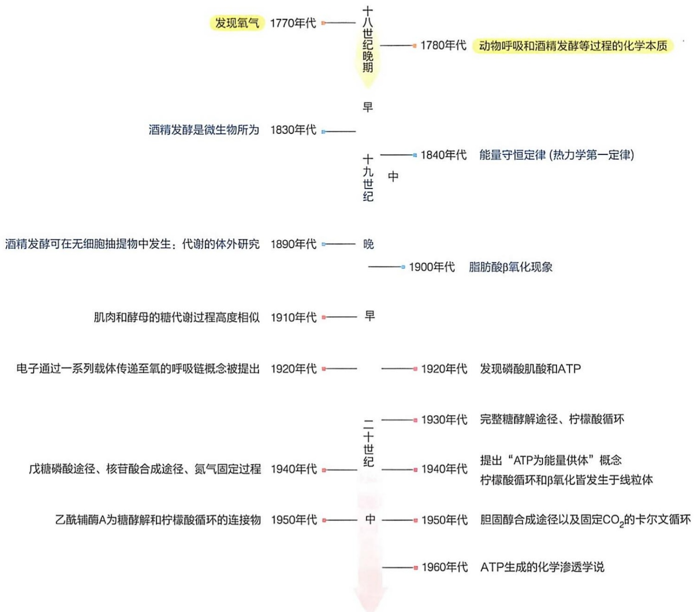

flowchart

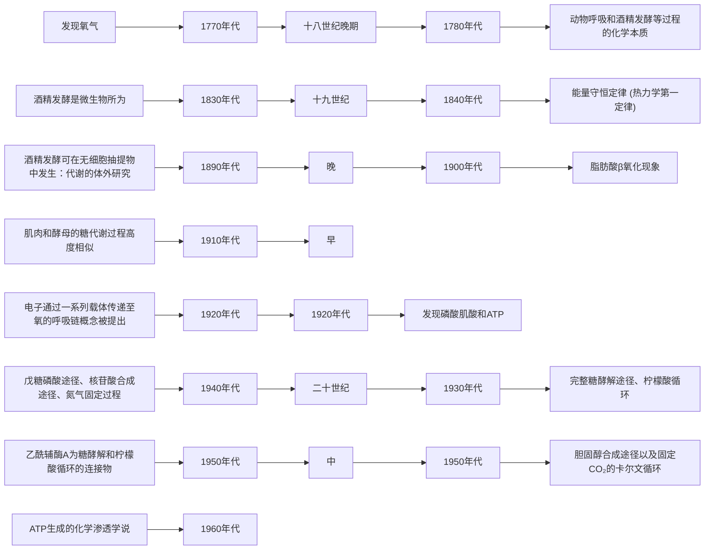

## 16.2 生物圈中不同代谢模式通过能量流动驱动物质循环

生物圈中形形色色的生物，尽管外观形态千差万别，但根据各自碳源获取方式的差异可大致划分为自养生物（autotroph）和异养生物（heterotroph）两大类。

自养生物是指能够以无机物作为主要碳源来生长增殖的生物，它们不依赖从外界摄取有机物来构建自身生物量，因此可以独立于其他生物而生存。相比而言，异养生物则不能从无机碳源合成有机物，需利用自养生物所提供的有机物为碳源，即离开其他生物，自身无法生长繁殖。因此，自养生物是生态系统中的生产者，而异养生物则是消费者。

自养生物可根据获得能量的方式大致分为两类。第一类（也是最主要的一类）通过光合作用从太阳光获得能量，并同时释放氧气，被称为光能自养生物（photoautotroph）；像光合植物、绿藻和蓝细菌都属于这一类。相对较少的第二类是生活于无光照的极端环境中（如深海）的细菌或古菌，它们通过氧化硫化氢、氢气、单质硫、二价铁和氨等无机物获得能量，被称作化能自养生物（chemoautotroph）；像硫细菌、铁细菌和甲烷菌等都属于这一类。这两种自养生物均从大气中的  $CO_{2}$  获得碳源。因此，自养生物无须依靠其他生物的存在即可自我生存。而异养生物则需要利用自养生物所提供的有机物（如由自养生物制造的葡萄糖）进行氧化分解（同时消耗由自养光合生物释放的氧气）获得碳源，所以异养生物的生存离不开自养生物的存在。

因此，这两大类生物（其中，自养生物主要指光能自养型）在生物圈里共同形成如图16-2所示的物质循环和能量流动。

光能自养生物消耗太阳能，利用  $CO_{2}$  和  $H_{2}O$  生成有机分子，同时释放  $O_{2}$ 。化能异养生物则利用  $O_{2}$，通过细胞呼吸作用氧化自养生物提供的有机分子（营养物质），释放能量，同时产生  $CO_{2}$  和  $H_{2}O$。

值得注意的是，生物圈中的这种物质循环由单方向的能量流动所驱动:太阳 $\rightarrow$ 自养生物 $\rightarrow$ 异养生物，其间部分能量必然被转换为热能，并导致宇宙中熵（即无序性）的增加。

能量代谢和物质代谢是每一种代谢过程不可分割的两个方面。物质代谢涉及细胞对外界物质的吸收、转运、合成和分解等过程，是生物圈中物质循环的基础。而能量代谢则涉及这些物质代谢过程中发生的能量转换，也是认识细胞生命活动不可或缺的一个重要方面。二者密不可分，都是我们今天认识生命活动的关键内容。

图 16-2 生物圈中发生于自养生物和异养生物之间的物质循环和能量流动

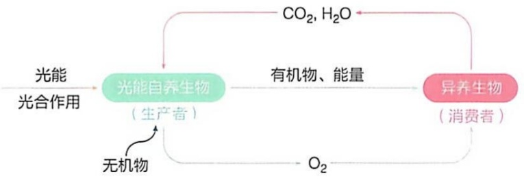

flowchart

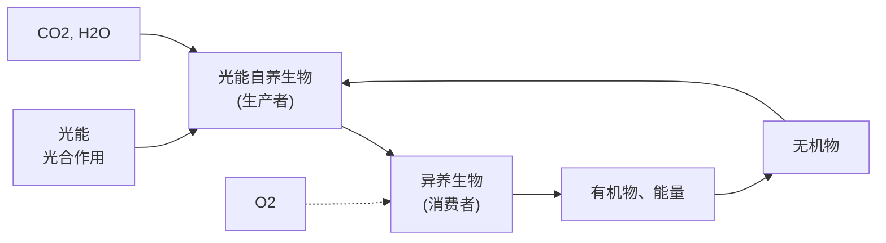

## 16.2.1 代谢在理论上可分为分解代谢和合成代谢两大类

代谢是活细胞内必然发生的生命事件。生物体内发生的物质代谢有的使反应物分子变小（即分子量降低），有的则使分子变大（即分子量增加）。前一类代谢反应被称作分解代谢（catabolism），也被称作生物降解；而后一类则被称作合成代谢（anabolism），也被称作生物合成。

具体而言，动物体内的分解代谢主要涉及以下方面。食物中的生物大分子首先在消化道内被分解成小分子。这涉及蛋白质被水解成20种不同的氨基酸，多糖被水解成葡萄糖等单糖，甘油三酯被水解成甘油和脂肪酸，核酸被水解成核苷酸等。这些降解产物被肠道细胞吸收后进入血液循环（吸收的脂质先进入淋巴系统，后进入血液循环；葡萄糖、氨基酸等则直接进入血液循环），随着血液流动被输送至全身各部位的组织细胞中；之后单糖、脂肪酸、甘油和部分氨基酸皆可氧化分解，形成乙酰辅酶A中的二碳单位，然后通过柠檬酸循环和氧化磷酸化彻底氧化，产生 $CO_{2}$ 和水等终产物。氧化反应所释放出的化学能通常被存储在ATP分子中，供生物体用于做不同类型的功（包括机械功、化学功等），成为生物体进行多种生命活动的能量来源。因此，分解代谢在维持细胞能量的稳定供给方面发挥重要作用。

生物体内的合成代谢则主要涉及以下方面。先是从简单前体合成单糖、脂肪酸、氨基酸和核苷酸等生物小分子，然后从这些单体小分子进一步合成多糖、甘油三酯、蛋白质和核酸等。比如，在很多自养生物进行光合作用的过程中， $CO_{2}$  可以被用于合成葡萄糖，然后葡萄糖又被用于合成寡糖和多糖分子。这些典型的生物合成过程对于生物个体的生长发育显然不可或缺。

## 16.2.2 分解代谢为合成代谢提供能量和前体

尽管我们通常将代谢归为分解代谢和合成代谢两大类，但这种划分是相对而非绝对的。发生于细胞里的几千种化学反应尽管被归属于不同的代谢途径中，但其实它们之间都是紧密相连、相互依赖，并形成一种多维网络的。只有当整个代谢网络都有序运转时，生物体生命活动的正常有效进行才可确保。

生物体需利用能量来进行各种生命活动。这涉及合成生物大分子、使分子和离子进行逆浓度梯度跨膜运输、肌肉收缩、细胞内进行各种运动、产生热量以及动物的发光等生命过程。

从能量角度看，在细胞分解代谢过程中，糖、脂肪和蛋白质等富能营养物质（即燃料分子）通过氧化分解，形成能量枯竭的  $CO_{2}$ 、 $H_{2}O$  和  $NH_{3}$  等简单分子。其间所释放的化学能将大部分被先暂时性储存于能量货币 ATP 和还原型电子载体 NADH、NADPH 或  $FADH_{2}$  等分子中（这些分子的结构和特征见本章后面部分）。而在细胞合成代谢过程中，很多化学反应的有效进行都依赖能量的输入，这正是由 ATP 和这些还原型电子载体提供的。这就形成了能量的产生、传递和利用的动态过程（图 16-3），充分体现出代谢过程的高度整合性。

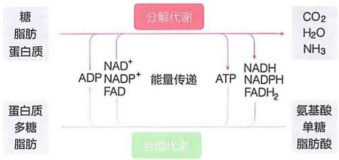

flowchart

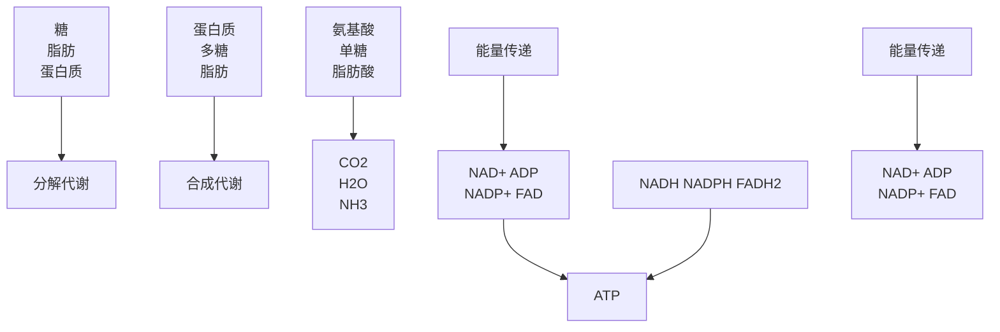

图16-3 生物体内的分解代谢与合成代谢之间形成一种相互依赖的整体

细胞内的分解代谢除了通过上述方式为合成代谢提供能量之外，还为合成代谢提供各种前体。比如，糖分解途径中形成的中间体是合成氨基酸的主要前体，也是合成核苷酸分子的重要前体，等等。

## 16.2.3 细胞内的分解代谢和合成代谢分别表现出收敛性和发散性特征

当大量分解和合成代谢途径被陆续揭示后，人们惊奇地观察到，这两类代谢途径各自表现出不同的总体特征。所有分解代谢途径总体呈现收敛型特征，即多样的起始分子最后都分解形成相同的终产物；合成代谢途径则总体呈现发散型特征，即从同样的起始分子，最后形成多样的终产物。此外，更为令人惊讶的是，某些代谢途径呈现循环型特征，它通过不断循环使某些代谢物被转化，但中间物被不断再生（图 16-4）。

下面进行具体举例说明，先说分解代谢途径。糖、脂肪酸和氨基酸等结构各异的燃料分子，最终皆被氧化分解形成完全相同的产物，即乙酰辅酶 A。也就是说，尽管这些燃料分子被氧化分解的具体酶促代谢途径各不相同（具体见后面的章节），但它们最后均被转化成被辅酶 A 携带的乙酰基这种二碳单位。分解代谢途径的这种收敛型特征，使得不同的燃料分子最后都可进入共同的分解途径彻底氧化。

图 16-4 收敛型、发散型和循环型代谢途径体现出生命过程的高效性与经济性特征

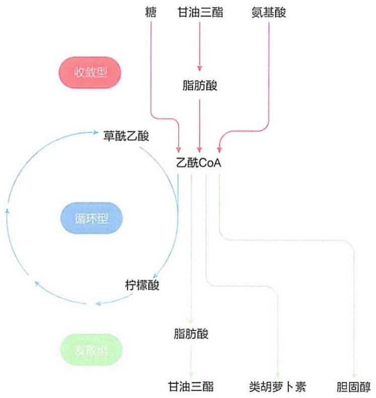

flowchart

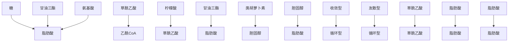

与上述分解代谢途径呈现的收敛型特征正好相反，合成代谢途径则总体呈现出发散型特征。即从少数（甚至一种）共同前体分子开始，通过不同的反应途径形成多种多样不同的终产物。例如，从乙酰辅酶 A 这一前体分子开始，通过不同的合成代谢途径可分别生成如脂肪酸、类胡萝卜素和胆固醇等大量类型结构和功能各不相同的生物分子（图 16-4）。

循环型代谢途径的典型代表是柠檬酸循环。它负责将上面的燃料分子分解代谢途径共同产生的乙酰辅酶A进行彻底氧化，形成 $CO_{2}$ （图16-4；具体见第18章）。这种循环式代谢途径表现出一种催化型特征，即途径中所有中间物都在被消耗的同时不断再生，含量维持恒定，但是却可以使大量的乙酰辅酶A中的二碳单位发生彻底氧化。

细胞代谢途径呈现出的这三种特征，完美地诠释了生命过程的高效性与经济性。

## 16.2.4 生物体内的分解与合成代谢反应交织成一个多维网络

尽管我们通常将生物代谢人为地划分为分解代谢和合成代谢，并归纳为不同的看似独立的代谢途径，每一条途径完成一定的生物功能，但是在活的细胞内，各条代谢途径并非独立存在，而是通过共享代谢中间物而相互关联，交织成一种具有时间、空间、组织和调控等维度的复杂多维网络（图 16-5）。图中展示的代谢途径将在后面章节里分别进行详细的介绍。

因此，当代谢网络中的某种代谢中间物分子的浓度发生改变时，细胞中以它作为前体或中间体的所有其他途径都将受到影响；反之，不同代谢途径流量的改变也会影响特定代谢中间物的浓度。

研究表明，生物体内代谢中间物的含量均保持动稳态，即细胞内某种代谢中间物一般都同时被合成和分解，且二者的速率基本相等，从而使其浓度维持基本恒定。

总体而言，生物体内（或细胞内）的代谢网络处于一种动稳态。这是通过对代谢途径中一些调节酶的活性随时进行正负调控而实现的；也就是说，调节酶的活性可被一些因子抑制，但可被另外一些因子激活。这样维持的代谢动稳态对于细胞或生物个体的生存和正常生长发育至关重要。这种动稳态无法维持或者被破坏，也就意味着生命的异常甚至终结。

图 16-5 生物体内的代谢反应相互交织形成多维网络示意图

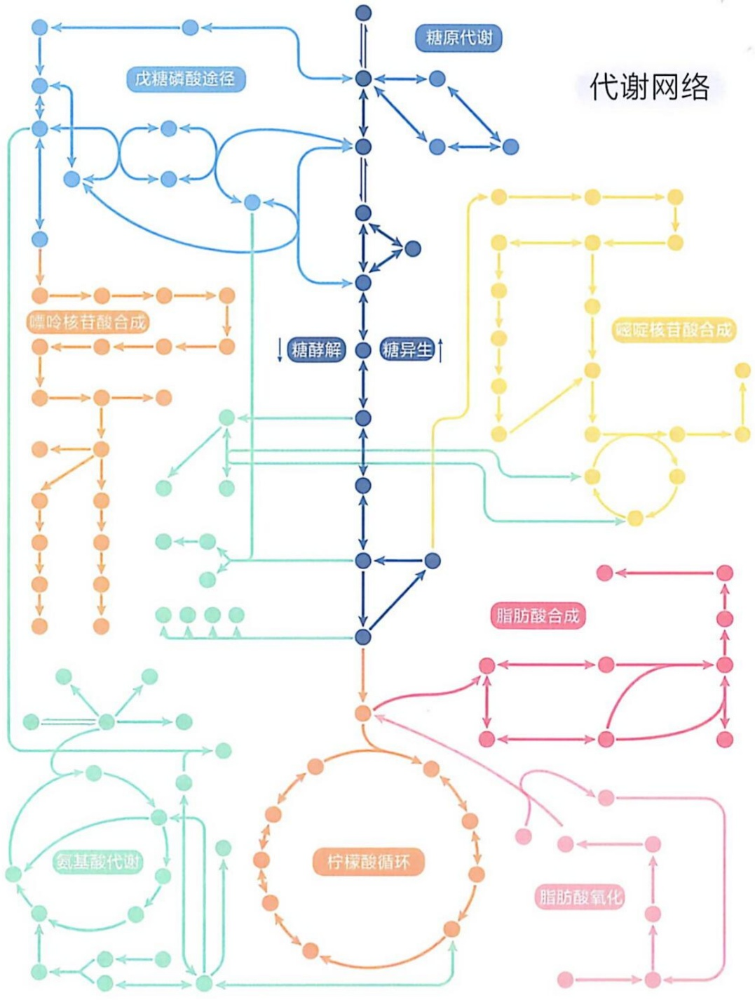

flowchart

This flowchart illustrates the process of a controlled glucose network, showing how various metabolic pathways (such as fatty acids, nucleic acid, and glycine) interact with sugar derivatives to produce final products like glucose synthesis and oxidation.

## 16.3 生物体内的代谢反应可归纳为几种不同类型

匈牙利学者奥尔贝特·圣捷尔吉（Albert Szent-Györgyi，1893—1986）曾指出，生命活动的本质是一个电子寻找归宿的过程。这一观点是对生物体内化学反应的一种颇具哲学意义的总结。

国际生物化学与分子生物学联盟（IUBMB）的酶学委员会已经确认的酶的总体数量是 6 000 多种，这也粗略反映了活细胞中代谢反应的数量。总括起来，所有代谢反应几乎均涉及电子重排过程；毕竟，这是共价键断裂和形成过程所必然发生的事件。例如，在光合作用过程中，光能首先被用来从诸如二价铁、硫化氢或者水等电子供体中剥离电子。这些电子随后通过一系列传递过程，最终被转移至  $CO_{2}$  中的碳原子上，再经过一系列的转化形成单糖等有机分子。

发生于生物体内的几千种代谢反应可依据电子转移和化学键重组的方式，大致划分为以下五种类型:①碳碳键断裂和形成反应（由裂合酶和连接酶等催化）；②分子内部重排、异构和消除反应（由异构酶和脱水酶等催化）；③基团转移反应（由转移酶和水解酶等催化）；④氧化还原反应（由氧化还原酶等催化）；⑤自由基反应（由异构酶和氧化还原酶等催化）。

生物体内发生的化学反应可能是基于它们在生物演化过程中对生命过程的适应性，以及它们在合适酶催化后的速率而被选择的结果。而代谢途径则可能是使用这些被选择的化学反应为工具，绕过那些不可能发生的化学反应（即产物与底物之间的自由能变化为大的正值的反应），而构建起来的。

在介绍这几类反应之前，我们需要简单介绍一下涉及共价键断裂和形成的有机化学反应的一般情况。

## 16.3.1 有机分子发生共价键断裂时可通过均裂产生自由基产物或通过异裂产生带电产物

化学反应的本质在于共价键的断裂与重新形成。原子之间电子的重新排列使两个原子之间共享电子对从而形成共价键。共价单键断裂一般通过两种方式发生（图16-6）:一种方式是均裂（homolytic cleavage），即共享电子对在共享它们的两个原子之间均等分配，使得两个原子各携带一个未成对电子后，以自由基形式分离，比如一个C—H键均裂后可形成碳自由基和氢自由基（即氢原子），而一个C—C键均裂后则形成两个碳自由基。另一种方式是异裂（heterolytic cleavage），即共享电子对在两个共享它们的原子之间不均等分配，其中一个原子因保留全部两个成键电子而带负电，而另一个原子则因未获电子而带正电，当C—H和C—C键发生异裂时就会形成碳负离子（carbanion）、质子、碳正离子（carbocation）、氢负离子（hydride ion）等。这里所形成的自由基和正、负离子都是不稳定的中间体，需形成新的共价键才可恢复稳定状态。这就是化学反应发生的本质。

图 16-6 共价键可通过均裂或异裂方式断裂形成不稳定的自由基或带电中间体

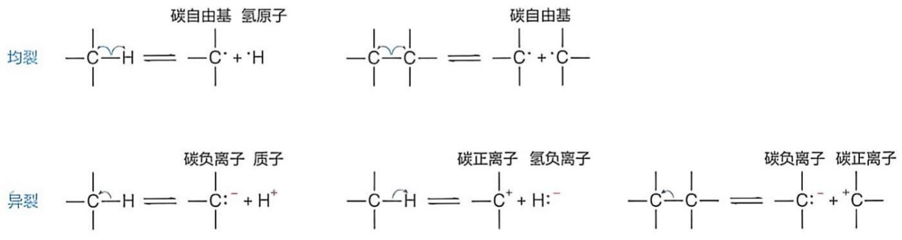

chemical

三种碳自由基氢原子结构式，分别为均裂、异裂和碳负离子/质子的化学方程式

在生物化学反应过程中，发生异裂的比例远高于均裂。过去甚至一直以为通过发生均裂而导致的自由基反应在生物体内极为少见，但现在人们已经观察到，自由基反应在生物体内也并不少见（典型的如核苷酸还原酶催化的脱氧核苷酸的形成过程，具体见第26章）。

## 16.3.2 许多代谢反应涉及亲核基团与亲电基团之间的相互进攻

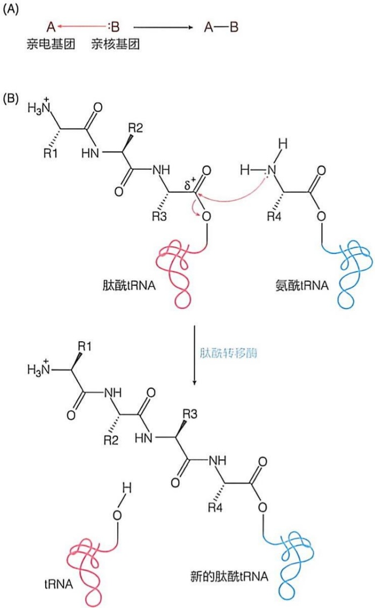

图16-7 亲核进攻反应及酰胺键（肽键）的形成（A）亲核基团对亲电基团进攻后形成共价键。（B）氨基氮原子对羰基碳原子进攻，形成酰胺键连接。

在有机分子中存在富含电子和缺乏电子的基团，它们之间可发生原子重组，即化学反应。因为富含电子的亲核基团（nucleophile）总是倾向于寻求缺乏电子的亲电基团（electrophile），故易导致新共价键的形成。

有机分子中的亲核基团一般含有带孤对电子的原子，典型的如氨基（—NH₂）中的氮原子、羟基（—OH）中的氧原子以及碳负离子中的碳原子。有机分子中的亲电基团则包含易接受电子对的原子，这些原子通常带有部分正电荷或具有空轨道，典型的如羰基（>C=O）或羧基（—COOH）中的碳原子，以及磷酸基中的磷原子。值得注意的是，碳原子既可作为亲核基团（如以碳负离子形式存在时）也可作为亲电基团（如以羰基形式存在时），这取决于它所处的具体化学环境。

生物体内的许多代谢反应都涉及亲核基团与亲电基团之间的相互进攻，因此而导致旧化学键的断裂和新化学键的形成。例如，一个氨基进攻一个羰基形成酰胺键的反应即为典型的亲核基团进攻亲电基团的反应（图 16-7）。

类似地，在酯化反应中，羧酸分子中的羧基碳（亲电基团）与醇分子中的羟基氧（亲核基团）发生相互攻击后，最终形成酯键和一个水分子。这种亲核-亲电攻击在生物代谢反应中广泛存在，如肽链、核酸、寡糖和多糖等的形成过程中。

下面简单介绍代谢过程中存在的几种常见化学反应类型。

## 16.3.3 代谢反应中碳碳键的断裂和形成通常依赖于邻近羰基的存在

生物体内的大量化学反应都发生在含碳有机分子之间，这就必然会涉及 C—C 键的断裂和形成。常见的—CH₂—CH₂—结构中的 C—C 键一般相当稳定，很难断裂或形成，这类反应大多由裂合酶或连接酶等催化，而且只可发生于合适的 C—C 键。

如上所述，一个 C—C 键发生异裂（图 16-6），将分别形成一个碳负离子和一个碳正离子。而一个 C—C 键的形成则涉及一个亲核的碳负离子与一个亲电的碳正离子之间的进攻。碳负离子和碳正离子通常都极其不稳定，即使有酶的催化，它们作为反应中间体也难以形成。

只有当邻近具有高电负性的 O 和 N 原子（如分别以羰基和亚胺基形式存在的 O 和 N）存在，直接改变碳原子外周的电子云分布时，相应的羰基碳等可以使邻近磷原子间的 C—C 键的断裂和形成变得更加容易，也可以稳定邻近碳原子形成的碳负离子，最终使得碳负离子和碳正离子中间体才得以形成、稳定并参与 C—C 键的断裂和形成过程（图 16-8）。另外，羰基碳的这种特征和稳定碳负离子的能力可通过与酶活性中心的金属离子或广义酸之间的相互作用而加强。因此，在很多代谢反应中，邻近羰基的存在对于 C—C 键的断裂和形成发挥了至关重要的作用。

具体而言，羰基可以通过形成烯醇负离子（亚胺基则形成烯胺中间体）稳定邻近

的碳负离子，从而促进其形成。这也使得另一个分子中具有亲电能力的羰基碳（带部分正电）可以与亲核的碳负离子反应，形成碳碳连接。后面章节中，我们将看到大量在特定位置引入并利用邻近羰基实现C—C键形成或断裂的反应，如脂肪酸的β氧化。其他例子还包括在柠檬酸循环中乙酰辅酶A与草酰乙酸缩合形成柠檬酸的反应（见第18章），以及糖异生过程中甘油醛-3-磷酸与磷酸二羟丙酮缩合形成果糖-1,6-二磷酸的反应或糖酵解中的逆向反应（分别见第21章和第17章），等等。

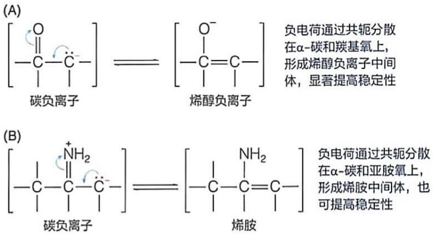

图 16-8 羰基与亚胺促进碳负离子的形成

## 16.3.4 代谢物分子内的重排反应常涉及电子在分子内的重新分布

分子内重排是代谢过程中一种常见反应类型，它通常涉及分子内部原子或基团的重新排列，而不涉及原子或基团的加入或离去。这种反应一般由异构酶或脱水酶等催化。这种重排反应往往伴随着电子在一个分子内重新分布（即分子内的氧化还原反应）。在分子中，电子的分布决定了分子的电荷分布、键角和键长等特征，这进而决定分子的化学性质。除了酶催化之外，某些分子内的某个部分受到外部能量（如热、光、电）的激发时，电子的分布也可能会发生变化，导致分子内部发生重排反应（如光激发下的视黄醛分子）。

在代谢反应中，分子内电子的重新分布一般导致异构现象。这包括分子内碳碳双键的位置的改变、顺反构型的转变和羰基位置的改变（如醛糖与酮糖之间的互变）等，但分子的整体氧化状态不变。经过这样的重排后，电子的重新分布可能为分子在代谢途径中发生的后续酶促反应做准备（如葡萄糖-6-磷酸转变为果糖-6-磷酸的过程），也可能因为结构的改变而诱发特定生理现象（如视觉形成过程中，11-顺式视黄醛转变为全反式视黄醛）。

## 16.3.5 代谢反应中常涉及基团在亲核基团间转移

在代谢过程中，经常发生一个基团从一种分子转移至另外一种分子的反应。这一般由转移酶或水解酶等催化。这将改变分子的结构和性质，在生物分子的合成和分解过程中均普遍发生。如前所述，在化学反应过程中，富含电子的亲核基团倾向于与缺乏电子的亲电基团（如羰基碳或带正电荷的原子）结合。代谢反应中的基团转移反应，往往是基团被活化形成亲电位点后、从一个亲核基团转移至另外一个亲核基团的过程，这当然是在特异酶的催化下发生的。

在生物体内常发生转移的基团包括脂酰基、糖基和磷酰基等。其中，磷酰基转移反应是细胞中一种特别重要且非常普遍的基团转移反应，在代谢途径中起着特殊的作用。后面我们将看到，许多代谢反应均涉及磷酰基（$-\mathrm{PO}_{3}^{2-}$）而非磷酸基（$-\mathrm{O}-\mathrm{PO}_{3}^{2-}$）从ATP转移至一种反应物上，以激活该反应物，使其能进行随后的化学反应。催化磷酰基从ATP分子发生转移的酶统称为激酶。在激酶的催化下，磷酰基可从ATP转移至大量（数百种）不同的受体分子中，这包括醇类、羧酸类等；这是ATP为生物化学反应提供能量的主要方式。

例如，在糖酵解的第一步反应过程中，ATP 分子末端的磷酰基被转移至葡萄糖分子的 C6 羟基上，形成葡萄糖 -6- 磷酸。该反应由己糖激酶催化，同时释放出一分子 ADP（图 16-9）。

在磷酰基转移反应过程中，将形成一种磷原子的五价过渡态。而在脂酰基或糖基转移过程中，则一般都会形成一种碳原子的四面体过渡态，这体现了磷和碳在电子结构和立体化学上的差异。

## 16.3.6 涉及电子转移的氧化还原反应在生物体内普遍发生

大多数生物均需通过氧化糖或脂肪等燃料分子来获得细胞活动所需的能量。其中涉及大量氧化还原反应，即电子在两种反应物之间的转移。其中失去电子被氧化的物质称为还原剂，而获得电子被还原的物质称为氧化剂（图 16-10A）。也就是说，每次失去电子的氧化反应必然伴随着一次获得电子的还原反应，即前者提供电子，而后者接受电子。还原剂被氧化后成氧化产物，而氧化剂被还原后则成还原产物。

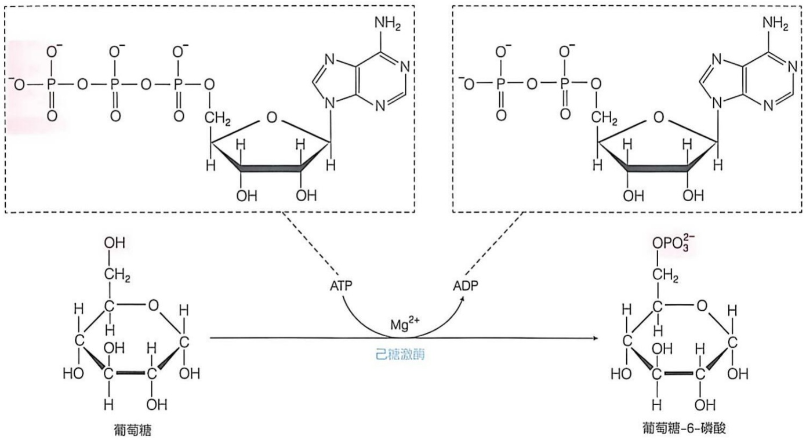

chemical

Chemical reaction diagram showing the enzymatic conversion of glucose to glucose-6-phosphate via magnesium ion activation

比如，乳酸脱氢酶催化乳酸（还原剂，电子供体）被氧化成丙酮酸（氧化产物）的反应（图 16-10B），这里的氧化剂（电子受体）是 NAD⁺ 辅因子，其接受一个氢负离子而被还原成 NADH。当然该酶也催化其逆反应，即丙酮酸被还原成乳酸的反应。正如乳酸脱氢酶催化的反应，生物体内发生氧化还原反应时，电子常以氢负离子（携带 2 个电子）或氢原子（携带 1 个电子）形式发生转移。因此，生物体内的氧化反应往往以脱氢的形式发生。

氧化还原反应在生物体内能量转换过程中发挥关键作用，是氧化磷酸化和光合磷酸化过程中产生能量货币 ATP 的关键过程。后面我们将详细介绍生物体内所发生的氧化还原反应的表征方法。

生物体内发生的第五类反应是自由基反应。其细节将在后面的几个具体例子中予以介绍。

图 16-9 磷酰基从 ATP 转移至葡萄糖的反应

图 16-10 氧化还原反应的通用模式（A）和发生于生物体内的一种典型氧化还原反应（B）

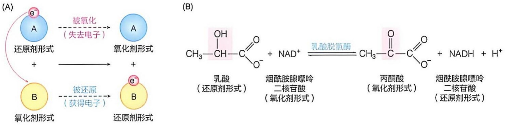