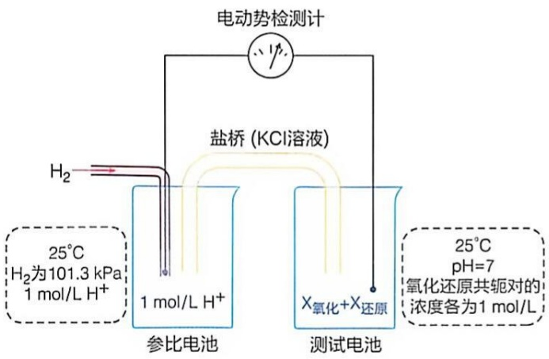
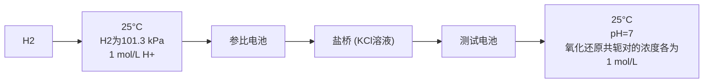
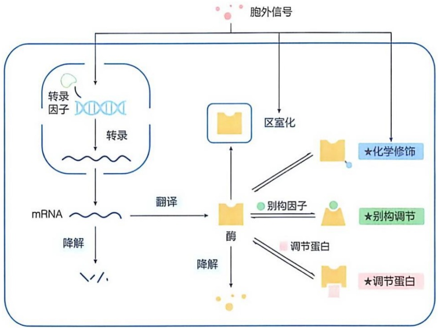
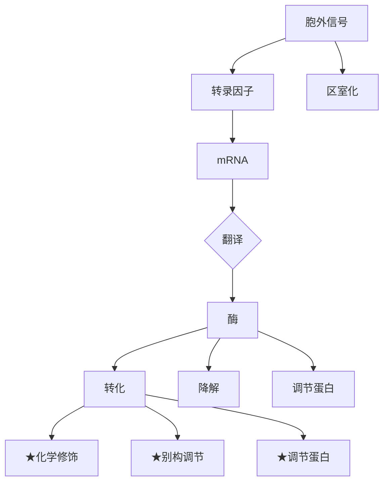
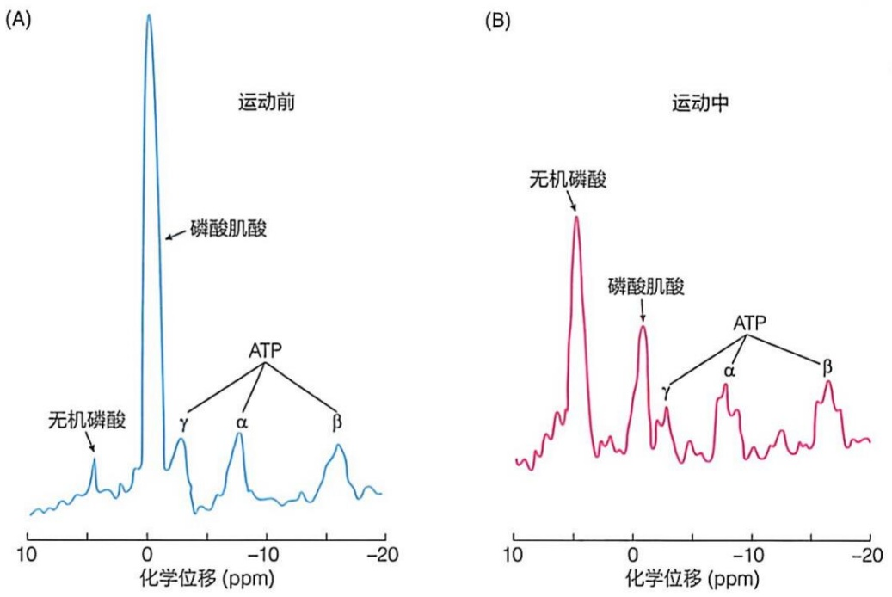
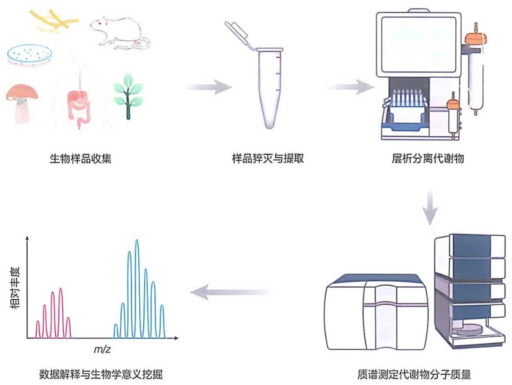

## 16.8 氧化还原反应的自由能变化（$\Delta G$）可通过其电子受体与供体之间氧化还原势的差值（$\Delta E$）计算

探究一种氧化还原反应时，一个关键问题是判断谁是电子供体，谁是电子受体。也就是说，当将两种共轭氧化还原对被放置于同一溶液体系中时，电子会自发地从谁转移至谁。当然从自由能释放角度考虑，还需判断这样的电子转移会释放多少自由能，即 $\Delta G^{\ominus}$ 和 $\Delta G$ 的值。

显然，这种电子转移的方向取决于两个氧化还原对中的电子受体对电子的相对亲和力高低，电子必然是从亲和力低的受体转移至亲和力高的受体。那么，如何判断电子载体的相对电子亲和力呢？

长期的探索表明，我们可利用电化学领域建立的还原势（reduction potential, E）这一参数来反映电子载体的相对电子亲和力。它表征一种电子载体获得电子的相对能力。通过比较两种电子载体的还原势，我们就可以判断它们对电子的相对亲和力，从而判断它们之间发生氧化还原反应的可能性。与自由能变化的概念类似，人们也建立了标准还原势  $E^{\ominus}$  和实际还原势 E 这两个概念。前者为一常数，在标准条件下测定；而后者则为一变量，依实际条件不同而不同。按照惯例，一种电子载体的还原势越高，则对电子的亲和力越高。也就是说，电子总是从还原势低的电子载体移至还原势高的电子载体，即还原势较低的载体更易发生氧化（失去电子），而还原势高的载体更易被还原（得到电子）。这种电子转移过程也伴随自由能的降低。因此，对于氧化还原反应而言，我们可以通过考察电子载体还原势的相对差异，而非平衡常数，去考察反应过程的自由能变化，这比利用平衡常数更为简单方便。

## 16.8.1 生物体内重要电子载体的标准还原势被系统测定

标准还原势 $E^{\ominus}$ 是在标准情况下测定的、反映一种物质的相对电子亲和力。它是

通过将所有待测样品与同一种参比氢电极（$\mathrm{H^{+}/H_{2}}$）进行电子亲和力比较而测定的（图16-20）。参比氢电极的组成如下:$\mathrm{H^{+}}$ 浓度为 $1 \mathrm{~mol/L}$（即 $\mathrm{pH}=0$），$\mathrm{H_{2}}$ 的气压为 $101.3 \mathrm{kPa}$，温度为 $25^{\circ} \mathrm{C}$。待测样品的组成如下:$\mathrm{pH}$ 为7，温度为 $25^{\circ} \mathrm{C}$，氧化还原共轭对（$\mathrm{X}_{\text {氧化}}+\mathrm{X}_{\text {还原}}$）的浓度各为 $1 \mathrm{~mol/L}$。将参比氢电极与待测样品池以盐桥和检流计连接。盐桥的饱和氯化钾溶液为测试电极和参考电极提供离子运动的路径，以建立两个半电池之间的电路连接。电子则通过导线从一个半电池流到另一个半电池，中间连接的电动势检测计（电位差计）可以测定待测样品与参考电极之间的电位差（单位为V）。

flowchart

图 16-20 标准还原势的测定装置

如果电子从参比电极（氢电极）移向待测样品，则待测样品的  $E^{\ominus\prime}$  为正值，意味着待测物质的氧化形式比  $H^{+}$  对电子具有更高的亲和力。如果是反过来，电子从待测样品流向氢电极，则待测样品的  $E^{\ominus\prime}$  为负值，意味着该物质的氧化形式对电子的亲和力低于  $H^{+}$ 。以此方法，人们对生物体内很多参与氧化还原反应的化合物的  $E^{\ominus\prime}$  进行了测定，具体见表 16-6。

表 16-6 生物体内一些重要氧化还原半反应的标准还原势

| 氧化还原半反应 | $E^{\ominus}/N$ |
| --- | --- |
| $\frac{1}{2}O_2 \rightarrow H_2O$ | 0.816 |
| $Fe^{3+} \rightarrow Fe^{2+}$ | 0.771 |
| 细胞色素$f(Fe^{3+}) \rightarrow$细胞色素$f(Fe^{2+})$ | 0.365 |
| 细胞色素$a_3(Fe^{3+}) \rightarrow$细胞色素$a_3(Fe^{2+})$ | 0.35 |
| 细胞色素$a(Fe^{3+}) \rightarrow$细胞色素$a(Fe^{2+})$ | 0.29 |
| 细胞色素$c(Fe^{3+}) \rightarrow$细胞色素$c(Fe^{2+})$ | 0.254 |
| 细胞色素$c_1(Fe^{3+}) \rightarrow$细胞色素$c_1(Fe^{2+})$ | 0.22 |
| 细胞色素$b(Fe^{3+}) \rightarrow$细胞色素$b(Fe^{2+})$ | 0.077 |
| 泛醌→泛醇 | 0.045 |
| 延胡索酸→琥珀酸 | 0.031 |
| $2H^+ \rightarrow H_2$(标准条件下,$pH = 0$) | 0.000 |
| 草酰乙酸→苹果酸 | -0.166 |
| 丙酮酸→乳酸 | -0.185 |
| 乙醛→乙醇 | -0.197 |
| $FAD \rightarrow FADH_2$ | -0.219* |
| $S \rightarrow H_2S$ | -0.243 |
| 硫辛酸→二氢硫辛酸 | -0.29 |
| $NAD^+ \rightarrow NADH$ | -0.320 |
| $NADP^+ \rightarrow NADPH$ | -0.324 |
| 乙酰乙酸→β-羟丁酸 | -0.346 |
| α-酮戊二酸→异柠檬酸 | -0.38 |
| $2H^+ \rightarrow H_2 (pH 7)$ | -0.414 |

\* 这是利用游离 FAD 测定的标准还原势；结合于不同黄素蛋白分子中的 FAD 的标准还原势与此值不同，相互之间也存在一定差异。

## 16.8.2 氧化还原反应中每一个半反应的实际还原势（E）可通过能斯特公式计算

在上述标准还原势概念的基础上，作为威廉·奥斯特瓦尔德（Wilhelm Ostwald, 1853—1932）的助手，德国学者瓦尔特·能斯特（Walther Nernst, 1864—1941）于

1880年代建立了计算氧化还原反应中每一个半反应实际还原势 $E$ 的能斯特公式（式16-5），使其与共轭对中的电子受体和供体的离子浓度相关联:

$$
E = E ^ {\ominus_ {t}} - \frac {R T}{n F} \ln \frac {[ \text {电子供体} ]}{[ \text {电子受体} ]} \tag {16-5}
$$

这里的 $E^{\mathrm{e}^{\prime}}$ 为测定的标准还原势，$R$ 为摩尔气体常数 $[8.3145\mathrm{J / (mol\cdot K)}]$，$T$ 为热力学温度 $[T(\mathrm{K}) = t(\mathrm{^\circ C}) + 273.15]$，$n$ 是所转移的电子数，$F$ 为法拉第常数（96485 J/mol），[电子受体]和[电子供体]分别为一个氧化还原共轭对中的电子受体和电子供体的实际物质的量浓度，$\ln$ 为自然对数。将有关常数（温度为 $25^{\circ}\mathrm{C}$）代入公式16-5后，则可得出更为简化的公式:

$$
\begin{array}{l} E = E ^ {\ominus \prime} + \frac {0 . 0 2 6}{n} \ln \frac {[ \text {电子供体} ]}{[ \text {电子受体} ]} \\ = E ^ {\ominus_ {t}} + \frac {0 . 0 5 9}{n} \lg \frac {[ \text {电子供体} ]}{[ \text {电子受体} ]} \tag {16-6} \\ = E ^ {\ominus \prime} + \frac {0 . 0 5 9}{n} \lg Q \\ \end{array}
$$

可见，每一个氧化还原对的实际还原势是一种高度依赖环境条件的变量，也就是说，一种氧化还原对在不同条件下其实际还原势是不同的。需要注意的是，一种氧化还原反应中的两个半反应的实际还原势需分别计算。

## 16.8.3 任何氧化还原反应的 $\Delta G^{\ominus \prime}$ 或 $\Delta G$ 可分别通过其 $\Delta E^{\ominus \prime}$ 或 $\Delta E$ 计算

当一种氧化还原反应发生时，电子将从还原势低的氧化还原共轭对流向还原势高的氧化还原共轭对。据此，能斯特于1880年代又建立了一种将氧化还原反应的自由能变化（标准自由能变化和实际自由能变化）与其氧还对之间还原势差值之间关系的方程式:

$$
\Delta G ^ {\ominus \prime} = - n F \Delta E ^ {\ominus \prime} \tag {16-7}
$$

$$
\Delta G = - n F \Delta E \tag {16-8}
$$

这里需要注意的是  $\Delta E^{\ominus\prime}$  和  $\Delta E$  的计算方法。无论是计算标准还原势差还是实际还原势差，都需将电子受体的  $E^{\ominus\prime}$  或 E 减去电子供体的  $E^{\ominus\prime}$  或 E。如前所述，氧化还原反应中电子总是从还原势低的氧还对流向还原势高的氧还对。所以这里的电子受体就是还原势高的氧还对，而电子供体就是还原势低的氧还对。因此还原势差的计算方法非常简单，就是将高还原势值减去低还原势值。

比如，电子从 NADH 传递至  $O_{2}$  的标准自由能变化可通过以下方式计算:从表 16-6 中查出， $NAD^{+} \rightarrow NADH$  半反应的  $E^{\Theta'} = -0.320 V$ ，而  $1/2 O_{2} \rightarrow H_{2}O$  的  $E^{\Theta'} = 0.816 V$ ，将高值减去低值，故  $\Delta E^{\Theta'} = +0.816 V - (-0.320 V) = +1.136 V$ 。据式 16-7 即可以计算出该氧化还原反应的标准自由能变化。

因此，就正向反应而言，得到的差值总是正值，而根据式16-7和式16-8计算出的标准自由能变化或实际自由能变化则均为负值，即自发的电子传递反应总为热力学有利反应，反应释放自由能（用于生成ATP等）。换个角度看，就是电子移动的趋势或自由能变化均与 $\Delta E^{\ominus}$ 或 $\Delta E$ 值成正比，从而反映氧化还原反应进行的方向和强度。

但是一种氧化还原反应的实际自由能变化可以通过两种途径计算。一是根据式16-6先计算出两个半反应的实际还原势，然后计算出它们的差值，再利用式16-8计算出实际自由能变化。另外一种方式是先根据两个半反应的标准还原势计算出标准还原势的差值，然后按照式16-7计算出标准自由能变化值（如上所述），然后根据式16-3计算出实际自由能变化，需根据两种产物和两种反应物的物质的量浓度计算出质量作用比 $Q$ 。通过这两种不同方式计算出来的同一种氧化还原反应的实际自由能变化值可能会有微小差异。

## 16.9 生物体内的代谢物浓度通常维持在稳态

生物体的稳态（homeostasis；也称内稳态）概念最初是1860年代由法国学者克洛德·贝尔纳（Claude Bernard，1813—1878）等提出，后由美国学者沃尔特·坎农（Walter Cannon，1871—1945）等在1930年代进一步深化。稳态是指生物个体通过自我调节机制，在适应外界环境变化的同时维持自身内部环境稳定的一种现象，包括动物维持基本恒定的体温和血液中各种营养成分的基本恒定，等等。

生物体每个细胞内大约含有一千种左右的小分子中间代谢物。这些代谢物也被维持在一种稳态，即尽管它们在不断被消耗和产生，但它们在细胞内的浓度却基本保持恒定。这样的小分子中间代谢物包括氨基酸、糖类、脂肪酸、核苷酸、维生素和激素等。它们在生物体内发挥不同的作用，如能量供应、信号传递和结构支持等。它们相对恒定的水平主要是通过对合成和分解代谢反应的精细调控而实现的，这种动态平衡的维持对于生物体的正常生理功能至关重要。

## 16.9.1 代谢过程通过多种方式被严格调控

活细胞内发生的各种代谢反应相互交织在一起而形成一种动态的网络。细胞依赖长期演化所形成的、根据条件的变化对某些代谢反应进行及时和精准调节的方式，维持代谢物浓度的相对恒定。例如，当人体剧烈运动时，身体里的分解代谢过程会加速以提供充足的能量；而当刚摄取食物且处于休息状态时，分解代谢过程较慢，而糖原等生物合成过程则会加速。代谢反应的这种可调节性使得生命体能够快速适应不同的环境和生理状态的改变，从而维持代谢中间物水平的稳态。尽管不同生物体的具体代谢过程可能存在差异，但代谢调节通常都利用一些类似的策略和方式。

在长期演化过程中，生物体对某种成分（如葡萄糖）的分解和合成代谢途径可能会共用某些酶促可逆反应。但是，为了确保这样的合成和分解代谢途径能够作为单向过程有效进行，合成或分解代谢途径都必然包含至少一步热力学上高度有利、从而在细胞内条件下远离平衡的反应，这样就可以推动合成或分解代谢途径正向发生。这样的热力学上高度有利反应的逆向反应当然就是热力学上高度不利的反应，这就可以避免逆向代谢途径的发生。对于分解代谢或合成代谢途径中这样的不可逆反应而言，它的正向和逆向反应被不同的酶催化，以不同的机制发生。这些酶通常是调控（包括协调）正向和逆向代谢途径流量的重要节点（具体见后面各章）。

某些物质，如脂肪酸的分解和合成代谢，发生在真核细胞的不同亚细胞部位。具体而言，脂肪酸降解在线粒体基质中发生，而脂肪酸合成则发生于胞质溶胶。由于代谢途径也受到反应物是否存在（即可利用性）的控制，将反应分布于不同亚细胞区室中的策略，也有助于避免发生某种代谢中间物同时被合成和分解这样的无效循环。

## 16.9.2 生物体内的特定代谢物通常以几乎相同的速率生成和消耗

大约在 20 世纪中期，人们逐渐认识到，生物体复杂的代谢网络通过严格调控而维持特定代谢物的稳态。这种平衡态一旦被破坏，将导致疾病的发生甚至个体的死亡。生物体主要通过调节某些代谢关键酶的活性而维持代谢物的稳态。通过酶活性调节，对分解和合成代谢途径的速率进行调整，以适应机体内外环境的变化，满足需求，同时维持稳态。

就维持稳态而言，生物演化产生的正负反馈调节机制可能是一种最重要的原理和机制。比如，对于一条合成代谢途径而言，过剩的产物可自发抑制途径中某些酶的活性，从而使合成途径的速率降低，而当产物缺乏时，这些抑制效应就自动取消，恢复合成过程。这样就可以动态控制代谢物的合成过程，确保产物的浓度维持恒定。

此外，当某种代谢物的浓度过高时，生物体不仅抑制其合成、也会促进其分解来降低其浓度；而当某种代谢物的浓度过低时，生物体会通过促进其合成和/或抑制其分解来提高其浓度。这种调节机制可以确保代谢物的浓度始终维持在一个适宜的范围内，从而维持生物体的正常生理功能。

在成年动物体内，细胞代谢物的生成和消耗速率保持平衡，使其总量和组成分布保持稳定，这是稳态的典型表现。一个代表性的例子是，不同来源的葡萄糖进入血液的速率与被不同组织摄入的速率基本相匹配，使得血液中的葡萄糖浓度基本维持在5 mmol/L的恒定水平。

## 16.9.3 代谢物水平的扰动可通过对酶活性的调节而恢复

在生物体内，几乎所有代谢反应均由特异的酶催化。为了确保代谢过程能响应机体的需求，很多酶的活性受到严格调节。生物演化出了多种机制对酶活性进行调节，这使得生物体内的代谢过程能有效响应机体的生理和环境变化，这是生命过程的一种重要特征。下面简单介绍一些常见的细胞调节酶活性的方式。

flowchart

图 16-21 细胞内的酶活性以不同方式被调控

酶活性的调节模式总体可以分为两大类，一类是通过改变细胞中特定酶的含量而改变其活性，另外一类则不改变酶的含量，仅改变其催化活性。具体而言，细胞内酶的活性可通过改变以下过程而调节（图16-21）:基因的转录、mRNA的稳定性及翻译水平、蛋白质的降解，或者是酶被可逆禁锢于特定的亚细胞部位、小分子的别构调节、酶分子的可逆共价修饰、调节蛋白的作用等。与酶的含量和催化活性调节无关的一个方面是，酶的底物的可利用性。

这些不同酶活性调控机制的演化产生，表明维持代谢物的稳态是生命过程的一个重要方面。它使得生命过程在一种相对稳定的内部环境中运行，同时又能响应外部环境条件的改变而进行有效的自我调整。这种通过自我反馈的方式进行调节的具体例子，我们在后面对每条代谢途径的学习过程中将频繁看到。

酶含量的调节可通过调节转录、翻译以及蛋白质降解等方式实现。来自其他器官的激素等信号的诱发，可通过不同信号转导通路而调控特定目标组织中转录因子活性，这些转录因子可启动或关闭特定目标基因的转录过程，从而提高或降低特定酶的含量。其次，细胞还可通过调节蛋白与特定 mRNA 分子的结合或 RNA 的共价修饰等方式而促进或抑制特定蛋白质的翻译过程。

酶活性的其他调节方式我们在第 4 章进行过详细介绍，在后面的学习过程中将介绍很多具体的案例。

## 16.10 生物体内的代谢过程可通过不同方法进行探究

代谢探究的核心内容是鉴定和表征发生于生物体内的几千种酶促化学反应。我们不仅需要对每一种酶所催化的化学反应进行鉴定分析，还需对特定化学反应所完成的生物功能进行揭示。生物体内酶的含量和代谢中间物都以含量低而著称，这为我们对它们进行鉴定和分析带来巨大的挑战。

对代谢途径的认识主要开始于 20 世纪上半叶。葡萄糖在酵母和肌肉中通过糖酵解途径被分解为丙酮酸的代谢途径在 1930 年代基本上被全部揭示；1940 年代，重同位素和放射性同位素的使用，更是极大地促进了我们对不同类型生物体内代谢过程的认识。

对代谢途径开展研究，不仅要选择合适的模式生物，同时还需从细胞处于破碎状态的体外（in vitro）和细胞处于完整活体状态的体内（in vivo）这两个角度来开展。但是，目前我们对代谢途径的认识大多还是通过体外研究获得，未来需开展更多活细胞研究来深入认识代谢过程的本质。

以下介绍几种代表性的代谢研究方法和体系。

## 16.10.1 利用抑制剂阻断特定酶促反应可使代谢途径中间物积累和被分离鉴定

代谢途径中的一种中间物一般作为前面一个酶促反应的产物产生，同时作为一个后续酶促反应的底物被转化。因此，代谢中间物在细胞内的浓度一般被维持在一种很低的水平，很难被纯化、鉴定和表征。

为了鉴定这样的代谢中间物，一种有效的方法是加入特定酶的抑制剂、阻断某一步酶促反应，这样该酶的底物及更加上游的代谢中间物将被积累，使得对其进行纯化和鉴定成为可能。

这种方法最早被应用于对酵母将葡萄糖转化为乙醇过程的中间代谢物的鉴定。例如，碘乙酸的加入可导致甘油醛-3-磷酸的累积，后来人们认识到，这是由于碘乙酸可有效抑制糖酵解过程中的甘油醛-3-磷酸脱氢酶（通过共价修饰其关键半胱氨酸残基而使酶被不可逆抑制）。累积的甘油醛-3-磷酸可以在酸性条件下与2,4-二硝基苯肼反应，生成棕色物质，故可进行定量分析；这使得甘油醛-3-磷酸被鉴定为糖酵解途径的一种中间产物。

再如，丙二酸作为琥珀酸脱氢酶的竞争性抑制剂，在鉴定柠檬酸循环中间体过程中发挥了重要作用（详见第18章）。

此外，在揭示呼吸链电子载体在生物膜排列顺序的过程中，人们也使用了多种抑制剂，选择性地阻断传递链中某个特定的电子传递步骤，再通过测定各种组分是处于氧化态还是还原态，可有效推测它们之间的前后顺序（详见第19章）。

## 16.10.2 生物体内特定酶的遗传缺陷也可导致中间代谢物的积累和鉴定

与上述利用酶抑制剂方法互补的一种代谢研究方法是获得代谢途径中某种酶发生遗传缺陷的突变体。这样产生的实际效果与加入酶抑制剂具有一定的可比性:特定酶的缺陷将导致其底物和其他上游代谢物的积累，同时产生在缺乏某种营养物时无法生长等缺陷表型。获得一种特异酶的抑制剂需要经过大量的前期探索，获得具有某种遗传缺陷表型的突变体也需要大量的前期探索。前者通过直接抑制酶的活性而发挥效应，而后者则是通过基因突变而使酶的活性丧失。对于动物而言，这种积累的代谢中间物可能会出现在血液中或尿液中，对它们的分离和鉴定有助于阐明动物体内某条代谢途径的化学步骤细节。

比如，在 1930 年代，人们观察到，某些智障儿童的尿液中含高水平的苯丙酮酸。对这些患者所开展的研究，帮助人们揭示了芳香族氨基酸分解代谢的具体过程（详见第 24 章）。具体而言，对苯丙酮尿症（phenylketonuria）的研究表明，是患者体内的苯丙氨酸羟化酶存在遗传缺陷，患者血液中的苯丙氨酸异常积累后被转化为苯丙酮酸，这可在患者尿液中检测到。人们同时还观察到，这些患者体内的酪氨酸降解代谢是正常的。对这样的遗传缺陷个体的代谢异常现象等的研究，帮助人们阐明了苯丙氨酸在人体内的降解代谢途径。

但是，对上述具有遗传缺陷人类个体开展研究，毕竟可遇而不可求。后来，人们针对微生物进行了诱导突变处理。具体而言，研究人员利用包括加入化学诱变剂或X射线照射等人工方法诱导微生物（如霉菌和细菌）发生基因突变。例如，美国学者乔治·比德尔（George Beadle，1903—1989）和爱德华·塔特姆（Edward Tatum，1909—1975）等通过X射线诱导，获得了大量链孢霉（Neurospora）和大肠杆菌（E.coli）的营养缺陷型突变:这些遗传突变株必须依赖某种氨基酸或其他代谢物的加人才可生长。这些代谢缺陷突变体的获得和进一步表征，不仅使得比德尔和塔特姆等提出了“一个基因决定一种酶”的重要假说，也帮助人们认识了像芳香族氨基酸的合成和分解等复杂代谢途径的发生过程。

另外，对一种能够生长在乳糖培养基的大肠杆菌进行诱导突变后，形成一种无法在乳糖培养基上生长的突变型。后续研究表明，这种突变型是因为缺失了能够将乳糖分解为半乳糖和葡萄糖的β-半乳糖苷酶（β-galactosidase）或乳糖酶（lactase）。这样的突变体的获得为阐明细菌中乳糖的分解代谢机制提供了有效路径。通过获得和分析大量具有不同特征的营养缺陷型微生物突变体，人们对微生物中各种氨基酸及其他生命物质合成和分解代谢通路获得了全新的认识。鉴于这些代谢途径的保守性，这也为我们认识其他生物中的相关代谢途径提供了重要知识。许多代谢途径的细节都是通过对这样的突变株的深入分析而逐渐阐明的。

## 16.10.3 同位素示踪法提供了一种高度灵敏和特异的活体代谢研究方法体系

尽管德国学者弗朗茨·克诺普（Franz Knoop，1875—1946）早在1900年代就利用苯基标记法探究了脂肪酸的分解代谢过程，并提出了脂肪酸分解的β氧化学说（每次脱去两个碳原子）。但是，这样的化学标记法的使用范围和效率存在严重的局限性。

1930 年代以来，物理学家所制备的重同位素和放射性同位素先后被应用于代谢研究领域。同位素示踪法的优越性是化学标记等其他方法所无法比拟的，比如:它不改变被标记化合物的任何化学性质（而像苯基标记法等却不可避免地会改变所标记化合物的性质和特征）；标记某种化合物时，可根据其原子组成选择不同的重同位素或放射性同位素，标记分子中的某个特定原子，这样我们就可以跟踪该特定原子在多步代谢转化过程中的去向；等等。

例如，α- 氨基酸中的 α- 氨基可利用重同位素  ${}^{15}$ N（不具放射性）标记为 α- ${}^{15}$ NH $_{2}$ 。假如该氮原子发生转化后被转化为氮气，因为普通氮气的分子量为 28（两个  ${}^{14}$ N），而含 1 个或 2 个重同位素  ${}^{15}$ N 原子的氮气的分子量则分别为 29 或 30。这些质量不同的分子可通过质谱仪（mass spectrometer）有效分辨。后面我们将看到，固氮细菌中氮固定的具体路径正是利用  ${}^{15}$ N 标记的氮气而揭示的（第 25 章）。如果这样的重同位素被掺入到像 DNA 这样的生物大分子中，则可通过密度梯度方法分离 DNA 复制后产生的含有不同比例  ${}^{15}$ N 的 DNA 分子（一条链或两条链被标记）；细菌细胞中 DNA 的半保留复制正是通过这样的实验被验证的（第 8 章）。

在 1940 年代，放射性同位素示踪法的出现无疑为代谢研究带来了革命性的突破。与重同位素类似，放射性同位素的掺入也不会改变被标记化合物的化学性质。然而，对放射性同位素的检测手段远比对重同位素的检测灵敏和高效。常用于代谢研究的放射性同位素包括氚（tritium， $^{3}$ H）、碳  $14(^{14}\mathrm{C})$ 、磷  $32(^{32}\mathrm{P})$ 、硫  $35(^{35}\mathrm{S})$ 、碘  $131(^{131}\mathrm{I})$ 等，尽管它们都产生 β 射线，但能量水平按  ${}^{32}P$ ， ${}^{131}I$ ， ${}^{35}S$ ， ${}^{14}C$ ， ${}^{3}H$  顺序依次降低。典型的例子有  $CO_{2}$  的光合固定途径（第 21 章）、胆固醇的生成途径（第 23 章）以及血红素（heme）的合成途径（第 25 章）等。这些途径的阐明都得益于  ${}^{14}C$  等放射性同位素的有效应用。

总之，同位素示踪法的建立与应用，极大推进了我们对生物体内物质合成过程的认识。

## 16.10.4 核磁共振波谱技术可追踪活体中含某种特定原子的分子的含量变化

核磁共振波谱（nuclear magnetic resonance spectroscopy，NMR）是指具有内在磁性的原子核在强的外加磁场作用下，产生不同的核自旋能级，吸收特定频率外源电磁辐射后引起能级跃迁所给出的共振波谱。NMR 波谱技术能够检测分子中具有核自旋的特定原子核（如  ${}^{1}H$ 、 ${}^{13}C$ 、 ${}^{15}N$ 、 ${}^{31}P$  等）。该技术通过测量其化学位移值，能够精确区分处于不同化学环境的同种原子核。这种环境的差异主要源于核外电子云密度的变化，后者由化学键（共价作用）或分子内空间相互作用（如空间偶极耦合）所决定。

对于代谢研究而言，NMR 技术的特别之处在于，它可用于分析活组织和活细胞中含某种特定原子的代谢物的相对含量和变化。最为常用的 NMR 测定是基于有机分子所含的天然氢（ $^{1}$ H）的核磁性。鉴于此，对  ${}^{1}$ H 原子的 NMR 分析被广泛应用于检测一种有机分子中存在的具有不同化学环境的氢原子。当然，这样的分析只适合分子量较低的有机分子，像蛋白质等生物大分子，则因为其中的氢原子处于大量不同化学环境，导致其化学位移谱过多，而无法将每个化学位移峰指认给特定的不同氢原子。

此外，尽管有机分子大多为含碳分子，但天然分子中所含的  ${}^{12}C$  并无核磁性，无法产生 NMR 信号；而具有核磁性的同位素  ${}^{13}C$  却因天然丰度过低，生物分子中所含  ${}^{13}C$  的 NMR 信号难以被检测到。但随着 NMR 技术的改进，对这种低丰度  ${}^{13}C$  的 NMR 分析也成为可能。这得益于 1970 年代开始利用的脉冲电磁辐射（取代传统的连续辐射）以及傅里叶（Fourier）转换，极大地提高了 NMR 信号的分辨率。从此通过分析  ${}^{13}C$  的 NMR 信号而检测小的有机物分子中的碳原子成为可能。

在利用 NMR 技术分析代谢小分子时，一般无须对样品进行纯化。如果分析的是天然存在的核磁性原子（如  ${}^{1}H$ ），则无需额外进行标记。更为重要的是，这样的分析可以直接利用活体生物实时进行，从而可直接监测机体内代谢反应发生的真实情况。这样，NMR 技术就可用于直接监测人体组织（如骨骼肌、心肌和脑）的代谢状态。通过这样的 NMR 技术，人们对人体前臂骨骼肌在运动前后的磷谱（ ${}^{31}P$ ）进行了监测和比较，观察到五种明显不同的  ${}^{31}P$  化学位移（chemical shift）峰谱，被确认分别对应于 ATP 分子中的  $\alpha$ 、 $\beta$ 、 $\gamma$  这三个磷原子，以及磷酸肌酸和无机磷酸中的磷原子（图 16-22）。

通过这样的活体 NMR 检测，人们观察到，与人体前臂骨骼肌在运动前（图 16-22A）的情况比较，运动后骨骼肌中这些含磷分子的含量（图 16-22B）变化具有如下明显特征:磷酸肌酸的水平明显降低，而无机磷酸的水平则明显升高，说明磷酸肌酸被转变为肌酸和 ATP，后者水解后释放出无机磷酸。但是，值得注意的是，ATP 的水平在运动前和运动后基本维持恒定，这直接证实了像 ATP 这样的代谢物的水平在活体内的确保持一种动稳态；而且，骨骼肌在运动时，其 ATP 水平的维持可能通过磷酸肌酸所提供的磷酰基实现。通过 NMR 技术检测遗传代谢病患者尿液中代谢产物的种类及各自含量变化，可为疾病诊断提供依据。显然，在上述 NMR 检测过程中，像 ADP 和其他含磷化合物中的磷原子并未被检测到。这可能是因为它们的浓度过低以及信号的重叠等因素所致。

图 16-22 人体前臂肌肉中磷酸肌酸、无机磷酸以及 ATP 分子中的三个磷酸基团在运动前后的 NMR 波谱比较

（A）运动前的 NMR 化学位移峰（256 s 内）。(B) 运动 19 分钟后的化学位移峰（645 s 内）。

## 16.10.5 层析 - 质谱联用技术可全面分析并鉴定样品中的代谢小分子组分

利用层析-质谱联用法（chromatography-mass spectrometry）分析化合物小分子的主要原理如下:首先，通过分配层析技术将样品中的代谢物混合物分离；然后，利用质谱技术测定各种代谢物的精确分子质量；最后，根据不同代谢物的分子质量鉴定混合物中所存在代谢物的化学本质并估算其相对含量。分配层析技术是利用不同分子在两个不同液相（流动相和固定相）之间分配系数的差别而将不同分子分离开的一种高效分离生物分子的技术。其中的流动相一般处于气体或液体状态，而固定相则一般处于固体介质的表面。

挥发性较强的代谢物小分子或其衍生物一般可通过气相层析（gas chromatography）进行分离。其中，通常以一种惰性气体（如  $N_{2}$  ）作为流动相，以一种吸附剂作为固定相。而待分离的化合物样品则处于气体状态（如加热至  $300^{\circ}C$  左右使之汽化）。当气体流动相携带着待分离样品流经固定相时，样品中的不同组分在流动相和固定相之间不断按照各自的分配系数分配，最终将样品中的不同组分分离开。

代谢物分子也可通过高效液相层析（high-performance liquid chromatography, HPLC）进行分析。HPLC 的流动相一般为极性溶液，固定相可以是各种固体介质；如反相柱（reversed phase column）的固定相介质为疏水性物质。

通过层析-质谱联用法对生物样品中的代谢小分子进行全面系统分析鉴定的领域称为代谢组学（metabolomics）。开展代谢组学分析的基本步骤如图16-23所示。

分析的第一步是对生物样品的收集。生物样品可以来自生物个体、个体的特定器官或组织，也可以来自组织培养的细胞等。第二步则是对样品进行猝灭（quenching）与提取。猝灭的目的在于终止样本中发生的所有生物化学反应，以“冻结”代谢物在采样瞬间的真实状态。猝灭涉及对组织样品进行快速液氮冷冻（-196℃）、液氮研磨、细胞破碎等。最后通过离心或过滤等方式提取代谢物，提取后利用氮气吹干（nitrogen evaporation）等方法将提取物进行浓缩和冷冻干燥。第三步是对代谢物进行层析（气相或液相层析）分离。第四步是将进行了粗分的代谢物通过质谱分析仪进行分子质量的测定。最后的第五步则是将质谱仪输出的信号数据，即质荷比（m/z）和信号强度进行记录，以分析确定样品中每种代谢物的化学本质和丰度。

图 16-23 利用层析-质谱联用法对样品中代谢物进行鉴定的基本步骤

## 16.10.6 代谢组学分析的开展依赖于对大数据的利用

与蛋白质组学和基因组学等类似，代谢组学拟对一种生物样品中存在的代谢物分子进行全面的定性和定量鉴定。最早的代谢组学分析可以追溯到20世纪五六十年代对氨基酸等小分子代谢物的鉴定工作。当时的研究者也主要通过层析和质谱等技术开展有关分析，但由于受到当时的技术条件和设备分析能力的限制，准确度欠佳。随着技术的进步，特别是质谱和NMR技术的发展，对代谢物的分离纯化、检测分析以及数据处理（对代谢物进行定性定量分析）等方面均取得了重要的突破。因此，代谢组学在21世纪初再次受到了人们的重视。

基于获得的对代谢物的质谱数据，人们可以与数据库中所储存代谢物分子的质谱信息进行对比，鉴定所检测到的小分子的化学本质。在此基础上，人们可以对样品中特定代谢物在不同条件下的含量改变等进行分析。进而通过比较正常或异常生物样品的代谢物异同，鉴定具有代表性的生物标志物（biomarker），这对于疾病诊断具有重要参考价值。特别是，通过分析体液（如血液和尿液）的代谢组特征与特定疾病（如特定肿瘤、神经退行性疾病、心血管疾病）之间的对应关系，可以为我们提前诊断这些疾病提供重要参考数据，从而为疾病的早期预警和精准治疗提供科学依据。

综上所述，代谢研究方法多种多样，每种方法都有其独特的优势和适用范围限制。在实际研究中，需要根据具体的研究目的和条件选择合适的方法，以获得准确可靠的代谢信息。

## ※展望

新陈代谢是生命的重要特征之一。生物体内的几千种代谢反应相互关联，形成一个多维动态网络；这些化学反应在体内的有序进行维持着生物体内的物质和能量的动态转化。由于这样的表征必须是基于全局和活体的探究过程，我们尚无法对生物体内存在的代谢网络进行有效的定性和定量表征。

近期发展起来的代谢组学等技术试图对生物体内所有的代谢物进行定性和定量监测，从而认识生物体处于不同状态时，其体内代谢物变化的规律。代谢组学是随着高通量质谱分析技术的出现、大数据库的建立以及基于计算机技术的生物信息学等的兴起而发展起来的。它主要依赖小分子的分子质量的精确测定以及已有数据库中储存的代谢物信息而开展。代谢组学使得人们可以对不同生物样品中存在的小分子代谢物进行定性和定量分析，为认识特异生物样品中的代谢网络特征提供了可能性。

对活生物体内的代谢状态进行监测的另外一种有效方法是核磁共振技术。它主要基于对具有核磁信号的特定类型原子在不同分子中的定量变化而跟踪其所在分子在活的生物体内的变化情况，为认识生物体内的代谢反应的动态变化提供了一种强有力的工具。

对活的生物体内的代谢网络进行表征还依赖建立数学模型进行定量分析。比如对某种代谢途径的流速和流量随着不同代谢物浓度的改变或不同酶活性的改变而改变的情况分析，都需要通过测定特定的数学参数，建立特定的数学模型才可进行。

## ※ 本章小结

代谢是生物体内所有酶促化学反应的总和。这些反应可分为分解代谢和合成代谢两大类，前者为生物体提供能量以及合成代谢的前体，而后者则为生物生长发育提供所需的各类大小分子。分解代谢具收敛型特征，而合成代谢具发散型特征。

代谢反应一般被归纳成由一系列酶促反应组成的不同代谢途径，其中多个涉及小分子代谢物转换的中间代谢途径在不同类型的生物中高度保守。

伴随物质代谢的同时，生物体内还发生能量转换。生物体内的能量转换也遵循热力学

第一和第二定律。

生物体能捕获太阳能或通过降解环境中的富含能量的有机分子来获取化学能，生物体内的能量转换一般以 ATP 为中间载体或能量货币。

细胞内合成 ATP 时一般消耗由氧化还原反应所释放的能量，氧化还原反应涉及电子从供体到受体的转移，细胞利用几种通用的电子载体收集生物氧化过程中释放的电子。

氧化还原反应可通过氧化还原势等进行能量学表征。

生物体内的代谢反应形成一种相互关联的多维网络，通过多种调节机制使得代谢反应有序进行，而各种代谢中间物则处于稳态。各种代谢反应的有序进行是生命的重要特征，其紊乱将导致生命过程出现异常甚至终结。

## ※ 思考题

1. 在标准条件下，ATP 水解释放的自由能为 -30.5 kJ/mol。如果 ATP 在标准条件下被水解，但是 pH 为 9.0，释放的自由能有何变化？为什么？
2. 下列反应发生在神经元的细胞质中，在  $37^{\circ}$ C 条件下，当磷酸肌酸的浓度为 4.3 mmol/L，肌酸浓度为 1.1 mmol/L，ADP 浓度为 0.75 mmol/L，ATP 浓度为 2.7 mmol/L 时，计算反应的实际自由能变化（默认标准自由能变在体温和室温条件下变化不大）。

$$
\text {磷酸肌酸} + \mathrm{ADP} \longrightarrow \text {肌酸} + \mathrm{ATP}
$$

已知:

(1) 磷酸肌酸 $+ \mathrm{H}_{2} \mathrm{O} \longrightarrow$ 肌酸 $+ \mathrm{P}_{1}, \Delta G_{1}^{\ominus \prime} = -40.3 \mathrm{~kJ} / \mathrm{mol}$
(2) ADP + P$_{1}$ → ATP + H$_{2}$O, ΔG$_{2}^{\ominus\prime}$ = -30.5 kJ/mol

3. 下列反应是糖酵解途径的第二步反应:

$$
\text {葡萄糖} - 6 - \text {磷酸} \rightleftharpoons \text {果糖} - 6 - \text {磷酸} \quad \Delta G ^ {\ominus} = - 1. 6 8 \mathrm{kJ/mol}
$$

(a) 计算该反应的 ${K}_{\mathrm{{eq}}}^{\prime }$ (反应温度为 ${25}^{ \circ  }\mathrm{C}$ )。
（b）如果将果糖 -6- 磷酸和葡萄糖 -6- 磷酸的浓度分别调整到 1.5 mol/L 和 0.50 mol/L， $\Delta G$ 是多少？
(c) 为什么 $\Delta G^{\ominus}$ 和 $\Delta G$ 会有所不同?

4. 将下列物质按照接受电子倾向递增的顺序排列: (a) $\alpha-$ 酮戊二酸 $+ \mathrm{CO}_{2}$; (b) 草酰乙酸; (c) $\mathrm{O}_{2}$; (d) $\mathrm{NADP}^{+}$。

其中，半反应的标准还原势如下:

| 半反应 | $E^{\ominus}/V$ |
| --- | --- |
| $\alpha-$酮戊二酸 + $CO_{2}+2H^{+}+2e^{-}\rightarrow$异柠檬酸 | -0.38 |
| 草酰乙酸 + $2H^{+}+2e^{-}\rightarrow$苹果酸 | -0.166 |
| $\frac{1}{2}O_{2}+2H^{+}+2e^{-}\rightarrow H_{2}O$ | 0.816 |
| $NADP^{+}+H^{+}+2e^{-}\rightarrow NADPH$ | -0.324 |

5. $\mathrm{NAD}^{+} / \mathrm{NADH}$ 和丙酮酸/乳酸共轭物氧化还原对的半反应标准还原势如下:

| 半反应 | $E^{\Theta\prime}/V$ |
| --- | --- |
| $NAD^{+} + H^{+} + 2e^{-} \rightarrow NADH$ | -0.32 |
| 丙酮酸 $+ 2H^{+} + 2e^{-} \rightarrow$乳酸 | -0.185 |

(a) 哪对氧化还原对更容易失去电子？为什么？

(b) 哪对是较强的氧化剂？请解释。

(c) 计算丙酮酸转化为乳酸的 $\Delta G^{\ominus'}$ 和 $K_{\mathrm{eq}}'$ 。

(d) 当 pH 为 7、温度为  $25^{\circ}$ C、每个反应物和产物的浓度为 1 mol/L 时，下列反应将向哪个方向进行？

$$
\text {丙酮酸} + \mathrm{NADH} + \mathrm{H} ^ {+} \rightleftharpoons \text {乳酸} + \mathrm{NAD} ^ {+}
$$

## ※ 推荐阅读

1. ALBERTY R A. Biochemical thermodynamics [J]. Biochim Biophys Acta, 1994, 1207 (1): 1-11.

Robert A. Alberty 撰写的一部经典著作，主要探讨了生物化学中的热力学原理及其应用。

2. FREY P A, ARABSHAHI A. Standard free energy change for hydrolysis of the  $\alpha-\beta$  phosphoanhydride bridge in ATP [J]. Biochemistry, 1995, 34 (36): 11307–11310.

这篇文章测定了 ATP 分子中  $\alpha-\beta$  磷酸酐键水解反应的标准自由能变化，为研究 ATP 水解反应的热力学提供了关键数据。

3. HANSON R W. The role of ATP in metabolism [J]. Biochem Educ, 1989, 17 (2): 86–92.

综述 ATP 在细胞代谢中的核心作用，包括其作为能量货币的功能、在能量转换和合成代谢中的关键角色，以及相关的调控机制和疾病关联。

4. WESTHEIMER F H. Why nature chose phosphates [J]. Science, 1987, 235 (4793): 1173-1178.

这篇文章探讨了自然界选择磷酸盐作为生命化学核心元素的主要原因。

5. KORNBERG A, RAO N N, AULT-RICHÉ D, et al. Inorganic polyphosphate: a molecule of many functions [J]. Annu Rev Biochem, 1999, 68: 89-125.

这篇综述介绍了无机多磷酸盐作为一种多功能分子，在微生物应激适应、炎症与疾病机制以及工农业应用等多个领域的重要作用。

(撰写:李珍，秦咏梅，窦非；审修:李森，杨广笑，丁智)

## 糖类分解代谢

葡萄糖在代谢途径中扮演着核心角色，这主要体现在两个方面:首先，几乎所有生物都具备分解和合成葡萄糖的代谢途径；其次，大多数生物具有相似的分解和合成葡萄糖的机制。在人类大脑神经元以及成熟红细胞中，葡萄糖是它们在正常生理状态下唯一的能量供应分子，因此葡萄糖是人体必需的营养物质。

我们的代谢学习之旅始于葡萄糖的糖酵解过程。这不仅是因为糖酵解作为酵母酒精发酵的关键步骤而最早受到科学工作者的关注和研究，更是因为它代表了生物体内最古老、最保守的能量获取和生物合成前体供应途径。

根据个体生理状态和细胞类型的不同，葡萄糖具有不同的代谢命运。在动物体中，葡萄糖的主要代谢命运包括以下方面:①经过糖酵解转变为丙酮酸，随后被氧化成二氧化碳和水，或被还原成乳酸；②通过戊糖磷酸途径氧化产生核糖-5-磷酸和NADPH，这些产物被用于生物合成；③合成寡糖（如蔗糖）和多糖（如糖原和淀粉），用于运输或储存等；④合成糖蛋白、糖脂等糖缀合物，发挥细胞识别等功能；⑤合成存在于细胞外基质和细胞壁的纤维素、几丁质等结构多糖，发挥结构和组织等功能；等等（图17-1）。

本章将重点介绍葡萄糖分解成丙酮酸的糖酵解途径、葡萄糖分解成核糖-5-磷酸的戊糖磷酸途径，以及糖原分解成葡萄糖的过程。而在第21章中，我们将介绍糖的合成代谢，涉及葡萄糖的生成、二氧化碳的固定以及糖原的生成等过程。

对葡萄糖分解代谢途径的认识是早期生物化学研究的核心内容，糖酵解途径因此被揭示。从某种意义上说，生物化学的发展与对糖酵解途径的阐述过程密切相关。糖酵解过程的揭示得益于1897年德国学

## 17