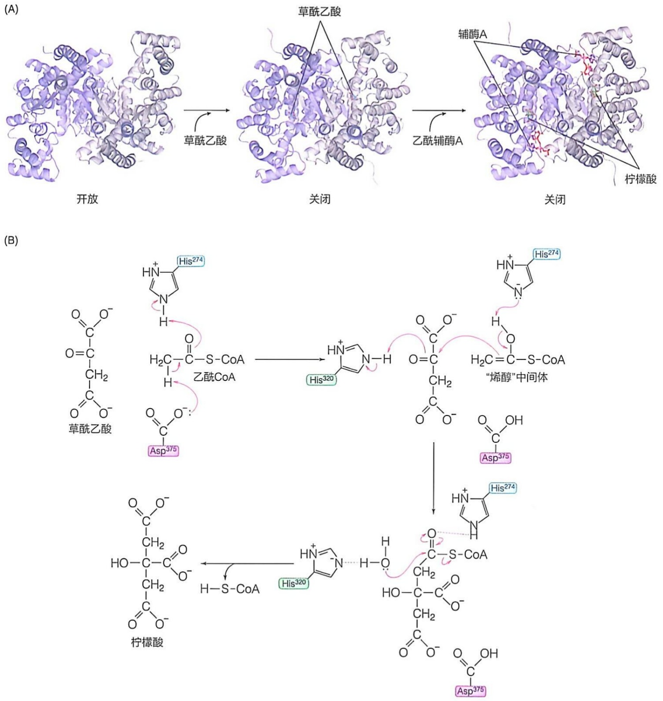

图 18-7 柠檬酸合酶与草酰乙酸结合后发生契合诱导构象变化及酶的可能催化机制

(A) 猪源柠檬酸合酶三种构象的结构图 (PDB: 5UQS, 4CTS,

2CTS）。两个亚基分别以蓝灰色和灰色卡通模型显示。结合的草酰乙酸、辅酶A和柠檬酸分别以青色、粉色和绿色棍状模型显示。（B）柠檬酸合酶的可能催化机制。

## 18.3.2 柠檬酸通过异构化转变成异柠檬酸后进行连续两步氧化脱羧反应

柠檬酸循环的第二步反应是柠檬酸发生异构化，即调整优化柠檬酸分子中羟基的位置，生成异柠檬酸，为后续的氧化脱羧反应做好准备。异构反应发生的过程是脱水后再加水。两步反应均由顺乌头酸酶（cis-aconitase，也称顺乌头酸水合酶）催化，因为生成中间产物顺乌头酸而得名 $^{①}$ 。

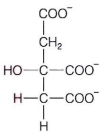

<details>
<summary>chemical</summary>

Chemical structure of a carboxylic acid with multiple hydroxyl and methyl substituents
</details>

柠檬酸

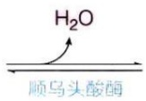

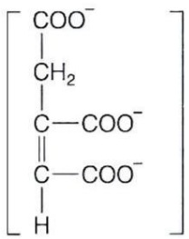

<details>
<summary>chemical</summary>

Chemical structure of a carboxylic acid with methyl and hydrogen substituents
</details>

顺乌头酸

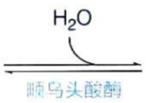

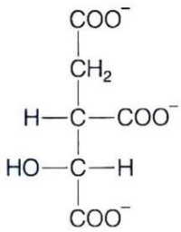

<details>
<summary>chemical</summary>

Chemical structure of a dicarboxylic acid with multiple carboxyl groups and hydroxyl side chains
</details>

异柠檬酸

$$
\Delta G ^ {\ominus \prime} = 1 3. 3 \mathrm{kJ/mol}
$$

顺乌头酸酶利用 4Fe-4S 这种铁硫中心作为辅因子 $^{②}$ 。该酶催化的反应是高度可逆的，也就是说，中间物顺乌头酸既能转变成异柠檬酸，也能转变成柠檬酸。

需要强调的是，在酶的活性中心，表观对称的柠檬酸分子与酶的结合并非对称（即与底物分子中相同组分结合的酶分子基团是不同的）。另外，在催化过程中，中间产物顺乌头酸需在活性中心绕  $C_{\alpha}=C_{\beta}$  双键进行  $180^{\circ}$  的翻转（图 18-8）。

此外，一种存在于胞质溶胶中的铁调节蛋白（iron regulatory protein）可以通过与mRNA分子中的特定调节序列结合而调节铁储存和铁转运蛋白质的翻译过程。蛋白质序列测定结果表明，它与线粒体基质中的顺乌头酸酶序列完全相同。后续研究表明:当细胞内的铁离子浓度很低时，该蛋白质从线粒体转位到胞质溶胶中，脱去辅因子，发挥调节翻译的功能；而当铁离子浓度处于高位时，则在线粒体中发挥顺乌头酸酶的活性。也就是说，脱去辅因子的顺乌头酸酶在胞质溶胶中具有其他完全不同的生物学功能。这种蛋白质被称作兼职（moonlighting）蛋白质。

柠檬酸循环的第三步反应是异柠檬酸的氧化脱羧，生成  $\alpha-$  酮戊二酸、 $CO_{2}$  和 NADH。该反应由异柠檬酸脱氢酶（isocitrate dehydrogenase）催化，为不可逆反应。在真核细胞中，异柠檬酸脱氢酶有三种同工酶，根据辅因子差异分为两大类:①以  $NADP^{+}$ 作为辅因子的异柠檬酸脱氢酶1和异柠檬酸脱氢酶2，分别存在于胞质溶胶和线粒体基质中，主要参与NADPH的生成反应；②以 $\mathrm{NAD^{+}}$ 作为辅因子的异柠檬酸脱氢酶3，存在于线粒体基质中，参与柠檬酸循环。

<small><span class="docvortex-page-footnote" data-block-type="page_footnote" style="color:#6b7280">① 顺乌头酸酶是裂合酶，而非异构酶。早期认为从柠檬酸到异柠檬酸的转变由两种不同的酶催化，但后来只鉴定到一种酶。</span></small>

<small><span class="docvortex-page-footnote" data-block-type="page_footnote" style="color:#6b7280">② 4Fe-4S 是一种含四个Ⅱ价铁离子和四个无机硫原子、铁原子还同时与酶分子中三个半胱氨酸侧链的一SH形成配位键的辅因子（详见第19章），但同样的铁硫中心在这里和在呼吸链等处的功能完全不同。</span></small>

图 18-8 顺乌头酸酶催化过程中产生的中间体在酶的活性中心发生翻转

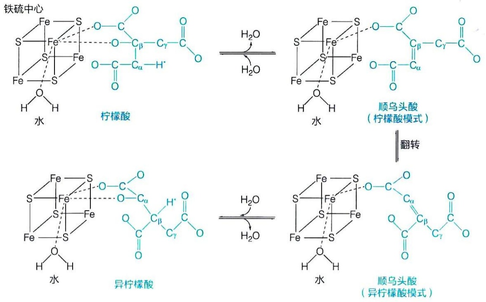

<details>
<summary>chemical</summary>

化学反应示意图，展示铁硫中心、柠檬酸和顺乌头酸的水-异柠檬酸转化过程
</details>

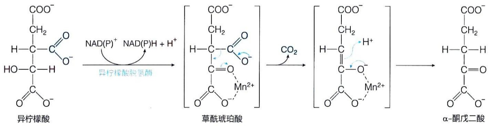

<details>
<summary>chemical</summary>

Reaction pathway of异柠檬酸, phthalic acid, and α-dimethylmalonate showing oxidation and reduction steps
</details>

异柠檬酸脱氢酶利用的辅因子是锰离子，它帮助稳定脱氢后的中间体，包括草酰琥珀酸和  $\alpha-$  酮戊二酸的烯醇形式。

柠檬酸循环的第四步反应，$\alpha-$ 酮戊二酸氧化脱羧生成琥珀酰辅酶A、$\mathrm{CO}_{2}$ 和NADH。该反应与丙酮酸的氧化脱羧反应高度相似，也依赖五种辅因子，且不可逆。

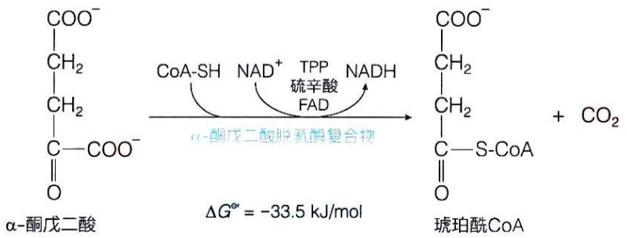

<details>
<summary>chemical</summary>

Reaction mechanism of α-ketoxybutyric acid showing NAD+ catalysis to form a carboxylic acid and CO2, with activation energy ΔG* = -33.5 kJ/mol
</details>

催化此反应的酶是 $\alpha-$ 酮戊二酸脱氢酶复合物（$\alpha$-ketoglutarate dehydrogenase complex），它与丙酮酸脱氢酶复合物以及支链  $\alpha-$  酮酸脱氢酶复合物（负责 Ile、Leu 和 Val 脱氨后产物氧化分解）具有相似的结构和催化机制（图 18-9）。 $\alpha-$  酮戊二酸脱氢酶复合物也由三种酶组装而成，分别为  $\alpha-$  酮戊二酸脱氢酶（ $E_{1}$ ）、二氢硫辛酰胺转琥珀酰基酶（ $E_{2}$ ）、二氢硫辛酰胺脱氢酶（ $E_{3}$ ）。

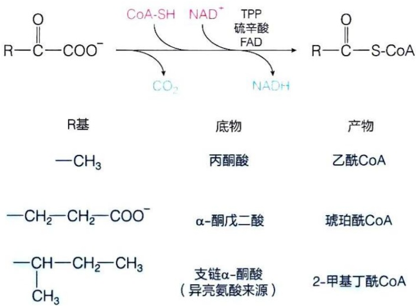

<details>
<summary>chemical</summary>

Chemical reaction pathway showing conversion of R-methylcarboxylic acid to S-methylcarboxylic acid via intermediates and products, with associated chemical formulas below.
</details>

图 18-9 α-酮戊二酸脱氢酶复合物与丙酮酸脱氢酶复合物及支链α-酮酸脱氢酶复合物具保守的结构和催化机制

这三种脱氢酶复合物中的  $E_{1}$  亚基之间和  $E_{2}$  亚基之间具有相似的一级和高级结构，而  $E_{3}$  亚基之间则完全相同。这似乎是一种趋异演化（divergent evolution）的结果。

## 18.3.3 琥珀酰辅酶 A 裂解所释放能量通过底物水平磷酸化生成 GTP 或 ATP

柠檬酸循环的第五步反应是，琥珀酰辅酶 A 所携带的硫酯键发生断裂，生成琥珀酸，释放能量用于合成 GTP 或 ATP。这是柠檬酸循环中唯一的底物水平磷酸化反应。该反应由琥珀酰辅酶 A 合成酶（succinyl-CoA synthetase）催化。值得注意的是，它以其所催化的逆反应命名。

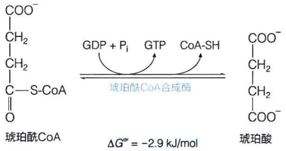

<details>
<summary>chemical</summary>

Reaction mechanism of琥珀酰CoA with GDP, Pi, GTP, and CoA-SH enzymes forming a coaldehyde intermediate
</details>

琥珀酰辅酶 A 合成酶可以催化 GDP 或 ADP 发生磷酸化，分别生成 GTP 或 ATP。一般认为，细菌中的该酶是非特异性的；动物中的该酶主要利用 GDP，但也存在对 ADP 特异的酶（即存在同工酶）；植物中则主要利用 ADP。

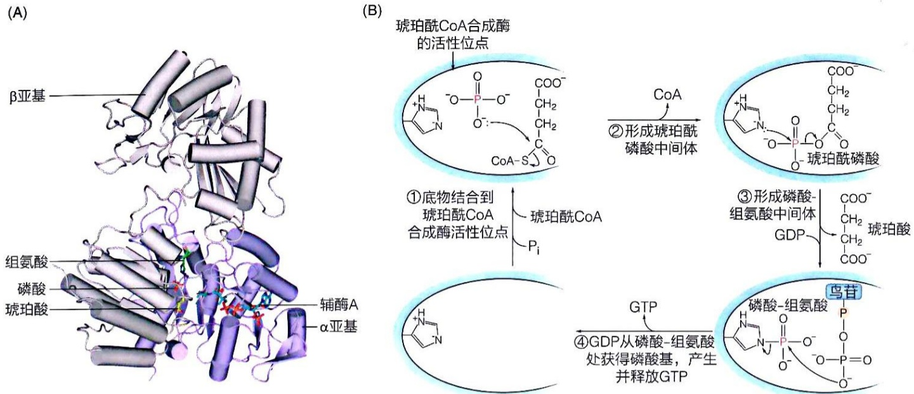

图 18-10 琥珀酰辅酶 A 合成酶的结构和催化机制示意图

（A）琥珀酰辅酶A合成酶处于一种催化状态的结构（PDB:6XRU），$\alpha$ 亚基显示为蓝灰色，$\beta$ 亚基显示为灰色。酶结合的琥珀酸和辅酶A以及参与催化的组氨酸用棍状模型展示。（B）琥珀酰辅酶A合成酶的催化机制示意图。

哺乳动物中的琥珀酰辅酶A合成酶由 $\alpha$ 和 $\beta$ 两种不同亚基组成，酶的活性位点可能位于这两个亚基之间的界面上（图18-10A）。一种可能的反应机制如图18-10B所示，简单描述如下:反应开始时，第一种底物琥珀酰辅酶A和第二种底物无机磷酸结合于酶的活性中心。然后无机磷酸取代琥珀酰辅酶A分子中的辅酶A组分，形成琥珀酰磷酸中间体，将一个硫酯键转换成一个磷酸键。接着，磷酸基被转移至酶活性位点的组氨酸上，形成磷酸-组氨酸中间体，释放出游离的琥珀酸。最后，第三种底物GDP或ADP进入酶的活性中心，并从磷酸-组氨酸处获得磷酸基，产生并释放GTP或ATP，完成底物水平磷酸化过程。

但是，值得注意的是，类似的磷酸化酶中间体并未在糖酵解过程中催化底物水平磷酸化的酶——磷酸甘油酸激酶或丙酮酸激酶中鉴定到。早年曾认为类似的磷酸化酶中间体存在于氧化磷酸化过程中（即化学偶联学说，见第19章），当然也未鉴定到。

## 18.3.4 琥珀酸经三步反应再生草酰乙酸

琥珀酸依次在琥珀酸脱氢酶、延胡索酸酶和苹果酸脱氢酶的催化下，经三步反应重新生成草酰乙酸，完成一轮柠檬酸循环。

柠檬酸循环的第六步反应由琥珀酸脱氢酶（succinate dehydrogenase）催化，琥珀酸被氧化生成延胡索酸（fumarate，也称富马酸，系统名为反丁烯二酸），同时产生$\mathrm{FADH}_2$。

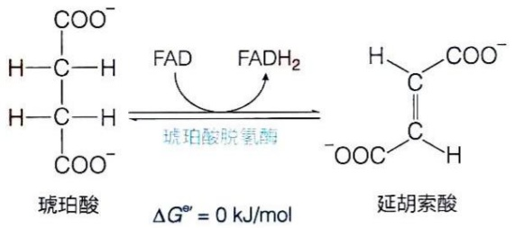

<details>
<summary>chemical</summary>

Reaction mechanism showing fluorobenzene dehydrogenation to form ester and its subsequent hydrolysis
</details>

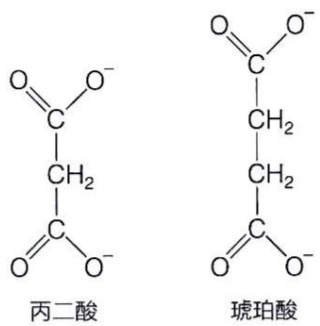

<details>
<summary>chemical</summary>

Structural formulas of acetic acid and uracilic acid with labeled atoms
</details>

作为琥珀酸脱氢酶的竞争性抑制剂，丙二酸（malonate）可有效阻断柠檬酸循环的运行。这会导致原本浓度极低的中间体的积累，使得它们得以被分离和鉴定。丙二酸在早期对柠檬酸循环的探究过程中发挥了重要作用。

柠檬酸循环的第七步反应由延胡索酸酶 [fumarase, 也称延胡索酸水合酶（fumarate hydratase）] 催化，延胡索酸发生可逆水合，生成 L-苹果酸（malate）。该酶具有高度的立体专一性，只催化具有反式双键的延胡索酸而非具有顺式双键的马来酸（maleate，即顺丁烯二酸），同时也只生成 L-苹果酸，而非 D-苹果酸。也就是说，当延胡索酸酶催化逆向反应时，只会使得 L-苹果酸转化为延胡索酸。

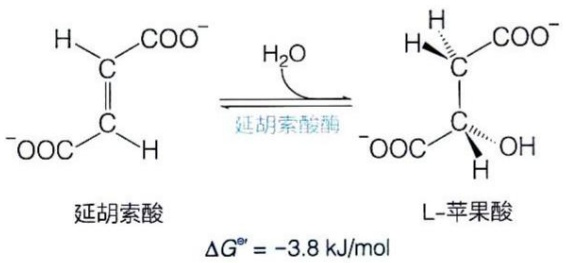

<details>
<summary>chemical</summary>

Chemical reaction diagram showing hydrogenation of esteric acid to L-aminocarboxylic acid under water, yielding ΔG* = -3.8 kJ/mol
</details>

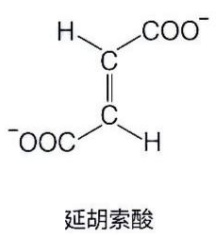

<details>
<summary>chemical</summary>

Chemical structure of 延胡索酸 (tert-butanol sulfate)
</details>

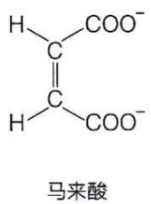

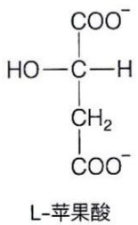

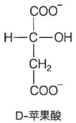

<details>
<summary>chemical</summary>

Chemical structure of D-苹果酸, showing carboxyl and hydroxyl groups
</details>

柠檬酸循环的第八步反应由苹果酸脱氢酶（malate dehydrogenase）催化，使 L-苹果酸氧化生成草酰乙酸，同时生成 NADH。此反应的标准自由能变化为正值，表明在标准条件下，热力学上有利于生成苹果酸的逆向反应。但在细胞内的实际条件下，反应将正向发生，生成草酰乙酸。这是因为正向反应的两种产物草酰乙酸和 NADH 被及时消耗转化、浓度极底所致（草酰乙酸在细胞内的浓度一般都低于  $10^{-6}$  mol/L）。草酰乙酸在柠檬酸合酶催化下及时与乙酰辅酶 A 缩合而被消耗，同时 NADH 也将其所携带电子迅速传递至呼吸链并再生  $NAD^{+}$ 。

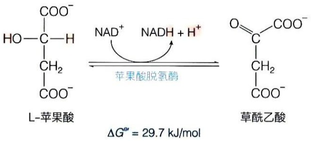

<details>
<summary>chemical</summary>

Reaction mechanism showing L-苹果酸脱氢酶催化反应，导致草酰乙酸生成草酰乙酸的电离常数 ΔG'' = 29.7 kJ/mol
</details>

草酰乙酸的再生，标志着一轮柠檬酸循环的完成，可以进入下一轮循环。

柠檬酸循环中将琥珀酸转化为草酰乙酸的最后三步反应将一个亚甲基通过氧化、水合和再氧化，最终转化为羰基（图18-11）。这与脂肪酸β氧化和支链氨基酸碳骨架的分解过程中所发生的三步反应高度可比（见第22章和第24章，图22-11）。在这三步反应中，第一次和第二次氧化反应分别由FAD和NAD $^{+}$ 作为电子受体，且均发生于线粒体基质中；FADH $_{2}$ 和NADH所携带的电子直接进入线粒体内膜上的呼吸链（详见第19章）。

图 18-11 亚甲基转化为羰基的三个步骤

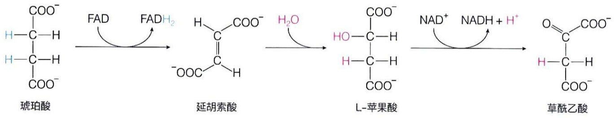

<details>
<summary>flowchart</summary>

```mermaid
graph LR
  A["琥珀酸"] -->|"FAD\nFADH2"| B["延胡索酸"]
  B -->|"H2O"| C["L-苹果酸"]
  C -->|"NAD+ NADH + H+""| D["草酰乙酸"]
```
</details>

## 18.3.5 一个活化的二碳单位经柠檬酸循环彻底氧化可产生大约 10 分子 ATP

柠檬酸循环的八步反应中，有三步反应不可逆，分别由柠檬酸合酶、异柠檬酸脱氢酶和  $\alpha-$  酮戊二酸脱氢酶复合物催化。其他反应均为可逆反应。其中的前四步反应可以被看作是使 1 个二碳单位氧化成 2 个  $CO_{2}$  的氧化阶段，而后四步反应则为草酰乙酸的再生阶段（图 18-12）。

总反应式为

$$
\mathrm{乙酰} \mathrm{CoA} + 3 \mathrm{NAD} ^ {+} + \mathrm{FAD} + \mathrm{GDP(ADP)} + \mathrm{P} _ {\mathrm{i}} + 2 \mathrm{H} _ {2} \mathrm{O}
$$

$$
\longrightarrow 2 \mathrm{CO} _ {2} + 3 \mathrm{NADH} + \mathrm{FADH} _ {2} + \mathrm{GTP(ATP)} + 2 \mathrm{H} ^ {+} + \mathrm{CoA}
$$

尽管每轮柠檬酸循环后，一个二碳单位被氧化产生2分子 $\mathrm{CO}_{2}$，但是利用 ${}^{14}\mathrm{C}-$ 乙酸开展的同位素标记实验表明，以乙酰基形式进入循环的2个碳原子，在第一轮的柠檬酸循环中并未被氧化成 $\mathrm{CO}_{2}$。也就是说，它们被保留在最后再生的草酰乙酸的四碳酸分子中（图 18-12），而第一轮氧化形成的  $CO_{2}$  实际上来自草酰乙酸。

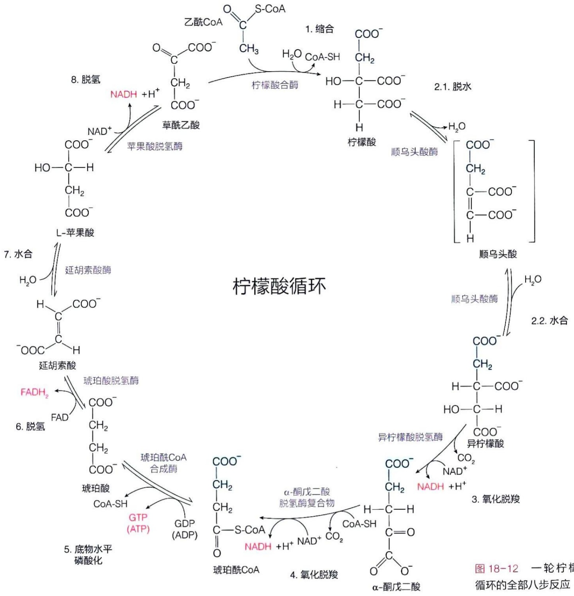

<details>
<summary>flowchart</summary>

This image illustrates the biochemical cycle of citric acid (柠檬酸), showing the conversion pathways from acetic acid to ester, water, and various organic compounds through intermediates like hydroxylation, glycerol formation, and oxidation.
</details>

图 18-12 一轮柠檬酸循环的全部八步反应

一个乙酰辅酶 A 的二碳单位经过一轮柠檬酸循环后，共产生 3 分子 NADH、1 分子 FADH₂ 和 1 分子 ATP（图 18-12）。经过线粒体内的氧化磷酸化过程（见第 19 章），每分子 NADH 可产生大约 2.5 分子 ATP，而每分子 FADH₂ 则产生大约 1.5 分子 ATP。因此，1 分子乙酰辅酶 A 经柠檬酸循环彻底氧化后，总共可产生大约 10 分子 ATP。

## 18.3.6 一个葡萄糖分子彻底氧化后可产生大约 $30 \sim 32$ 分子 ATP

现在我们可以计算出 1 分子葡萄糖在有氧条件下，经糖酵解和柠檬酸循环彻底氧化所能产生的 ATP 分子的大约数目，如表 18-1 所示。

经发生于胞质溶胶中的糖酵解，1 分子葡萄糖通过底物水平磷酸化净产生 2 分子 ATP，同时还产生 2 分子 NADH。在有氧条件下，胞质溶胶中 1 分子 NADH 的电子可经两条不同途径穿梭至呼吸链，分别可产生 2.5 分子或 1.5 分子 ATP（详见第 19 章），因此胞质溶胶中的 2 分子 NADH 就可以产生 3～5 分子 ATP。

1 分子葡萄糖经糖酵解产生 2 分子丙酮酸。2 分子丙酮酸在丙酮酸脱氢酶复合物作用下氧化脱羧生成 2 分子乙酰辅酶 A，且在线粒体基质中产生 2 分子 NADH。这些 NADH 通过呼吸链产生大约 5 分子 ATP。每分子乙酰辅酶 A 产生大约 10 分子 ATP。因此 1 分子葡萄糖经糖酵解和柠檬酸循环彻底氧化，以及氧化磷酸化的能量转换，最终可产生大约 30～32 分子 ATP（具体见表 18-1）。

我们前面介绍过，1 分子葡萄糖经无氧发酵可净产生 2 分子 ATP。显然，1 分子葡萄糖经过有氧氧化所产生的能量，以所产生的 ATP 分子算，是无氧发酵时的大约 15～16 倍。然而，我们也需认识到，这是经过更为复杂的步骤，经过更多的物质投入后的结果。所以，我们不能这么简单计算其产生能量的效率。毕竟，根据德国学者瓦尔堡等的观察，许多肿瘤细胞即使在氧气供应充足时，还是倾向于利用糖酵解获得能量（见图17-17）。因此，这样的简单计算是否反映生物体的真实情况，值得继续探究。

表 18-1 一分子葡萄糖彻底氧化所释放能量可产生 ATP 分子数量的大约计算

| 反应步骤 | 生成还原型电子载体的数量 | 最终产生ATP的数量* |
| --- | --- | --- |
| 葡萄糖→葡萄糖-6-磷酸 |  | -1 |
| 果糖-6-磷酸→果糖-1,6-二磷酸 |  | -1 |
| 2×甘油醛-3-磷酸→2×甘油酸-1,3-二磷酸 | 2NADH(胞质溶胶) | 3~5** |
| 2×甘油酸-1,3-二磷酸→2×甘油酸-3-磷酸 |  | 2 |
| 2×磷酸烯醇式丙酮酸→2×丙酮酸 |  | 2 |
| 2×丙酮酸→2×乙酰CoA | 2NADH(线粒体) | 5 |
| 2×异柠檬酸→2×α-酮戊二酸 | 2NADH(线粒体) | 5 |
| 2×α-酮戊二酸→2×琥珀酰CoA | 2NADH(线粒体) | 5 |
| 2×琥珀酰CoA→2×琥珀酸 |  | 2 |
| 2×琥珀酸→2×延胡索酸 | 2FADH2(线粒体) | 3 |
| 2×苹果酸→2×草酰乙酸 | 2NADH(线粒体) | 5 |
| 总和 |  | 30~32 |

\* 按线粒体内每分子 NADH 生成大约 2.5 分子 ATP 和每分子 FADH$_{2}$ 生成大约 1.5 分子 ATP 计算；负值表示消耗 ATP。

\*\* 该数字由 NADH 中的电子从胞质溶胶转运入线粒体基质的具体穿梭系统决定。

## 18.4 柠檬酸循环是兼具分解与合成功能的两用代谢途径

其实将生物体内的代谢途径划分为分解和合成两类是人为的。毕竟，生物体内的代谢反应之间相互交织，构成了一个复杂的多维动态网络。

柠檬酸循环就是一个很好的例子。它既是一条分解代谢途径（使燃料分子彻底氧化成  $CO_{2}$ ），同时也是一条不可或缺的合成途径。它被定义为一种两用代谢途径（amphibolic pathway）。具体而言，它是葡萄糖、脂肪酸和大部分氨基酸碳骨架彻底氧化的最终共同途径，也为许多生物合成反应提供前体物质，因此，它是细胞代谢途径的一个核心枢纽。

## 18.4.1 糖类、脂肪酸和氨基酸等燃料分子的分解产物殊途同归汇入柠檬酸循环

柠檬酸循环是一条典型的分解代谢通路。燃料分子大多先转化为乙酰辅酶A或柠檬酸循环的其他中间体:①葡萄糖经丙酮酸的氧化脱羧转化成乙酰辅酶A；②脂肪酸通过β氧化途径直接生成乙酰辅酶A（见第22章）；③很多氨基酸的碳骨架也被转化为乙酰辅酶A或柠檬酸循环的中间体被彻底氧化（或通过糖异生途径转化为葡萄糖；见第24章）。因此，柠檬酸循环是糖类、脂肪酸和氨基酸等燃料分子分解代谢的最终共同通路。它反映了分解代谢通路的高度收敛性，也充分体现了生物过程的高效性。

## 18.4.2 柠檬酸循环的中间体是合成各类生物分子的重要碳骨架来源

柠檬酸循环不仅是不同燃料分子最终的共同分解通路，同时也是合成代谢的重要前体来源。其中间产物为许多重要的生物合成过程提供前体（图18-13）。例如，琥珀酰辅酶A是合成血红素、叶绿素和辅酶 $B_{12}$ 的重要前体之一（见第25章）；草酰乙酸是通过糖异生途径生成葡萄糖的前体（见第21章）；草酰乙酸和 $\alpha-$ 酮戊二酸不仅为合成某些氨基酸，也为合成嘌呤或嘧啶碱基提供重要前体（见第25章和第26章）；柠檬酸循环还为合成脂肪酸和胆固醇及其他重要生物分子提供前体（见第23章）。

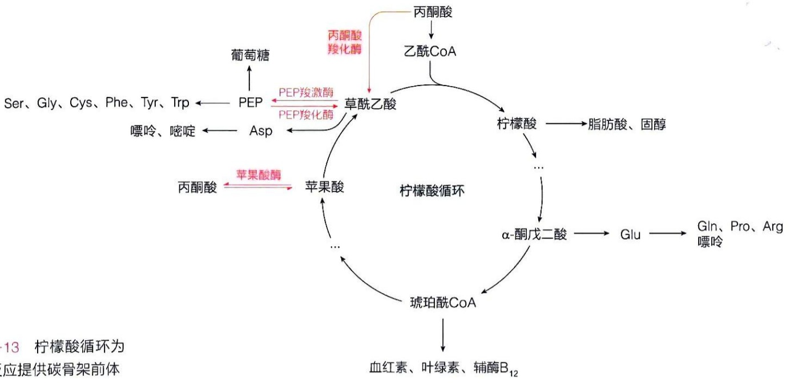

<details>
<summary>flowchart</summary>

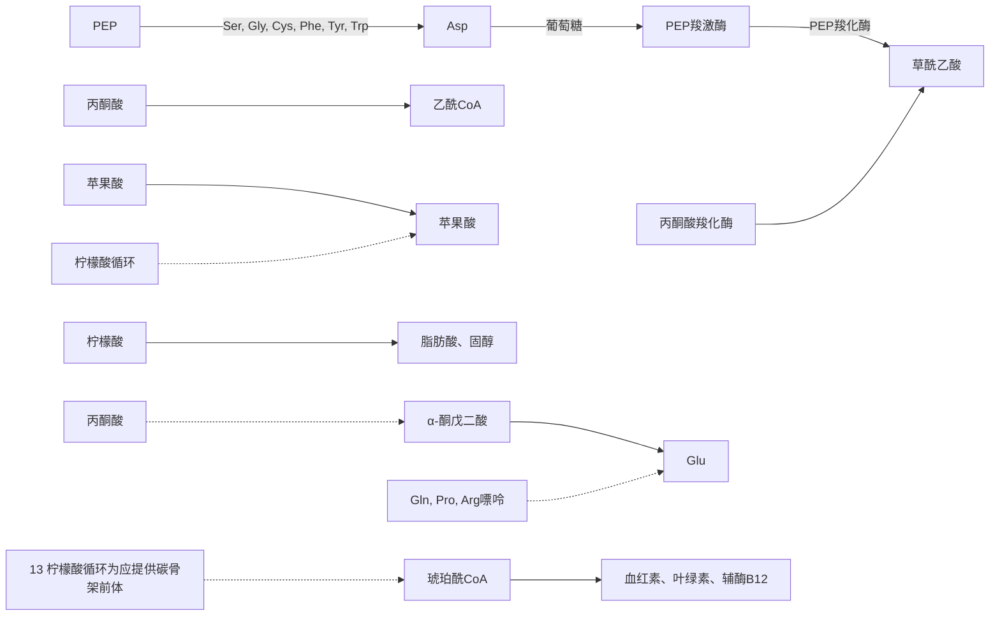
</details>

图 18-13 柠檬酸循环为合成反应提供碳骨架前体

## 18.4.3 柠檬酸循环中的大部分反应在厌氧生物祖先中也为合成代谢提供前体

尽管柠檬酸循环必须在有氧条件下才可发生，但是柠檬酸循环中的大部分反应也存在于厌氧微生物中，只是没有演化出完整的循环机制。这意味着，这些反应在需氧生物出现之前的演化早期就已出现。

研究表明，厌氧微生物利用柠檬酸循环中的部分反应获得生物合成的前体，而非

能量。例如，厌氧生物可利用该循环的前三步反应生成 $\alpha-$ 酮戊二酸，但由于缺乏 $\alpha-$ 酮戊二酸脱氢酶，所以不会进行随后的脱羧等柠檬酸循环反应。这类生物也含有催化草酰乙酸逆向转化为琥珀酰辅酶A的四种酶，可将草酰乙酸转化为苹果酸、延胡索酸、琥珀酸和琥珀酰辅酶A，用于其他生物合成反应（图18-14）。

与正常的柠檬酸循环不同的是，这些反应的发生并不依赖氧气的存在。这是因为异柠檬酸脱氢酶催化生成 $\alpha-$ 酮戊二酸的氧化反应所生成的NADH，可以被苹果酸脱氢酶催化生成苹果酸的还原反应重新转化为 $\mathrm{NAD^{+}}$ ，所以并无通过电子传递链使NADH重新转化为 $\mathrm{NAD^{+}}$ 的需求。

总之，这些早期演化产生的柠檬酸循环反应，主要功能是为生物合成提供前体。只是当地球表面出现氧气之后，这些反应被筛选、组合后应用于分解代谢过程，逐渐形成了精巧而高效的循环式代谢途径，并满足多方面需求。其实，生物体内代谢途径的分子演化过程也是生物演化的一个极其重要的方面，和宏观的演化过程一样精彩绝伦，引人入胜，值得深入探究。

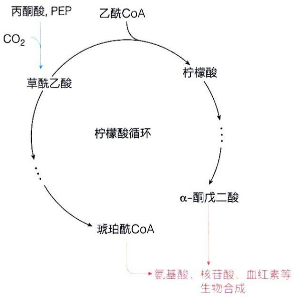

<details>
<summary>flowchart</summary>

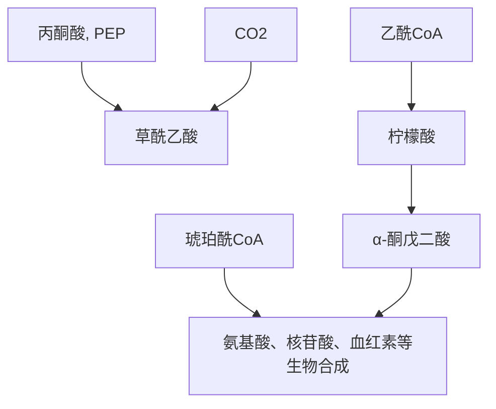
</details>

图18-14 厌氧微生物利用柠檬酸循环中的部分反应获得生物合成的前体

## 18.4.4 柠檬酸循环的中间体可通过几种添补反应得到补充

柠檬酸循环的中间体可能被导入发生氧化分解，或导出用于生物合成，但该循环的中间体需维持一种相对恒定的稳态水平。如果中间体作为合成反应的前体被导出，则将导致中间体整体浓度下降，这时生物体必须恢复这些中间体的原有水平，才能维持柠檬酸循环的正常运转。

这些补充柠檬酸循环中间体的生物化学反应，我们称之为添补反应（anaplerotic reaction，又称回补反应）。原则上，能够净生成任何柠檬酸循环中间体的生化反应均可称为柠檬酸循环的添补反应（图18-15）。反应的底物可以是丙酮酸、磷酸烯醇式丙酮酸、多种氨基酸等前体物质。许多添补反应是通过羧化反应增加一个碳单位而发生的。

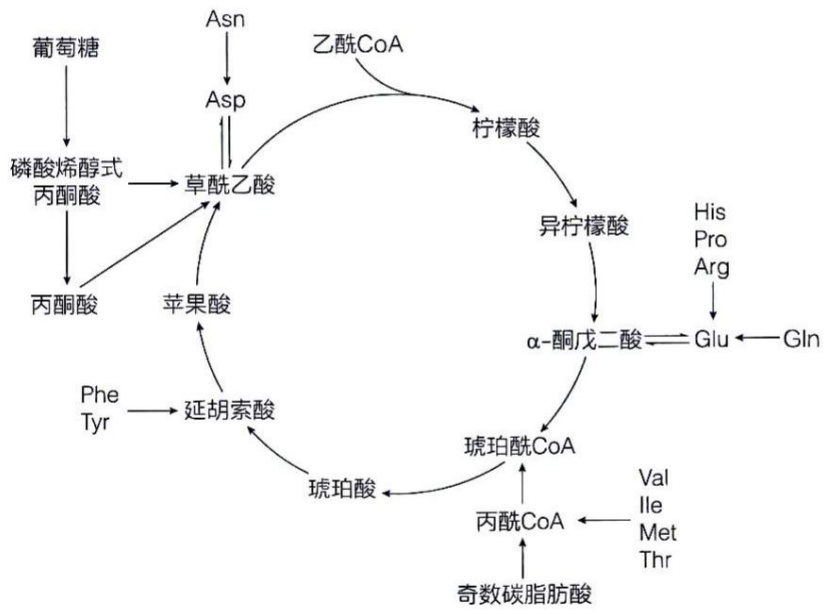

<details>
<summary>flowchart</summary>

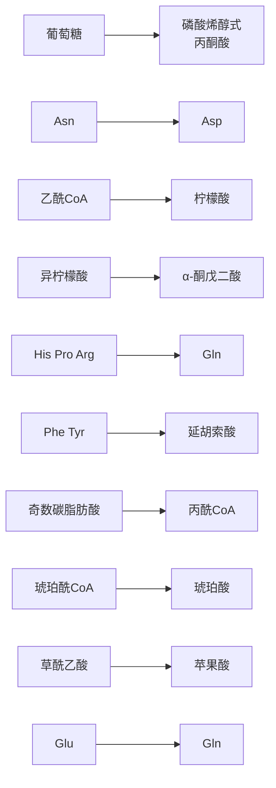
</details>

图18-15 柠檬酸循环的代表性添补反应

在这些添补反应中，以丙酮酸和磷酸烯醇式丙酮酸为前体的反应可能最广泛，故最为重要。丙酮酸在丙酮酸羧化酶（pyruvate carboxylase）催化下，可以发生羧化反应生成草酰乙酸:

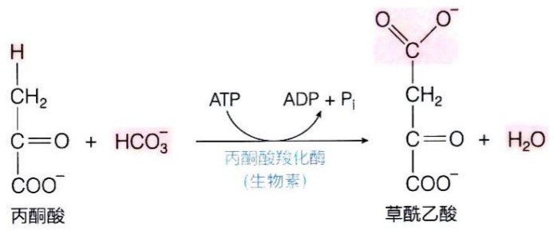

<details>
<summary>chemical</summary>

Chemical reaction equation showing conversion of acetic acid to aracilic acid using ATP and ADP with Pi
</details>

此反应普遍发生于动物肝脏和肾脏细胞内。丙酮酸羧化酶以生物素为辅因子，我们将在第21章详细讨论其催化机制（见图21-6）。理论上，丙酮酸还可通过苹果酸酶催化的可逆反应转变成苹果酸:

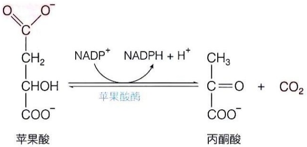

<details>
<summary>chemical</summary>

Chemical reaction equation showing conversion of acetic acid to cyanoic acid and dihydroxybenzene under NADP+ and NADPH+ conditions
</details>

尽管该反应在真核生物和细菌中普遍存在，但目前的证据表明，该酶在体内主要催化的是脱羧反应，而非羧化反应。因此，它是否为一种柠檬酸循环添补反应尚需证实。

磷酸烯醇式丙酮酸（PEP）可在磷酸烯醇式丙酮酸羧激酶（PEP carboxykinase）催化下生成草酰乙酸:

$$
\mathrm{磷酸烯醇式丙酮酸} + \mathrm{CO} _ {2} + \mathrm{GDP} \rightleftharpoons \mathrm{草酰乙酸} + \mathrm{GTP}
$$

此反应发生于动物的心脏和骨骼肌中。磷酸烯醇式丙酮酸也可在磷酸烯醇式丙酮酸羧化酶（PEP carboxylase）催化下生成草酰乙酸:

$$
\mathrm{磷酸烯醇式丙酮酸} + \mathrm{HCO} _ {3} ^ {-} \rightleftharpoons \mathrm{草酰乙酸} + \mathrm{P} _ {\mathrm{i}}
$$

此反应普遍发生于高等植物、酵母和细菌等生物体内。从这两种反应对能量利用效率的对比中，可以看出高等植物和动物在不同生态位受到的不同筛选压力。

添补反应也受到严格的调控。比如丙酮酸羧化酶只在乙酰辅酶A存在条件下才具有活性；柠檬酸循环的任何中间体的缺乏，都会导致草酰乙酸再生不足，引起乙酰辅酶A累积，从而激活丙酮酸羧化酶。在正常情况下，循环中间体被其他途径所消耗的数量与被添补反应所补充的数量保持动态平衡，浓度几乎保持不变。

当然，从某种意义上说，上面的羧化反应也可以被看作是发生于动物、微生物等生物体内的 $\mathrm{CO}_{2}$ 的固定反应。

## 18.4.5 柠檬酸循环的流速通过反馈抑制等方式被有效调控

由葡萄糖、脂肪酸和氨基酸等分解产生的乙酰辅酶A，均通过柠檬酸循环彻底氧化。柠檬酸循环的总速率很大程度上取决于底物的可用性和产物等对部分调节酶的反馈抑制等。速率调节的最终目的是维持中间产物的浓度稳态，在为细胞提供足量的NADH、$\mathrm{FADH}_2$ 和ATP的同时，也避免代谢途径的速率过高而造成资源浪费。

## （1）催化柠檬酸循环不可逆反应的酶的活性通过别构效应调节

柠檬酸循环中有三步反应是不可逆的，分别由柠檬酸合酶、异柠檬酸脱氢酶和$\alpha-$ 酮戊二酸脱氢酶复合物催化。这些酶的活性高低决定了乙酰辅酶A的氧化速率，而这些酶的活性主要通过底物的可利用性以及各种中间代谢物的正负别构效应进行瞬时性调节。

例如，柠檬酸合酶的底物是乙酰辅酶A和草酰乙酸，而这两种底物的浓度随着细胞代谢状态的变化而变化。它们的可利用性将影响柠檬酸的形成速率。别构效应则涉及激活和抑制两个方面，如ADP别构激活柠檬酸合酶和异柠檬酸脱氢酶，而ATP则别构抑制柠檬酸合酶和异柠檬酸脱氢酶，琥珀酰辅酶A和NADH可别构抑制柠檬酸合酶和 $\alpha-$ 酮戊二酸脱氢酶复合物（表18-2）。

此外，在脊椎动物肌肉中，作为和肌肉收缩伴随的 ATP 需求增加的信号， $Ca^{2+}$  通过激活异柠檬酸脱氢酶和  $\alpha-$  酮戊二酸脱氢酶而促进柠檬酸循环的运行，增加能量的供应。

表 18-2 柠檬酸循环中三种调节酶的别构调节情况

| 酶 | 激活剂 | 抑制剂 |
| --- | --- | --- |
| 柠檬酸合酶 | ADP | NADH、琥珀酰辅酶A、柠檬酸、ATP |
| 异柠檬酸脱氢酶 | $Ca^{2+}$、ADP | ATP、NADH |
| α-酮戊二酸脱氢酶复合物 | $Ca^{2+}$ | 琥珀酰辅酶A、NADH |

需要指出的是，在正常情况下，糖酵解与柠檬酸循环的速率相互匹配，主要取决于以下两种协同调节机制:一是ATP和NADH发挥的普遍性别构抑制效应。ATP作为共同产物，可同时抑制糖酵解、丙酮酸氧化脱羧及柠檬酸循环等途径中的多种酶；类似地，NADH也可同时抑制丙酮酸氧化脱羧和柠檬酸循环途径中的多种酶。二是柠檬酸的别构抑制效应。柠檬酸可同时抑制柠檬酸循环和糖酵解:一方面，线粒体内产生的柠檬酸可别构抑制柠檬酸合酶的活性；另一方面，柠檬酸可以从线粒体基质被转运至胞质溶胶中，而高浓度的柠檬酸可有效抑制磷酸果糖激酶-1的活性。总之，通过共用上述别构抑制剂，使得胞质溶胶内发生的糖酵解与线粒体内发生的柠檬酸循环可以彼此协调一致，维持能量的供需平衡。

## (2) 柠檬酸循环可被某些毒物所抑制

柠檬酸循环是营养物质彻底分解的必经之路，为生命活动提供合成前体和所需能量，维持它的正常运行对生命过程至关重要，一旦受阻，后果很严重。

如果柠檬酸循环中某些酶的活性被有毒物质抑制，将出现中毒症状。例如砷化物中的三氧化二砷（$\mathrm{As_2O_3}$，arsenic trioxide，又名砒霜）的毒性就很强。它主要的一种作用机制就是三价砷可以占据丙酮酸脱氢酶复合物和 $\alpha-$ 酮戊二酸脱氢酶复合物中的还原型硫辛酰胺辅因子中的两个自由巯基，阻止 $\mathrm{E}_3$ 亚基使其重新生成氧化型硫辛酰胺；从而抑制这些重要酶复合物的功能，产生毒性。又如，氟代乙酸（fluoroacetic acid）常被用作灭鼠药（对包括人在内的哺乳动物也具毒性），它在细胞内被活化成氟代乙酰辅酶A后，可替代乙酰基进入柠檬酸循环，由柠檬酸合酶催化生成氟代柠檬酸，后者被顺乌头酸酶转化后与酶紧密结合，是顺乌头酸酶的自杀性抑制剂。

## 18.5 乙醛酸循环可将乙酰辅酶 A 净转化为琥珀酸而用于生物合成

为探究细菌如何利用乙酸作为唯一碳源进行生长繁殖，以及植物发芽的种子如何从脂肪酸合成葡萄糖等现象，克雷布斯等于1950年代发现了乙醛酸循环（glyoxylate cycle）。这是克雷布斯等在揭示尿素循环（鸟氨酸循环）和柠檬酸循环之后，再次揭示的一种循环式代谢途径。

长期的研究表明，脊椎动物不具备将脂肪酸（通过其 $\beta$ 氧化分解产物乙酰辅酶A）转化为葡萄糖的能力。但是，植物、某些无脊椎动物和一些微生物（大肠杆菌和酵母等）却可以通过乙醛酸循环，将乙酸盐转化为葡萄糖。

乙醛酸循环可被视作为从柠檬酸循环衍生出来的一条途径，它部分利用柠檬酸循环中的酶促反应。它的起始两步反应和最后一步反应与柠檬酸循环中的完全相同，但其中间阶段却通过两种特有的酶促反应生成独特的中间产物乙醛酸。乙醛酸循环的生理意义在于，它使得某些生物能够以乙酸盐或脂肪酸作为唯一的碳源生存，并为糖类的合成提供必要的前体分子。

## 18.5.1 乙醛酸循环涉及异柠檬酸裂合酶和苹果酸合酶催化的反应

乙醛酸循环的起始阶段与柠檬酸循环完全相同，共用柠檬酸循环的第一步和第二步反应，即乙酰辅酶A与草酰乙酸缩合形成柠檬酸，以及柠檬酸转化为异柠檬酸的酶促反应。接下来，乙醛酸循环特有的两步反应分别由异柠檬酸裂合酶（isocitrate lyase）和苹果酸合酶（malate synthase）催化:前者催化异柠檬酸裂解形成琥珀酸和乙醛酸，后者催化乙醛酸与另一分子乙酰辅酶A缩合生成苹果酸（图18-16）。乙醛酸循环的最后一步反应也与柠檬酸循环中的完全相同:在苹果酸脱氢酶催化下，苹果酸氧化再生为草酰乙酸。

乙醛酸循环的总反应式为

$$
2 \mathrm{乙酰} \mathrm{CoA} + \mathrm{NAD} ^ {+} + 2 \mathrm{H} _ {2} \mathrm{O} \longrightarrow \mathrm{琥珀酸} + 2 \mathrm{CoA} + \mathrm{NADH} + \mathrm{H} ^ {+}
$$

## 18.5.2 乙醛酸循环所生成的琥珀酸可用于合成葡萄糖

乙醛酸循环绕过柠檬酸循环中自异柠檬酸开始的两步氧化脱羧反应，每轮循环缩合2分子乙酰辅酶A，净生成1分子琥珀酸。琥珀酸可经过糖异生途经（即利用非糖分子合成葡萄糖的途径）净转化为葡萄糖（见第21章）。脊椎动物由于缺乏乙醛酸循环所特有的异柠檬酸裂合酶和苹果酸合酶，无法利用乙酰辅酶A净合成葡萄糖。

细胞的能量状态决定着异柠檬酸随后是进入乙醛酸循环还是进入柠檬酸循环，其中所涉及的调控机制较为复杂。简而言之，当能量过剩时，异柠檬酸脱氢酶发生磷酸化修饰而失活，异柠檬酸进入乙醛酸循环，促进葡萄糖的生成；而当能量匮乏时，异柠檬酸脱氢酶处于去磷酸化状态而活化。另外，异柠檬酸裂合酶还可被 AMP、ADP 等别构抑制，推动异柠檬酸进入柠檬酸循环，促进能量供应。

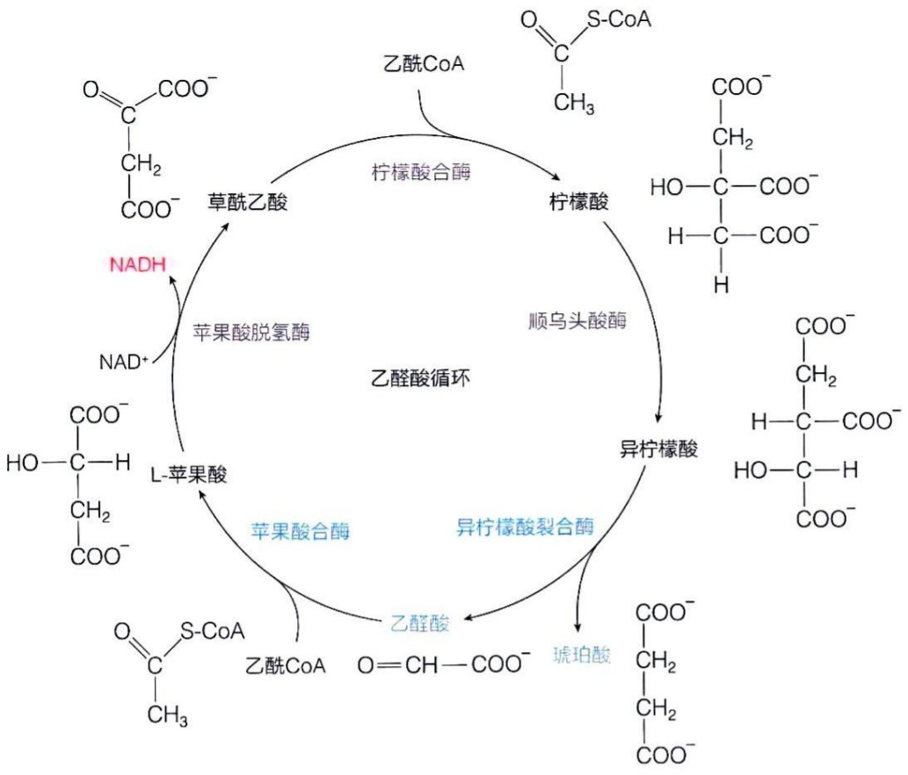

<details>
<summary>flowchart</summary>


</details>

图 18-16 乙醛酸循环的主要酶促反应

## 18.5.3 发芽种子通过乙醛酸循环可将脂肪酸转化为葡萄糖

在植物中，乙醛酸循环发生在乙醛酸循环体（glyoxysome）中。只有当富含脂肪的种子萌发时，才会形成这种特殊的细胞器。种子中的甘油三酯存在于油脂体（lipid body）中，其分解产生的脂肪酸进入乙醛酸循环体内，乙醛酸循环体中含有将脂肪酸分解成乙酰辅酶A的酶类，并通过乙醛酸循环生成琥珀酸。琥珀酸再被转运至线粒体基质，借助其中的柠檬酸循环的部分酶促反应转化为苹果酸。苹果酸在进入胞质溶胶后，由其中的苹果酸脱氢酶同工酶催化，再将苹果酸氧化为草酰乙酸。后者进入糖异生途径用于合成葡萄糖和蔗糖等（图18-17），为种子萌发提供不可或缺的能量和葡萄糖前体等。

因此，在植物获得通过光合作用产生葡萄糖的能力之前，萌发中的种子通过乙醛酸循环产生葡萄糖，这样的演化结果对于植物的繁衍具有重要的生物学意义。