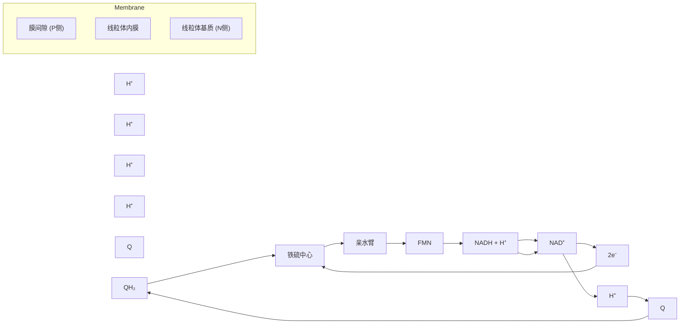
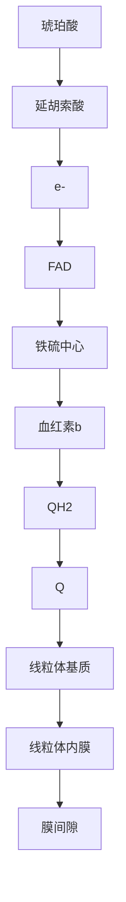
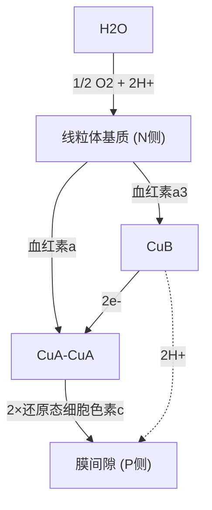
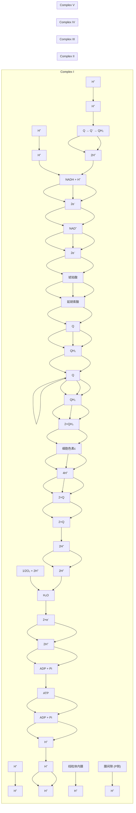
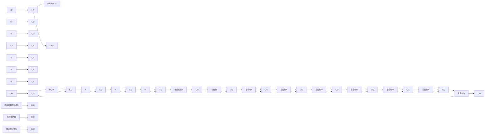

物所含电子载体和蛋白质亚基的种类以及可以将什么电子供体的电子传递给什么电子受体等进行了表征。这些复合物被简单地命名为复合物Ⅰ、Ⅱ、Ⅲ和Ⅳ。随后，这四种膜蛋白复合物被分别定义为:NADH脱氢酶（复合物Ⅰ）、琥珀酸脱氢酶（复合物Ⅱ）、细胞色素c还原酶（复合物Ⅲ）和细胞色素c氧化酶（复合物Ⅳ）。值得注意的是，这里的复合物Ⅱ与柠檬酸循环中的琥珀酸脱氢酶完全相同。

每种复合物的天然电子供体和受体均得到明确鉴定。具体而言，复合物I的电子供体是NADH，复合物Ⅱ的电子供体是琥珀酸（通过 $\mathrm{FADH}_2$），而复合物I和Ⅱ的最终电子受体均为泛醌（Q）；复合物Ⅲ的电子供体是泛醌（$\mathrm{QH}_2$），其最终电子受体为细胞色素 $c$；复合物IV的电子供体是细胞色素 $c$，其最终电子受体是 $\mathrm{O}_2$。这些鉴定不仅清晰地表征了每种复合物自身的电子传递特征，还完整地描绘了呼吸链中四种复合物参与的电子传递全过程。

自 1990 年代开始，人们对每种复合物单独的结构或共同形成的超级复合物的结构通过 X 射线晶体衍射技术或冷冻电镜单颗粒技术进行了解析。这使得人们对呼吸链中存在的具体电子传递路径获得了接近原子水平的精准认识，当然对这一电子传递过程在细胞内发生的动态细节还远不清楚。下面介绍通过上述各种研究过程所认识的可能发生于每种复合物中的电子传递过程。

## 19.4.1 呼吸链复合物 | 催化电子从 NADH 转移至泛醌

很多脱氢酶的活性中心以 $\mathrm{NAD^{+}}$ 作为电子受体，所形成的NADH将电子通过复合物I继续往前传递至Q，形成 $\mathrm{QH_2}$ 。复合物I因此也被称作NADH脱氢酶或NADH:泛醌氧化还原酶。

哺乳动物的呼吸链复合物I是四种复合物中最大、可能也是认识最不深入的一种复合物。它由45种亚基组成（但细菌中的复合物I仅含14种亚基），分子量约为 $850\mathrm{kDa}^{\text{①}}$ 。结构测定结果表明，该复合物中一般含1个FMN和8个铁硫中心（为[2Fe-2S]或[4Fe-4S])，同时也可结合NADH和辅酶Q等辅因子。复合物I整体呈L型，一部分镶嵌在线粒体内膜（或原核细胞的质膜）中，被称为膜臂，另一部分则伸展于线粒体基质（或原核细胞的胞质溶胶）中，被称为亲水臂（图19-5）。

通过比较细菌和其他生物的复合物Ⅰ的组成，人们揭示膜臂的7种亚基和亲水臂的7种亚基高度保守，可能是功能重要的14种亚基，这些亚基被认为是复合物的核心亚基，其他亚基被称为外周亚基。外周亚基尽管不直接行使催化功能，但对复合物的结构稳定和功能发挥不可或缺。

复合物I催化两个同时发生的偶联过程:

<small><span class="docvortex-page-footnote" data-block-type="page_footnote" style="color:#6b7280">① 严格地说，此处应使用“分子质量”而非“分子量”。分子质量是指分子的实际质量，有单位，涉及蛋白质等生物大分子时，常用道尔顿（Da）作为单位；分子量是相对分子质量的简称，无单位（或者单位为1）。当分子质量以Da为单位时，其数值与分子量数值相同。为照顾使用习惯和行文需要，本书类似表达处均使用“分子量”。</span></small>


<details>
<summary>flowchart</summary>


</details>

图 19-5 呼吸链复合物 I 结构和功能示意图

复合物Ⅰ（PDB:7V2C）接受来自NADH的电子，电子流经一系列铁硫中心并最终还原辅酶Q，同时通过复合物Ⅰ的膜臂将质子泵送至线粒体膜间隙。电子传递路径用红色箭头标出；质子泵送方向用蓝色箭头标出；膜臂处被认为存在四种不同质子泵。

一个是将 NADH 中的电子转移至泛醌的放能过程: $NADH + H^{+} + Q \rightarrow NAD^{+} + QH_{2}$ 。具体过程为:1 分子 NADH 首先将其 2 个电子转移至复合物 I 中的 FMN 辅因子，形成 1 分子  $FMNH_{2}$ ，随后  $FMNH_{2}$  中的电子通过一系列铁硫中心被传递至复合物 I 的亲水臂近膜端的铁硫中心 N2 上，最后电子被转移至结合在膜臂上的氧化型辅酶 Q 上（结合于一种特异的 Q 隧道中），生成  $QH_{2}$ ；后者离开复合物 I，扩散至磷脂双分子层中。发生于复合物 I 中的全部电子传递过程可以总结为: $NADH \rightarrow FMN \rightarrow [4Fe-4S] \rightarrow [2Fe-2S] \rightarrow [4Fe-4S] \rightarrow [4Fe-4S] \rightarrow [4Fe-4S] \rightarrow [4Fe-4S] \rightarrow QH_{2}$ 。

另一个过程是将 4 个质子从线粒体基质泵送至膜间隙的逆梯度耗能过程。这应该与复合物 I 介导电子传递的过程同时发生。但目前证据表明，这样的质子泵送发生于膜臂部分。结构测定结果表明，在膜臂的中间部分似乎存在一条由谷氨酸残基组成的隧道，但它在质子泵送过程中的具体作用仍不清楚。

值得注意的是，复合物Ⅰ是一种转位酶（即属于第七大类酶），催化质子从一个亚细胞部位（线粒体基质）转运至另一亚细胞部位（线粒体膜间隙）。

在未来的研究过程中，我们需阐明复合物Ⅰ中发生的多步电子传递过程与质子跨膜泵送之间究竟如何偶联。因为质子无法通过现有的结构测定方法探测，开展有关研究的方法尚未建立。

## 19.4.2 呼吸链复合物Ⅱ催化电子从琥珀酸转移至泛醌

体外分析结果表明，呼吸链复合物Ⅱ可将电子从琥珀酸转移至泛醌。后续研究表明，复合物Ⅱ就是柠檬酸循环中的琥珀酸脱氢酶。因为它催化的电子传递反应为  $FADH_{2} + Q \rightarrow FAD + QH_{2}$ ，所以它的系统是琥珀酸:泛醌氧化还原酶。这反映了柠檬酸循环与呼吸链电子传递之间形成了一种叠合，其意义值得深入探究。


<details>
<summary>flowchart</summary>


</details>

图 19-6 呼吸链复合物Ⅱ结构和功能示意图

呼吸链复合物Ⅱ（PDB:1ZOY）催化琥珀酸中的电子流经一系列电子载体，最终还原辅酶Q。

复合物Ⅱ催化琥珀酸脱氢生成延胡索酸（即反丁烯二酸）和 $\mathrm{FADH_2}$ 。真核生物复合物Ⅱ部分整合于线粒体内膜上，部分伸出到线粒体基质中（图19-6）；在原核生物中，则部分整合于细胞质膜中。与复合物I相比，复合物Ⅱ结构更为简单，仅由4种亚基组成。它所含电子载体除了1个与特异组氨酸残基（原核生物中可能为半胱氨酸残基）侧链共价相连的辅基FAD之外，还包括3个铁硫中心。这里共价连接的FAD所发挥的作用与复合物I中非共价结合的FMN类似:将从琥珀酸接受的电子传递至[2Fe-2S]铁硫中心；再经过一个[4Fe-4S]和一个[3Fe-4S]后，将电子最终传递至氧化型泛醌Q，形成还原型泛醌$\mathrm{QH_2}$ 。泛醌是一个电子传递汇合点，它将来自复

合物Ⅰ、Ⅱ和其他氧化反应的电子全部传递至复合物Ⅲ。

因此，复合物Ⅱ催化的全部电子传递过程可以总结为:琥珀酸→FAD→[2Fe-2S]→[4Fe-4S]→[3Fe-4S]→QH₂。

结构测定结果表明，在复合物Ⅱ中还紧密结合了1个血红素b和2个磷脂酰乙醇胺分子。血红素b并非位于电子传递路径上，但位于泛醌结合位点附近（图19-6），推测的功能是阻止复合物Ⅱ中“泄漏”的电子直接与 $O_{2}$ 结合而产生活性氧（reactive oxygen species，ROS）。而2个磷脂酰乙醇胺分子与复合物Ⅱ的结合也高度特异（并非像与其他膜磷脂结合那样），但其功能不清楚。

复合物Ⅱ催化的电子传递过程所释放的自由能不足以驱使质子逆梯度跨膜转运。但当电子后续在复合物Ⅲ和Ⅳ中传递时，会驱动质子跨膜转运。

值得注意的是，有学者认为复合物Ⅱ不能算作呼吸链的一部分，因为它仅仅负责将琥珀酸脱下的电子传递至呼吸链，而不参与任何其他来源电子的传递。换句话说，复合物Ⅱ中的FAD并不接受任何其他来源的电子。这与复合物I、Ⅲ和Ⅳ参与大量不同来源电子的传递现象存在本质的区别。

## 19.4.3 其他含 FAD 辅因子的脱氢酶也将电子传递至泛醌

泛醌是分解代谢的一种收敛点，它不仅接受来自复合物Ⅰ和Ⅱ的电子，还接受其他以 FAD 为辅因子的脱氢酶催化所释放的电子，比如由脂酰 CoA 脱氢酶催化脂肪酸 β 氧化第一步脱氢反应所释放的电子（图 19-7；第 22 章）。


<details>
<summary>chemical</summary>

Reaction mechanism diagram showing the conversion of R-CH2-C(β)-C(α)-C=S-CoA to form R-CH2-C(=C)-C(S-CoA) and then to Q via FAD and ETF enzymes
</details>

图 19-7 脂肪酸β氧化途径中的脂酰CoA脱氢酶将电子传递至Q

具体而言，脂酰 CoA 脱氢酶使用 FAD 为电子受体。所生成  $FADH_{2}$  将电子传递至电子传递黄素蛋白（electron-transfer flavoprotein，ETF）中的 FAD，最后在含有 FAD 和铁硫中心的 ETF:泛醌氧化还原酶催化下传递至 Q，生成  $QH_{2}$ 。这里的脂酰 CoA 脱氢酶和 ETF 均位于线粒体基质中，而 ETF:泛醌氧化还原酶整合于线粒体内膜上。这三种蛋白质组成的总体电子传递过程是: $FAD \rightarrow FAD \rightarrow FAD \rightarrow [Fe-S] \rightarrow QH_{2}$ 。因此，复合物 I、复合物 II 和脂酰辅酶 A 脱氢酶复合物中发生的电子传递具有高度的可比性:最前面的电子载体均为 FAD 或 FMN，而最后将电子传递至 Q 的电子载体均为铁硫中心（图 19-5 至图 19-7）。

需要强调的是，ETF可以将来自十几种线粒体基质黄素蛋白的电子传递至Q，最终进入呼吸链。

此外，结合于线粒体内膜外侧的甘油-3-磷酸脱氢酶（将胞质溶胶中NADH携带的电子穿梭传递至呼吸链）也催化将电子经由FAD传递至Q的过程，但该酶并不使用铁硫中心（具体见后）。

## 19.4.4 呼吸链复合物Ⅲ将电子从还原型泛醌传递至细胞色素 $c$

泛醌（$\mathrm{QH}_2$）从上游众多不同的电子供体处获得电子后，继续通过呼吸链复合物Ⅲ将其所携带电子传递至细胞色素 $c$。因此，根据其总体的酶活性，复合物Ⅲ也被称作辅酶 Q: 细胞色素 $c$ 氧化还原酶（或简称细胞色素 $c$ 还原酶）。此外，由于其所含的细胞色素 $b$ 和细胞色素 $c_1$ 发挥关键作用，它还被称作细胞色素 $bc_1$ 复合物。

复合物Ⅲ由11个亚基组成，分子量约 $250\mathrm{kDa}$，体内复合物Ⅲ常以同源二聚体形式存在，二聚体分子量约 $500\mathrm{kDa}$。其结构由两个相同部分组成。就电子传递而言，每部分中的关键亚基包括1个细胞色素 $b$、1个铁硫蛋白和1个细胞色素 $c_{1}$。其中的细胞色素 $b$ 以9次跨膜的形式镶嵌在线粒体内膜中，而细胞色素 $c_{1}$ 和铁硫蛋白位于线粒体内膜的膜间隙侧；铁硫蛋白的一端锚定在内膜上，另一端可以摆动。

复合物Ⅲ所含电子载体如下（图19-8）:细胞色素 $b$ 含有2个血红素 $b$ 辅基，分别被称作 $b_{\mathrm{L}}$ 和 $b_{\mathrm{H}}$ [这里的L和H分别表示低（low）和高（high）电子亲和力]。铁硫蛋白为Rieske铁硫蛋白:它含一个[2Fe-2S]铁硫中心，但其中的1个铁原子与2个组氨酸残基的咪唑基侧链（而非半胱氨酸残基的巯基）配位，这使得该铁硫中心的还原势远高于常规的铁硫中心，即具有更高的电子亲和力（详见图19-4）。细胞色素 $c_{1}$ 含一个共价连接的血红素$c$ 辅因子。另外，在细胞色素 $b$ 分子上还存在2个辅酶Q结合位点，分别靠近膜间隙和线粒体基质，被称作 $\mathrm{Q_P}$ （P表示positive，因为膜间隙一侧带正电荷）和 $\mathrm{Q_N}$ （N表示negative，因为基质侧带负电荷）。


<details>
<summary>flowchart</summary>

This diagram illustrates the biochemical pathway of blood cells (Q) and their intercellular structure, showing how various components like blood red素 b_H, b_L, c1, and c_c interact with a central iron-sulfur center.
</details>

图 19-8 呼吸链复合物Ⅲ的结构和功能示意图

呼吸链复合物Ⅲ（PDB:1BGY）由两个相同部分组成，分别以灰色和淡蓝色显示，每个部分均含11种亚基。

复合物Ⅲ中的电子传递和质子泵送通过Q循环方式进行。辅酶Q还原形成的 $QH_{2}$ 为复合物Ⅲ的电子供体。然而其下游的电子载体，无论是血红素b、血红素c还是铁硫中心，每次仅能传递1个电子。为解释在复合物Ⅲ中， $QH_{2}$ 如何可以同时参与电子传递和质子从线粒体基质到膜间隙的跨膜泵送（从而支持他所提出的化学渗透假说），米切尔于1970年代提出Q循环（Q cycle；这里的Q代表泛醌）假说，后续1990年代结构测定结果强有力

地支持了 Q 循环假说（图 19-9）。

Q 循环不仅解释了质子跨膜泵送的一种可能机制，同时也解释了双电子供体（$\mathrm{QH}_2$）中的 2 个电子如何通过下游的单电子载体（血红素和铁硫中心）继续传递。根据 Q 循环假说，在复合物Ⅲ中，$\mathrm{QH}_2$ 将电子传递给细胞色素 $c$ 的过程并非一次性完成，而是分两个阶段进行（图 19-9）。

在 Q 循环的第一阶段，1 个  $QH_{2}$  分子结合于细胞色素 b 的  $Q_{P}$  位点上，其所携带的 2 个高势能电子中的 1 个被转移至复合物Ⅲ中的铁硫中心，同时释放 1 个  $H^{+}$ 至膜间隙中，形成半醌自由基（·QH）。铁硫中心的电子再经细胞色素  $c_{1}$  被传递至细胞色素 c。半醌自由基所携带的另 1 个电子通过血红素  $b_{L}$  转移至对电子具有较高亲和力的靠近线粒体基质侧的血红素  $b_{H}$，同时将 1 个  $H^{+}$ 释放至膜间隙中，形成氧化型泛醌 Q，并离开活性中心而自由扩散至线粒体内膜中。血红素  $b_{H}$ 上的 1 个电子接着被传递至结合于线粒体基质侧  $Q_{N}$  位点上的 Q 分子中，形成 1 个半醌自由基（·Q⁻）。

在 Q 循环的第二阶段，另一分子的  $QH_{2}$  结合于细胞色素 b 的  $Q_{P}$  位点上。以与第一阶段相同的方式将 1 个电子依次传递至铁硫中心、细胞色素  $c_{1}$  和细胞色素 c。这个  $QH_{2}$  分子上剩余的 1 个电子也通过血红素  $b_{L}$  和血红素  $b_{H}$，最终传递至第一阶段在  $Q_{N}$  位点上形成的那个半醌自由基（·Q⁻），后者从基质获得 2 个质子后形成  $QH_{2}$。

结构分析表明，这里的铁硫蛋白可能在两种构象之间振荡:一种构象使铁硫中心更靠近细胞色素 b 上的  $Q_{P}$  位点，另一种构象则使铁硫中心更靠近细胞色素  $c_{1}$  中的血红素 c 基团。

```mermaid
graph LR
  subgraph Stage_1 [第一阶段]
  A["Q"] --> B["Q⁻"]
  B --> C["Q_N"]
  C --> D["QH₂"]
  D --> E["Q"]
  E --> F["2H⁺"]
  F --> G["细胞色素c"]
  G --> H["铁硫中心"]
  H --> I["e⁻"]
  I --> J["血红素bL"]
  J --> K["e⁻"]
  K --> L["血红素bH"]
  L --> M["Q_H₂"]
  M --> N["Q"]
  N --> O["QN"]
  end

  subgraph Stage_2 [第二阶段]
  P["Q⁻"] --> Q["QH₂"]
  Q --> R["Q_N"]
  R --> S["QH₂"]
  S --> T["QH₂"]
  T --> U["Q"]
  U --> V["e⁻"]
  V --> W["e⁻"]
  W --> X["QH₂"]
  X --> Y["Q"]
  Y --> Z["细胞色素c"]
  Z --> AA["e⁻"]
  AA --> AB["e⁻"]
  AB --> AC["血红素bL"]
  AC --> AD["Q_H₂"]
  AD --> AE["Q"]
  AE --> AF["Q"]
  AF --> AG["2H⁺"]
  end
```


<details>
<summary>flowchart</summary>


</details>

图 19-9 复合物Ⅲ中可能发生的 Q 循环示意图

总体来看，在 Q 循环的两个阶段中发生如下氧化还原反应和质子泵送过程。在  $Q_{P}$  结合位点上，2 个  $QH_{2}$  发生氧化反应，释放 4 个电子，其中:2 个电子通过 Rieske 铁硫蛋白和细胞色素  $c_{1}$  被传递至 2 分子细胞色素 c，使后者还原；另外 2 个电子经血红素  $b_{L}$  和  $b_{H}$  传递至  $Q_{N}$  结合位点的 1 分子 Q，生成 1 分子  $QH_{2}$ 。其间将 4 个  $H^{+}$  释放至膜间隙，线粒体基质中的 2 个  $H^{+}$  被用于形成 1 个  $QH_{2}$ 。

因此，Q 循环氧化还原反应的总方程如下:

$$
\mathrm{QH} _ {2} + 2 \mathrm{Cyt} c (\text {氧化态}) + 2 \mathrm{H} _ {\mathrm{N}} ^ {+} \longrightarrow \mathrm{Q} + 2 \mathrm{Cyt} c (\text {还原态}) + 4 \mathrm{H} _ {\mathrm{P}} ^ {+}
$$

值得注意的是，通过复合物Ⅲ每传递一对电子到2个细胞色素c（Cyt c），尽管膜间隙获得4个 $H^{+}$ ，但是线粒体基质只失去2个 $H^{+}$ 。严格意义上说，这一步中仅仅有2个 $H^{+}$ 被跨膜泵送，即从线粒体基质泵送至膜间隙（从N侧泵送至P侧）；另外2个 $H^{+}$ 并非直接从线粒体基质中获得，它们对跨膜电化学势形成的贡献应该比泵送的质子更低。因此，“一对电子经过复合物Ⅲ时泵送4个质子”的说法并不严谨。

## 19.4.5 呼吸链复合物Ⅳ将电子从细胞色素 $c$ 传递至 $\mathrm{O}_2$

从复合物Ⅲ获得电子的细胞色素 c，通过位于呼吸链最末端的呼吸链复合物Ⅳ将电子最终传递至  $O_{2}$ ，生成  $H_{2}O$ 。因此复合物Ⅳ也被称为细胞色素 c 氧化酶（cytochrome c oxidase）。哺乳动物的复合物Ⅳ由 14 种亚基组成，而细菌的复合物Ⅳ则仅由 3～4 种亚基组成。与复合物Ⅰ和Ⅲ类似，复合物Ⅳ在催化电子传递的同时也催化质子的跨膜转运。

对原核和真核生物呼吸链复合物的结构比较分析表明，在复合物IV的14种亚基中，3种亚基高度保守，可能为发挥功能的核心亚基（分别被称作亚基Ⅰ、Ⅱ和Ⅲ）。值得注意的是，真核细胞中这三种核心亚基均由线粒体基因组编码。其余亚基则由核基因组编码，可能主要负责复合物IV的组装和稳定等。

结构测定结果表明，亚基Ⅰ和Ⅲ高度疏水，缺乏明显的膜外亲水结构域，而亚基Ⅱ包含一个膜外β桶结构域以及两个跨膜螺旋。

复合物IV的电子载体主要存在于亚基I（一种细胞色素a）和Ⅱ中。亚基Ⅲ中并不含任何电子载体，但其存在是复合物IV发挥功能所不可或缺的。亚基Ⅱ中含有由两个铜离子组成的 $Cu_{A}-Cu_{A}$ 双核中心（铜离子与亚基中的2个Cys残基的巯基结合；其结构与[2Fe-2S]类铁硫中心具某种可比性）。亚基I中含血红素a、 $a_{3}$ 和 $Cu_{B}$ 铜离子；其中的血红素 $a_{3}$ 中的铁离子与 $Cu_{B}$ 形成另一个双核中心。血红素a和 $a_{3}$ 均为a类血红素，结构完全一样，但因为在蛋白质中的结合环境不同，使得它们的还原势不同，血红素 $a_{3}$ 具更高的电子亲和力。

结构测定结果表明，电子在复合物IV中的传递路径如下:来自还原态细胞色素c的电子被依次转移至 $Cu_{A}-Cu_{A}$ 双核中心、血红素a、血红素 $a_{3}-Cu_{B}$ 双核中心（图19-10）。

目前，对于 $\mathrm{O}_2$ 最后接受电子而被还原成 $\mathrm{H}_2\mathrm{O}$ 的细节并非十分清楚。一种可能的机制如下（图19-11）:当血红素 $a_3$ 中的铁离子和 $\mathrm{Cu_B}$ 组成的双核中心从2个还原型细胞色素 $c$ 接受2个电子，使其中的两个金属离子均处于还原态后，$\mathrm{O}_2$ 进入并结合于两个金属离子之间，形成一种过氧化桥。随后，从另外2分子还原型细胞色素 $c$ 接受另外2个电子后，2个质子进入，导致过氧化桥裂解，形成两个各自与金属离子结合的羟基。最终，再结合2个质子后，生成2分子 $\mathrm{H}_2\mathrm{O}$ 。简而言之，要将1个 $\mathrm{O}_2$ 分子还原成为2个 $\mathrm{H}_2\mathrm{O}$ 分子，需转移4个电子，并同时从线粒体基质中获取4个质子。

复合物IV催化的总反应式可表示如下:

$$
4 \mathrm{Cyt} c (\mathrm{还原型}) + 8 \mathrm {H_ {N} ^ {+}} + \mathrm {O_ {2}} \longrightarrow 4 \mathrm{Cyt} c (\mathrm{氧化型}) + 4 \mathrm {H_ {P} ^ {+}} + 2 \mathrm {H_ {2} O}
$$

图 19-10 呼吸链复合物Ⅳ的结构与功能示意图 (PDB: 5Z62)


<details>
<summary>flowchart</summary>


</details>


<details>
<summary>flowchart</summary>

This diagram illustrates the metabolic pathways of two different cell culture conditions (labeled as '2 × 还原态细胞色素 c' and '2 × 还原态细胞色素 c'), showing how iron (Fe) and copper (Cu) are converted into various metal complexes such as CuA-CuA, Fe, and O2.
</details>

图 19-11 复合物Ⅳ中  $O_{2}$  被还原形成  $H_{2}O$  的一种可能机制

复合物Ⅳ是呼吸链中的第三个质子泵。在这一过程中，复合物Ⅳ每传递2个电子可驱动2个质子从线粒体基质转运到线粒体膜间隙，但详细的机制并不清楚。

在复合物IV中，当结合于第二个双核中心的  $O_{2}$  处于未完全还原的中间体状态时，中间体是否会脱离复合物而产生 ROS，需进一步探究。

## 19.4.6 呼吸链电子传递驱动跨膜电化学势的形成

发生于呼吸链复合物中的电子传递，将在不同阶段以机制尚不明确的不同方式驱动质子的逆梯度跨膜泵送。这使得来自 NADH 和其他可氧化底物的每对电子在通过这些存在于膜蛋白复合物之中和之间的电子载体传递过程中可驱使一定量的质子跨膜转运（图 19-12）。

根据化学渗透学说，呼吸链电子传递将产生由化学梯度（ $\Delta pH$ ；反映膜两侧的质子浓度差）和电势梯度（ $\Delta\psi$ ；反映膜两侧电荷差）共同构成的跨膜电化学势能，即质子动力势。这样的质子动力势可为 ATP 的生成提供能量。

我们可以根据将 $1\mathrm{mol}$ 质子进行跨线粒体内膜转运所需消耗的自由能的量以及


<details>
<summary>flowchart</summary>


</details>

图 19-12 电子传递驱动的质子跨膜转运与 ATP 合成
由呼吸链复合物Ⅰ、Ⅲ和Ⅳ组成的电子传递链将来自 NADH 等电子供体的电子最终传递至  $O_{2}$ ，形成  $H_{2}O$ 。电子传递路径用红色箭头标出，

质子泵送方向用蓝色箭头标出，$\mathrm{QH}_2$ 和细胞色素 $c$ 的扩散方向用虚线箭头标注。

图 19-13 逆浓度梯度质子跨膜泵送示意图  
N侧表示带负电侧（为线粒体基质侧），质子浓度低；P侧为带正电侧（膜间隙侧），质子浓度高。


<details>
<summary>chemical</summary>

Diagram illustrating ion transport in a membrane with labeled components including P and N electrodes, H+ ions, and membrane interface.
</details>

1 mol NADH 和琥珀酸将 2 mol 电子传递至  $O_{2}$  所释放自由能的量，估算各自可以跨膜泵送多少质子。

质子逆浓度梯度跨膜泵送是一个耗能的过程（图 19-13）。

我们先计算将 1 mol 质子逆电化学梯度进行跨线粒体内膜转运所需消耗的自由能。这可通过以下公式计算:

$$
\Delta G = R T \ln (C _ {2} / C _ {1}) + Z F \Delta \psi \tag {19-1}
$$

这里的 $R$ 、 $T$ 和 $F$ 分别为摩尔气体常数、热力学温度和法拉第常数（见公式16-5）； $C_2$ 和 $C_1$ 分别为膜间隙中和线粒体基质中的质子浓度，即 $[\mathrm{H}^{+}]_{\mathrm{P}}$ 和 $[\mathrm{H}^{+}]_{\mathrm{N}}$ ，且 $C_2 > C_1$ 即 $[\mathrm{H}^{+}]_{\mathrm{P}} > [\mathrm{H}^{+}]_{\mathrm{N}}$ ； $Z$ 为1个质子所带电荷的绝对值，即1； $\Delta \psi$ 为跨线粒体内膜的电势差（单位为V）。

就质子而言:

$$
\ln \left(C _ {2} / C _ {1}\right) = 2. 3 \left(\lg [ \mathrm{H} ^ {+} ] _ {\mathrm{p}} - \lg [ \mathrm{H} ^ {+} ] _ {\mathrm{N}}\right) = 2. 3 \left(\mathrm{pH} _ {\mathrm{N}} - \mathrm{pH} _ {\mathrm{p}}\right) = 2. 3 \Delta \mathrm{pH}
$$

$\Delta pH$  为线粒体基质与膜间隙的 pH 的差值。

因此，式19-1可以被转换为

$$
\Delta G = 2. 3 R T \Delta \mathrm{pH} + F \Delta \psi \tag {19-2}
$$

将三种常数代入，则得

$$
\Delta G = 5.7 \Delta \mathrm{pH} + 96.5 \Delta \psi \tag {19-3}
$$

一般而言，线粒体基质与膜间隙的 $\mathrm{pH}$ 差，即 $\Delta \mathrm{pH} = 0.75$；而线粒体内膜内外侧的电势差，即 $\Delta \psi = 0.15\mathrm{V}$。代入式19-3，得出泵送 $1\mathrm{mol}$ 质子逆梯度跨越线粒体内膜所需能量大约为 $20\mathrm{kJ / mol}$。

下面计算 $1\mathrm{mol}$ 的NADH或琥珀酸（通过 $\mathrm{FADH}_2$ ）将1对电子传递给 $\mathrm{O}_2$ 所释放的自由能。

从表16-4可查得有关氧化还原共轭对的标准还原势 $E^{\ominus \prime}$ : $\mathrm{NAD^{+} / NADH}$ 、延胡索酸/琥珀酸和 $\frac{1}{2}\mathrm{O}_2 / \mathrm{H}_2\mathrm{O}$ 分别为-0.320V、0.031V和0.816V。因此，电子从NADH或琥珀酸传递至 $\mathrm{O}_2$ 的 $\Delta E^{\ominus \prime}$ 分别为 $1.14\mathrm{V}[0.816 - (-0.320) = 1.14]$ 和 $0.785\mathrm{V}(0.816 - 0.031 = 0.785)$ 。

代入公式 16-7:

$$
\Delta G ^ {\ominus \prime} = - n F \Delta E ^ {\ominus \prime}
$$

计算结果表明，2个电子从NADH或琥珀酸传递至 $\mathrm{O}_2$ 所释放的标准自由能分别约为$220\mathrm{kJ / mol}$ 和 $150~\mathrm{kJ / mol}$ 。据此估算，每对电子从NADH或琥珀酸传递至 $\mathrm{O}_2$ 时，可分别泵送的质子数约为11个（ $220 / 20 = 11$ ）和7.5个（ $150 / 20 = 7.5$ )。这些数值与我们常用的10个和6个大致相符（图19-12）。

线粒体内膜两侧的质子浓度差和电势差所产生的电化学势，代表电子转移所产生的大部分能量的暂时性贮存，可用于驱动 ATP 的合成（具体见后）。

## 知识延展 19- 1

## 呼吸链复合物可能在细胞内以超级复合物形式存在

尽管线粒体内膜上的呼吸链电子载体可以被人为分离成复合物Ⅰ、Ⅱ、Ⅲ和Ⅳ等，但在完整的线粒体中，复合物Ⅰ、Ⅲ和Ⅳ似乎可以组装成超级复合物。

值得注意的是，复合物Ⅱ似乎并不参与超级复合物的形成，而是以独立形式存在于线粒体内膜上。因此，复合物Ⅱ可以被视作与脂酰辅酶A脱氢酶等催化特异底物分子氧化的酶类似，而并非通用呼吸链的一部分。

呼吸链超级复合物广泛存在于从酵母到高等动植物的众多生物中，但是在不同物种的超级复合物中，每种复合物存在的比例似乎稍有差异。比如，在1个从酵母细胞中分离到的超级复合物中，存在2个复合物Ⅲ和2个复合物Ⅳ；而在哺乳动物中则分离到了由1个复合物Ⅰ、2个复合物Ⅲ和1个复合物Ⅳ形成的超级复合物，这也是目前体外分离到的最常见组合比例（图19-14）。

在上述最常被分离到的呼吸链超级复合物中，复合物Ⅰ的膜臂与2个复合物Ⅲ中的一个接触。而复合物Ⅳ则同时与复合物Ⅰ的膜臂最远端和一个复合物Ⅲ接触。此外，线粒体内膜上的磷脂似乎也参与了超级复合物的组装。

除了超级复合物外，人们还观察到一种呼吸链巨大复合物（megacomplex）:它由2个复合物Ⅰ、2个复合物Ⅲ及2个复合物Ⅳ组装成一种类似圆盘状的结构（图19-15）。


<details>
<summary>flowchart</summary>

```mermaid
graph LR
  subgraph Complex IV
  A["2H⁺"] --> B["1/2O₂ + 2H⁺ - H₂O"]
  C["血红素a₃-CuB 双核中心"] --> D["血红素a"]
  E["CuA-CuA"] --> F["2xe"]
  G["血红素b_H"] --> H["血红素bL"]
  I["2Fe-2S"] --> J["血红素c₁"]
  K["细胞色素c"] --> L["细胞色素c"]
  M["血红素a_CuB 双核中心"] --> N["血红素a"]
  O["血红素b_L"] --> P["血红素b_H"]
  Q["QH₂"] --> R["4H⁺"]
  S["4H⁺"] --> T["4H⁺"]
  end

  subgraph Complex III
  U["NADH + H⁺"] --> V["FMN"]
  W["NAD⁺"] --> X["NAD"]
  Y["NADH + H⁺"] --> Z["FMN"]
  AA["NAD⁺"] --> AB["FMN"]
  AC["NAD⁺"] --> AD["FMN"]
  AE["NAD⁺"] --> AF["FMN"]
  AG["NAD⁺"] --> AH["FMN"]
  AI["NAD⁺"] --> AJ["FMN"]
  AK["NAD⁺"] --> AL["FMN"]
  AM["NAD⁺"] --> AN["FMN"]
  AO["NAD⁺"] --> AP["FMN"]
  AQ["NAD⁺"] --> AR["FMN"]
  AS["NAD⁺"] --> AT["FMN"]
  AU["NAD⁺"] --> AV["FMN"]
  AW["NAD⁺"] --> AX["FMN"]
  A --> AC
  B --> AD
  C --> AE
  D --> AF
  E --> AG
  F --> AH
  G --> AI
  H --> AJ
  I --> AK
  J --> AL
  K --> AM
  L --> AN
  M --> AO
  N --> AU
  O --> AV
  P --> AW
  Q --> AX
  R --> AZ
  S --> AB
  T --> AC
  U --> AD
  V --> AE
  W --> AF
  X --> AG
  Y --> AH
  Z --> AI
  AA --> AJ
  AB --> AK
  AC --> AL
  AD --> AM
  AE --> AN
  AF --> AO
  AG --> AU
  AH --> AV
  AI --> AW
  AJ --> AX
  AK --> AZ
  end

  subgraph Complex I
    AC_II["NADH + H⁺"] -.->|"2e⁻"| AF_NA
    AF_NA -.->|"2e⁻"| AF_NB
    AF_NB -.->|"2e⁻"| AF_NC
    AF_NC -.->|"2e⁻"| AF_ND
  end

  subgraph Complex III
    AD_III["4H⁺"] -.->|"Q"| AD_NI
    AD_NI -.->|"QH₂"| AD_NII
  end

  subgraph Complex IV
    AD_IV["4H⁺"] -.->|"4H⁺"| AD_NIII
  end

  subgraph Complex I
    AD_III -.->|"4H⁺"| AD_NIV
  end

  subgraph Complex III & Complex IV
  AD_III -.->|"4H⁺"| AD_NV
  AD_NV -.->|"4H⁺"| AD_NVI
  AD_NVI -.->|"4H⁺"| AD_NVII
  AD_NVII -.->|"4H⁺"| AD_NVIIII
  AD_NVIIII -.->|"4H⁺"| AD_NVIIIII
  AD_NVIIIII -.->|"4H⁺"| AD_NVIIIIIIIIIIIIIIIIIIIIIIIIIIIIIIIIIIIIIIIIIIIIIIIIIIIIIIIIIIIIIIIIIIIIIIIIIIIIIIIIIIIIIIIIIIIIIIIIIIIIIIIIIIIIIIIIIIIIIIIIIIIIIIIIIIIIIIIIIIIIIIIIIIIIIIIIIIIIIIIIIIIIIIIIIIIIIIIIIIIIIIIIIIIIIIIIIIIIIIIIIIII II II II II II II II II II II II II II II II II II II II II II II II II II II II II II II II II II II II II II II II II II II II II II II II II II II II II II II II II II II II II II II II II II II II II II II II II II II II II II II II II II II II II II II II II II II II II II II II II II II II IIIIIIIIIIIIIIIIIIIIIIIIIIIIIIIIIIIIIIIIIIIIIIIIIIIIIIIIIIIIIIIIIIIIIIIIIIIIIIIIIIIIIIIIIIIIIIIIIIIIIIIIIIIIIIIIIIIIIIIIIIIIIIIIIIIIIIIIIIIIIIIIIIIIIIIII
  end
```
</details>

图19-14 一种含1个复合物I、2个复合物Ⅲ和1个复合物IV的呼吸链超级复合物示意图(PDB:5GUP)


<details>
<summary>chemical</summary>

Molecular structure transformation diagram showing 90° rotation of a protein complex with labeled domains (CIV, CI, CIII)
</details>

图19-15 线粒体呼吸链复合物也可能形成巨大复合物结构

呼吸链复合物Ⅰ、Ⅲ和Ⅳ可以组装成巨大复合物（PDB:5XTI）。其中复合物Ⅲ以二聚体形式存在（橙色），2个复合物Ⅰ呈现为灰蓝色和粉色，2个复合物Ⅳ呈现为玫红色和紫色。

在巨大复合物中，呼吸链复合物Ⅰ、Ⅲ和Ⅳ之间存在1:1:1的比例关系，可能是真实情况下呼吸链复合物所形成的某种功能复合物。提高电子传递效率、减少活性氧的产生可能是超级复合物或巨大复合物存在的分子逻辑基础，但目前尚无明确定论。

## 19.4.7 胞质溶胶中产生的 NADH 所携带电子可通过穿梭系统传递至呼吸链

糖酵解发生于胞质溶胶中，大部分情况下，其过程中产生的NADH需将电子传递至 $\mathrm{O}_2$ 以完成氧化过程。在使NADH重新氧化成 $\mathrm{NAD^{+}}$ 的同时，也使得糖酵解途径中的氧化反应所释放的能量能被用于生成ATP。在原核生物中，胞质溶胶中产生的NADH能直接将电子传递至质膜上的呼吸链复合物I，不存在障碍。但在真核细胞中，由于复合物I接受电子的部位存在于线粒体基质中，而胞质溶胶中产生的NADH尽管能自由通过线粒体外膜，却无法自由穿过线粒体内膜。为此，真核细胞演化产生可不断往返的独特穿梭（shuttle）机制，将胞质溶胶中NADH携带的电子传递至呼吸链。真核细胞中存在两种这样的穿梭系统，即苹果酸-天冬氨酸穿梭系统（图19-16A）和甘油-3-磷酸穿梭系统（图19-16B）。前者将电子先穿梭至线粒体基质中，然后通过线粒体基质中的NADH进入呼吸链；而后者却是将电子通过线粒体内膜外侧的蛋白质系统将电子传递至辅酶Q后进入呼吸链。下面分别简单介绍。

## (1) 苹果酸 - 天冬氨酸穿梭系统将电子通过苹果酸带入线粒体基质

这种机制最初于1960年代由荷兰学者皮特·博斯特（Piet Borst）等在一种肿瘤细胞中鉴定。后来发现普遍存在于哺乳动物大脑、心脏和肝脏等正常组织中，并且是最普遍发生的一种将胞质溶胶中NADH的电子传递至呼吸链的穿梭机制。

苹果酸-天冬氨酸穿梭主要依赖存在于胞质溶胶和线粒体基质中的谷草转氨酶（aspartate aminotransferase，即天冬氨酸转氨酶）和苹果酸脱氢酶这两种酶的同工酶，以及存在于线粒体内膜上的苹果酸/α-酮戊二酸转运蛋白和谷氨酸/天冬氨酸转运蛋白。具体过程简单描述如下（图19-16A）。

胞质溶胶中的 NADH 在胞质苹果酸脱氢酶的催化下，将其电子用于使草酰乙酸还原成苹果酸的过程。苹果酸通过苹果酸 /α-酮戊二酸转运蛋白穿过线粒体内膜进入线粒体基质，并在线粒体苹果酸脱氢酶催化下，重新生成草酰乙酸和 NADH。这样的 NADH 可进入呼吸链（图 19-16A）。

这样产生的草酰乙酸在线粒体谷草转氨酶催化下获得谷氨酸的氨基形成天冬氨酸，脱去氨基后的谷氨酸被转化为 $\alpha-$ 酮戊二酸。天冬氨酸可通过天冬氨酸/谷氨酸转运蛋白重新返回胞质，并由胞质谷草转氨酶催化重新生成草酰乙酸，参与下一轮穿梭运输。与此同时，通过利用这两种跨膜转运蛋白，胞质中由 $\alpha-$ 酮戊二酸生成的谷氨酸返回至线粒体基质；而线粒体基质中生成的 $\alpha-$ 酮戊二酸则重新返回至胞质溶胶，使得穿梭过程可以不断重复发生。

苹果酸-天冬氨酸穿梭系统尽管理论上是可逆的，但实际上是单方向的，即只将胞质溶胶中的NADH电子穿梭带入线粒体基质，而非相反。因为天冬氨酸/谷氨酸转运蛋白的作用依赖跨膜质子梯度:一个谷氨酸进入线粒体基质必须伴随一个质子的进入。这与观察到的事实也是吻合的，线粒体基质中的 $\mathrm{NADH / NAD^{+}}$ 比例远高于胞质溶胶。

图 19-16 将胞质溶胶中的 NADH 所携带电子引入线粒体内膜呼吸链的穿梭系统

(A) 苹果酸 - 天冬氨酸穿梭系统。(B) 甘油 -3- 磷酸穿梭系统。


（2）甘油-3-磷酸穿梭系统直接将胞质溶胶中NADH的电子从线粒体内膜的外侧引入呼吸链

线粒体甘油-3-磷酸脱氢酶早在1930年代就被鉴定。后续研究表明，这是一种单亚基酶，整合于线粒体内膜的外侧，是另外一种将胞质溶胶NADH中的电子传递至线粒体内膜呼吸链的穿梭系统（图19-16B）。甘油-3-磷酸穿梭系统将胞质溶胶（膜间隙）中的NADH所携带电子通过其中的FAD辅因子传递至辅酶Q。

线粒体甘油-3-磷酸脱氢酶在哺乳动物不同组织中的表达差异很大，在大部分组织中的表达量都很低，只有在大脑和骨骼肌等组织中有一定的表达。所以甘油-3-磷酸穿梭在哺乳动物组织中并非一种普遍发生的过程。该系统常见于昆虫飞行肌中，可能对维持昆虫飞行肌高速率的氧化磷酸化反应很重要。

甘油 -3- 磷酸穿梭系统主要借助分别位于胞质溶胶和线粒体内膜上的甘油 -3- 磷酸脱氢酶的两种同工酶，将胞质溶胶中 NADH 携带的电子穿梭至呼吸链。具体而言，首先，在胞质溶胶甘油 -3- 磷酸脱氢酶催化下，NADH 将其电子传递至磷酸二羟丙酮（一种糖酵解中间物），使后者还原生成甘油 -3- 磷酸。然后，在线粒体甘油 -3- 磷酸脱氢酶催化下，甘油 -3- 磷酸上的电子被转移至该酶的 FAD 辅因子，生成  $FADH_{2}$  的同时重新生成磷酸二羟丙酮。 $FADH_{2}$  所携带的 2 个电子再被传递至辅酶 Q，生成  $QH_{2}$ ， $QH_{2}$  通过复合物Ⅲ进入呼吸链。

通过苹果酸-天冬氨酸穿梭机制，胞质溶胶中的NADH所携带的电子能够以与线粒体基质中的NADH相同的方式进入呼吸链，使得每个NADH产生大约2.5个ATP分子。然而，当电子通过甘油-3-磷酸穿梭途径传递时，情况则有所不同，这种情况下，电子绕过复合物I，直接传递至复合物Ⅲ。因此，每对电子仅能产生大约1.5个ATP分子（具体见后）。值得注意的是，线粒体内膜上的甘油-3-磷酸脱氢酶与复合物Ⅱ及电子转移黄素蛋白:泛醌氧化还原酶等具有一定的可比性。它们均使电子以$\mathrm{QH_2}$ 形式从复合物Ⅲ进入呼吸链。

## 知识延展 19- 2

## 呼吸链电子传递过程中可产生活性氧

对于耗氧生物而言，90%以上的氧分子都在线粒体中被消耗。氧气作为一种生命的必需物质，具有双面性。一方面，氧气分子是氧化磷酸化过程的末端电子受体，另一方面，氧气分子的不充分还原可能会生成有害的氧自由基，包括超氧化物、过氧化氢和羟基自由基等，被统称为活性氧（ROS）。

呼吸链中的多个步骤都是产生活性氧的潜在位点。具体而言，复合物Ⅰ中的FMN和复合物Ⅲ中所产生半醌自由基（·QH）可能将单个电子传递至 $O_{2}$ 形成超氧自由基（ $O_{2}^{-}$ ），继而导致羟基自由基（·OH）和过氧化氢（ $H_{2}O_{2}$ ）等活性氧的产生。

$$
\mathrm{O} _ {2} \xrightarrow {\mathrm{e} ^ {-}} \mathrm{O} _ {2} ^ {-} \cdot \xrightarrow {\mathrm{e} ^ {-}} \mathrm{H} _ {2} \mathrm{O} _ {2} + \cdot \mathrm{OH}
$$

其中的羟基自由基活性最强，破坏性也最强。

氧自由基由于存在未成对电子，因此极易从其他分子掠夺电子以形成自身的稳定电子对，这一过程会损害其他生物分子。例如，活性氧可以与细胞内的蛋白质、膜脂和核酸等生物分子发生反应，造成生物大分子的破坏和损伤。不能被迅速处理的活性氧将产生严重生理危害，诱发衰老等现象。

对呼吸链中不同位点产生活性氧的情况，目前的认识还不深入。一般而言，存在 FMN、FAD 和 Q 参与的位点都存在产生活性氧的潜在可能性，因为它们都能以半醌自由基形式存在，复合物Ⅰ、Ⅱ和Ⅲ中均存在这样的位点。具体而言，复合物Ⅰ中的 FMN 结合位点（被称作  $I_{F}$  位点）和 Q 结合位点（ $I_{Q}$  位点）、复合物Ⅱ中的 FAD 结合位点（ $II_{F}$  位点）以及复合物Ⅲ中的 Q 结合位点  $III_{QP}$ （即电子供体  $QH_{2}$  结合位点，见图 19-8）可能是 ROS 产生较多的地方。已有实验分析结果表明，其中的  $I_{F}$  和  $III_{QP}$  位点可能产生的活性氧最多（图 19-17）。

此外，存在于某些免疫细胞质膜中的 NADPH 氧化酶（NADPH oxidase）则通过催化单电子跨膜转移至分子氧而产生超氧阴离子，并利用它杀死病原体。


<details>
<summary>flowchart</summary>


</details>

图 19-17 呼吸链中产生活性氧的可能位点

为防止活性氧对正常细胞的破坏效应，细胞演化出多种清除活性氧的保护机制。其中最主要的方式是通过产生一系列酶，如超氧化物歧化酶（superoxide dismutase）和谷胱甘肽过氧化物酶（glutathione peroxidase）等，它们将活性氧转化为水分子等。例如，红细胞中产生的过氧化氢会被谷胱甘肽过氧化物酶分解成水。同时，提供电子的2分子还原型谷胱甘肽（glutathione，GSH）被氧化，成为氧化型谷胱甘肽（GSSG）。后者通过谷胱甘肽还原酶催化，利用NADPH作为电子供体，可重新转化为GSH。因此GSH对于细胞有效清除活性氧至关重要。

## 19.5 储存于跨膜电化学梯度中的能量可用于驱动 ATP 合成

根据化学渗透学说，氧化磷酸化分为两个阶段，第一阶段是呼吸链电子传递及所偶联的跨膜质子梯度的形成，第二阶段则是利用储存于跨膜电化学梯度中的能量驱动ATP的合成。因此，电子传递和ATP合成可以是两种分离事件，二者通过跨膜质子梯度这个第三方进行偶联，这依赖一种拓扑学上封闭的绝缘生物膜的存在。下面介绍氧化磷酸化的第二阶段，即ATP的合成过程。

## 19.5.1 跨膜质子梯度储存的能量包括化学势能和电势能两部分

根据化学渗透学说，跨膜质子梯度所储存的能量可驱动质子顺浓度梯度移动，故被称作质子动力势。其本质为电化学势，由化学势能（chemical potential）和电势能（electrical potential）两部分组成（见图19-13）。化学势能是由于质子不能自由通过线粒体内膜，从而在膜两侧形成质子浓度差（内膜外面浓度高，内膜里面浓度低），即pH梯度（$\Delta \mathrm{pH}$）所致，电势能是由于膜两侧存在电荷差（膜外侧带正电，膜内侧带负电）所致，这种跨膜电势梯度（ $\Delta\psi$ ），大约为0.15\~0.20 V。

虽然质子无法自由穿过线粒体内膜，但可依赖膜蛋白进行跨膜转运。而顺浓度梯度的跨膜质子转运，将伴随能量的释放和做功，实现 ATP 的合成等。

上面我们利用公式 19-1 计算将 1 mol 质子逆电化学梯度进行跨线粒体内膜所需消耗的自由能大约为  $\Delta G = 20 \, kJ/mol$ ，这意味着 1 mol 质子顺梯度转运所能释放的自由能为  $\Delta G = -20 \, kJ/mol$ 。

后面我们将回答的重要问题之一是，每合成1个ATP分子需要几个（即下面反应式中 $n$ 的具体值）质子顺梯度跨膜转运，从带正电的P侧（也是质子浓度高的一侧）转移至带负电的N侧（也是质子浓度更低的一侧）？这个问题可用简单的化学式表示为

$$
\mathrm{ADP} + \mathrm {P_ {i}} + n \mathrm {H_ {P} ^ {+}} \rightarrow \mathrm{ATP} + \mathrm {H_ {2} O} + n \mathrm {H_ {N} ^ {+}}
$$

根据目前的认识，一般认为这里的 $n = 3 \sim 5$ 。但具体数目并不清楚，因为这与ATP合酶的催化机制密切相关（具体见后）。

## 19.5.2 电子传递过程与 ATP 合成过程之间存在强制性偶联

从大约 1940 年代开始，人们先利用完整细胞、后利用分离的线粒体等，对氧化磷酸化过程开展了广泛研究。电子传递过程一般通过测定样品氧气的消耗量反映，而 ATP 合成则可直接检测。利用这样的实验系统，人们对细胞中或分离的线粒体（以及后来的内外翻转线粒体内膜颗粒等）中在不同条件下发生电子传递和 ATP 合成的情况进行了深入探究。

人们首先观察到，只有当线粒体［或内外翻转颗粒（具体见后）］处于完全封闭状态时，ATP合成才可发生。尽管当时尚无法解释，但这一现象被反复验证，也是米切尔提出化学渗透假说的重要实验依据之一。

另外，人们也观察到，呼吸链电子传递与 ATP 合成这两个过程之间存在强制性偶联关系。一方面，只有当电子传递发生时（比如通过提供像琥珀酸这样的电子供体时），ATP 合成才可发生，这与电子传递驱动 ATP 合成的预期是一致的。但是，另一方面，只有当 ATP 合成发生时（即必须提供 ADP 和  $P_{i}$  底物时），电子传递才可发生。换言之，一旦电子传递被氰化物等抑制剂阻断，ATP 合成也就停止；同样，一旦 ATP 合成被寡霉素（oligomycin）或杀黑星菌素（venturicidin）等阻断时，电子传递也停止。后一种情况是未曾预料的。

## 19.5.3 某些化合物可解除电子传递与 ATP 合成之间的强制性偶联

在利用完整细胞或分离线粒体开展研究的过程中，人们也观察到某些化合物的加入可以使 ATP 合成被抑制，但电子传递却可以更加有效地发生，即两者的强制性偶联关系被解除。比如，加入像 2,4-二硝基苯酚（2,4-dinitrophenol，DNP）和羰基氰酯 -3-