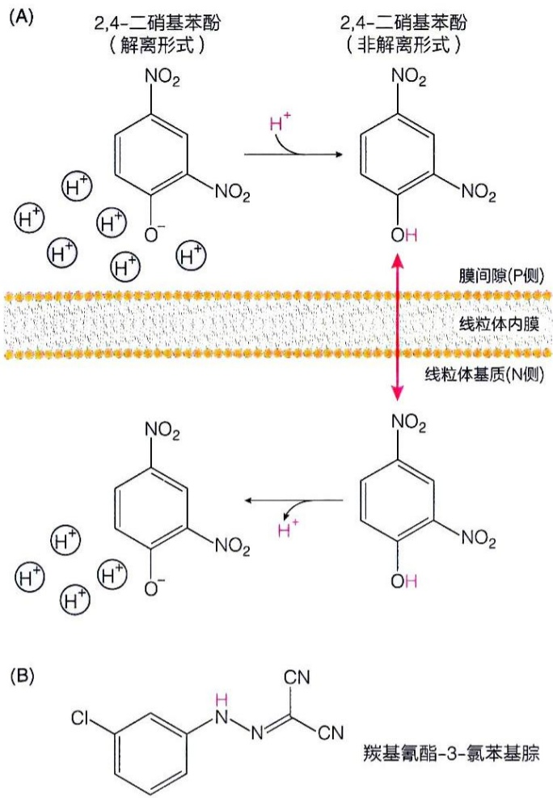

图19-18 2,4-二硝基苯酚解偶联示意图（A）及羰基氰酯-3-氯苯基腙的结构（B）

氯苯基腙（carbonyl cyanide-3-chlorophenylhydrazone, CCCP）等化合物后，尽管ATP合成被抑制，但电子传递却以更高速度进行。这些化学物质被称为解偶联剂（uncoupler）。

这些化合物所产生的解偶联效应，也成为米切尔提出化学渗透假说的重要实验依据。根据化学渗透假说，解偶联剂可能通过破坏跨膜质子梯度而产生效应。这些解偶联剂尽管化学结构各异，但均为有机弱酸（其 $\mathrm{pK_a}$ 接近7）且极性很低。这些分子在非解离状态下具有良好的脂溶性，可以有效地跨膜扩散。

比如，1940年代，李普曼等就观察到，2,4-二硝基苯酚能可逆性地解除磷酸化与氧化之间的偶联关系。其解偶联机制通过二十年后提出的化学渗透假说可以有效解释。尽管这样的化合物在 $\mathrm{pH}7$ 以解离形式存在时，由于极性较强，不易溶于脂质，难以直接透过生物膜；但在酸性环境中，2,4-二硝基苯酚将发生质子化，转变为非解离形式，获得良好的脂溶性，能够自由穿过细胞膜（图19-18A）。这种性质使得解偶联剂可以将质子顺浓度梯度跨膜（被动）转运，破坏跨膜质子梯度，最终抑制ATP合成。羰基氰酯-3-氯苯基腙（CCCP）等也属于疏水弱酸性分子（图19-18B），可通过类似方式破坏跨膜质子梯度，从而产生解偶联效应。

其实，在发现2,4-二硝基苯酚可以作为氧化磷酸化过程的解偶联剂之前，人们对这种物质的生物效应就已经有所认识。它在1880年代被用作食物增色剂，但后来认识到它具毒性。在第一次世界大战期间（即1910年代），人们注意到法国制造军火的工人在生产炸药（三硝基甲苯）的过程中接触2,4-二硝基苯酚，体重会显著减轻。1930年代，2,4-二硝基苯酚被观察到具有刺激代谢（并产热）的效应，并因此而被用作减肥药。然而，后来发现此药会产生严重的副作用，如导致白内障、失明、肾脏和肝脏损伤甚至死亡，因此被美国明令禁止应用于医疗领域。作为解偶联剂，2,4-二硝基苯酚会导致细胞消耗更多的碳水化合物和脂肪，达到减肥效果。但它也会抑制ATP的合成并产生大量的热量，导致严重的生物毒性。研究表明，服药过量导致的疾病和死亡大多是由于体温过高而非ATP合成抑制所致。

## 19.5.4 人工施加的跨膜电化学梯度可驱动 ATP 合成

1960年代，人们使用超声波处理分离到的线粒体、叶绿体或细菌后，发现线粒体的内膜、叶绿体的类囊体膜或细菌的细胞质膜等碎片会自发封闭形成囊泡颗粒。与原来的线粒体内膜相比，这种囊泡颗粒最大的变化是形成了内外翻转（inside-out）的线粒体内膜、类囊体膜或细菌质膜的囊泡颗粒，比如原来朝向基质侧的线粒体内膜翻转朝向外侧等。对分离的线粒体和叶绿体、内外翻转线粒体内膜和细菌质膜亚颗粒以及人工重构生物囊泡等所开展的人工施加跨膜电化学梯度的研究，为米切尔提出的化学渗透假说提供了强有力的实验证据。在这些实验里，在未加入任何可氧化底物作为电子供体的情况下，检测到了ATP的生成。

比如，人们对分离的线粒体开展了如下实验:先将线粒体孵育于含 $0.1\mathrm{mol} / \mathrm{L}$ KCl、$\mathrm{pH} = 9$ 的缓冲液中较长一段时间，使线粒体基质平衡于相同条件（即含 $0.1\mathrm{mol} / \mathrm{L}$ KCl, $\mathrm{pH} = 9$）。然后再将线粒体孵育于含钾离子载体缬氨霉素（valinomycin；为疏水性分子）但不含KCl的 $\mathrm{pH} = 7$ 缓冲液中一段时间。这将使得线粒体基质中的 $\mathrm{K}^+$ 被顺梯度转运出来，结果是线粒体基质中因为 $\mathrm{K}^+$ 浓度下降、$\mathrm{Cl^-}$ 浓度不变而带更多负电荷；而线粒体外膜则因为 $\mathrm{K}^+$ 浓度的增加而带更多正电荷，形成一种电势梯度（$\Delta \psi$）。同时线粒体内外的 $\mathrm{pH}$ 分别为9和7，形成一种化学梯度（$\Delta \mathrm{pH}$）。这样的化学梯度和电势梯度导致了ATP的生成。

另外利用重构的含细菌视紫红质蛋白（一种光驱动质子泵）和 ATP 合酶的人工囊泡，在光照条件下也检测到了 ATP 合成。

后来人们通过对内外翻转的线粒体内膜颗粒或细菌质膜颗粒等施加类似的电化学梯度（但与上述的梯度是相反的），也成功实现了 ATP 的合成（这时的 ATP 合成发生于颗粒的外面，更易于检测）。

同时人们发现分离的叶绿体，通过类似方法提供跨膜质子梯度后，在黑暗中也可以合成 ATP。

这些体外实验再次表明，完整封闭的膜结构是实现氧化和磷酸化偶联、产生 ATP 的必要条件。对于不完整的膜片段（未形成封闭结构）而言，只会氧化 NADH 消耗氧气，但不合成 ATP。

在上述观察基础上，米切尔在 1960 年代早期提出的化学渗透假说，到 1970 年代末被学术界逐渐接受:使氧化和磷酸化之间发生偶联的是质子梯度的电化学势能，它通过氧化而产生，通过 ATP 合成而消耗。

## 19.6 ATP 合酶利用储存于跨膜质子梯度中的电化学势能合成 ATP

1960 年代，美国学者拉克等从牛的心肌线粒体内膜上分离得到一种可溶性的偶联因子（ $F_{1}$ ），它被鉴定为一种 ATP 水解酶。他们后续提供的证据表明，这种酶尽管在体外催化 ATP 水解，但在细胞内却催化 ATP 的合成。我们下面聚焦于对 ATP 合酶的认识。

## 19.6.1 存在于线粒体内膜、细菌质膜和类囊体膜上的 ATP 合酶负责 ATP 合成

通过电子显微技术，在内外翻转的线粒体内膜、类囊体膜或细菌质膜的囊泡颗粒的外表面（相当于线粒体内膜的基质侧），人们明显观察到直径大约为  $10 \, nm$  的球形（或旋钮状）未知结构，它们通过一个长约  $5 \, nm$  的细柄连接到膜上，而且这些囊泡仍然具有氧化磷酸化活性。

拉克等用尿素或胰蛋白酶处理这些囊泡后，外周的球形颗粒就会脱落，处理后的囊泡仍然具有电子传递活性，但是无法合成ATP。脱落下来的被他们称作 $\mathrm{F}_{1}$ 结构的球形颗粒却可以催化ATP的水解。当把球形颗粒重新加到囊泡颗粒上后，ATP合成也重新恢复。这强有力地表明，这些位于膜表面的旋钮状结构就是细胞内催化ATP生成的ATP合酶。

与电子传递类似，ATP 的合成也发生于生物膜结构上，这与化学渗透假说内容高度吻合。ATP 合酶可以利用跨膜质子梯度中所储存的能量合成 ATP。1970 年代以来，人们对 ATP 合酶如何利用这样的跨膜质子梯度合成 ATP 进行了卓有成效的探究。

## 19.6.2 ATP 合酶为由 $F_{0}$ 和 $F_{1}$ 两部分组成的多亚基复合物

后续研究表明，无论是来自原核还是真核生物（包括来自叶绿类囊体膜上）的ATP合酶均为多亚基复合物。ATP合酶由两部分组成:嵌合在膜内的部分被称为 $\mathrm{F_o}$，因为这是ATP合酶对抑制剂寡霉素的响应部位；伸展至膜外的球形颗粒部分被称为 $\mathrm{F_1}$，这部分含有催化ATP合成的活性中心，在体外可催化ATP合成的逆反应，即ATP的水解反应。因此，ATP合酶早期也被称为 $\mathrm{F_1F_o - ATP}$ 酶（归为F型ATP酶）或$\mathrm{F_1F_o - ATP}$ 合酶，但通常被简称为ATP合酶。

一种结构和作用机制高度可比的  $V_{0}V_{1}-ATP$  酶（为 V 型 ATP 酶）存在于溶酶体和植物液泡的膜上。它们的生物功能就是通过水解 ATP 而将质子泵入细胞器的内部，形成酸性内环境。存在于溶酶体内的各种水解酶均为适应这种酸性环境而演化产生，即它们催化活性的最适 pH 均为酸性。一般认为，存在于细菌质膜上的 ATP 合酶，除了可以利用跨膜质子梯度合成 ATP 之外，在某些条件下，也能通过催化 ATP 水解而发挥质子泵的作用。ATP 合酶具有的这种双向催化作用，表明酶催化时其实是同时加速可逆反应的正向和反向的速率，使反应快速达到其平衡状态。线粒体和叶绿体 ATP 合酶在体内是否能在一定条件下发挥水解 ATP 的功能尚不明确。

作为一种高度保守的蛋白质复合物，原核细胞、真核细胞线粒体和叶绿体的ATP合酶的基本亚基组成模式类似，均为 $\alpha_{3}\beta_{3}\gamma \delta \varepsilon \mathrm{ab}_{2}\mathrm{c}_{8 - 15}$ （图19-19）。其总分子量大约为$500\mathrm{kDa}$，大肠杆菌ATP合酶各亚基的分子量依次为:55（α）、50（β）、32（γ）、19（δ）、15（ε）、30（a）、17（b）、8（c）kDa（按照两种字母顺序依次降低）。

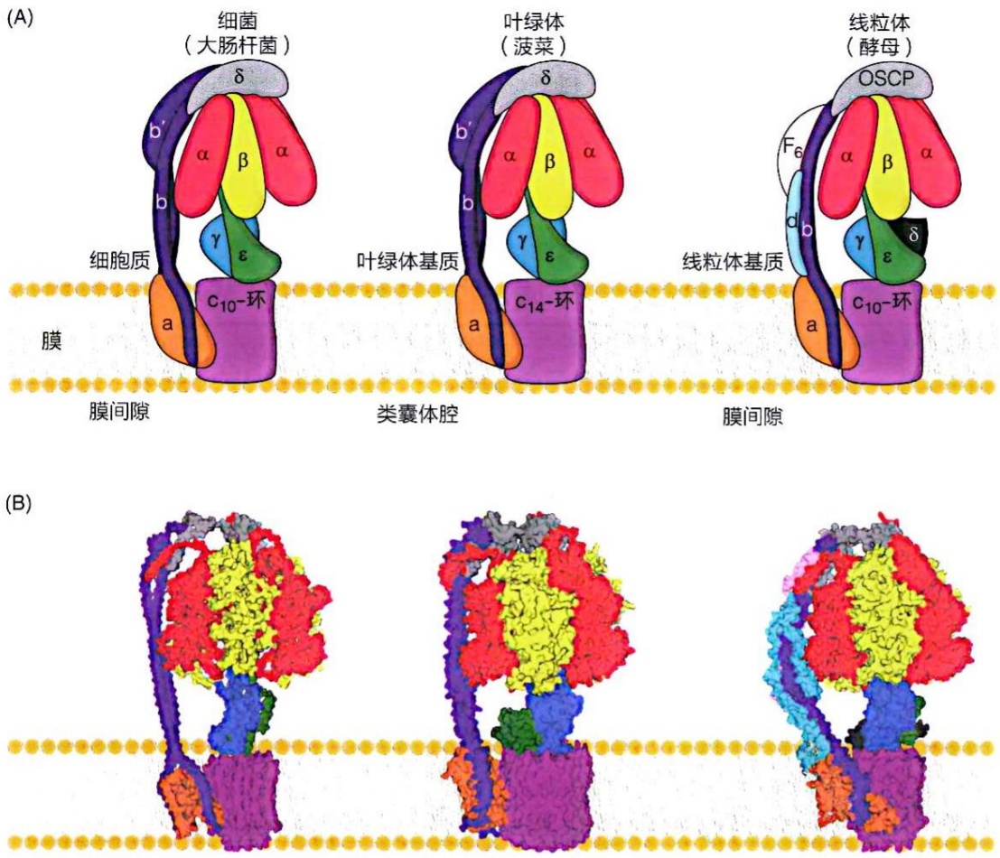

图 19-19 细菌、叶绿体和线粒体 ATP 合酶结构示意图（A）和冷冻电镜重构图（B）

这里的  $\alpha$ 、 $\beta$ 、 $\gamma$ 、 $\delta$ 、 $\varepsilon$  五种亚基组成  $F_{1}$  部分的直径约 10 nm 的球形颗粒。其中的 3 个  $\alpha$  和 3 个  $\beta$  亚基间隔排列（即由 3 个  $\alpha\beta$  单位组成），形成一种类似橘瓣的结构，其中的三个  $\beta$  亚基含合成 ATP 的活性中心。 $\gamma$  亚基处于  $F_{1}$  的内部中心位置，下面与膜上的 c 环接触，上面与  $\alpha$  和  $\beta$  亚基接触，并被认为可以旋转。部分物种中， $\varepsilon$  亚基 C 端可处于两种构象:插入状态（与  $\alpha$  和  $\beta$  接触）或非插入状态（只与 c 亚基接触，不与  $\alpha$  或  $\beta$  接触）；处于插入状态时抑制 ATP 合酶的 ATP 水解活性。

由 a、b 和 c 亚基组成 ATP 合酶的  $F_{o}$  部分。这三种亚基均为膜蛋白，其中的 a 和 c 亚基完全整合于膜内，共同形成质子通道。而 b 亚基则是整合于膜内，但伸出至膜外，并与  $F_{1}$  部分的 δ 亚基相互作用。每个 ATP 合酶分子中由不同数目的 c 亚基形成一种存在于膜内的 c 环结构。在不同的物种中，c 亚基的数目为 8～17 个不等。一般而言，细菌和叶绿体中的 ATP 合酶高度类似，但在线粒体 ATP 合酶的  $F_{o}$  部分，还观察到其他亚基的存在，它们的功能有待阐述。

此外，线粒体 ATP 合酶被观察到以二聚体甚至四聚体形式分布于线粒体的嵴上，其生物学意义有待揭示。

## 19.6.3 纯化的 $F_{1}$ 部分在体外可有效催化 ATP 分子的可逆分解和合成

对 ATP 合酶催化机制的研究其实早在 ATP 合酶被鉴定之前就已经开始。1950 年代人们就观察到，肝脏线粒体样品可以在缺乏氧化底物、也没有氧气摄取的条件下，使得放射性同位素  ${}^{32}P$  标记的无机磷酸（ $P_{i}$ ）快速进入 ATP 分子中。同时通过在  $H_{2}{}^{18}O$  中进行反应，也观察到无机磷酸中的氧原子进行了多次的交换。具体而言，在  $P_{i}$  中检测到了 3～4 个  ${}^{18}O$  原子（图 19-20）。

图 19-20 由 ATP 合酶的  $F_{1}$  部分在体外单独催化的  ${}^{18}O$  交换实验

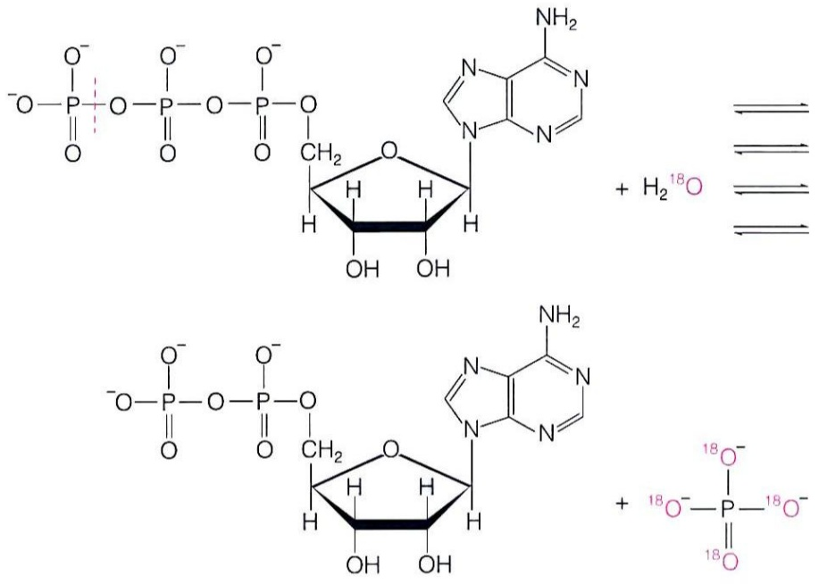

后来当 ATP 合酶被分离纯化，以及其  $F_{1}$  可以被有效分离后，这些结果在体外得到有效重复。该令人意外的结果在当时无法被解释。因为理论上，分离的  $F_{1}$  作为一种 ATP 水解酶，它在催化 ATP 分子发生水解时， $H_{2}^{18}O$  中只会有 1 个  ${}^{18}O$  进入到所产生的  $P_{i}$  中，即每个  $P_{i}$  应该只带 1 个  ${}^{18}O$  原子。

从化学角度看，水解产生的 $\mathrm{P_i}$ 含有3\~4个而非1个 ${}^{18}\mathrm{O}$ 的事实，意味着ATP在ATP合酶或 $\mathrm{F_1}$ 中的合成和水解过程可在酶活性中心反复多次发生:ADP与 $\mathrm{P_i}$ 之间可以反复地结合，而ATP分子中的最后一个酸酐键可以反复断开，其 $\Delta G^{\prime}$ 接近0。因此，在ATP合酶的活性中心的ATP合成几乎无须消耗自由能，也就无须存在跨膜质子梯度。

根据化学渗透假说，在细胞内发生的 ATP 生成过程的能量来自于跨膜质子梯度，那么这样的跨膜质子梯度通过何种方式驱动 ATP 合酶合成 ATP 呢？

## 19.6.4 跨膜质子梯度中储存的能量驱动 ATP 从酶活性中心的释放

如果 ATP 的合成不需要能量，那么能量用于 ATP 合成的哪个步骤呢？

为了解释上述同位素交换实验结果，1970年代，美国学者保罗·博耶（Paul Boyer，

1918—2012）等提出的假想是:氧化反应所提供的能量被用于 ATP 分子从 ATP 合酶活性中心的释放，而非用于形成 ATP 分子中的共价键（图 19-21）。

这意味着氧化反应提供的能量是驱使 ATP 合酶发生某种构象改变，从而导致 ATP 分子的释放。类似的解释从未在其他酶催化反应中被提出过，因此开始时难以得到大家的认可。如果 ATP 被合成后紧密结合于活性中心，那么它与 ATP 合酶的亲和力应该远高于与 ADP 的亲和力。实际测定结果表明，ATP 与 ATP 合酶结合的亲和力比 ADP 高大约 2～50 倍，即 ADP 的  $K_{d}$ （解离常数）值比 ATP 的  $K_{d}$  值高 2～50 倍。这支持了博耶的假说。

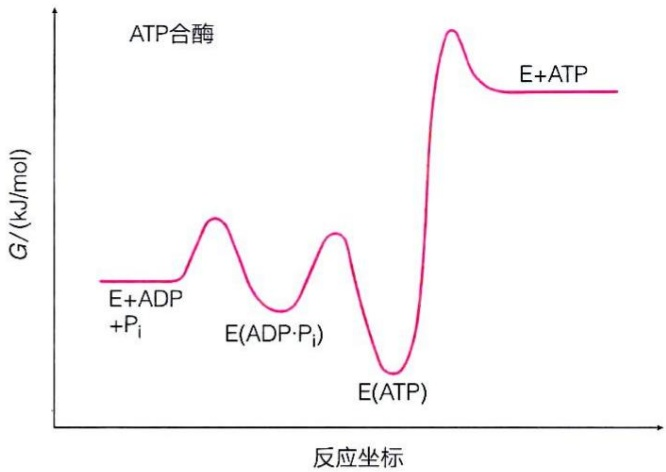

line

| 反应坐标 | G (kJ/mol) |
| --- | --- |
| E+ADP + Pi | ~0.2 |
| \(E(ADP \cdot Pi)\) | ~0.4 |
| E(ATP) | ~0.1 |
| E+ATP | ~0.8 |

图19-21 ATP合酶释放产物ATP时需消耗自由能

换句话说，尽管在经典的酶促反应中，到达过渡态

是需要克服的主要能量势垒。但在ATP合酶催化的反应中，ATP的紧密结合提供了高的结合能，这使酶结合ATP的自由能水平与结合 $\mathrm{ADP + P_i}$ 的自由能水平接近，因此，平衡常数接近1， $\mathrm{ADP + P_i\rightarrow ATP}$ 的反应无须克服高的能量势垒即可有效发生且可逆。但是合成的ATP必须释放才可驱动反应向ATP合成方向进行，而ATP释放所需的自由能才是由质子梯度所储存的电化学势能提供的。

## 19.6.5 ATP 合酶通过三个催化亚基各自与底物和产物亲和力发生轮流改变的机制催化 ATP 的生成

除了同位素交换实验表明能量可能被用于 ATP 分子释放而非合成过程之外，体外动力学分析也表明，每个 ATP 合酶复合物中的三个催化亚基的行为是相同的（即并不存在两种不同的催化中心）。动力学分析还表明，三个催化亚基之间存在协同效应:对合成过程而言，ATP 分子无法从一个催化中心释放，除非另外一个催化中心结合了 ADP 和  $P_{i}$ ；类似地，对水解过程而言， $P_{i}$  分子无法从一个催化中心释放，除非另外一个催化中心结合了 ATP 分子。

ATP合酶分子中参与催化的 $\alpha$ 和 $\beta$ 亚基各有3个拷贝，而 $\gamma$ 、$\delta$ 和 $\varepsilon$ 却各自只有1个拷贝。3个催化亚基 $\beta$ （更为准确地说，活性中心其实是由 $\alpha$ 和 $\beta$ 亚基共同形成的，但主要位于 $\beta$ 亚基中）与任何单拷贝亚基之间发生完全相同的相互作用是很难实现的，这也就使得三个催化亚基无法完全相同。为了解决这一矛盾，博耶等提出了三个大的催化亚基围绕一个更小的不对称的核心旋转运动的假说。

基于上述观察，1970年代博耶等提出了一种独特的“结合变构机制”（binding change mechanism）假说，以解释ATP合酶催化ATP生成的机制。其主要内容是，一个位于 $\alpha_{3}\beta_{3}$ 六聚体中央的不对称核心（在尚缺乏详细结构信息条件下，他们假想的中央核心包括 $\gamma$ 、$\delta$ 和 $\varepsilon$ 三个亚基）发生旋转，使得三个 $\beta$ 亚基轮流发生构象改变，但每一瞬间各自的构象不同。

大约20年后，结合变构假说得到了英国学者约翰·沃克（John Walker）等对ATP合酶 $\mathrm{F}_{1}$ 部分晶体结构测定结果的强有力支持。他们巧妙地利用一种不可水解的ATP类似物App(NH)p代替ATP，使得其中的一个β亚基停留在结合ATP的状态，从而观察到以下现象:$\mathrm{F}_{1}$ 部分的3个 $\alpha$ 和3个β亚基的确以橘瓣式交替排列（具假六重对称性）；其中央结合1个不对称的 $\gamma$ 亚基，这使得每个ATP合酶分子中的3个β亚基所处构象和所结合的核苷酸形式都不同；其中一个亚基结合App(NH)p、一个结合ADP，一个是空的（即不结合任何核苷酸）。晶体结构表明，其中的每一个 $\alpha$ 亚基也结合1分子ATP（其意义尚不清楚）；每一个 $\alpha$ 亚基为其相邻的β亚基可能提供一个高度保守的精氨酸残基［有时被称作精氨酸指（Arg-finger）结构］参与催化中心的形成。

基于上述信息，ATP 合酶催化的结合变构机制（或称作旋转结合变构机制）如图 19-22 所示。

ATP 合酶催化的结合变构机制主要涉及以下两个方面（图 19-22）。

每一个  $\beta$  亚基在每一轮的催化过程中需经历三种构象状态。具体而言，第一种状态是不具备催化活性 L（loose）态，但能松弛地结合 ADP 和  $P_{i}$ 。随着  $\gamma$  亚基的旋转，该  $\beta$  亚基构象发生变化，转变为可与底物紧密结合的 T（tight）态，这时的活性中心可以催化 ADP 和  $P_{i}$  结合形成 ATP。随着  $\gamma$  亚基的继续转动，该  $\beta$  亚基被转变为第三种对 ATP 结合松弛的 O（open）态，此时合成的 ATP 分子可从活性中心释放，完成一轮催化过程。这样，当 $\gamma$ 亚基旋转一周（$360^{\circ}$）后，ATP合酶经历一个完整的催化循环。每个 $\beta$ 亚基合成1个ATP分子，而每个ATP合酶则生成3个ATP分子。

图 19-22 ATP 合酶催化的结合变构机制示意图

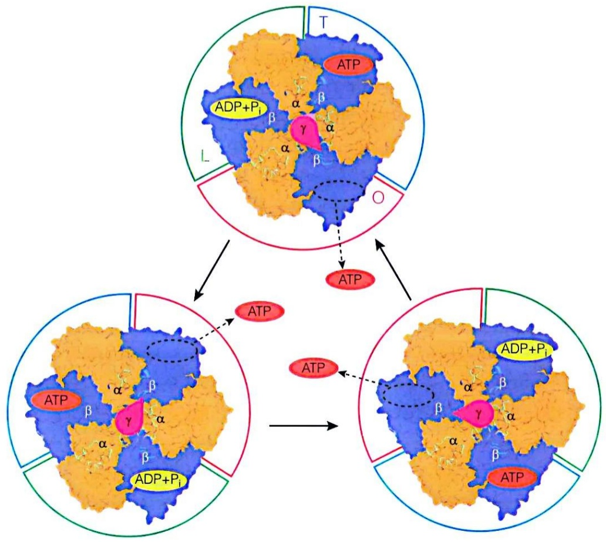

flowchart

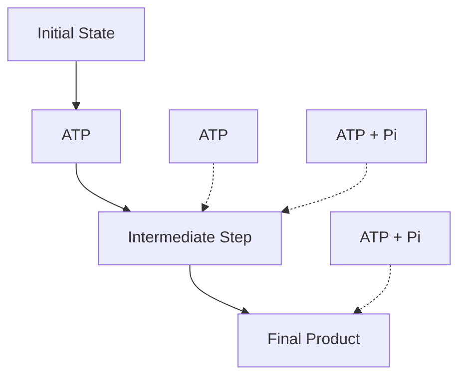

另外，在任何一个给定时刻，一个ATP合酶分子中的非对称性的 $\gamma$ 亚基与3个β亚基的相互作用不同，这使得三个主要位于β亚基上的催化中心所处构象不同，其中一个催化中心处于结合ADP和 $\mathrm{P_i}$ 的L态、一个处于形成ATP的T态，而第三个则处于释放ATP的O态。

ATP合酶发挥ATP水解酶活性时，每个ATP酶分子中的三个 $\beta$ 亚基将通过协同机制水解ATP分子，这将驱动 $\gamma$ 亚基朝与体内ATP合成时相反的方向旋转。如果将ATP合酶的 $\mathrm{F}_{1}$ 部分固定在载玻片上，而在其 $\gamma$ 亚基或 $\mathrm{F}_{\circ}$ 部分的某个c亚基上连接一个带有荧光标记的肌动蛋白微丝，喷淋ATP溶液后用荧光显微镜观察，则 $\mathrm{F}_{1}$ 水解ATP产生的驱动力可带动肌动蛋白微丝进行运动。这样的体外直接观察也为结合变构机制提供了一定的支持性证据。

## 19.6.6 质子顺电化学梯度流经 $F_{\circ}$ 可驱动c环和 $\gamma$ 亚基的转动

将化学渗透假说和 ATP 合酶催化的结合变构机制假说进行综合，目前人们对 ATP 合酶在细胞内催化 ATP 生成的机制的总体认识如下:质子顺梯度流经 ATP 合酶的  $F_{0}$  部分时，将驱动存在于生物膜中的 c 环进行旋转，后者再带动  $\gamma$  亚基旋转，使得三个  $\beta$  亚基通过上述结合变构机制合成 ATP。

质子通道可能由a和c亚基共同形成，它由两个“半通道”组成，各自都可使质子特异和自由通过。在此基础上，寻找 $\mathrm{F_o}$ 亚基中的可能参与形成这样的质子半通道的残基（酸性和碱性残基），并通过残基替换等方式进行验证。人们假想的一种由a和c亚基共同组成的两个分别位于P侧（即膜间隙侧）和N侧（即线粒体基质侧）的半通道组成的质子通道如图19-23A所示。

每个 ATP 合酶分子中的 c 亚基拷贝数在不同物种中不同，一般由 8～15 个拷贝组成。比如，大肠杆菌和酵母中 10 个，钝顶螺旋藻（Spirulina platensis）中 15 个，而在牛和人中只由 8 个拷贝组成。这些不同拷贝数的 c 亚基在膜中组装成 c 环（c-ring），呈旋转对称分布。每个 c 亚基含内外两个跨膜螺旋结构，其 N 端和 C 端均位于膜间隙，而连接两个螺旋的环位于线粒体基质，并与  $F_{1}$  部分的  $\gamma$  和  $\varepsilon$  亚基接触。所有 c 亚基的内部螺旋形成一个内圈，而外部螺旋形成另一个外圈。位于外圈螺旋中部（埋于膜内）的一个谷氨酸（Glu）或天冬氨酸（Asp）残基，被认为参与了质子的跨膜移动并驱动 c 环旋转（图 19-23B）。

与 c 环形成跨膜螺旋不同的是，存在于膜内、位置相对固定的 a 亚基所含  $\alpha$  螺旋以几乎垂直于 c 环的横向角度镶嵌于膜中（图 19-23），正是存在于 a 和 c 亚基的  $\alpha$  螺旋中的氨基酸残基被认为共同形成了跨膜质子通道。

因此，a亚基与c环组成两个亲水的半通道（只穿越一半细胞膜厚度）:一个从高电势的膜间隙一侧通往膜的中间位置，另一个从膜的中间位置通往低电势的线粒体基质一侧。质子的跨膜转运路径如下:从高电势一侧进入半通道的质子与a亚基中一个保守的组氨酸残基结合使其质子化，之后质子被转移到c环上正对半通道入口的带负电的谷氨酸（或天冬氨酸，大肠杆菌中的Asp $^{61}$ ）残基上，使后者发生质子化，形成—COOH。电中性的谷氨酸残基可进入疏水的生物膜中，驱使c环往一个方向旋转；旋转一圈后，谷氨酸残基所携带的质子在线粒体基质侧的半通道中发生去质子化（因为基质侧呈碱性），重新恢复为去质子化状态。这样质子就被释放至线粒体基质，完成顺梯度跨膜转运过程。c亚基上的去质子化谷氨酸残基则进入新一轮的质子化和c环旋转过程。

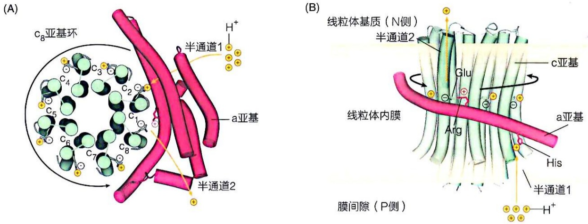

图 19-23 跨膜质子梯度驱动 ATP 合酶 c 环旋转的一种可能机制示意图

这两个半通道之间被认为以a亚基中的一个保守精氨酸残基（大肠杆菌中的$\mathrm{Arg}^{210}$）为界，这个精氨酸残基所带正电侧链作为一种静电屏障发挥作用。一方面阻止质子从一个半通道直接进入另外一个半通道（必须随c亚基旋转一圈后才能进入），另一方面可以阻止c环发生反向旋转。简而言之，当c亚基上的Asp（或Glu）处于带负电（去质子化）状态时，a亚基上带正电的Arg可与之结合，阻止c亚基移动；当Asp与进入的质子结合时，Asp与Arg不再互作，c亚基移动。

## 19.6.7 每对电子流经呼吸链所释放能量可合成 ATP 分子的数目依物种的不同而不同

根据上面的认识，每个 ATP 合酶中的 c 环旋转一圈所需要消耗的质子数等于其所含 c 亚基的拷贝数。因此，在不同物种中，ATP 合酶旋转一圈将消耗 8～15 个跨膜质子，产生 3 个 ATP 分子。因为在牛（或其他哺乳动物）或钝顶螺旋藻线粒体中每个 ATP 合酶分别含 8 个和 15 个 c 亚基，合成 1 个 ATP 所需消耗的质子数分别为 2.7（8/3）个和 5（15/3）个。由于线粒体内膜上发生 ADP/ATP 转运时（ATP 运出，ADP 运入）还需消耗 1 个质子，上面的质子消耗分别为 3.7 个和 6 个。

我们也可以按照这样的方式估算每对电子通过呼吸链后所产生ATP分子的数量。

比如，一对电子从 NADH 传递至  $O_{2}$  所释放能量可以合成 ATP 的数目可通过以下方程式进行描述:

$$
x \mathrm{ADP} + x \mathrm{P} _ {\mathrm{i}} + 1 / 2 \mathrm{O} _ {2} + \mathrm{H} ^ {+} + \mathrm{NADH} \rightarrow x \mathrm{ATP} + \mathrm{H} _ {2} \mathrm{O} + \mathrm{NAD} ^ {+}
$$

式中的 $x$ 即为磷氧比（P/O ratio），即还原1个氧原子可合成ATP分子的数量。依据化学渗透假说，电子传递释放的自由能通过跨膜质子梯度的电化学势与ATP合成相偶联。要测定磷氧比，则需测算还原1个氧原子所泵送的跨膜质子数与合成1个ATP分子所消耗的质子数目之间的比例关系。

下面以一个电子供体NADH和 $\mathrm{FADH}_2$ 经呼吸链传递、分别泵出10个和6个质子进行估算，如果合成1分子ATP消耗4个质子，则1个NADH携带的1对电子则传递所产生的磷氧比为2.5（10/4），而 $\mathrm{FADH}_2$ 所携带的一对电子传递产生的磷氧比则为1.5（6/4）。

根据上面描述的 ATP 合酶催化机制，当我们说“合成 1 分子 ATP 消耗 4 个质子”时，意味着其 ATP 合酶的 c 环由 9 个亚基组成。但不同生物 ATP 合酶的 c 亚基数不同，因此在不同物种中合成 1 分子 ATP 所需消耗的质子数并非相同。例如，牛线粒体 ATP 合酶上的 c 环亚基数为 8，因此合成 1 个 ATP 需消耗的质子数为  $(8 + 3)/3$ ，即 3.7 $^{①}$ 。如果以 NADH 为电子供体，则 P/O = 10/3.7 = 2.7。而对于酵母线粒体来说，合成 1 个 ATP 分子需消耗的质子数为  $(10 + 3)/3$ ，即 4.3，对应的 NADH 磷氧比为 2.3。而前面提到的钝顶螺旋藻则为  $(15 + 3)/3 = 6$ ，其 NADH 的磷氧比为 1.7。由此可见，不同物种的 NADH 的磷氧比一般介于 1.7 \~ 2.7 之间。

## 19.6.8 储存于跨膜质子梯度中的能量可用于驱动其他生物学过程

跨膜质子梯度作为一种电化学势能，除用于合成 ATP 外，也可用于驱动其他生物学过程，例如细菌鞭毛旋转、褐色脂肪产热和物质跨膜转运等。

## (1) 跨膜质子梯度可用于驱动细菌鞭毛的旋转

在漫长的生物演化过程中，为了摄食和避害，细菌进化出“快速”游动的能力。这种能力依赖细菌中存在的一种特殊的运动器官——鞭毛。它存在于大约70%的细菌种类中，是一种相当复杂的蛋白质机器。鞭毛马达的旋转产生动力，通过扭矩传递给接头装置，最终传递给鞭毛丝，带动其转动。

沙门菌鞭毛的结构如图19-24所示。长期的研究结果表明，鞭毛马达中含有质子通道，利用跨膜质子梯度的电化学势驱动鞭毛的转动，将化学能转变为机械能，进而将扭矩传递给鞭毛的内膜环，驱动内膜环的转动。

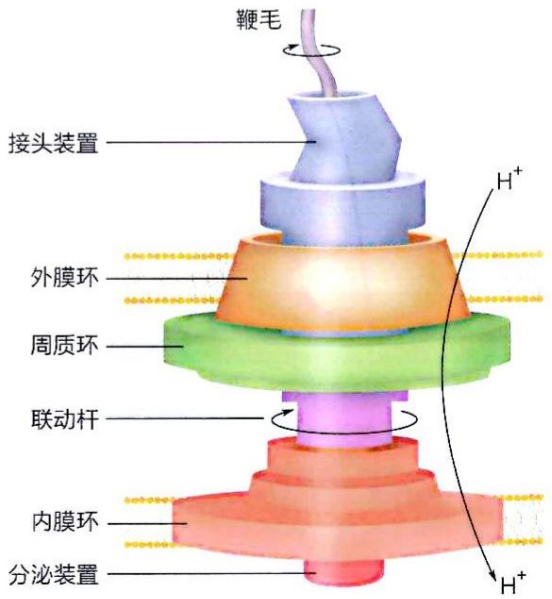

text_image

鞭毛
接头装置
外膜环
周质环
联动杆
内膜环
分泌装置
H⁺
H⁺

图 19-24 沙门菌鞭毛的结构示意图

<small>① 每将一分子 ATP 运出线粒体消耗一个质子。</small>

## （2）跨膜质子梯度可用于驱动物质跨膜转运

跨膜质子梯度在细胞的物质跨膜转运过程中同样发挥关键作用。某些位于膜上的物质转运蛋白利用质子梯度驱动跨膜主动运输，如溶质载体（solute carrier）超家族蛋白，就是利用跨膜质子电化学梯度作为驱动力，实现对二价金属离子，包括  $Mn^{2+}$ 、 $Fe^{2+}$ 、 $Cd^{2+}$ 、 $Co^{2+}$ 、 $Zn^{2+}$ 、 $Ni^{2+}$  和  $Pb^{2+}$  等的主动运输。酵母中的溶质载体对  $Fe^{2+}$  的转运受溶液 pH 影响，表明转运过程可能依赖质子浓度。在一定范围内，质子浓度的增加可提高其转运效率。

## (3) 跨膜质子梯度可用于产生热量

位于某些类型细胞线粒体内膜的解偶联蛋白（uncoupling protein，UCP），又称产热蛋白（thermogenin），可利用跨膜质子梯度产生热量。解偶联蛋白在线粒体内膜上形成质子通道，使质子的顺梯度流动发生“短路”，即质子通过ATP合酶的 $F_{0}$ 部分以外的路径返回线粒体基质。因此，质子回流所释放的能量并未储存于ATP分子中，而是被用于产生热量。

在人体中已鉴定出五种解偶联蛋白（UCP1—5）。其中第一个被鉴定的 UCP1 在褐色脂肪组织（brown adipose tissue）等特定组织中表达尤为显著，占其线粒体膜蛋白总量的约 10%。在人类等哺乳动物的新生个体以及冬眠哺乳动物的颈部和背部存在的褐色脂肪组织细胞中，储存相对较小的脂肪滴（与白色脂肪细胞相比）。褐色脂肪细胞含有丰富的线粒体，正是线粒体中的细胞色素使得这些脂肪组织整体呈褐色。褐色脂肪的产热方式为非战栗性产热（non-shivering thermogenesis），又称代谢产热，它与肌肉组织等通过 ATP 水解实现的战栗性产热的机制不同。

褐色脂肪的产热依赖于线粒体内膜上的解偶联蛋白UCP1对跨膜质子梯度的利用（图19-25）。解偶联蛋白转运质子的活性可以被嘌呤核苷酸（如ATP、ADP、GTP、GDP）抑制，这种抑制效用可以被脂肪酸解除，但详细的机制有待阐述。褐色脂肪细胞中的解偶联蛋白所产生热量，对于帮助新生儿以及冬眠动物维持体温至关重要。

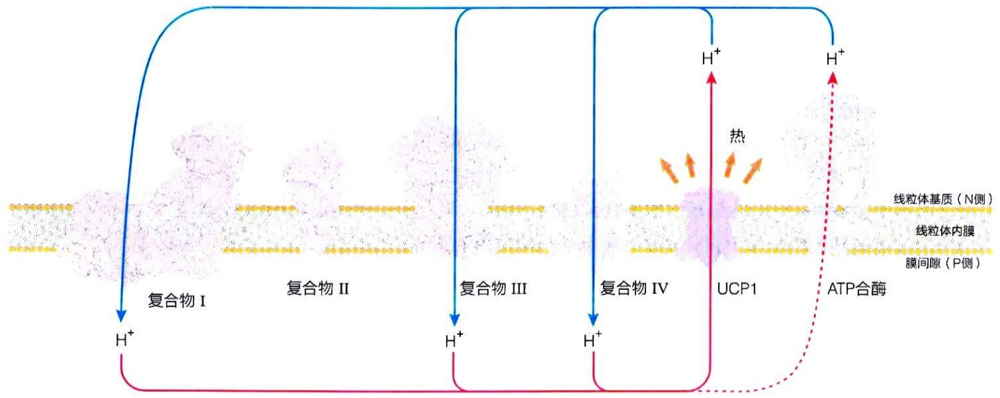

flowchart

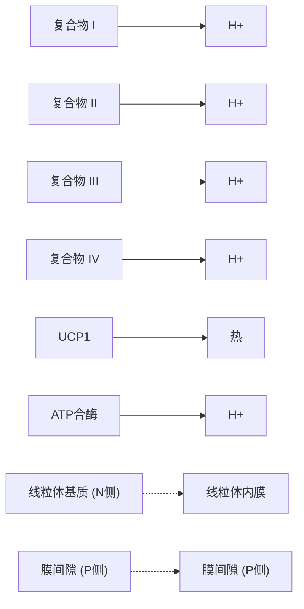

图19-25 线粒体内膜上的解偶联蛋白利用呼吸链所产生的跨膜质子梯度产热

## 19.6.9 呼吸链复合物及 ATP 合酶的部分亚基由线粒体基因组编码

线粒体和叶绿体都属于真核细胞特有的细胞器，含有自己的DNA。人类细胞中的线粒体DNA全长为16569bp，所含基因编码13种蛋白质、22种tRNA和2种rRNA（12S和16S）。线粒体呼吸链复合物及ATP合酶中少数亚基由线粒体基因编码，它们在线粒体基质中被转录和翻译；其他则由细胞核基因组编码，在胞质溶胶中合成后被转运至线粒体。

具体而言，复合物Ⅰ、Ⅲ、Ⅳ以及ATP合酶均含有由线粒体基因组编码的蛋白质亚基，这包括呼吸链复合物Ⅰ中的7种亚基、复合物Ⅲ中含两个血红素（ $b_{L}$  和 $b_{H}$ ）的细胞色素b亚基、复合物Ⅳ中的3种亚基以及ATP合酶中包括α亚基在内的两种亚基。

因此，线粒体基质中生成的蛋白质亚基需与来自胞质溶胶中的亚基在线粒体内膜上进行有效组装，才可形成复合物Ⅰ、Ⅲ、Ⅳ以及ATP合酶。这样的新生肽链的转运和组装过程是一个复杂而重要的生命过程，它们在细胞内发生的详细机制有待阐明。

## 19.6.10 氧化磷酸化过程被严格调控以适应细胞的能量需求

需氧细胞中的 ATP 分子大多通过氧化磷酸化途径——利用电子传递至氧气过程所释放能量——产生。在生物演化过程中，氧化磷酸化过程的出现极大地提高了分解代谢的产能效率。但是，细胞对能量的需求随着不同生命过程的发生而不同。与其他生命过程类似，细胞演化出有效的调节机制，使得细胞的能量供给和需求之间达到良好的平衡状态，这也充分反映了生命过程的高效性。

(1) 产生 ATP 的不同途径之间的协同调节维持体内 ATP 水平的相对恒定

不同分解途径产生 ATP 的效率可能不同。比如，1 分子葡萄糖在有氧条件下完全氧化成  $CO_{2}$  和水可产生大约 30（或 32）个 ATP 分子。而通过缺氧条件下的乳酸发酵或酒精发酵等过程，每分子葡萄糖只能产生 2 个 ATP 分子。正如巴斯德效应所反映的事实，无论通过什么途径产生 ATP，细胞都维持相对恒定的 ATP 水平。因此，酵母细胞在缺氧条件下需消耗更多的葡萄糖来实现有氧条件下少量葡萄糖氧化即可实现的 ATP 产量。

（2）细胞内 ATP 水平相对恒定的维持通过对分解代谢各个途径的联动和协同调控而实现

维持细胞内 ATP 水平的相对恒定是通过对所有相关代谢途径进行自我调节而实现的。具体而言，ATP 和 ADP 的相对浓度不仅调控着电子传递和氧化磷酸化的速率，也调控糖酵解、丙酮酸氧化、柠檬酸循环等途径的速率。

当 ATP 的消耗增加时，不仅呼吸链电子传递和 ATP 合成的速率提高，而且糖酵解、丙酮酸氧化和柠檬酸循环等代谢途径的速率也随之提高，这使得电子流入呼吸链的速率相应提高。这通过高浓度 ADP 和 AMP 对多种酶——磷酸果糖激酶 -1、丙酮酸激酶、丙酮酸脱氢酶复合物、柠檬酸合酶、异柠檬酸脱氢酶等的别构激活而实现。当 ATP 的消耗速率降低时，高水平的 ATP 则可以别构抑制这些酶的活性。

此外，磷酸果糖激酶-1也会被柠檬酸循环的第一种中间产物柠檬酸别构抑制。当ATP的消耗速率降低时，高水平ATP将导致柠檬酸循环的某些酶被抑制，使其速率降低，这将导致柠檬酸在线粒体内的积累；另外，当乙酰辅酶A的产量高时，柠檬酸也会积累。柠檬酸将通过内膜上的特异转运蛋白转运至胞质溶胶中，抑制糖酵解途径的速率。当细胞中的ATP和柠檬酸浓度均升高时，它们会对磷酸果糖激酶-1同时产生别构抑制作用，其效果大于它们单独作用的效果之和，这可大大降低糖酵解途径的速率。

值得注意的是，这些别构激活和别构抑制效应的产生都是瞬时性、快速进行的过程，可以有效调节代谢途径的速率，达到维持 ATP 水平基本恒定的效果。

## （3）氧化磷酸化的速率决定于细胞内ADP的可利用性

研究表明，细胞内的ADP水平是反映细胞能量状态的一个重要指标。线粒体中呼吸速率（以 $\mathrm{O}_2$ 消耗率反映）通常受限于底物ADP的可获得性，即 $\mathrm{O}_2$ 的消耗速率显著依赖 $\mathrm{P_i}$ 的受体——ADP的可利用浓度。这种ADP对氧化磷酸化的调节方式被称为受体控制（acceptor control）机制（图19-26）。

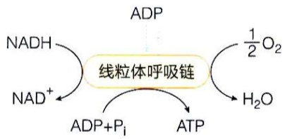

flowchart

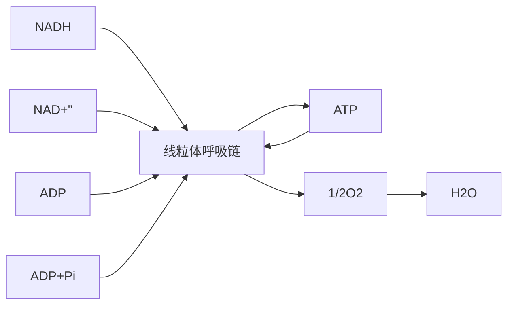

图19-26 氧化磷酸化速率受到ADP可利用性的调节

在某些动物组织中，受体控制比（acceptor control ratio），即高ADP水平诱导的氧消耗速率与缺乏ADP状态下的耗氧速率的比值，至少为10。这意味着:ADP水平高时（表明ATP的消耗速率高），氧化磷酸化的速率也高；而当ADP水平低时（表明ATP的消耗速率低），氧化磷酸化的速率也低。因此，氧化磷酸化的速率最终受到能荷（ATP/ADP）调节。

率受到 具体而言，当线粒体内ADP浓度上升时，ATP合酶活性上升，跨膜质子梯度下降，电子传递速率上升，耗氧率上升，细胞呼吸增加；反之，当线粒体内ADP浓度下降时，ATP合酶活性降低，质子梯度上升，电子传递速率下降，耗氧率下降，细胞呼吸减少。

细胞中燃料分子的氧化速率被精细调控，以致于在大多数组织中 ATP 浓度只发生轻微的上下波动，甚至在能量需求发生极端性变化时也是如此。

此外，在真核生物中还存在一种具有内在无序结构的抑制因子1（inhibitory factor 1, IF1），用于调节ATP合酶的ATP水解活性。当细胞处于低氧状态时，它将阻止ATP合酶因跨膜质子梯度过低而可能出现的ATP酶活性，即c环的倒转，以避免水解通过底物磷酸化产生的ATP分子。抑制因子1在pH低于6.5时被激活成二聚体，然后再与ATP合酶结合并抑制其水解活性。当pH恢复到中性时，抑制因子1的抑制效用也相应地被解除。

## ※展望

氧化磷酸化过程主要发生于生物膜上，长期以来人们难以在体外对其开展有效研究。美国学者拉克在1970年代对氧化磷酸化过程的复杂性发出感叹:“任何人如果不被氧化磷酸化搞晕，那么仅仅是因为他或她并不知晓有关情况。”对这一复杂过程和机制的探究仍在进行之中，还存在多个关键问题尚未回答。

比如，电子传递过程如何导致跨膜质子梯度的形成是一个尚未回答的重要问题。尽管参与电子传递的电子传递链复合物Ⅰ、Ⅲ和Ⅳ的结构都或多或少通过X射线晶体衍射技术或冷冻电镜技术得到了解析，但是这些结构信息并未提供太多关于电子传递如何与质子跨膜转运相偶联的信息。毕竟质子太小，其传递路径也就难以从测定的蛋白质复合物的结构信息中得到任何暗示。但是这样的一个关键过程，该如何被揭示呢？我们似乎尚无任何思路。

再比如，尽管体外研究结果暗示 ATP 合酶通过一种独特的旋转机制实施催化，但对于存在于细胞中的 ATP 合酶究竟如何实施催化，我们毫无所知。根据体外数据，人们提出了存在于线粒体内膜中、由多个 c 亚基组成的 c 环需进行旋转，然后带动 γ 亚基旋转才能使得含有催化 ATP 合成的活性中心发生构象转变的机制。但是一个显而易见的缺陷是，存在于细胞膜中的 c 环如果快速旋转，膜的磷脂双层结构又如何被维持呢？这些都是需要通过活细胞探究才可回答的问题，但目前我们在活细胞中对蛋白复合物行为开展研究的手段极其有限。

其他问题包括，含有大量亚基的呼吸链复合物和 ATP 合酶在生物膜上究竟是如何组装成这么复杂而精巧结构的呢？当细胞处于不同条件时（如正常温度下和热休克胁迫条件下），呼吸链电子传递和 ATP 合成是如何被精细调控的呢？这些距离精确认知都还有很长的路要走。

## ※ 本章小结

氧化磷酸化是将NADH和 $\mathrm{FADH}_2$ 中的电子通过位于生物膜中由蛋白质复合物组成的呼吸链传递至 $\mathrm{O}_2$ 产生 $\mathrm{H}_2\mathrm{O}$ 、形成跨膜质子梯度、最后利用电化学势驱动ATP合成的过程。

呼吸链主要由四种多亚基呼吸链复合物（Ⅰ、Ⅱ、Ⅲ和Ⅳ）以及两种可移动电子载体（泛醌和细胞色素c）组成；ATP合成则由跨膜蛋白质复合物ATP合酶催化。

根据化学渗透假说，呼吸链电子传递与 ATP 合成之间以一种间接偶联方式进行。

由伸出膜外的  $F_{1}$  部分（ATP 合成中心）和整合于膜中的  $F_{0}$  部分（质子通道）组成的 ATP 合酶被认为通过结合变构的旋转机制催化 ATP 分子的合成。储存于跨膜质子梯度中的能量也可用于做其他功（如驱动细菌鞭毛的旋转或动物细胞的产热）。

发生于胞质溶胶中的糖酵解途径所产生的NADH携带的电子通过苹果酸-天冬氨酸等穿梭系统被传递至呼吸链。

导向 ATP 合成的不同氧化分解途径受到严格的协同调节，以维持细胞内 ATP 水平的动态稳定。

## ※ 思考题

1. 线粒体呼吸链由哪些成员组成？
2. 在线粒体中，呼吸链复合物Ⅰ的亲水臂朝向哪一侧？ATP合酶的 $F_{1}$ 部分朝向哪一侧？在人工制备的亚线粒体颗粒中，上述朝向又是什么情况？
3. 已知泛醌的苯醌头部可以接受电子，那其异戊二烯链又有什么功能？
4. 常见的呼吸链抑制剂有鱼藤酮、抗霉素 A 和氰化物，它们分别阻断了哪两个电子载体间的电子传递？
5. 在牛的心肌细胞中，以 NADH 作为电子供体时，细胞呼吸的磷氧比是多少？当加入 2,4-二硝基苯酚后，磷氧比会怎么变化？
6. 缬氨霉素是一种电中性钾离子载体，可以在线粒体内膜两侧转移钾离子。当加入缬氨霉素后，研究者发现线粒体ATP合成减少，氧气消耗增加，热释放增加，线粒体内膜两侧的pH梯度增加。请解释这些现象出现的原因。
7. 已知革兰氏阴性菌类鼻疽伯克霍尔德菌（Burkholderia pseudomallei）的 ATP 合酶的 c 环有 17 个 c 亚基，则当用 NADH 作为电子供体时，该菌的磷氧比大约是多少？

## ※ 推荐阅读

1. MITCHELL P. Coupling of phosphorylation to electron and hydrogen transfer by a chemi-osmotic type of mechanism [J]. Nature, 1961, 191 (4784): 144–148.
阐述磷酸化与电子传递通过化学渗透机制的偶联作用。
2. ZHU J P, VINOTHKUMAR K R, Hirst J. Structure of mammalian respiratory complex I [J]. Nature, 2016, 536 (7616): 354–358.
利用冷冻电镜技术，首次以近原子分辨率（约 3.5 Å）揭示哺乳动物呼吸链复合体 I 的 L 形构象，包括 45 个亚基的精确排列及跨膜臂与亲水臂的协同作用。
3. WU M, GU J K, GUO R Y, et al. Structure of mammalian respiratory supercomplex $\mathbf{I}_1\mathbf{III}_2\mathbf{IV}_1$ [J]. Cell, 2016, 167 (6): 1598-1609.
利用冷冻电镜技术解析呼吸链超级复合物 $\mathrm{I}_1\mathrm{III}_2\mathrm{IV}_1$ 的结构，揭示其偶联电子传递与质子转运的分子机制。
4. KÜHLBRANDT W. Structure and mechanisms of F-type ATP synthases [J]. Annu Rev Biochem, 2019, 88: 515–549.
综述 F 型 ATP 合酶的结构与作用机制。
5. VERCELLINO I, SAZANOV L A. The assembly, regulation and function of the mitochondrial respiratory chain [J]. Nat Rev Mol Cell Biol, 2022, 23 (2): 141–161.

综述线粒体呼吸链的组装、调控及功能多样性，重点探讨其与人类疾病的关联性。

6. LAI Y Z, ZHANG Y Y, ZHOU S, et al. Structure of the human ATP synthase [J]. Mol Cell, 2023, 83 (12): 2137-2147.

利用冷冻电镜技术解析人源 ATP 合酶的四种不同构象（包括开放、半开放、结合和催化状态）的高分辨率结构，深化对 ATP 合酶在合成 / 水解 ATP 过程中旋转催化机制的理解。

(撰写: 周丛照, 李珍, 秦咏梅, 杨茂君, 肖淳;

审修:杨广笑，张哲，李森，丁智）