位酶催化，转化为葡萄糖-1-磷酸。接着在UDP-葡萄糖焦磷酸化酶（UDP-glucose pyrophosphorylase）的催化下，葡萄糖-1-磷酸与UTP反应，即生成UDP-葡萄糖（同时释放 $\mathrm{PP_i}$，后者再水解为 $\mathrm{P_i}$）。最后在UDP-半乳糖-4-差向异构酶催化下，UDP-葡萄糖被转化为UDP-半乳糖。

生物体内鉴定到的用于活化单糖的核苷酸包括 UDP、GDP、AMP、ADP 和 CDP 等不同形式，它们参与不同的寡糖或多糖生成过程。哺乳动物细胞中存在的核苷酸活化单糖总结于表 21-1 中。值得注意的是，ADP（或 AMP）未被用作活化单糖载体，可能与 ADP 被用于形成能量货币 ATP 有关。

## （2）核苷酸-糖可在特异膜蛋白协助下进入内质网和高尔基体

核苷酸-糖（NDP-糖）的合成一般在胞质溶胶中进行，但很多糖基化反应均发生于内质网或高尔基体内。核苷酸-糖由于携带负电荷，难以扩散通过内质网膜，需要通过一系列核苷酸-糖转运体转送进入内质网或高尔基体腔中。核苷酸-糖提供糖基后，释放出的核苷二磷酸在核苷二磷酸酶（NDPase）催化下，转变为核苷一磷酸（NMP）和无机磷酸。核苷一磷酸也通过核苷酸-糖转运体被反向送回至胞质溶胶中，而无机磷酸也通过特异转运体被运出高尔基体或内质网（图21-18）。

表 21-1 哺乳动物细胞中常见的核苷酸活化单糖

<table><tr><td>类型</td><td>名称</td></tr><tr><td rowspan="6">UDP-糖</td><td>UDP-葡萄糖(UDP-Glc)</td></tr><tr><td>UDP-半乳糖(UDP-Gal)</td></tr><tr><td>UDP-乙酰葡萄糖胺(UDP-GlcNAc)</td></tr><tr><td>UDP-乙酰半乳糖胺(UDP-GalNAc)</td></tr><tr><td>UDP-木糖(UDP-Xyl)</td></tr><tr><td>UDP-葡萄糖醛酸(UDP-GlcUA)</td></tr><tr><td rowspan="2">GDP-糖</td><td>GDP-甘露糖(GDP-Man)</td></tr><tr><td>GDP-岩藻糖(GDP-Fuc)</td></tr><tr><td>CMP-糖</td><td>CMP-唾液酸(CMP-Sia)</td></tr></table>

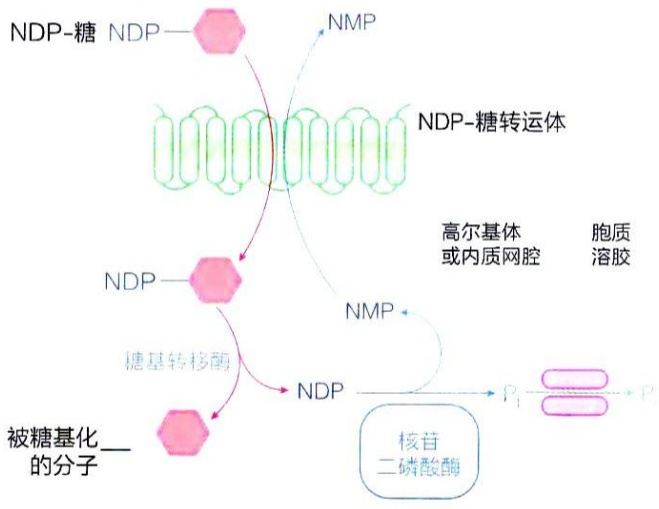

<details>
<summary>flowchart</summary>

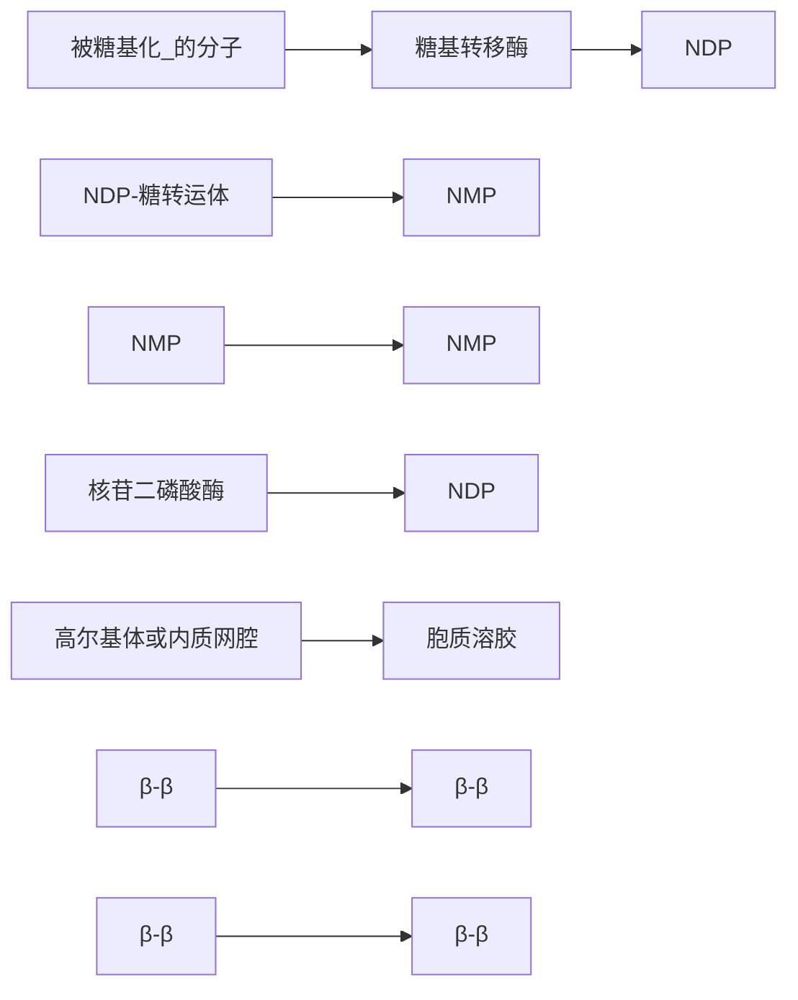
</details>

图21-18 真核细胞核苷酸-糖转运进入高尔基体或内质网的体系

## 21.3.2 乳糖合酶在高尔基体中催化 UDP-半乳糖与葡萄糖缩合形成乳糖

作为一种由葡萄糖和半乳糖缩合而成的二糖，乳糖是哺乳动物乳汁中的主要碳水化合物成分（占人体乳汁重量的6%左右），为婴儿提供营养。1980年代的研究发现，乳糖合成发生于乳腺细胞的高尔基体中，并随乳蛋白一起分泌到细胞外。

在动物分娩及哺乳期间，乳腺组织的代谢活动出现明显变化。具体表现包括:脂肪合成代谢上调，新合成多种蛋白质（包括  $\alpha-$  乳清蛋白等），以及开始合成乳糖等。

乳腺上皮细胞的质膜中含丰富的葡萄糖转运体 GLUT1，确保了细胞内充足葡萄糖的供应。胞质溶胶中的葡萄糖可通过位于高尔基体膜上的 GLUT1 进入高尔基体内（图 21-19A）。部分葡萄糖在胞质内先活化，形成 UDP-葡萄糖，再转化成 UDP-半乳糖（图 21-17），然后经特异转运体进入高尔基体。

乳糖合酶由半乳糖基转移酶与  $\alpha-$  乳清蛋白（ $\alpha-lactalbumin$ ）结合而成。乳糖由半乳糖与葡萄糖通过（ $\beta1\rightarrow4$ ）糖苷键相连而成。乳糖生物合成的单糖供体为由 UDP-葡萄糖转化而成的 UDP-半乳糖（图 21-17），受体为葡萄糖。有趣的是，催化该反应的半乳糖基转移酶，在哺乳期乳腺细胞中发生了一次底物特异性转变的过程，这正是通过与  $\alpha-$  乳清蛋白的结合而实现的。

具体而言，哺乳期之前单独存在的（$\beta 1 \rightarrow 4$）半乳糖基转移酶，对以葡萄糖作为受体反应催化活性极低，而主要以与蛋白质共价连接的 $N-$ 乙酰葡萄糖胺为受体（生成糖蛋白）。但是，在哺乳期的乳腺组织中，产生了一种本身并无催化能力的 $\alpha-$ 乳清蛋白。通过与 $\alpha-$ 乳清蛋白结合形成非共价复合物，半乳糖基转移酶的底物特异性发生了显著改变，对葡萄糖受体的特异性大幅提高，因此成为了高效催化乳糖合成的酶（图21-19A）。因此，与 $\alpha-$ 乳清蛋白结合的半乳糖基转移酶通常被称作乳糖合酶（lactose synthase）（图21-19B）。

在乳腺组织中，乳糖的合成受到脑垂体分泌的催乳素（prolactin）的调控。催乳素通过刺激乳腺上皮细胞中的 JAK-STAT 等信号转导通路来上调  $\alpha$ -乳清蛋白的表达。半乳糖基转移酶除了参与糖蛋白生成，也参与糖脂的生成。

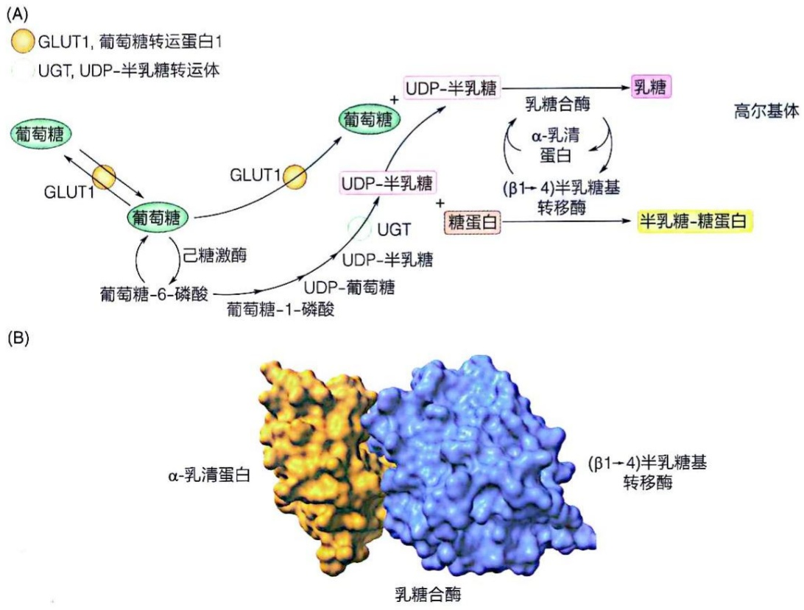

图 21-19 乳糖合成的过程及乳糖合酶复合体的结构

（A）乳腺上皮细胞高尔基体中合成乳糖的过程。（B）乳糖合酶复合体的结构（PDB:1NQI）。

## 21.3.3 光合植物细胞利用 UDP-葡萄糖与果糖-6-磷酸缩合形成蔗糖

作为光合植物中的主要运输糖，蔗糖合成主要发生于光合细胞的胞质溶胶中。蔗糖不具有还原性末端，相对比较稳定，适合于运输过程。这里简单介绍蔗糖的生物合成过程。

叶绿体基质中发生光合固碳时，所形成的磷酸二羟丙酮可被磷酸-丙糖磷酸反向转运体转运至胞质溶胶。然后在催化糖异生途径的几种酶的作用下，磷酸二羟丙酮与其异构产物甘油醛-3-磷酸缩合，先后生成果糖-1,6-二磷酸、果糖-6-磷酸和葡萄糖-6-磷酸（见图21-4）。葡萄糖-6-磷酸经由葡萄糖-1-磷酸可进而转化为UDP-葡萄糖（见图21-17）。

之后，UDP-葡萄糖与果糖-6-磷酸缩合后再脱磷酸，即生成蔗糖（图21-20）。

图 21-20 从 UDP-葡萄糖和果糖-6-磷酸生成蔗糖的过程

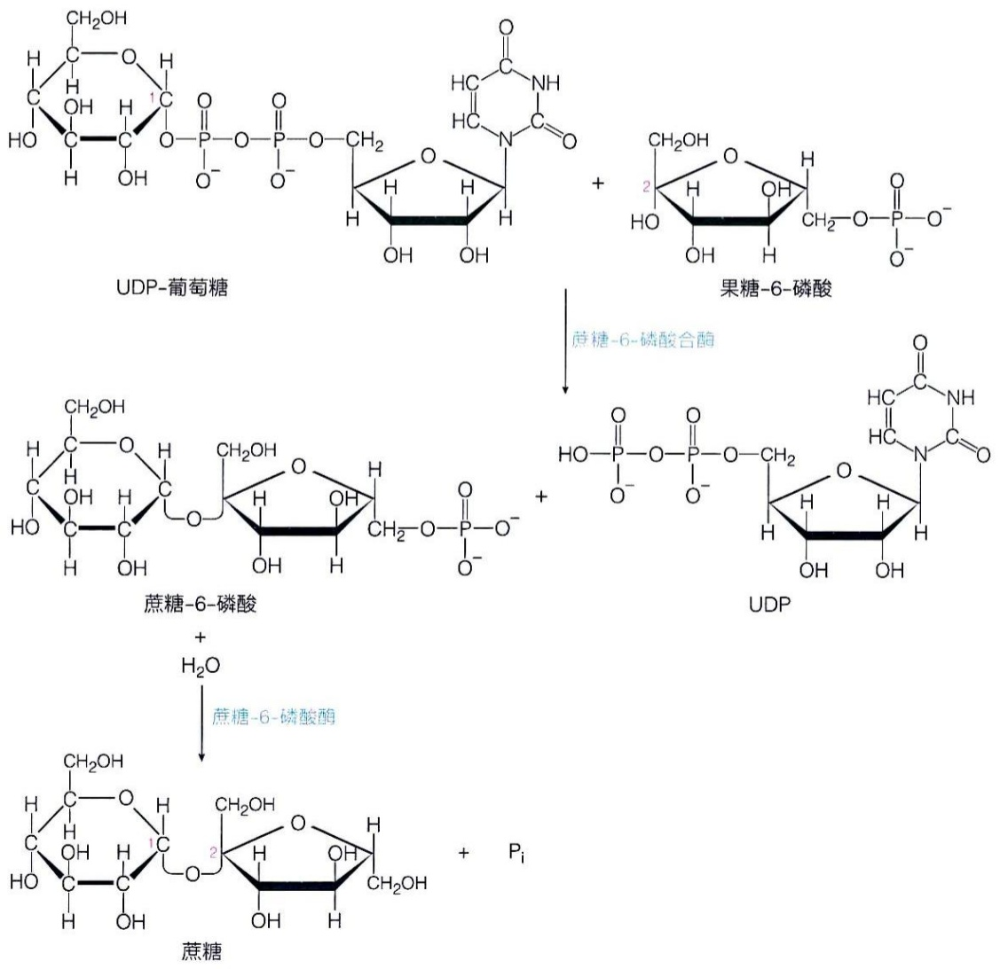

<details>
<summary>chemical</summary>

糖苷酸合成反应示意图，展示UDP-葡萄糖、果糖-6-磷酸、蔗糖-6-磷酸及蔗糖合成酶催化作用
</details>

催化 UDP-葡萄糖（糖供体）与果糖-6-磷酸（糖受体）缩合的酶是蔗糖-6-磷酸合酶（sucrose 6-phosphate synthase），产物为蔗糖-6-磷酸。蔗糖-6-磷酸进而在蔗糖-6-磷酸酶（sucrose 6-phosphate phosphatase）催化下，水解脱去磷酸基团，即生成蔗糖，这步反应促使整个反应往蔗糖合成方向进行。

## 21.4 糖原、淀粉和纤维素的合成均以 NDP-葡萄糖为单糖供体

糖原、淀粉和纤维素均为葡萄糖的多聚体。糖原和淀粉是生物的能量储存分子，而纤维素则是植物的结构支持成分。这里简单介绍这三类多糖分子的生物合成过程。

## 21.4.1 糖原合成以 UDP-葡萄糖为单糖供体

糖原可为机体快速提供或储存葡萄糖。比如当动物剧烈运动时，骨骼肌中的糖原会快速提供葡萄糖并在一小时之内将糖原消耗殆尽。而肝脏中的糖原则可在两餐之间或禁食期间的大约24小时内，为其他组织提供葡萄糖。就人类等哺乳动物而言，虽然以糖原形式储存的总能量远低于脂肪，但这些脂肪不能被转化为葡萄糖，也不能通过无氧分解为机体提供能量。因此，对于哺乳动物而言，糖原不仅在氧气供应不足时对持续供能具有重大意义，而且对于大脑神经元等仅使用葡萄糖作为能量来源的细胞而言，也不可或缺。此外，肝脏通过合成和分解糖原而参与血糖调节:当血糖水平较高时，机体将多余的葡萄糖以糖原形式储存起来；在血糖水平较低时，肝糖原分解为葡萄糖，补充血糖。

糖原合成（glycogenesis）发生于脊椎动物和某些微生物细胞内。脊椎动物体内的糖原合成主要发生于肝脏和骨骼肌细胞中。合成高度分支的糖原分子，依赖糖原蛋白（glycogenin）、糖原合酶（glycogen synthase）和糖原分支酶（glycogen branching enzyme）等的共同催化。糖原的合成和降解受到胰岛素、胰高血糖素和肾上腺素等激素的调控。

糖原合成也需先活化葡萄糖，形成 UDP-葡萄糖（见图 21-17）。1950 年代，阿根廷学者莱洛伊尔观察到，UDP-葡萄糖不仅参与细胞内二糖（如蔗糖或乳糖）的形成，而且也参与糖原的形成。

1970 年代，阿根廷学者克拉拉·克里斯曼（Clara Krisman）等观察到，如果将  ${}^{14}$ C 标记的 UDP-葡萄糖加入到肝脏抽提物中，则可产生一种被  ${}^{14}$ C-葡萄糖标记的蛋白质。他们认为这就是人们长期寻找的糖原合成的引物。后来这种蛋白质被命名为糖原蛋白。

## (1) 糖原生成由糖原蛋白启动

后续研究表明，一个糖原分子的合成开始于由同源二聚体糖原蛋白进行自催化糖基化的过程。具体而言，糖原蛋白具有自催化活性（图21-21A）。这种活性将葡萄糖基从UDP-葡萄糖转移至糖原蛋白自身两个亚基中的 $\mathrm{Tyr}^{194}$ 残基侧链羟基或已连接的葡萄糖单位上，形成共价连接（异头碳具 $\alpha$ 构型），葡萄糖残基之间则形成（$\alpha 1\rightarrow 4$）糖苷键。最终形成与糖原蛋白每个亚基共价连接的、一般含8个葡萄糖残基的寡糖链。后者就构成了糖原生成的引物。

根据测定的糖原蛋白二聚体的晶体结构（图 21-21B），尚无法判断这样的催化过程是发生于亚基之间，还是亚基之内。每一个亚基中的 Tyr $^{194}$  与本亚基和另一亚基所结合的 UDP-葡萄糖的 C1 都太远，必须依赖构象的动态调整或其他机制才可实现缩合反应。无论如何，糖原蛋白二聚体将一直存在于最终合成的两个糖原分子的中心。

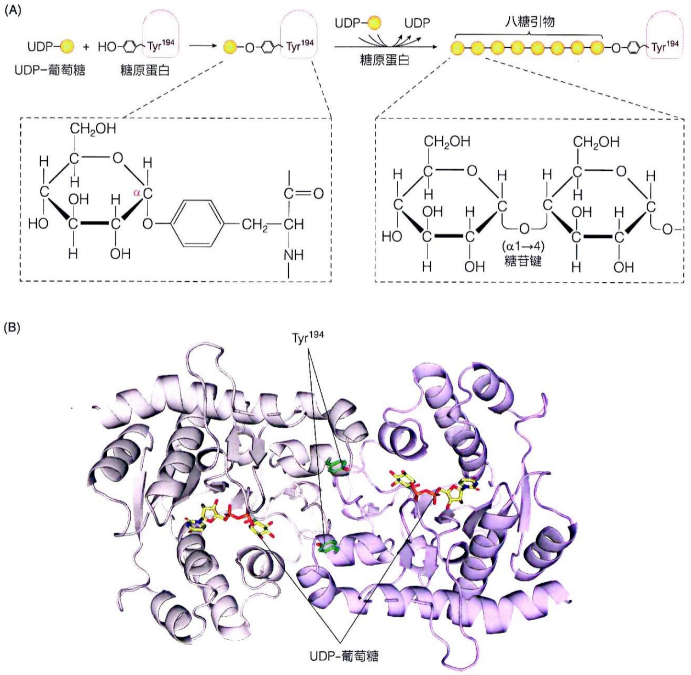

图 21-21 糖原蛋白催化引物生成过程和糖原蛋白结构示意图（A）糖原蛋白催化糖原生成引物形成过程示意图。（B）兔源糖原蛋白二聚体结构图（PDB:1LL2）。两个亚基分别用蓝灰色和灰色卡通模

型显示，结合的 UDP-葡萄糖用黄色棍状模型展示，与葡萄糖共价连接的酪氨酸残基侧链用绿色棍状模型展示。

## (2) 糖原合酶和糖原分支酶催化后续糖原分子的形成过程

糖原蛋白在形成了8个糖基的引物后，将招募糖原合酶到糖原起始颗粒，利用UDP-葡萄糖，通过形成（$\alpha 1 \rightarrow 4$）糖苷键，继续在糖原分子的非还原端催化延伸糖链（图21-22A）。因此，糖原分子的大小取决于糖原蛋白与糖原合酶之间的相互作用。当糖原合酶与糖原蛋白脱离时，糖原的合成即终止。

糖原分子的重要特征之一就是含有大量的分支，这些分出的支链与分支点的葡萄糖残基以（$\alpha 1 \rightarrow 6$）糖苷键连接。但是糖原蛋白和糖原合酶都只催化（$\alpha 1 \rightarrow 4$）糖苷键的形成。糖原分子支链的形成由糖原分支酶催化。该酶催化包括断开（$\alpha 1 \rightarrow 4$）糖苷键和形成（$\alpha 1 \rightarrow 6$）糖苷键的反应，能将一个七糖单位从一段至少含11个葡萄糖残基的糖链非还原端转移至邻近糖链上，并以（$\alpha 1 \rightarrow 6$）糖苷键连接。新的分支点距离原分支点至少4个葡萄糖残基（图21-22B）。

最后生成的每一个糖原分子大约含有 55 000 个葡萄糖残基，并形成最多 12 个层级大约 4 000 条的分支。这时糖原合酶和分支酶的活性位点难以接近糖原分子的非还原端，尤其后者难以接近分子的内部。一个糖原分子中大量分支链的存在，不仅增加了其可溶性，也增加了非还原末端的数目（大约 3 000 个），可大幅提高糖原的分解和合成效率。理论上，糖原分子的每一个非还原性末端，均可通过糖原磷酸化酶的催化去除、或通过糖原合酶的催化加入葡萄糖单位，这使得每个糖原分子的大小均处于一种不断变化的动稳态。

## (3) 糖原合酶的活性可通过激素诱发的可逆磷酸化修饰等调节

糖原磷酸化酶和糖原合酶均存在于糖原颗粒中，且均为被高度调节的酶，糖原合酶的催化活性也主要通过可逆磷酸化修饰和别构方式调节。

但是，与糖原磷酸化酶相反，糖原合酶处于磷酸化修饰状态时，为低活性状态，而其脱磷酸化形式则是高活性状态。目前已知糖原合酶至少可被11种蛋白激酶催化发生磷酸化修饰而降低活性。其中最重要的可能是糖原合酶激酶3（glycogen synthase kinase 3，GSK3）。它将磷酸基团添加到糖原合酶羧基端的3个Ser残基上。

图21-22 糖原合酶催化的糖原糖链延伸（A）和糖原分支酶催化的糖原分支（B）过程示意图

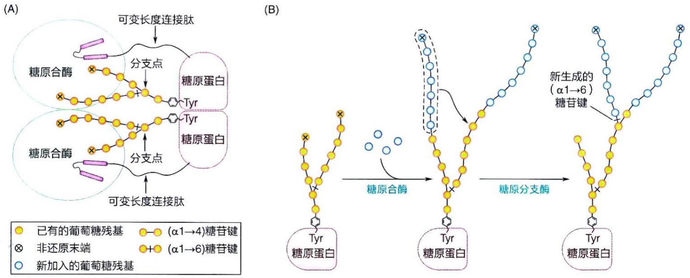

糖原合酶中被糖原合酶激酶3识别的位于肽链C末端的保守氨基酸序列是:Ser-X-X-X-Ser$^{-8}$-X-X-X-Ser$^{-4}$-X-X-X-Ser$^{0}$-X-X-X-Ser$^{+4}$。糖原合酶激酶3催化中间0、-4和-8三个位置的Ser残基发生磷酸化修饰。但是，糖原合酶激酶3无法直接对这些位点实施催化，其作用依赖于酪蛋白激酶Ⅱ（casein kinase Ⅱ，CK Ⅱ）先催化糖原合酶在+4位Ser残基上发生预磷酸化，即引发作用（priming）（图21-23）。蛋白质的级联磷酸化（hierarchical phosphorylation）修饰概念最初就是从研究糖原合酶的这种复杂调控机制过程中建立起来的。

具体而言，酪蛋白激酶Ⅱ对位于糖原合酶+4位的丝氨酸进行磷酸化之后，糖原合酶激酶3即可通过该磷酸化位置与糖原合酶结合，进而对位点上游0位的丝氨酸残基进行磷酸化修饰。这样就产生了新的引发位点，促使糖原合酶激酶3沿着新的磷酸化位点移动，进而相继磷酸化-4和-8位的丝氨酸残基。

在肝细胞中，糖原合酶的去磷酸化主要由被胰岛素激活的磷酸蛋白磷酸酶1（phosphoprotein phosphatase 1，PP1）催化（图21-23）。胰岛素也可通过激活蛋白激酶B（PKB，又称Akt）而使糖原合酶激酶3的N端一个Ser残基磷酸化而形成假底物，使后者发生自抑制，阻止其对糖原合酶的磷酸化及抑制效应。胰高血糖素及肾上腺素则通过激活蛋白激酶A（PKA）而激活磷酸蛋白磷酸酶2A（phosphoprotein phosphatase 2A，PP2A），后者使得糖原合酶激酶3的N端发生去磷酸化而活化，进而使糖原合酶磷酸化而失活（图 21-23）。此外，蛋白激酶 A 也可通过促进糖原合酶某些 Ser 残基磷酸化而部分失活。

图21-23 糖原合酶被酪蛋白激酶Ⅱ和糖原合酶激酶3进行级联磷酸化修饰示意图

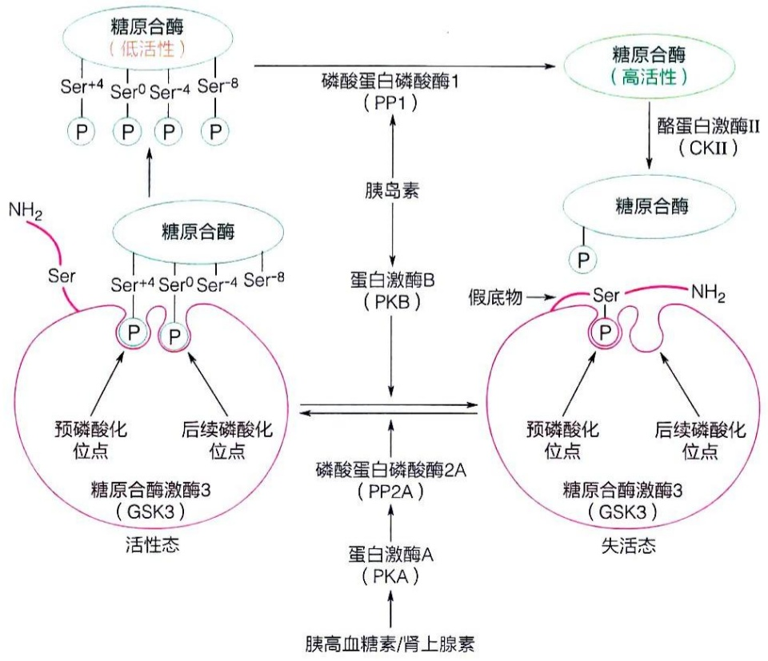

<details>
<summary>flowchart</summary>

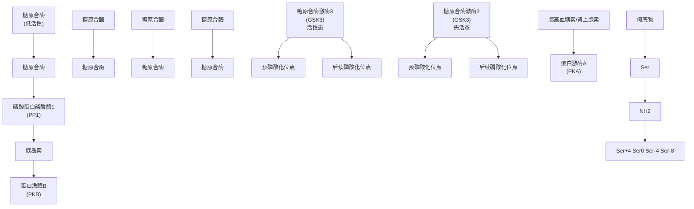
</details>

葡萄糖-6-磷酸（合成糖原的一种前体）是糖原合酶的别构激活剂。它与磷酸化的低活性糖原合酶结合，使磷酸基团暴露，有利于PP1对糖原合酶的去磷酸化作用，从而激活糖原合酶。从这个角度来看，因发生磷酸化而失活的糖原合酶可被视为葡萄糖-6-磷酸的感受器。而且，葡萄糖-6-磷酸还能降低糖原合酶与UDP-葡萄糖反应的 $K_{\mathrm{m}}$ 值。

## 21.4.2 淀粉合成发生于叶绿体基质并利用 ADP-葡萄糖为单糖供体

淀粉是植物光合作用的最终产物之一，它与动物中的糖原的结构高度可比。植物光合细胞中支链淀粉的合成过程与上述糖原合成过程高度类似，只是使用ADP-葡萄糖（而非UDP-葡萄糖）提供单糖单位（图21-24）。直链与支链淀粉的合成均由淀粉合酶（starch synthase）催化。与UDP-葡萄糖类似，ADP-葡萄糖是葡萄糖-1-磷酸在ADP-葡萄糖焦磷酸化酶催化下生成的。随后，淀粉合酶以ADP-葡萄糖为供体，催化葡萄糖单位添加至预先存在的短链糖（如麦芽三糖）的非还原末端，

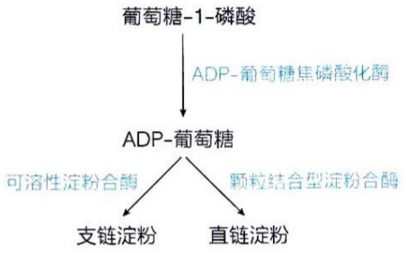

<details>
<summary>flowchart</summary>

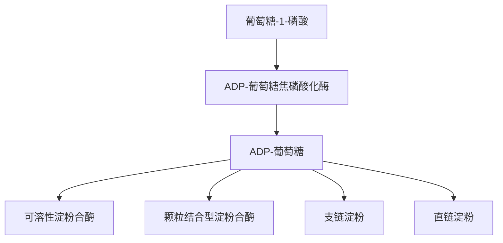
</details>

图21-24 植物支链和直链淀粉的合成过程

形成（ $\alpha1\rightarrow4$ ）糖苷键连接，进而形成葡萄糖多聚体，即淀粉。值得注意的是，植物淀粉合成并不依赖类似糖原蛋白这样的引物。

根据与淀粉粒结合的紧密程度和底物特异性不同，淀粉合酶被大致分为颗粒结合型（granule-bound）和可溶性淀粉合酶两类。颗粒结合型淀粉合酶与淀粉粒结合紧密，负责直链淀粉的合成；而可溶性淀粉合酶或是溶于胞质溶胶，或是呈半溶解半偶联于淀粉粒的状态，参与支链淀粉的合成。此外，淀粉分支酶（starch branching enzyme）催化（ $\alpha1\rightarrow6$ ）糖苷键分支点的形成，而淀粉去分支酶（starch debranching enzyme）可水解（ $\alpha1\rightarrow6$ ）糖苷键，可帮助去除支链淀粉合成过程中的错误分支，以确保支链淀粉的有序合成。

植物光合细胞的叶绿体（质体的一种）基质中可合成临时性淀粉，而在非光合细胞的质体中则合成储藏淀粉并形成淀粉体。

叶绿体基质中的甘油酸 -3- 磷酸转化成葡萄糖 -1- 磷酸，进一步转化成 ADP-葡萄糖后参与临时性淀粉的合成。临时性淀粉在光照下形成，在黑暗中降解，以满足细胞在无光照条件下的能量和生物合成的需求。

光照条件下，在叶绿体基质中形成的磷酸丙糖可通过叶绿体内膜转运至胞质溶胶中，并经过一系列反应，转化为蔗糖。蔗糖被运输至植物的种子、根和块茎等非光合部分后，用于合成储藏淀粉。卡尔文循环中形成的磷酸丙糖，大约5/6被用于再生核酮糖-1,5-二磷酸，1/6被用于合成蔗糖和淀粉。

淀粉生物合成过程中的 ADP-葡萄糖焦磷酸化酶是高等植物淀粉生物合成中的一

## 知识延展 21- 1

## 我国科学家成功实现人工合成淀粉

2021年，我国学者报道了一种在无细胞体系中利用二氧化碳和氢气合成淀粉的化学-生物化学混合途径，实现了从 $\mathrm{CO}_{2}$ 到淀粉的体外从头合成。这意味着在不依赖植物光合作用的前提下，能够以 $\mathrm{CO}_{2}$ 、电解产生的氢气为原料，无细胞合成淀粉。这实现了“光能—电能—化学能”的能量转变。首先，通过高效的化学催化剂将 $\mathrm{CO}_{2}$ 还原成甲醇等更易溶于水的一碳化合物。然后，科学家通过对三种限速酶进行工程化改造和优化，构建了一条只有11步酶促反应的人工合成途径（图21-25），实现了从 $\mathrm{CO}_{2}$ 到淀粉的体外转化。这种技术为未来利用 $\mathrm{CO}_{2}$ 进行化学-生物混合法合成淀粉提供了一种可能性。

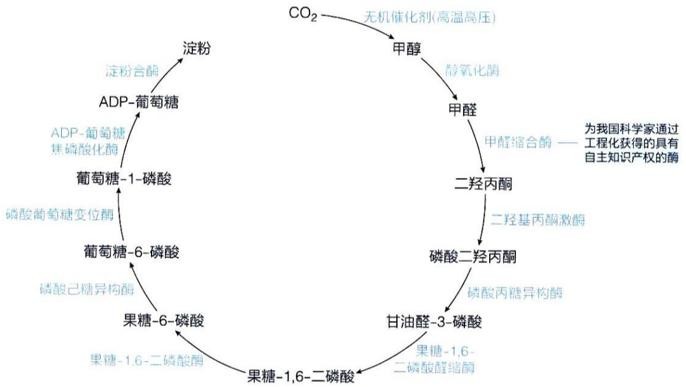

<details>
<summary>flowchart</summary>

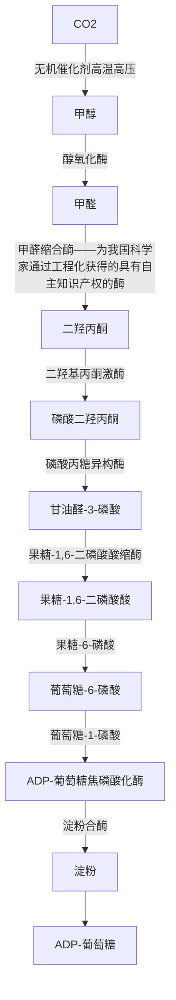
</details>

图21-25 人工合成淀粉的主要步骤

种调节酶，它催化的不可逆反应为淀粉合成的一个限速步骤。该酶是一种异四聚体，由两个大的调控亚基和两个小的催化亚基组成。该酶可被甘油酸-3-磷酸别构激活，而被无机磷酸别构抑制。在光合作用活跃时，甘油酸-3-磷酸积累，ADP-葡萄糖焦磷酸化酶随之被激活，促进淀粉的合成。

## 21.4.3 纤维素生成也由 UDP-葡萄糖提供单糖单位

纤维素是植物中的一种重要结构多糖，是细胞壁的主要成分，为细胞提供强度和刚性，防止细胞膨胀和质膜破裂。纤维素是由数千个D-葡萄糖单元以（β1→4）糖苷键连接形成的线性聚合物，并由至少18条多糖链组装成束，这些糖链束再共结晶形成原微纤丝，后者进一步组装，形成更粗的纤维等。

纤维素合成的单糖供体也是 UDP-葡萄糖。但是，这里的 UDP-葡萄糖是从植物叶子中含量丰富的蔗糖生成。反应由与整合于细胞质膜中的纤维素合酶复合体动态结合的蔗糖合酶（sucrose synthase）催化，使源自光合细胞的蔗糖与 UDP 之间发生可逆反应，生成 UDP-葡萄糖和果糖（图 21-26A）。这样，在纤维素合酶附近局部产生高浓度的 UDP-葡萄糖用于纤维素合成。需要注意的是，这里的蔗糖合酶不同于光合细胞中的蔗糖 -6- 磷酸合酶（见图 21-20）。

在纤维素合成过程中，葡萄糖残基从 UDP-葡萄糖转移至已经结合于纤维素合酶细胞质一侧的“引物”葡萄糖上，从而将葡萄糖基添加到纤维素链上。合成的纤维素链自发结晶形成微纤丝，最终生成纤维素。

纤维素合酶复合体一般以同源六聚体形式整合于植物细胞的质膜中。在质膜内侧将 UDP-葡萄糖供体上的葡萄糖单元持续添加，通过跨膜新生纤维素链通道使新生的纤维素链不断被挤出到细胞壁空间（图 21-26B）。在质膜的外表面，不同亚基合成的纤维素链与邻近的纤维素生长链结合，在细胞外面形成纤维素微纤丝（图 21-26A）。植物纤维素合酶一般组装成六瓣状玫瑰花环结构，而每个花瓣结构为纤维素合酶三聚体（图 21-26C），每个亚基合成一条新生纤维素链。6个纤维素合酶三聚体组成纤维素合酶复合体核心催化结构，因此可同时合成18条纤维素链，组合成微纤丝。18条链并排排列，各自的非还原端和还原端具相同方向（即相互平行）。18条纤维素链聚合物在细胞外表面结晶后整合到细胞壁中。

在 UDP-葡萄糖前体中，葡萄糖的异头碳与核苷酸之间通过  $\alpha-$  糖苷键连接。但在纤维素中，葡萄糖残基之间通过  $(\beta1\rightarrow4)$  糖苷键连接。因此在糖苷键形成过程中，异头碳（C1）上需发生构型的反转。纤维素合酶中的糖基转移酶催化的反应体现为单取代（single-displacement）反应机制，新生纤维素链末端葡萄糖残基的 C4 羟基对供体糖（UDP-葡萄糖）的（C1）异头碳进行亲核攻击，在此过程中构型发生逆转，形成  $(\beta1\rightarrow4)$  糖苷键。

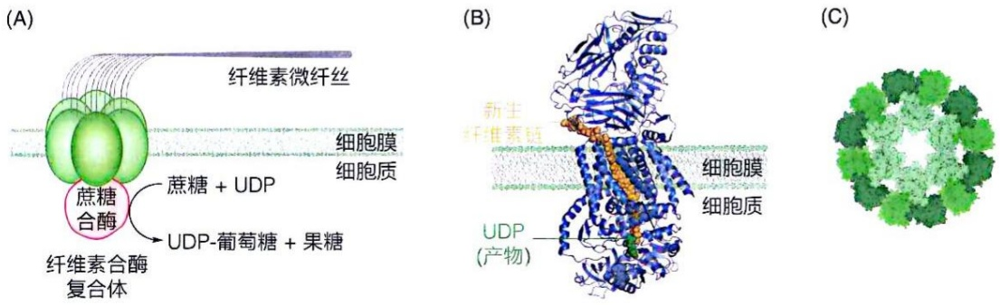

图 21-26 不同生物来源的纤维素合酶结构及互作关系

（A）植物细胞中纤维素合酶六聚体与蔗糖合酶的互作，协同合成纤维素。（B）光合细菌中纤维素合酶的晶体结构（PDB:4HG6）。（C）杨树纤维素合酶复合体（六个三聚体）的冷冻电镜结构（PDB:6W1B）。

## 21.5 与蛋白质和脂质共价结合寡糖基的生成也由特异糖基转移酶催化

糖可与蛋白质和脂质等生物分子通过共价键连接形成糖缀合物（glycoconjugate）。这样的共价连接使蛋白质和脂质发生糖基化（glycosylation）修饰。与蛋白质连接的寡糖基，根据与糖基连接的氨基酸残基是天冬酰胺还是丝氨酸或苏氨酸，一般被分为N-寡糖基和O-寡糖基。糖脂则是通过向脂质分子亲水头部添加糖基而产生，如糖鞘脂和甘油糖脂。

真核细胞中的蛋白质和脂质的糖基化一般也由特异的糖基转移酶催化。这样的修饰并非像依赖模板进行的核酸或蛋白质合成那样均一，而存在微异质性（microheterogeneity），即同一种蛋白质的不同个体分子的同一个位点的修饰寡糖基可能不同。这主要是因为蛋白质的糖基化修饰的最终结果受到底物可利用性、酶活性以及酶在细胞器中的定位等因素影响。

## 21.5.1 $N-$ 糖基修饰发生于新生肽链正被合成的过程中

真核生物中的许多分泌蛋白质或位于细胞表面的蛋白质会发生 $N-$ 糖基化修饰。这种寡糖基化修饰一般都含有一个由2个 $N-$ 乙酰葡萄糖胺（$N$-acetylglucosamine, GlcNAc）和3个甘露糖组成的核心五糖（$\mathrm{GlcNAc_2Man_3}$）。核心五糖通过一个 $N-$ 乙酰葡萄糖胺残基具有 $\beta$ 构型的异头碳，与肽链中一个Asn侧链的氮原子之间形成糖苷键。在核心五糖基础上，还可添加其他单糖基，如半乳糖基、$N-$ 乙酰葡萄糖胺基、唾液酸基和岩藻糖基等，形成多种多样的寡糖基。

N-糖基化在内质网和高尔基体中发生。分泌蛋白的N-糖基化过程发生于新生肽链在转运跨过内质网膜的过程中。其早期事件，包括核心五糖的生成等，对不同蛋白质或同一蛋白质不同位点而言，都高度相同。寡糖基的异质性主要产生于后续加工过程。也就是说，所有的N-糖基化都是在与Asn残基侧链连接的 $\mathrm{GlcNAc_2Man_3}$ 核心五糖合成之后，继续添加其他单糖残基后形成。鉴于所添加单糖残基的不同和糖苷键连接类型的差异，最后的N-寡糖基结构呈现出高度的多样性。

N-糖基合成的开始阶段涉及在内质网膜上胞质溶胶侧与脂质分子多萜醇（dolichol；一种含15\~19个异戊二烯单位的长链脂质醇）焦磷酸共价结合的 $Glc_{3}Man_{9}GlcNAc_{2}$ 寡糖基的逐步组装过程（图21-27）。每一种单糖均以被活化的形式——包括UDP-Man、UDP-GlcNAc、多萜醇磷酸-Man、多萜醇磷酸-Glc等——并在特异的可溶性糖基转移酶（位于胞质溶胶或内质网腔中）催化下逐一添加。之后，连接有寡糖基的多萜醇焦磷酸分子发生翻转，使所携带寡糖基进入内质网腔中，并继续添加单糖基以形成更大的寡糖基。

然后在内质网腔内，由寡糖基转移酶（oligosaccharyltransferase）催化，多萜醇焦磷酸所携带寡糖基被转移至合成中的多肽链 Asn-X-Ser/Thr 模体中的 Asn 残基侧链，形成 N-糖苷键。再分别在  $\alpha-$  葡萄糖苷酶（ $\alpha-glucosidase$ ）Ⅰ和Ⅱ催化下去除末端的三个葡萄糖残基。随后，在保留  $GlcNAc_{2}Man_{3}$  核心五糖基础上，利用  $\alpha-$  甘露糖苷酶（ $\alpha-mannosidase$ ）去除少数甘露糖残基，形成高甘露糖 N-糖基化（即除核心五糖外，只含甘露糖）形式。

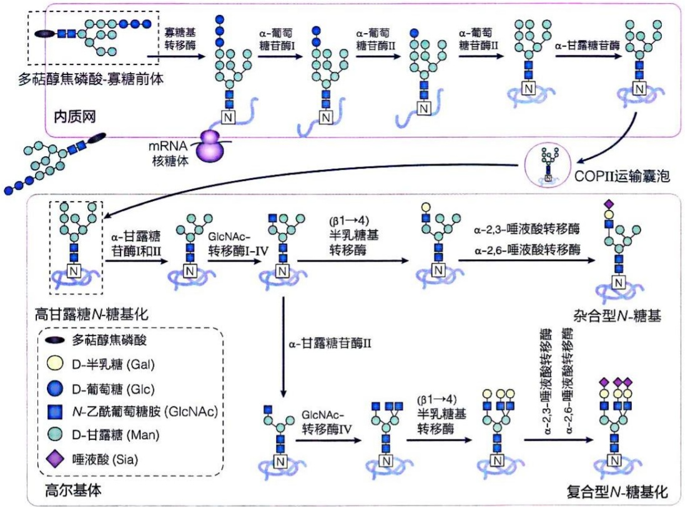

<details>
<summary>flowchart</summary>

```mermaid
graph LR
  subgraph Macrophage ["内质网"]
  A["多萜醇焦磷酸-寡糖前体"] --> B["寡糖基转移酶"]
  B --> C["α-葡萄糖苷酶I"]
  C --> D["α-葡萄糖苷酶II"]
  D --> E["α-葡萄糖苷酶II"]
  E --> F["α-甘露糖苷酶"]
  F --> G["COPII运输囊泡"]
  end

  subgraph HighGlucoside_N_Glucoside_N["HighGlucoside_N-Glucoside [\"高甘露糖N-糖基化\"]"]
  H["α-甘露糖苷酶I和II"] --> I["GlcNAc-转移酶I-IV"]
  I --> J["(β1→4)半乳糖基转移酶"]
  J --> K["α-2,3-唾液酸转移酶\nα-2,6-唾液酸转移酶"]
  K --> L["杂合型N-糖基"]
  end

  subgraph HighGlucoside_N_Glucoside["HighGlucoside_N-Glucoside [\"高尔基体\"]"]
  M["α-甘露糖苷酶II"] --> N["GlcNAc-转移酶IV"]
  N --> O["(β1→4)半乳糖基转移酶"]
  O --> P["α-2,3-唾液酸转移酶\nα-2,6-唾液酸转移酶"]
  P --> Q["复合型N-糖基化"]
  end

  %% Internal Network
  A -.->|"mRNA核糖体"| H
  G -.->|"COPII运输囊泡"| H
```
</details>

图21-27 在内质网和高尔基体膜上发生的 $N-$ 糖基化过程示意图

经过对新生肽链折叠的质量控制和检查，确保蛋白质折叠正常之后，糖蛋白在包被蛋白复合物Ⅱ（coat protein complex Ⅱ，COPⅡ）协助下，以囊泡的形式被运输至高尔基体。再经过α-甘露糖苷酶I和Ⅱ、GlcNAc-转移酶I—Ⅳ、(β1→4)半乳糖基转移酶、α-2,3-唾液酸转移酶和α-2,6-唾液酸转移酶等的进一步催化加工后，产生大量多样化的N-寡糖基。这些寡糖基的最外面通常为唾液酸（图21-27）。最终形成肽链位点特异性的杂合型（不同分支的单糖组成不同）或复合型（不同分支的单糖组成相同）寡糖基，具体形成何种寡糖基由不同糖基转移酶的表达水平、新生肽链上糖基化位点的可及性以及糖蛋白在内质网和高尔基体中存留时间长短等因素决定。

## 21.5.2 O-糖基在翻译后添加至蛋白质分子

O-糖基是在蛋白质合成之后，通过专一糖基转移酶将糖基逐一添加至位于特异空间位置的 Ser 或 Thr 残基上而形成的。与 N-糖基不同的是，在修饰位点并未观察到特异的序列模体，发生修饰的结构特征似乎由蛋白质二级或三级结构决定。

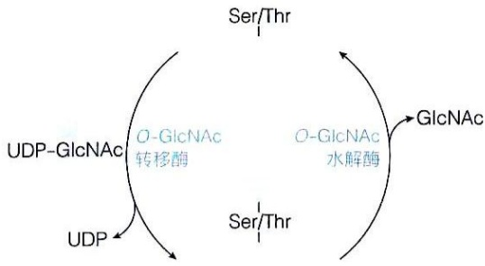

<details>
<summary>flowchart</summary>

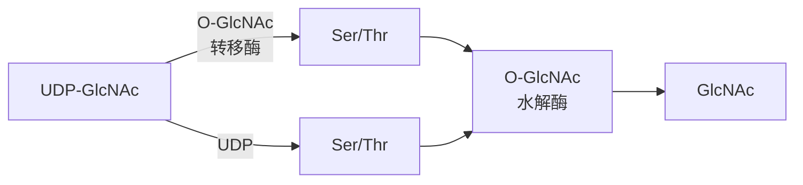
</details>

图21-28 蛋白质分子中发生的可逆 $O$-GlcNAc 糖基化修饰

与 N-寡糖生成主要发生于内质网中（结束于高尔基体中）不同的是，O-糖基化修饰主要发生于高尔基体中，而且有关的糖基转移酶均与膜结合，不需要多萜醇磷酸的参与。

此外，近年在细胞核和细胞质中还观察到某些蛋白质分子上发生 O-乙酰葡萄糖胺（O-GlcNAc）的动态可逆修饰（图 21-28）。这种修饰由特异的 O-GlcNAc 转移酶（O-GlcNAc transferase）催化添加，由 O-GlcNAc 水解酶（O-GlcNAcase）脱下。糖基由尿苷二磷酸-N-乙酰葡萄糖胺（UDP-GlcNAc）提供。蛋白质分子中的 O-GlcNAc 糖基化可与磷酸化相互竞争，发生于营养状态改变和细

胞应激的条件下，在信号转导、蛋白质稳定性维持和转录等生理过程中发挥作用。

糖鞘脂是在神经酰胺的 C1 羟基位置上添加糖基合成的，它们存在于包括人类在内的动物细胞膜的脂质双层中。糖鞘脂的糖基化始于内质网或高尔基体的细胞质侧，向存在于生物膜中的脂质基团添加葡萄糖或半乳糖单位。之后再翻转至内质网或高尔基体的腔侧，以进行进一步加工处理。

## 21.5.3 糖基化异常与疾病密切相关

编码蛋白质糖基化酶的基因如果存在缺陷，通常导致胚胎死亡，这显示了蛋白质糖基化修饰的生物学重要性。N-寡糖形成异常导致的先天性糖基化障碍（congenital disorder of glycosylation），临床表现通常非常严重，影响肌肉发育和神经系统的多种功能。这些障碍最早在患有未明原因多系统疾病的儿童中发现，后检测到这些患儿血清中的转铁蛋白糖基化不足，表明蛋白质糖基化缺陷是这类疾病产生的可能原因之一。在先天性糖基化障碍患者中，缺陷仅涉及单个或多个糖基化步骤和途径。涉及的缺陷酶可能催化单糖的活化、转运，也可能涉及特异糖基转移酶或糖苷酶等的表达或结构异常，还可能涉及内质网和高尔基体中其他蛋白质功能的异常。

## ※展望

对糖合成代谢途径的深入探索还在持续推进。科学家们致力于进一步阐明活体内各个反应步骤进行的分子机制，揭示酶的结构与功能关系，以精准认识糖合成过程。在此基础上，通过对关键酶的改造和优化，有望提高糖类物质的合成效率，为糖类物质的工业化生产提供新的思路。此外，糖合成代谢的研究成果将为医药、食品等行业带来变革。在医药方面，合成特定结构的糖类化合物可能成为开发新型药物的重要途径。这些糖类药物可以用于治疗多种疾病，如肿瘤和免疫性疾病等；同时，对糖合成代谢与疾病关系的研究，也将为疾病的诊断和治疗提供新的生物标志物和治疗靶点。在食品工业中，糖合成代谢的知识可以用于开发新型功能性食品。例如，通过调控糖合成途径，生产出具有特定营养功能的糖类物质，满足不同人群的健康需求。此外，利用生物技术合成天然糖类的替代品，既可以降低生产成本，又能减少对自然资源的依赖。随着生物技术的不断发展，合成生物学将在糖合成代谢中发挥越来越重要的作用。通过设计和构建新的生物合成途径，可以实现糖类物质的高效、可持续生产。同时，合成生物学还可以为创造新型糖类物质提供可能，拓展糖类物质的应用范围。

## ※ 本章小结

生物体可将非糖前体通过高度保守的糖异生途径转化为葡萄糖，这些代谢物以糖异生途径不同代谢中间物的形式进入。糖异生过程受到多种因素的调控，包括调节酶的别构效应、激素诱发的可逆磷酸化修饰以及细胞的能态改变等。

糖异生作为生命体内重要的代谢过程，与其他代谢途径协同，在饥饿或剧烈运动等条件下维持着机体的正常生理血糖稳定。

糖异生途径通过利用四个关键酶催化的反应克服糖酵解途径逆行时的能量势垒，推动糖合成途径顺利进行，并作为机体对糖异生和糖酵解反向调节的主要位点。

糖原是葡萄糖在肝脏和肌肉等器官和组织中的储存形式，对快速供应能量和血糖稳定有重要作用。糖原合成是一个耗能过程，涉及糖原蛋白、糖原合酶和糖原分支酶的催化，受胰岛素、胰高血糖素和肾上腺素等激素调控。

淀粉和纤维素是植物中的重要多糖，分别为葡萄糖长期储存产物和细胞壁的主要成分。

糖缀合物是糖与蛋白质、脂质等分子的共价结合物。蛋白质中涉及 $N-$ 糖基化修饰和$O-$ 糖基化修饰等，对细胞识别等过程发挥重要影响。糖基化异常与多种疾病相关，如先天性糖基化紊乱。研究糖缀合物的功能有助于深入理解糖类在生理和病理过程中的作用，为新型疗法的开发提供可能。

## ※ 思考题

1. 结合激素的作用机制，说明肾上腺素如何通过对有关酶类活性的复杂调控，实现对血糖浓度稳态的调节？
2. 糖酵解和糖异生都是不可逆过程，如果两个途径同时以相同速率进行，会导致什么结果？细胞是如何调控这两个过程的？
3. 简述卡尔文循环的反应过程。该过程中一些酶受光照的调控，生物产生这一调控机制的原因是什么？
4. 为什么饥饿时会出现与糖尿病患者相似的症状（血液中酮体含量升高）？
5. 糖原、淀粉和纤维素的合成过程有哪些异同点？

## ※ 推荐阅读

- 1. ANSDERSON S M, RUDOLPH M C, MCMANAMAN J L, et al. Key stages in mammary gland development. Secretory activation in the mammary gland: it's not just about milk protein synthesis! [J]. Breast Cancer Res, 2007, 9 (1): 204.
- 该综述概述了乳腺发育的关键阶段，并重点揭示分泌激活过程不仅涉及乳蛋白合成，还包含更复杂的细胞调控机制。
- 2. ANDERSON I, BACKLUND A. Structure and function of Rubisco [J]. Plant Physiol Biochem, 2008, 46(3): 275-291.
- 该文阐述了 Rubisco 的结构如何决定其在光合作用中固定  $CO_{2}$  的中心功能及其效率低下的局限性。
- 3. CAI T, SUN H B, QIAO J, et al. Cell-free chemoenzymatic starch synthesis from carbon dioxide [J]. Science, 2021, 373 (6562): 1523–1527.
- 该文开发了一种体外化学酶法系统，实现了利用 $\mathrm{CO}_{2}$ 直接高效合成淀粉。
- 4. CHAIKUAD A, FROESE D S, BERRIDGE G, et al. Conformational plasticity of glycogenin and its maltosaccharide substrate during glycogen biogenesis [J]. Proc Natl Acad Sci USA, 2011, 108 (52): 21028-21033.
- 该文通过整合结构生物学，揭示了糖原蛋白及其麦芽糖底物在糖原合成过程中发生的动态构象变化，阐明了其自糖基化的运行机制。
- 5. PILKIS S J, EL-MAGHRABI M R, CLAUS T H. Hormonal regulation of hepatic gluconeogenesis and glycolysis [J]. Annu Rev Biochem, 1988, 57: 755-783.
- 该综述阐述了以胰岛素和胰高血糖素为代表的多种激素，通过控制关键酶表达与活性来协同控制肝脏糖异生和糖酵解双向代谢通路的分子机制及其生理病理意义。
- 6. STANLEY P. Genetics of glycosylation in mammalian development and disease [J]. Nat Rev Genet, 2024, 25 (10): 715–729.
- 该综述阐述了糖基化通路中关键基因的遗传变异如何通过影响糖链合成与修饰，进而导致哺乳动物细胞发育异常及多种人类疾病的分子机制。

（撰写:李珍，秦咏梅，易文，崔隽；审修:张哲，李森，杨广笑，刘峰，卢丹琪，黄春洪，丁智）

# 脂肪酸分解代谢

前面介绍了葡萄糖分解成  $CO_{2}$  和  $H_{2}O$  的全过程。这包括糖酵解、柠檬酸循环和氧化磷酸化，这些过程释放的能量用于合成 ATP。但很多生物利用脂质分子作为长期能量储备（在动植物体内一般以甘油三酯的形式存在）。这里我们介绍脂肪酸分解过程。

脂肪是动物体内最重要的长期能量储备，其在同等重量下完全氧化释放的能量约为糖类或蛋白质的两倍，且因高度疏水而易于在皮下和腹腔等部位大量储存。在长期饥饿或持续运动等状态下，脂肪组织分解甘油三酯产生甘油和游离脂肪酸，进入血液供能。

脂肪酸氧化是许多动物（包括人类）的核心能量来源。它不仅为休眠等特殊状态提供能量、水和热量，也是心脏和静息骨骼肌的主要燃料。在葡萄糖不足时，脂肪酸可成为包括脑在内所有器官的重要能源。因此适量脂肪储存是必需的，但过量会导致肥胖，建议将体重指数维持在18.5～25之间。

大多数组织能通过脂肪酸氧化弥补葡萄糖供能不足，但神经组织通常依赖葡萄糖。在饥饿状态下，肝脏进行高流量脂肪酸氧化时会生成酮体。酮体可经血液运输至脑组织供能，对维持血糖下降时神经细胞的功能至关重要。

脂肪酸通过  $\beta$  氧化分解为乙酰辅酶 A，随后进入柠檬酸循环和氧化磷酸化途径彻底氧化产能，但该过程需充足氧气。本章介绍脂肪酸分解代谢的不同方面:从食物中摄取或从脂肪组织中动用脂肪酸的过程；偶数碳和奇数碳脂肪酸氧化分解为乙酰辅酶 A 的  $\beta$  氧化途径；不饱和脂肪酸以及分支脂肪酸的氧化过程；乙酰辅酶 A 在肝脏组织转化为酮体，进而为肝外组织提供能量的过程。此外，植物发芽种子和微生物可通过乙醛酸循环将乙酰辅酶 A 转化为琥珀酸，并经糖异生途径合成葡萄糖。

## 22