## 22.1 动物体内的脂肪酸可通过食物摄取或脂肪动用等途径获得

动物从消化食物中吸收或自身合成等方式产生脂肪酸等脂质。当这些脂质满足机体各种需求后，多余的脂肪酸主要以甘油三酯的形式储存于脂肪组织等。当机体处于饥饿状态或能量需求增加时，则通过脂肪动用为机体提供脂肪酸以供能。本节将对脂质的消化吸收和脂肪动用过程进行介绍（脂质合成过程将在第23章介绍）。

## 22.1.1 甘油三酯的消化、吸收和转运

食物中摄入的脂肪进入消化道后，在小肠内被胆汁中的胆盐乳化（emulsification）后被消化，随后被小肠上皮细胞吸收，形成乳糜微粒（chylomicron，CM）（参考图23-54）。这些乳糜微粒先经淋巴液运输进入血液，再由血液运输至肝脏、肌肉和脂肪组织等进行进一步处理或储存。

## （1）脂肪需经乳化后才可被小肠中的脂肪酶有效水解

食物中的脂肪块不溶于水，进入小肠后，难以被来自胰腺的脂肪酶有效水解，需先被胆盐（bile salt）乳化成脂肪滴 $^{①}$ （图 22-1）。

胆汁酸由肝脏以胆固醇为前体合成，分泌后经胆管进入胆囊以胆盐的形式贮存。胆汁酸包括胆酸（cholic acid）、甘氨胆酸（glycocholic acid）和牛磺胆酸（taurocholic acid）等，均为一面亲水另一面疏水的二维“面相”性两亲分子（facial amphiphile）。当人体摄入脂肪类食物后，胆盐从胆囊释放至小肠内，固体脂肪发生乳化形成脂肪滴:胆盐的非极性面与疏水脂质接触，而其极性面则与水溶液接触，构成脂肪滴的表面。胆盐的这种乳化作用，提高了脂肪的水溶性。

图22-1 食物甘油三酯的消化过程示意图

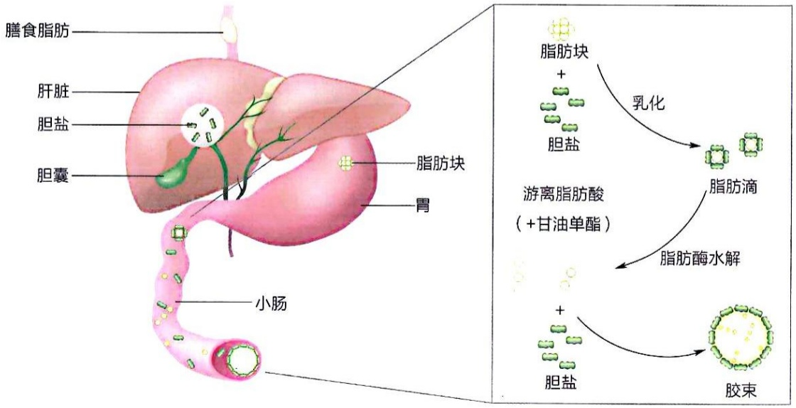

<details>
<summary>text_image</summary>

膳食脂肪
肝脏
胆盐
胆囊
脂肪块
胃
小肠
脂肪块
+
胆盐
乳化
游离脂肪酸
(+甘油单酯)
脂肪滴
脂肪酶水解
+
胆盐
胶束
</details>

① 此处脂肪滴是乳化颗粒，与后文“脂滴”不同。

在辅脂肪酶（colipase；一种由约100个氨基酸残基组成的、辅助脂肪酶发挥催化活性的蛋白质）的协助下，胰腺脂肪酶（pancreatic lipase）可将脂肪滴中的甘油三酯分解为2-甘油单酯（2-monoacylglycerol）和游离脂肪酸等。这些产物在肠道内以胶束（micelle）形式存在，其中的甘油单酯和游离脂肪酸可顺着跨膜浓度梯度渗透进入或通过细胞质膜上的脂肪酸转运蛋白进入小肠黏膜上皮细胞。食物来源的磷脂所含脂肪酸可由磷脂酶等水解释放。这些裂解产物在进入小肠黏膜上皮细胞后，将在其内质网中重新合成甘油三酯，这一过程被称为再酯化（re-esterification）（图22-2）。

胆汁酸产生或分泌不足可引起胆汁缺乏性脂肪泻。其症状表现为脂肪无法充分消化，导致大量甘油三酯经粪便排出。此外，人们还尝试以消化道中的脂肪酶为靶点，研发小分子抑制剂，旨在抑制小肠对脂肪的消化吸收，进而达到减肥的效果。这是基于脂肪泻发病原理而设计的一种药物减肥思路。

## （2）肠道吸收的甘油三酯以乳糜微粒形式通过淋巴系统运输

新合成的甘油三酯在小肠黏膜上皮细胞中与细胞内的载脂蛋白——ApoB-48和ApoC-Ⅱ等装配，形成乳糜微粒。乳糜微粒因为太大而无法进入毛细血管，只可通过肠绒毛的中央乳糜管进入淋巴系统，

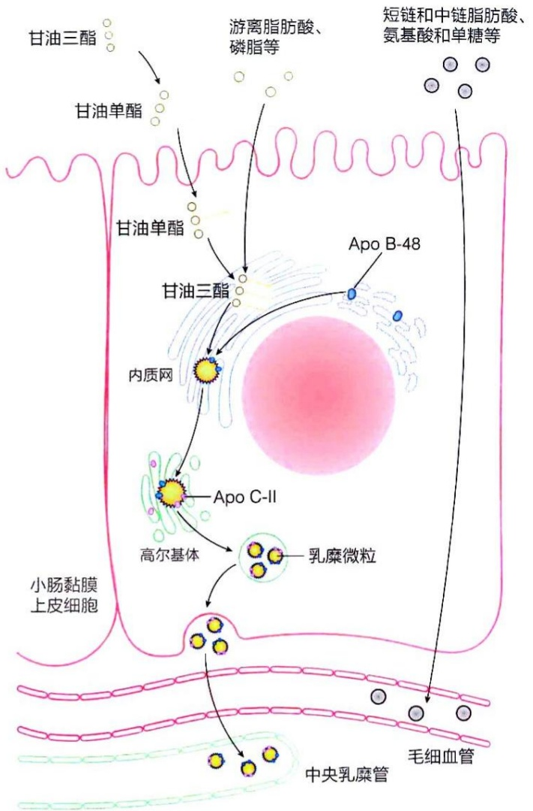

<details>
<summary>flowchart</summary>

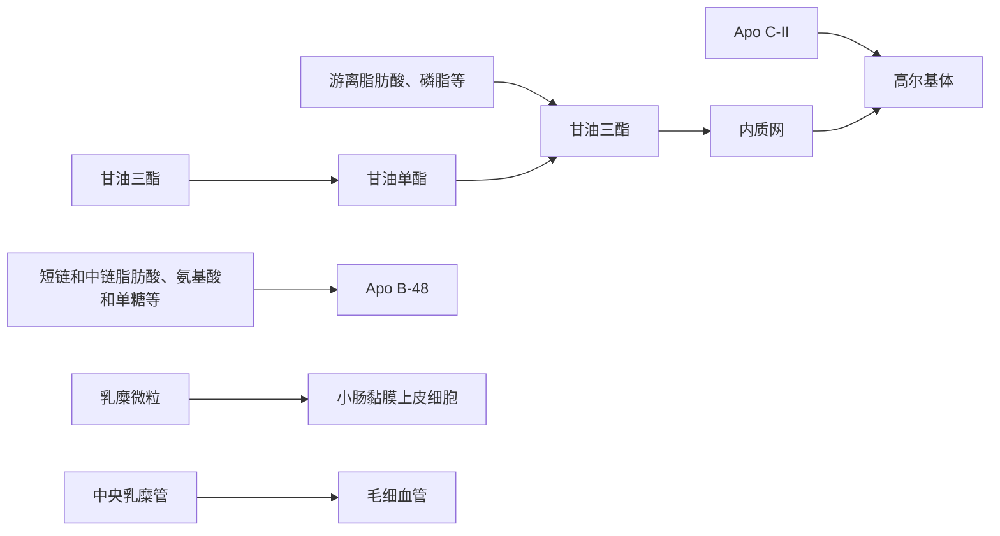
</details>

图 22-2 小肠内甘油三酯的吸收过程示意图

随后单向运输至血液，再经血液转运至肝脏、肌肉和脂肪等靶组织。需指出的是，短链和中链脂肪酸在被小肠上皮细胞吸收后，可伴随所吸收的氨基酸和单糖等直接通过肝门静脉进入肝脏。

乳糜微粒除了输送甘油三酯之外，也运输膳食来源的胆固醇和脂溶性维生素等脂质分子。当乳糜微粒被运输至靶组织的毛细血管内时，那里的脂蛋白脂肪酶（lipoprotein lipase）将被乳糜微粒表面的 ApoC-Ⅱ 激活，使得甘油三酯被再次水解为游离脂肪酸和甘油。因此，脂蛋白脂肪酶的活性受饮食调节:在摄入富含脂质的食物时被激活，而在未摄入脂质食物、处于禁食状态时，则保持低活性状态。脂肪酸被肌肉细胞吸收后可以进行氧化分解产生能量，被脂肪组织吸收后可重新酯化为甘油三酯长期储存。

第 23 章将详细介绍载脂蛋白的结构和功能。

## 22.1.2 脂肪组织中甘油三酯的动用由激素信号诱发

脂肪细胞中的甘油三酯一般以脂滴（lipid droplet）形式储存于胞质溶胶中。脂肪细胞是储存还是动用甘油三酯，取决于机体其他器官对能量的供需情况，通常由激素信号进行器官间的相互协调。

## (1) 脂质在细胞中以脂滴形式储存

脂滴的表面为镶嵌多种蛋白质的单层磷脂膜，而甘油三酯和胆固醇酯等则被包裹在脂滴的中央。脂滴的主要功能是动态响应细胞对能量的需求。脂滴包被蛋白（perilipin，PLIN）是分布在脂滴表面的一种主要蛋白质，静息状态下阻止脂肪分解，但在激素诱发发生磷酸化修饰后可解除其抑制效应，促进脂肪分解。

分布在脂滴表面的另外一种蛋白质是 CGI-58，它是脂肪组织甘油三酯脂肪酶（adipose triglyceride lipase，ATGL）的招募者和激活剂。在非激素诱导状态下，CGI-58 与未被磷酸化修饰的脂滴包被蛋白结合，从而无法招募 ATGL 接近脂滴，故阻止脂肪分解。

## （2）肾上腺素或胰高血糖素通过诱发多种蛋白质的磷酸化而启动甘油三酯的动用

在禁食、饥饿或交感神经兴奋时，胰高血糖素或肾上腺素分泌增加，脂滴包被蛋白发生磷酸化修饰，导致CGI-58从脂滴包被蛋白上解离，从而可以招募和激活ATGL，启动脂肪动用（也称脂肪动员）过程，为其他组织供能（图22-3）。

图 22-3 脂肪组织中甘油三酯的动用

PKA:蛋白激酶A；PLIN:脂滴包被蛋白；ATGL:脂肪组织甘油三酯脂肪酶；HSL:激素敏感脂肪酶；MGL:甘油单酯脂肪酶。

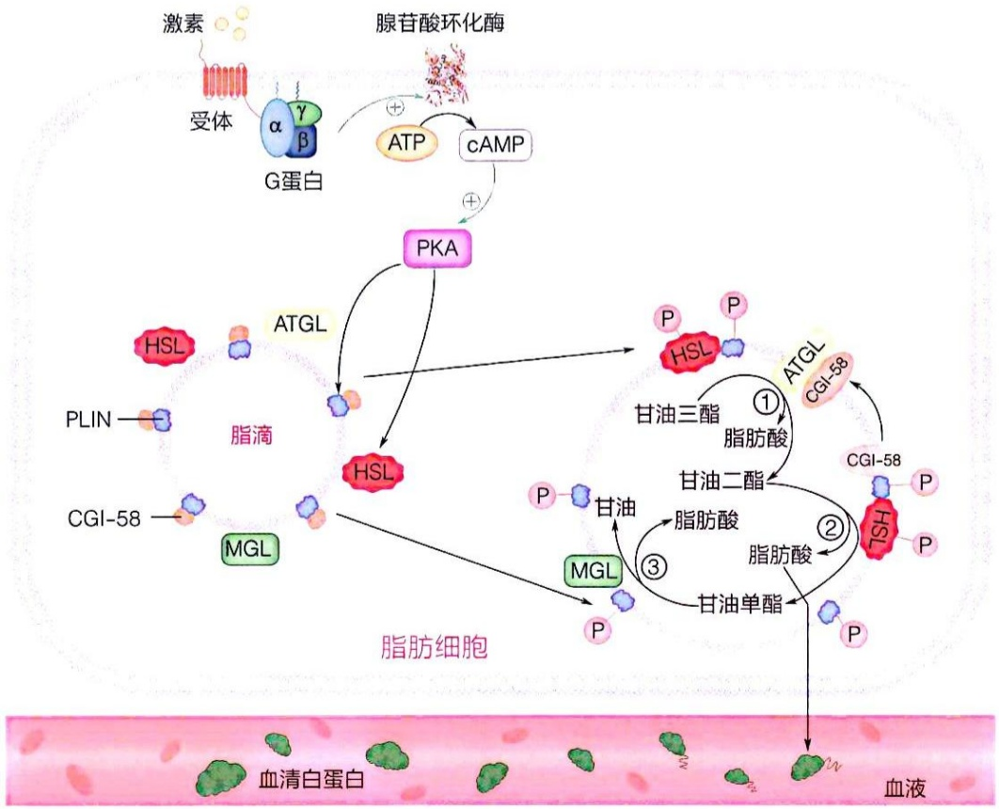

<details>
<summary>flowchart</summary>

This diagram illustrates the metabolic pathway of G-protein metabolism, showing how ATP and cAMP modulate PKA to regulate HSL, leading to various metabolites (ATGL, CGI-58, TSH) and their interactions with plasma membrane proteins.
</details>

具体而言，肾上腺素或胰高血糖素分别与脂肪细胞质膜上的特异 G 蛋白偶联受体（GPCR）结合，并通过所结合的 G 蛋白（由  $\alpha$ 、 $\beta$ 、 $\gamma$  三个不同亚基组成的异源三聚体）激活质膜上的腺苷酸环化酶（adenylyl cyclase）。后者所产生的环腺苷酸（cAMP）作为胞内第二信使，再激活蛋白激酶 A。活化的蛋白激酶 A 催化脂肪细胞内多种蛋白质发生磷酸化而启动对甘油三酯的动用。

首先，蛋白激酶 A 催化脂滴包被蛋白发生磷酸化，这导致与其结合的 CGI-58 蛋白解离。后者招募脂肪组织甘油三酯脂肪酶 ATGL 至脂滴表面并使之激活，催化甘油三酯转化为甘油二酯和脂肪酸（图 22-3，①）。蛋白激酶 A 同时也催化脂肪细胞中的激素敏感脂肪酶（hormone-sensitive lipase，HSL）发生磷酸化修饰，致使后者可与磷酸化的脂滴包被蛋白结合，而从胞质溶胶转移至脂滴表面，催化甘油二酯转化为甘油单酯和游离脂肪酸（图 22-3，②）。甘油单酯进而在甘油单酯脂肪酶（monoacylglycerol lipase，MGL）作用下分解为游离脂肪酸和甘油（图 22-3，③），从而完成 1 分子甘油三酯水解为 1 分子甘油和 3 分子脂肪酸的全部脂解过程。

## （3）游离脂肪酸和甘油通过血液运输至其他组织

高疏水性的脂肪酸在血液中的运输以白蛋白（albumin）为载体。白蛋白占血清蛋白质总含量的大约一半，每个白蛋白分子可以非共价键形式携带约7分子脂肪酸；抵达靶组织后，脂肪酸与白蛋白分离，在细胞质膜上的脂肪酸转运蛋白协助下进入细胞内。

## (4) 胰岛素抑制脂肪动用

胰岛素通过信号转导过程，诱发磷酸二酯酶降解 cAMP，从而使得蛋白激酶 A 活性受到抑制。这一过程将抑制脂肪细胞中脂肪的动用。此外，胰岛素还通过激活蛋白磷酸酶 1，使激素敏感的脂肪酶等发生去磷酸化，这也抑制脂肪动用过程。

## (5) 脂质自噬也可导致脂肪动用

脂质自噬（lipophagy）是一种近年被揭示的、针对脂滴发生自噬的细胞过程。具体而言，被识别的脂滴与溶酶体融合形成自噬溶酶体（autophagolysosome），脂滴中的脂质（包括甘油三酯和胆固醇酯等）被溶酶体内的酸性脂肪酶水解。脂质自噬所产生的脂肪酸通常进入线粒体进行氧化分解。溶酶体酸性脂肪酶（lysosomal acid lipase, LAL）的活性对 $\mathrm{pH}$ 值高度敏感，$\mathrm{pH}$ 的上升会迅速抑制其活性，当 $\mathrm{pH} > 4.5$ 时，其活性完全丧失。

## 22.1.3 甘油三酯水解产生的甘油被运输至肝脏后进入糖异生或糖酵解途径

甘油三酯在脂肪酶作用下，水解为3分子脂肪酸和1分子甘油。甘油经血液循环运至肝脏和肾脏等器官后，在甘油激酶（glycerol kinase）的催化下，转变成甘油-3-磷酸。然后在甘油-3-磷酸脱氢酶的催化下，氧化生成磷酸二羟丙酮，后者可异构为甘油醛-3-磷酸。在肝细胞中，它们既可以进入糖异生途径，也可以进入糖酵解途径（图22-4）。在饥饿状态下，它们一般进入糖异生途径，用于合成内源葡萄糖。

图 22-4 在肝细胞中甘油可进入糖异生或糖酵解途径

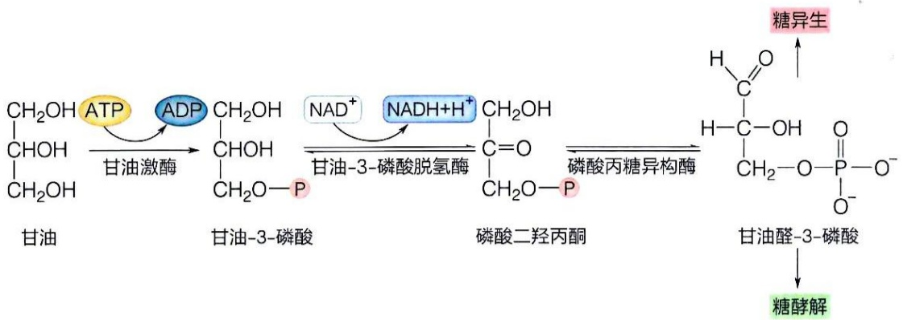

<details>
<summary>flowchart</summary>


</details>

值得注意的是，因为甘油激酶并不存在于脂肪细胞中，故在脂肪细胞中甘油无法被重复利用（生成甘油三酯所需的甘油-3-磷酸由糖酵解过程产生的磷酸二羟丙酮还原生成）。

## 22.2 脂肪酸氧化是动物体内一条重要能量供给途径

除了大脑和成熟红细胞等主要依赖葡萄糖供能的器官之外，动物的大部分组织都可直接利用脂肪酸作为能源。

在动物细胞中，脂肪酸先氧化生成乙酰辅酶A。这一过程涉及脂酰辅酶A（acyl-CoA）在胞质溶胶中的形成（即脂肪酸的活化）、跨过线粒体内膜进入线粒体基质（转运）以及经β氧化途径形成乙酰辅酶A（氧化）三个阶段。产生的乙酰辅酶A则与从丙酮酸产生的乙酰辅酶A一样，最后进入共同的氧化分解和能量转换途径——柠檬酸循环和氧化磷酸化。脂肪酸β氧化释放的电子也由辅因子NAD $^{+}$ 或FAD暂时携带，并通过线粒体内膜上的电子传递链最终传递至分子氧，释放能量用于产生ATP。

## 22.2.1 脂肪酸经脂酰辅酶A合成酶催化形成脂酰辅酶A

在动物细胞中，脂肪酸分解代谢主要发生于线粒体基质中。但脂肪酸在进入线粒体之前，需在胞质溶胶中被活化。具体而言，由胞质溶胶中的脂酰辅酶A合成酶（acyl-CoA synthetase）催化，脂肪酸与辅酶A缩合，形成含硫酯键的脂酰辅酶A。

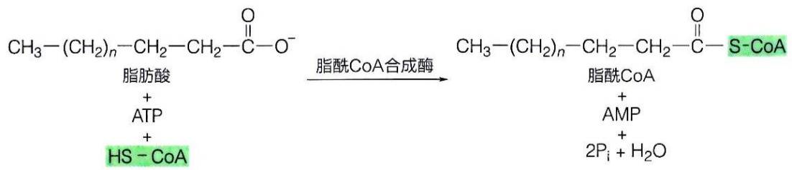

<details>
<summary>chemical</summary>

Chemical reaction equation showing conversion of a fatty acid derivative to a thioester using CoA and ATP, with reagents and conditions labeled.
</details>

脂酰辅酶 A 合成酶依据其所催化的底物脂肪酸碳链的长短不同分成几种类型。它们分别催化短链（<6 个碳原子）、中链（6～12 个碳原子）、长链（13～21 个碳原子）

和超长链（≥22个碳原子）脂肪酸的活化。它们功能不同，定位于线粒体基质、过氧化物酶体、线粒体外膜和内质网等部位。催化长链脂肪酸活化的脂酰辅酶A合成酶定位于线粒体外膜等处。

脂酰辅酶A合成酶催化的脂肪酸活化涉及两步反应:①先由ATP提供AMP基团形成脂酰AMP中间体，释放的焦磷酸随后被焦磷酸酶水解成2分子无机磷酸（$\mathrm{P_i}$），所释放的能量用于驱动脂酰辅酶A的形成，该反应的 $\Delta G^{\ominus}$ 为-19kJ/mol。②脂酰AMP中的脂酰基被转移至辅酶A，即AMP被辅酶A置换，形成脂酰辅酶A，反应的$\Delta G^{\ominus}$ 为-15kJ/mol。因此，该反应的总 $\Delta G^{\ominus}$ 为-34kJ/mol。因此，活化1分子脂肪酸相当于消耗了2分子ATP，使反应不可逆。

## 22.2.2 脂酰基由肉碱携带跨过线粒体内膜进入基质

被活化的脂肪酸需进入线粒体基质才可被氧化。中链和短链脂肪酸（≤12个碳原子）可自由透过线粒体内膜，之后由位于线粒体基质的中、短链脂酰辅酶A合成酶活化。但是，长链脂酰辅酶A需借助特殊的肉碱转运系统进入线粒体基质。该系统具体包括位于线粒体外膜上的肉碱棕榈酰基转移酶I（carnitine palmitoyltransferase I）、位于线粒体内膜的肉碱/脂酰肉碱转运蛋白（carnitine/acyl-carnitine transporter）和位于线粒体内膜基质侧的肉碱棕榈酰基转移酶II（carnitine palmitoyltransferase II）（图22-5）。

肉碱（carnitine）于1900年代首次在肌肉中发现，1950年代被发现参与脂肪酸分解代谢。它是氨基酸的衍生物，化学名称为β-羟基-γ-三甲胺丁酸。其β-碳（C3）为手性碳，发挥酰基转移作用的为L-肉碱（左旋肉碱）。肉碱主要从膳食摄入，也可在肝脏和肾脏中合成。肉碱作为长链脂肪酸的唯一载体，将胞质溶胶中的长链脂酰基转运至线粒体内进行氧化。

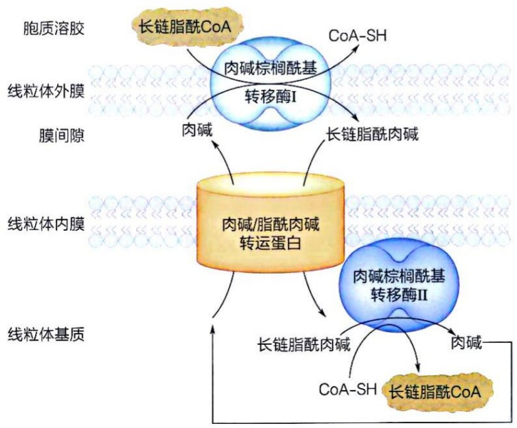

<details>
<summary>flowchart</summary>

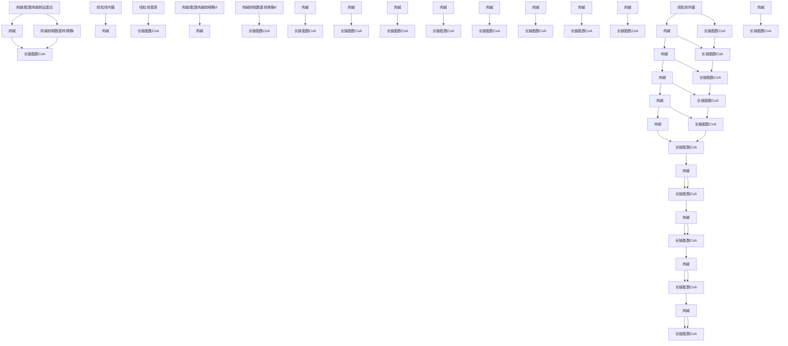
</details>

图22-5 脂酰辅酶A跨越线粒体内膜进入基质的过程示意图

位于线粒体外膜的肉碱棕榈酰基转移酶Ⅰ和位于线粒体内膜的肉碱棕榈酰基转移酶Ⅱ为同工酶，催化以下可逆反应。

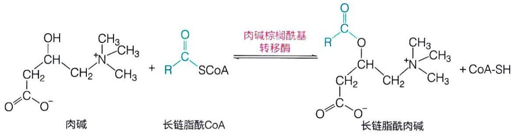

<details>
<summary>chemical</summary>

Reaction mechanism showing conversion of fatic acid to long-chain fatty acids using CoA enzyme
</details>

线粒体外膜的肉碱棕榈酰基转移酶I催化，使长链脂酰辅酶A与肉碱缩合，形成长链脂酰肉碱。所脱下的辅酶A留在胞质溶胶中。形成的长链脂酰肉碱通过位于线粒体内膜的肉碱/脂酰肉碱转运蛋白被转运至线粒体基质，再由位于线粒体内膜上的肉碱棕榈酰基转移酶Ⅱ催化，转移长链脂酰基至辅酶A，重新形成长链脂酰辅酶A（前述反应的逆过程），但利用的是线粒体基质中的辅酶A。释放的游离肉碱经肉碱/脂酰肉碱转运蛋白转运出线粒体基质，参与新一轮的脂酰肉碱跨膜转运过程。

胞质溶胶中的辅酶A池与线粒体基质中的辅酶A池相对独立，各自维持不同的浓度，这种不同浓度的产生和维持机制尚不清楚。

研究表明，长链脂酰辅酶A进入线粒体基质的过程是长链脂肪酸β氧化的限速步骤。这一过程的关键在于肉碱棕榈酰基转移酶I的活性。有趣的是，1970年代，美国学者揭示，该酶的活性被丙二酸单酰辅酶A（malonyl-CoA）强烈抑制。丙二酸单酰辅酶A是脂肪酸合成的前体，它是在乙酰辅酶A羧化酶（acetyl-CoA carboxylase）催化下由乙酰辅酶A羧化生成的（见图23-3）。当细胞中的葡萄糖含量充足时，葡萄糖被转化为脂肪酸，此时，丙二酸单酰辅酶A被大量合成以合成脂肪酸。在这种情况下，细胞优先氧化葡萄糖，而不应氧化脂肪酸，形成无效循环。为此，肉碱棕榈酰基转移酶I的活性通过丙二酸单酰辅酶A的别构效应有效抑制。这时，胞质溶胶中的长链脂酰辅酶A可被用于合成磷脂等。

## 22.2.3 线粒体内的脂酰辅酶 A 通过 β 氧化途径分解成乙酰辅酶 A

脂肪酸氧化分解的过程早在1900年代就通过化学标记法进行了探究。而同位素示踪技术在1940年代才被广泛用于代谢研究。当时，德国学者克诺普分别将含偶数碳和含奇数碳的脂肪酸的甲基末端接上一个“苯环”进行标记。这是因为“苯环”在动物体内无法被降解，故可作为脂肪酸分子代谢的“示踪物”。

克诺普观察到:在给狗喂食标记的含偶数碳的脂肪酸后，尿液中的产物是苯乙酰甘氨酸；而喂食标记的含奇数碳的脂肪酸时，尿液中的产物是苯甲酰甘氨酸。这里的甘氨酸是体内用来中和游离羧基的常用方式。克诺普由此得出结论:脂肪酸降解是通过在 $\beta-$ 碳上发生氧化反应、每次移去一个二碳单位的方式进行的。

在这之后，脂肪酸氧化过程的细节逐渐清晰。比如，美国学者莱宁格等在1940年代利用肝组织匀浆无细胞系统观察到，脂肪酸氧化（以及相关的柠檬酸循环）全部发生于线粒体组分中。1950年代，德国学者费奥多尔·吕南（Feodor Lynen，1911—1979）观察到，脂肪酸氧化时，需被活化形成脂酰辅酶A，这个过程依赖ATP，脂肪酸氧化释放出来的二碳单位并非游离乙酸，而是乙酰辅酶A。

脂肪酸氧化分解时，每移去一个二碳单位产生一个乙酰辅酶A，需要四步反应。这些反应在1950年代被全部鉴定，如图22-6所示。含偶数碳的脂酰辅酶A经多轮β氧化后，可被完全转化为乙酰辅酶A。以棕榈酰辅酶A（含16个碳）为例，它经一轮脂肪酸β氧化产生少两个碳原子的肉豆蔻酰辅酶A（含14个碳）和乙酰辅酶A。

每一轮  $\beta$  氧化由脱氢、水合、再脱氢、硫解四步反应组成。每轮循环最后生成 1 分子乙酰辅酶 A 和比原来少两个碳原子的脂酰辅酶 A。对具体每步酶促反应的详细描述如下。

## (1) 脱氢反应

在以 FAD 为辅因子的脂酰辅酶 A 脱氢酶（acyl-CoA dehydrogenase）催化下，脂酰辅酶 A 分子分别在其 α- 碳和 β- 碳脱去 1 个氢原子，生成反式  $-\Delta^{2}-$  烯酰辅酶 A（trans- $\Delta^{2}-$  enoyl-CoA），同时产生 1 分子 FADH $_{2}$ 。该反应具高度立体专一性，只产生反式 C=C 双键。

这里释放的电子将通过其他两种蛋白质传递至呼吸链（图 22-7）。以中链脂酰辅酶 A 脱氢酶（medium-chain

acyl-CoA dehydrogenase, MCAD）为例，其活性中心催化辛酰辅酶A生成辛烯酰辅酶A，同时产生 $FADH_{2}$ 。 $FADH_{2}$ 将所携带电子依次通过电子传递黄素蛋白（electron-transferring flavoprotein, ETF）和ETF:辅酶Q氧化还原酶（ETF-Q oxidoreductase, ETF-QO；含FAD、4Fe-4S和辅酶Q）后，经由辅酶Q将电子传递至线粒体内膜上的呼吸链（见第19章）。

依据结构及其他数据，在这三种蛋白质中发生的电子传递路径如图22-8所示。

脂酰辅酶 A 脱氢酶根据其底物特异性和亚细胞定位可分为三种类型:作用于长链脂酰辅酶 A 且定位于线粒体内膜的长链脂酰辅酶 A 脱氢酶（long-chain acyl-CoA dehydrogenase，LCAD）；作用于中链脂酰辅酶 A 且定位于线粒体基质的中链脂酰辅酶 A 脱氢酶（MCAD）；作用于短链脂酰辅酶 A 也定位于线粒体基质的短链脂酰辅酶 A 脱氢酶（short-chain acyl-CoA dehydrogenase，SCAD）。这些酶的疏水底物结合腔的深度和宽度不同，从而决定了它们对不同链长脂肪酸的偏好（图22-9）。例如，LCAD的底物结合腔更深，使其能够结合长链脂酰辅酶A，而MCAD和SCAD的底物结合腔相对较浅，更适合结合中链和短链底物。这种结构差异为理解这些酶的底物特异性提供了重要的结构基础。

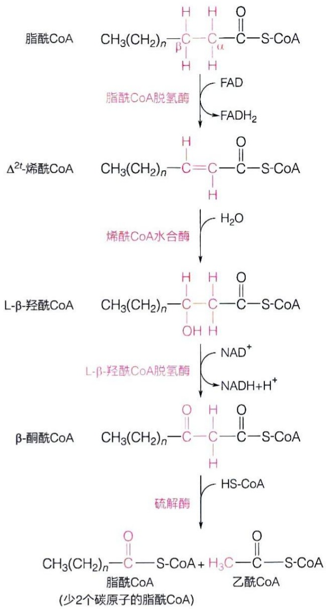

<details>
<summary>flowchart</summary>

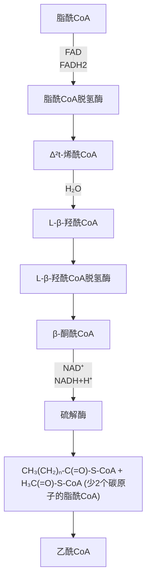
</details>

图 22-6 脂肪酸每一轮  $\beta$  氧化的四步反应上标中的 t 代表 trans（反式双键）。

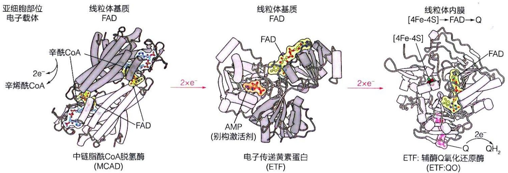

<details>
<summary>flowchart</summary>

```mermaid
graph LR
  A["亚细胞部位\n电子载体"] --> B["线粒体基质\nFAD"]
  B --> C["中链脂酰CoA脱氢酶 (MCAD)"]
  C --> D["线粒体基质\nFAD"]
  D --> E["电子传递黄素蛋白 (ETF)"]
  E --> F["&quot;线粒体内膜 [4Fe-4S"]→FAD→Q"]
  F --> G["ETF: 辅酶Q氧化还原酶 (ETF:QO)"]
```
</details>

图22-7 中链脂酰辅酶A脱氢酶经ETF和ETF-QO将电子传递至线粒体内膜中的辅酶Q

图中展示了猪源MCAD（PDB:3MDE）、人源ETF（PDB:1EFV）和猪源ETF-QO（PDB:2GMH）的空间结构。辛酰辅酶A（天蓝色）、FAD（黄色）、AMP（橙色）、辅酶Q（粉色）和铁硫簇（[4Fe-4S]）

用球棍模型呈现。在球棍模型中，红色代表氧原子，蓝色代表氮原子，橙色代表磷原子，绿色代表硫原子。ETF:辅酶Q氧化还原酶是一种整合于线粒体内膜的铁硫蛋白，包含三个结构域:FAD、[4Fe-4S]和Q，构成三个氧化还原中心。

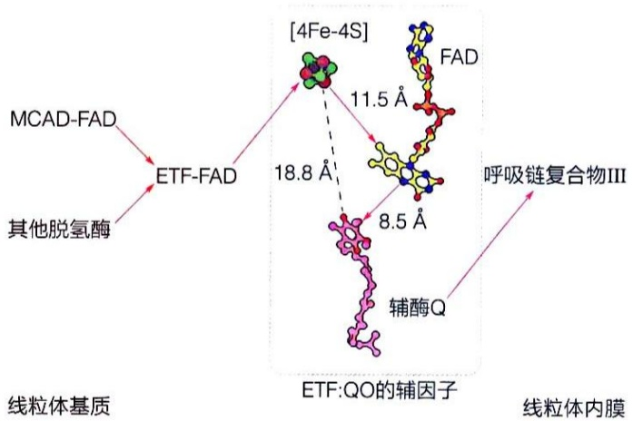

<details>
<summary>flowchart</summary>

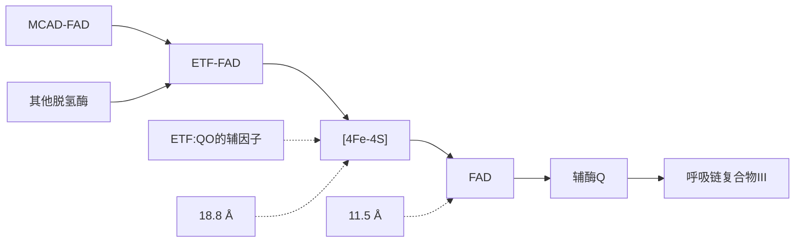
</details>

图22-8 猪源ETF:QO中的三个氧化还原中心构成了一个连续的电子传递路径

图中展示了猪源ETF:QO（PDB:2GMH）中三个氧化还原中心之间的距离，对应的辅因子FAD（黄色）、辅酶Q（粉色）和铁硫簇（[4Fe-4S]）用球棍模型呈现。在球棍模型中，红色代表氧原子，蓝色代表氮原子，橙色代表磷原子，绿色代表硫原子，棕色代表铁原子。电子传递方向用红色箭头标示。ETF:泛醌（辅酶Q）氧化还原酶包含三个氧化还原中心，其对应的配体为泛醌（碳骨架为浅蓝色）、FAD（碳骨架为深黄色）和铁硫簇（[4Fe-4S]），用球棍模型展示。

值得注意的是，ETF 还收集多种其他 FAD 依赖性脱氢酶的电子（包括多种参与氨基酸分解代谢的酶）。

## (2) 水合反应

第一步反应生成的反式  $-\Delta^{2}-$  烯酰辅酶 A 在烯酰辅酶 A 水合酶（enoyl-CoA hydratase）催化下发生水合反应。羟基被加在  $\beta-$  碳原子上，形成 L- $\beta-$  羟酰辅酶 A（L- $\beta-$  hydroxyacyl-CoA）。该酶也具高度立体特异性:反应物含反式（非顺式）双键，产物的  $\beta-$  碳为 L 构型（非 D 构型）。

## (3) 再脱氢反应

由 L- $\beta$ -羟酰辅酶 A 脱氢酶（L-3-hydroxyacyl CoA dehydrogenase）催化，L- $\beta$ -羟酰辅酶 A 被转化为

β-酮酰辅酶 A（β-ketoacyl CoA）。该酶的电子受体 NAD⁺ 被还原成 NADH。

## (4) 硫解反应

β-酮酰辅酶 A 在脂酰辅酶 A 酰基转移酶（acyl-CoA acyltransferase）又名硫解酶（thiolase）的作用下，断裂形成 1 分子乙酰辅酶 A 和 1 分子比原来少两个碳原子的脂

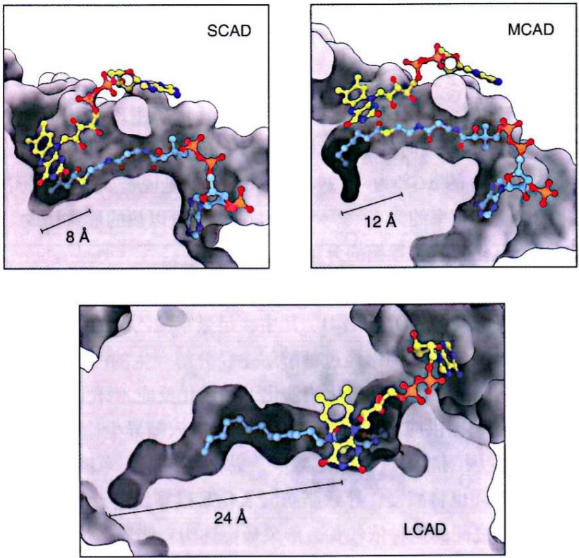

图22-9 短链、中链和长链脂酰辅酶A脱氢酶的活性中心的异同比较
大鼠短链脂酰辅酶A脱氢酶（SCAD；PDB:1JQI），猪源中链脂酰辅酶A脱氢酶（MCAD；PDB:3MDE）和人源长链脂酰辅酶A脱氢酶（LCAD；PDB:3B96）的结构示意图。底物结合腔的表面（灰色）展示不同的脂酰辅酶A脱氢酶对其底物链长具有特异性。SCAD、MCAD和LCAD底物结合腔的深度分别为8Å、12Å和24Å。脂酰辅酶A（浅蓝色）和FAD（黄色）用球棍模型展示。球棍模型中红色代表氧原子，蓝色代表氮原子，橙色代表磷原子。

酰辅酶 A。

偶数碳脂酰辅酶 A 经若干轮  $\beta$  氧化后全部转化为乙酰辅酶 A，如含 16 个碳的棕榈酰辅酶 A 经 7 轮  $\beta$  氧化，最后生成 8 分子乙酰辅酶 A。

催化脂肪酸  $\beta$  氧化第一步反应的酶的遗传缺陷可导致婴儿猝死综合征。动物心脏主要依赖脂肪酸  $\beta$  氧化获取能量，这体现出该途径对机体正常生理功能的重要性。

## 22.2.4 β 氧化的产物乙酰辅酶 A 经柠檬酸循环彻底氧化

脂酰辅酶 A 经  $\beta$  氧化产生的所有乙酰辅酶 A 都可直接进入柠檬酸循环，被彻底氧化为  $CO_{2}$ 。以 16 碳的棕榈酰辅酶 A 为例，每轮  $\beta$  氧化产生 1 分子 NADH、1 分子  $FADH_{2}$  和 1 分子乙酰辅酶 A。经过 7 轮  $\beta$  氧化后的总反应式为:

$$
\text {棕榈酰} \mathrm{CoA} + 7 \mathrm{CoA} + 7 \mathrm{FAD} + 7 \mathrm{NAD} ^ {+} + 7 \mathrm{H} _ {2} \mathrm{O} \longrightarrow
$$

$$
8 \text {乙酰} \mathrm{CoA} + 7 \mathrm{FADH} _ {2} + 7 \mathrm{NADH} + 7 \mathrm{H} ^ {+}
$$

每分子乙酰辅酶 A 进入柠檬酸循环彻底氧化时，又生成 1 分子  $FADH_{2}$  和 3 分子 NADH，以及 1 分子的 ATP 或 GTP。这些  $FADH_{2}$  和 NADH 均可直接将电子经线粒体电子传递链最终传递给氧，生成水。线粒体内 1 分子  $FADH_{2}$  经电子传递链传递的一对电子释放的能量可产生约 1.5 个 ATP 分子，而 1 分子 NADH 传递的一对电子可产生约 2.5 个 ATP 分子。因此，每分子乙酰辅酶 A 彻底氧化可产生  $1.5 + 3 \times 2.5 + 1 = 10$  个 ATP。

因此，每分子棕榈酰辅酶 A 被彻底氧化后所生成 ATP 数量可按以下方式计算:

$$
8 \text {乙酰} \mathrm{CoA} = 8 \times 1 0 = 8 0 \mathrm{ATP}
$$

$$
7 \mathrm{FADH} _ {2} = 7 \times 1. 5 = 1 0. 5 \mathrm{ATP}
$$

$$
7 \mathrm{NADH} = 7 \times 2. 5 = 1 7. 5 \mathrm{ATP}
$$

即总计为大约108个ATP分子。但是，棕榈酸活化为棕榈酰辅酶A时，消耗了相当于2个ATP分子的能量，因而1分子棕榈酸彻底氧化净生成大约106个ATP分子。它们全部水解成ADP和磷酸时的 $\Delta G^{\ominus}$ 为 $-30.54\mathrm{kJ / mol}\times 106 = -3237\mathrm{kJ / mol}$ 。棕榈酸彻底氧化为 $\mathrm{CO}_{2}$ 和 $\mathrm{H}_2\mathrm{O}$ 的 $\Delta G^{\ominus}$ 为 $-9790\mathrm{kJ / mol}$ 。也就是说，如果按照标准条件计算，则棕榈酸氧化的能量转化率约为 $33\%$ ，剩余的 $67\%$ 能量以热的形式释放。

## （1）脂肪酸的氧化分解依赖糖的分解代谢

脂酰辅酶A氧化分解形成的乙酰辅酶A需先与草酰乙酸缩合生成柠檬酸，再经柠檬酸循环才可彻底氧化成 $\mathrm{CO}_{2}$ 和 $\mathrm{H}_2\mathrm{O}$ 。其中，足量草酰乙酸的供应是柠檬酸循环有效运转的基础，而这又依赖葡萄糖经过糖酵解途径分解产生的丙酮酸，因为草酰乙酸的主要添补途径是丙酮酸在丙酮酸羧化酶催化下的羧化反应（详见18.5.3节）。

当动物机体的葡萄糖供应不足时，草酰乙酸将进入糖异生途径而被消耗。同时，通过糖酵解途径产生丙酮酸的量也随之减少。总的结果是，草酰乙酸的含量大幅下降。这时，柠檬酸循环也将减慢，导致脂肪酸氧化难以高效进行。因此，人们将脂肪酸氧化与葡萄糖代谢之间的这种依赖关系形象地描述为:脂肪燃烧于糖的火焰中。

## （2）在一个邻近硫酯键或羧基的 $\beta-$ 碳亚甲基上引入一个羰基需经三步反应

脂肪酸 $\beta$ 氧化的前三步反应实际上是将一个邻近硫酯键的 $\beta-$ 碳亚甲基（一$^{\beta}\mathrm{CH}_{2}-$ $^{\alpha}\mathrm{CH}_{2}-\mathrm{CO}-\mathrm{S}-$）转变为一个羰基。这致使 $\mathrm{C}_{\beta}-\mathrm{C}_{\alpha}$ 单键不稳定，因为 $\mathrm{C}_{\alpha}$ 夹在两个携带羰基的碳原子之间。这使得 $\beta$ 氧化的最后一步反应得以在硫解酶的催化下发生:$\mathrm{C}_{\beta}-$ 羰基碳被辅酶A上的巯基亲核进攻，$\mathrm{C}_{\beta}-\mathrm{C}_{\alpha}$ 单键发生断裂，形成的碳负离子中间体通过共振被稳定，这使乙酰辅酶A得以离去。

这种将一个亚甲基转变为一个羰基的反应策略也发生于柠檬酸循环和分支侧链氨基酸（异亮氨酸、亮氨酸和缬氨酸）的氧化反应中（图22-10）。

考虑到碳碳单键具有高度的稳定性（其键能大约为 $348\mathrm{kJ / mol}$），裂解碳碳单键并非易事。生物演化产生的这种共同策略可能代表一种有效的生物分子转化方案。而且，序列分析表明，催化 $\beta$ 氧化和分支侧链氨基酸转化过程对应每步反应的酶分子的氨基酸序列之间具有同源性。这些现象表明，生物演化过程中，这可能通过基因重复（gene duplication）机制产生，即一个基因通过产生两个或更多个副本后，各自独立演化为具有新功能的新基因，在这里表现为新基因产生催化机制相同但底物特异性不同的新酶。

## 22.2.5 含奇数碳的脂肪酸氧化产生的丙酰辅酶 A 可转变为琥珀酰辅酶 A

上面介绍的  $\beta$  氧化途径是脂肪酸氧化分解的主要途径。但生物体内还存在其他辅助途径，这里做简单介绍。

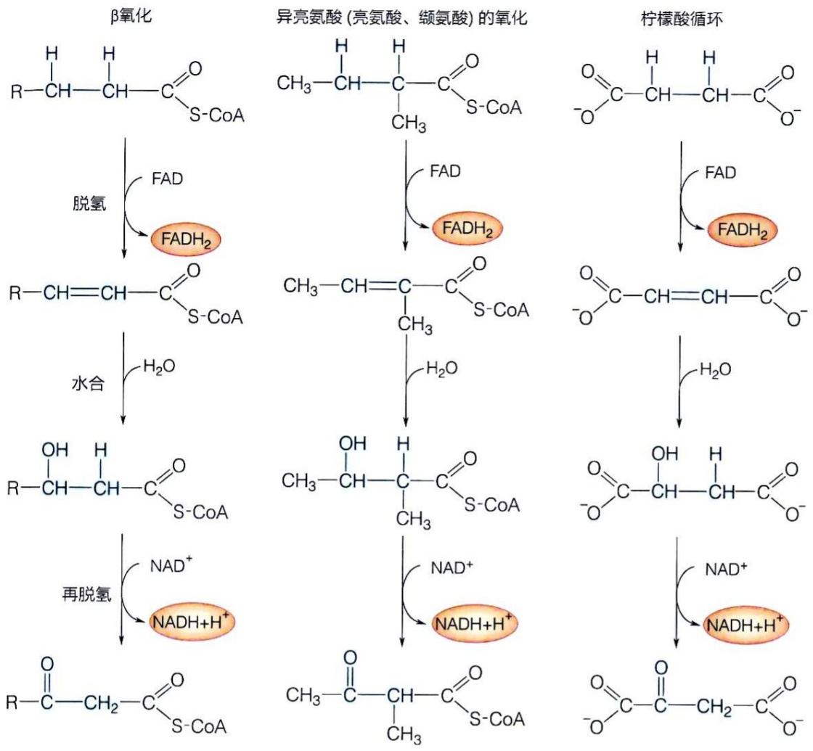

图22-10 在一个邻近硫酯键或羧基的 $\beta-$ 碳亚甲基部位引入一个羰基的策略被应用于不同代谢过程

## (1) 碳原子为奇数的脂肪酸氧化分解产生 1 分子丙酰辅酶 A

哺乳动物细胞产生的脂肪酸均为线性，且所含总碳原子数目大多为偶数，所以，经β氧化后，可全部转变为乙酰辅酶A。碳原子总数为奇数的脂肪酸可产生于反刍动物、海洋生物及许多植物中。这些脂肪酸经β氧化，除产生若干个乙酰辅酶A分子之外，还产生1个丙酰辅酶A（propionyl-CoA）分子。此外，缬氨酸、异亮氨酸、苏氨酸和甲硫氨酸等的分解代谢中也产生丙酰辅酶A，反刍动物瘤胃中细菌的糖代谢也产生丙酰辅酶A。

这些丙酰辅酶 A 经三步酶促反应转化为琥珀酰辅酶 A（图 22-11）。后者可进入柠檬酸循环进一步转换为其他代谢物，也可为糖异生提供前体。

第一步反应由丙酰辅酶 A 羧化酶（propionyl-CoA carboxylase）催化，丙酰辅酶 A 羧化成 D-甲基丙二酸单酰辅酶 A（D-methylmalonyl-CoA）。该酶的催化机制与丙酮酸羧化酶类似，也利用与特定赖氨酸残基共价结合的生物素作为辅因子（图 21-6A）在两个不同的活性中心之间来回摆动（图 22-12；参考图 23-3C）；需消耗 1 个 ATP 分子用于活化碳酸氢根离子。由于连接于赖氨酸残基侧链的生物素总长度大约为 16 Å，而生物素臂需在生物素羧化酶活性中心和另一个羧基转移酶活性中心（两者相距约 55 Å）之间来回摆动，所以生物素羧基载体蛋白结构域在催化过程中需要移位。

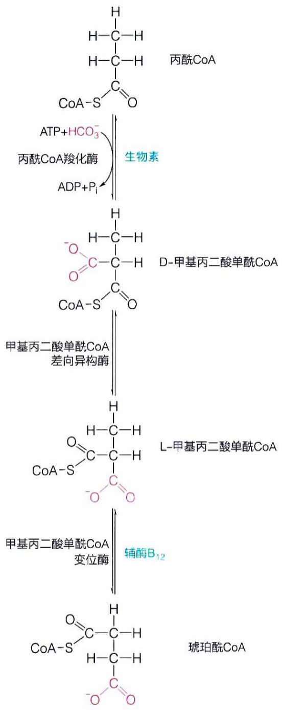

<details>
<summary>chemical</summary>

Reaction pathway of acetylsaldehyde (CoA) showing enzymatic steps including nucleophilic acid, D-acyl-CoA, L-acyl-CoA, and琥珀酰CoA with intermediates like ATP, ADP, and B12.
</details>

图22-11 丙酰辅酶A转变为琥珀酰辅酶A的三步化学反应

第二步反应由甲基丙二酸单酰辅酶A差向异构酶（methylmalonyl-CoA epimerase）催化，将D-甲基丙二酸单酰辅酶A异构化为L-甲基丙二酸单酰辅酶A。

第三步由甲基丙二酸单酰辅酶 A 变位酶（methylmalonyl-CoA mutase）催化，将 L-甲基丙二酸单酰辅酶 A 转化为琥珀酰辅酶 A。该酶利用维生素  $B_{12}$ （钴胺素）的衍生物 5'-脱氧腺苷钴胺素（即辅酶  $B_{12}$ ）为辅因子。

甲基丙二酸单酰辅酶A变位酶以同源二聚体形式存在。人类甲基丙二酸单酰辅酶A变位酶的每个亚基包含两个结构域:N端负责结合底物甲基丙二酸单酰辅酶A，而C端负责结合辅酶 $\mathrm{B}_{12}$ （图22-13）。该酶催化甲基丙二酸单酰辅酶A重排成琥珀酰辅酶A。这种重排反应涉及一种少见的氢原子与羰基-辅酶A之间的位置互换，辅酶 $\mathrm{B}_{12}$ 的参与至关重要:它通过自身形成的自由基，诱导底物也形成自由基中间体而促进这种位置互换反应的发生。具体如图22-14所示。

## (2) 辅酶  $B_{12}$  衍生自由细菌合成的维生素  $B_{12}$

辅酶  $B_{12}$  含有一个由四个吡咯（pyrrole）环连接而成的咕啉（corrin）环，咕啉环中央络合一个钴离子（ $Co^{3+}$ ）。与血红素中铁离子类似，钴离子也可在垂直于咕啉环的位置（上、下）形成两个配位键。下方与甲基苯并咪唑核苷酸的氮原子成键，该核苷酸的磷酸基通过氨基异丙醇基与咕啉环上的丙酸基以酰胺键共价连接。这部分结构被称为钴胺素（cobalamin，Cbl）。当钴离子的上方与氰基（—CN）、甲基（—CH₃）相连时即为维生素  $B_{12}$ ；当与一个 5′-脱氧腺苷（此处的 5′-脱氧腺苷与形成 DNA 的 2′-脱氧核苷不同）相连时即为辅酶  $B_{12}$ （图 22-15A），基于其结构特征也被称作脱氧腺苷钴胺素（deoxyadenosyl cobalamin，dAdoCbl）。当 5′-脱氧腺苷与钴离子断开时，可产生 5′-脱氧腺苷自由基，启动分子内重排反应。

英国女学者霍奇金于1950年代成功解析了辅酶 $\mathrm{B}_{12}$ 的三维结构（图22-15B）（她还于1940年代解析了青霉素这种抗生素的三维结构），这为认识辅酶 $\mathrm{B}_{12}$ 参与酶促反应的机制提供了重要的结构信息。

## 22.2.6 不饱和脂肪酸 $\beta$ 氧化需额外的酶参与

不饱和脂肪酸的氧化过程也发生于线粒体中，其活化和进入线粒体内膜的方式与在大肠杆菌丙酰辅酶A羧化酶（PDB:3N6R）六聚体的结构中，一个 $\alpha$ 亚基和两个相邻的不同层 $\beta$ 亚基分别以深灰色和浅灰色模型展示，其中 $\alpha$ 亚基的生物素羧基载体蛋白结构域以紫色呈现。生物素羧化酶活性中心和羧基转移酶活性中心用红色圆圈标记，两者相距 $55\AA$ 。生物素（绿色）及其共价连接的赖氨酸残基放大展示于左上角。ADP（橙色）和辅酶A（浅蓝色）的相对结合位置参考了另外两个结构（PDB:3G8C，1ON3）。在球棍模型中，红色代表氧原子，蓝色代表氮原子，橙色代表磷原子，黄色代表硫原子。

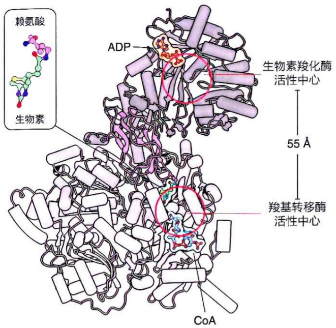

<details>
<summary>text_image</summary>

赖氨酸
生物素
ADP
生物素羧化酶
活性中心
55 Å
羧基转移酶
活性中心
CoA
</details>

图 22-12 大肠杆菌丙酰辅酶 A 羧化酶的结构示意图

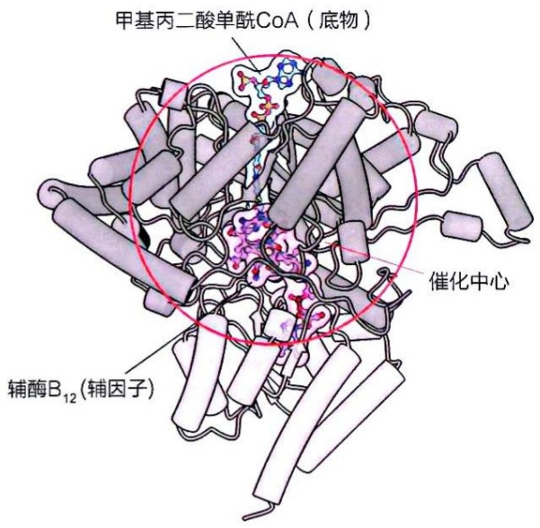

<details>
<summary>text_image</summary>

甲基丙二酸单酰CoA（底物）
催化中心
辅酶B₁₂(辅因子)
</details>

图 22-13 人源甲基丙二酸单酰辅酶 A 变位酶的结构示意图在人源甲基丙二酸单酰辅酶 A 变位酶（PDB:2XIQ）的同源二聚体结构中，一个单体的不同结构域分别以深灰色和浅灰色模型呈现。催化中心用红色圆圈标示。辅因子辅酶 B$_{12}$（紫色）和底物甲基丙二酸单酰辅酶 A（天蓝色）用球棍模型展示。在球棍模型中，红色代表氧原子，蓝色代表氮原子，橙色代表磷原子。

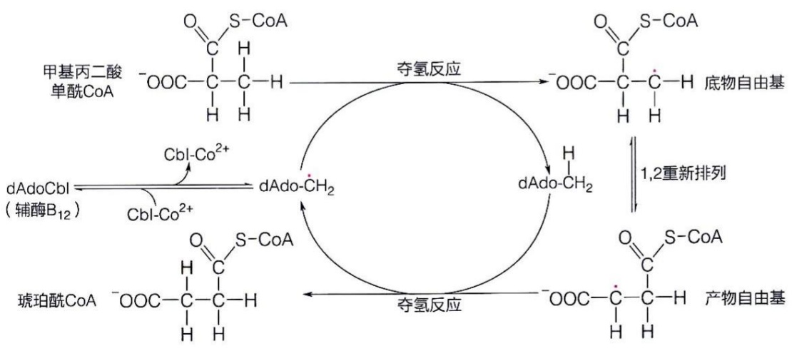

<details>
<summary>flowchart</summary>

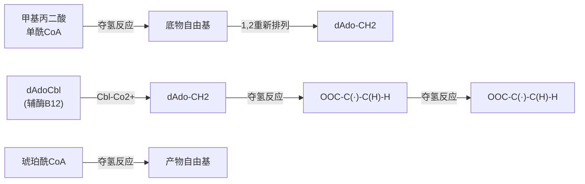
</details>

图 22-14 甲基丙二酸单酰辅酶 A 变位酶的作用机制示意图

dAdoCbl: 5'-脱氧腺苷钴胺素；dAdo: 5'-脱氧腺苷；Cbl: 钴胺素。

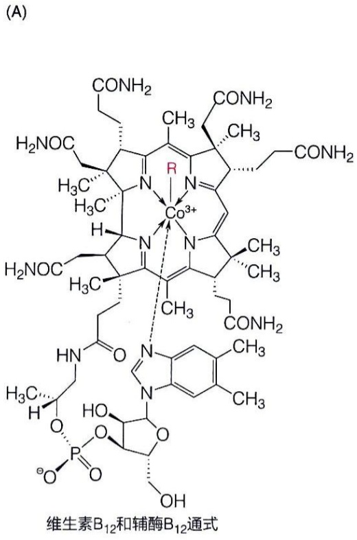

<details>
<summary>chemical</summary>

Chemical structure of维生素B12 and its conjugated form B12, showing cobalt coordination with nitro and hydroxyl groups
</details>

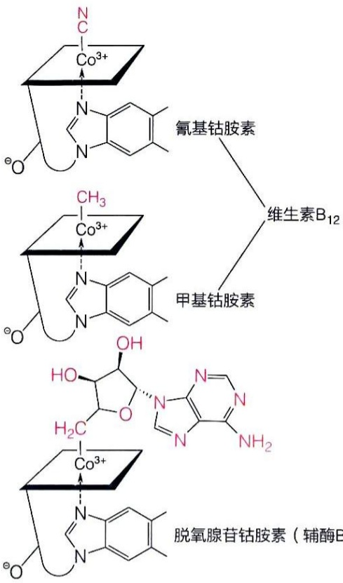

<details>
<summary>chemical</summary>

Chemical reaction pathway showing the synthesis of cobalt compounds from cyanoic acid and guanidine, then to depropanoate via amine and pyridine intermediates.
</details>

(B)

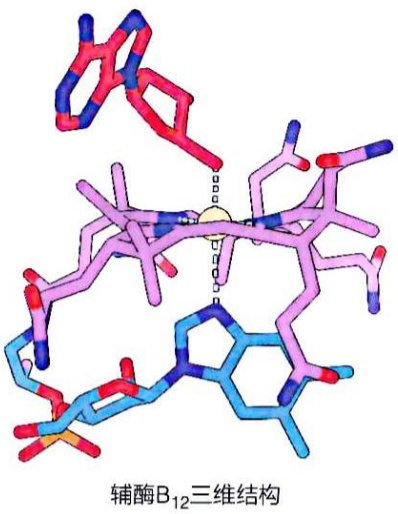

<details>
<summary>chemical</summary>

3D molecular structure of B12 complex with labeled core and hydrogen bonds
</details>

图 22-15 维生素 ${\mathrm{B}}_{12}$ 和辅酶 ${\mathrm{B}}_{12}$ 的结构图

（A）维生素 $B_{12}$ 和辅酶 $B_{12}$ 的化学结构；维生素 $B_{12}$ 包括氰基钴胺素和甲基钴胺素。（B）在辅酶 $B_{12}$ 的三维结构图（PDB:4GMA）中，钴

离子为浅黄色，咕啉部分为紫色，上方的5'-脱氧腺苷为红色，下方的甲基苯并咪唑核苷酸为蓝色。在棍状模型中，红色代表氧原子，蓝色代表氮原子，橙色代表磷原子。

酸（油酸）的β氧化过程上标中的c代表cis，顺式双键；而t则代表trans，反式双键。

图 22-16 单不饱和脂肪

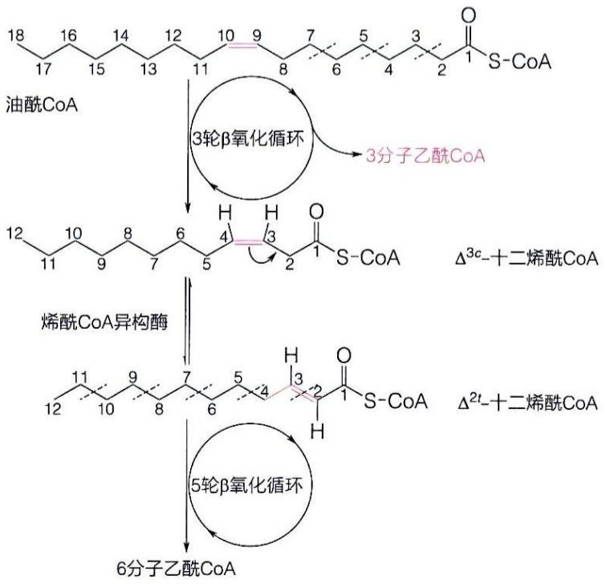

<details>
<summary>chemical</summary>

Chemical reaction pathway showing β-coumarin cycle and subsequent ring-opening reactions for 3, 5, and 6-membered carboxylate CoA
</details>

饱和脂肪酸相同。在  $\beta$  氧化过程中，不饱和脂肪酸需要两种额外的酶参与:一种是异构酶，另一种是还原酶。

下面以含一个双键的油酸（18:1$\Delta^{9}$）的 $\beta$ 氧化为例说明（图22-16）。转化为油酰辅酶A后，最初的三轮 $\beta$ 氧化通过常规的四步反应发生。但所产生的顺式 $-\Delta^{3}-$ 十二烯酰辅酶A并非脂酰辅酶A脱氢酶或烯酰辅酶A水合酶的底物。这就需要烯酰辅酶A异构酶催化，使其转化为反式 $-\Delta^{2}-$ 十二烯酰辅酶A。后者为烯酰辅酶A水合酶的底物，可通过 $\beta$ 氧化过程继续分解。由于这一轮 $\beta$ 氧化过程中并无脂酰辅酶A脱氢酶参与，因而油酰辅酶A与硬脂酰辅酶A（18:0）的 $\beta$ 氧化相比，少产生1个$\mathrm{FADH}_{2}$。

接下来，再以亚油酸（18:2$\Delta^{9,12}$）的 $\beta$ 氧化过程为例，说明多不饱和脂肪酸的分解过程（图22-17）。这一过程除需烯酰辅酶A异构酶之外，还需2,4-二烯酰辅酶A还原酶（2,4-dienoyl-CoA reductase）的参与。亚油酰辅酶A（linoleoyl-CoA；即顺式-9,12-十八碳二烯酰辅酶A）发生 $\beta$ 氧化时，最初的三轮循环为常规过程，形成$\Delta^3$ -顺式， $\Delta^6$ -顺式-烯酰辅酶A。这时需经上述烯酰辅酶A异构酶催化，生成 $\Delta^2$ -反式， $\Delta^6$ -顺式-烯酰辅酶A。再进行一轮 $\beta$ 氧化循环，生成$\Delta^4$ -顺式-烯酰辅酶A。随后，它在脂酰辅酶A脱氢酶催化下生成 $\Delta^2$ -反式， $\Delta^4$ -顺式-二烯酰辅酶A。后者由2,4-二烯酰辅酶A还原酶催化①后被转化为 $\Delta^3$ -反式-烯酰辅酶A。再经烯酰辅酶A异构酶催化，转化为 $\Delta^2$ -反式异构体，成为$\beta$ 氧化途径的正常底物，四轮循环后再产生5个分子的乙酰辅酶A。

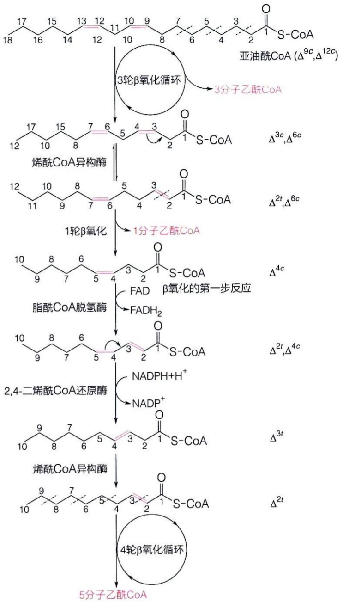

<details>
<summary>flowchart</summary>

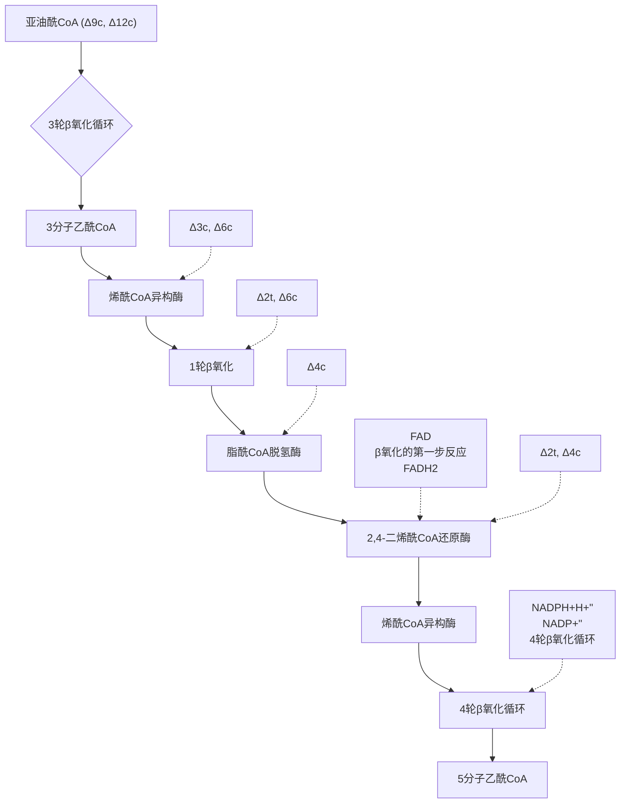
</details>

图 22-17 多不饱和脂肪酸（亚油酸）的β氧化过程上标中的 c 代表 cis（顺式双键）；而 t 则代表 trans（反式双键）。

## 22.2.7 超长链脂肪酸在过氧化酶体中氧化分解

研究表明，超长链脂肪酸在哺乳动物细胞过氧化物酶体（peroxisome）中氧化分

<small><span class="docvortex-page-footnote" data-block-type="page_footnote" style="color:#6b7280">① 这里只利用 NADPH，而非 NADH 作为电子供体。</span></small>