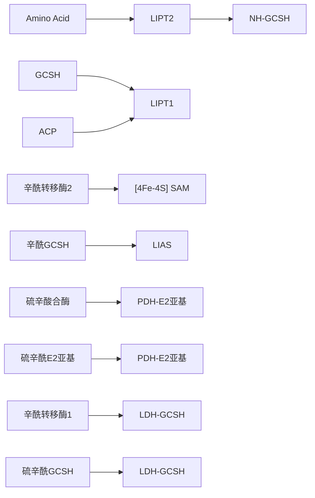
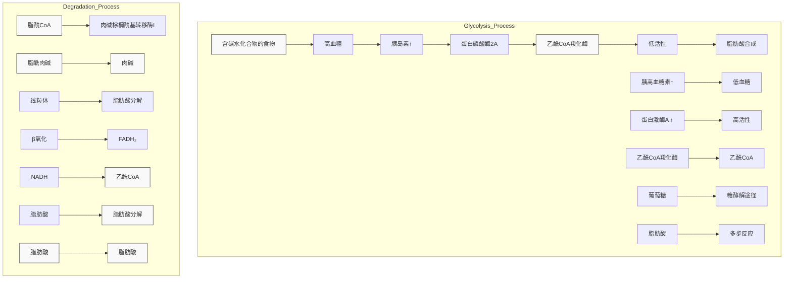
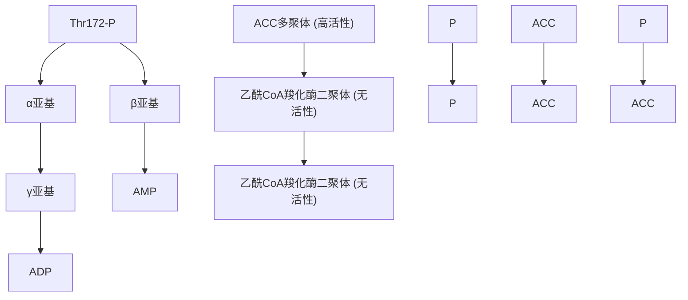
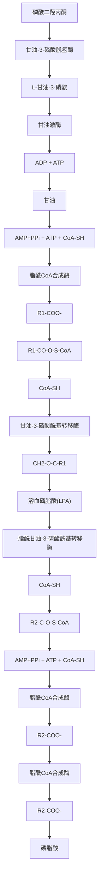
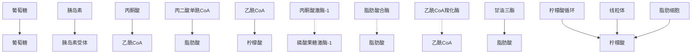
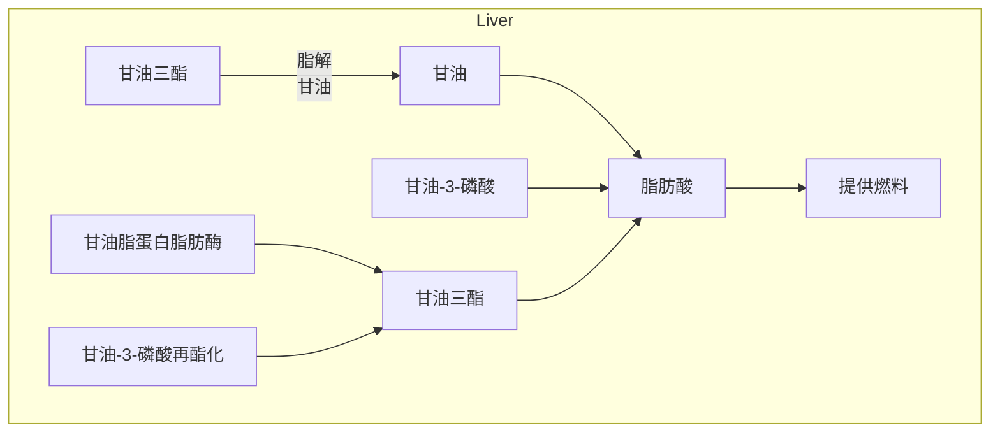
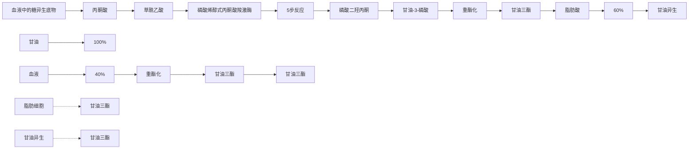
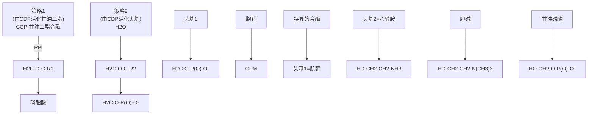

chemical

肽链与羧基乙胺的结构式，展示β-巯基乙胺、泛酸及4'-磷酸泛酰巯基乙胺的分子结构

图23-5 磷酸泛酰巯基乙胺是酰基载体蛋白（ACP）和辅酶A的共同功能基团

辅酶A在脂肪酸分解过程中的作用，而且它们的功能基团完全相同，均利用磷酸泛酰巯基乙胺末端的巯基。

## 23.1.5 脂肪酸合成涉及起始、延长和终止等阶段

脂肪酸的合成大致可分为起始、延长和终止三个阶段（图 23-6）。在进入延长阶段的多轮五步反应之前，必须先完成起始阶段的反应。

（1）脂肪酸合成起始于丙二酸单酰/乙酰转酰基酶催化的反应

在丙二酸单酰/乙酰转酰基酶催化下，乙酰辅酶A中的乙酰基被转移至ACP辅因子末端的巯基，形成乙酰ACP；随后，乙酰基再被转至β-酮酰合酶中一个特异半胱氨酸侧链的巯基，同时，释放辅酶A。这个过程完成了起始反应。这是每个脂肪酸分子合成的起始阶段，即在第一轮的五步反应之前发生。这个乙酰基将成为最终合成脂肪酸分子甲基末端的两个碳原子。

(2) 脂肪酸合成的每一轮涉及底物装载、缩

## 合、还原、脱水和还原五步反应

随着起始反应的完成，脂肪酸合成的第一轮反应便开始了。

第一步是底物装载（substrate loading）反应（图23-6，①），这步反应只发生于上述起始步完成之后（即β-酮酰合酶发生了乙酰化之后）；也由丙二酸单酰/乙酰转酰基酶催化，此时，结合于活性中心的丙二酸单酰辅酶A中的丙二酸单酰基被转移至ACP辅因子末端的巯基（同时也释放辅酶A），完成底物的装载。

第二步是缩合（condensation）反应（图23-6，②）。由β-酮酰合酶催化，结合于起始阶段ACP辅因子上的丙二酸单酰基与β-酮酰合酶上的乙酰基发生缩合，生成乙酰乙酰ACP，并释放 $CO_{2}$ 。丙二酸单酰基可视作乙酰基的活化状态，而脱羧过程释放的能量使缩合反应的自由能变化为负值，从而驱动缩合反应的有效进行，并使其不可逆。可以认为，丙二酸单酰辅酶A形成时消耗的ATP（图23-3）间接推动了缩合反应的进行。尽管 $HCO_{3}^{-}$ 是脂肪酸合成过程所必需的，但其碳原子并不出现在最终产物中，而是在缩合过程中以 $CO_{2}$ 的形式被释放。因此，合成偶数碳脂肪酸的所有碳原子均来自乙酰辅酶A所提供的二碳单位。在糖异生途径中，在由丙酮酸经草酰乙酸生成磷酸烯醇式丙酮酸的反应过程中，也利用了类似的“羧化-脱羧”策略，表明羧基化修饰也是活化底物的一种有效方式。

flowchart

乙酰乙酰 ACP 也可被称为  $\beta-$  酮丁酰 ACP。通过接下来的三步反应， $\beta-$  酮基将被还原为亚甲基。

第三步是还原（reduction）反应（图23-6，③），由β-酮酰还原酶催化，将β-酮丁酰ACP还原为D-β-羟丁酰ACP。这步反应与脂肪酸β氧化对应步骤的逆过程存在两方面的差异:其一，使用NADPH作为电子供体，而脂肪酸β氧化中对应的电子受体是 $NAD^{+}$ ；其二，产物中的不对称碳为D构型，而非L构型。

第四步是脱水（dehydration）反应（图23-6，④）。由β-羟酰脱水酶催化。D-β-羟基丁酰ACP从C2和C3分别脱去H和OH，形成反式- $\Delta^{2}$ -丁烯酰ACP，同时释放1分子水。

第五步是还原反应（图23-6，⑤）。这是第二次还原反应，由烯酰还原酶催化，反式 $-\Delta^{2}-$ 丁烯酰ACP还原为丁酰ACP。这步还原反应的电子供体也是NADPH（而

图 23-6 由脂肪酸合酶催化的脂肪酸从头合成每轮的五步反应

在对应的脂肪酸 $\beta$ 氧化步骤中，电子受体是FAD）。在细菌中，烯酰还原酶是脂肪酸合成途径的限速酶之一。广谱抗菌剂三氯生（tricloson）通过抑制烯酰还原酶的活性而抑制细菌的生长和繁殖，被广泛添加于牙膏、香皂、护肤霜、除臭剂等日化用品中。

经过上述五步反应，乙酰基通过接受丙二酸单酰基的二碳单位而最终生成丁酰ACP，完成第一轮使脂肪酸碳骨架延长两个碳原子的反应。

在丙二酸单酰/乙酰转酰基酶的催化下，第一轮反应形成的丁酰基将从ACP转移至 $\beta-$ 酮酰合酶的特异半胱氨酸侧链的巯基上（类似于起始阶段发生的反应）。随后，第二轮及后续多轮反应依次进行，生成碳链长度分别为6、8、10、12、14和16个碳的脂肪酸中间体。当生成含16个碳的脂肪酸（棕榈酸）后，脊椎动物的脂肪酸合酶无法继续催低碳链的延长。此时，I型脂肪酸合酶的硫酯酶活性催化棕榈酰基与ACP之间的硫酯键水解，释放棕榈酸，从而终止脂肪酸合成过程。

合成1分子棕榈酸需要消耗7分子丙二酸单酰辅酶A。这由7分子乙酰辅酶A羧化形成:

$$
7 \text {乙酰} \mathrm{CoA} + 7 \mathrm{CO} _ {2} + 7 \mathrm{ATP} \longrightarrow 7 \text {丙二酸单酰} \mathrm{CoA} + 7 \mathrm{ADP} + 7 \mathrm{P} _ {\mathrm{i}}
$$

从起始物乙酰辅酶A到终产物棕榈酸的化学计量总反应式为:

$$
1 \text {乙酰} \mathrm{CoA} + 7 \text {丙二酸单酰} \mathrm{CoA} + 1 4 \mathrm{NADPH} + 1 4 \mathrm{H} ^ {+} \longrightarrow
$$

$$
1 \text {棕榈酸（} 16 \text {碳}) + 7 \mathrm{CO} _ {2} + 8 \mathrm{CoA} + 1 4 \mathrm{NADP} ^ {+} + 6 \mathrm{H} _ {2} \mathrm{O}
$$

因此，合成 1 分子棕榈酸需消耗 7 分子 ATP 用于生成 7 分子丙二酸单酰辅酶 A。

## 23.1.6 动物细胞中棕榈酸的碳链可在光面内质网膜中继续延长

在动物细胞的胞质溶胶中，脂肪酸合酶催化合成的最终产物通常是含16个碳原子的棕榈酸。然而，细胞中也存在对更长碳链脂肪酸的需求，这可通过脂肪酸碳链的继续延长而满足。

真核细胞中脂肪酸碳链的延长主要发生于光面内质网膜中。

光面内质网膜的胞质溶胶侧中发生的脂肪酸碳链延长过程与脂肪酸合酶催化过程类似，使用丙二酸单酰辅酶A作为二碳单位的供体，也以NADPH作为还原剂。尽管催化的反应均类似，但催化脂肪酸碳链延长的酶均位于内质网膜上，且被延长的脂酰基以辅酶A（而非ACP）的形式存在。通过缩合、还原、脱水和再还原四步反应，脂肪酸碳链每次延长两个碳单位。例如，从棕榈酸开始，经过这四步反应生成硬脂酸（含18个碳原子）。

在光面内质网膜上，脂肪酸碳链可延长至36个碳原子，并用于合成多种结构脂质。此外，经碳链延长后的脂肪酸还可在光面内质网中发生去饱和反应（具体见后）。

## 知识延展 23- 1

## 动物细胞线粒体中也存在脂肪酸合成途径

在 20 世纪五六十年代，研究者发现被分离的线粒体中存在脂肪酸合酶的活性，揭示了线粒体可能具备合成脂肪酸的能力。后续研究进一步表明，线粒体中的脂肪酸合成途径属于 FASⅡ系统。无论在蛋白质水平还是基因水平，线粒体 FASⅡ均表现出与细菌中的对应酶之间的同源性。这一发现与线粒体起源于好氧细菌的内共生假说相契合。

到七八十年代，参与线粒体脂肪酸合成途径的关键蛋白质组分被分离纯化。这包括线粒体酰基载体蛋白。到八九十年代，研究者对线粒体脂肪酸合成的酶促步骤有了更多认识，揭示它参与合成硫辛酸等重要辅因子。具体而言，线粒体脂肪酸合成途径产生的辛酰ACP中间体中的一部分被释放，进入硫辛酸辅因子合成途径；另一部分则可进一步延长为14碳或16碳的脂肪酸。在硫辛酸合成途径中，辛酰基从线粒体酰基载体蛋白转移至另一种载体蛋白，即甘氨酸裂解系统蛋白H（glycine cleavage system H protein, GCSH），这一过程由辛酰转移酶2（lipoyl transferase 2, LIPT2）催化。随后，硫辛酸合酶（lipoic acid synthase, LIAS）借助辅因子S-腺苷-L-甲硫氨酸（SAM）产生的5'-脱氧腺苷自由基，通过[4Fe-4S]获取2个硫原子，插入到与GCSH结合的辛酰基团的6号和8号碳上（图23-7）。接着，硫辛酸通过另一种辛酰转移酶（lipoyl transferase 1，LIPT1）被转移至靶蛋白上；与蛋白质中特定赖氨酸残基的侧链氨基形成酰胺键，共价连接到蛋白质分子，如丙酮酸脱氢酶复合物中的 $E_{2}$ 亚基（PDH- $E_{2}$ ）上。当蛋白质被降解或在脂酰酰胺酶的作用下，共价结合在蛋白质上的硫辛酸得以释放。

硫辛酸是一种重要的辅因子，对于线粒体中的几种关键酶复合物的功能至关重要。除丙酮酸脱氢酶复合物外，还包括α-酮戊二酸脱氢酶复合物以及支链α-酮酸脱氢酶复合物。这些酶复合物在细胞能量代谢过程中扮演核心角色。此外，硫辛酸还具有强效抗氧化能力。线粒体脂肪酸合成途径，特别是硫辛酸的合成，可能对保持线粒体的正常功能以及细胞内能量的有效生成至关重要。线粒体脂肪酸合成途径或硫辛酸合成途径的异常可能导致严重的代谢紊乱。

flowchart

图23-7 线粒体中经由辛酰ACP合成硫辛酸的过程SAM:S-腺苷-L-甲硫氨酸；GCSH:甘氨酸裂解系统蛋白H； $\mathrm{PDH - E_2}$ :丙酮酸脱氢酶复合物中的 $\mathsf{E}_2$ 亚基。

## 23.1.7 不饱和脂肪酸在光面内质网膜中生成

动植物细胞中的饱和脂肪酸可进一步发生去饱和反应，形成含碳碳双键的不饱和脂肪酸。

## (1) 棕榈酸和硬脂酸可在动物细胞中去饱和形成 $\Delta^{9}$ 顺式碳碳双键

由位于光面内质网膜中的硬脂酰辅酶A去饱和酶（stearoyl-CoA desaturase，也称$\Delta^{9}-$去饱和酶）催化。该酶催化的氧化反应依赖它与细胞色素$b_{5}$以及细胞色素$b_{5}$还原酶的共同作用，最终将棕榈酸（16:0）和硬脂酸（18:0）去饱和，分别生成棕榈油酸（16:1）和油酸（18:1）（图23-8A）。

硬脂酰辅酶 A 去饱和酶利用氧气，同时使 NADPH 和脂酰基发生氧化。NADPH 提供 1 对电子，经由细胞色素  $b_{5}$  还原酶中的 FAD 和细胞色素  $b_{5}$  中的血红素传递，最终到达分子氧。另 1 对电子从脂酰基的单键中释放，也传递给氧，最终生成 2 分子水。去饱和酶的活性中心利用由 2 个铁离子构成的双核中心进行催化，使脂肪酸碳链中 C9 位和 C10 位之间的单键发生氧化，形成  $\Delta^{9}$  双键（图 23-8B、C）。

在植物细胞中，上述去饱和反应主要发生于叶绿体基质中，其中的一种水溶性硬

图23-8 内质网膜上三种蛋白质组成的电子传递链参与脂肪酸去饱和反应

（A）硬脂酰辅酶 A 去饱和酶位于光面内质网膜上，其催化脂肪酸去饱和反应时，需依赖细胞色素  $b_{5}$  和细胞色素  $b_{5}$  还原酶组成的电子传递系统。（B）鼠源硬脂酰辅酶 A 去饱和酶的结构（PDB:6WF2）。酶活性中心分别结合硬脂酰辅酶 A（球棍模式展示其原子结构）和两个金属铁离子（紫色，其中一个铁离子周围的水分子用红色圆球表示）。脂肪酸碳链中的 C9 和 C10 使用草青色展示。（C）硬脂酰辅酶 A 去饱和酶活性中心的放大展示。脂肪酸碳链中的 C9 和 C10 位于一个转折处，两个铁离子（Fe1、Fe2）组成双核中心。橙色虚线表示两个铁离子与周围 9 个组氨酸残基相互作用，Fe1 与 C10 相距为 4.5 Å，Fe2 与距 C9 相距为 4.6 Å， $H_{2}O$  与 C9 相距为 3.2 Å。

脂酰 ACP 去饱和酶（stearoyl-ACP desaturase）催化硬脂酰 ACP 转化为油酰 ACP。

（2）植物细胞可将油酸进一步去饱和生成亚油酸和  $\alpha-$  亚麻酸

哺乳动物细胞自身能够合成如棕榈油酸（16:1 $\Delta^{9}$ ）和油酸（18:1 $\Delta^{9}$ ）这种 $\Delta^{9}$ 单不饱和脂肪酸。然而，由于缺乏在 $\Delta^{9}$ 双键之后的位置（如 $\Delta^{12}$ 和 $\Delta^{15}$ ）引入双键所需的去饱和酶，它们无法合成亚油酸（18:2 $\Delta^{9,12}$ ）和α-亚麻酸（18:3 $\Delta^{9,12,15}$ ）。亚油酸和α-亚麻酸是哺乳动物合成多种具有重要生理功能的不饱和脂肪酸（如含20个碳原子的花生四烯酸）的前体，故为必需脂肪酸（essential fatty acid），须从食物中获取。

在植物细胞中，油酸等单不饱和脂肪酸可进一步去饱和，生成多不饱和脂肪酸。这一过程发生于它们被掺入到甘油磷脂或半乳糖甘油酯分子中之后。去饱和反应分别由整合于内质网膜或叶绿体内膜上的不同去饱和酶催化。 $\Delta^{12}$ -去饱和酶催化其中的油酸分子C12位引入双键，生成亚油酸，再经 $\Delta^{15}$ -去饱和酶催化C15去饱和反应形成 $\alpha$ -亚麻酸。这样的去饱和过程可以发生于磷脂酰胆碱C2位连接的油酰基上，油酰基被氧化成亚油酰基，再经去饱和形成亚麻酰基（图23-9）。

chemical

Chemical reaction pathway showing the conversion of phosphate to phosphorus and amino acids using acid and thiol glycolysis enzymes

图 23-9 植物多不饱和脂肪酸在甘油磷脂中的生成过程

## 23.1.8 脂肪酸合成途径通过调节乙酰辅酶 A 羧化酶活性进行调控

脂肪酸的合成速率受内源和外源多种因素调控。一般而言，动物体内充足的葡萄糖供应将通过胰岛素信号通路促进细胞合成脂肪酸，而葡萄糖的缺乏将通过胰高血糖素信号通路抑制脂肪酸的合成。

催化脂肪酸合成限速步骤的乙酰辅酶 A 羧化酶在调节动物体内脂肪酸合成中发挥重要作用。脊椎动物体内乙酰辅酶 A 羧化酶活性通过别构效应和可逆磷酸化修饰两种方式调节。

(1) 柠檬酸和棕榈酰辅酶 A 可分别激活和抑制乙酰辅酶 A 羧化酶的活性

在 1950 年代，研究人员发现，柠檬酸能够显著提高无细胞系统（使用肝细胞提取物）中脂肪酸的合成速率。到 1960 年代，借助密度梯度离心技术，研究者揭示了这一现象的机制:柠檬酸的激活效应与乙酰辅酶 A 羧化酶形成多聚体密切相关，电子显微镜亦观察到了纤维状的多聚体。后续研究揭示，柠檬酸可促使低活性的乙酰辅酶

图23-10 脊椎动物乙酰辅酶A羧化酶的活性通过别构效应调节

chemical

Reaction pathway of 乙酰CoA and its conjugated form, showing enzymatic conversion to acyl-CoA and its subsequent hydrolysis.

A 羧化酶二聚体组装成高活性的多聚体。作为提供乙酰辅酶 A 的前体，柠檬酸的这种调节作用属于前馈激活。相反，棕榈酰辅酶 A 则通过将乙酰辅酶 A 羧化酶从高活性的多聚体解聚为低活性的二聚体或单体，实现对其活性的反馈抑制（图 23-10）。结构测定结果表明，二聚体中活性中心被遮蔽，阻止底物乙酰辅酶 A 与  $HCO_{3}^{-}$  的进入；而在多聚体中活性中心被暴露，而且生物素载体蛋白结构域可自由摆动（图 23-3）。

此外，棕榈酰辅酶A或其他长链脂酰辅酶A还可通过抑制柠檬酸裂解酶而抑制脂肪酸合成。

## (2) 乙酰辅酶 A 羧化酶活性可通过可逆磷酸化修饰调节

动物体内的脂肪酸合成过程在高血糖状态下活跃进行，而在低血糖状态下则受到抑制（图23-11）。具体而言，高血糖诱导胰岛素的分泌，胰岛素与细胞表面受体结合后，通过信号转导过程，激活靶细胞内的一种磷酸酶，即蛋白磷酸酶2A（protein phosphatase 2A，PP2A），导致乙酰辅酶A羧化酶发生去磷酸化而激活。相反，低血糖诱导胰高血糖素的释放，后者通过信号转导激活靶细胞内的蛋白激酶A（PKA），导致乙酰辅酶A羧化酶发生磷酸化而失活。肾上腺素产生的效应与胰高血糖素相似（即通过磷酸化作用降低乙酰辅酶A羧化酶活性），但其分泌主要是在应激条件下由神经信号触发。

## (3) AMP 激活的蛋白激酶通过诱发乙酰辅酶 A 羧化酶磷酸化而使其失活

1970年代，在探究乙酰辅酶A羧化酶的过程中，人们观察到一种可以被AMP激活的蛋白质激酶。它能够催化依赖 ATP 的乙酰辅酶 A 羧化酶的磷酸化修饰，导致酶的活性显著下降；而当这种磷酸化被去除后，乙酰辅酶 A 羧化酶的活性大幅上升。这种酶被命名为 AMP 活化蛋白激酶（AMP-activated protein kinase，AMPK）。

图 23-11 脂肪酸合成和分解途径之间的关联调节
①含碳水化合物的食物通过升高血糖水平诱导胰岛素的分泌；②胰岛素信号激活蛋白磷酸酶2A，使乙酰辅酶A羧化酶发生去磷酸化而激活；
③乙酰辅酶A羧化酶催化乙酰辅酶A发生羧化反应生成丙二酸单酰辅酶A；④丙二酸单酰辅酶A通过抑制肉碱棕榈酰基转移酶Ⅰ而阻止脂肪酸分解；⑤低血糖促进胰高血糖素的释放，而胰高血糖素信号激活蛋白激酶A（PKA）；
⑥蛋白激酶A通过磷酸化乙酰辅酶A羧化酶而降低其活性；⑦肉碱棕榈酰基转移酶Ⅰ介导胞质溶胶中的脂酰辅酶A转运至线粒体基质；⑧脂酰辅酶A在线粒体基质内进行β氧化。

flowchart

总体而言，当机体细胞处于低能量供给状态时，将由腺苷酸激酶（adenylate kinase）催化可逆反应: $ADP + ADP \rightleftharpoons ATP + AMP$ 。该反应在生成ATP供细胞利用的同时，使AMP的水平大幅升高。AMP结合于AMPK的γ亚基，诱导其构象改变。AMPK是一种丝氨酸/苏氨酸蛋白激酶，是由一个催化亚基（α）

flowchart

图 23-12 AMPK 通过磷酸化乙酰辅酶 A 羧化酶抑制脂肪酸合成

和两个调节亚基（β 和 γ）组成的异源三聚体。AMP 与 γ 亚基的结合一方面促进了上游激酶（如 LKB1）对 α 亚基苏氨酸 172 位点（Thr $^{172}$ ）的磷酸化修饰，并抑制磷酸酶对该位点的去磷酸化，从而“从零到一”地激活 AMPK；另一方面还可进一步对已经被磷酸化的 AMPK 产生直接的别构激活作用，迅速提升其活性。通过这两种机制的协同作用，AMP 的结合高效地激活了 AMPK。激活后的 AMPK 进而催化下游底物，例如使乙酰辅酶 A 羧化酶发生磷酸化修饰。未磷酸化的 ACC 可聚合形成有活性的多聚体；而 AMPK 介导的磷酸化使 ACC 倾向于以无活性的二聚体形式存在，从而抑制其多聚化（图 23-12）。后续的研究还表明，当葡萄糖水平下降（营养匮乏）或组织内钙离子浓度升高（通常出现在具有促分解代谢作用的激素的分泌时）也能通过激活 AMPK，引起其对乙酰辅酶 A 羧化酶的修饰（见第 27 章）。

乙酰辅酶A羧化酶活性的降低会减少丙二酸单酰辅酶A的生成，从而解除其对肉碱棕榈酰基转移酶I的抑制作用，使大量脂酰辅酶A得以转运至线粒体基质进行β氧化。相反，当乙酰辅酶A羧化酶活性增强时，丙二酸单酰辅酶A的增加会有效抑制肉碱棕榈酰基转移酶I的活性。因此，当脂肪酸合成减少时，一般β氧化将加速；而当脂肪酸合成活跃时，β氧化则受到抑制。这种机制实现了脂肪酸合成与分解代谢的协同调节（图23-11），避免了无效循环。这也是一种调节机制，是细胞协调生物分子合成与分解代谢的一种有效策略。

植物细胞中的脂肪酸合成主要发生于叶绿体中。其中的乙酰辅酶 A 羧化酶活性受到叶绿体基质 pH 和  $Mg^{2+}$  浓度变化的调节:在碱性 pH（如 pH = 8.0）时被激活，在酸性 pH（如 pH = 6.5）时被抑制，在高浓度  $Mg^{2+}$  存在时被激活。

## 23.2 脂肪酸以甘油三酯形式长期储存

机体一般将脂肪酸转化为惰性的甘油三酯形式以实现长期储存。脂肪酸的羧基与甘油的羟基通过酯化反应缩合，使得羧基和羟基的化学反应活性均大幅降低，生成的甘油三酯（俗称脂肪）更适合在机体内长期储存。一个70公斤重的个体通常储存约15公斤的脂肪，足以支持个体生存大约3个月，而所储存的糖原仅能提供大约12小时所需的能量。

在发芽的种子中，甘油三酯不仅作为能量来源，还为生成内源性葡萄糖提供前体:脂肪酸通过乙醛酸循环生成的琥珀酸先被转化为延胡索酸，再被转化为草酰乙酸进入糖异生途径（见图18-17）。生成的葡萄糖通过代谢，为植物早期发育所需的多种生物合成提供前体，并通过提高胚细胞的渗透压，帮助种子吸取水分。在哺乳动物体内，

flowchart

图 23-13 磷脂酸的合成途径

肝脏、小肠和脂肪组织是甘油三酯合成最为活跃的场所。其中，肝脏不仅利用自身从头合成的脂肪酸（由多余的葡萄糖等转化而来），还利用从食物中摄取并通过血液循环运输来的脂肪酸作为合成甘油三酯的原料。小肠则主要利用从食物中吸收的脂肪酸合成甘油三酯（见图22-2）。脂肪组织将各种来源的脂肪酸转化为甘油三酯，进行长期储存。这包括从食物中摄取的、肝脏中从头合成的，以及脂肪组织自身储存的甘油三酯水解获得的脂肪酸（这一过程称为脂解，具体见后）。

甘油三酯的合成主要发生于真核细胞内质网的胞质侧。此外，线粒体和脂滴间接参与甘油三酯的合成。甘油三酯合成途径主要有两条，即广泛发生的甘油磷酸途径（glycerol phosphate pathway，又称甘油三酯从头合成途径）和小肠上皮细胞中发生的甘油单酯途径（monoacylglycerol pathway）。

甘油磷酸途径的中间体为含有两个脂酰基单位的1,2-甘油二酯-3-磷酸，也被简称为磷脂酸（phosphatidic acid）。磷脂酸同时也是合成甘油磷脂的前体（具体见后），所以它代表合成代谢的一个分叉点。

## 23.2.1 磷脂酸由 L-甘油 -3-磷酸脂酰化生成

在合成磷脂酸之前，需先生成L-甘油-3-磷酸。糖酵解途径的中间产物磷酸二羟丙酮在甘油-3-磷酸脱氢酶（glycerol-3-phosphate dehydrogenase）的催化下，利用NADH提供的电子即可还原为L-甘油-3-磷酸。此外，在肝脏和肾脏等组织中，少量的甘油通过甘油激酶（glycerol kinase）转化为L-甘油-3-磷酸（图23-13）。

随后，1 分子由脂肪酸活化形成的脂酰辅酶 A 在一种脂酰转移酶（acyl transferase）的催化下，将一个脂酰基转移到 L-甘油-3-磷酸的 C1 羟基上，生成溶血磷脂酸（lysophosphatidic acid，LPA），并释放 1 分子辅酶 A。脂酰辅酶 A 的形成过程与脂肪酸在氧化前通过脂酰辅酶 A 合成酶在胞质溶胶中活化的过程完全相同，均需消耗 ATP，生成 AMP 和焦磷酸（见第 22 章）。此外，某些细胞或细胞碎片（如血小板）释放的溶血磷脂酸还具有信号分子的功能。

接下来，另一种脂酰转移酶催化溶血磷脂酸的 C2 羟基与 1 分子脂酰辅酶 A 缩合，生成磷脂酸。值得注意的是，催化 C1 和 C2 羟基酰基化的脂酰转移酶并不相同。通常，磷脂酸的 C1 羟基连接饱和脂肪酸，而 C2 羟基则连接不饱和脂肪酸，这表明两种酰基转移酶具有不同的特异性。具体而言，催化 C1 羟基酰基化的酶为甘油 -3- 磷酸酰基转移酶（glycerol-3-phosphate acyltransferase，GPAT），而催化 C2 羟基酰基化的酶则为 1- 脂酰甘油 -3- 磷酸酰基转移酶（1-acylglycerol-3-phosphate acyltransferase，AGPAT）。此外，真核细胞中还存在一种甘油二酯激酶（diacylglycerol kinase），它能够催化甘油二酯在 C3 位羟基发生磷酸化，生成磷脂酸:

$$
1, 2 - \text {甘油二酯} + \mathrm{ATP} \longrightarrow \text {磷脂酸} + \mathrm{ADP}
$$

甘油二酯和磷脂酸均为信号分子。由催产素等激素诱发产生的甘油二酯为第二信使，是蛋白激酶 C（PKC）的关键激活剂；磷脂酸也参与和营养物感应等有关的信号转导过程。作为信号分子的磷脂酸产生于质膜，而作为甘油三酯合成中间体的磷脂酸则产生于内质网膜，故互不干扰。

## 23.2.2 磷脂酸经去磷酸化后再脂酰化即生成甘油三酯

磷脂酸经两步反应，即去磷酸化和脂酰化，生成甘油三酯（图 23-14）。

第一步由磷脂酸磷酸酶 [phosphatidic acid phosphatase，也称脂素（lipin）] 催化，磷脂酸脱磷酸，生成甘油二酯，同时释放无机磷酸。

第二步由甘油二酯酰基转移酶（diacylglycerol acyltransferase）催化，甘油二酯发生脂酰化，生成甘油三酯。脂酰基仍由脂酰辅酶A提供（图23-14）。在真核细胞中，甘油三酯主要在内质网中合成。甘油二酯酰基转移酶有两种同工酶:甘油二酯酰基转移酶1对单不饱和脂酰辅酶A（如油酰辅酶A）有偏好，而对饱和脂酰辅酶A的活性较低；甘油二酯酰基转移酶2则对中链脂酰辅酶A的活性较高，但对长链脂酰辅酶A的活性较低。利用单颗粒冷冻电镜技术，研究者解析了人源甘油二酯酰基转移酶1的同源二聚体结构（图23-15A），结果显示，两个单体各结合1分子脂酰辅酶A底物，

图 23-14 从磷脂酸生成甘油三酯的过程

chemical

Reaction pathway showing the conversion of phosphatidic acid to guanidine and then to guanidine triacrylate via intermediate compounds

图 23-15 结合底物油酰辅酶 A 的甘油二酯酰基转移酶结构

（A）人源甘油二酯酰基转移酶1的二聚体结构（PDB:6VP0）。其中仅可见脂酰辅酶A底物，但未见甘油二酯底物，跨膜α螺旋TM4与TM6之间的距离较大，可能形成甘油二酯底物结合及甘油三酯产物离开的通道。TM:跨膜α螺旋。（B）人源甘油二酯酰基转移酶催化机制示意图。其单体显示为浅蓝色梯形，反应室显示为灰色倒置烧瓶形状。

(A)

text_image

内质网腔
Y417 TM4 H415
S411 TM6
脂酰CoA 脂酰CoA E416
胞质溶胶

(B)

flowchart

This diagram illustrates the biochemical pathway of glutamine (甘油二酯) and its subsequent conversion into glutamine (甘油三酯), showing the mechanism of protein binding to H415 and its subsequent enzymatic transformation.

每个单体由9个跨膜α螺旋（TM）组成，并在内质网膜中形成一个反应室（reaction chamber）。甘油二酯酰基转移酶1的活性中心H415/E416位于TM7。脂酰辅酶A由甘油二酯酰基转移酶1反应室底部（近胞质溶胶侧，TM7-TM8之间形成的入口）进入反应室，而甘油二酯从TM4与TM6形成的较大入口进入反应室。反应后，产物甘油三酯扩散至内质网腔（图23-15B）。

在脂肪细胞中，新合成的甘油三酯释放至内质网膜的脂双层之间。当积累量超过某一阈值后，新生脂滴以出芽方式从内质网膜释放至胞质溶胶。在肝细胞中，新合成的甘油三酯被引入至新生的脂蛋白颗粒中，最终被分泌到细胞外，进入血液循环。一种可能的脂滴或脂蛋白颗粒形成机制如图23-16所示，一般认为脂滴和脂蛋白颗粒分别在内质网的胞质溶胶侧和内质网腔侧形成。

## 23.2.3 脊椎动物体内甘油三酯的合成受胰岛素等激素促进

在正常成年人体内，储备的脂肪通常可保持长期稳定。然而，当短期内摄入的热量超过机体能量需求时，多余的糖、蛋白质以及脂肪酸会被转化为甘油三酯进行长期储存。机体主要通过分泌胰岛素等激素调节甘油三酯的合成与分解，维持能量供需平衡。

胰岛素将促进摄入过量的糖转化为甘油三酯（图 23-17），同时也抑制脂肪组织中储存的甘油三酯的分解。在饱食状态下，胰岛素分泌增加，通过提高细胞膜中葡萄糖转运蛋白 GLUT4 的含量，促进肌肉和脂肪细胞摄取血液中的葡萄糖（但肝细胞膜中的 GLUT2 含量不受胰岛素调节）。同时，胰岛素还促使肝细胞和脂肪细胞中的葡萄糖转化为甘油三酯（肌肉细胞虽可摄取葡萄糖，但主要将其用于糖原合成或氧化供能，而非大量合成甘油三酯）。具体而言，一方面，胰岛素促进通过膳食摄入的糖通过脂肪酸从头合成途径转化为脂肪酸，进而合成甘油三酯；另一方面，胰岛素通过激活糖酵解途径中的关键调节酶，如磷酸果糖激酶-1（PFK-1）和丙酮酸激酶，促进糖酵解。产生的丙酮酸进入线粒体后转化为乙酰辅酶A，随后与草酰乙酸缩合形成柠檬酸。柠檬酸通过柠檬酸穿梭机制转运至胞质溶胶，为脂肪酸合成提供乙酰辅酶A前体。胰岛素同时通过促使乙酰辅酶A羧化酶去磷酸化，提高其活性（通过形成多聚体），促进脂肪酸合成。此外，胰岛素还可通过激活特异的转录因子，促进许多基因的转录，增加这些基因所编码蛋白质如乙酰辅酶A羧化酶、脂肪酸合酶、柠檬酸裂解酶等酶的含量，促进脂肪酸的从头合成和甘油三酯合成。

flowchart

图 23-16 内质网膜上形成的甘油三酯可被引入脂滴或脂蛋白颗粒中

胰岛素在促进脂肪合成的同时，也通过抑制脂滴包被蛋白的磷酸化（促进其去磷酸化）而抑制脂肪组织中脂肪的动用。

因此，对于缺乏胰岛素或对胰岛素不敏感的糖尿病患者而言，取其体细胞合成脂肪的能力显著降低，体细胞内多余的乙酰辅酶A被转化为酮体。患者因此逐渐消瘦，并出现酮症酸中毒等严重代谢紊乱。

flowchart

图 23-17 胰岛素促进脂肪细胞对葡萄糖的摄取和甘油三酯的合成

## 23.2.4 动物体内存在甘油三酯周转现象

1960 年代，人们观察到以下有趣现象。动物组织中发生持续、自发的甘油三酯的水解（脂解）和重新合成这种“无效循环”。分解所释放脂肪酸的大约 75% 并不氧化分解，而是被重新酯化为甘油三酯，形成一种脂肪酸的再酯化（re-esterification）过程，这种现象被称作甘油三酯周转（triacylglycerol cycling）或甘油三酯-脂肪酸循环，如图 23-18 所示。无论动物处于饥饿（甘油三酯的动用量非常高）还是饱食（甘油三酯的动用量非常低）状态，这种甘油三酯的周转现象均以相似比例发生。

flowchart

图 23-18 发生于动物体内的甘油三酯周转现象

具体而言，当脂肪组织中动用的甘油三酯水解所产生的脂肪酸经血液循环运输至肝脏后，在肝脏中可重新酯化为甘油三酯。随后，肝脏将甘油三酯、磷脂、胆固醇与载脂蛋白结合，以脂蛋白颗粒的形式释放到血液中。在脂肪组织毛细血管中，甘油三酯在脂蛋白脂肪酶的作用下再次分解为脂肪酸，被脂肪组织摄取后进行再酯化，所形成的甘油三酯储存于脂肪组织。这种甘油三酯周转过程的主要功能是使脂肪酸处于能量储存和供应的动态平衡状态，维持其代谢灵活性。

甘油三酯周转所释放的脂肪酸大部分最终重新转化为甘油三酯。从表面上看，这是一种“无效”循环，然而，即使在饥饿状态也维持甘油三酯周转的事实表明:它的存在对机体代谢应该是必要的，因而被

演化保留下来。例如，血液中随时存在一定水平的游离脂肪酸，可以更快满足机体对能量的爆发式需求；在遇到“战或逃（fight or flight）”的紧急状态时，动物机体需通过分泌肾上腺素促进脂肪组织中的甘油三酯水解而这需要一定的时间才可发生。在此过程中，已经存在的游离脂肪酸可以被立即使用，以应对紧迫情况。此外，甘油三酯周转可作为棕色脂肪细胞的一种产热机制，周转过程中“浪费”的能量以热的形式释放。甘油三酯周转还可能与脂质多样性的产生和脂质信号传导等过程有关，但其生理意义尚需进一步探究。

## 23.2.5 饥饿状态下肝脏和脂肪组织通过甘油异生途径产生甘油-3-磷酸

在葡萄糖供应充足的条件下，肝脏和脂肪组织等可以将糖酵解途径中的磷酸二羟丙酮还原为甘油-3-磷酸，用于甘油三酯的合成（图23-13）。如前所述，脂肪组织中因缺乏甘油激酶，甘油三酯水解释放的甘油无法被重新转化为甘油-3-磷酸，通常被运输至肝脏用于糖异生过程。在饥饿状态下，尽管脂肪组织中缺乏糖酵解途径，无法直接获得甘油-3-磷酸，但甘油三酯的周转依然能够有效进行。

1960 年代，美国学者理查德·汉森（Richard Hanson，1935—2014）等在非糖异生组织，即脂肪组织中观察到了丙酮酸羧化酶和磷酸烯醇式丙酮酸羧激酶的存在。它们的表达量比进行糖异生的肝脏组织还要高。他们还观察到，在脂肪组织中， $^{14}$ C 标记的丙酮酸可转化为甘油三酯中的甘油骨架。这种利用非甘油和非葡萄糖前体从头生成甘油三酯中甘油的过程被定义为甘油异生（glyceroneogenesis）途径，具体如图 23-19 所示。

饥饿状态下的脂肪组织中存在的甘油异生途径相当于一条缩短的糖异生途径。具体过程如下:由乳酸或丙氨酸转化而来的丙酮酸在丙酮酸羧化酶催化下，转化为草酰乙酸；后者再在磷酸烯醇式丙酮酸羧激酶催化下生成磷酸烯醇式丙酮酸；然后经过糖异生途径中的五步反应，生成磷酸二羟丙酮，后者还原生成甘油-3-磷酸。

后续研究表明，这种甘油异生途径也发生于肝脏中。

随着我们对甘油三酯周转现象生理学意义的进一步认识，尤其是其在动物饥饿状态下的作用，从某种意义上说，这种甘油异生途径将糖代谢与脂质代谢进行了衔接和平衡，可能对动物应对饥饿等生理状态具有重要意义。

flowchart

图 23-19 脂肪细胞甘油异生途径

值得注意的是，肝脏和脂肪组织中的甘油异生过程同样存在一种反向调节机制。具体而言，当肝脏中的甘油异生活性较高时，脂肪组织中的相应活性则较低，反之亦然。这种精细的调节过程是通过激素介导而实现的。例如，皮质醇（cortisol）作为一种糖皮质激素，可以上调肝细胞中磷酸烯醇式丙酮酸羧激酶的表达水平，从而增强肝细胞甘油异生活性，导致肝细胞中的甘油三酯合成增加。然而，皮质醇在脂肪细胞中却表现出相反的作用，它抑制脂肪细胞中磷酸烯醇式丙酮酸羧激酶基因的表达（主要因为肝脏和脂肪细胞转录因子差异所致），从而降低其中的甘油异生活性，使得未被重新酯化的脂肪酸进入血液，进而被其他组织利用。这种反向调节的生物学意义在于:当血糖水平低时，肝脏加速糖异生过程，脂肪组织中脂肪酸的再酯化被抑制，提供更多脂肪酸作为替代能源；而当血糖水平高时，肝脏糖异生减慢，但脂肪组织中脂肪酸再酯化活性则增强。

## 23.3 作为膜组分的甘油磷脂也以磷脂酸为前体生成

膜脂是细胞所有膜结构的重要组分。膜脂的主要结构特征是具有两亲性，即含一个亲水的、极性头部基团，也含一个或多个疏水的碳氢链尾部基团。膜脂主要包括甘油磷脂、鞘磷脂以及胆固醇三大类，甘油磷脂以甘油为骨架，鞘磷脂则以鞘氨醇为骨架。下面先介绍甘油磷脂和鞘磷脂的生物合成途径，后面将介绍胆固醇的合成途径。

## 23.3.1 甘油磷脂的生成利用核苷酸活化的前体

1950年代初，美国学者尤金·肯尼迪利用放射性同位素（${}^{32}\mathrm{P}$ 和 ${}^{14}\mathrm{C}$）标记的磷酸胆碱等开展实验，其研究结果揭示，动物肝细胞先将磷酸胆碱转化为 CDP- 胆碱后再用于合成磷脂酰胆碱。1960 年代，他们在细菌细胞中还鉴定到了 CDP- 甘油二酯作为甘油磷脂生成的中间体。这些发现开启了人们对甘油磷脂在细胞中合成途径的认识。

甘油磷脂由甘油骨架、两条疏水性脂肪酸碳链（分别位于C1和C2）以及一个含有磷酸基团的亲水头部基团组成。其中的两条脂肪酸碳链经常是不同的。因此，任何一种甘油磷脂其实代表的是一类分子，因为所结合的脂肪酸碳链一般都是多样而非均一。基于此，哺乳动物细胞中可存在数千种不同的磷脂分子，因为脂肪酸碳链的长度、不饱和度以及连接在磷酸基团的官能团的不同，使得甘油磷脂的种类繁多。

## （1）真核细胞从磷脂酸生成甘油磷脂利用两种策略

磷脂酸不仅是合成甘油三酯的一种中间体，也是合成甘油磷脂的一种中间体。因此，磷脂酸可被视作这两条合成途径的分叉点。总体而言，后续合成步骤涉及磷脂酸与一种含羟基的亲水分子（即头基）之间的缩合，形成磷酸酯键连接。但总体策略可分为两种（图23-20）。

图 23-20 真核细胞中甘油磷脂生成的两种策略

flowchart

在第一种策略中，由 CDP-甘油二酯合酶催化磷脂酸通过与 CTP 反应，被活化为 CDP-甘油二酯，后者由特异的合酶催化再被头基的羟基亲核进攻，经缩合形成甘油磷脂分子，同时释放 CMP。在第二种策略中，由磷脂酸磷酸酶催化磷脂酸脱去磷酸基转变为 1,2-甘油二酯，极性亲水头基分子利用其羟基与 CTP 反应，被活化为 CDP-头基，再由特异的转移酶催化 1,2-甘油二酯的羟基亲核进攻 CDP-头基分子中的磷酸基，经缩合形成甘油磷脂分子，同时释放 CMP。上述两种策略的共同原则是:一种底物通过与核苷酸缩合而被活化，而另一种底物则利用其羟基对磷酸基进行亲核进攻（图 23-20）。

原核细胞甘油磷脂的合成（一般利用形成 CDP-甘油二酯的策略）发生于质膜上，而真核细胞甘油磷脂的合成发生于光面内质网膜或线粒体内膜上。某些甘油磷脂，如磷脂酰肌醇、磷脂酰乙醇胺、磷脂酰胆碱等在光面内质网膜上生成，另一些甘油磷脂，如磷脂酰甘油（合成心磷脂的前体）、心磷脂等则在线粒体内膜上合成。总体而言，光面内质网膜是通用膜磷脂的合成场所，而线粒体内膜则是特异磷脂（如心磷脂）的特化合成场所。

CDP-甘油二酯合酶（CDP-diacylglycerol synthase，CDP-DAG 合酶）为一种结合于内质网膜、线粒体内膜或细菌质膜上的蛋白质。其催化过程如图 23-21 所示:底物分别来自生物膜中的磷脂酸和胞质溶胶中的 CTP，生成的 CDP-甘油二酯保留于膜内，参与后续反应。

CDP-甘油二酯为活化的磷脂酸，它通过与形成头基的亲水分子的羟基缩合，完成甘油磷脂的合成过程。与许多其他生物合成反应一样，焦磷酸继续水解释放更多的自由能，有效驱动反应的正向进行。这里 CTP 发挥的活化作用与寡糖或多糖合成过

图 23-21 CDP-甘油二酯合酶催化反应示意图