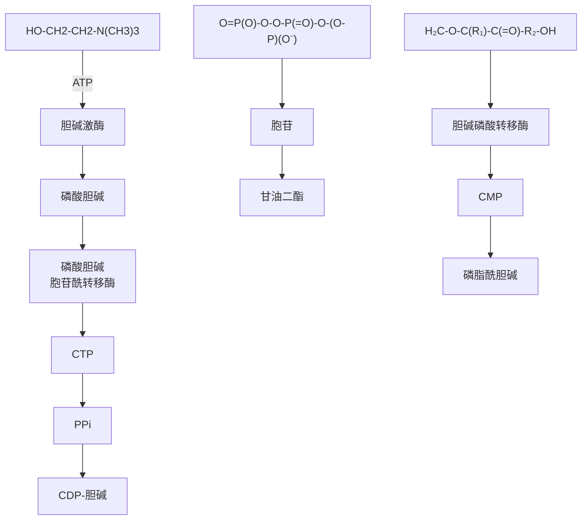
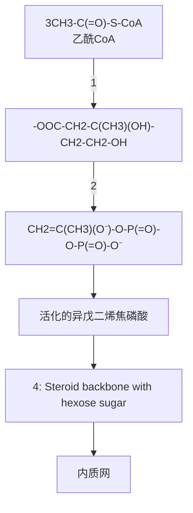
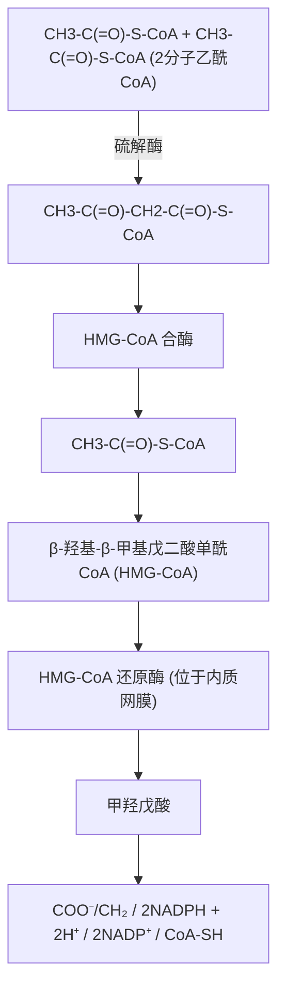
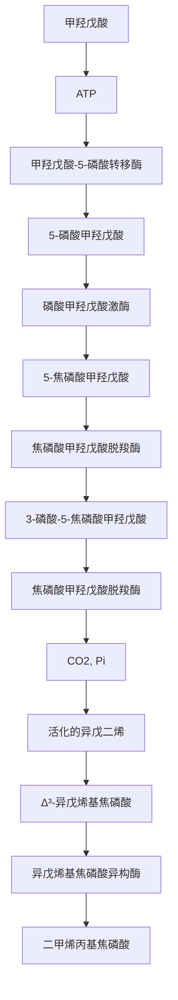
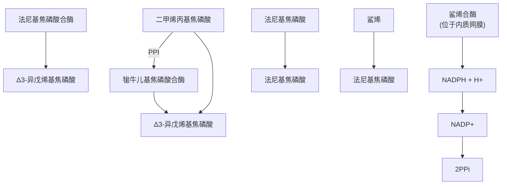
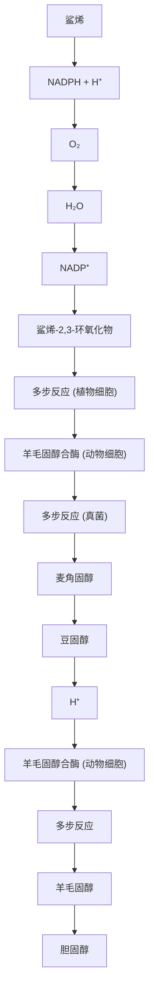
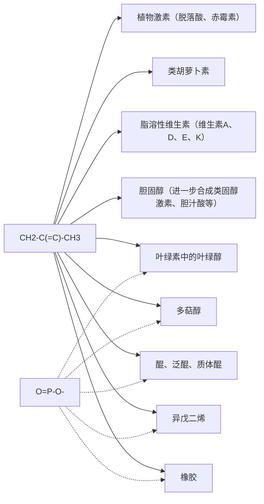
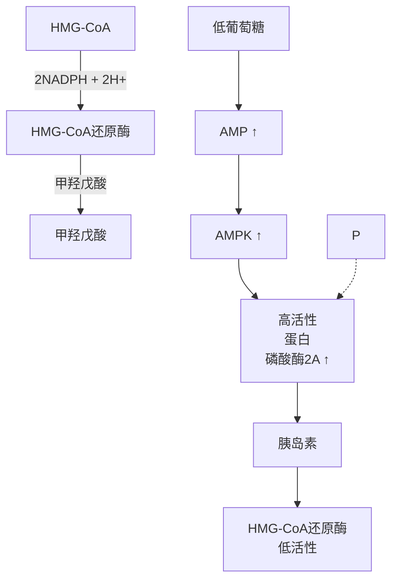

程中 UTP 等发挥的活化作用具有高度可比性。CDP 常用作脂质分子的活化基团，而 UDP 则用作糖类分子的活化基团。活化的前体再与另外一种分子的羟基缩合形成甘油磷脂或寡糖、多糖等产物。

## (2) 真核生物中的多种甘油磷脂利用 CDP- 甘油二酯生成

原核生物中的甘油磷脂均利用 CDP- 甘油二酯合成。在真核生物中，磷脂酰肌醇、磷脂酰丝氨酸、磷脂酰甘油等均利用 CDP- 甘油二酯前体生成（图 23-20）。催化它们生成的酶分别被称为磷脂酰肌醇合酶、磷脂酰丝氨酸合酶和磷脂酰甘油合酶。

磷脂酰肌醇的脂肪酸组成相对而言具有较高保守性，即硬脂酸和花生四烯酸通常分别占据甘油的C1位和C2位。磷脂酰肌醇可以在特异性激酶的催化下，被磷酸化生成磷脂酰肌醇-4,5-二磷酸（$\mathrm{PIP}_2$）。$\mathrm{PIP}_2$ 位于质膜中，是一种重要的信号分子，同时也是信号分子的前体。此外，$\mathrm{PIP}_2$ 还可以被进一步水解，生成肌醇-1,4,5-三磷酸

$(\mathrm{IP}_3)$，后者是细胞内的第二信使。

## （3）真核细胞的其他一些甘油磷脂利用 CDP-头基生成

这包括磷脂酰乙醇胺和磷脂酰胆碱等，主要发生于内质网膜上。以磷脂酰胆碱合成为例说明如下（图23-22）。

首先，胆碱在胆碱激酶催化下，被ATP磷酸化生成磷酸胆碱。然后，在磷酸胆碱胞苷酰转移酶（phosphocholine cytidylyltransferase）催化下，磷酸胆碱被转化形成CDP-胆碱。磷酸胆碱胞苷酰转移酶是磷脂酰胆碱生物合成过程中的关键酶，催化的反应是磷脂酰胆碱合成途径的限速步骤。最后，在胆碱磷酸转移酶（cholinephosphotransferase）催化下，磷酸胆碱基团从CDP-胆碱被转移至甘油二酯，生成磷脂酰胆碱，同时释放CMP。

磷脂酰胆碱在哺乳动物细胞中是一种含量最丰富的磷脂，占膜脂质中甘油磷脂总量约50%。胆碱主要通过食物获得。肝细胞能以磷脂酰乙醇胺为底物，在磷脂酰乙醇胺甲基转移酶（phosphatidylethanolamine methyltransferase）催化下，由S-腺苷甲硫氨酸提供3个甲基，经过3次甲基化反应，最终生成一定量的磷脂酰胆碱（图23-23）。但这样内源性合成的磷脂酰胆碱无法满足动物的需求，仍需依赖外源性食物胆碱的补充。

flowchart

图 23-22 哺乳动物磷脂酰胆碱的合成

chemical

Chemical reaction pathway showing conversion of phosphatidylpropan-2-aminobutyric acid to phosphatidylpropan-3-aminobutyric acid via S-adenosylamine and S-adenosylamine hydrolysis steps

图 23-23 磷脂酰乙醇胺经三次甲基化可转变为磷脂酰胆碱

## 23.3.2 哺乳动物中甘油磷脂可通过头基交换而转化

这是 1970 年代观察到的一种现象。典型的例子是从磷脂酰胆碱和磷脂酰乙醇胺生成磷脂酰丝氨酸的过程。

磷脂酰丝氨酸在哺乳动物甘油磷脂总量中占比约为 10%。在正常细胞中，磷脂酰丝氨酸分布于质膜的内侧。然而，在细胞凋亡过程中，它通过翻转机制暴露于质膜的外侧，释放信号并吸引吞噬细胞清除自身。磷脂酰丝氨酸的合成主要由磷脂酰丝氨酸合酶（phosphatidylserine synthase）催化完成，它以两种同工酶形式存在，通过将丝氨酸分别替换磷脂酰胆碱中的胆碱（磷脂酰丝氨酸合酶 1）或磷脂酰乙醇胺中的乙醇胺（磷脂酰丝氨酸合酶 2）来合成（图 23-24）。

chemical

化学反应式图，展示丙氨酸、乙醇胺及其合成酶的磷酸酯反应路径

图 23-24 哺乳动物通过头基转换合成磷脂酰丝氨酸的过程

这两种磷脂酰丝氨酸合酶同工酶的活性均依赖钙离子的存在。这种合成途径无须消耗能量，利用已有的甘油磷脂，可快速响应生理需求，调节膜脂质的组成。甘油磷脂在体内通过多种途径合成，以维持它们在体内的动态变化和稳态。

## 23.3.3 含醚键的甘油磷脂的合成利用脂肪醇作为前体

在含醚键的甘油磷脂中，其甘油骨架的 C1 位通过醚键与脂肪醇碳链连接，而其 C2 位通过酯键与一个长短不一的脂肪酸碳链连接。缩醛磷脂（plasmalogen）和血小板活化因子（platelet-activating factor）均属于甘油醚脂。缩醛磷脂和血小板活化因子的合成过程与甘油磷脂合成既存在相似之处，也存在不同之处。以缩醛磷脂的合成为例说明如下（图 23-25）。

缩醛磷脂的合成过程起始于糖酵解中间物磷酸二羟丙酮与脂酰辅酶A的缩合反应，生成1-脂酰-二羟丙酮-3-磷酸。这一反应与磷脂酸的合成过程不同，由磷酸二羟丙酮酰基转移酶催化。随后，由1分子长链脂肪醇取代甘油骨架C1位的脂酰基。长链脂肪醇是从脂酰辅酶A经两步还原反应（由NADPH提供电子，先后由脂酰辅酶A还原酶和脂肪醛还原酶催化）生成的。取代后生成1-烷基-二羟丙酮-3-磷酸（1-烷基醚）。后者分子甘油骨架C2酮基被还原成羟基（也由NADPH提供电子），并发生脂酰化后，即生成1-烷基-2-脂酰甘油-3-磷酸，相当于磷脂酸的1-烷基醚衍生物。该中间体再与乙醇胺进行缩合（加入头基，与磷脂酰乙醇胺中的头基完全相同），在所形成中间物的C1位连接的脂肪链中引入双键，生成缩醛磷脂。最后一步反应为去饱和反应，也由一种混合功能氧化酶（细胞色素P450单加氧酶）催化，需 $\mathrm{O}_2$ 参与，NADPH提供电子，这与脂肪酸去饱和酶的作用机制高度类似（图23-8）。

缩醛磷脂的合成过程起始于过氧化物酶体（前三步反应），生成的1-烷基-甘油-3-磷酸中间体，随后被转运至内质网，在内质网中完成后续的脂酰化、头基的添加以及去饱和反应，最终形成缩醛磷脂。

## 23.3.4 细菌通常通过 CDP- 甘油二酯途径合成甘油磷脂

尽管真核细胞利用两种策略合成甘油磷脂（图23-20），但在细菌中，甘油磷脂均利用活化的CDP-甘油二酯作为前体生成（图23-26A）。

具体简单描述如下。磷脂酰丝氨酸由磷脂酰丝氨酸合酶催化，经活化的 CDP-甘油二酯与丝氨酸缩合生成，同时释放 CMP。磷脂酰乙醇胺则由磷脂酰丝氨酸脱羧酶催化磷脂酰丝氨酸脱羧后生成。磷脂酰甘油由磷脂酰甘油磷酸合酶催化，使 CDP-甘油二酯与甘油 -3- 磷酸缩合生成磷脂酰甘油 -3- 磷酸，后者再在一种磷酸酶的作用下水解，脱去磷酸基团，即生成磷脂酰甘油。心磷脂因最早从新鲜的牛心肌中分离出来而得名，广泛存在于动植物和微生物中。在原核细胞中，由心磷脂合酶（cardiolipin synthase）催化 2 分子磷脂酰甘油缩合而成，同时释放 1 分子甘油。它含 2 分子磷脂酰基和1分子甘油，故又名双磷脂酰甘油。

图 23-25 缩醛磷脂合成的过程

在真核细胞中，线粒体内膜上合成心磷脂的过程与原核生物稍有差异。真核细胞心磷脂合酶催化1分子磷脂酰甘油与1分子CDP-甘油二酯（非2分子磷脂酰甘油）缩合生成心磷脂。心磷脂分子独特的锥状结构（图23-26B），对于维持呼吸链中细胞色素 $c$ 氧化酶等膜蛋白复合物结构和活性是必需的。

图 23-26 细菌中以 CDP-甘油二酯为前体合成几种甘油磷脂的过程（A）和心磷脂结构（B）
在类球红细菌（Rb. sphaeroides）光反应中心结合的心磷脂结构（PDB:1QOV）中，四个酰基碳链（R1—R4）长度均短于常见的 18 个碳原子，其碳原子个数分别在 R1—R4 后面的括号中标注。

## 23.4 鞘脂的生成始于棕榈酰辅酶 A 与丝氨酸之间的缩合

鞘脂（sphingolipid）是生物膜脂质中与甘油磷脂并列的另一大类，其骨架为鞘氨醇（sphingosine）。典型的鞘脂包括鞘磷脂和鞘糖脂等。它们的结构特征与甘油磷脂类似，含一个疏水尾部和一个亲水头部。神经酰胺（ceramide）是合成鞘磷脂和鞘糖脂的共同前体。本节介绍鞘磷脂和代表性鞘糖脂的从头合成过程（图23-27）。

## (1) 神经酰胺由棕榈酰辅酶 A 与丝氨酸缩合后衍生而成

鞘脂的合成途径涉及多种细胞器，主要发生于内质网和高尔基体。相比之下，甘油磷脂的合成主要发生在光面内质网膜和线粒体内膜上。尽管两类脂质的合成过程在某些方面相似，但也存在显著差异。

鞘脂合成起始于棕榈酰辅酶A与丝氨酸之间的缩合脱羧。该反应由位于光面内质网膜上的丝氨酸棕榈酰转移酶（serine palmitoyltransferase）催化，利用磷酸吡哆醛（PLP）为辅因子，生成β-酮鞘氨醇（β-ketosphinganine），同时释放辅酶A和 $CO_{2}$ (源自丝氨酸的羧基)。这步反应是鞘脂合成的限速步骤。

图 23-27 从棕榈酰辅酶 A 和丝氨酸经由神经酰胺生成鞘磷脂和鞘糖脂的过程

flowchart

This flowchart illustrates the metabolic pathway of a glycosaminoglycan, showing the conversion of amino acids and alcohols to various organic compounds like glucose, glucose-cholesterol, and phosphate.

β-酮鞘氨醇经 β-酮鞘氨醇还原酶催化，被还原为二氢鞘氨醇（sphinganine），该反应由 NADPH 提供电子。随后，由二氢神经酰胺合酶（dihydroceramide synthase）催化，二氢鞘氨醇中 C2 位氨基与一分子脂酰基以酰胺键连接，生成二氢神经酰胺。该中间体再由二氢神经酰胺去饱和酶（一种混合功能氧化酶）催化，发生去饱和反应（类似于脂肪酸碳链去饱和反应，见图 23-8）生成神经酰胺。

## （2）从神经酰胺衍生鞘磷脂或鞘糖脂等

在高尔基体中，神经酰胺 C1 位羟基通过加入不同的头基生成不同类型的鞘脂，如鞘磷脂或鞘糖脂。

由位于高尔基体膜上的鞘磷脂合酶（sphingomyelin synthase）催化，将磷脂酰胆碱分子中的头基磷酸胆碱转移至神经酰胺C1位羟基，则生成鞘磷脂，同时释放一分子甘油二酯。最初，人们认为磷酸胆碱基团也是由CDP-胆碱提供的。然而，1970年代的同位素标记示踪研究揭示，磷脂酰胆碱才是鞘磷脂合成的头基供体，纠正了先前的错误。

由同样位于高尔基体膜中的神经酰胺葡萄糖基转移酶（ceramide glucosyltransferase）催化，UDP-葡萄糖中的葡萄糖基被转移至神经酰胺C1位羟基，则生成鞘糖脂中的葡萄糖脑苷脂（glucocerebroside）。神经酰胺C1位羟基也可连接其他单糖或寡糖基（这包括决定ABO血型的鞘糖脂所含有的三种寡糖基），生成其他类型的鞘糖脂。例如，当神经酰胺C1位羟基连接半乳糖基（由UDP-半乳糖提供）时，则生成半乳糖脑苷脂（galactocerebroside）。

神经节苷脂（ganglioside）是一类更为复杂的鞘糖脂，其特征是在神经酰胺分子C1位羟基上连接有一个或多个唾液酸（sialic acid）糖基，如N-乙酰神经氨酸（N-acetylneuraminate）或N-羟乙酰神经氨酸（N-glycolylneuraminate）。这些携带寡糖链的分子位于细胞表面，在细胞识别、黏附和信号转导过程中发挥作用。迄今为止，已鉴定大约200种不同的神经节苷脂，它们的多样性主要源于寡糖链的组成差异。神经节苷脂的合成是一个有序的过程，涉及在神经酰胺分子上顺序添加活化的单糖。每一步添加反应由位于高尔基体膜中特异的糖基转移酶催化。不同类型的神经节苷脂的糖基组成因其类型而异，这种差异由细胞中表达的糖基转移酶的种类所决定。糖基转移酶的糖基供体包括UDP-葡萄糖、UDP-半乳糖、UDP-N-乙酰半乳糖胺以及CMP-N-乙酰神经氨酸等。

## 23.5 动物胆固醇由乙酰辅酶 A 提供的二碳单位经缩合反应合成

胆固醇也是构成真核细胞生物膜的重要脂质成分，尤其在哺乳动物细胞中发挥重要作用。此外，它还是合成类固醇激素和胆汁酸等的前体物质。从分离纯化、元素分析、结构测定、生物合成途径以及含量调控等多方面，人们对胆固醇的研究已持续数百年，但相关研究仍在不断深入。

胆固醇的化学结构涉及四个融合在一起的环（即环戊烷多氢菲），总共含27个碳原子。尽管胆固醇的结构看似复杂，但它能被包括人类在内的几乎所有动物合成。其中，肝脏是胆固醇合成的主要场所，大约70%\~80%的胆固醇由肝脏合成，大约10%由小肠合成。

早在 1920 年代，英国学者哈罗德·钱农（Harold Channon, 1897—1979）就观察到，给大鼠饲喂角鲨烯（squalene；一种于 1910 年代从鲨鱼肝脏中分离的非皂化脂肪）时，其

chemical

Chemical structure of a complex organic molecule with labeled carbon atoms and functional groups

图23-28 胆固醇分子中的所有碳原子均由乙酸中的相应碳原子提供

组织中的胆固醇含量显著增加。在1930年代，美国学者鲁道夫·舍恩海默（Rudolf Schoenheimer，1898—1941）等观察到，胆固醇合成在小鼠体内是按需进行的:当从食物中摄取足量胆固醇时，体内胆固醇的合成会相应减少。在同期，舍恩海默和戴维·里滕伯格（David Rittenberg，1906—1970）等人利用氘（${}^{2}\mathrm{H}$，即重氢）标记的重水（$\mathrm{D}_2\mathrm{O}$）饲喂大鼠，发现在胆固醇分子中的所有氢原子均可被氘标记。这一结果表明，胆固醇可能是由小分子单位缩合而成的。在1940年代，里滕伯格和康拉德·布洛赫（Konrad Bloch，1912—2000）等使用氘标记的乙酸分别饲喂大鼠和小鼠，发现氘存在于胆固醇的侧链和甾核中，排除了琥珀酸等是胆固醇合成直接中间体的可能性；而且，氘主要是从乙酸的甲基部分进入胆固醇分子中。随后，布洛赫等利用稳定重同位素$^{13}\mathrm{C}$和放射性同位素$^{14}\mathrm{C}$分别标记乙酸的甲基碳和羧基碳，然后饲喂大鼠，并对被标记的碳原子出现在胆固醇分子中的精确位置进行了鉴定。他们发现胆固醇分子中的所有碳原子均分别源自乙酸分子的甲基碳和羧基碳（图23-28）。也就是说，乙酸（在体内以乙酰辅酶A的形式存在）是胆固醇合成的唯一前体。

## 23.5.1 动物体内的胆固醇合成大约涉及 30 步酶促化学反应

长期研究表明，机体内的胆固醇既可从食物摄取，也可由自身细胞从头合成。在哺乳动物体内，胆固醇的合成主要发生于肝脏，其合成过程起始于胞质溶胶，最终在内质网膜上完成。

该合成过程大约涉及30步酶促反应，可人为划分为四个阶段（图23-29）。第①阶段:由3分子乙酰辅酶A经缩合、还原形成含6个碳原子的中间物甲羟戊酸。第②阶段:甲羟戊酸转化为活化的异戊二烯中间物，即异戊烯基焦磷酸和二甲烯丙基焦磷酸。第③阶段:由6分子异戊二烯活化中间体聚合形成含30个碳的鲨烯中间体。第④阶段:鲨烯环化形成羊毛固醇中间体，再经多步反应生成胆固醇。

与脂肪酸合成（见图23-6）类似，胆固醇合成的所有碳原子也均来源于乙酰辅酶A，同时合成反应所需的还原当量也由NADPH提供。胆固醇合成是一个高度耗能的过程:每合成1分子胆固醇需消耗36分子ATP及16分子NADPH。

flowchart

图23-29 胆固醇的合成可被划分为四个阶段

①由3分子乙酰辅酶A缩合成1分子甲羟戊酸；②由甲羟戊酸转化为活化的异戊二烯；③由6分子活化的异戊二烯缩合生成1分子鲨烯；④由鲨烯转化为胆固醇。

flowchart

图23-30 由乙酰辅酶A合成甲羟戊酸的过程

## (1) 胆固醇合成第一阶段 (由 3 分子乙酰辅酶 A 缩合成 1 分子甲羟戊酸)

如图 23-30 所示，胆固醇的合成始于 2 分子乙酰辅酶 A 之间缩合形成乙酰乙酰辅酶 A 的酶促反应。该反应由硫解酶（thiolase）催化，是脂肪酸 β 氧化途径最后一步反应（见图 22-6），也与酮体生成的第一步反应（见图 22-20）完全相同。值得注意的是，胆固醇合成始于肝细胞的胞质溶胶，而脂肪酸 β 氧化和酮体生成则均发生于线粒体基质中；因此，催化胆固醇合成的硫解酶实际上为另外两条代谢途径中所使用酶的同工酶，并非完全相同。

随后，乙酰乙酰辅酶 A 再与 1 分子乙酰辅酶 A 缩合，生成 β-羟基 -β-甲基戊二酸单酰辅酶 A（β-hydroxy-β-methylglutaryl-CoA，HMG-CoA）。该反应由胞质溶胶中的 HMG-CoA 合酶催化，线粒体基质中催化酮体合成的 HMG-CoA 合酶是其同工酶。在位于光面内质网膜上的 HMG-CoA 还原酶（HMG-CoA reductase；其活性中心位于胞质溶胶侧）的作用下，由 2 分子 NADPH 提供 4 个电子，HMG-CoA 被还原为 3,5-二羟基-3-甲基戊酸，简称为甲羟戊酸（mevalonate），反应释放 1 分子辅酶 A。HMG-CoA 还原酶作为一种调节酶，催化胆固醇合成的限速步骤（具体见后）。

（2）胆固醇合成的第二阶段（由甲羟戊酸生成活化的异戊二烯）

如图23-31所示，经前三步反应生成的甲羟戊酸将经历两次磷酸化，分别由甲羟戊酸-5-磷酸转移酶（mevalonate 5-phosphotransferase）和磷酸甲羟戊酸激酶（phosphomevalonate kinase）催化，生成5-焦磷酸甲羟戊酸。随后，在焦磷酸甲羟戊酸脱羧酶（pyrophosphomevalonate decarboxylase）的催化下，形成一种不稳定的中间体3-磷酸-5-焦磷酸甲羟戊酸（C3位羟基通过磷酸化成为一个易离去基团）之后，迅速发生脱羧和脱磷酸反应，生成含5个碳原子的 $\Delta^3$ -异戊烯基焦磷酸（$\Delta^3$-isopentenyl pyrophosphate）。后者中有一部分发生自发异构反应，生成二甲烯丙基焦磷酸（dimethylallyl pyrophosphate）。

这里生成的两种活化异戊二烯形式，将作为下一阶段缩合反应的共同前体。值得注意的是，植物也通过生成甲羟戊酸中间体的途径合成固醇类（即甾醇类）化合物，细菌则一般不合成胆固醇或其他固醇类物质。

（3）胆固醇合成的第三阶段（由6分子活化异戊二烯缩合成1分子鲨烯）

如图23-32所示，该阶段始于1分子二甲烯丙基焦磷酸与1分子 $\Delta^3$ -异戊烯基焦磷酸进行的“首尾”缩合，生成1分子含10个碳原子的牻牛儿基焦磷酸（geranyl pyrophosphate），释放1分子焦磷酸。该反应由牻牛儿基焦磷酸合酶催化。

随后，1 分子牻牛儿焦磷酸再与 1 分子  $\Delta^{3}$ -异戊烯基焦磷酸进行 “首尾” 缩合，生成含 15 个碳原子的法尼基焦磷酸（farnesyl pyrophosphate），释放 1 分子焦磷酸。催化这步反应的是法尼基焦磷酸合酶。在此基础上，在鲨烯合酶（squalene synthase）的催化下，2 分子法尼焦磷酸进行“头对头”缩合，生成含30个碳原子的鲨烯（squalene）。该反应需要1分子NADPH参与，并释放2分子焦磷酸。鲨烯又名三十碳六烯，属萜类化合物。其中的主链含24个碳原子，另外6个碳原子以甲基支链形式存在，分子中的6个碳碳双键全为反式构型。这些中间物的命名均与最初分离得到它们的物种名称有关，如鲨烯最初是从鲨鱼的肝脏中分离纯化的。

flowchart

图 23-31 甲羟戊酸生成活化的异戊二烯的过程

flowchart

图 23-32 六分子活化异戊二烯缩合形成鲨烯中间体

值得注意的是，鲨烯合酶位于内质网膜上，但其活性中心位于胞质溶胶侧，使其可以直接利用胞质溶胶中生成的法尼基焦磷酸，而生成的疏水性鲨烯，则可在膜上参与后续的胆固醇生成反应。

（4）胆固醇合成的第四阶段（鲨烯转化为胆固醇）

此阶段涉及的反应发生于内质网膜上，鲨烯这种线性前体将被转变为胆固醇的四环结构（图23-33）。因此，闭环是这一阶段的主要特征。

在动物肝细胞中，含30个碳原子的鲨烯先由鲨烯单加氧酶（squalene monooxygenase）催化，为环化做准备。该酶也被称为鲨烯环氧化酶（squalene epoxidase），是一种位于内质网膜上的混合功能氧化酶:分子氧中的1个氧原子被加到碳链末端的双键上，形成鲨烯2,3-环氧化物（squalene-2,3-epoxide）活性中间体；而分子氧中的另1个氧原子接受NADPH传递的电子被还原为 $H_{2}O$ ；该酶含FAD辅因子。与其他单加氧酶相比，该酶具有以下特点:催化过氧化（非羟基化）反应；存在一条疏水性通道，可供底物进出；不

含血红素铁。鲨烯单加氧酶也是胆固醇从头合成的调节酶之一。

随后，鲨烯2，3-环氧化物在动物体内羊毛固醇合酶（lanosterol synthase）——一种鲨烯2，3-环氧化物环化酶——的催化下，发生一种独特的系列闭环反应，生成羊毛固醇。该酶无需任何辅因子，仅依赖活性位点酸性氨基酸触发环化反应。羊毛固醇通过一系列大约19步反应，最后转化为胆固醇。这涉及侧链上1个碳碳双键的还原，固醇环上另1个碳碳双键位置的改变及3个甲基的去除等。其中的脱甲基反应依赖于NADPH、氧气以及细胞色素 $b_{5}$ 家族成员的协同作用（通过电子传递）。动物、植物、酵母细胞生成固醇的途径有所不同:动物体内环化反应形成的产物是羊毛固

flowchart

图 23-33 鲨烯经由羊毛固醇转化为胆固醇的过程

醇（lanosterol），并最终转化为胆固醇；在植物中，鲨烯2,3-环氧化物经多步反应生成豆固醇（stigmasterol）；在酵母中，环化后的最终产物为麦角固醇（ergosterol）（图23-33）。

异戊烯基焦磷酸是生物体合成多种类异戊二烯化合物的前体。这些类异戊二烯化合物（isoprenoid）包括脂溶性维生素、植物色素、多萜醇（dolichol）和泛醌等（图23-34），具有多种生物学作用（见第7章）。它们可能代表了一类最古老且结构最多样化的天然化合物。迄今为止，在自然界中已发现超过20000种不同的类异戊二烯化合物。

## 23.5.2 动物细胞通过对 HMG-CoA 还原酶等的调节维持胆固醇的稳态

舍恩海默等在1930年代进行的小鼠喂食实验表明:当小鼠摄入不含胆固醇的食物时，其体内会合成胆固醇；而当小鼠被喂富含胆固醇的食物时，其体内的胆固醇合成则显著减少。无论饲喂含胆固醇食物与否，其体内均维持一定水平的胆固醇。这表明，动物体内不仅能够合成胆固醇，而且其合成量的高低受到食物中胆固醇含量的调节:摄取多则合成少，反之亦然。当动物摄入大量富含胆固醇的食物后，体内的胆固醇从头合成将被抑制。

动物细胞内的胆固醇主要来源于两条途径:一是从血液中摄取来自食物或其

flowchart

图 23-34 异戊烯基焦磷酸是合成大量类异戊二烯化合物的前体

flowchart

图 23-35 HMG-CoA 还原酶的活性可通过可逆磷酸化修饰调节

他组织中的胆固醇；二是细胞本身通过大约30步反应从头合成的胆固醇。从血液中摄取主要通过细胞表面的低密度脂蛋白（low density lipoprotein，LDL）受体介导的内吞作用，将LDL颗粒中的胆固醇摄入细胞内（具体见后），从而提高细胞内的胆固醇水平。

1960 年代，HMG-CoA 还原酶被确定为细胞内胆固醇从头合成途径中的主要调节酶。然而，HMG-CoA 还原酶的活性并不被任何下游代谢物直接别构抑制，其活性可通过磷酸化 / 去磷酸化修饰、酶的降解、转录和翻译等多种方式调节，下面分别简单介绍。

（1）HMG-CoA 还原酶活性可因磷酸化修饰而被抑制

HMG-CoA 还原酶的可逆磷酸化修饰主要受 AMP 活化蛋白激酶（AMPK）和胰岛素的调节（图 23-35）。当细胞内 AMP 的浓度很高（即 ATP 浓度很低）时，积累的 AMP 与 AMPK 结合而使后者激活，催化 HMG-CoA 还原酶一个特定丝氨酸残基侧链发生磷酸化修饰，使其活性降低，从而减慢胆固醇的合成速率。

胰岛素通过诱发 HMG-CoA 还原酶的去磷酸化而提高其活性。具体而言，胰岛素通过激活蛋白磷酸酶 2A（PP2A），导致 HMG-CoA 还原酶去磷酸化而被激活，最终促进细胞内胆固醇的合成。胰岛素还可通过促进糖酵解途径而提高细胞内 ATP 水平，降低 AMP 水平，从而降低 AMPK 活性。

## (2)当胆固醇水平升高时 HMG-CoA 还原酶可被降解

在细胞内，HMG-CoA 还原酶的半衰期通常为 2～4 小时，而在内质网膜中存在的其他蛋白质的半衰期则显著更长，约为其 10 倍。这表明，细胞内的 HMG-CoA 还原酶可被有效降解。具体而言，HMG-CoA 还原酶的降解是一种由胰岛素诱导基因蛋白（insulin-induced gene protein, Insig 蛋白；也位于内质网膜上）介导，并受固醇类化合物促进的过程（图 23-36）。

flowchart

This diagram illustrates the biochemical pathway of HMG-CoA还原酶 in response to oxygen fixation, showing how internal proteins (gp78 and Insig) are converted into a complex form that is then combined with胆固醇.

胆固醇衍生物氧固醇（oxysterol；如24-羟基胆固醇）和胆固醇合成途径的中间体羊毛固醇，可诱发HMG-CoA还原酶的降解。在血液或组织细胞中，胆固醇含量是氧固醇的 $10^{4} \sim 10^{6}$ 倍。

存在于内质网膜上的 HMG-CoA 还原酶可分为两个结构域:具有催化活性的胞质溶胶结构域和感知胆固醇前体或衍生物信号的膜结合结构域。氧固醇或羊毛固醇通过促进 Insig 蛋白与 HMG-CoA 还原酶结合，并招募如 gp78 等泛素连接酶（E3），触发 HMG-CoA 还原酶的泛素化修饰而促进其降解，进而降低 HMG-CoA 还原酶的活性，最终抑制细胞内胆固醇的合成（图 23-36）。

此外，氧固醇还可抑制 LDL 受体介导的外源性胆固醇摄入过程，但其具体作用机制目前还不十分清楚。

## (3) HMG-CoA 还原酶的活性还可通过转录和翻译过程调节

参与胆固醇合成和摄取等过程的蛋白质，如HMG-CoA合酶、HMG-CoA还原酶和LDL受体，它们编码基因的表达受到固醇调节元件结合蛋白（sterol regulatory element-binding protein，SREBP）调控。SREBP蛋白的转录活性受细胞内固醇类化合物（如胆固醇和氧固醇）水平的精细调节:当这些化合物水平较高时，SREBP蛋白不具有转录活性；只有当固醇类化合物水平较低时，SREBP蛋白才转变为具有活性的转录因子，从而促进相关基因的表达。

图 23-36 在高水平胆固醇前体或衍生物存在时，HMG-CoA 还原酶降解加速

Insig: 胰岛素诱导基因蛋白; gp78: 一种泛素连接酶 (E3); Ub: 泛素。

## 23.5.3 胆固醇可衍生成多种具有其他功能的生命分子

无论是从外源摄取的还是自身从头合成的胆固醇，都可转化为多种具有其他功能的重要生命分子。这包括胆汁酸（或胆汁盐）、类固醇激素及维生素 $D_{3}$ 等。

## (1) 胆固醇在肝细胞中可被转化为胆汁酸和胆汁盐等

从胆固醇到胆汁酸的转化是一个复杂的过程，涉及多个羟基的引入、碳碳双键的还原以及侧链的氧化等。这些转化增加了固醇分子中极性基团的数量，从而提高了其水溶性，使胆汁酸能更有效地被运输。从胆固醇合成胆酸（一种典型的胆汁酸）的过程如图23-37A所示。参与胆汁酸合成的羟化酶，如固醇 $7\alpha-$ 羟化酶（即CYP7A1，cytochrome P450 family 7 subfamily A member 1）、固醇 $12\alpha-$ 羟化酶（即CYP8B1）和固醇27-羟化酶（即CYP27A1），均属于细胞色素P450类混合功能氧化酶家族成员（因此名称中含CYP）。导致胆固醇侧链缩短的氧化过程发生于过氧化物酶体中，最终侧链断裂并释放1分子丙酰辅酶A后，生成含24个碳原子的胆酸。这些酶通过催化一系列复杂的氧化反应，将疏水性的胆固醇转化为具有较高亲水性的胆汁酸。胆酸可与甘氨酸或牛磺酸（taurine，2-氨基乙磺酸）分别形成酰胺键，即生成甘氨胆酸盐和牛磺胆酸盐（图23-37B）。

## （2）从胆固醇合成7-脱氢胆固醇中间体后，再生成维生素 $D_{3}$ 依赖紫外光照射

维生素  $D_{3}$ ，也称为胆钙化醇（cholecalciferol），是利用胆固醇从头合成途径的最后一种中间体——7-脱氢胆固醇（7-dehydrocholesterol，也称维生素  $D_{3}$  原）合成的。它经过一步还原反应即可转变成胆固醇。但是，通过动物皮肤表皮中的光化学反应，7-脱氢胆固醇被转化为维生素  $D_{3}$ ；通过先后在肝脏和肾脏细胞中的继续转化，最终形成 1,25-二羟胆钙化醇，也称骨化三醇（calcitriol）（图 23-38）。

这一转化过程发生于皮肤、肝脏和肾脏。第一步发生于皮肤表皮细胞的质膜中，无需酶的催化，但需紫外线照射（最有效波长为295～300 nm），在7-脱氢胆固醇分子C9位和C10位之间断开，形成维生素 $D_{3}$ 。第二步发生于肝细胞的内质网中，由CYP2R1催化，生成25-羟基维生素 $D_{3}$ 。第三步发生于肾脏细胞线粒体内膜，由1α-羟化酶（CYP27B1）催化，生成骨化三醇。骨化三醇发挥激素作用，促进小肠对钙的吸收以及骨骼的矿化。

## （3）胆固醇经简单的羟基化反应生成氧固醇

氧固醇是一种在1900年代发现的胆固醇衍生物，它调节胆固醇合成的作用直到1970年代才逐渐明朗。当时，人们注意到，直接加入胆固醇并不能有效调节其合成过程，从而推测氧固醇可能是一种调节胆固醇生成的效应分子。典型的氧固醇包括24-羟基和27-羟基胆固醇等。它们在肝细胞中由少量胆固醇经线粒体或微粒体中的羟化酶催化形成。与胆汁酸或骨化三醇生成过程中的羟化酶类似，这些羟化酶也属于细胞色素P450家族成员。因为增加的羟基，使氧固醇比胆固醇更易溶于水。目前认为氧固醇是调控胆固醇合成的效应分子，可通过促进HMG-CoA还原酶的降解

图 23-37 胆酸和胆酸盐由胆固醇衍生而成