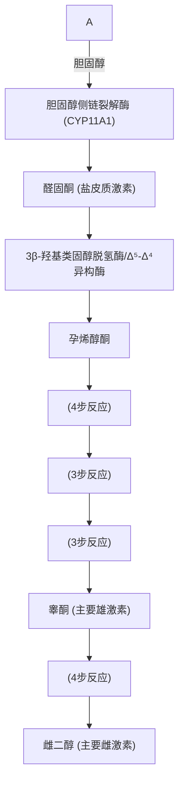
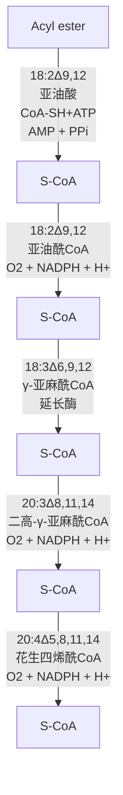
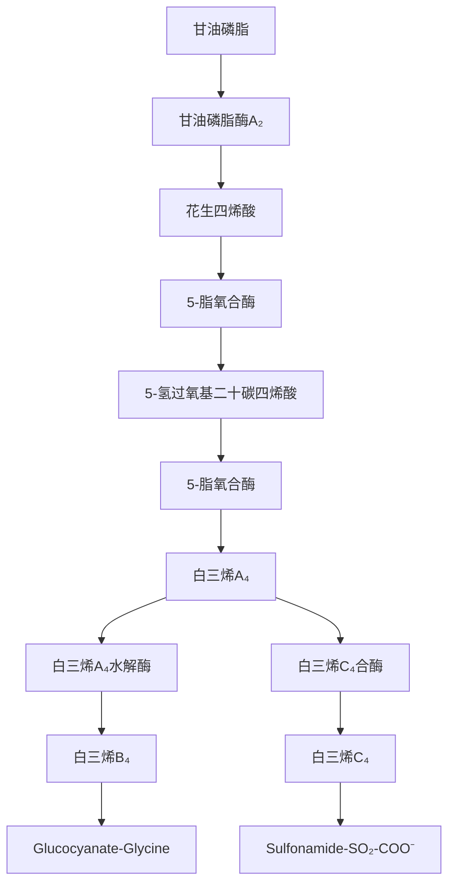
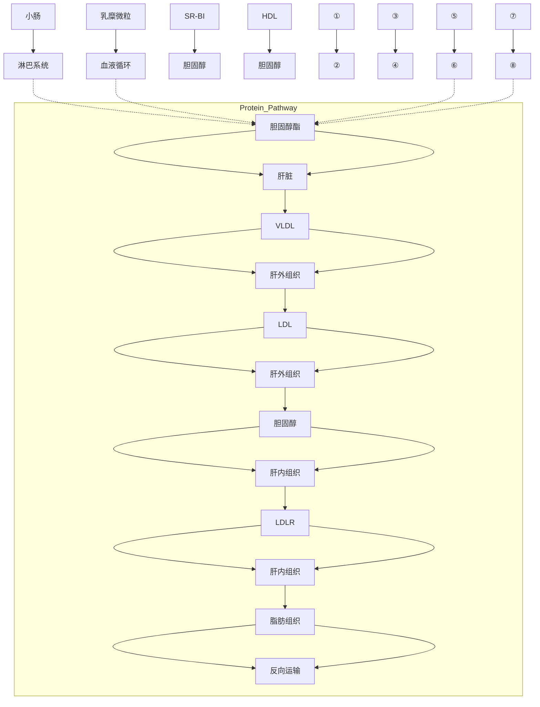
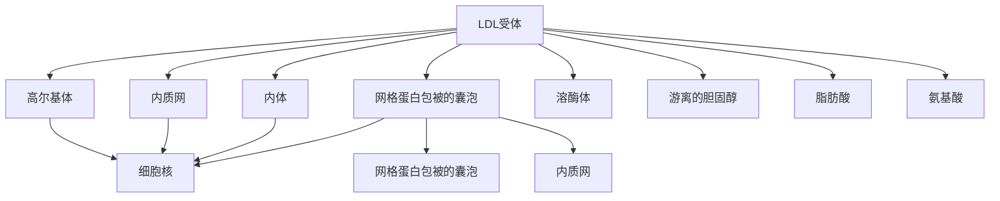
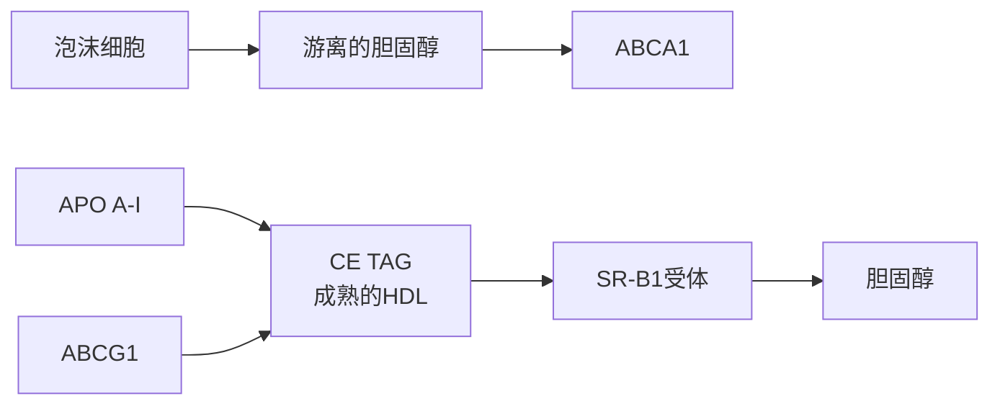
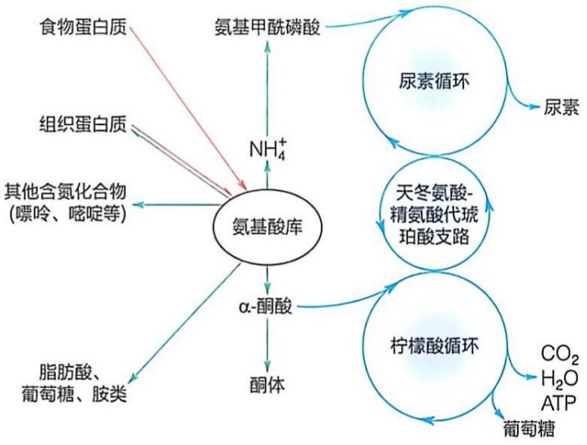
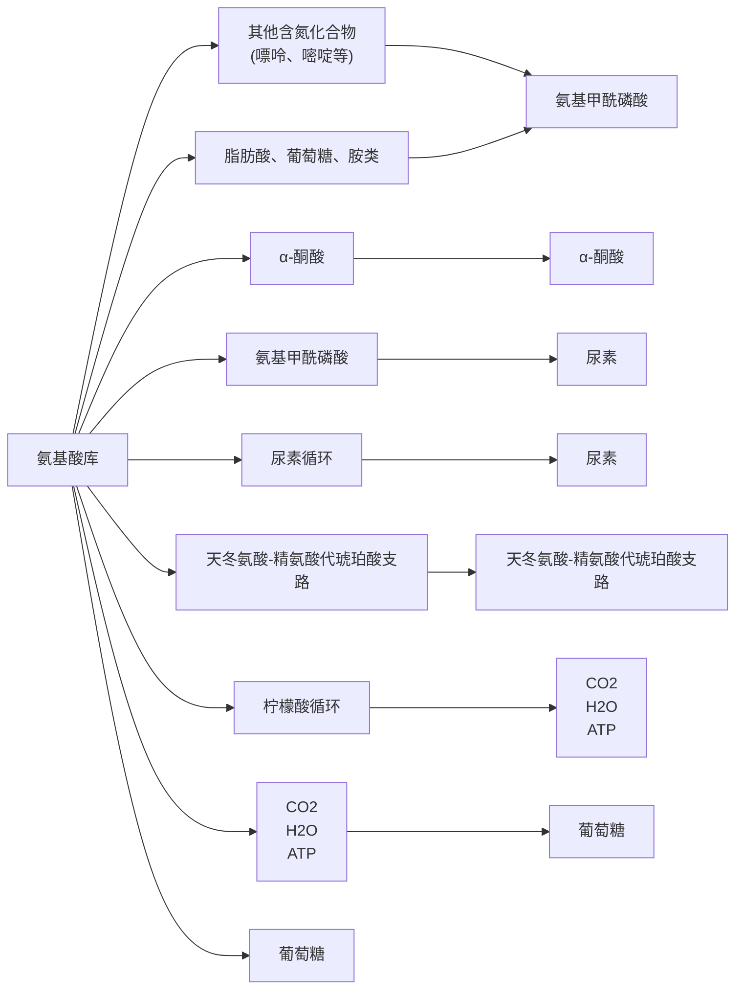

图 23-38 动物体内从 7- 脱氢胆固醇生成 1, 25-二羟基维生素 ${\mathrm{D}}_{3}$ 的过程

（图 23-36）、抑制 LDL 的内吞以及抑制胆固醇合成有关基因的转录而抑制细胞内胆固醇含量的增加。然而，其确切的调控机制尚未完全阐明。

（4）胆固醇分子中的羟基与脂酰基缩合生成高度疏水的胆固醇酯

胆固醇分子中的 C3 位羟基可与一个脂酰基（倾向于选择不饱和的油酰基等）缩合形成固醇酯（cholesteryl ester）。胆固醇酯是一种高度疏水的分子，不再具有胆固醇或脂肪酸分子的两亲性特征，这有利于胆固醇分子在不同器官之间以脂蛋白颗粒的方式进行运输以及在脂滴中的长期储存。

机体内存在两种方式将游离胆固醇转化为胆固醇酯。其一，发生于肝细胞的内质网膜上，胆固醇在脂酰辅酶A:胆固醇酰基转移酶（acyl-CoA:cholesterol acyltransferase，ACAT）催化下，由脂酰辅酶A提供脂酰基通过酯化反应生成。该酶被胆固醇别构激活，但被胆固醇酯别构抑制。其二，发生于血液中，在高密度脂蛋白（HDL）颗粒摄取肝外细胞释放的游离胆固醇进行反向运输的过程中，由附着于HDL颗粒表面的卵磷脂-胆固醇酰基转移酶（lecithin-cholesterol acyltransferase，LCAT）催化，将磷脂酰胆碱C2位连接的不饱和脂肪酸转移至胆固醇的羟基（图23-39）。生成的胆固醇酯形成HDL的疏水核心，同时形成的溶血卵磷脂保留在脂蛋白颗粒表面并改变颗粒形态。结合胆固醇酯的HDL经血液循环，将其运输至肝脏、肾脏及生殖腺等组织。

(5) 多种类固醇激素在肾上腺皮质、性腺和胎盘等组织中生成

胆固醇在肾上腺皮质、睾丸、卵巢和胎盘等组织中可转化为多种类固醇激素。其中的醛固酮和皮质醇在肾上腺皮质中合成；雄性激素睾酮（testosterone）主要在雄性生殖腺睾丸中合成，但肾上腺皮质和雌性卵巢也能合成少量；雌性激素雌二醇在雌性生殖腺卵巢中合成。所有固醇类激素均以含21个碳的孕烯醇酮（pregnenolone）为前体合成（图23-40）。

从胆固醇到孕烯酮醇的转化涉及从侧链去除6个碳原子，催化该反应的酶——胆固醇侧链裂解酶（CYP11A1），先分别在胆固醇分子的C20位和C22位上（图23-33）加上羟基，然后断裂碳碳键，并在C20位形成羰基。这发生于所有可以产生固醇类激素细胞的线粒体内膜上。

在卵巢细胞内，孕烯醇酮离开线粒体内膜进入内质网膜，并进一步在 $3\beta-$ 羟基类固醇脱氢酶 $\Delta^{5}-\Delta^{4}$ 异构酶这种双功能酶催化下，转化为孕酮（progesterone，也称黄体酮；含 $\Delta^{4}-3-$ 酮结构）。在肾上腺皮质中，孕酮继续在四种酶的催化下，转化为醛固酮（aldosterone；含

chemical

Chemical structures of phospholipid-alkyltransferase enzyme showing its conversion to fibrinol and fibrinol with labeled functional groups

图 23-39 卵磷脂-胆固醇酰基转移酶所催化的反应

C11位羟基、C18位羰基、C21位羟基)，后者为一种盐皮质激素，调节机体的水盐平衡，如促进肾脏对钠的重吸收、钾的排泄以及 $\mathrm{H^{+}}$ 排泄等。在肾上腺皮质中，孕酮也可转化为皮质醇（cortisol；在C11、C17、C21位上增加一个羟基），这种糖皮质激素具有促进糖异生，促进蛋白质分解以及促进脂解等功能。在睾丸中，孕酮转化为睾酮（C17位含一个羟基，侧链被去除），促进雄性特征的发育。在卵巢中，孕酮转化为睾酮后，最终转化为雌二醇（estradiol；C19位被脱去，A环转变为苯环，C3位连接一个羟基），促进雌性特征的发育。

## 23.6 哺乳动物以花生四烯酸为前体生成不同的类二十烷酸局部激素

动物体内的前列腺素（prostaglandin）、血栓烷（thromboxane）和白三烯（leukotriene）等类二十烷酸激素（eicosanoid）均以花生四烯酸（arachidonic acid,  $20:4\Delta^{5,8,11,14}$ ）为前体生成。

前面已经介绍过，动物细胞将硬脂酸通过单次去饱和反应可生成油酸（18:1 $\Delta^{9}$ ）（见图23-8）。然而，只有植物等可以在甘油磷脂分子中进一步使油酸碳链发生去饱和反应生成亚油酸（18:2$\Delta^{9,12}$）等多不饱和脂肪酸（见图23-9）。植物不能合成花生四烯酸，而动物则可利用必需脂肪酸亚油酸作为前体合成花生四烯酸。此处，我们先介绍动物从亚油酸合成花生四烯酸的过程，然后介绍花生四烯酸生成类二十烷酸局部激素的过程。

flowchart

图 23-40 胆固醇转化形成的孕烯醇酮是所有其他固醇类激素的前体

## (1) 从亚油酸合成花生四烯酸需进行碳链的去饱和及延伸

并非所有器官都能从亚油酸合成花生四烯酸，例如神经细胞则无法合成。这一生物合成过程主要在哺乳动物肝细胞的内质网膜上进行。合成完成之后，花生四烯酸被掺入甘油磷脂分子中，再并被运输至其他组织中。

首先，亚油酸从位于细胞质膜中的甘油磷脂分子中（一般位于C2，由磷脂酶 $\mathrm{A}_2$ 催化）水解产生，经脂酰辅酶A合成酶催化，被活化为亚油酰辅酶A。随后，亚油酰辅酶A经去饱和（由 $\Delta^6$ -去饱和酶催化）、延伸（丙二酸单酰辅酶A提供两个碳原子，生成二高- $\gamma$ -亚麻酰辅酶A）及再次去饱和（由 $\Delta^5$ -去饱和酶催化）的三步反应生成花生四烯酰辅酶A（图23-41）。最后，花生四烯酰辅酶A将其脂酰基再次用于合成甘油磷脂（一般连接于甘油的C2位），被运输至不同组织，并储存于生物膜中以备后续利用。

## （2）自甘油磷脂释放的花生四烯酸被用于合成类二十烷酸化合物

在白细胞介素（interleukin；由免疫细胞产生和释放）等特定信号的诱导下，特异的磷脂酶 $\mathrm{A}_2$ 被激活，催化甘油磷脂水解，释放连接在甘油骨架C2位的花生四烯酸。这一由磷脂酶 $\mathrm{A}_2$ 催化的步骤，正是类二十烷酸合成途径中的关键限速步骤。根据最终产物的结构特征（环形或线性），以花生四烯酸为前体的类二十烷酸的合成可分为两条途径:环加氧酶（cyclooxygenase，COX）途径生成含环的前列腺素和血栓烷，而脂加氧酶（lipoxygenase）途径则生成线性的白三烯和脂氧素等分子。

图 23-41 动物体内从亚油酸合成花生四烯酸的过程

flowchart

在人体内，前列腺素发挥着多种关键的生理作用，如调节炎症、感知疼痛、控制血液流动和调节生殖过程。不同类型的前列腺素分子均在其脂肪酸碳链的大约中间位置形成一个戊烷环。依据戊烷环上是否存在双键及取代官能团的不同，前列腺素被进一步细分为不同的亚类。

位于内质网膜的环加氧酶是一种“双功能酶”，既具有环加氧酶活性，也具有过氧化物酶（peroxidase）活性，催化花生四烯酸转化为前列腺素（图23-42）。

在环加氧酶的加氧酶活性催化下，2 分子氧被引入到花生四烯酸分子中，形成前列腺素  $G_{2}$ （ $PGG_{2}$ ）中间体（C8 与 C2 连接而形成五碳环，C9 与 C11 之间形成过氧桥，在 C15 位上加过氧羟基）。阿司匹林（aspirin）可共价修饰环加氧酶的加氧酶活性中心一个丝氨酸残基而不可逆地抑制其活性。随后，经环加氧酶的过氧化物酶活性催化，C15 位过氧羟基被还原为羟基， $PGG_{2}$  被转化为其他前列腺素和血栓烷的

flowchart

This flowchart illustrates the biochemical pathway of converting glutamine phosphate to various fatty acids and blood glucose, detailing the conversion steps involving intermediates like PUFAs, PGG2, PGH2, and PGF2.

图 23-43 从花生四烯酸合成白三烯分子的过程

flowchart

共同前体，即前列腺素  $H_{2}$ （ $PGH_{2}$ ）。在形成其他前列腺素时，C9 与 C11 之间的过氧桥将被打开，形成羟基和羰基等。在血小板中， $PGH_{2}$  经血栓烷合酶（thromboxane synthase）催化形成含一个六元醚环的血栓烷。血栓烷具有促进血小板凝集和平滑肌收缩等功能。

由 5- 脂氧合酶（5-lipoxygenase）催化，花生四烯酸可在其 C5 位引入过氧基，形成 5- 氢过氧基二十碳四烯酸（5-hydroperoxy eicosatetraenoate）（图 23-43）；经 5- 脂氧合酶催化，生成白三烯 A$_{4}$，然后，再生成白三烯 B$_{4}$ 和 C$_{4}$。白三烯 C$_{4}$ 是白三烯 A$_{4}$ 与谷胱甘肽结合产物（图 23-43）。脂氧合酶存在于心、脑、肺、脾等组织，属于混合功能加氧酶。

## 23.7 脂质分子以脂蛋白颗粒的形式在血清中运输

由于胆固醇、胆固醇酯和甘油三酯等脂质分子都几乎不溶于水，它们无法直接经血液循环运输。因此，这些分子必须依赖特异蛋白质的帮助，才能通过血液在不同组织之间进行转运。

在血浆中，脂质分子与载脂蛋白（apolipoprotein，Apo）组合成脂蛋白（lipoprotein）颗粒。这里的载脂蛋白可被看作是“脂质专车”。具体而言，脂蛋白颗粒是以胆固醇酯和甘油三酯等为疏水核心、以胆固醇和磷脂等形成的单分子层包被于外层、并镶嵌着载脂蛋白的颗粒。

当载脂蛋白和脂质成分的组成及所占比例不同时，脂蛋白颗粒的密度也不同，它们在离心力作用下的沉降速度也不同。据此，脂蛋白被大致分为四类:乳糜微粒（chylomicron，CM）、极低密度脂蛋白（very low density lipoprotein，VLDL）、低密度脂蛋白（low density lipoprotein，LDL）和高密度脂蛋白（high density lipoprotein，HDL）。一般而言，甘油三酯含量越高，脂蛋白的密度越低；但蛋白质含量越高，则脂蛋白的密度也越高。

脂质分子以不同脂蛋白形式在血液中循环，将胆固醇和甘油三酯等脂质分子分配于不同组织中，满足机体对脂质的需求（图 23-44）。

这些不同类型的脂蛋白颗粒，因为形态和大小的差异，可通过电镜负染制备方法进行有效区分。具体而言，从乳糜微粒至高密度脂蛋白颗粒，随着密度的依次增高，颗粒直径也依次减小。这些脂蛋白颗粒的带电情况也不同，故也可以通过电泳技术将它们有效分离。

下面简单介绍四类脂蛋白颗粒的组成和功能特征。

## (1) 乳糜微粒

这种脂蛋白颗粒的主要功能是将肠道吸收的脂质转运至肌肉、脂肪和肝脏等组织。它在小肠上皮细胞中生成，是人体血浆中体积最大而密度最小的一类脂蛋白颗粒。其中的甘油三酯含量可高达90%以上，而蛋白质的占比仅为2%。其结

flowchart

图 23-44 人体内脂质以脂蛋白颗粒形式运输

①小肠形成的乳糜微粒（CM）进入淋巴管后再进入血液循环系统。②乳糜微粒在血液中经过脂蛋白脂肪酶的作用，逐渐释放其核心的甘油三酯后，转变为乳糜微粒残体。③乳糜微粒残体经内吞作用进入肝细胞。④肝细胞合成的甘油三酯，胆固醇、胆固醇酯与载脂蛋白组装成极低密度脂蛋白（VLDL）。⑤VLDL经水解释放游离脂肪酸后形成低密度脂蛋白（LDL）。⑥LDL通过受体（LDLR）介导的内吞作用将胆固醇摄入肝外组织细胞。⑦肝脏合成高密度脂蛋白（HDL）的结构蛋白（如载脂蛋白A-I），并以新生HDL颗粒的形式将其分泌到血液中。⑧巨噬细胞等外周细胞中的胆固醇通过HDL收集转运至肝脏，这一过程称为胆固醇反向运输。⑨HDL通过与清道夫受体B类I型（SR-BI）识别、结合而被转运至肝内。

text_image

Apo B-48
Apo A-IV
Apo C-III
游离的胆固醇
Apo C-II
甘油三酯
磷脂单层膜
Apo E

图23-45 乳糜微粒的结构示意图

text_image

磷脂单层膜
甘油三酯
胆固醇酯
游离的胆固醇
Apo E
Apo C-III
Apo C-II
VLDL
Apo B-100
LDL

图 23-46 极低密度脂蛋白（VLDL）和低密度脂蛋白（LDL）
颗粒的结构示意图

构组成如图 23-45 所示。

膳食中的甘油三酯经消化后产生的脂肪酸和 C2 甘油单酯，在小肠中与胆汁酸等形成胶束（见图 22-1），然后被小肠上皮细胞吸收，并在其光面内质网中重新酯化成甘油三酯。甘油三酯与少量胆固醇、胆固醇酯及磷脂与在粗面内质网上合成的载脂蛋白组装成乳糜微粒。这些乳糜微粒经高尔基体分泌至细胞外，先进入淋巴系统，最终进入血液循环系统。

乳糜微粒中的主要载脂蛋白为 Apo B-48（乳糜微粒特异性标志物），但也含有 Apo C-Ⅱ、Apo C-Ⅲ和 Apo A-Ⅳ等载脂蛋白。分泌后的乳糜微粒可从高密度脂蛋白获取载脂蛋白 Apo C 和 Apo E，形成成熟的乳糜微粒。乳糜微粒表面所含 Apo C-Ⅱ可激活毛细血管中的脂蛋白脂肪酶，使得微粒中的甘油三酯水解为甘油和脂肪酸。脂肪酸被心肌、骨骼肌及脂肪组织等摄入和利用，而甘油则在肝脏中用于糖异生。这样，血液循环中的乳糜微粒逐渐变小，形成以含胆固醇和胆固醇酯为主的乳糜微粒残体，并被肝细胞质膜表面的 Apo E 受体所识别，内吞进入肝细胞。在肝细胞中，包含乳糜微粒残体的内体与溶酶体融合，载脂蛋白被水解为氨基酸，胆固醇酯分解为胆固醇和脂肪酸，被肝细胞利用。至此，乳糜微粒完成了将食物中的外源性胆固醇等转运至肝脏，同时将外源性甘油三酯转运至心肌、骨骼肌及脂肪组织等任务。

## (2) 极低密度脂蛋白颗粒

这类脂蛋白颗粒主要在肝脏中生成，将肝细胞中的甘油三酯、胆固醇和胆固醇酯转运至肝外组织。这些脂质分子由定位于肝细胞内质网上的甘油三酯转运蛋白转移至Apo B-100上，形成极低密度脂蛋白颗粒（图23-46）。

肝细胞中的 Apo B-100 与小肠上皮细胞中的 Apo B-48 是由同一个基因编码的。小肠的 Apo B-48 是通过对同一种 mRNA 分子中的碱基编辑后翻译生成的，是 Apo B-100 的截短形式，因分子量大概为 Apo B-100 的 48% 而得名。新生的 VLDL 分泌进入血液后，从 HDL 获取 Apo C-Ⅱ 和 Apo E 等载脂蛋白，转变为成熟的 VLDL。

VLDL 约含 50%\~70% 的甘油三酯和约 10% 的胆固醇。血液中成熟的 VLDL 经由被 Apo C-Ⅱ 激活的脂蛋白脂肪酶催化，其中的甘油三酯分解为脂肪酸和甘油，被肝外组织摄取和利用。白色脂肪细胞吸收这样的脂肪酸后，将其重新转化为甘油三酯，并储存于脂滴中。肌肉细胞也将吸收的脂肪酸转化为甘油三酯，并储存于脂滴中。与白色脂肪不同的是，肌肉细胞分解脂滴中的甘油三酯后，产生的脂肪酸进入线粒体被氧化而提供运动所需能量。因此，VLDL 是体内转运内源性甘油三酯的主要脂蛋白颗粒形式。

## (3) 低密度脂蛋白颗粒

这是 VLDL 在血液循环中释放大量脂肪酸之后，剩余的含高比例胆固醇和胆固醇酯的一种脂蛋白颗粒（图 23-46）。低密度脂蛋白几乎只含载脂蛋白 Apo B-100。人体血浆中大约 70% 的胆固醇由 LDL 所携带，它通过血液循环将胆固醇转运至肝外组织，如肌肉、肾上腺和脂肪组织；通过细胞表面的 LDL 受体内吞（图 23-47）。LDL 还可将胆固醇转运到动脉壁巨噬细胞中，使之转变为泡沫细胞，可诱发动脉粥样硬化（atherosclerosis），进而诱发心血管疾病等。不被外周组织吸收利用的 LDL 经血液循环返回肝脏，也由肝细胞表面的 LDL 受体介导内吞。进入肝细胞的胆固醇可转化为胆汁酸，或由脂酰辅酶 A- 胆固醇酰基转移酶催化，酯化成胆固醇酯而储存于肝细胞的脂滴中。这样，由肝脏合成的 VLDL 经 LDL 返回肝脏，完成内源性胆固醇的转运过程。

在哺乳动物中，大多数细胞的质膜上均携带 LDL 受体。LDL 受体在内质网合成，经过高尔基体的加工修饰后，被运送至质膜。血浆中的 LDL 颗粒表面的 Apo B-100 与质膜上的 LDL 受体特异结合，诱发内吞过程。一旦 LDL 及其受体进入早期内体，其酸性环境使 LDL 与受体分离，受体通过再循环内体返回至质膜。所形成的晚期内体则与溶酶体融合，其中的 LDL 在脂肪酶和蛋白酶的作用下被降解，释放出游离的胆固醇、脂肪酸和氨基酸等物质，供细胞利用。

LDL 受体的遗传缺陷将导致肝脏及肝外组织对 LDL 的正常摄取过程受到显著影响。这导致血浆中 LDL 的水平大幅升高，可诱发或加速动脉粥样硬化等疾病的发生。具体而言，LDL 的氧化在动脉粥样硬化的形成过程中可能扮演关键角色。当 LDL 在动脉内皮下被氧化后，将吸引单核细胞浸润。这些单核细胞随后分化为巨噬细胞，并通过受体介导的内吞作用，吸收氧化的 LDL，导致细胞脂滴中游离胆固醇逐渐积累，最终形成泡沫细胞。这些细胞经历凋亡或坏死，它们在动脉内皮下释放胆固醇，进而形成脂质条纹。随着这些脂纹的扩大和炎症反应的加剧，最终形成纤维斑块，导致动脉狭窄和硬化。

flowchart

图 23-47 低密度脂蛋白受体介导血浆低密度脂蛋白的内吞过程

值得注意的是，动物细胞内的 LDL 受体和 HMG-CoA 还原酶两者的基因表达受到协调控制，以维持细胞内胆固醇水平的相对稳定。当细胞内胆固醇水平较低时，细胞合成 LDL 受体和 HMG-CoA 还原酶；而当细胞内胆固醇水平较高时，这两种蛋白质的合成均被抑制。LDL 受体由美国学者约瑟夫·戈尔茨坦（Joseph Goldstein）和迈克尔·布朗（Michael Brown）等于 1970 年代发现。两种蛋白质均为降低体内胆固醇水平的重要药物靶点。

flowchart

图 23-48 高密度脂蛋白将胆固醇从外周逆向转运回肝脏 CE: 胆固醇酯; TAG: 甘油三酯; SR-B I: 清道夫受体 B 类 I 型。

## (4) 高密度脂蛋白颗粒

高密度脂蛋白颗粒的结构蛋白主要由肝脏合成，小部分由小肠细胞产生，其主要成分是载脂蛋白 Apo A-I。HDL 颗粒的直径最小，密度最高。新生的 HDL 含有极低量的胆固醇和胆固醇酯。其主要功能是将外周组织、包括泡沫细胞中的胆固醇，通过逆向运输途径经血液循环运回肝脏（图 23-48）。三磷酸腺苷结合盒转运体 A1（ATP-

binding cassette subfamily A member 1, ABCA1) 和 G1 (ATP-binding cassette subfamily G member 1, ABCG1) 均属于 ATP 结合盒转运蛋白超家族成员。ABCA1 通过水解 ATP 释放能量，将细胞内的胆固醇从细胞质膜转运至新生的 HDL 上；ABCG1 采用相同的方式，将胆固醇转运至成熟的 HDL 上。

在HDL被肝细胞摄取之后，它会将所携带的胆固醇和胆固醇酯带入细胞内部。这些胆固醇经由特异性酶的催化作用，转化为胆汁酸。随后，这些胆汁酸排出体外或转入胆囊中储存。这一摄取过程由特异性受体介导，该受体称为清道夫受体B类I型（scavenger receptor class B type I，SR-BI）。值得注意的是，SR-BI受体与LDL受体不同，它并不引发胞吞作用。在卸载其脂质后，HDL颗粒与受体分离，重新回到血液循环中。此外，HDL还能通过胆固醇酯转运蛋白（cholesteryl ester transfer protein）与VLDL和LDL进行胆固醇酯和甘油三酯的双向交换。胆固醇酯转运蛋白是一种疏水性糖蛋白。由于胆固醇酯通常源自HDL，而甘油三酯则是VLDL颗粒的组成部分，胆固醇酯转运蛋白的活性促进了胆固醇酯从HDL向VLDL和LDL的转移，同时甘油三酯则从VLDL向LDL和HDL的转移。

综上所述，HDL 将外周组织中的胆固醇转运至肝脏，并由肝脏转化为胆汁酸，通过肠道排出体外。因而维持细胞内胆固醇的稳态，防止胆固醇在血液中的浓度过高。

## 知识延展 23- 2

## 他汀类药物竞争性抑制 HMG-CoA 还原酶的活性

在 1970 年代，日本学者远藤章（Akira Endo，1933—2024）推测真菌不仅含有抗生素，还可能含可抑制胆固醇合成的分子。1972 年，通过筛选 6000 多种真菌，他们发现橘青霉菌（Penicillium Citrinum）培养液可有效抑制胆固醇的合成。1973 年，他们从橘青霉菌培养液中分离出一种新的化合物 ML-236B，因它与甲羟戊酸结构相似，可作为 HMG-CoA 还原酶的竞争性抑制剂。这种化合物被命名为美伐他汀（Mevastatin，又称 Compactin）。

1979年，德国默克（Merk）公司的研究团队从土曲霉菌（Aspergillus terreus）中分离出一种与美伐他汀结构相似的化合物，称为美维林素（Mevinolin）。这种化合物后来被开发为降脂药物洛伐他汀（Lovastatin），商品名为Mevacor，洛伐他汀属于他汀类药物。后续的临床研究表明，洛伐他汀和他汀类药物家族的其他成员能够有效治疗杂合型家族性高胆固醇血症（heterozygous familial hypercholesterolaemia）等高胆固醇血症。杂合型患者通常携带一个发生了突变的 LDL 受体基因，从而影响血液中胆固醇的清除。然而，洛伐他汀对于纯合型患者的效果有限。纯合型家族性高胆固醇血症，是一种更为严重的遗传性疾病，患者体内两个 LDL 受体基因都存在缺失突变，导致 LDL 受体完全或几乎完全失去功能。由于洛伐他汀的作用机制依赖于 LDL 受体的存在，因此在纯合子型患者中，洛伐他汀的治疗效果并不显著。这种治疗效果的差异与 LDL 受体在胆固醇代谢中的作用机制是一致的。LDL 受体负责从血液中清除 LDL，后者是胆固醇的主要载体。当 LDL 受体功能受损或缺失时，血液中胆固醇水平升高。因此，洛伐他汀和其他他汀类药物在治疗杂合子型家族性高胆固醇患者时有效，但对纯合子型患者则需其他疗法。

## ※展望

活细胞内生命分子的可视化是近期生命科学研究的一个活跃领域。通过利用荧光蛋白标记特异蛋白质而对后者进行可视化观察的技术已较为成熟，但对于包括脂质在内的其他分子的可视化观察手段还比较有限。鉴于脂质分子的疏水特性、且多以单体形式存在，对其进行可视化改造、实现对其在活细胞内的动态分布和运输的观察，存在更大的挑战。相关技术仍需进一步开发。

目前，研究人员对甘油磷脂和鞘脂等脂质分子的结构多样性与生物膜结构特征的多样性之间的对应关系认识不够。这可能与不同序列蛋白质折叠形成不同构象和不同功能的蛋白质的策略存在可比性。现在我们已能够通过计算机程序从氨基酸序列准确预测蛋白质的三维空间结构，未来是否能通过生物膜的脂质组成来预测其结构特征？

脂质代谢与肥胖、心血管疾病、脂肪肝等人类健康问题密切相关。这些疾病均以脂质过量储存为特征。那么，我们如何有效避免这些疾病的发生？这需要我们深入理解脂质合成与分解代谢途径之间的动态平衡机制是如何调整和维持的。这是基础科学研究中的难题，对人类健康具有重要的应用潜力，亟待解决。

## ※ 本章小结

发生于胞质溶胶中的脂肪酸合成过程利用来自线粒体基质的乙酰辅酶A所携带的二碳单位。它以柠檬酸的形式被转运至胞质溶胶后，先在乙酰辅酶A羧化酶催化下生成丙二酸单酰辅酶A，然后在每轮合成反应过程中提供一个二碳单位。

在脊椎动物中，脂肪酸的合成由一种包含七个活性中心的I型多功能脂肪酸合酶同源二聚体催化。每轮合成使碳链延长两个碳原子，中间体通过共价键连接到酰基载体蛋白结构域上。这一过程涉及五个步骤:装载、缩合、还原、脱水和再还原。通常，经过7轮这样的循环，从甲基端开始延伸，最终形成棕榈酸（C16），由硫酯酶活性中心催化释放。

在动物细胞中，棕榈酸可在光面内质网膜中继续延长其碳链；棕榈酸和硬脂酸可由内质网膜上的去饱和酶催化分别转化为棕榈油酸和油酸；植物可使油酸进一步去饱和生成亚油酸和 $\alpha-$ 亚麻酸等多不饱和脂肪酸。

乙酰辅酶 A 羧化酶是动物脂肪酸合成的关键调节酶。

甘油三酯或甘油磷脂的合成均源自共同的前体——磷脂酸。在动物体内，甘油三酯的合成过程受到激素的严格调控。

脂肪组织甘油三酯动用所产生的游离脂肪酸可重新酯化为甘油三酯；脂肪组织通过甘油异生过程产生甘油-3-磷酸，用于合成甘油三酯。

大肠杆菌甘油磷脂合成一般均起始于 CDP- 甘油二酯。真核细胞甘油磷脂则可遵循两种合成策略:利用 CDP- 甘油二酯或 CDP- 头部基团活化前体；缩醛磷脂和血小板活化因子等醚脂的形成则需要脂肪醇前体。

鞘磷脂和鞘糖脂的生成始于棕榈酰辅酶A和丝氨酸的缩合，以神经酰胺为关键中间体。

动物可利用食物中摄取的必需脂肪酸亚油酸合成花生四烯酸，后者是合成前列腺素、血栓烷和白三烯等局部激素的前体。

胆固醇合成可分为四个阶段:3 分子乙酰辅酶 A 缩合形成甲羟戊酸阶段；甲羟戊酸转化为活化的异戊二烯阶段；6 分子活化的异戊二烯缩合形成鲨烯阶段；鲨烯转化为胆固醇阶段。胆固醇可转化为其他功能分子，如胆酸盐、固醇类激素、维生素 D、氧固醇等；胆固醇及其他脂质需以脂蛋白颗粒形式通过血液转运；胆固醇的合成和运输被有效调控；血液中胆固醇过多可引起动脉粥样硬化。

以异戊二烯为前体可合成大量结构和功能各异的生物活性分子。

## ※ 思考题

1. 比较脂肪酸  $\beta$  氧化和脂肪酸生物合成的异同。
2. 脂肪酸碳链的延长有何要点？
3. 乙酰 CoA 羧化酶在脂肪酸合成中起什么作用？
4. 胰岛素如何调节甘油三酯的合成？

5. 胆固醇合成是一个严格调控的过程，描述 SREBP 通路如何调控胆固醇的合成。
6. 血浆脂蛋白在脂质代谢中有何重要作用？

## ※ 推荐阅读

- 1. MUNDAY M R. Regulation of mammalian acetyl-CoA carboxylase [J]. Biochem Soc Trans, 2002, 30 (6): 1059-1064.
- 该文综述了乙酰辅酶 A 羧化酶（ACC）调控脂肪酸代谢的功能及其分子机制，特别是 AMPK 与 PKA 激酶介导的磷酸化调控通路。
- 2. LANDS W E. Biosynthesis of prostaglandins [J]. Annu Rev Nutr, 1991, 11: 41-60.
- 该文综述了前列腺素等类二十烷酸的生物合成途径，重点分析了多不饱和脂肪酸在其中的调控作用及其对健康的动态影响。
- 3. ZHANG Y M, ROCK C O. Membrane lipid homeostasis in bacteria [J]. Nat Rev Microbiol, 2008, 6 (3): 222-233.
- 该文综述了细菌通过调控脂肪酸合成途径、重塑磷脂结构以及循环利用磷脂中间产物等多种机制，以动态维持其细胞质膜的脂质稳态与稳定性。
- 4. SINGH K, GRAF B, LINDEN A, et al. Discovery of a regulatory subunit of the yeast fatty acid synthase [J]. Cell, 2020, 180 (6): 1130-1143.
- 该研究首次在酵母脂肪酸合酶中发现了一个 $\gamma$ 亚基，它通过稳定脂肪酸合酶构象并重新定位酰基载体蛋白结构域，形成一个内部的反应室。
- 5. BROWN M S, GOLDSTEIN J L. A proteolytic pathway that controls the cholesterol content of membranes, cells, and blood [J]. Proc Natl Acad Sci USA, 1999, 96 (20): 11041-11048.
- 该文综述了细胞质膜完整性的维持依赖于胆固醇与磷脂中饱和与不饱和脂肪酸之间的动态平衡，并受内质网膜蛋白 SREBP 的转录调控。
- 6. LU X Y, SHI X J, HU A, et al. Feeding induces cholesterol biosynthesis via the mTORC1-USP20-HMGCR axis [J]. Nature, 2020, 588 (7838): 479-484.
- 该研究首次发现在进食状态下，mTORC1 通过磷酸化激活去泛素化酶 USP20，使其结合并稳定胆固醇合成的限速酶 HMG-CoA 还原酶，从而揭示了从营养感知到胆固醇合成的 mTORC1-USP20-HMGCR 调控轴。
- 7. LUO J, YANG H Y, SONG B L. Mechanisms and regulation of cholesterol homeostasis [J]. Nat Rev Mol Cell Biol, 2020, 21 (4): 225-245.
- 该文综述了胆固醇稳态对于细胞及机体功能的重要性，其稳态失调是引发心血管疾病、神经退行性疾病及癌症等多种疾病的重要病理生理基础。

（撰写:秦咏梅，李珍，陈晓伟；审修:宋保亮，李森，杨广笑，丁智）

# 24

## 氨基酸分解代谢

对生物体而言，氨基酸（这里特指  $\alpha-$  氨基酸）主要用于合成蛋白质。此外，它还能为其他生物分子的合成提供碳骨架或氮原子（第 25、26 章）。然而，与葡萄糖或脂肪酸相比，氨基酸作为燃料分子的利用程度相对较低。而且氨基酸被用作燃料分子的情况，因物种的不同以及生物体所处环境条件的不同而存在较大差异。

对食肉动物而言，其食物通常富含蛋白质，消化后产生丰富的氨基酸。因此在刚进食后，大约90%的能量来自氨基酸的分解代谢。但对食草动物而言，其能量很少来自氨基酸分解代谢。当处于饥饿状态时，动物需利用氨基酸分解代谢所产生的中间代谢物合成葡萄糖或酮体，供大脑等器官利用。有趣的是，动物摄取的超过其蛋白质合成所需的过量氨基酸既不可被直接储存也不可被直接排出，它们或作为燃料分子被氧化分解，或被转化为糖和脂肪等分子储存。脊椎动物体内的氨基酸主要源自食物蛋白质以及细胞内蛋白质降解的产物，这样获得的游离氨基酸首先被用于合成各种新生蛋白质和其他生物分子（如核苷酸等），只有过量的氨基酸才进入分解代谢途径。

对于细菌而言，它们在一定条件下可利用从环境中摄取的氨基酸作为燃料分子，例如大肠杆菌（Escherichia coli）等能够利用多种氨基酸作为碳源和能量来源。这些细菌拥有一系列分解代谢途径，能够分解支链氨基酸（如亮氨酸、异亮氨酸和缬氨酸）、芳香族氨基酸（如苯丙氨酸、酪氨酸和色氨酸）以及一些非α-氨基酸等。此外，在特定环境中，例如人体肠道内，某些细菌能够分解氨基酸生成短链脂肪酸（如乙酸、丙酸和丁酸），不仅为其他细菌提供能量，还能被宿主吸收利用。

植物极少将氨基酸作为能源，主要依赖光合作用产生的糖类分子来提供能量。与动物细胞相比，植物细胞内的氨基酸浓度一般较低，仅能满足合成蛋白质、核苷酸和其他生物分子所需，但植物需利用氨基酸分解产生的中间代谢物作为合成其他生物分子的前体。某些植物种子含有储存蛋白质，它们分解产生的氨基酸可用于合成幼苗生长所需的蛋白质。同时，这些氨基酸和储存的脂肪、淀粉等，可通过分解代谢为幼苗生长提供能量，特别是在植物光合作用系统处于未完全建立的幼苗阶段。氨基酸分解代谢产物还参与调节植物的生长和发育、维持细胞内 pH 的稳定、提供还原力以及增强植物对生物和非生物逆境胁迫的抵抗能力等。氨基酸在这些过程中的作用是多方面的，不仅提供合成糖类和脂质分子的前体，也为合成植物激素和次生代谢物提供前体。

在氨基酸分解过程中，其  $\alpha-$  氨基需先被脱去，形成氨。游离的氨对动物体具有毒性，必须通过转化为尿素等方式及时有效地排出体外。脱氨后的碳骨架以  $\alpha-$  酮酸的形式转化为柠檬酸循环的前体或中间体，进一步氧化分解或转化为其他生物分子（如葡萄糖、酮体或脂肪酸）被利用或储存。

尽管不同生物在不同条件下是否分解氨基酸以及氨基酸分解后的去向存在差异，但氨基酸分解代谢过程均涉及脱去氨基、氮的再利用或排泄、碳骨架的进一步分解或转化为其他分子等。值得注意的是，所有氨基酸的脱氨代谢模式高度类似，但脱氨后产生的碳骨架的代谢模式却高度不同。人体氨基酸分解代谢的缺陷可导致疾病（如苯丙酮尿症），这反映了氨基酸被有效分解的重要性。

本章重点介绍发生于脊椎动物（包括人）体内的氨基酸分解代谢途径。其内容主要包括氨基酸的脱氨基及尿素形成过程，不同氨基酸的碳骨架分解产生可进入柠檬酸循环等的中间体，一碳单位载体在氨基酸分解等代谢过程中的作用等。

## 24.1 动物体内的氨基酸主要源自食物蛋白质和细胞内蛋白质的降解

食物蛋白质是动物体内氨基酸的重要来源。食物蛋白质在消化道内消化分解为氨基酸后被吸收，然后通过血液循环运输至肝脏等不同组织。此外，1940年代的同位素标记实验结果表明，细胞中的蛋白质也处于动态平衡状态，即通过不断降解和合成而周转（turnover），这意味着细胞内的氨基酸被不断产生和重新利用。

## 24.1.1 食物蛋白质的营养价值主要由必需氨基酸的种类与含量等要素决定

在地球上存在的生物中，只有少数固氮细菌可以将大气中的氮气同化（固定）为自身有机分子中的氮（见第25章）。对其他生物而言，其体内的氮元素主要来源于环境。

## （1）生物（动物）的氮平衡状态可通过凯氏定氮法进行估算

生物体在给定时间段内摄入和排出氮量之间的差异，即氮平衡（nitrogen balance），可通过实验测定。有机分子中的氮含量可通过凯氏定氮法（Kjeldahl method）进行大致测定。其主要过程如下:先用浓硫酸将样品中的有机氮转化为无机铵盐（消化），然后在碱性条件下将铵盐转化为氨气；后者随水蒸气逸出后，被过量的硼酸液吸收（蒸馏），再以标准盐酸滴定（滴定），即可计算出样品的含氮量。由于蛋白质样品的含氮量比较恒定，约为 $16\%$ 。因此，可根据样品的含氮量计算蛋白质的含量:蛋白质 $(\%) =$ 氮含量 $(\%) \times 6.25$ 。具体而言，因为每克蛋白质含 $0.16\mathrm{g}$ 氮，所以 $1\mathrm{g}$ 氮就相当于 $1 / 0.16$ ，即 $6.25\mathrm{g}$ 蛋白质。

蛋白质在动物体内分解代谢所产生的含氮物质主要由尿和粪便（少量通过汗液）排出。测定尿与粪便中的含氮量（排出氮）及摄入食物的含氮量（摄入氮），可以估算动物个体蛋白质的代谢概况。动物个体的氮平衡可分为三种情况:①处于平衡状态，即摄入氮量等于排出氮量。②处于正的氮平衡状态，即摄入氮量高于排出氮量，反映体内蛋白质的合成量高于分解量。儿童、孕妇及恢复期患者属于此种情况。③处于负的氮平衡状态，即摄入的氮量低于排出的氮量，表明蛋白质摄入量不足或过量降解。饥饿或消耗性疾病患者处于这种情况。

基于对人体氮平衡情况的分析，成人每日有大约 20 g 蛋白质发生净分解后排出体外。鉴于食物蛋白质与人体蛋白质组成的差异，无法全部被利用，故成人每日需从食物中摄取蛋白质的最低量为 30～50 g，以维持身体的氮平衡。

## (2) 人体等脊椎动物需从食物获得必需氨基酸

从营养角度而言，仅仅摄入足量的蛋白质还不够，需要摄入足量的各类必需氨基

酸（essential amino acid），这反映蛋白质的“质”。必需氨基酸是指人体无法合成或合成不足，必须从食物中获取的氨基酸，一般包括赖氨酸、色氨酸、缬氨酸、亮氨酸、异亮氨酸、苏氨酸、甲硫氨酸、苯丙氨酸和组氨酸（表24-1）。

其余 11 种氨基酸可以由人体自身足量合成，故无须从食物中获取，被称为非必需（non-essential）氨基酸。但这种分类方法并不严格。例如，在非必需氨基酸中，有的氨基酸在某些特定条件下，如疾病、怀孕、婴儿期或创伤时，自身合成的量不能满足需要，称为条件（conditionally）必需氨基酸，这包括精氨酸、半胱氨酸、谷氨酰胺、甘氨酸、脯氨酸和酪氨酸等。动物体并不能够从头（即利用简单的前体）合成酪氨酸或半胱氨酸，只是酪氨酸可以通过苯丙氨酸（一种必需氨基酸）生成，而半胱氨酸则可通过甲硫氨酸生成。当然，如果从食物中摄取足量的酪氨酸和半胱氨酸，则无须从苯丙氨酸和甲硫氨酸生成。

因此，高营养价值的蛋白质需含有种类齐全的必需氨基酸，且每种必需氨基酸的含量需足够高。如果种类不全或含量较低，则为营养价值较低的蛋白质。一般而言，越接近人类的动物食品，其营养价值越高，因为其蛋白质中必需氨基酸的种类和比例与人体蛋白质相近。例如，胶原蛋白（市面上常有出售）的营养价值就相对较低，因为它所含的主要氨基酸成分为甘氨酸和脯氨酸，均为非必需氨基酸。此外，胶原蛋白几乎不含色氨酸和甲硫氨酸，且半胱氨酸含量也极低。

表 24-1 人体必需氨基酸和非必需氨基酸

| 必需氨基酸 | 非必需氨基酸 |
| --- | --- |
| 赖氨酸 | 丙氨酸 |
| 色氨酸 | 天冬酰胺 |
| 缬氨酸 | 天冬氨酸 |
| 亮氨酸 | 谷氨酸 |
| 异亮氨酸 | 丝氨酸 |
| 苏氨酸 | 精氨酸* |
| 甲硫氨酸 | 酪氨酸* |
| 苯丙氨酸 | 半胱氨酸* |
| 组氨酸 | 谷氨酰胺* |
|  | 甘氨酸* |
|  | 脯氨酸* |

这六种氨基酸在儿童生长发育期或特定疾病状态下是必需的。

如果将几种蛋白质进行混合，必需氨基酸可以互相补充，从而提高其营养价值。例如，谷类蛋白质的赖氨酸含量较低，但色氨酸含量较高；豆类蛋白质则相反，赖氨酸含量较高，色氨酸含量较低。两者混合食用则可提高其营养价值。

值得注意的是，对于动物体而言，非必需氨基酸是动物体自身可以合成的氨基酸。在演化过程中，存活下来的动物都维持着合成这些非必需氨基酸的能力。相比之下，动物自身不能合成必需氨基酸，表明生命活动对这些氨基酸的短暂缺失有较强的耐受性、这些氨基酸的合成途径更加复杂或者对它们的需求量可以从食物中摄取满足。因此，从生物演化角度看，非必需氨基酸（如谷氨酸等）可能对动物体更为重要，它们在动物体内的代谢和生理功能中更加不可或缺，即动物必须具备自身合成它们的能力。

## 24.1.2 细胞内维持着一种动稳态的氨基酸库

与其他代谢物类似，由体内或细胞内所有氨基酸组成的氨基酸库（pool）也维持一种动稳态。食物蛋白质消化产生的氨基酸和体内蛋白质降解产生的氨基酸均汇入氨基酸库。库中的氨基酸同时被分流，用于合成和更新组织蛋白质以及合成核苷酸的碱基、脂肪酸、葡萄糖或胺类（包括甲状腺激素、儿茶酚胺类激素及神经递质等）等生物分子（图24-1）。

人体每日更新体内约 1% 的蛋白质，其中约 70% 降解释放的氨基酸被重新用于合成蛋白质，剩下的约 20% 被进一步分解。因此，氨基酸分解代谢途径中某些关键酶的缺陷或功能异常可引发遗传性疾病。

过量氨基酸在发生氧化分解前须脱去氨基，所形成的氨对生物体（特别是大脑）具有毒性，需转化为尿素等含氮化合物排出体外（图 24-1）。

氨基酸脱氨后形成结构各异的  $\alpha-$  酮酸经不同的代谢途径氧化分解。其产物或为柠檬酸循环中间体，或被彻底氧化成  $CO_{2}$  和  $H_{2}O$ （释放能量用于生成 ATP），或进入糖异生途径被转化为葡萄糖，供大脑等器官用作燃料分子，或在肝细胞中转化为酮体后运送至其他器官提供能量

flowchart

图24-1 哺乳动物氨基酸分解代谢概况红色和绿色箭头分别反映氨基酸汇入和汇出氨基酸库，蓝色箭头反映氨基酸的氧化分解途径。