(图 24-1)。氨基酸分解代谢所产生能量仅占机体产能的大约 10%。

## 24.1.3 食物蛋白质在消化道内降解为氨基酸后被吸收

对于动物（包括人类）而言，食物蛋白质的消化过程从胃中开始，在小肠中结束。

## (1) 食物蛋白质在胃中发生变性和部分水解

食物蛋白质进入胃后，将刺激胃黏膜中的胃泌素细胞分泌肽类激素胃泌素（gastrin）。胃泌素通过血液运输到胃黏膜的壁细胞（parietal cell，也称泌酸细胞），刺激壁细胞分泌盐酸，同时刺激胃黏膜中的主细胞分泌胃蛋白酶原（pepsinogen）。

在生理条件下，胃液通常呈酸性（pH 1.5～2.5），这种酸性环境不仅可以使食物中的球状蛋白质发生变性，也发挥杀菌和抗病毒的作用，还能激活胃蛋白酶原。在酸性条件下，酶原分子发生构象调整而部分激活，随后通过自身剪切去除 N 端含 40 多个残基的肽段，生成最适 pH 为酸性的、具有完全水解活性的胃蛋白酶（pepsin）。胃蛋白酶的研究历史悠久:1830 年代，德国学者施旺首次鉴定到胃蛋白酶的存在；1920 年代，美国学者约翰·诺思罗普（John Northrop，1895—1981）成功使其结晶，并揭示了酶的化学本质为蛋白质；1930 年代，英国学者约翰·伯纳尔（John Bernal，1901—1971）对其进行了 X 射线晶体衍射分析，揭示了其具有明确的三维结构特征。

胃蛋白酶对肽键切割的特异性较低，主要裂解由苯丙氨酸、酪氨酸、色氨酸及亮氨酸等疏水性/芳香族氨基酸的羧基与其他氨基酸的氨基形成的肽键。这使得变性的食物蛋白质发生部分降解，主要形成大的肽段，同时也产生少量小肽段和游离氨基酸。

## (2) 蛋白质在小肠中被多种水解酶降解

蛋白质在小肠中被进一步水解成三肽、二肽和氨基酸后经上皮细胞吸收。

胃中的盐酸将刺激小肠中的 S 细胞分泌肽类激素促胰液素（secretin），后者通过血液运输至胰腺外分泌腺后，刺激其分泌碳酸氢根离子以中和从胃中带来的盐酸。

同时，由小肠上部（十二指肠）的内分泌细胞产生和分泌的肠促胰酶肽（cholecystokinin，CCK，也称胆囊收缩素）诱发胰腺外分泌细胞将多种酶原分泌到小肠中，这包括胰蛋白酶原（trypsinogen）、胰凝乳蛋白酶原（chymotrypsinogen）、弹性蛋白酶原（proelastase）以及羧肽酶原A和B（procarboxypeptidase A，B）。在胰蛋白酶原分子中，Asp-Asp-Asp-Asp-Lys-Ile这一序列可被小肠黏膜细胞分泌的肠激酶（enterokinase）识别并在Lys-Ile肽键处切割。作为一种锚定于细胞质膜上的蛋白质，肠激酶是一种丝氨酸蛋白酶，其前体经胰蛋白酶或一种类似酶切割后，转变为两条肽链并呈现活性。胰蛋白酶原经肠激酶激活为胰蛋白酶后，可激活其他蛋白酶原，产生具有活性的胰凝乳蛋白酶、弹性蛋白酶、羧肽酶、氨肽酶（aminopeptidase）等。

小肠上皮细胞除了分泌肠激酶的前体外，还分泌氨肽酶和二肽酶（dipeptidase）等酶的前体。在消化道中，不同蛋白酶对蛋白质进行水解，它们识别和切割氨基酸的位点各不相同，具体如图 24-2 所示。

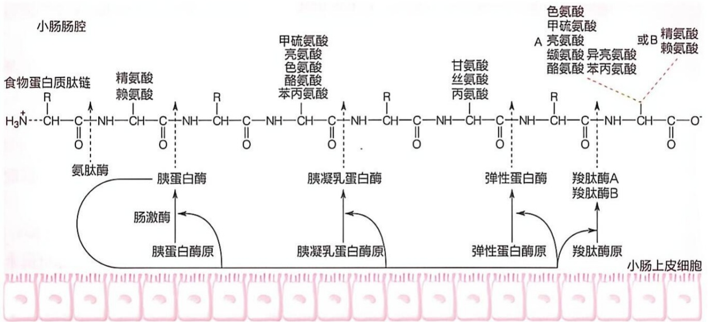

flowchart

图 24-2 食物蛋白质在动物小肠中被降解为小肽和氨基酸

在小肠黏膜细胞和胰腺外分泌细胞分泌的消化酶的协同作用下，食物中的蛋白质最终主要被水解为游离的氨基酸和少量短肽。这些游离氨基酸被转运至小肠上皮细胞，由此进入小肠绒毛中的毛细血管，并被运输至肝脏等器官。在哺乳动物体内，大多数食物来源的球状蛋白在胃肠道中几乎被完全水解为游离氨基酸。然而，某些纤维蛋白如角蛋白，仅能被部分消化。此外，一些植物性食物的蛋白质因包被了纤维素外壳，难以在胃肠道中有效变性及水解。

## (3) 氨基酸由小肠上皮细胞吸收进入血液

蛋白质在小肠中消化产生的氨基酸、二肽和三肽由小肠黏膜上皮细胞中的吸收细胞（enterocyte）吸收。具体而言，小肠上皮吸收细胞的肠腔侧质膜上的一种寡肽共转运蛋白（oligopeptide co-transporter）和多种氨基酸共转运蛋白（amino acid co-transporter）分别将二肽/三肽和各种氨基酸转运进入细胞内（图24-3）。

氨基酸共转运蛋白在将氨基酸转运进入细胞时，也将  $Na^{+}$ 同时转运至小肠上皮吸收细胞内。有多种共转运蛋白参与氨基酸从肠腔到小肠上皮吸收细胞的转运，它们分别负责中性氨基酸、酸性氨基酸、碱性氨基酸、亚氨基酸等的转运。结构相似的氨基酸通常由同一种共转运蛋白转运。此外，寡肽共转运蛋白在转运二肽或三肽时，也同时转运质子。

小肠肠腔中的  $Na^{+}$  浓度高于小肠上皮细胞，这种  $Na^{+}$  跨膜浓度梯度所形成的电化学势能，可驱动对氨基酸的转运。同时，小肠上皮细胞质膜上的  $Na^{+}/K^{+}-ATP$酶通过水解 ATP 将细胞内的  $Na^{+}$  泵出细胞外，从而维持细胞内较低的  $Na^{+}$  浓度，进而促进氨基酸的吸收。

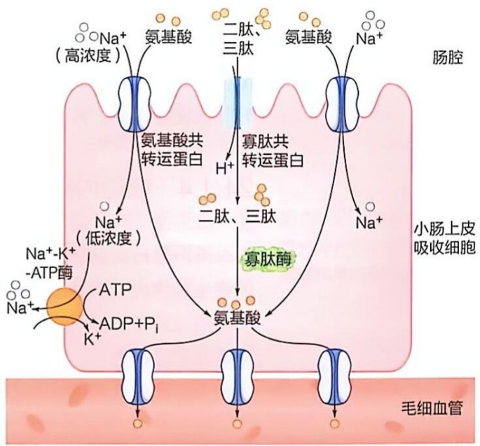

flowchart

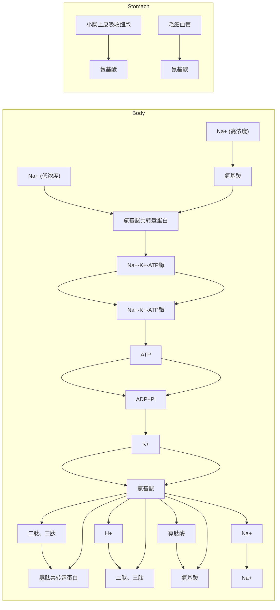

图24-3 蛋白质水解产生的二肽、三肽及氨基酸通过小肠上皮吸收细胞吸收进入血液

进入小肠上皮细胞的二肽和三肽在细胞内的寡肽酶催化下被进一步水解为氨基酸。在面向毛细血管一侧的小肠上皮吸收细胞中，还存在另外一些氨基酸转运蛋白，它们负责将氨基酸从小肠上皮吸收细胞转运至毛细血管内；在这些氨基酸转运蛋白中，有一些与面向肠腔一侧的氨基酸转运蛋白相同，而另一些则不同（图 24-3）。

值得注意的是，小肠上皮吸收细胞对氨基酸和寡肽的摄取与对单糖和寡糖的摄取在某些方面具有相似性，但与脂肪酸的摄取过程完全不同。

## (4) 未消化蛋白质将在大肠中被肠道细菌分解

在小肠中，食物蛋白质中的大约 $95\%$ 可被消化吸收。未被消化的蛋白质以及未被吸收的氨基酸会进入大肠下端，被肠道细菌分解。这一过程被称为蛋白质的腐败（putrefaction）作用，也称为蛋白质的微生物发酵。蛋白质腐败与肠道中的菌群种类密切相关，涉及多条代谢途径，其产物多种多样。这些产物对生物个体产生的效应既有正面的，也有负面的，具体机制有待进一步阐明。

肠道细菌对氨基酸的作用方式多种多样。一方面，它们可以通过所产生和分泌的酶发挥作用；另一方面，也可以将氨基酸摄入细菌细胞内，再进一步代谢转化和利用。例如，使氨基酸发生脱氨基或脱羧基作用，也可使它们发生氧化、还原、水解等反应。由于氨基酸的碳骨架各不相同，其腐败产物也各不相同。例如，酪氨酸分解可产生酪胺、苯乙酚、对羟苯乙酸、苯酚等，半胱氨酸的分解产物包括乙硫醇、甲硫醇、硫化氢、甲烷等，赖氨酸的分解产物为尸胺，组氨酸的分解产物包括组胺等，色氨酸的分解产物包括色胺、甲基吲哚、吲哚等，丙氨酸的分解产物包括丙酸和乙胺等（图24-4）。

某些腐败作用的产物可能具有一定营养价值，如少量脂肪酸和维生素。然而，绝大多数腐败作用的产物，如胺类、酚类、吲哚以及硫化氢（这些物质通常具有恶臭气味），可能对人体有害。这些物质主要随粪便排出体外，但少部分会被吸收，经肝脏转化为无毒形式，再排出体外。

## 24.1.4 细胞内的蛋白质通过溶酶体和泛素-蛋白酶体等降解

不同蛋白质在细胞中的寿命存在极大差异，从几分钟到几十年不等。大多数蛋白质在生物体内处于动态平衡状态，不断经历降解和重新合成的过程。在细胞内蛋白质的生成过程中，翻译和折叠等环节难免出现错误，已经生成的蛋白质也可能发生折叠异常和氧化损伤等，这些异常蛋白质需要被有效降解为氨基酸。我们对蛋白质在活体生物中这些行为和现象的认识仍在不断深入。

蛋白质在细胞内可发生有效降解。在真核细胞中，蛋白质降解主要经两种方式发生:一种是不消耗 ATP 的溶酶体途径，另一种是消耗 ATP 的泛素-蛋白酶体（ubiquitin-proteasome）途径。溶酶体是一种内部环境呈酸性的细胞器，可以非特异性降解包括蛋白质在内的各种生物分子，这一细胞器在1950年代被发现。而泛素-蛋白酶体途径则是在1970年代被揭示的。关于细胞内通过溶酶体和泛素-蛋白酶体途径发生的蛋白质降解过程，参阅本教材第12章。

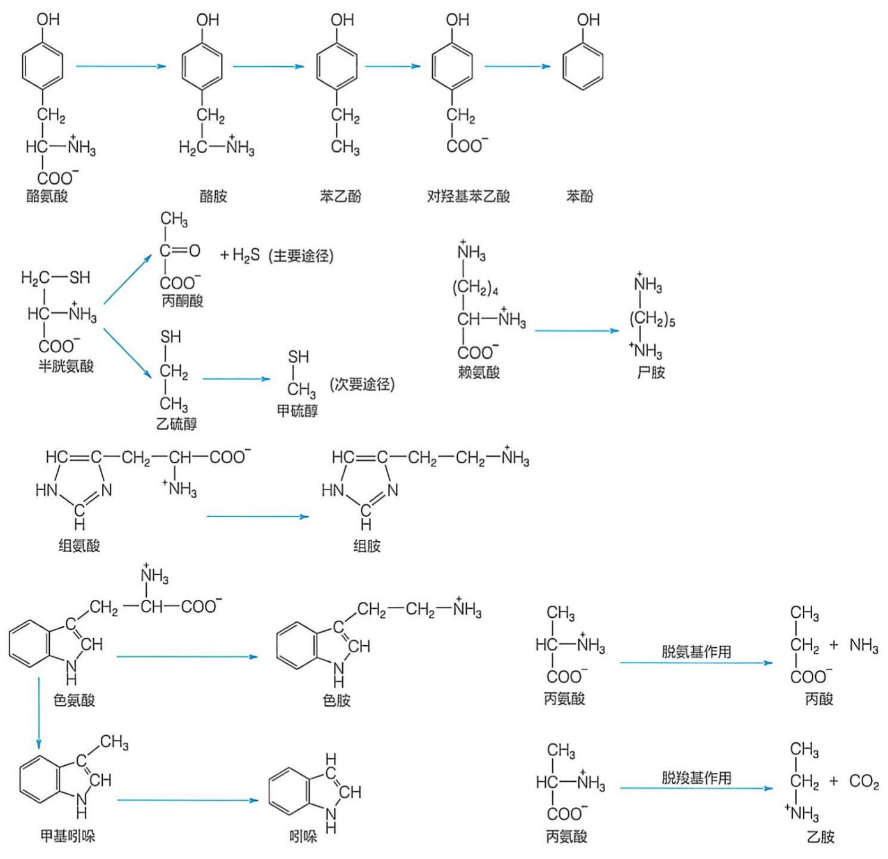

flowchart

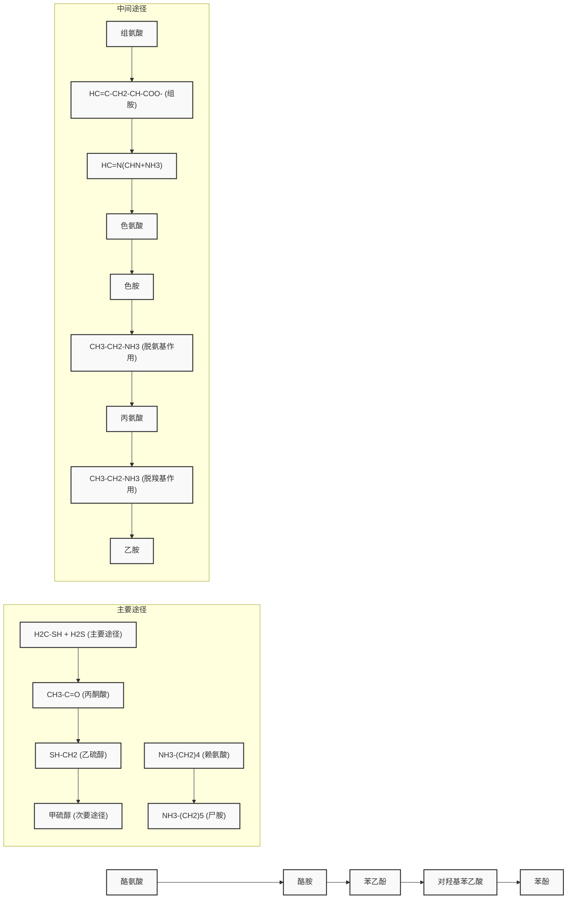

图 24-4 动物大肠微生物分泌的酶使氨基酸发生腐败作用的代表性产物

## 24.2 动物以多种形式排出多余的氮

无论是从食物中摄取的，还是细胞内蛋白质降解所产生的氨基酸，在进行氧化分解前均需先脱去其氨基，形成  $\alpha-$  酮酸，这是与糖和脂肪酸氧化分解不同的一个方面。

在介绍氨基酸脱氨（氮）的具体代谢过程之前，我们需要了解动物体内如何排出多余的氮。

获得足够的氮对所有生物的正常生长至关重要，因为许多生物分子都含氮元素。然而，只有少数微生物可将空气中的氮气固定为生物可利用的氨，而其他生物都必须依赖氨和其他含氮有机分子作为氮源。氮不仅存在于蛋白质和核酸分子中，也存在于糖类、脂质以及其他多种分子中。动物从食物中获取氮，合成各类含氮分子，动物体是一个动稳态体系，生物分子处于一种动态平衡中，多余的氮需被排出体外。

## 24.2.1 动物体内多余的氮以氨（或质子化的铵）、尿素和尿酸等形式排出体外

动物体内多余的氮以多种含氮废物的形式排出体外，包括氨 [ammonia；其质子化形式为铵（$\mathrm{NH}_4^+$）]、尿素（urea）和尿酸（uric acid）等（图24-5）。值得注意的是，作为化学物质，这些化合物早在18世纪就已被鉴定。具体而言，荷兰学者赫尔曼·布尔哈弗（Herman Boerhaave，1668—1738）于1720年代从人体尿液中鉴定到尿素，英国学者普里斯特利于1770年代鉴定到氨气（alkaline air；碱性气体），瑞典学者卡尔·舍勒（Carl Scheele，1742—1786）于同一时期从尿液和肾结石中鉴定到尿酸。这些物质均为无色，其中氨和尿酸具有刺鼻或令人不愉快的气味，而尿素则无味。在毒性方面，氨对动物具有较高的毒性，尿素和尿酸相对不具有毒性。

动物排出多余氮的方式主要取决于环境中水的可利用情况。一般而言，水生动物大多以氨的形式排出，氨在水中的溶解度极高（约为 34 g）。相比之下，陆生动物则以尿素或尿酸的形式排出。具体而言，哺乳动物和两栖动物等主要以尿素形式排出，这种形式相对无毒且在水中的溶解度也极高（约为 108 g），可通过尿液排出。而鸟类和爬行动物等主要以尿酸形式排出；尿酸难溶于水（溶解度约为 7 mg），可以在体内浓缩后以固体形式排出，从而减少水分的损失。

氨对动物具有毒性，陆生动物无法像水生动物那样及时将氨排出体外，因此，将氨转化为无毒的尿素排出体外可能是演化选择的结果。在正常生理 pH 范围内，生物体内的游离氨主要以铵盐（ $NH_{4}^{+}$ ）的形式存在。就氨的毒性而言，如果家兔血液中氨的含量达到 3 g/L（正常浓度约为 0.6 g/L），即可导致中毒死亡。人体血液中氨的含量通常低于 50 μmol/L（约为 0.85 g/L），当达到 100 μmol/L（约为 1.70 g/L）时，即出现中毒症状。

图 24-5 动物以氨、尿素或尿酸等形式将多余的氮排出体外

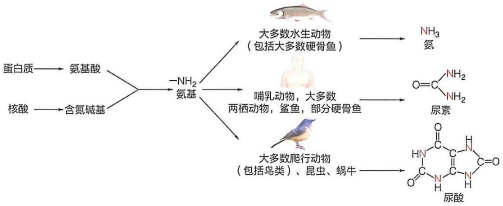

flowchart

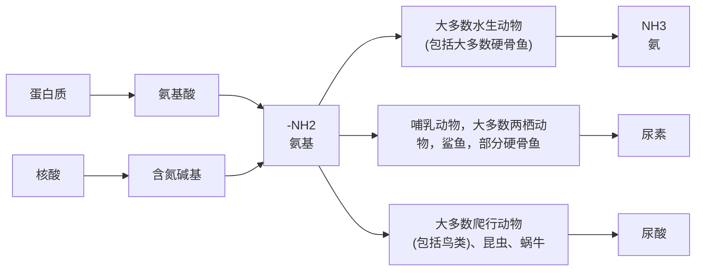

尽管氨基酸的脱氨基作用是体内氨的主要来源，但氨也可通过其他化合物的分解代谢过程产生。这包括胺类物质的氧化分解、嘌呤和嘧啶类化合物的分解代谢。

在哺乳动物体内，多余的氨主要在肝脏中被转化为尿素，再经肾脏处理，随尿液排出体外。此外，少量氨可能通过皮肤黏膜或经呼吸系统排出体外。

## 24.2.2 肠道中的氨被吸收进入血液但只有少量氨直接通过尿液排出体外

作为动物血液中氨的重要来源之一，肠道中的氨主要产自以下两条途径。首先，未被吸收的氨基酸在肠道细菌的作用下发生脱氨反应，生成氨。在大肠中，蛋白质的腐败过程在生成苯酚、吲哚及硫化氢等产物的同时，也伴随氨的生成。其次，血液中的尿素可渗入肠道，受到肠道细菌分泌的尿素酶作用重新水解生成氨，随后被吸收进入血液。每天平均大约有7 g尿素渗入人的肠道，而粪便中几乎不含尿素，因此渗入肠道内的尿素几乎全部被肠道细菌分解为氨。每天以这种方式重新进入人体内的氨大约为4 g。

正常人将吸收进入体内的氨在肝脏中转化为尿素并排出体外，因此不会发生氨中毒。然而，对于严重肝病患者，由于肝脏无法及时处理体内的氨，常常引发肝性脑病（脑组织的氨中毒）。因此，对肝病患者，需要采取适当的措施，尽量减少肠道中氨的产生和吸收。肠道中氨的吸收与肠道pH有关。在碱性环境中， $NH_{4}^{+}$ 倾向于转化为 $NH_{3}$ ，而 $NH_{3}$ 比 $NH_{4}^{+}$ 更易于穿过细胞膜被吸收。因此，当肠道偏碱性时，氨的吸收效率更高。在临床上，对于高血氨患者，采用弱酸性透析液进行结肠透析，并禁止使用碱性肥皂水灌肠，其目的就是为了减少患者对氨的吸收。

当血液中的谷氨酰胺流经肾脏时，可在肾小管上皮细胞中被谷氨酰胺酶催化，脱去侧链上的氨基生成氨（同时生成谷氨酸）。此外，其他氨基酸在肾小管上皮细胞中也可发生脱氨反应，产生氨。在肾小管上皮细胞中生成的氨排入原尿中，与  $H^{+}$  结合后以  $NH_{4}^{+}$  的形式随尿液排出体外。

## 24.3 哺乳动物肝脏将氨转变为尿素

对以尿素作为哺乳动物多余氮排出形式的认识以及对尿素生成过程的理解是一个逐步深入的过程。早在 1810 年代，人们意识到，既然尿素（和尿酸）是动物体内最富含氮的物质，那么排尿的主要目的应该是去除由食物摄入导致的血液中过量的氮，类似于呼吸作用去除过量的碳。1840年代，人们认识到，蛋白质的氧化降解是尿液中尿素氮的主要来源。例如，当人们给狗喂食甘氨酸和亮氨酸时，尿素排泄量明显增加。由于这些氨基酸仅含1个氮原子，而1个尿素分子含有2个氮原子，由此人们推断，尿素的生成必然涉及一个化学合成过程。

在 1880 年代，人们观察到，给狗的肝脏灌注铵盐，会导致大量尿素的形成。这一观察结果表明，除了合成糖原和胆汁以外，肝脏还具有合成尿素的第三种生理功能。进入 1900 年代，人们在狗等动物肝脏中鉴定出精氨酸酶（arginase），它将精氨酸水解成鸟氨酸和尿素。同时，他们也发现，排泄尿酸的鸟和爬行类动物的肝脏中明显缺乏精氨酸酶，而在排泄尿素的哺乳动物、两栖类和鱼类的肝脏中则存在这种酶。

在 1930 年代，汉斯·克雷布斯等在利用哺乳动物肝脏切片针对尿素生成过程开展研究时观察到，尽管大多数氨基酸的作用可以被解释为通过生成氨而促进尿素形成，但出人意料的是，鸟氨酸却以一种催化的方式促进尿素的合成。基于实验观察及细致分析，克雷布斯提出了肝脏中尿素生成的鸟氨酸循环（即尿素循环）途径（详见后文）。值得一提的是，几年后的 1937 年，克雷布斯揭示了糖酵解产物丙酮酸彻底氧化的柠檬酸循环途径，获得了 1953 年的诺贝尔生理学或医学奖。而 20 年后的 1957 年，他和科恩伯格一起发现了乙醛酸循环，成为生物化学科学史上最精通循环的科学家。

## 24.3.1 不同氨基酸的氨基先被转移至 $\alpha-$ 酮戊二酸以形成谷氨酸的形式收集

分析结果表明:在哺乳动物的大多数组织中，谷氨酰胺的水平明显高于其他氨基酸，其次是谷氨酸、丙氨酸、天冬氨酸等；而在其血液中，谷氨酰胺的浓度最高，占血浆游离氨基酸总量的约 $25\%$ ，其次是丙氨酸等。后续研究发现，在哺乳动物体内将氨基从氨基酸收集并转化为尿素的过程中，谷氨酸、谷氨酰胺、丙氨酸以及天冬氨酸等发挥了关键作用。

## （1）氨基酸大多通过转氨酶催化的转氨基反应进行脱氨

转氨反应（transamination）由苏联学者亚历山大·布劳恩施泰因（Aleksandr Braunstein，1902—1986）等人于1930年代首次观察到。他们的研究结果表明，在切碎的鸽子或兔子肌肉中，谷氨酸的氨基可以转移到丙酮酸形成丙氨酸，或者转移到草酰乙酸形成天冬氨酸，且这些反应是可逆的。在此过程中，他们还观察到不同的催化特异转氨反应的转氨酶（aminotransferase/transaminase）的存在。

生物体内存在多种特异的转氨酶，催化某种 $\alpha-$ 氨基酸中的氨基转移至一种 $\alpha-$ 酮酸。转氨酶所催化反应的平衡常数一般接近1.0，即反应高度可逆。细胞内发生的转氨反应通常如图24-6所示:一种特异的转氨酶（如丙氨酸氨基转移酶）催化一种特异的 $\alpha-$ 氨基酸（如丙氨酸）将其氨基转移给 $\alpha-$ 酮戊二酸，$\alpha-$ 氨基酸被转变为 $\alpha-$酮酸（如丙酮酸），而  $\alpha-$  酮戊二酸则被转变为谷氨酸。

因此，在氨基酸的脱氨反应中， $\alpha-$ 酮戊二酸充当通用的氨基受体。而其逆反应则是许多氨基酸的合成反应:在此过程中，谷氨酸则充当通用的氨基供体（见第25章）。

转氨酶存在于几乎所有类型的生物体内。在哺乳动物组织中，肝脏表现出最高的转氨酶活性水平。在组成蛋白质的20余种L-氨基酸中，只有赖氨酸、苏氨酸、脯氨酸（以及羟脯氨酸）不参与转氨反应（即无特异性的转氨酶），其他氨基酸的转氨反应均由特异性的转氨酶催化。

转氨酶均以其所识别的特异氨基酸命名。如丙氨酸氨基转移酶 [alanine aminotransferase, ALT; 根据其逆反应，曾被称为谷丙转氨酶（glutamic-pyruvic transaminase, GPT）] 催化丙氨酸的转氨反应；而天冬氨酸氨基转移酶 [aspartate aminotransferase, AST; 根据其逆反应，曾被称为谷草转氨酶（glutamic-oxaloacetic transaminase, GOT）] 催化天冬氨酸的转氨反应。天冬氨酸氨基转移酶催化的反应如下:

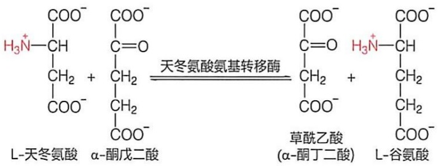

chemical

Chemical reaction equation showing conversion of L-天冬氨酸 to α-酮戊二酸 via acetylation with acetylene氨基转移酶

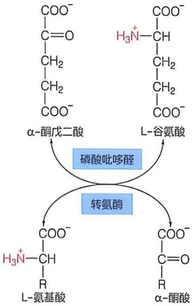

flowchart

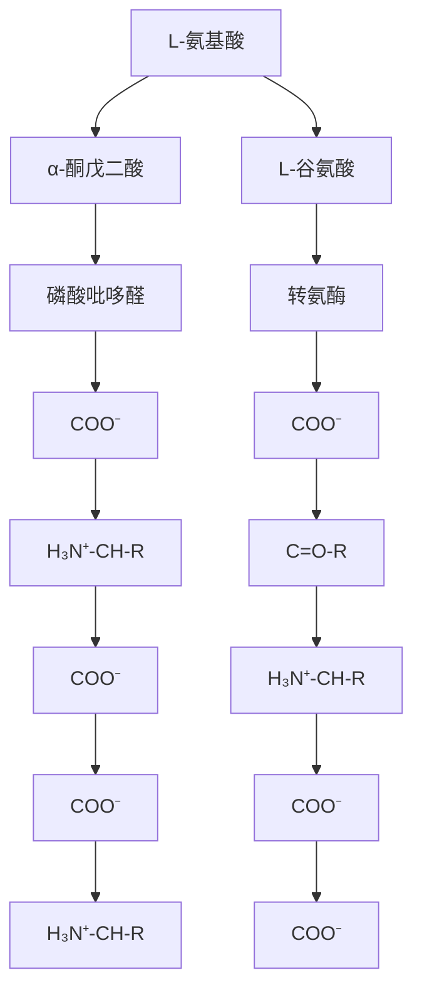

图 24-6 转氨酶催化的可逆转氨基反应示意图

动物中的天冬氨酸氨基转移酶通常以同源二聚体形式存在，这与大多数转氨酶相似，其同工酶分布于胞质溶胶和线粒体中（植物的叶绿体中也有分布）。天冬氨酸氨基转移酶在人体大脑、骨骼肌、肝脏、胰腺、红细胞和肾脏等多种组织和细胞中均有表达。相比之下，丙氨酸氨基转移酶主要存在于肝脏组织中，其活性约为其他组织的100倍。因此，在临床上，通常通过检测血液中丙氨酸氨基转移酶的水平反映肝脏损伤的情况。

## (2) 转氨酶均利用磷酸吡哆醛作为辅因子

在 1940 年代，美国学者埃斯蒙德·斯内尔（Esmond Snell，1914—2003）等观察到，用缺乏维生素  $B_{6}$ （1930 年代鉴定）的食物饲喂的大鼠，其组织中的转氨酶活性远低于用正常含维生素  $B_{6}$  的食物饲喂的大鼠。同时，人们也观察到，维生素  $B_{6}$  对于多种转氨酶的催化活性是必需的。

后续研究表明，维生素  $B_{6}$  以三种形式存在，即吡哆醇（pyridoxine）、吡哆胺（pyridoxamine）和吡哆醛（pyridoxal）（图 24-7）。它们在动物体内通过磷酸化和氧化反应转化为磷酸吡哆醛（pyridoxal phosphate，PLP），进而作为转氨酶的辅因子发挥作用。磷酸吡哆醇（即吡哆醇-5'-磷酸）经过氧化后形成磷酸吡哆醛（即吡哆醛-5'-磷酸），而磷酸吡哆胺（即吡哆胺-5'-磷酸）则是磷酸吡哆醛携带氨基的中间体形式。

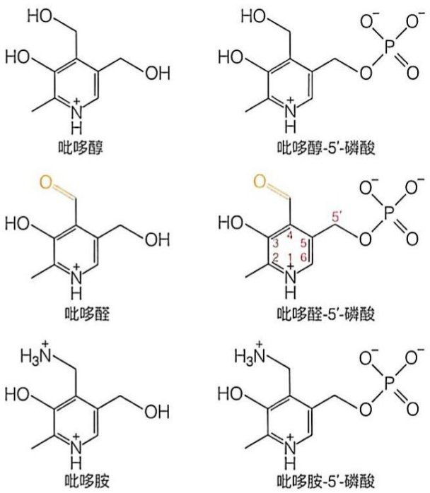

图 24-7 吡哆醇、吡哆醛和吡哆胺以及它们的磷酸化产物

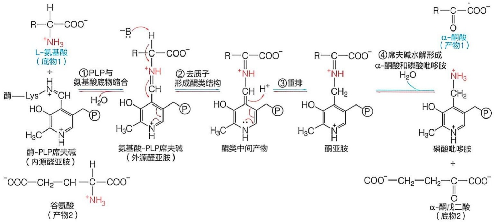

chemical

Reaction pathway of L-aminoglycan to form alpha-amino acid and its related products, including enzymatic hydrolysis, intermediate formation, and final product formation.

图 24-8 磷酸吡哆醛参与转氨酶催化的转氨基过程

## (3) 磷酸吡哆醛作为转氨酶活性中心的氨基载体而发挥作用

正如  $NAD^{+}$  是许多脱氢酶的辅因子，磷酸吡哆醛是许多转氨酶以及参与氨基酸其他代谢的酶（如脱羧酶）的通用辅因子。在脱氢酶活性中心， $NAD^{+}$  作为氢负离子的临时性载体发挥作用；而在转氨酶活性中心，磷酸吡哆醛则作为氨基的临时性载体发挥作用。磷酸吡哆醛在转氨酶的活性中心发挥催化作用的普遍机制如图 24-8 所示，具体描述如下。

在未结合底物前，磷酸吡哆醛的醛基与酶分子中一个特异赖氨酸残基的  $\varepsilon-$  氨基以 “席夫碱”（Schiff base）的形式共价连接 $^{①}$ ，形成内源性醛亚胺。

当特异的 $\alpha-$ 氨基酸底物（底物1）进入转氨酶的活性中心后，磷酸吡哆醛与其$\alpha-$ 氨基发生缩合反应，形成席夫碱。因氨基来自底物而非酶分子，故被称作外源性醛亚胺（图24-8，①）。随后，在活性中心的广义碱催化基团作用下，底物氨基酸的$\alpha-$ 碳脱去一个质子，成为碳负离子，进而诱发重排过程，形成醌类中间体（图24-8，②）。接着，中间体再次发生重排，形成酮亚胺形式的席夫碱中间体（图24-8，③）。在此基础上，席夫碱发生水解，进入活性中心的氨基酸底物被转变为相应的 $\alpha-$ 酮酸(产物1)，而其 $\alpha-$ 氨基则被磷酸吡哆醛以磷酸吡哆胺的形式携带（图24-8，④）。上述四步反应仅代表转氨酶乒乓催化机制的前半部分（图24-8，四步反应从左至右，用蓝色箭头表示): 在将第一种底物转变成第一种产物的同时形成携带第一种底物氨基的酶分子中间体。

<small>① 席夫碱是由含羰基的醛或酮类化合物与一级胺类化合物缩合后进一步脱水形成的亚胺化合物，亚胺基是极活泼的基团。</small>

转氨酶乒乓催化机制的后半部分是前四步反应的逆过程（图24-8，四步反应从右至左，用红色箭头表示）。具体而言，另一种 $\alpha-$ 酮酸（通常为 $\alpha-$ 酮戊二酸）作为第二种底物进入酶的活性中心后，与其中的磷酸吡哆胺发生缩合反应，形成酮亚胺，同时脱去1分子水（正好是第④步反应的逆反应）；接着发生分子重排，形成醌类中间体（对应第③步反应的逆反应）；随后，前面的广义碱接受质子后形成的广义酸催化基团提供1个质子，并发生重排，形成外源性醛亚胺（对应第②步反应的逆反应）；最终，外源醛亚胺转变为内源醛亚胺（酶分子活性中心恢复到最初的结构），从而结束整个反应过程，生成另外一种 $\alpha-$ 氨基酸（通常为谷氨酸）作为第二种产物。

最终的结果是，一种 $\alpha-$ 氨基酸脱去氨基转变为一种相应的 $\alpha-$ 酮酸，而 $\alpha-$ 酮戊二酸接受氨基形成谷氨酸。在此催化过程中，磷酸吡哆醛发挥了临时携带氨基的作用。

磷酸吡哆醛参与  $\alpha-$  氨基酸在  $\alpha$ 、 $\beta$ 、 $\gamma$  碳上的多种转换反应，除转氨反应外，还参与脱羧、 $\alpha-$  碳手性的逆转（如从 L 构型转变为 D 构型）等。

## (4) 血清中转氨酶水平的升高可能提示肝脏或心脏等器官存在损伤

在临床诊断中，血清中天冬氨酸氨基转移酶（AST）和丙氨酸氨基转移酶（ALT）的水平被用来反映肝脏或心脏是否受到损伤。这种检测指标的设计依据是:天冬氨酸氨基转移酶在心脏中含量最高，其次是在肝脏中；而丙氨酸氨基转移酶则主要存在于肝脏中。

在正常人体内，血清中的这两种酶含量极低（约为肝中的 1/100）。因此，如果患者血清中的天冬氨酸氨基转移酶的含量显著升高，提示其心脏或肝脏等器官可能存在损伤；同样，如果血清中丙氨酸氨基转移酶的含量显著升高，则提示肝脏可能受到损伤。例如，心肌梗死患者血清中的天冬氨酸氨基转移酶活性通常大幅升高，而肝病（如传染性肝炎）患者，其血清中的这两种酶的水平往往都会大幅升高。

## 24.3.2 肝外组织中的游离氨被转化为谷氨酰胺

肝外组织产生的过量氨通常先被转化为谷氨酰胺。随后，谷氨酰胺通过血液将氨运输至肝细胞的线粒体中。因此，谷氨酰胺在大多数组织以及血液中的含量都最高。

## （1）谷氨酰胺在肝外组织中由谷氨酰胺合成酶催化合成

谷氨酰胺合成酶（glutamine synthetase）催化的反应需消耗 ATP，分为两步进行（图 24-9）。在第一步反应中，谷氨酸侧链的羧基首先发生磷酸化修饰（即活化），形成  $\gamma-$  谷氨酰磷酸中间体；在第二步反应中， $\gamma-$  谷氨酰磷酸的磷酸基被铵离子提供的氨基取代，生成谷氨酰胺。除了氨具有毒性外，过量的谷氨酸（作为一种主要的兴奋性神经递质）在神经组织中也具有毒性（导致神经元损伤或死亡）。因此，谷氨酰胺在神经组织中的合成将两种具有毒性的分子转化为一种无毒分子。

图24-9 肝外组织中的谷氨酰胺合成酶与肝脏中的谷氨酰胺酶的联合脱氨作用

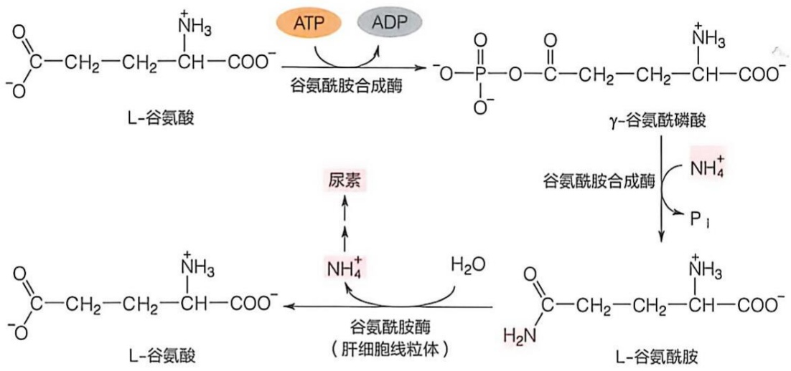

flowchart

谷氨酰胺被转运至肝脏后，进入肝细胞的线粒体中。在谷氨酰胺酶（glutaminase）的作用下，谷氨酰胺的氨基被脱去，形成铵离子。随后，这些铵离子被用于合成尿素。由此可见，通过肝外组织中的谷氨酰胺合成酶与肝脏中的谷氨酰胺酶的联合作用，使得肝外组织中产生的游离氨可被收集转运，并在肝脏中被转化为尿素（图24-9）。

## (2) 谷氨酰胺合成酶利用金属离子实施催化

哺乳动物（包括人）中的谷氨酰胺合成酶由两个五聚体呈上下两层排列，形成十聚体结构（图 24-10A；细菌中的该酶由两个六聚体呈上下两层排列形成十二聚体结构，具体见第 25 章）。

谷氨酰胺合成酶的每个亚基含一个活性中心，该活性中心位于两个相邻亚基的相互作用面上。每个活性中心一般含二或三个二价金属离子，通常为镁或锰离子（图24-10A）。具体而言，催化反应涉及以下步骤（图24-10B）:首先，ATP分子结合到活性中心的一端（若将活性中心想象成双漏斗结构，则是从一个漏斗进入），并诱导构象发生调整（图24-10B，①）；随后，谷氨酸从活性中心的另一端（或另一个漏斗）进入，形成γ-谷氨酰磷酸中间体（图24-10B，②③）。最后，铵离子进入活性中心后被转化为氨，氨中的氮原子进攻中间体上的δ碳，使磷酸基释放，从而生成谷氨酰胺（图24-10B，④）。在释放所有的产物（谷氨酰胺、ADP和无机磷酸）之后，酶的活性中心恢复到初始状态。

在大多数陆地动物中，过量的谷氨酰胺通过血液被运输至肝、肾、肠道等器官进行处理。此外，谷氨酰胺是合成各种含氮生物分子的重要氨基供体（详见第25、26章）。

在固氮细菌中，谷氨酰胺合成酶是将通过氮气固定形成的氨引入生物系统的重要入口。氨被先转化为谷氨酰胺，然后用于合成其他含氮生物分子。固氮细菌中的谷氨酰胺合成酶的活性因此受到精细调控（详见第25章）。

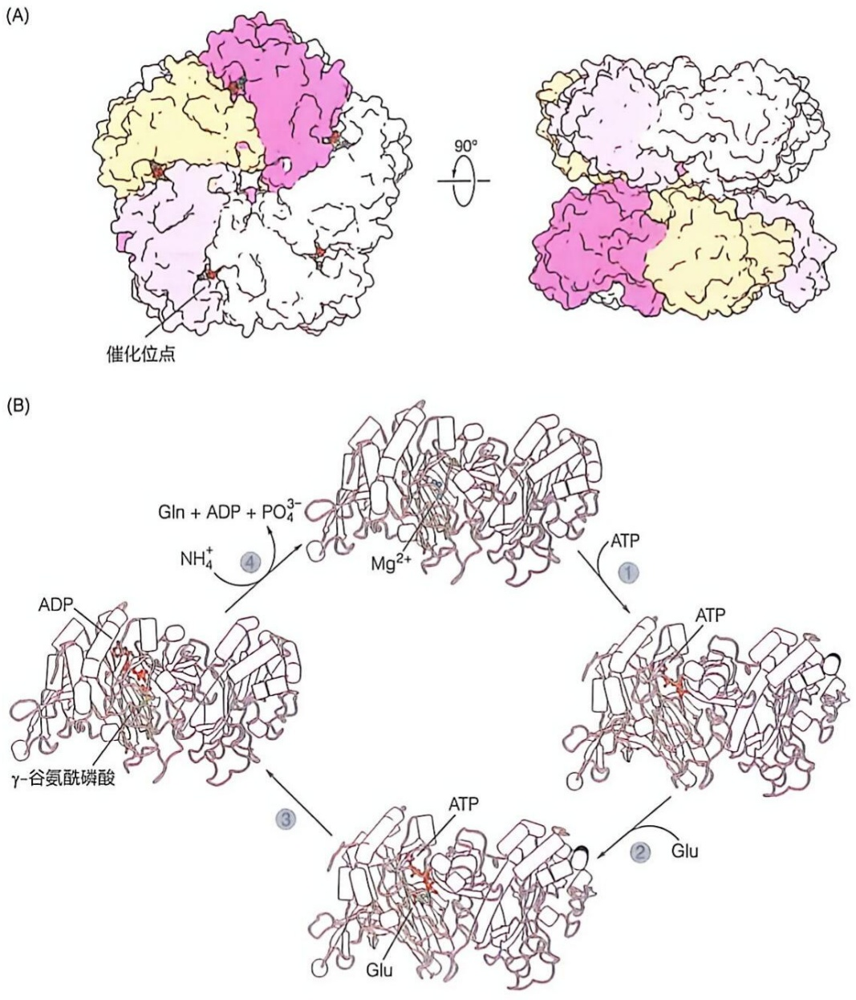

图 24-10 哺乳动物谷氨酰胺合成酶的寡聚体结构和可能的催化机制

（A）人源谷氨酰胺合成酶（PDB:2QC8）十聚体全酶中催化位点的相对位置。（B）谷氨酰胺合成酶的催化机制，其中ADP/ATP（橙色）与底物谷氨酸/γ-谷氨酰磷酸（绿色）用棍状模型展示。棍状模型中红色代表氧原子，蓝色代表氮原子，橙色代表磷原子，黄色代表硫原子。催化位点的三个镁离子展示为青色球体。

## 24.3.3 葡萄糖 - 丙氨酸循环将肌肉等外周组织中的氨和碳骨架转运至肝脏转化

1960 年代的研究发现，在 20 种组成蛋白质的氨基酸中，丙氨酸是动物骨骼肌释放到血液中的主要氨基酸，同时也是肝脏从血液摄取用于糖异生的主要氨基酸（占肝脏摄取所有氨基酸的 50% 以上）。这一现象主要发生在动物的饥饿状态下，此时释放到血液中的氨基酸总量显著减少。利用  ${}^{14}$ C 标记氨基酸进行动物实验的结果表明，丙氨酸转化为血糖的效率远高于其他氨基酸，并且葡萄糖水平的升高与丙氨酸的水平呈线性正相关。

基于这些观察，一种葡萄糖-丙氨酸循环（glucose-alanine cycle）在1970年代初被提出（图 24-11）。其核心观点是，外周组织（如骨骼肌）通过糖酵解产生的丙酮酸，经过转氨反应转化为丙氨酸。随后，丙氨酸将其携带的氨基和碳骨架经血液转运至肝脏，其中的氨基通过尿素循环转变为尿素，而碳骨架则通过糖异生转化为葡萄糖。

图 24-11 葡萄糖-丙氨酸循环将肌肉等外周组织中多余氨基安全转运至肝中进行转化

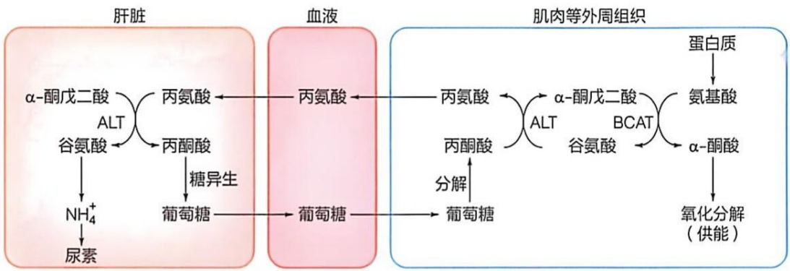

flowchart

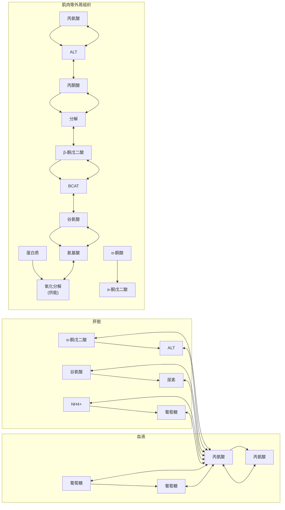

支链氨基酸是肌肉组织中合成丙氨酸所需氨基的主要来源。在饥饿或激烈运动状态下，肌肉组织通过氧化支链氨基酸的碳骨架提供能量，其氨基被支链氨基酸转氨酶（branched-chain aminotransferase，BCAT）和丙氨酸氨基转移酶（ALT）转移给丙酮酸，通过葡萄糖-丙氨酸循环将脱去的氨基安全转运至肝脏处理。然而，与肌肉等肝外组织不同，肝细胞无法将支链氨基酸进行脱氨和氧化。

因此，通过肌肉等组织与肝脏之间的葡萄糖-丙氨酸循环，肌肉组织等外周组织可以有效利用其支链氨基酸的氧化分解提供能量，而肝脏组织不仅可以将肌肉中氨基酸脱去的氨通过尿素循环产生尿素，还可维持葡萄糖的动稳态。需要注意的是，尽管丙酮酸携带的碳骨架在肝脏中可以有效转化为葡萄糖，但这未导致葡萄糖的净生成，而仅仅是葡萄糖的再生。所以其主要功能是将外周组织中的氨基酸脱去的氨基安全转运至肝脏，在此过程中并未净消耗葡萄糖。

## 24.3.4 肝外组织与肝脏共同完成联合脱氨作用

如上所述，在肝外组织中，大多数氨基酸通过转氨反应脱去氨基，这些氨基最终集中到谷氨酸分子中（图 24-6）。肝外组织中的谷氨酸进而与游离铵离子缩合生成谷氨酰胺（图 24-9），肝外组织中的游离铵离子部分源于谷氨酸在谷氨酸脱氢酶催化下的氧化脱氨（具体见后）。谷氨酰胺进入血液后，将肝外组织中的氨基转运至肝脏，在肝细胞线粒体中，谷氨酰胺在谷氨酰胺酶催化下脱去侧链氨基，生成铵离子和谷氨酸（图 24-9）。在肝细胞线粒体中，谷氨酸可继续发生脱氨反应。因此，线粒体中的谷氨酰胺和谷氨酸的脱氨是最终的脱氨步骤，这些反应产生的铵离子将通过尿素循环转化为尿素排出（具体见后）。

## (1) 肝外组织中的转氨酶与肝脏中的谷氨酸脱氢酶协同完成联合脱氨作用

谷氨酸分子所收集的过剩氨基的彻底脱氨反应主要发生于肝细胞的线粒体中（少量发生于肾脏细胞的线粒体），这一过程由谷氨酸脱氢酶（glutamate dehydrogenase；该酶识别的是L-谷氨酸）催化。该反应使谷氨酸发生氧化脱氨，将氨基以铵离子的形式脱去，最终转化为尿素排出体外。由外周组织中的转氨酶和肝脏中的谷氨酸脱氢酶联合完成的彻底脱氨过程称为联合脱氨作用（transdeamination），是动物体内一种重要的脱氨方式，如图24-12所示。

## （2）谷氨酸在肝细胞线粒体基质中可发生氧化脱氨作用

谷氨酸脱氢酶广泛存在于不同生物体内。在肝细胞的线粒体中，谷氨酸脱氢酶催化谷氨酸的脱氢和脱氨两步反应，同时将谷氨酸的碳骨架重新转化为  $\alpha-$  酮戊二酸。肝细胞线粒体中的谷氨

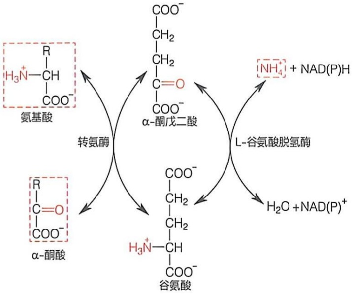

chemical

Reaction mechanism diagram showing conversion of amino acids to α-ketoacid and then to谷氨酸 via α-ketoacid and L-galactose dehydrogenation steps

图 24-12 由转氨酶和谷氨酸脱氢酶协同完成的联合脱氨作用

酸脱氢酶既可以利用  $NAD^{+}$ ，也可以利用  $NADP^{+}$  作为辅因子，但在动物体内更多利用  $NADP^{+}$ ，其催化的两步反应如图 24-13 所示。

尽管在体外条件下，上述反应是可逆的，但由于谷氨酸脱氢酶对铵离子（$\mathrm{NH_4^+}$）的 $K_{\mathrm{m}}$ 值非常高（通常为 $20 \sim 30 \mathrm{mmol/L}$），使得逆反应——利用铵离子进行还原性氨基化生成谷氨酸的反应——在正常肝细胞内难以发生（仅在某些含有高浓度铵离子的细菌中才可能发生）。至少在大多数体外条件下，产物（包括NADPH）的释放似乎是该反应的限速步骤（推测在体内也是如此）。

谷氨酸脱氢酶催化生成的  $\alpha-$  酮戊二酸可以直接进入线粒体基质中的柠檬酸循环。这将使柠檬酸循环的中间体得到添补，增强柠檬酸循环的活性。当然，过多的  $\alpha-$  酮戊二酸可以通过柠檬酸循环被彻底氧化，从而为细胞提供能量。

动物体内或其他生物体内的谷氨酸脱氢酶均由两个三聚体上下叠合在一起、组装成同源六聚体。与其他生物中的谷氨酸脱氢酶不同，动物体内的谷氨酸脱氢酶受到多种别构调节因子的调节，如被 GTP、ATP 和棕榈酰辅酶 A 等别构抑制（通过降低对底物的亲和力），但被 ADP 和亮氨酸等激活。这表明，谷氨酸脱氢酶催化的氧化脱氨过程受到严格调控，以响应细胞内的不同变化条件。这与谷氨酸具有多种重要生物学功能的事实是吻合的。

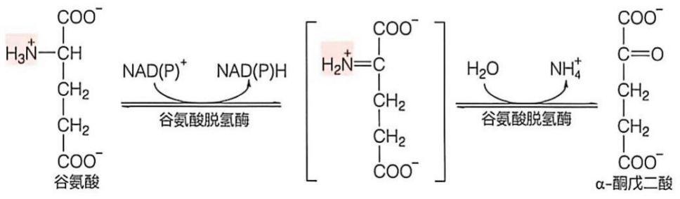

chemical

Chemical reaction diagram showing conversion of glutamine to α-ketoxybenzoic acid via NAD(P)+ and NAD(P)H enzymes

图 24-13 谷氨酸脱氢酶催化的氧化脱氨反应

在哺乳动物的肝外组织，如肾脏和大脑等，也存在谷氨酸脱氢酶。在这些组织中，谷氨酸脱氢酶催化谷氨酸氧化脱氨所生成的铵离子，通过形成谷氨酰胺被转运至肝脏处理。

## (3) 线粒体基质中的谷氨酸也为合成天冬氨酸提供氨基

尿素分子含有两个氮原子，其中一个源于铵离子（通过先形成氨基甲酰磷酸），而另一个则由天冬氨酸提供（见后续内容）。因此，在线粒体基质中，谷氨酸除了通过谷氨酸脱氢酶催化发生氧化脱氨外，还需将部分氨基转移至草酰乙酸形成天冬氨酸。该反应由常规的天冬氨酸氨基转移酶（线粒体基质同工酶）催化完成。

动物体内发生的氨基酸脱氨代谢过程可以总结如下（图 24-14）。

在肝外组织中，氨基酸的氨基汇聚于谷氨酸，随后，谷氨酸在谷氨酰胺合成酶的催化下转化为谷氨酰胺，并通过血液运输至肝脏。在肝脏中，谷氨酰胺在谷氨酰胺酶的催化下脱去氨基，生成铵离子（用于合成尿素）。在肝细胞的线粒体中，谷氨酰胺脱氨以及肝脏中氨基酸转氨等过程形成的谷氨酸，一部分在谷氨酸脱氢酶的催化下，脱氨生成铵离子（用于合成尿素），另一部分将其氨基转移至草酰乙酸形成天冬氨酸，也为尿素合成提供氨基。

图 24-14 动物体内的氨代谢总括图

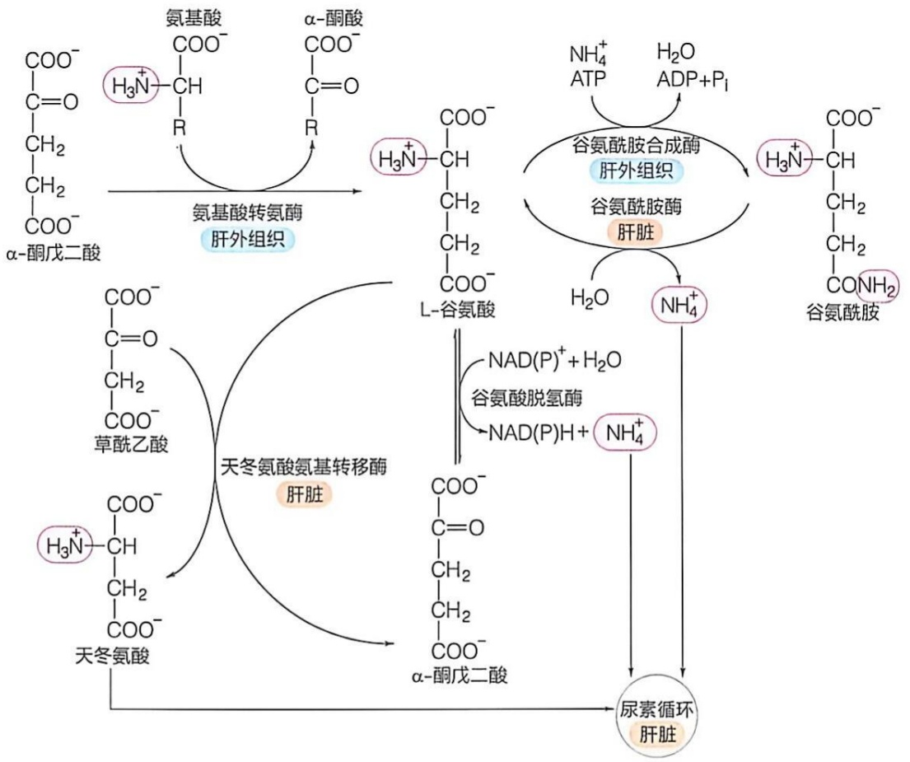

flowchart

This flowchart illustrates the biochemical pathway of a liver enzyme, showing how amino acids and nucleotides are converted into various enzymes (L-谷氨酸, NAD(P)+H2O, NH4+) and ultimately to the urinary cycle.

## 24.4 肝细胞通过尿素循环将氨基酸脱去的氨基转化为尿素

在哺乳动物体内，氨基酸代谢过程中脱去的氨基，在满足合成新的氨基酸或其他含氮化合物的需求之后，过量的氨将以尿素的形式排出体外。氨主要在肝细胞中被转化为尿素。如前所述，生成尿素的过程是一种循环式的代谢途径，最初被称作鸟氨酸循环，现在通常称为尿素循环（urea cycle）。尿素这种几乎无毒的含氮废物在肝脏中形成后，经血液流入肾脏，并最终经尿液排出体外。尿素的生成是哺乳动物体内多余氨的主要代谢去路。

## 24.4.1 尿素循环在肝细胞的线粒体与胞质溶胶中协同完成

催化尿素循环的酶分布于肝细胞的线粒体基质和胞质溶胶，即尿素循环开始于肝细胞线粒体基质中，完成于胞质溶胶中，中间代谢物需进行跨膜转运（图 24-15）。

## 知识延展 24- 1

## 尿素循环的发现

1930年代初，生物化学领域迎来了一项重大突破。汉斯·克雷布斯与他的学生库尔特·亨泽莱特（Kurt Henseleit，1907—1973）利用大鼠肝切片开展了尿素形成实验，探究不同氨基酸，包括丙氨酸、苯丙氨酸、半胱氨酸和精氨酸等对尿素产生速率的影响。起初，他们发现精氨酸能够显著提高尿素的合成速率。然而，由于蛋白质中精氨酸的含量相对较低，难以满足体内生成大量尿素的需求，且精氨酸酶催化的（尿素生成）反应也可在肝外组织中发生，这一发现并未引起足够重视。尽管如此，克雷布斯和亨泽莱特并未因此止步。他们进一步研究发现，加入鸟氨酸也能显著提高尿素的合成速率，且合成的尿素量远远超出所添加的鸟氨酸量。这一现象表明，鸟氨酸在尿素合成过程具有“催化作用”。在此基础上，他们试图揭示鸟氨酸和精氨酸之间的中间体。他们将刚被发现的瓜氨酸（因最初从西瓜中分离而得名）作为候选化合物。实验结果表明，当加入瓜氨酸和铵离子后，肝切片中迅速产生了尿素。1932年，克雷布斯和亨泽莱特以德文发表了题为《动物体内尿素形成研究》的论文，提出了由  $NH_{3}$  和  $CO_{2}$  生成尿素的一种循环代谢途径，即鸟氨酸循环（后更名为尿素循环）。

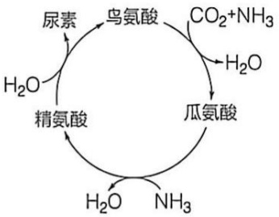

flowchart

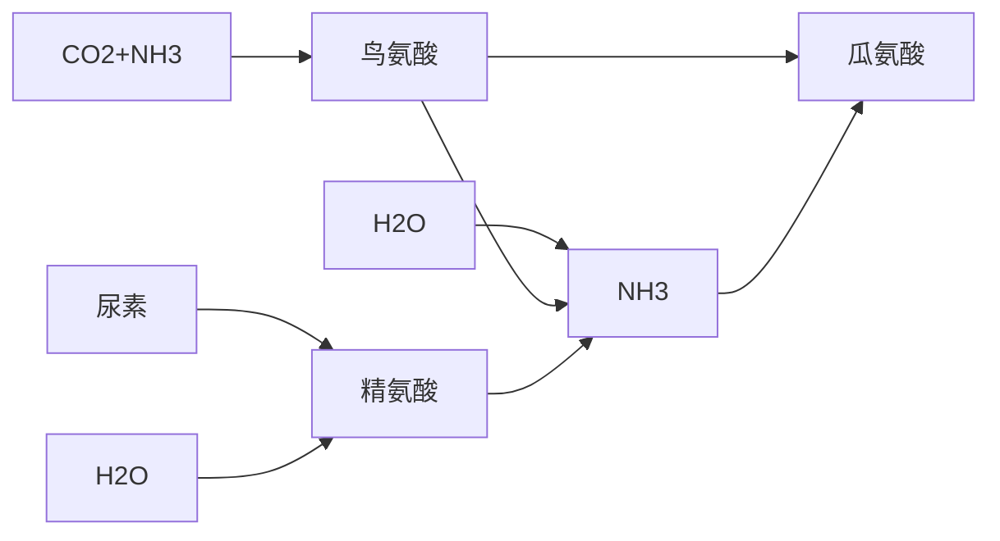

这是人们提出的第一种循环式代谢途径（此前提出的均为线性代谢途径）。此后，克雷布斯还提出了另外两种循环代谢途径:1937年的柠檬酸循环和1957年的乙醛酸循环。

需要注意的是，这个第一版的鸟氨酸循环（尿素循环）并不完整。在后续的1940年代至1950年代，氨基甲酰磷酸、天冬氨酸的参与以及其他中间体的存在才被他人逐渐揭示。