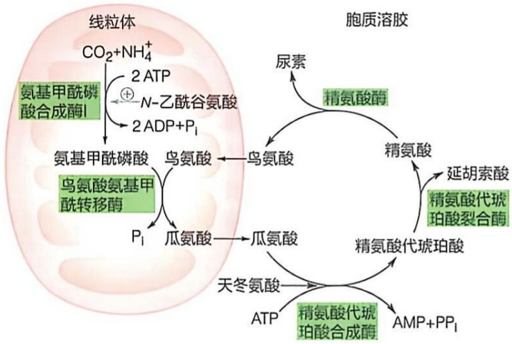

flowchart

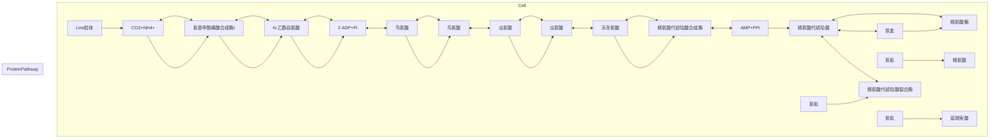

图 24-15 尿素循环

这使得高毒性的氨在线粒体基质中形成后，可立刻与其中处于高浓度水平的碳酸氢根缩合，同时也利用该亚细胞部位的充足 ATP 供应。

（1）铵离子与碳酸氢盐在线粒体基质中缩合形成氨基甲酰磷酸

在肝细胞的线粒体基质中，由上述过程中形成的  $NH_{4}^{+}$  与在线粒体中产生的高浓度  $CO_{2}$ （ $CO_{2}$  与水结合后形成碳酸氢根离子）缩合并消耗 ATP，生成氨基甲酰磷酸。该反应由线粒体基质中的氨基甲酰磷酸合成酶 I（carbamoyl phosphate synthetase I，CPS I）催化。注意，动物细胞的胞质溶胶中存在一种氨基甲酰磷酸合成酶同工酶，

即氨基甲酰磷酸合成酶Ⅱ（CPSⅡ），它参与嘧啶碱基的合成，而在细菌中仅存在一种氨基甲酰磷酸合成酶（见第26章）。

上述酶促反应包含三步（图 24-16A）:①  $HCO_{3}^{-}$  通过磷酸化（磷酰基由 ATP 提供）被活化，形成中间产物羧基磷酸；② 氨取代磷酸基团，生成氨基甲酸酯中间体；③ 氨基甲酸酯与第 2 个 ATP 分子反应，生成氨基甲酰磷酸。

氨基甲酰磷酸合成酶Ⅰ含两个活性中心，二者通过一条长约38 Å的底物通道相连接（图 24-16B）。其中，第一个活性中心负责催化氨基甲酸酯中间体的生成（第①②步反应），而第二个活性中心则负责氨基甲酸酯中间体的磷酸化过程，生成最终产物氨基甲酰磷酸（第③步反应）。

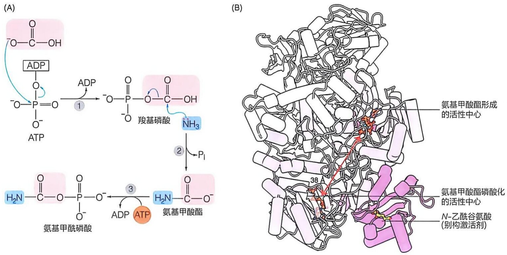

图 24-16 氨基甲酰磷酸合成酶 I 的结构及催化机制

(A) CPS I 催化的三步反应。(B) 人类 CPS I 的结构示意图 (CPS I; PDB: 5DOU)。催化结构域和别构结构域分别用灰色和紫色模型展示。ADP 分子（橙色）、磷酸根离子和 N-乙酰谷氨酸（黄色）用棍状模型

展示。棍状模型中红色代表氧原子，蓝色代表氮原子，橙色代表磷原子。镁离子显示为天青色球体，钾离子显示为紫色球体。CPS I 两个活性中心之间的距离约为 38 Å。

氨基甲酰磷酸合成酶Ⅰ催化完成的反应是尿素生成的限速步骤之一。1950年代，N-乙酰谷氨酸（N-acetylglutamate）被鉴定为氨基甲酰磷酸合成酶Ⅰ的别构激活因子。N-乙酰谷氨酸是在N-乙酰谷氨酸合酶（N-acetylglutamate synthase）的催化作用下，由乙酰辅酶A与谷氨酸缩合而成（图24-17）。实验结果表明，精氨酸（而非其他氨基酸）可能是N-乙酰谷氨酸合酶的激活剂，但其具体的作用机制目前尚不清楚。

值得注意的是，在原核生物、低等真核生物和植物中，N-乙酰谷氨酸是细胞从头合成精氨酸的第一个中间体。然而，在哺乳动物中，N-乙酰谷氨酸仅作为氨基甲酰磷酸合成酶Ⅰ的别构激活剂而合成。此外，在低等生物中，N-乙酰谷氨酸合酶受精氨酸的

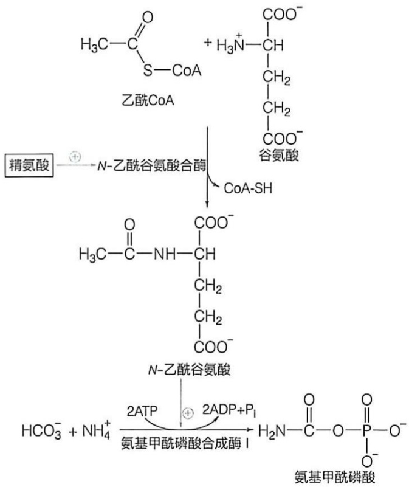

flowchart

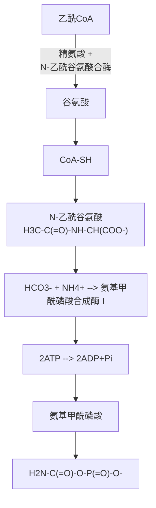

图 24-17 哺乳动物中 N-乙酰谷氨酸的合成过程及调节作用

抑制，但在哺乳动物中，该酶却被精氨酸激活。这些相关性和差异性提示，哺乳动物的尿素循环可能是以低等生物的精氨酸合成途径为基础演化产生的。

## (2) 氨基甲酰磷酸与鸟氨酸在线粒体基质中缩合成瓜氨酸

作为活化的氨甲酰基供体，氨基甲酰磷酸将通过与鸟氨酸缩合进入尿素循环。这步反应由线粒体基质中的鸟氨酸氨基甲酰转移酶（ornithine carbamoyltransferase）催化，将氨甲酰基转移至鸟氨酸的侧链氨基，缩合成瓜氨酸（citrulline）:

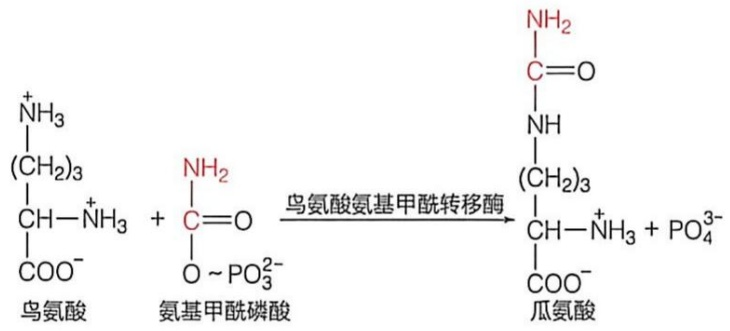

chemical

Chemical reaction equation showing the conversion of gu氨酸 to agaric acid via ammonia and phosphate intermediate

在尿素循环中，鸟氨酸的角色类似于柠檬酸循环中的草酰乙酸。鸟氨酸参与了尿素分子的生成过程，而草酰乙酸参与了二碳单位的氧化分解过程。它们的本质是作为一种载体发挥作用，并在各自循环的最后步骤再生，发挥一种类似催化剂的作用。

产物瓜氨酸在线粒体内膜中的特异性转运蛋白的协助下，从线粒体基质转运至胞质溶胶。类似地，最后在胞质溶胶中重新生成的鸟氨酸也需通过线粒体内膜上的特异性转运蛋白被转运至线粒体基质。值得注意的是，鸟氨酸和瓜氨酸的跨膜转运是通过同一种反向转运蛋白（antiporter）完成的，即在将瓜氨酸转出的同时将鸟氨酸转入线粒体。

## (3) 瓜氨酸从天冬氨酸再获取一个氨基而形成精氨酸

如上所述，尿素分子中两个氨基中的一个氨基源于天冬氨酸。这通过瓜氨酸与天冬氨酸先进行缩合，然后进行裂解而实现。

在线粒体基质中的天冬氨酸氨基转移酶催化下，草酰乙酸从谷氨酸获得氨基，转化为天冬氨酸。随后，天冬氨酸通过线粒体内膜上的特异性转运蛋白进入胞质溶胶，并进入尿素循环。从瓜氨酸转化为精氨酸的反应过程分为两个阶段:第一阶段由精氨酸代琥珀酸合成酶（argininosuccinate synthetase）催化，天冬氨酸的氨基与瓜氨酸侧链羰基发生缩合，生成精氨酸代琥珀酸。在随后的第二阶段，精氨酸代琥珀酸在精氨酸代琥珀酸裂合酶（argininosuccinate lyase）催化下，裂解成精氨酸和延胡索酸。

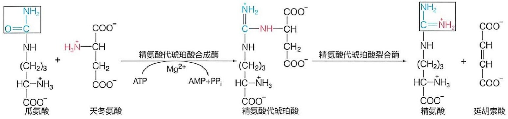

chemical

Reaction pathway of guanidine and acrylonitrile showing enzymatic conversion to guanine and its subsequent product via glycosylation steps

需要注意的是，瓜氨酸的侧链羰基先与来自ATP的AMP基团形成共价连接，形成瓜氨酰AMP活化中间体（这里未展示），后者再与天冬氨酸的氨基缩合，形成精氨酸代琥珀酸。

## (4) 精氨酸在精氨酸酶的催化下生成尿素并重新产生鸟氨酸

这是尿素循环的最后一步反应。在精氨酸酶的催化下，精氨酸末端的尿素基团被水解脱去，同时再生出鸟氨酸。

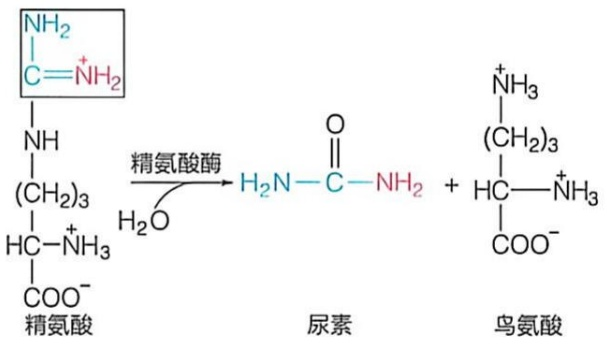

chemical

Chemical reaction equation showing the synthesis of urea and guanidine from amino acids under basic conditions

生成的尿素可进入血液，然后在肾脏随尿液排出体外。鸟氨酸则被转运至线粒体基质，进入下一轮尿素循环。

催化尿素循环的五种酶分别位于线粒体基质和胞质溶胶（图 24-15）。初步数据表明，这些酶分别在线粒体内膜的基质侧（包括氨基甲酰磷酸合成酶Ⅰ和鸟氨酸氨基甲酰转移酶）和线粒体外膜的胞质溶胶侧（包括精氨酸代琥珀酸合成酶、精氨酸代琥珀酸裂合酶和精氨酸酶）形成代谢复合体（metabolon），并且在不同的酶之间形成底物通道。此外，可能形成跨越线粒体内外膜的复合体和通道结构。总体来看，许多共同参与某些代谢过程的酶在活细胞中可能都形成这样的代谢复合体，其详细情况值得进一步探究。

## 24.4.2 尿素循环与柠檬酸循环之间存在相互关联

从中间体共用的角度来看，尿素循环与柠檬酸循环之间的关联主要通过天冬氨酸和延胡索酸实现（图 24-18）。具体而言，尿素的生成依赖天冬氨酸提供一个氮原子，而天冬氨酸的合成需要利用柠檬酸循环的中间体草酰乙酸；天冬氨酸提供氮原子后生成延胡索酸，后者需要通过柠檬酸循环重新转化为草酰乙酸。合成天冬氨酸所需的氨基由谷氨酸持续提供，而谷氨酸的氨基则来源于肝外组织的谷氨酰胺、丙氨酸或肝脏内的其他多余氨基酸。

在尿素循环中，天冬氨酸在胞质溶胶中与瓜氨酸缩合成精氨酸代琥珀酸，后者迅速裂解成精氨酸和延胡索酸。这样产生的延胡索酸去向如何？研究表明，胞质溶胶中的延胡索酸酶同工酶将催化延胡索酸转化为苹果酸，苹果酸随后通过线粒体内膜上的苹果酸/α-酮戊二酸转运蛋白进入线粒体基质的柠檬酸循环。在苹果酸脱氢酶的催化下，被转化为草酰乙酸。在线粒体基质中，草酰乙酸与谷氨酸通过转氨基作用，重新生成天冬氨酸，天冬氨酸再通过线粒体内膜上的谷氨酸/天冬氨酸转运蛋白返回胞质溶胶，进入尿素循环。上述过程被称为天冬氨酸-精氨酸代琥珀酸支路（aspartate-argininosuccinate shunt）（图24-18），它连接了尿素循环和柠檬酸循环。通过这个支路，氨基酸的氨基代谢（尿素循环）与其碳骨架代谢（柠檬酸循环）之间建立了紧密的联系，确保氮排泄与碳骨架去向之间的动态平衡得以维持。

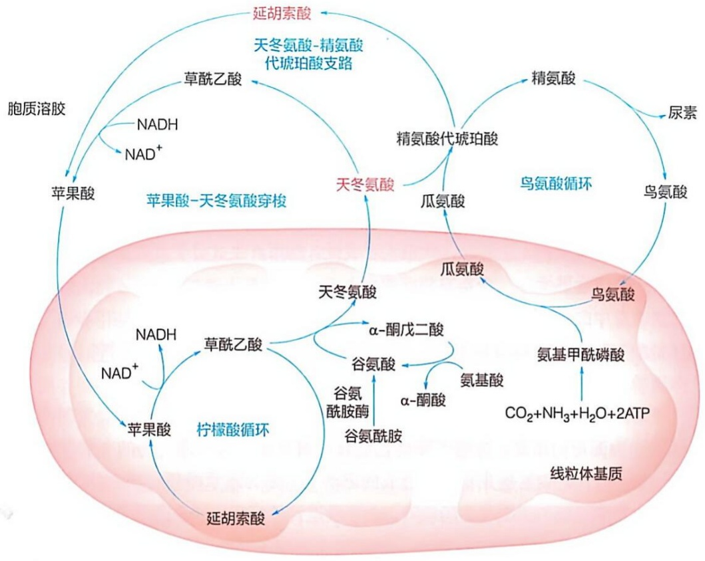

flowchart

This diagram illustrates the metabolic pathways of various amino acids and related compounds, including pyruvate (苹果酸), acrylate (草酰乙酸), and gu氨酸, along with their interactions with nitrogen and urea.

图 24-18 尿素循环与柠檬酸循环之间通过天冬氨酸和延胡索酸关联

值得注意的是，这里所涉及的两种位于线粒体内膜上的转运蛋白，与苹果酸-天冬氨酸穿梭机制完全相同（见图19-6A）。这同时也解释了为什么在胞质溶胶中，由延胡索酸生成的苹果酸，并不被氧化为草酰乙酸、进而生成天冬氨酸进入尿素循环，而是被转运至线粒体基质中。因为苹果酸的氧化依赖 $\mathrm{NAD^{+}}$ 的存在，而胞质溶胶中较高的NADH浓度和相对较低的 $\mathrm{NAD^{+}}$ 浓度阻止了胞质溶胶中苹果酸的氧化。然而，当动物处于饥饿状态时，胞质溶胶中的 $\mathrm{NAD^{+}}$ 浓度升高（NADH浓度降低），苹果酸就可以被氧化生成草酰乙酸，进入糖异生途径生成葡萄糖，而不是通过从谷氨酸获得氨基而转化为天冬氨酸。因此，肝脏中的尿素循环也与糖异生途径密切相关:尿素循环的驱动力源自线粒体基质中的氨和胞质溶胶中的天冬氨酸。当尿素循环的流量增加时，将通过提高胞质溶胶中草酰乙酸的有效浓度而促进糖异生途径的发生。

## 24.4.3 尿素循环需消耗能量

合成1个尿素分子的总反应式可表示如下:

$$
\mathrm{NH} _ {4} ^ {+} + \mathrm{HCO} _ {3} ^ {-} + 3 \mathrm{ATP} + ^ {-} \mathrm{OOCH} _ {2} \mathrm{CH} (\mathrm{NH} _ {3} ^ {+}) \mathrm{COO} ^ {-} (\text {天冬氨酸}) + \mathrm{H} _ {2} \mathrm{O} \longrightarrow
$$

$$
\mathrm{H} _ {2} \mathrm{NCONH} _ {2} (\text {尿素}) + 2 \mathrm{ADP} + \mathrm{AMP} + 2 \mathrm{P} _ {\mathrm{i}} + \mathrm{PP} _ {\mathrm{i}} + ^ {-} \mathrm{OOCCH} = \mathrm{CHCOO} ^ {-} (\text {延胡索酸}) + 5 \mathrm{H} ^ {+}
$$

若仅从尿素循环自身的能量消耗角度分析，合成1分子尿素需消耗相当于4分子ATP的能量。具体而言，合成氨基甲酰磷酸需消耗2分子ATP；在合成精氨酸代琥珀酸时，消耗1分子ATP，生成AMP和焦磷酸，而焦磷酸进一步水解，实际上相当于消耗了2分子ATP。但是，在线粒体基质中，谷氨酸在谷氨酸脱氢酶作用下释放氨时，可能伴随1分子NADH的生成。此外，在胞质溶胶中，由尿素循环生成的延胡索酸被转化为苹果酸，苹果酸转运至线粒体基质后，在苹果酸脱氢酶的催化下生成1分子NADH。若形成的2分子NADH进入呼吸链，约可产生5分子ATP，这就可以达到某种程度的能量平衡。

## 24.4.4 尿素循环的流量通过调节酶活性和基因表达而调控

尿素循环的主要生物学功能，是在动物机体需要分解大量氨基酸时，及时将有毒的氨转化为无毒的尿素。尽管该循环也会移除氨基酸分解代谢产生的少量碳酸氢盐（源自  $CO_{2}$ ），但碳酸氢盐并非尿素合成的驱动力，因为尿素循环的核心目标是排氨。如果催化尿素循环的酶出现功能缺陷，会导致遗传性疾病，这也凸显了尿素循环的重要性。

尿素循环可能是从精氨酸生成途径演化而来，但其流量并非由对精氨酸或尿素的需求所驱动，因此并不通过产物的反馈抑制而进行调节，这有异于氨基酸和核苷酸等的从头合成途径。然而，当机体需要分解更多的氨基酸时，肝脏必须快速提高氨转化为尿素的能力，尿素循环也随之加快。与许多代谢途径类似，尿素循环的调节可分为短期调节和长期调节。

## (1) 尿素循环的短期调节通过别构因子实现

如前所述，催化尿素循环限速步骤的氨基甲酰磷酸合成酶Ⅰ的活性完全依赖于N-乙酰谷氨酸的别构激活效应，而合成N-乙酰谷氨酸的酶可以被精氨酸激活（图24-17）。因此，当食物中的蛋白质含量增加时，N-乙酰谷氨酸的含量也随之增加，促进尿素循环的加速。

## (2) 尿素循环的长期调节通过提高所有酶的含量实现

人们观察到，当给成年哺乳动物个体长期喂食高蛋白质含量的食物或使其处于饥饿状态时，参与尿素循环的所有酶的含量都会提高。这不仅包括直接催化尿素循环五步反应的酶，还包括其他相关的酶和蛋白质，如 $N-$ 乙酰谷氨酸合酶和线粒体内膜上的鸟氨酸/瓜氨酸转运蛋白。这些蛋白质含量的提高，主要是通过相关激素（如糖皮质激素和胰高血糖素）增加这些蛋白质基因的转录水平而实现的。此外，调节蛋白质的降解和翻译过程也可实现蛋白质含量的提高。

## 24.4.5 人体尿素循环的缺陷可导致氨中毒现象

在正常生理状态下，进入血液的氨量与从血液中清除的氨量基本相等，处于动态平衡。氨在肝脏中被转化为尿素并排出体外，是维持这种动态平衡的关键。当肝脏因病毒感染等原因受到严重损伤，或者催化尿素合成的相关酶存在遗传性缺陷时，尿素合成难以有效进行，就会导致血氨浓度升高，诱发高氨血症（hyperammonemia）和氨中毒。其中大脑对氨最为敏感，所受损伤也最为严重。

通常认为，血液中的氨可通过血-脑屏障进入脑组织，与脑内的 $\alpha-$ 酮戊二酸缩合成谷氨酸（这是谷氨酸脱氢酶催化的脱氨反应的逆过程），随后，氨再与谷氨酸进一步缩合成谷氨酰胺（该反应由谷氨酰胺合成酶催化）。因此，随着大脑中氨含量的升高，脑内的 $\alpha-$ 酮戊二酸大量消耗，导致柠檬酸循环减慢，ATP的生成速度也随之减慢，最终引起大脑功能障碍。同时，脑中谷氨酰胺的增加，会使得脑中星形胶质细胞的渗透压升高，进而导致脑水肿和昏迷。此外，谷氨酸也因转变为谷氨酰胺而减少，而谷氨酸及其脱羧产物 $\gamma-$ 氨基丁酸是重要的神经递质，它们的减少也将影响大脑功能的正常发挥。

研究发现，$\mathrm{NH}_4^+$ 可与 $\mathrm{K}^+$ 竞争结合 $\mathrm{Na}^+ / \mathrm{K}^+ -\mathrm{ATP}$ 酶而被转运至胞内，同时使胞外 $\mathrm{K}^+$ 浓度升高；胞外过量的 $\mathrm{K}^+$ 进一步通过 $\mathrm{Na}^+ -\mathrm{K}^+ -\mathrm{Cl}^-$ 共转运体进入神经细胞，同时带入一个 $\mathrm{Na}^+$ 和两个 $\mathrm{Cl}^-$ 。过量的 $\mathrm{Cl}^-$ 将干扰 $\gamma-$ 氨基丁酸与其受体的结合，导致神经细胞的高度去极化，进而引起神经-肌肉协调异常。此外，胞外过量的 $\mathrm{NH}_4^+$ 还将干扰离子通道和水通道蛋白的活性，破坏脑神经细胞的渗透平衡，加剧脑水肿。

人体血氨的正常参考范围为 $15\sim 45~\mu \mathrm{mol / L}$ ，当血氨浓度高于 $50~\mu \mathrm{mol / L}$ （约为$0.85~\mathrm{g / L}$ ）时，通常可认为是高氨血症。高氨血症主要分为获得性和先天性两种类型。获得性高氨血症由肝功能严重受损所致，如酒精中毒、肝炎或胆道阻塞引起的肝硬化，这些情况都将导致血氨无法被肝脏解毒而积累。先天性高氨血症则主要由尿素循环中酶的先天性缺陷引起。尿素循环中任何一种酶的缺陷都可能导致高氨血症。例如，鸟氨酸氨基甲酰转移酶的缺陷，其临床表现为智力发育障碍。尿素循环紊乱的典型特征包括高氨血症、脑病和呼吸性碱中毒（氨刺激脑干呼吸中枢引发过度呼吸所致）等。临床症状包括呕吐、易怒、嗜睡和严重精神障碍等。患有遗传性缺陷的婴儿在出生时表现正常（可能是因为此时机体对尿素循环的依赖程度较弱），但在数天内会逐渐出现嗜睡等症状。常用的治疗方式包括提供低蛋白质饮食，但需确保饮食中富含精氨酸（它可促进 $N-$ 乙酰谷氨酸的产生），这样可以最大限度地减少脑损伤，避免血氨水平过高。此外，治疗方法还包括服用苯丁酸钠等药物。苯丁酸钠在体内代谢后可转化为苯乙酰辅酶A，后者与谷氨酰胺缩合，生成苯乙酰谷氨酰胺，通过尿液排出体外，从而降低血液中氨（谷氨酰胺可分解为谷氨酸和氨）的含量，减少高血氨性脑病的发作频率。

## 24.5 氨基酸的碳骨架可经柠檬酸循环彻底氧化或用于糖异生等

20种基本氨基酸脱去其 $\alpha-$ 氨基后，剩余的碳骨架形成不同的 $\alpha-$ 酮酸。这些 $\alpha-$ 酮酸的后续氧化分解途径各不相同，部分途径与脂肪酸分解途径类似。然而，它们最终均可转化为乙酰辅酶A或柠檬酸循环的中间体。以下将介绍不同氨基酸碳骨架氧化分解途径的总体特征及其各自的具体情况。

## 24.5.1 肝细胞中氨基酸碳骨架的分解产物可用于生成葡萄糖或酮体

通过同位素标记等方法的分析，人们观察到，20种基本氨基酸脱去 $\alpha-$ 氨基后的碳骨架可分解形成七种产物，即乙酰乙酰辅酶A、乙酰辅酶A、丙酮酸、 $\alpha-$ 酮戊二酸、琥珀酰辅酶A、延胡索酸和草酰乙酸（图24-19）。

由于动物机体大多在缺乏葡萄糖的饥饿条件下利用氨基酸作为燃料分子，因此人们通常以20种基本氨基酸的碳骨架分解产物能否转化为葡萄糖或酮体作为区分标准。

如果氨基酸的碳骨架分解能净转化为柠檬酸循环的中间体，则被称为生糖氨基酸（glucogenic amino acid）。这是因为它们的碳骨架通过柠檬酸循环被净转化为草酰乙酸后，通过糖异生途径生成葡萄糖（见第21章）。通常情况下，当动物处于长期饥饿或剧烈运动状态时，这些氨基酸将成为生成葡萄糖的关键前体物质。

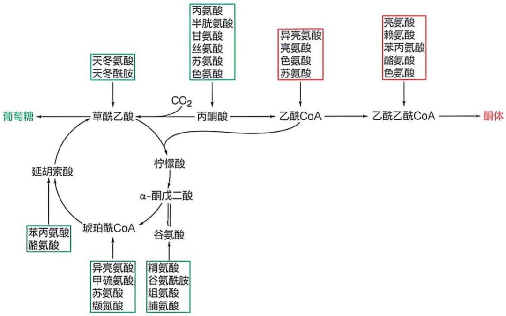

flowchart

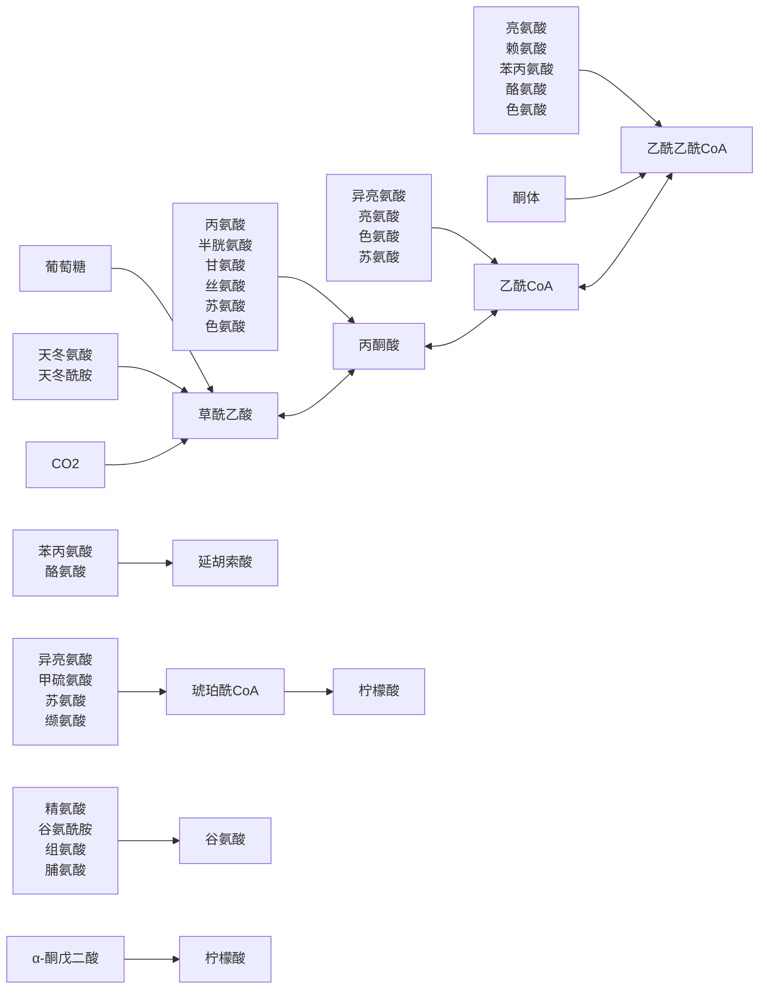

图24-19 二十种氨基酸脱氨后所形成 $\alpha-$ 酮酸的分解代谢总况绿色框中的氨基酸为生糖氨基酸和兼性氨基酸，红色框中的氨基酸为生酮氨基酸。

如果氨基酸的碳骨架分解产物能净转化为乙酰乙酰辅酶A或乙酰辅酶A，则被称为生酮氨基酸（ketogenic amino acid）。这是因为它们的碳骨架分解产物可以通过肝细胞线粒体中的酮体生成途径合成酮体（见第22章）。据此，仅有亮氨酸和赖氨酸被归类为严格意义上的生酮氨基酸。当动物处于长期饥饿或剧烈运动状态时，这些氨基酸用于合成酮体。某些侧链较为复杂的氨基酸，其碳骨架分解产物中，一部分可净转化为柠檬酸循环中间体，另一部分则可净转化为乙酰乙酰辅酶A或乙酰辅酶A。这类氨基酸被称为兼生糖生酮氨基酸。比如，三种芳香族氨基酸（色氨酸、酪氨酸、苯丙氨酸）以及苏氨酸和异亮氨酸均属于这类兼生糖生酮氨基酸。

20 种氨基酸的归类如表 24-2 所示。

表 24-2 生糖、生酮和兼生糖生酮氨基酸的分类

| 类别 | 氨基酸 |
| --- | --- |
| 生糖氨基酸 | 甘氨酸、丝氨酸、缬氨酸、组氨酸、精氨酸、半胱氨酸、脯氨酸、谷氨酸、丙氨酸、谷氨酰胺、天冬氨酸、天冬酰胺、甲硫氨酸(13种) |
| 生酮氨基酸 | 亮氨酸、赖氨酸(2种) |
| 兼生糖生酮氨基酸 | 异亮氨酸、苏氨酸、苯丙氨酸、色氨酸、酪氨酸(5种) |

值得注意的是，无论属于哪一类，在理论上，这20种氨基酸的氧化分解产物均可通过柠檬酸循环彻底氧化为  $CO_{2}$  和  $H_{2}O$ ，从而产生能量。然而，在肝细胞中，氨基酸氧化分解的产物并非肝脏获取能量的重要途径，肝细胞通常利用脂肪酸的分解获取能量。一般在饥饿或剧烈运动状态下，肝脏会利用氨基酸为其他器官生成葡萄糖和酮体。

以下根据生成的七种共同产物，介绍 20 种基本氨基酸脱氨后的碳骨架的分解过程。大多数氨基酸的碳骨架氧化或全部或部分发生于线粒体中，由于每种氨基酸的分解途径各不相同，我们的介绍难以做到细致全面。

## 24.5.2 六种氨基酸的碳骨架全部或部分转化为丙酮酸

该组氨基酸包括丙氨酸、甘氨酸、丝氨酸、苏氨酸、半胱氨酸和色氨酸（图24-20）。它们的代谢转化过程可概括如下:①丙氨酸通过一步的转氨作用，将氨基转移至 $\alpha-$ 酮戊二酸，生成丙酮酸；②色氨酸中与吲哚环相连的三碳单位转化为丙氨酸后经转氨作用，即生成丙酮酸；③半胱氨酸经两或三步反应脱去巯基，转变为二氧化硫（$\mathrm{SO}_2$）或硫化氢（$\mathrm{H}_2\mathrm{S}$）后，转化为丙酮酸；④丝氨酸在丝氨酸脱水酶（以PLP作为辅因子）的催化下，脱去 $\beta-$ 羟基和 $\alpha-$ 氨基，转化为丙酮酸；⑤甘氨酸在丝氨酸羟甲基转移酶（以PLP作为辅因子）的催化下，从 $N^5, N^{10}-$ 亚甲基四氢叶酸获取亚甲基并发生水合反应，转化为丝氨酸（该反应的逆反应使四氢叶酸从丝氨酸获取一个一碳单位），丝氨酸再经丝氨酸脱水酶催化，转化为丙酮酸；⑥苏氨酸在苏氨酸脱氢酶的催化下，转化为2-氨基-3-酮丁酸；后者在2-氨基-3-酮丁酸-辅酶A连接酶的催化下，生成1分子乙酰辅酶A和1分子甘氨酸，随后甘氨酸通过上述途径（⑤）转化为丙酮酸。

图 24-20 丙氨酸、苏氨酸、甘氨酸、丝氨酸、半胱氨酸和色氨酸分解生成丙酮酸的过程

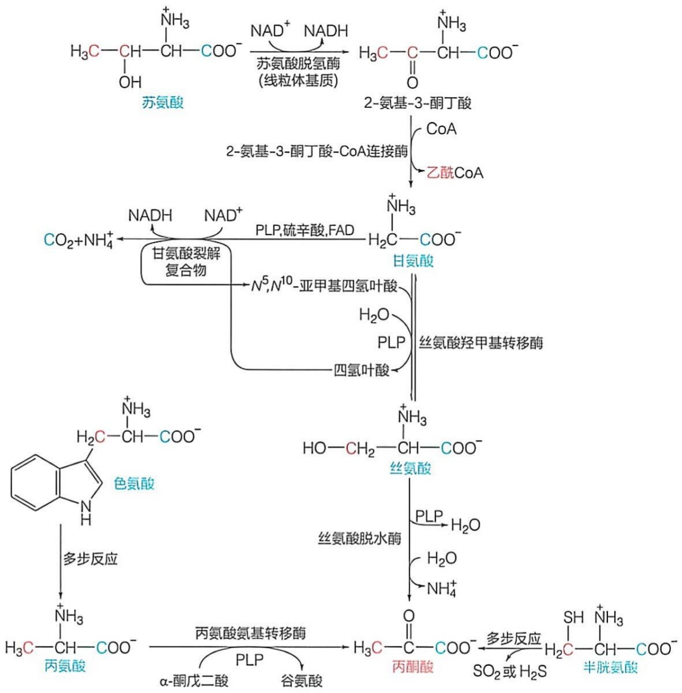

flowchart

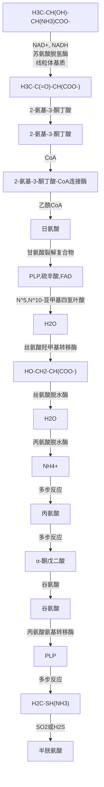

这些生成丙酮酸的反应发生于胞质溶胶中。丙酮酸被转运至线粒体基质中后，发生羧基化反应生成草酰乙酸，随后转化为苹果酸，并被转运至胞质溶胶，重新生成草酰乙酸，从而进入糖异生途径。然而，在极少数情况下（例如饮食中摄入大量蛋白质时），生成的丙酮酸转化为乙酰辅酶A，随后进入柠檬酸循环彻底氧化。

值得注意的是，甘氨酸也可在肝脏等器官中经甘氨酸裂解复合物（四种酶和PLP、硫辛酸、四氢叶酸、FAD、NAD五种辅因子）催化，裂解成 $CO_{2}$ 和 $NH_{4}^{+}$，同时还产生 $N^{5}, N^{10}-$ 亚甲基四氢叶酸和NADH。该裂解过程发生于线粒体中。四氢叶酸（tetrahydrofolate， $FH_{4}/THF$ ）为一种一碳单位载体。

半胱氨酸分子中的巯基可转化为  $H_{2}S$  或  $SO_{2}$ ， $H_{2}S$  可作为信号分子发挥作用， $SO_{2}$  可进一步氧化生成  $H_{2}SO_{4}$ 。这样形成的硫酸根一部分以无机盐形式随尿液排出，而另一部分则通过 ATP 活化生成活性硫酸根，即 3'-磷酸腺苷-5'-磷酸硫酸（3'-phosphoadenosine-5'-phosphosulfate，PAPS）。

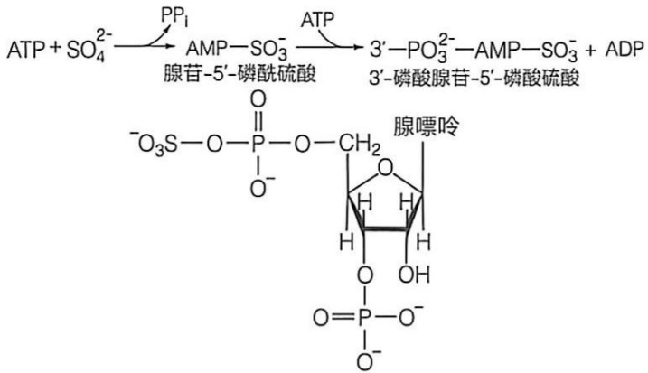

chemical

Chemical reaction pathway showing enzymatic conversion of ATP and sulfate to AMP-SO3- and its phosphorylation products

3'-磷酸腺苷-5'-磷酸硫酸（PAPS）的结构

PAPS 具有较高的反应活性，可与某些分子结合形成硫酸酯。例如，类固醇激素可通过硫酸酯化反应而失活；一些外源性酚类化合物经硫酸酯化反应生成的产物具有更高的水溶性，可排出体外。这些反应在肝细胞解毒过程中发挥重要作用。此外，PAPS 还可参与硫酸角质素及硫酸软骨素等糖胺聚糖分子中硫酸化氨基糖的生物合成（见第 14 章）。

## 24.5.3 七种氨基酸的碳骨架可部分转变为乙酰辅酶 A

该组氨基酸包括色氨酸、苯丙氨酸、酪氨酸、亮氨酸、异亮氨酸、赖氨酸和苏氨酸七种。这些氨基酸碳骨架代谢转化的特征在于，部分氨基酸碳骨架（如色氨酸、亮

图 24-21 色氨酸、苯丙氨酸、酪氨酸、亮氨酸、异亮氨酸、赖氨酸和苏氨酸碳骨架分解生成乙酰乙酸和乙酰辅酶 A

氨酸、异亮氨酸和赖氨酸）的后期氧化过程与脂肪酸氧化分解生成乙酰辅酶 A 的过程类似，它们均需先与辅酶 A 连接后才可进行转化。其中，苯丙氨酸、酪氨酸、亮氨酸碳骨架的一部分可转化为乙酰乙酸，后者可直接转化为酮体，或转化为乙酰辅酶 A 后再转化为酮体。

具体分解过程（图 24-21）简单描述如下:①含有 11 个碳原子的色氨酸碳骨架中的吲哚环 8 个碳原子中，有 4 个碳原子以 CO₂ 形式释放，剩余 4 个碳原子可通过生成乙酰乙酰辅酶 A 后再转化为 2 分子乙酰辅酶 A（连接在吲哚环上的 3 个碳原子可被转化为丙氨酸）。②含有9个碳原子的苯丙氨酸经羟化反应，生成酪氨酸；酪氨酸经一系列反应生成乙酰乙酸（或经乙酰乙酰辅酶A转化为乙酰辅酶A）和含4个碳原子的延胡索酸。③含6个碳原子的亮氨酸经过脱羧和羧化等反应后转变为1分子乙酰乙酸和1分子乙酰辅酶A，乙酰乙酸可转化为乙酰辅酶A。④含有6个碳原子的异亮氨酸（以与辅酶A连接的形式）经脱羧后裂解成1分子乙酰辅酶A和1分子丙酰辅酶A；丙酰辅酶A可经羧化和异构化反应，转化为琥珀酰辅酶A（图22-12）。⑤含有6个碳原子的赖氨酸碳骨架中的4个碳也通过乙酰乙酰辅酶A而被转化为2分子乙酰辅酶A。苏氨酸产生乙酰辅酶A的详细过程如图24-20所示。

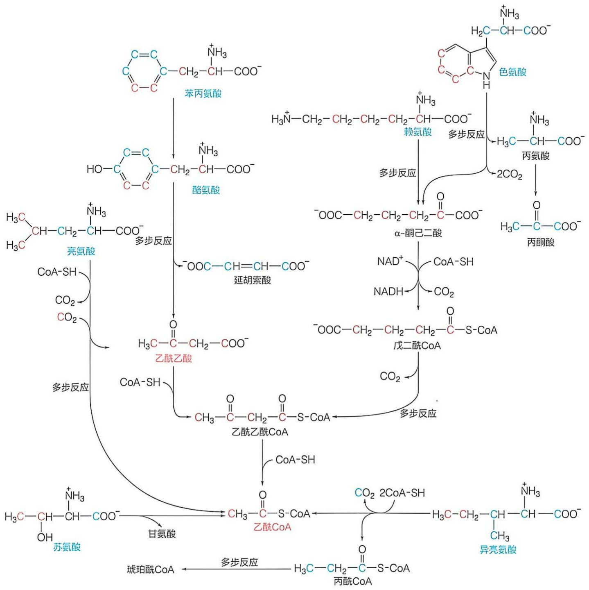

flowchart

在酪氨酸和苯丙氨酸分解过程中，生成的延胡索酸可直接进入柠檬酸循环。如果人体中催化苯丙氨酸和酪氨酸碳骨架分解的酶存在先天性遗传性缺陷，将会导致一些独特的症状（具体见后）。

## 24.5.4 五种氨基酸碳骨架分解生成 $\alpha-$ 酮戊二酸

该组氨基酸包括精氨酸、组氨酸、脯氨酸、谷氨酰胺和谷氨酸，其碳骨架分解过程可简单描述如下（图24-22）:①含有6个碳的精氨酸在精氨酸酶的催化下，脱去1分子尿素（含1个碳）后转化为鸟氨酸（含5个碳），后者脱去侧链末端氨基而转化为谷氨酸-γ-半醛，再经氧化脱氢反应，转化为谷氨酸；②含有6个碳的组氨酸经多步代谢反应，将1个一碳单位和1个氮原子转移至四氢叶酸，剩下的5个碳原子则转化为谷氨酸；③含有5个碳原子的脯氨酸环状结构经氧化反应形成席夫碱，再水解生成线性谷氨酸-γ-半醛，最终经氧化脱氢反应，转化为谷氨酸；④含有5个碳原子的谷氨酰胺在谷氨酰胺酶的催化下，脱去侧链氨基后转化为谷氨酸；⑤含有5个碳的谷氨酸经氧化脱氨反应转化为α-酮戊二酸，进入柠檬酸循环。在柠檬酸循环中，α-酮戊二酸转化为草酰乙酸后，存在两种代谢去向:一是进入糖异生途径，用于合成葡萄糖（主要途径）；二是被彻底氧化生成 $CO_{2}$ 和 $H_{2}O$，为细胞提供能量。

## 24.5.5 四种氨基酸的碳骨架分解产生琥珀酰辅酶 A

这组氨基酸包括甲硫氨酸、异亮氨酸、缬氨酸和苏氨酸，其碳骨架的一部分均先被转化为丙酰辅酶A。这些氨基酸碳骨架分解的具体过程可简单描述如下（图24-23）:①含有5个碳原子的甲硫氨酸在形成S-腺苷甲硫氨酸并将其甲基转移至某种受体后，生成高半胱氨酸（曾被称作同型半胱氨酸）。随后，高半胱氨酸将其巯基转移至丝氨酸（经由依赖PLP辅因子的胱硫醚-β-合酶和胱硫醚-γ-裂解酶依次催化并生成半胱氨酸）。在此过程中，生成含有4个碳原子的α-酮丁酸，后者经氧化脱羧反应，脱去1分子 $CO_{2}$ ，剩下的3个碳原子则形成丙酰辅酶A。②含有6个碳的异亮氨酸经转氨和氧化脱羧等反应后，剩余的5个碳原子被分解为1分子乙酰辅酶A和1分子丙酰辅酶A（图24-21）。异亮氨酸分解过程类似于脂肪酸的分解过程。

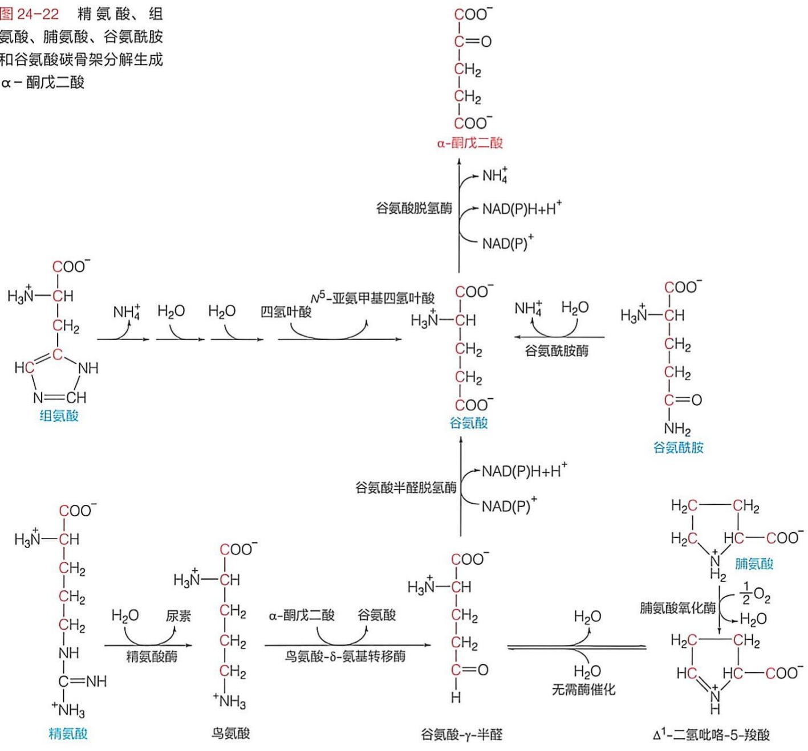

flowchart

This image illustrates the biochemical pathway of α-ketoxybutyrate (α-ketoxybutyrate) and its subsequent enzymatic reactions, including intermediates like gu氨酸, gu氨酸-β-hexylamine, and β-ketoxybutyrate.

③含有5个碳的缬氨酸经多步反应，包括转氨反应和两次脱羧反应，转化为丙酰辅酶A。④苏氨酸经苏氨酸脱水酶（它与丝氨酸脱水酶可能为同一种酶，主要存在于肝细胞胞质溶胶中）催化，先形成α-酮丁酸，后者进入线粒体后再转化为丙酰辅酶A，通过该途径，苏氨酸成为生糖氨基酸；而通过图24-20中描述的、主要发生于肝细胞线粒体基质的途径，苏氨酸为生酮氨基酸。

在线粒体基质中，丙酰辅酶 A 经羧化反应生成甲基丙二酰辅酶 A，再在依赖辅酶  $B_{12}$  的甲基丙二酰辅酶 A 变位酶的催化下发生差向异构，生成琥珀酰辅酶 A，进入柠檬酸循环。

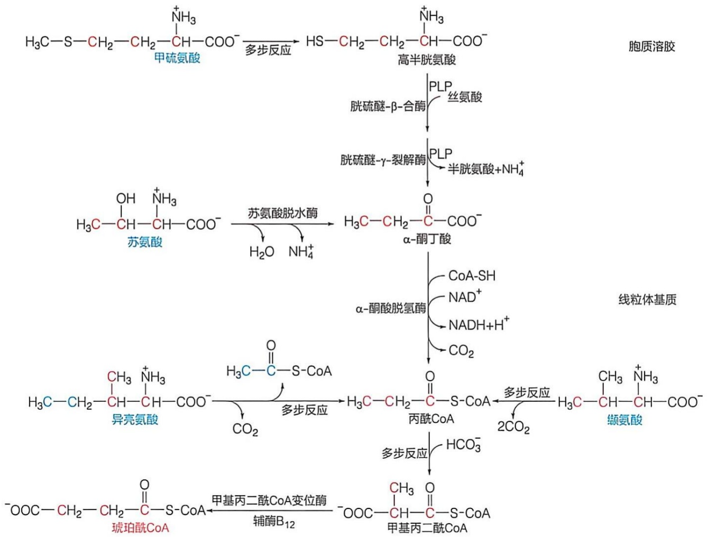

flowchart

This flowchart illustrates the biochemical pathway of glycogen synthesis, showing how various amino acids and nucleotides react with gluconic acid to form alpha-amino acids, followed by enzymatic reactions involving acyltransferase enzymes and nucleotides.

图 24-23 甲硫氨酸、异亮氨酸、苏氨酸和缬氨酸碳骨架分解生成琥珀酰辅酶 A

## 24.5.6 两种氨基酸的碳骨架被分解为草酰乙酸

这组氨基酸包括天冬酰胺和天冬氨酸。天冬酰胺在天冬酰胺酶的催化下，水解脱去酰胺上的氨基生成天冬氨酸。天冬氨酸在天冬氨酸氨基转移酶催化下，将其  $\alpha-$  氨基转移至  $\alpha-$  酮戊二酸，生成草酰乙酸（图 24-24）。

线粒体基质中生成的草酰乙酸被转运至胞质溶胶后进入糖异生途径。值得注意的是，线粒体基质中生成的草酰乙酸，无论是直接生成的还是经其他柠檬酸循环中间体转化生成的，均需被转运至胞质溶胶，才可进入糖异生途径。转运过程如下:在线粒体基质中，苹果酸脱氢酶催化草酰乙酸利用NADH进行还原，转化为苹果酸（与正常柠檬酸循环的反应方向相反）。随后，苹果酸通过线粒体内膜上的苹果酸/α-酮戊二酸转运蛋白被转运至胞质溶胶。在胞质溶胶中，在苹果酸脱氢酶的同工酶催化下，苹果酸被重新转化为草酰乙酸，然后进入糖异生途径。

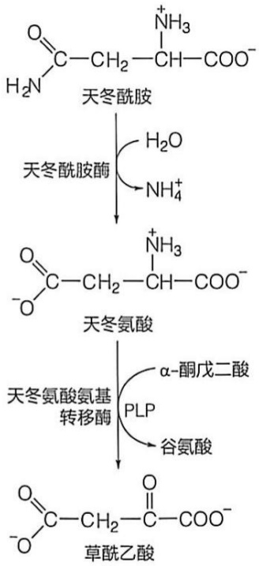

chemical

Reaction pathway diagram showing the conversion of acrylonitrile to acrylonitrile and its subsequent enzymatic transformation using α-ketoxybenzoic acid and谷氨酸.

图 24-24 天冬酰胺和天冬氨酸分解生成草酰乙酸

## 24.5.7 三种支链氨基酸分解生成乙酰辅酶 A、乙酰乙酸和丙酰辅酶 A 等

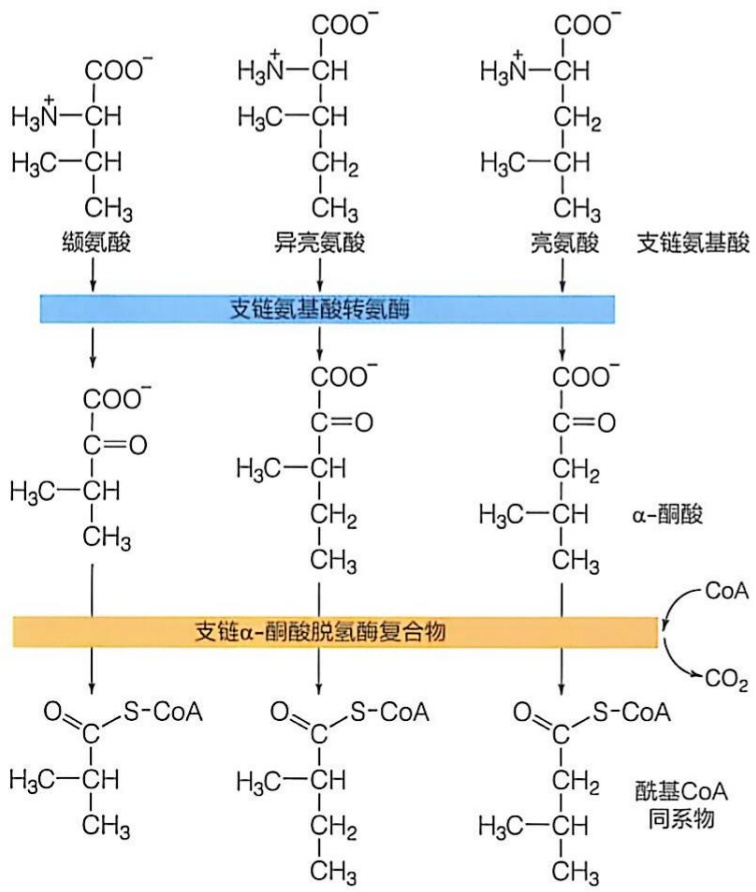

flowchart

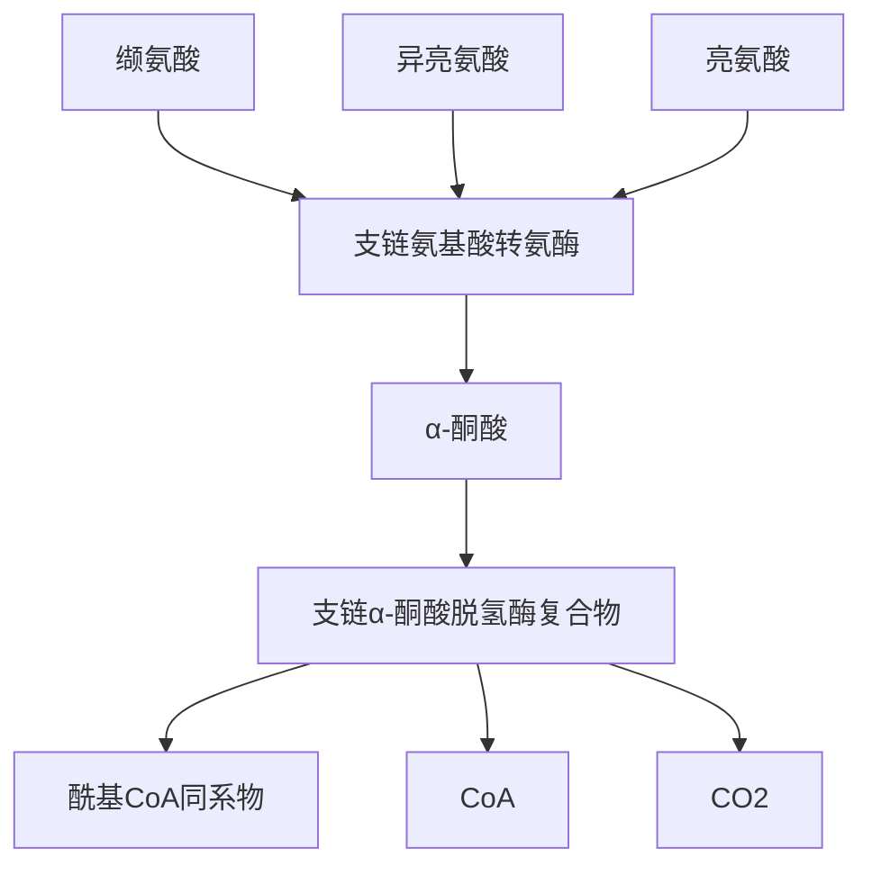

图 24-25 三种支链氨基酸分解代谢的前两步反应由相同的酶催化

缬氨酸、异亮氨酸、亮氨酸是三种侧链含有分支且高度相似的氨基酸，统称为支链氨基酸。这三种支链氨基酸均为必需氨基酸，即哺乳动物无法自身合成、必须通过食物摄取。如前所述，它们在脱去氨基后，其碳骨架分解可生成乙酰乙酰辅酶A，乙酰辅酶A和丙酰辅酶A（图24-21和图24-23）。

可能由于它们的结构高度相似，研究表明，催化这三种支链氨基酸的转氨酶以及催化它们产生的  $\alpha-$  酮酸氧化脱羧的酶也完全相同（图 24-25）。催化支链氨基酸发生氨基转移的酶被称作支链氨基酸氨基转移酶，催化支链氨基酸脱氨后生成的  $\alpha-$  酮酸发生氧化脱羧的酶被称作支链  $\alpha-$  酮酸脱氢酶复合物（branched-chain  $\alpha$ -keto acid dehydrogenase complex）。

支链  $\alpha-$  酮酸脱氢酶复合物与丙酮酸脱氢酶复合物以及  $\alpha-$  酮戊二酸脱氢酶复合物高度类似:它们均由三种亚基组装成较大的蛋白质复合物，且均使用 TPP、FAD、NAD $^{+}$ 、硫辛酸和辅酶 A 这五种辅因子，催化的机制也高度类似（见图 18-9）。

支链氨基酸在肌肉细胞中脱去氨基后在肝细胞中氧化分解。一种看似矛盾的现象是，在肝细胞中，支链氨基酸转氨酶的表达量极低，而支链  $\alpha-$  酮酸脱氢酶复合物的表达量却极高。相反，在肌肉细胞中，支链氨基酸转氨酶的表达量极高，但支链  $\alpha-$  酮酸脱氢酶复合物的表达量却极低。后续研究表明，如图 24-26 所示，肌肉细胞中的支链氨基酸发生转氨反应后，所生成的碳骨架  $\alpha-$  酮酸主要被分泌至血液中，随后被肝细胞摄取，氧化分解后用于糖异生或酮体的合成，而不是进入柠檬酸循环途径进行彻底氧化。

图 24-26 哺乳动物肌肉和肝脏对支链氨基酸的协同分解代谢

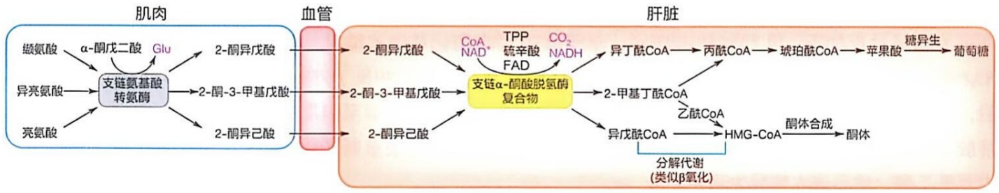

flowchart

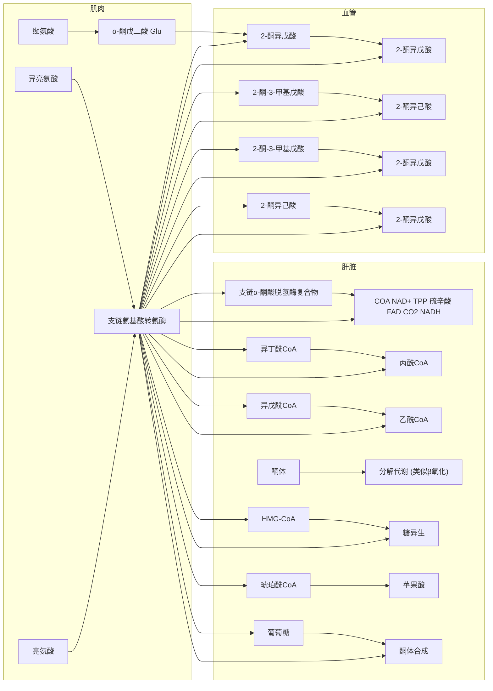

支链  $\alpha-$  酮酸脱氢酶复合物的遗传性缺陷可以导致枫糖尿病（maple syrup urine disease，也称支链酮酸尿症）。枫糖尿病患者血液及尿液中出现大量支链氨基酸及相应的酮酸，因其尿液具有类似枫糖的气味而得名。若不加以干预，枫糖尿病患者将出现大脑发育异常，并可能在婴儿期死亡。然而，若能早期诊断并在日常饮食中严格限制支链氨基酸的摄入量（同时密切监测其体内的支链酮酸和支链氨基酸的水平），患者则可正常发育。

## 24.5.8 催化苯丙氨酸和酪氨酸碳骨架分解的酶存在遗传性缺陷可导致人体疾病

前面我们简要介绍了含有9个碳原子的苯丙氨酸和酪氨酸的碳骨架经多步反应，最终裂解成含有4个碳原子的延胡索酸以及2分子乙酰辅酶A的过程（图24-21）。对苯丙氨酸和酪氨酸分解过程更为详细的描述，以及某些相关酶的遗传性缺陷所导致的疾病如图24-27所示。

## （1）与苯丙氨酸和酪氨酸分解代谢过程相关的遗传性缺陷被陆续发现

尿黑酸尿症（alcaptonuria）是最早被观察到的与该代谢途径相关的人类疾病。尿黑酸尿症患者排出的尿液在接触空气后变黑的现象最早于1580年代被记录。然而，直到1890年代，德国学者欧根·鲍曼（Eugen Baumann，1846—1896）才确定使尿液变黑的物质为2,5-二羟基苯乙酸（也被称作尿黑酸，homogentisic acid）。他还提供证据表明，摄入酪氨酸会促进尿黑酸尿症患者排出这种物质（当时被认为是微生物作用导致的结果）。后来研究发现，摄入苯丙氨酸同样会导致尿黑酸尿症患者中尿黑酸的排泄。从此，人们认识到，苯丙氨酸和酪氨酸的代谢都通过一条形成尿黑酸的路径进行，而尿黑酸尿症患者的代谢紊乱在于该代谢途径受到抑制，即氨基酸降解仅进行到这一步就停止了。

1900 年代，美国医生阿奇博尔德·加罗德（Archibald Garrod，1857—1936）观察到了尿黑酸尿症的可遗传性特征，并提出先天性代谢缺陷的概念。他观察到，这种代谢错误发生在酪氨酸和苯丙氨酸分解代谢过程的倒数第二步（图 24-27，④），即一种特异酶的先天性缺失，这种酶负责催化苯环的裂解。这一发现为孟德尔遗传定律在人类中的适用性提供了证据，并暗示遗传因子与酶之间存在相关性。虽然这两种氨基酸分解代谢途径在 1920 年代就已经提出并被广泛接受，但催化这些连续发生化学反应的酶和辅因子直到 1940 年代才被鉴定。后续研究表明，尿黑酸在体内积累的原因是尿黑酸 -1,2- 双加氧酶（homogentisate 1,2-dioxygenase）的遗传性缺陷所致。

另一种与严重智力低下相关的人类遗传性疾病——苯丙酮尿症（phenylketonuria, PKU）也被证实与苯丙氨酸分解代谢异常有关。具体而言，1930年代，挪威医生阿斯比约恩·福林（Asbjorn Folling，1888—1934）等通过有机化学方法检测到，患有严重智力障碍的姐弟俩人的尿液（具有难闻的气味）中含有苯丙酮酸（phenylpyruvic