的 ADP（反映 ATP 水平低）结合到铁蛋白  $\gamma$  亚基上的 ATP 结合位点，阻止 ATP 的结合，从而抑制固氮酶复合物的酶活性。三是固氮酶复合物的酶活性因铁蛋白亚基上一个特异精氨酸残基侧链被 ADP-核糖基化修饰（ADP-ribosylation）而受到抑制。这种修饰是可逆的，由两种酶催化完成，NAD $^{+}$  提供 ADP 核糖基，并释放一个烟酰胺分子。

## 25.2 固氮细菌产生的氨主要经由谷氨酸和谷氨酰胺进入其他生物分子

早在 1940 年代，通过利用  ${}^{15}N_{2}$  对固氮细菌进行示踪等研究发现，谷氨酸被标记的比例远高于其他氨基酸（其次是天冬氨酸），这表明固氮细菌形成的氨首先进入谷氨酸。后续研究进一步揭示，固氮过程形成的  $NH_{4}^{+}$  先进入谷氨酰胺和谷氨酸等氨基酸分子中，谷氨酰胺和谷氨酸再为细胞合成其他各类含氮生物分子提供氮源。后面我们将看到，谷氨酸通过转氨作用成为大部分其他氨基酸  $\alpha-$  氨基的供体，而谷氨酰胺侧链中的酰胺基也是合成大量含氮生物分子（如氨基酸的侧链和核苷酸）的氨基供体。

## 25.2.1 固氮产生的氨首先进入谷氨酰胺和谷氨酸

固氮细菌生成的  $NH_{3}$  （在溶液中以  $NH_{4}^{+}$  形式存在）可通过下面两条途径进入谷氨酸。

（1）游离氨可在谷氨酸脱氢酶催化下与  $\alpha-$  酮戊二酸缩合形成谷氨酸

谷氨酸脱氢酶广泛存在于动物、植物及微生物细胞中。在第24章中，我们介绍了在动物肝细胞的线粒体中，谷氨酸脱氢酶催化谷氨酸（通常指L-谷氨酸，但常省略不写L构型）氧化脱氨，产生的 $NH_{4}^{+}$ 进入尿素循环。尽管该酶催化的反应在理论上是可逆的，但由于其对氨的 $K_{m}$ 值过高（约为1\~5 mmol/L），在动物细胞中，该逆反应几乎从不发生。

但是，在固氮细菌细胞中， $NH_{4}^{+}$ 的浓度远高于普通细胞，这使得该逆反应可以有效地发生，成为 $NH_{4}^{+}$ 进入谷氨酸的有效途径:

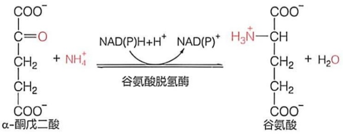

chemical

Chemical reaction equation showing the conversion of α-ketoxybutyric acid to pyrene via NAD(P)H+H+ and NAD(P)+ reactions

谷氨酸脱氢酶是一种具有高度立体专一性的酶，由于其活性中心的高度不对称性，它只可作用于 L-谷氨酸。

## (2) 游离氨也可通过谷氨酰胺合成酶 - 谷氨酸合酶途径进入谷氨酸

在 1970 年代之前，人们普遍认为生物体将有毒的氨转化为无毒有机含氮化合物的过程（也称氨的同化）仅通过上述谷氨酸脱氢酶（一种在 1930 年代就被鉴定的酶）催化的途径进行。然而，人们认识到该酶的  $K_{m}$  值太高，在大多数细胞内难以有效催化氨的固定。在此之后，人们鉴定到了另外一条由谷氨酰胺合成酶和谷氨酸合酶共同完成的途径，它可在低氨浓度条件下催化氨的固定反应。

在该途径中，首先由谷氨酰胺合成酶（glutamine synthetase）催化  $NH_{4}^{+}$  与谷氨酸缩合，生成谷氨酰胺:

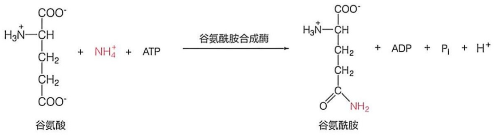

chemical

Chemical reaction equation showing conversion of glutamine to glutamylpropanoate using pyrolysis

谷氨酰胺合成酶催化的反应实际上分两步进行。首先，利用ATP使谷氨酸侧链羧基发生磷酸化修饰，形成 $\gamma-$ 谷氨酸磷酸中间体；随后，$\mathrm{NH}_4^+$ 取代磷酸基，生成谷氨酰胺。细菌谷氨酰胺合成酶是一种由12个相同亚基组装而成的同源寡聚体，形成上下各6个亚基叠加在一起的两层环状结构。每个亚基的活性中心都包含2个金属离子（通常为镁离子），ATP和谷氨酸被认为从两个相反方向进入活性中心，可能的催化机制见图24-10。

在此基础上，前面形成的谷氨酰胺再由谷氨酸合酶（glutamate synthase）催化，将其侧链氨基转移至  $\alpha-$  酮戊二酸，生成 2 分子谷氨酸:

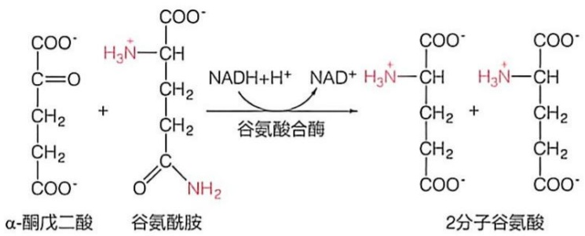

chemical

Reaction mechanism showing conversion of α-dimethylmalonate to 2-methylmalonate via pyruvate and NADH/H+ intermediate

谷氨酰胺合成酶对  $NH_{4}^{+}$  的  $K_{m}$  值（小于 0.1 mmol/L）远低于谷氨酸脱氢酶（其  $K_{m}$  值约为 1～5 mmol/L），因此，谷氨酰胺合成酶-谷氨酸合酶途径可以在较低  $NH_{4}^{+}$  浓度的条件下，使  $NH_{4}^{+}$  有效进入谷氨酰胺和谷氨酸，从而为合成其他含氮生物分子提供氨基。

许多酶催化的反应利用谷氨酰胺侧链作为氨基供体，包括谷氨酸合酶在内的这一大类酶被称为转酰胺酶（amidotransferase）。转酰胺酶在氨基酸、核苷酸等含氮有机物的合成过程中广泛发挥作用。这类酶通常包含两个活性部位:第一个活性部位催化谷氨酰胺侧链脱去氨基，生成游离的氨；后者通过底物通道到达第二个活性部位，与特异受体分子缩合生成产物。具体机制见下文（以谷氨酸合酶为例）。

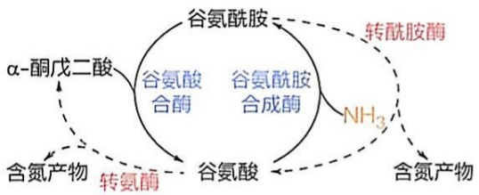

flowchart

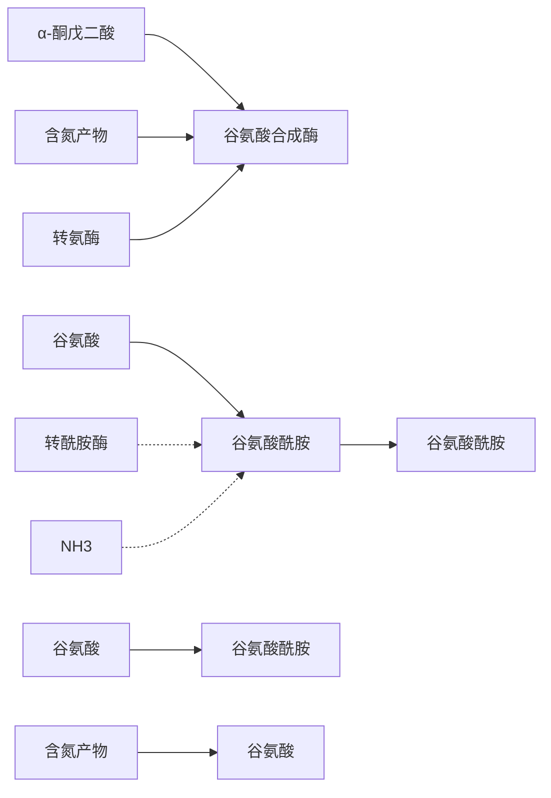

图25-3 游离氨进入谷氨酸和谷氨酰胺的循环过程

在谷氨酰胺合成酶-谷氨酸合酶途径中，若最终形成的2分子谷氨酸中的1分子谷氨酸由谷氨酰胺合成酶催化转变成谷氨酰胺，则可形成一轮循环过程，如图25-3所示。

这种循环的最终结果是:游离的氨进入谷氨酸和谷氨酰胺分子后，为合成大量其他含氮生物分子提供氮源。

## 25.2.2 谷氨酸合酶是一种存在于细菌和植物中但不存在于动物体内的复杂酶

作为一种转酰胺酶，谷氨酸合酶是一种仅存在于细菌和植物中的含多个辅因子的铁硫-黄素蛋白。该酶以不同形式存在，分别可从NADH或铁氧还蛋白（Fd）获取电子，催化将谷氨酰胺的酰胺基转移至 $\alpha-$ 酮戊二酸的反应，最终生成2分子谷氨酸。

与所有转酰胺酶一样，谷氨酸合酶具有两个活性部位。在依赖 NADH 的细菌谷氨酸合酶中（图 25-4A），两个活性中心均位于 α 亚基中，其催化过程大致如下（图 25-4B）:第一种底物谷氨酰胺进入第一个活性中心后，其侧链的酰胺基发生水解，生成  $NH_{3}$ ， $NH_{3}$  通过底物通道到达第二个活性中心。随后， $NH_{3}$  与第二种底物 α-酮戊二酸反应，生成亚胺中间体。来自 NADH 的两个电子依次通过位于 β 亚基中的 FAD、[4Fe-4S]、[4Fe-4S] 和位于 α 亚基中的 [3Fe-4S]，最终传递至活性中心 2 中的 FMN 辅因子，使亚胺中间体还原生成谷氨酸。谷氨酸合酶活性中心的不对称性，使之只生成 L-谷氨酸。

## 25.2.3 细菌谷氨酰胺合成酶的活性可通过多种方式调控

与谷氨酸合酶（只存在于植物和微生物中）不同，谷氨酰胺合成酶存在于所有生物体内。尽管不同生物体内的谷氨酰胺合成酶在基本结构模式和催化机制上具有相似性，但由于功能的差异，它们的调控方式也存在差异。

这里主要介绍细菌谷氨酰胺合成酶的调节方式，其活性不仅受到多种别构因子的调节（见图25-5），还通过共价修饰进行调节（见图25-6）。这种精细的调控机制确保了细胞内谷氨酰胺维持在适宜水平，既充分满足含氮生物分子合成的需求，同时也避免过量积累。

（1）细菌谷氨酰胺合成酶的活性可被多种别构效应物抑制

1960 年代的酶动力学体外实验结果表明，丝氨酸、甘氨酸、丙氨酸、色氨酸、组氨酸、AMP、CTP、葡萄糖胺 -6- 磷酸和氨基甲酰磷酸共 9 种效应物均可抑制细菌谷氨酰胺合成酶的活性（图 25-5）。这些别构效应物可产生累积性反馈抑制（cumulative feedback inhibition)，即每种效应物单独作用时仅产生部分抑制效应，但当所有效应物共同作用时，则可完全抑制该酶的活性。之前以为，每种效应物在亚基上的结合位点各不相同。

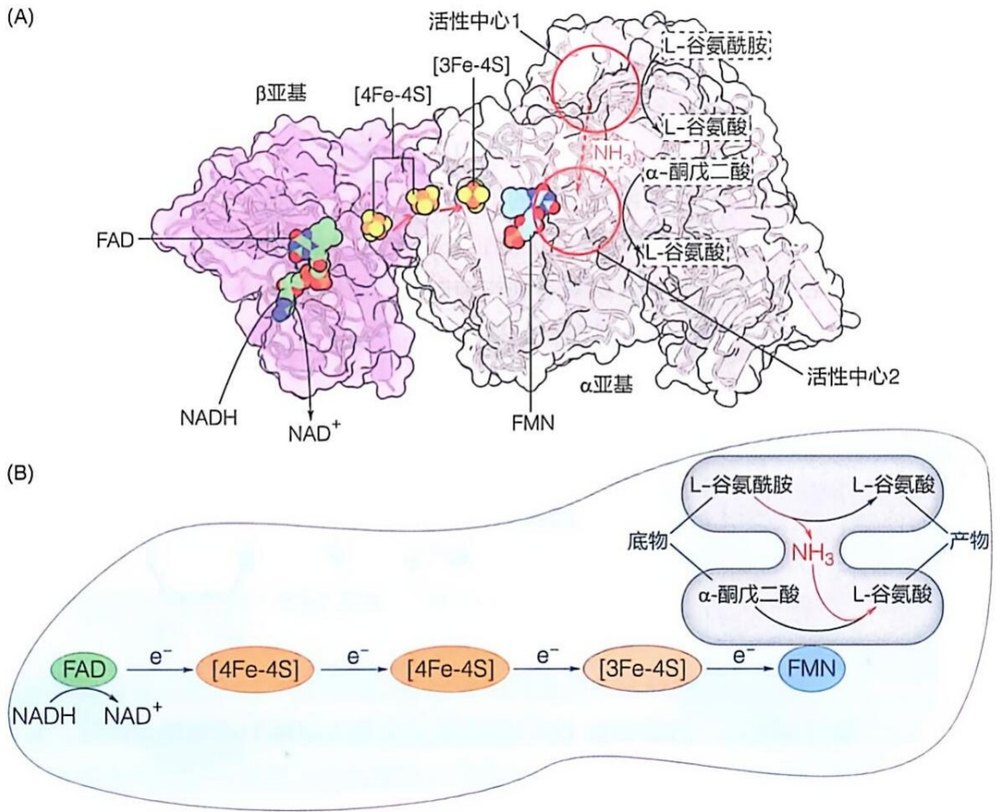

flowchart

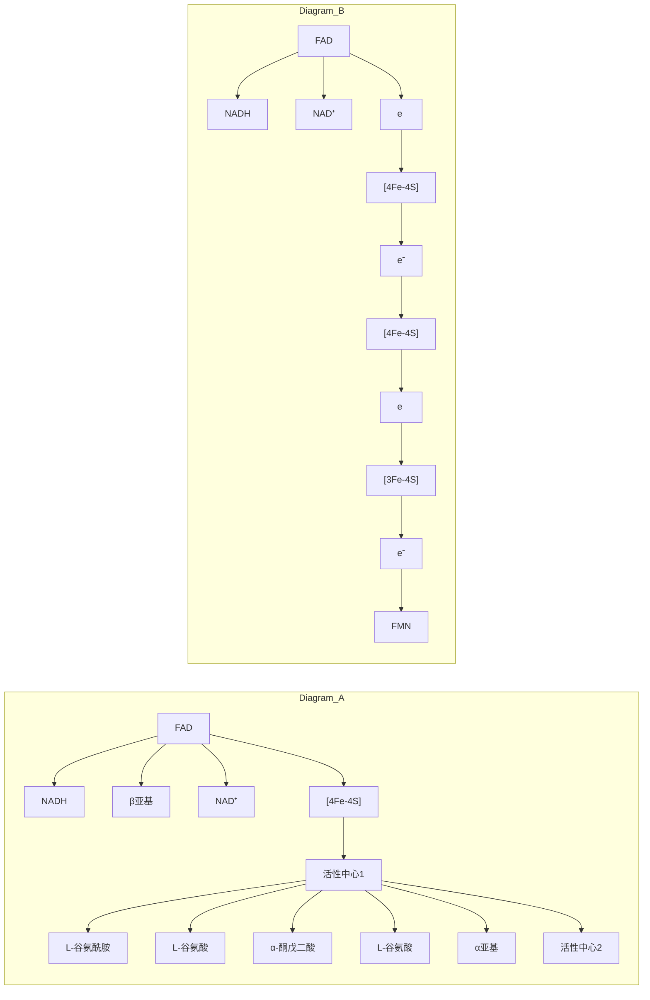

图 25-4 细菌谷氨酸合酶的结构及其催化过程

（A）巴西固氮螺菌（Azospirillum brasilense）谷氨酸合酶的一个催化结构单元（PDB:6S6X）。α亚基和β亚基分别用灰色和紫色模型展示。辅基FMN（天蓝色）和FAD（绿色），以及铁硫簇[4Fe-4S]和[3Fe-4S]用球状模型展示。球状模型中红色代表氧原子，蓝色代表

氮原子，橙色代表磷原子，黄色代表硫原子，棕色代表铁原子。两种底物的结合位置参考了蓝藻谷氨酸合酶的结构（PDB:10FE）。电子传递链用红色箭头表示；α亚基中的两个活性中心用红色圆圈表示。（B）细菌谷氨酸合酶催化反应过程的示意图。

但是，自 1990 年代以来，核磁共振（NMR）和晶体结构测定结果表明，在这些别构效应物中，丙氨酸、色氨酸、组氨酸和甘氨酸结合于谷氨酸的结合位点，AMP 结合于 CTP 的结合位点（至少对于未发生腺苷酸修饰的酶而言是如此）。这些观察结果提示，谷氨酰胺合成酶的别构效应物可能通过对别构位点的竞争性抑制机制实现对酶活性的调节。

除了甘氨酸、丝氨酸和丙氨酸之外，上述其他效应物均可被视为

谷氨酰胺参与的含氮化合物合成代谢途径的终产物。因此，它们的抑制效应本质上属于反馈抑制（feedback inhibition），即终产物抑制催化合成代谢途径上游步骤酶的活性。这是一种普遍存在的生物合成代谢途径的调节方式。然而，甘氨酸和丙氨酸的合成并未利用谷氨酰胺提供氨基（它们的  $\alpha-$  氨基由谷氨酸提供）。它们可能作为细胞内氨基酸水平的代表性指示物，参与对谷氨酰胺合成酶活性的调节。

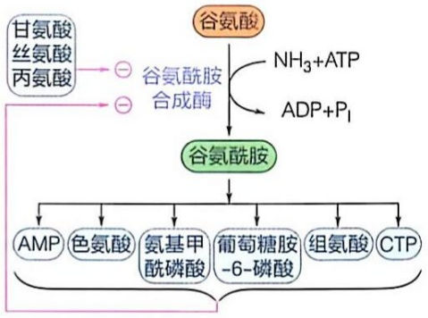

flowchart

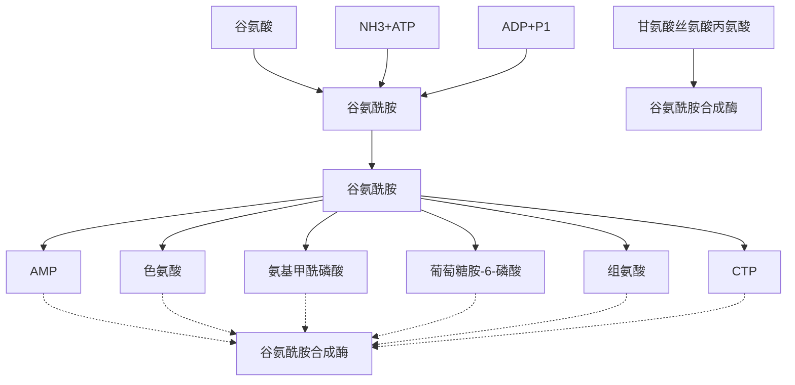

图 25-5 细菌谷氨酰胺合成酶的活性可被9种别构因子抑制

## (2) 细菌谷氨酰胺合成酶的活性还受到腺苷酰化共价修饰调节

在 1960 年代，人们观察到，从不同生长条件下获得的细菌细胞中分离纯化的谷氨酰胺合成酶存在两种不同的形式。例如，当大肠杆菌细胞从缺少氮的培养基中转移至含有过量  $NH_{4}^{+}$  的培养基中时，谷氨酰胺合成酶发生快速的腺苷酰化修饰，并且对丝氨酸、甘氨酸、丙氨酸等别构抑制剂的敏感性显著下降。后续分析表明，这是由于该酶分子中的一个特异酪氨酸残基（Tyr $^{397}$ ）的羟基发生腺苷酰化修饰所致。

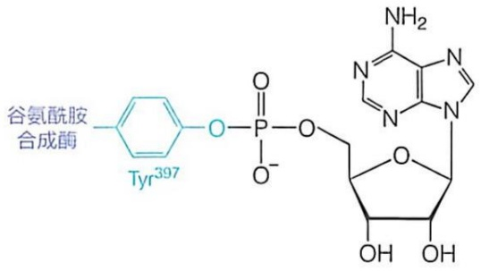

chemical

Chemical structure of a pyridine derivative with Tyrosine-397 and its biosynthesis product

被腺苷酰化修饰的谷氨酰胺合成酶的活性低，而无腺苷酰化修饰的谷氨酰胺合成酶的活性高。被修饰的 $\mathrm{Tyr}^{397}$ 残基位于底物谷氨酸的结合位点附近，腺苷酰化所产生的空间位阻可能阻碍底物谷氨酸进入活性中心；然而，目前尚未发现腺苷酰化修饰的谷氨酰胺合成酶的三维结构的报道，其详细调节机制有待进一步阐明。与可逆磷酸化修饰类似，这种可逆共价修饰过程依赖于两种酶的催化活性。值得注意的是，在真核细胞谷氨酰胺合成酶中，并未鉴定到这样的可逆腺苷酰化修饰现象。

后续研究揭示了细菌谷氨酰胺合成酶腺苷酰化修饰调控的分子过程:这一可逆循环式修饰过程的方向由 $\mathrm{P}_{\mathrm{II}}$ 调节蛋白（1960年代末期被鉴定）的尿苷酰化状态决定，而后者也发生在一个特异酪氨酸残基（$\mathrm{Tyr}^{51}$）位点。此外，这种双环级联（bicyclic cascade）调节机制涉及两种双功能酶催化活性的转换，具体过程如图25-6所示。

首先，谷氨酰胺合成酶的腺苷酰化（adenylylation）和去腺苷酰化（deadenylylation）由细菌谷氨酰胺合成酶腺苷酰转移酶这种双功能酶催化，简称为腺苷酰转移酶（adenylyltransferase，AT）。当腺苷酰转移酶与未被修饰的 $P_{II}$ 蛋白结合时，它催化谷氨酰胺合成酶发生腺苷酰化修饰，使后者处于低活性状态；当它与尿苷酰化共价修饰的 $P_{II}$ 蛋白（即 $P_{II}-UMP$ ）结合时，它催化谷氨酰胺合成酶发生去腺苷酰化，而处于高活性状态。

其次，$\mathrm{P}_{\parallel}$ 蛋白的尿苷酰化（uridylylation）和去尿苷酰化（deuridylylation）也由 $\mathrm{P}_{\parallel}$ 蛋白尿苷酰转移酶这种双功能酶催化，简称为尿苷酰转移酶（uridyltransferase, UT）。这种尿苷酰转移酶的活性决定于它所结合的别构效应物:当它与 $\alpha-$ 酮戊二酸或ATP别构结合时，则催化 $\mathrm{P}_{\parallel}$ 蛋白发生尿苷酰化修饰；而当它与谷氨酰胺或 $\mathrm{P}_{\mathrm{i}}$ 别构结合时，则抑制 $\mathrm{P}_{\parallel}$ 蛋白尿苷酰化。也就是说，当细胞内谷氨酰胺或 $\mathrm{P}_{\mathrm{i}}$ 浓度升高时，谷氨酰胺合成酶发生腺苷酰化修饰，使后者呈现低活性状态；相反，当 $\alpha-$ 酮戊二酸或 ATP 浓度升高时， $P_{II}$  蛋白处于尿苷酰化状态，促使谷氨酰胺合成酶发生去腺苷酰化，使后者恢复高活性状态。

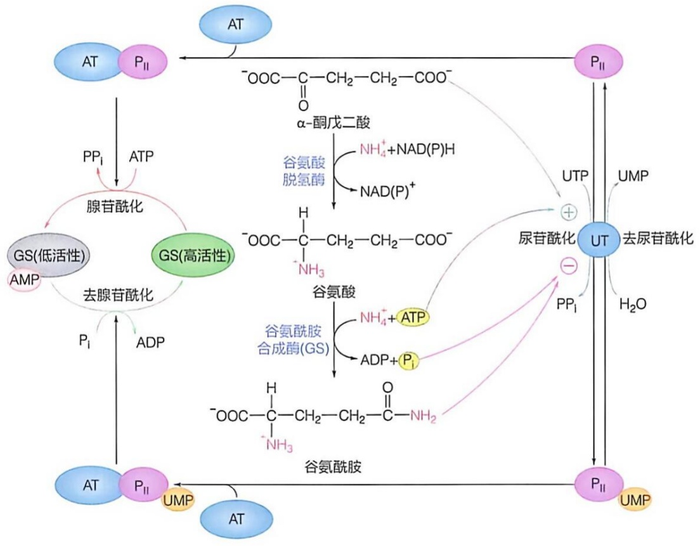

flowchart

This flowchart illustrates the biochemical pathway of glutathione (Glu) metabolism, showing how ATP and P1I enzyme activities in the nucleus are mediated by various enzymes to form glutathione (UT), which then activates downstream metabolites like urea and urea phosphate.

图 25-6 细菌谷氨酰胺合成酶的双环级联共价修饰调控过程

GS: 谷氨酰胺合成酶; AT: 腺苷酰转移酶; $P_{\mathrm{II}}: P_{\mathrm{II}}$ 蛋白; UT: 尿苷酰转移酶。

从理论角度分析，这种基于两种双功能酶实现的双环级联调控机制至少具有以下两方面的潜在优势。一方面，它可放大调节信号（使得别构效应物浓度的微小改变引发高水平的谷氨酰胺合成酶共价修饰及相应的活性改变）；另一方面，根据不同效应物（即  $\alpha-$  酮戊二酸和谷氨酰胺）在细胞内浓度比例的动态变化，对谷氨酰胺合成酶的活性进行持续且精细的调节，从而满足细胞代谢的需求。

除了通过别构因子的结合和共价修饰等方式进行调节之外，细菌谷氨酰胺合成酶的活性还可通过改变酶的含量（包括对基因转录和蛋白质降解等过程的调控）以及改变酶的寡聚状态（解聚将导致活性降低）进行调节，其调节方式复杂且多样。对于通过固氮作用（高度耗能）或从环境中获取的氨而言，细菌细胞演化出了精细的调控网络。这种多层次的调控使得细菌细胞中谷氨酰胺的生成量与细胞的生理需求量之间达到有效而精准的平衡，减少了不必要的能量消耗。

## 25.3 核心代谢通路为 20 种 L- 氨基酸的合成提供前体

细菌和植物等生物能够自主合成全部 20 种 L-氨基酸。这不仅需要从谷氨酸、谷氨酰胺等物质中获取氮，还需要获取碳骨架。20种氨基酸的合成途径各不相同，有的简单，有的复杂。因此，这些氨基酸合成途径被发现和鉴定的过程也各不相同，但最初大多是在大肠杆菌这种模式生物中被揭示的。在各种探究方法中，氨基酸营养缺陷型突变菌株（即在缺乏某种氨基酸的培养基中无法生长的细菌突变体）的利用以及同位素示踪分析等发挥了非常关键的作用。

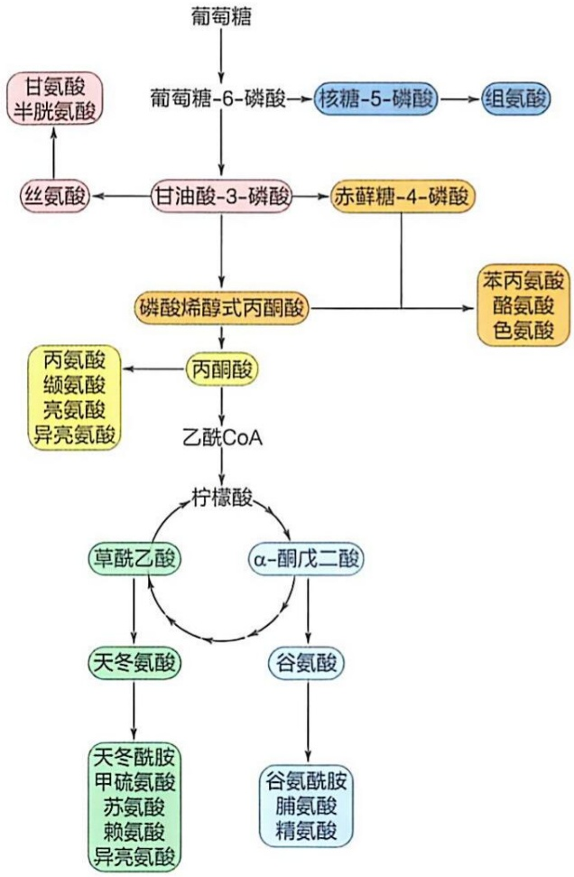

flowchart

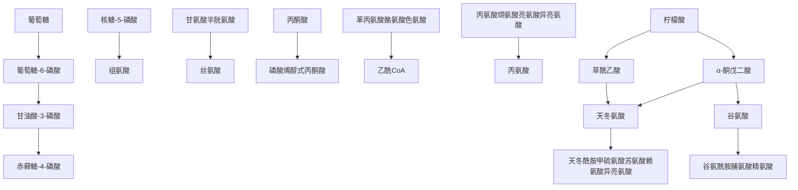

图 25-7 氨基酸的生物合成可根据其使用的共同前体大致分为六组

到 1960 年代时，细菌细胞中 20 种氨基酸的具体合成途径都已基本揭示。结果表明，几乎所有氨基酸的碳骨架都是从糖酵解、柠檬酸循环以及戊糖磷酸途径的中间体中获得的。我们在介绍 20 种氨基酸的氧化分解时，依据它们形成的共同最终产物将其大致分为七组（见图 24-19）；类似地，我们也可根据它们合成时所使用的共同前体，将细菌和植物细胞内 20 种氨基酸的合成途径粗略地分为六组，具体如图 25-7 所示。

需再次强调的是，包括人类在内的哺乳动物无法合成9种必需氨基酸。也就是说，在演化过程中，哺乳动物保留了合成非必需氨基酸的能力。这可能是以下两种因素综合作用的结果:一是这些非必需氨基酸对哺乳动物的生理功能而言极其重要、不可或缺，所以在演化选择的压力下，哺乳动物保留了合成它们所需的酶促反应。二是这些非必需氨基酸的合成途径相对简单，所以合成它们所需的

酶促反应无须受到强烈的演化选择压力。

接下来，我们根据所使用共同前体的情况介绍每组氨基酸的合成途径。

## 25.3.1 $\alpha-$ 酮戊二酸是合成谷氨酸、谷氨酰胺、脯氨酸和精氨酸的主要前体

尽管从  $\alpha-$  酮戊二酸衍生出每种氨基酸的具体代谢途径繁简不同，但这些氨基酸合成相关的酶促代谢途径却都存在于哺乳动物体内。

我们已介绍了由谷氨酸脱氢酶（图 24-13）和谷氨酸合酶（图 25-3，图 25-4）催化合成谷氨酸的反应。在第 24 章中，我们介绍了利用不同转氨酶（图 24-6）生成

谷氨酸的反应。在不同物种中，谷氨酸合成的方式并不相同:在细菌和植物中主要通过由谷氨酸合酶或谷氨酸脱氢酶（当氨的浓度比较高的时候）催化的反应，而在动物中则主要通过由转氨酶催化的反应。

谷氨酸则是合成谷氨酰胺、脯氨酸和精氨酸这三种氨基酸的直接前体:

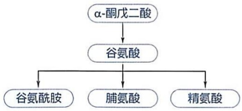

flowchart

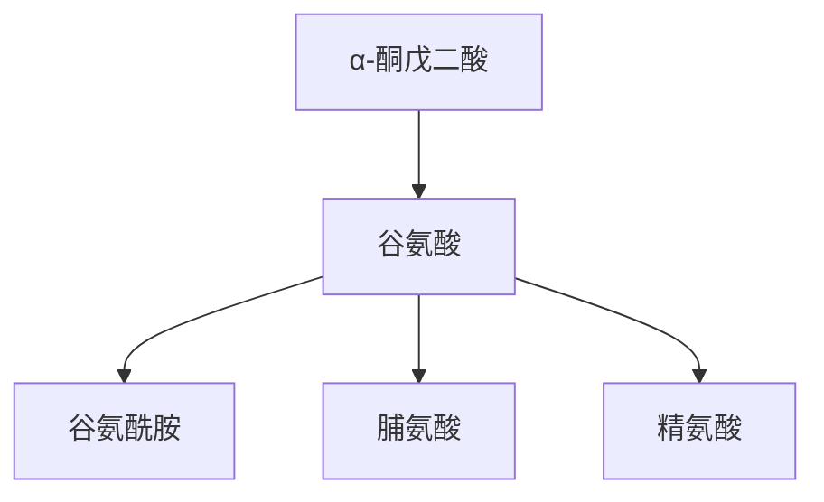

如 25.2.1 节所述，谷氨酰胺的生成是由谷氨酰胺合成酶催化谷氨酸与  $NH_{4}^{+}$ 缩合而实现的。接下来，我们介绍细菌细胞内脯氨酸和精氨酸的合成过程。

## (1) 谷氨酸侧链羧基被还原成醛基后衍生出脯氨酸

从谷氨酸合成脯氨酸和精氨酸都涉及谷氨酸侧链羧基被还原为醛基的过程，但具体发生过程不同，导致结果也不同。

细菌和植物细胞内生成脯氨酸的过程如图 25-8 所示。

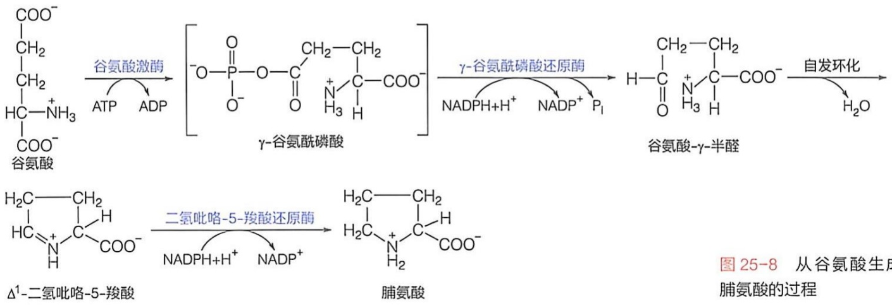

flowchart

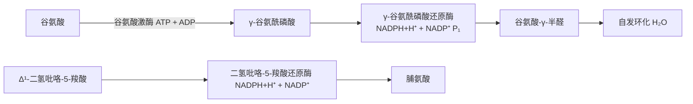

具体而言，谷氨酸先由谷氨酸激酶催化，从ATP获取磷酰基，生成 $\gamma-$ 谷氨酰磷酸。然后，在 $\gamma-$ 谷氨酰磷酸还原酶的催化下，$\gamma-$ 谷氨酰磷酸中的 $\gamma-$ 羧基被还原成谷氨酸- $\gamma-$ 半醛。后者通过形成席夫碱而自发成环，形成羟胺中间体后迅速脱水，转化为 $\Delta^{1}-$ 二氢吡咯-5-羧酸。在二氢吡咯-5-羧酸还原酶的催化下，还原生成含吡咯烷环的脯氨酸。

在动物细胞中，在鸟氨酸-δ-氨基转移酶催化下，从鸟氨酸生成的谷氨酸-γ-半醛也可用于生成脯氨酸。

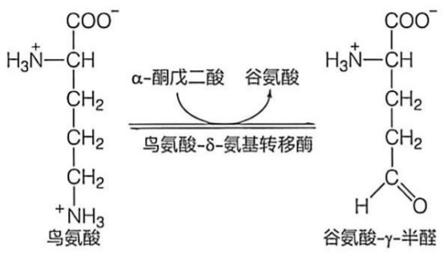

chemical

Chemical reaction diagram showing conversion of gu氨酸 to cyanoic acid and its subsequent conversion to cyanoic acid-gamma-nitroaldehyde

## (2) 谷氨酸在转化为鸟氨酸后再转化为精氨酸

在精氨酸的合成过程中，也需将谷氨酸侧链羧基还原为醛基，但为了避免发生脯氨酸生成过程中的自发成环反应，谷氨酸的  $\alpha-$  氨基先被乙酰基修饰，这样就阻止了通过形成席夫碱而自发成环的反应。

在细菌细胞中，从谷氨酸生成精氨酸的具体反应过程如图 25-9 所示。

谷氨酸转化为精氨酸的具体过程可简单描述如下。①在 N-乙酰谷氨酸合酶（由argA 基因编码）的催化下，乙酰基从乙酰辅酶 A 转移至谷氨酸的氨基上，生成 N-乙酰谷氨酸（该化合物为氨基甲酰磷酸合成酶 I 的必需别构激活剂，见图 24-16）。②经过 N-乙酰谷氨酸激酶（由 argB 基因编码）催化，N-乙酰谷氨酸从 ATP 获取磷酰基，生成 N-乙酰 -γ- 谷氨酰磷酸。③在 N-乙酰 -γ- 谷氨酰磷酸还原酶（由 argC 基因编码）催化下，N-乙酰 -γ- 谷氨酰磷酸被还原生成 N-乙酰谷氨酸 -γ- 半醛，该反应由 NADPH 提供电子。④在乙酰鸟氨酸氨基转移酶（由 argD 基因编码）催化下，N-乙酰谷氨酸 -γ- 半醛从谷氨酸获取氨基，生成 α-N-乙酰鸟氨酸。⑤经 N-乙酰鸟氨酸酶（由 argE 基因编码）催化，α-N-乙酰鸟氨酸脱去乙酰基（即脱去 α- 氨基上的保护基团），生成鸟氨酸。⑥在鸟氨酸转氨甲酰酶（由 argF 基因编码）催化下，鸟氨酸从氨基甲酰磷酸获取一个氨甲酰基，生成瓜氨酸。⑦在精氨酸代琥珀酸合成酶（由 argG 基因编码）的催化下，瓜氨酸与天冬氨酸缩合（消耗 ATP），生成精氨酸代琥珀酸。⑧经精氨酸代琥珀酸裂合酶（由 argH 基因编码）催化，精氨酸代琥珀酸发生裂解，生成精氨酸，同时释放延胡索酸。

图 25-9 从谷氨酸生成精氨酸的代谢过程

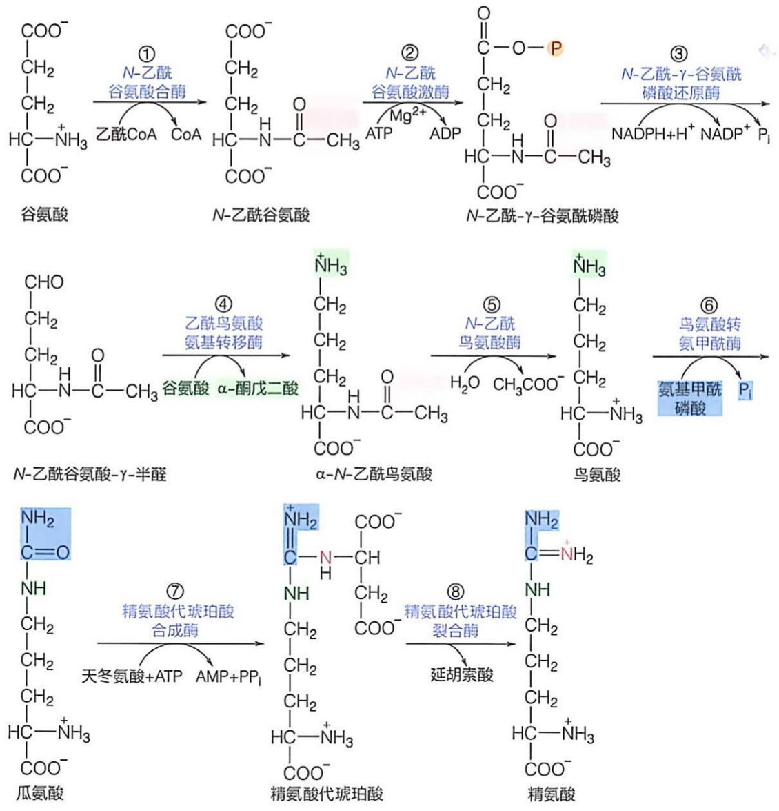

在这些反应中，从第⑥步开始的连续三步反应与尿素循环（见图24-17）中的三步反应完全相同。因此，就精氨酸碳骨架而言，它不仅需从谷氨酸获取5个碳原子，还需从氨基甲酰磷酸获取1个碳原子。除此之外，它需分别从谷氨酸和氨基甲酰磷酸各获取1个氮原子。

值得注意的是，精氨酸通常被视为人体的半必需（semi-essential）氨基酸。这意味着尽管人体自身能够合成精氨酸，但因为精氨酸本身除了作为蛋白质组分之外，还参与许多其他生物过程，如氨的解毒（即尿素循环）和一氧化氮（NO）信号分子的生成等，所以在某些情况下，人体有必要从饮食中获取额外的精氨酸，以补充自身合成的不足。

## 25.3.2 草酰乙酸是合成天冬氨酸、天冬酰胺、甲硫氨酸、苏氨酸、赖氨酸等的前体

从草酰乙酸合成这些氨基酸的过程也是简繁不一。最简单的是从草酰乙酸生成天冬氨酸的一步反应过程，由天冬氨酸氨基转移酶（aspartate aminotransferase，也称谷草转氨酶）催化，由谷氨酸提供氨基:

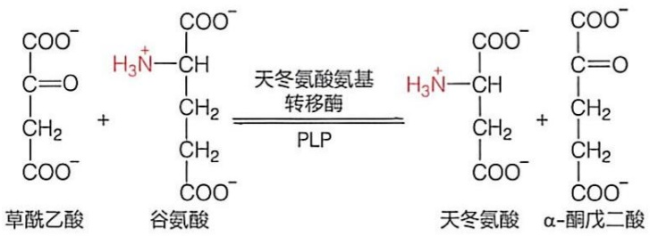

chemical

Chemical reaction equation showing the conversion of acrylate and glutamine to acetylsulfonic acid via transaminase enzyme transferase under PLP conditions

值得注意的是，现代生物体内合成氨基酸的相关酶，如转氨酶、合成酶，几乎专一性识别（产生）L-氨基酸。转氨酶的立体专一性机制见知识延展25-1。以这样生成的天冬氨酸为前体，可进一步衍生出天冬酰胺、甲硫氨酸、赖氨酸、苏氨酸以及异亮氨酸。

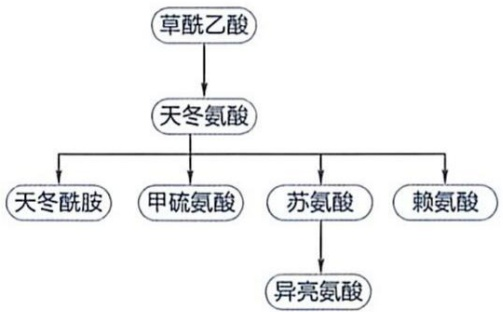

flowchart

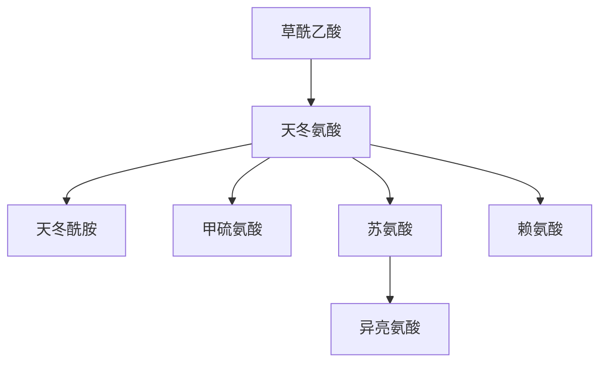

值得注意的是，包括人类在内的哺乳动物仅能合成这些氨基酸之中的天冬氨酸和天冬酰胺。也就是说，甲硫氨酸、赖氨酸、苏氨酸和异亮氨酸这四种氨基酸均为必需氨基酸。由于异亮氨酸的生成还需从丙酮酸获取2个碳原子，且其过程与缬氨酸共享四种酶，因此将其合成途径将在下面与缬氨酸等一起介绍。

## 知识延展 25- 1

# 转氨酶立体特异性催化 L- 氨基酸形成的结构基础

如第 24 章所述，转氨酶一般利用吡哆醛 -5- 磷酸（PLP）辅因子，催化特定氨基酸与  $\alpha-$  酮戊二酸发生可逆的转氨基反应（图 24-8）。这些转氨酶在催化过程中均表现出高度的立体专一性，即仅利用或产生其  $\alpha-$  碳为 L 构型（而非 D 构型）的氨基酸。这种特异性源于转氨酶活性部位存在的一种高度保守的不对称性结构。结合体外酶动力学和晶体结构分析等数据，转氨酶催化形成 L- 氨基酸的反应过程如图 25-10 所示（也请参考图 24-8）。

在转氨酶催化生成 L- 氨基酸的分子机制中，体现其立体特异性的关键步骤在于由吡哆胺 -5- 磷酸（PMP）与  $\alpha-$  酮酸缩合形成的醌类中间体所发生的立体特异性的质子化反应。该质子的特异性加成过程，最终决定了产物氨基酸的 L 构型。

具体而言，当底物  $\alpha-$  酮酸与 PMP（即临时性携带了氨基的 PLP）通过缩合形成席夫碱，即酮亚胺中间体后，迅速通过将其辅因子 C4' 位的一个质子（H\*）转移至一个保守的广义碱基团 -B:（为酶分子中一个高度保守的赖氨酸残基的侧链），形成一种具平面结构的醌类中间体（第①步），同时 -B:被转化为广义酸 -B:H\*。接下来，广义酸基团中的质子（H\*）将被转移至酮酸的  $\alpha-$  碳，形成醛亚胺中间体（第②步）；但由于空间定位的缘故，质子（H\*）只可从醌类中间体的一面（化学上将其定位为 si 面，即本图中的下面）被转移。醛亚胺中间体经水解，形成 L- 氨基酸（PMP 恢复为 PLP）。

与此相比，在 D- 氨基酸转氨酶中，保守的赖氨酸则位于吡哆醛环的 re 面（si 面的反面，即本图中的上面）。

在 L- 氨基酸合成过程中，其转氨酶的活性中心除了包含上述保守的赖氨酸残基外，还存在一个保守的精氨酸残基。这个精氨酸残基与  $\alpha-$  酮酸的羧基发生相互作用，从而使醌类中间体只能以一种特定的方位结合在活性中心。

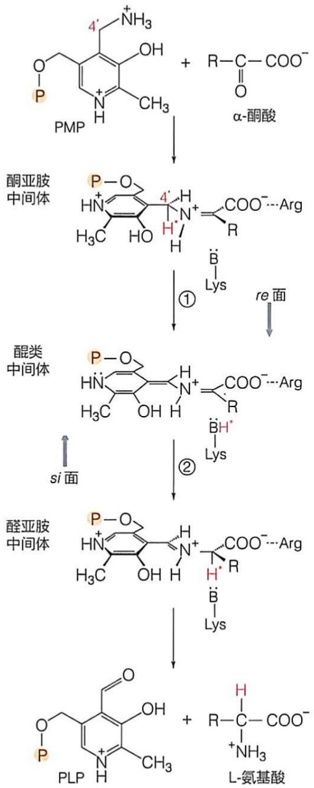

chemical

Reaction pathway showing the enzymatic conversion of α-alkylamine to L-amino acid via intermediate PMP and P-O-amine, with reagent re shown for silane formation.

图 25-10 吡哆胺 -5- 磷酸与  $\alpha-$  酮酸形成醌类中间体经质子化形成 L- 氨基酸的过程
PMP:吡哆胺 -5- 磷酸；PLP:吡哆醛 -5- 磷酸。

## (1) 天冬氨酸侧链发生氨基化生成天冬酰胺

天冬酰胺的合成由天冬酰胺合成酶（asparagine synthetase）催化。该酶也是一种转酰胺酶，它催化谷氨酰胺的侧链氨基转移至天冬氨酸的β-羧基上，生成天冬酰胺和谷氨酸。

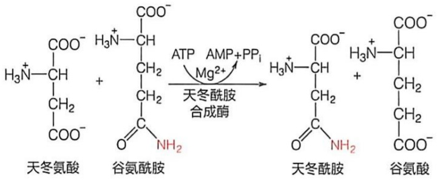

chemical

Reaction mechanism showing the synthesis of tetrahydrofuran and tetrafluoroacetate from tetrahydrofuran and tetrafluoroacetate under ATP, AMP, and Mg²⁺ conditions

值得注意的是，谷氨酰胺合成酶催化形成的活化中间体为  $\gamma-$  谷氨酰磷酸，而天冬酰胺合成酶催化形成的中间体为  $\beta-$  天冬氨酰-AMP。前者直接利用游离  $NH_{3}$ ，消耗 1 分子 ATP；而后者利用谷氨酰胺的酰胺氮，消耗 2 分子 ATP。然而，古菌天冬酰胺合成酶可以催化  $NH_{4}^{+}$ 与天冬氨酸侧链羧基直接缩合，生成天冬酰胺，这可能代表着另一种合成天冬酰胺的演化路线，而且与谷氨酰胺的生成过程可比。

部分肿瘤细胞（如急性淋巴细胞性白血病母细胞）缺乏天冬酰胺合成酶，因而无法自行合成天冬酰胺。天冬酰胺酶（asparaginase）是一种催化天冬酰胺水解的酶，可将天冬酰胺分解为天冬氨酸和氨。基于此，天冬酰胺酶常被用于治疗这类肿瘤。显然，天冬酰胺的极度缺乏会使肿瘤细胞（以及快速增殖的非肿瘤细胞）因无法合成大部分蛋白质而难以存活。

从含有 4 个碳原子的天冬氨酸生成含有 6 个碳原子的赖氨酸、含有 4 个碳原子的苏氨酸和含有 5 个碳原子的甲硫氨酸的途径比较复杂，其总体过程如图 25-11 所示。

（2）从天冬氨酸生成甲硫氨酸、苏氨酸和赖氨酸这三种氨基酸的途径共享前面两步反应

这两步共享反应如下。第一步是天冬氨酸激酶（aspartokinase）催化天冬氨酸侧链羧基（即β-羧基）发生磷酸化，生成天冬氨酰-β-磷酸（图25-11中的第①步反应）。在细菌中，该酶存在三种同工酶，它们各自具有不同的调节响应方式（具体见后）。第二步是天冬氨酸-β-半醛脱氢酶（aspartate β-semialdehyde dehydrogenase）催化天冬氨酰-β-磷酸还原为天冬氨酸-β-半醛的反应（图25-11中第②步）。这两步反应与谷氨酸转化为谷氨酸-γ-半醛的反应（在脯氨酸生成途径中）高度可比（图25-8）。天冬氨酸-β-半醛是生成甲硫氨酸、苏氨酸及赖氨酸的共同前体，下面描述它们各自后续的合成过程。

## I. 甲硫氨酸的生成

从天冬氨酸  $-\beta-$  半醛生成甲硫氨酸需从半胱氨酸获取 1 个硫原子，并从  $N^{5}-$  甲基四氢叶酸获取 1 个碳原子。

具体而言，细菌中从天冬氨酸- $\beta$ -半醛生成甲硫氨酸涉及以下五步反应。首先，

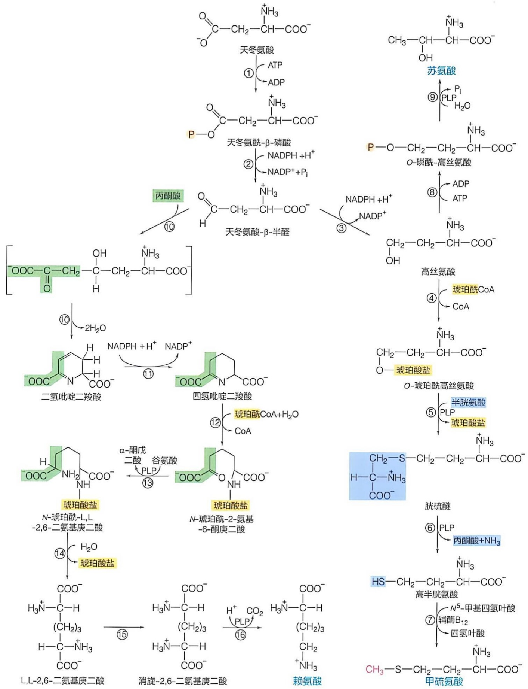

flowchart

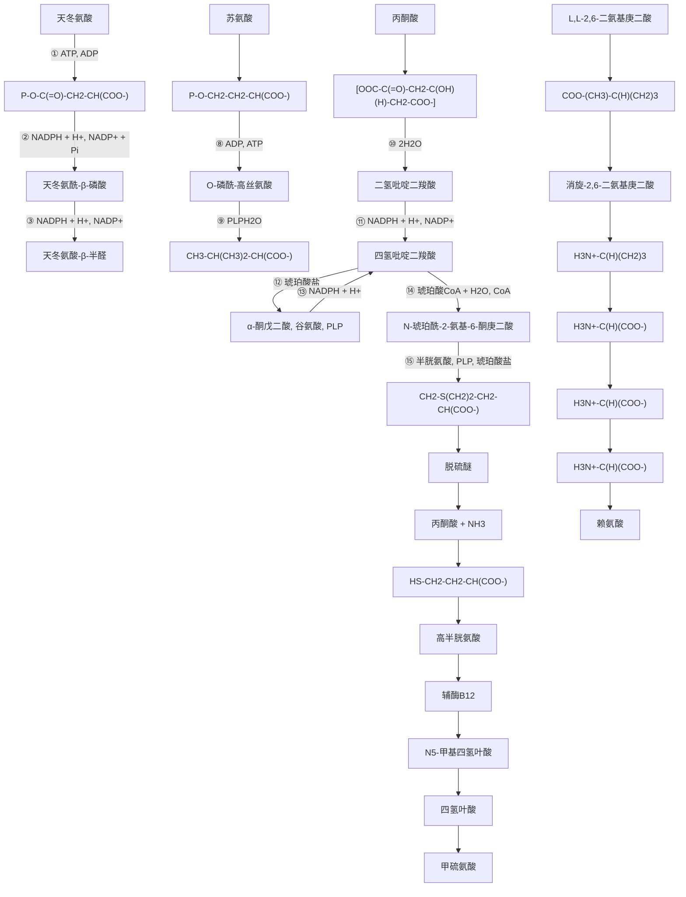

图 25-11 从天冬氨酸生成赖氨酸、苏氨酸和甲硫氨酸的化学过程

在高丝氨酸脱氢酶（homoserine dehydrogenase；由细菌 thrA 基因编码）的催化下，由 NADPH 提供电子，天冬氨酸 -β- 半醛被还原为高丝氨酸（图 25-11 中第③步）。然后，在高丝氨酸酰基转移酶（homoserine acyltransferase；细菌中由 metA 基因编码，该反应为专一合成甲硫氨酸途径的第一步反应）的催化下，高丝氨酸的羟基与来自琥珀酰辅酶 A 的琥珀酰基缩合，生成 O- 琥珀酰高丝氨酸（图 25-11 中第④步）；这一步在细菌中也可以是乙酰化修饰，而在植物细胞中发生的是磷酸化修饰。接着，在胱硫醚 γ- 合酶（cystathionine γ-synthase；由细菌 metB 基因编码）的催化下，由半胱氨酸替换琥珀酰基形成胱硫醚（图 25-11 中第⑤步）。然后，在胱硫醚 β- 裂解酶（cystathionine β-lyase；由细菌 aecD 基因编码）的催化下，胱硫醚脱去丙酮酸和氨，生成高半胱氨酸（homocysteine）（图 25-11 中第⑥步）。最后，在甲硫氨酸合酶（methionine synthase；由细菌 metH 基因编码）的催化下，高半胱氨酸从 $N^{5}-$ 甲基四氢叶酸获取 1 个碳原子，最终生成甲硫氨酸（图 25-11 中第⑦步）。该酶依赖辅酶 B$_{12}$（临时携带甲基），将甲基从 $N^{5}-$ 甲基四氢叶酸转移至高半胱氨酸（见图 24-37A）。

## Ⅱ.苏氨酸由高丝氨酸异构生成

从天冬氨酸生成苏氨酸和甲硫氨酸的途径共享前三步反应（图25-11中的第①至③步）。所生成的高丝氨酸中间体在高丝氨酸激酶（细菌thrB基因编码）的催化下，其羟基发生磷酸化修饰，形成 $O-$ 磷酰-高丝氨酸（图25-11中第⑧步）。后经依赖PLP的苏氨酸合酶（threonine synthase；由细菌thrC基因编码）催化，发生脱磷酸和异构反应（羟基位置发生移动）后，生成苏氨酸（图25-11中第⑨步反应）。该酶催化的异构反应可能是PLP参与的最复杂酶促反应之一，其详细机制尚不清楚。

## Ⅲ. 赖氨酸的生成

从天冬氨酸和丙酮酸前体生成赖氨酸涉及9步反应，即图25-11中的①、②、⑩至⑯步。其中，前两步反应与甲硫氨酸和苏氨酸合成途径共享。

具体过程如下:在二氢吡啶二羧酸合酶（dihydrodipicolinate synthase；细菌dapA基因编码）的催化下，天冬氨酸-β-半醛与丙酮酸缩合，先形成线性中间体，再发生环化（即反应分为两个阶段进行，但都由该酶催化发生），生成含有7个碳原子的二氢吡啶二羧酸（图25-11中第⑩步）。然后，由NADPH提供电子，在四氢吡啶二羧酸脱氢酶的催化下，二氢吡啶二羧酸被还原为四氢吡啶二羧酸（第⑪步）。随后，在N-琥珀酰-2-氨基-6-酮基庚二酸合成酶的催化下，四氢吡啶二羧酸与琥珀酰辅酶A缩合，生成N-琥珀酰-2-氨基-6-酮庚二酸（第⑫步）。再在琥珀酰二氨基庚二酸氨基转移酶的催化下，从谷氨酸获取氨基，生成N-琥珀酰-L,L-2,6-二氨基庚二酸（第⑬步）。接下来，在琥珀酰二氨基庚二酸脱琥珀酸酶的催化下，N-琥珀酰-L,L-2,6-二氨基庚二酸脱去琥珀酸，生成对称性分子L,L-2,6-二氨基庚二酸（第⑭步）。值得注意的是，此处的琥珀酰化与甲硫氨酸合成过程中发生的琥珀酰化（第⑭步）不同。在这里，琥珀酰基作为保护基团，避免了游离氨基的非特异性反应；而在前面的甲硫氨酸合成过程中，琥珀酰化的作用则是激活羟基。之后，在二氨基庚二酸差向异构酶的催化下，生成对称性的内消旋分子2,6-二氨基庚二酸（第⑮步）。

最终，在二氨基庚二酸脱羧酶（以 PLP 为辅因子）的催化下，消旋 2,6-二氨基庚二酸脱去分子末端的一个羧基，生成赖氨酸（第⑯步）。

综上所述，草酰乙酸是合成5\~6种氨基酸的前体。这些途径之间的关联很好地体现了合成代谢途径的发散型特征:共享上游的部分反应，通过下游的分叉途径最终形成多种氨基酸。这与分解代谢的收敛型特征形成明显对比，都体现了生物体内代谢过程的经济有效性。后面我们将了解到，这种发散型合成代谢途径将通过反馈抑制进行有效调控，以平衡不同氨基酸的合成量、满足蛋白质合成等过程的需求。

## 25.3.3 丙酮酸是合成丙氨酸、缬氨酸、异亮氨酸和亮氨酸的前体

作为糖酵解的终产物，丙酮酸不仅为合成精氨酸（图 25-11）提供部分碳骨架，还为合成丙氨酸、缬氨酸、亮氨酸和异亮氨酸提供全部或部分碳骨架。

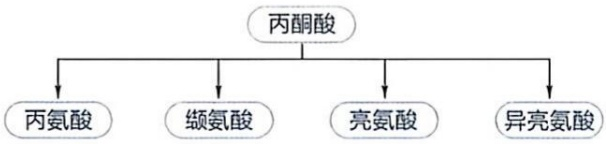

flowchart

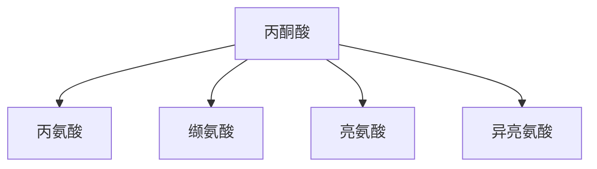

细菌和植物细胞内发生所有合成这些氨基酸的酶促反应，然而包括人类在内的哺乳动物仅能合成其中的丙氨酸。作为支链氨基酸，缬氨酸、亮氨酸和异亮氨酸的结构高度相似，它们的共同生物特征是:形成水溶性蛋白质的疏水核心，通过疏水效应驱动蛋白质的折叠过程，但它们几乎不为合成任何其他生物分子提供前体。也就是说，它们的代谢终点是提供能量（通过柠檬酸循环）或直接排出体外。

丙酮酸与丙氨酸之间的可逆转换可通过丙氨酸氨基转移酶（alanine aminotransferase，也称谷丙转氨酶）催化的反应实现:

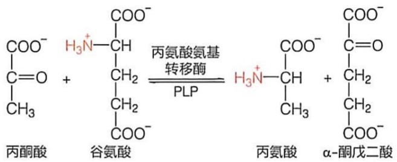

chemical

Chemical reaction equation showing the conversion of acetic acid and glutamic acid to pyruvate and α-dinitrobenzoic acid using PLEP enzyme

值得注意的是，正如催化三种支链氨基酸氧化分解的前两步反应（即脱氨和氧化脱羧）的酶完全相同（图24-25，图24-26），它们的合成过程也存在重叠和交叉步骤。其中，催化缬氨酸和异亮氨酸合成过程最后四步反应的酶完全相同（具体见后）。

## (1) 缬氨酸所含 5 个碳原子来自 2 分子丙酮酸

缬氨酸的合成过程如图25-12所示。它始于乙酰羟酸合酶（acetohydroxyacid synthase，又称乙酰乳酸合酶；由细菌ilvBN基因编码）催化1分子丙酮酸脱羧并连接硫胺素焦磷酸（TPP）形成的羟乙基-TPP与另1分子丙酮酸缩合形成α-乙酰乳酸（图25-12，第①步）。随后，α-乙酰乳酸在一种独特的酮醇酸异构还原酶（ketol acid isomeroreductase；由 ilvC 基因编码）的催化下，发生变位和还原反应（后一步由 NAD(P)H 提供电子），生成  $\alpha,\beta-$  二羟异戊酸（图 25-12，第②步）。早期认为该反应由两种酶催化，但长期的研究表明，所有细菌中都只由一种酶催化。 $\alpha,\beta-$  二羟异戊酸再由二羟酸脱水酶（dihydroxy acid dehydratase；由 ilvD 基因编码）催化脱水反应，生成  $\alpha-$  酮异戊酸（图 25-12，第③步）。后者在支链氨基酸转氨酶（branched-chain aminotransferase；由 ilvE 基因编码）的催化下，从谷氨酸接受氨基，生成缬氨酸（图 25-12，第④步）。

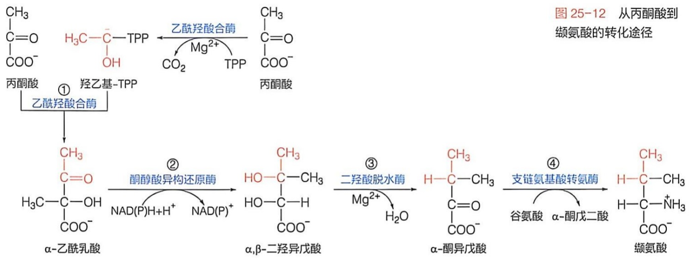

flowchart

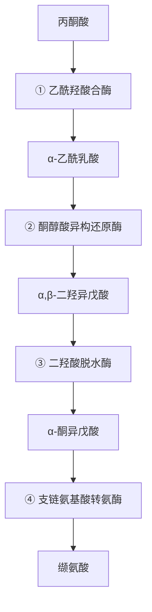

## (2) 生成异亮氨酸的 6 个碳原子分别来自苏氨酸和丙酮酸

异亮氨酸分子中的 4 个碳原子源于苏氨酸（其碳骨架最初来自草酰乙酸形成的天冬氨酸；图 25-11），其余 2 个碳原子则来自丙酮酸。因此，丙酮酸也是异亮氨酸合成的前体之一。异亮氨酸的合成过程如图 25-13 所示。

首先，苏氨酸在苏氨酸脱水酶/脱氨酶（threonine dehydratase/deaminase；由细菌 ilvA 基因编码）的催化下，发生脱氨脱水反应，生成  $\alpha-$  酮丁酸。催化之后的三步反应与催化缬氨酸生成的三步反应的酶完全相同。首先，在乙酰羟酸合酶的催化下，丙酮酸脱羧生成的羟乙基 TPP 与  $\alpha-$  酮丁酸缩合，生成  $\alpha-$  乙酰 - $\alpha-$  羟基丁酸（图 25-13，第①步）。后者再在酮醇酸异构还原酶的催化下，发生变位和还原反应（由 NAD(P)H 提供电子），生成  $\alpha, \beta-$  二羟 - $\beta-$  甲基戊酸（图 25-13，第②步）。随后， $\alpha, \beta-$  二羟 - $\beta-$  甲基戊酸在二羟酸脱水酶的催化下脱水，生成  $\alpha-$  酮 - $\beta-$  甲基戊酸（图 25-13，第③步）。最终，在支链氨基酸转氨酶的催化下， $\alpha-$  酮 - $\beta-$  甲基戊酸从谷氨酸获取氨基，生成异亮氨酸（图 25-13，第④步）。

值得注意的是，在缬氨酸（图 25-12）和异亮氨酸（图 25-13）的合成过程中，第①、②和③步反应的底物虽稍有差异，但催化的酶和反应的本质完全相同。这可能反映了缬氨酸和异亮氨酸这两种氨基酸在代谢途径演化过程中存在的深层关联。

## (3) 生成亮氨酸的碳骨架源来自丙酮酸和乙酰辅酶 A

生成亮氨酸的前三步反应与生成缬氨酸前三步完全相同，也由2分子丙酮酸缩合生成 $\alpha-$ 酮异戊酸（图25-12）。后者再在 $\alpha-$ 异丙基苹果酸合酶（ $\alpha-$ isopropylmalate