图 25-13 从苏氨酸和丙酮酸生成异亮氨酸的代谢过程

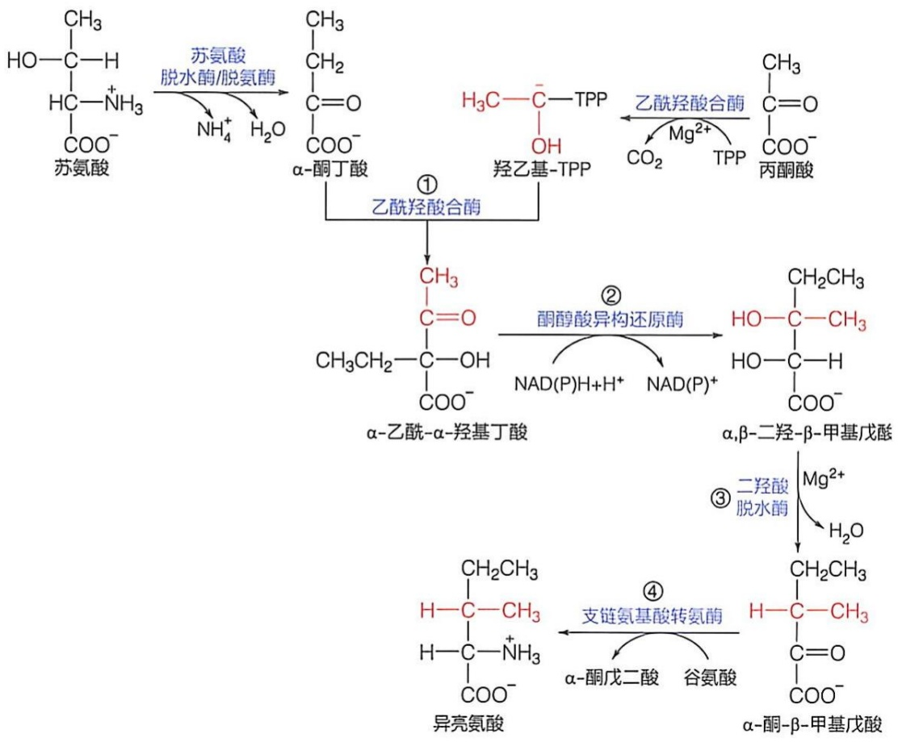

<details>
<summary>flowchart</summary>

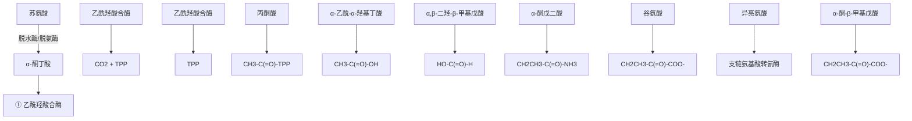
</details>

synthase；由细菌 leuA 基因编码）的催化下，与乙酰辅酶 A 携带的二碳单位缩合，形成 α- 异丙基苹果酸（图 25-14，第①步）。随后，在 α- 异丙基苹果酸异构酶（由 leuC 和 leuD 基因编码）的催化下，α- 异丙基苹果酸的羟基移动位置，转化为 β- 异丙基苹果酸（图 25-14，第②步）。接下来，β- 异丙基苹果酸经异丙基苹果酸脱氢酶（由 leuB 基因编码）催化，发生氧化脱羧反应（以 NAD⁺ 为电子受体），生成 α- 酮异己酸（图 25-14，第③步）。最终，α- 酮异己酸由支链氨基酸转氨酶催化，从谷氨酸获取氨基，生成亮氨酸（图 25-14，第④步）。

综上所述，三种支链氨基酸的合成过程存在一定重合，主要体现在以下三个方面:首先，缬氨酸与亮氨酸的生成途径共享前三步反应；其次，缬氨酸、异亮氨酸和亮氨酸的生成途径共享前三种酶；最后，生成三种氨基酸过程的最后一步均由支链氨基酸转氨酶催化完成。

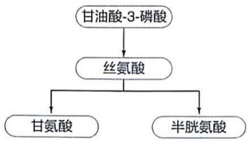

<details>
<summary>flowchart</summary>

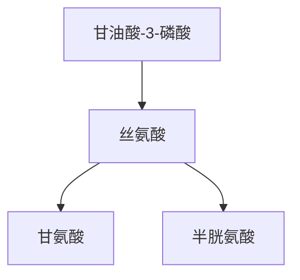
</details>

## 25.3.4 丝氨酸、甘氨酸和半胱氨酸的碳骨架源自甘油酸-3-磷酸

这三种氨基酸的碳骨架相对较短，其生物合成均仅利用1分子甘油酸-3-磷酸作为前体，通过较为简短的代谢途径完成。

半胱氨酸的合成需获取硫原子。微生物和植物可以将无机硫固定为有机硫，而包括人类在内的动物则不具备这种能力。但是，动物一般利用甲硫氨酸的有机硫来合成半胱氨酸，因此半胱氨酸被视为非必需氨基酸。

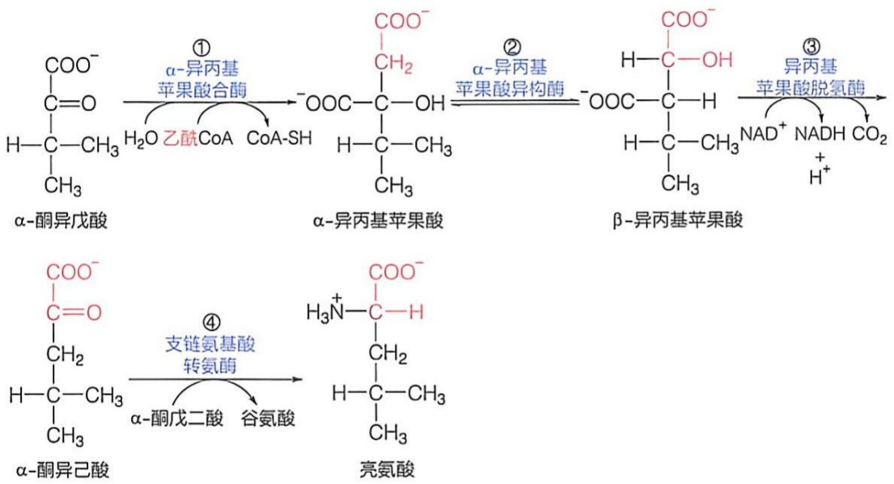

图 25-14 从  $\alpha-$  酮异戊酸和乙酰辅酶 A 生成亮氨酸的代谢过程

(1) 甘油酸 -3- 磷酸经三或四步简单反应即生成丝氨酸和甘氨酸

从甘油酸 -3- 磷酸生成丝氨酸和甘氨酸的过程如图 25-15 所示。

糖酵解途径中间物甘油酸-3-磷酸经过氧化、转氨和脱磷酸反应后，即可生成丝氨酸。具体而言，甘油酸-3-磷酸在磷酸甘油酸脱氢酶的催化下发生氧化，生成羟基丙酮酸-3-磷酸（图25-15，第①步）。后者再在磷酸丝氨酸氨基转移酶的催化下，从谷氨酸获取氨基，生成丝氨酸-3-磷酸（第②步）。在磷酸丝氨酸磷酸酶的催化下，丝氨酸-3-磷酸发生水解，脱去磷酸基团，生成丝氨酸（第③步）。丝氨酸将1个一碳单位转移至四氢叶酸后，生成 $N^{5},N^{10}$ -亚甲基四氢叶酸的同时也生成甘氨酸（图25-14，第④步）。该反应由丝氨酸转羟甲基酶催化，不仅生成了甘氨酸，也是四氢叶酸获取一碳单位的重要途径。

值得注意的是，生物体内广泛存在一种甘氨酸裂解复合物，催化下面的可逆反应:

$$
\text {甘氨酸} + \text {四氢叶酸} + \mathrm{NAD} ^ {+} \rightleftharpoons
$$

$$
N ^ {5}, N ^ {1 0} - \mathrm{亚甲基四氢叶酸} + \mathrm{CO} _ {2} + \mathrm{NH} _ {3} + \mathrm{NADH} + \mathrm{H} ^ {+}
$$

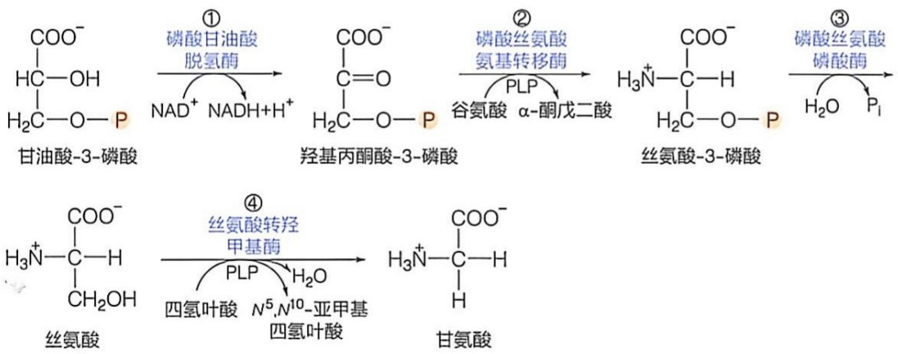

图 25-15 从甘油酸 -3- 磷酸生成丝氨酸和甘氨酸的代谢过程

甘氨酸裂解复合物由四种不同亚基组成，其作用方式类似于丙酮酸脱氢酶复合物等（也使用硫辛酸作为辅因子）。尽管在体外条件下，该反应是可逆的，但是，通过同位素示踪等研究发现，其在生物体内的主要功能是催化甘氨酸的裂解。这一过程具有双重生理意义:一方面，为四氢叶酸提供一碳单位（用于合成核苷酸等）；另一方面，反应产生的NADH可直接进入呼吸链，氧化释放能量（动物体内的甘氨酸裂解复合物镶嵌在线粒体内膜基质侧）。在极少数情况下，当自养型细菌细胞内的 $CO_{2}$ 和 $NH_{3}$ 浓度都较高时，才可能通过该反应合成甘氨酸。

## (2) 细菌和植物利用无机硫合成半胱氨酸

在植物和细菌中，半胱氨酸的碳骨架来自甘油酸-3-磷酸衍生的丝氨酸，而其硫原子来源如下:将硫酸根（$\mathrm{SO}_4^{2-}$）先还原为亚硫酸根（$\mathrm{SO}_3^{2-}$），再还原成硫化氢等硫化物（$\mathrm{S}^{2-}$），最终进入有机分子中，这是生物固定（同化）硫的重要途径。细菌和植物体内生成半胱氨酸的主要途径如图25-16所示。

一方面，进入细胞内的硫酸根需先通过一系列反应被转化为硫化物。在 ATP 硫酸化酶（ATP sulfurylase）的催化下，硫酸根与 ATP 分子中的 AMP 组分缩合，生成腺苷 -5'-磷酸硫酸（adenosine 5'-phosphosulfate，APS），同时释放焦磷酸（图 25-16,第①步）。然后，在APS激酶的催化下，腺苷-5'-磷酸硫酸发生磷酸化，生成3'-磷酸腺苷-5'-磷酸硫酸（3'-phosphoadenosine-5'-phosphosulfate，PAPS）（图25-16，第②步）。再由PAPS还原酶催化，硫酸盐被还原成亚硫酸盐（ $SO_{3}^{2-}$ ），同时释放3'-磷酸腺苷-5'-磷酸（图25-16，第③步）。在某些微生物、光合植物及藻类中，APS可在APS还原酶的催化下直接还原（利用谷胱甘肽等提供电子）为亚硫酸盐（图25-16，第④步）。通过上述两种方式生成的亚硫酸盐将在亚硫酸还原酶（sulfite reductase）的催化下，还原为 $S^{2-}$ （图25-16，第⑤步）。在细菌中，该酶一般利用3分子NADPH（或其他供体）提供电子，而在植物和藻类中一般利用铁氧还蛋白（Fd）提供电子。

图 25-16 细菌和植物细胞内生成半胱氨酸的代谢过程

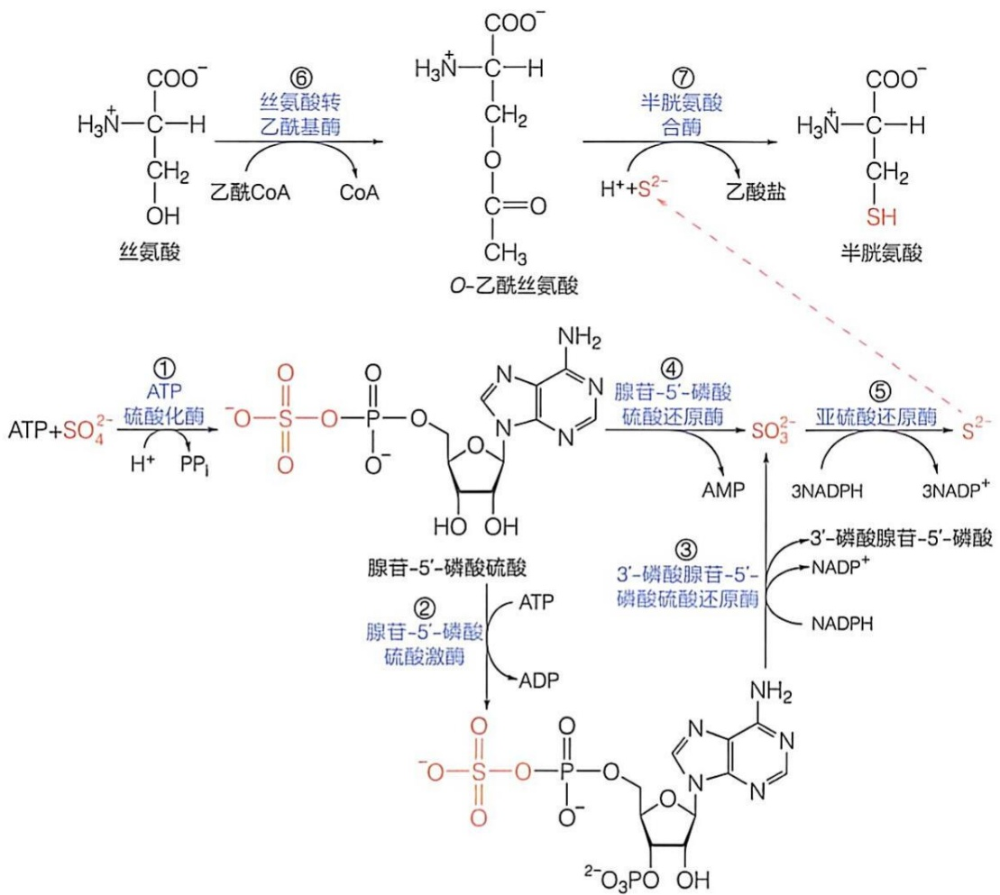

<details>
<summary>flowchart</summary>

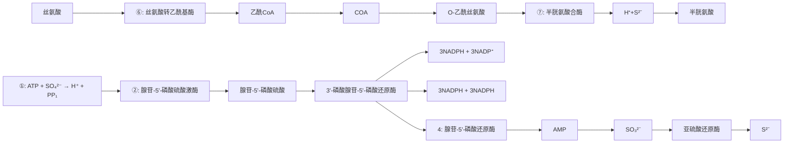
</details>

3'-磷酸腺苷-5'-磷酸硫酸

另一方面，丝氨酸在与硫化物发生缩合之前，其羟基需要被活化。该反应由丝氨酸转乙酰基酶（serine acetyltransferase；由细菌cysE基因编码）催化，即将乙酰辅酶A中的乙酰基转移至丝氨酸的羟基，生成O-乙酰丝氨酸（O-acetylserine）（图25-16，第⑥步）。最终，在半胱氨酸合酶（cysteine synthase，又称O-乙酰丝氨酸硫醇裂解酶；由细菌cysK或cysM基因编码）的催化下，$\mathrm{S}^{2-}$取代O-乙酰丝氨酸中的乙酰氧基，生成半胱氨酸（图25-16，第⑦步）。

## (3) 哺乳动物利用衍生自甲硫氨酸的高半胱氨酸提供硫原子合成半胱氨酸

哺乳动物同样利用丝氨酸提供的碳骨架生成半胱氨酸。然而，其硫原子只能通过转硫途径（而不是像细菌和植物那样通过固硫途径）从衍生自甲硫氨酸的高半胱氨酸获取（高半胱氨酸产生过程见图24-35、图24-36）。

从丝氨酸和高半胱氨酸生成半胱氨酸的过程如图 25-17 所示。在依赖 PLP 的胱硫醚 β- 合酶（cystathionine β-synthase）的催化下，丝氨酸与高半胱氨酸经缩合反应，生成胱硫醚。之后，胱硫醚在胱硫醚 γ- 裂解酶（cystathionine γ-lyase）的催化下发生裂解，巯基从高半胱氨酸转移至丝氨酸，生成半胱氨酸。

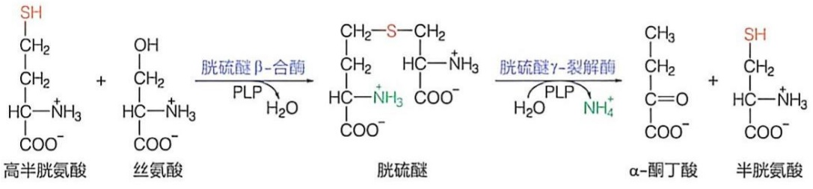

<details>
<summary>chemical</summary>

Reaction pathway of high-hemaldehyde and isomethylamine to form glutaric acid, followed by α-decylamine and dihydroquinone
</details>

图 25-17 哺乳动物从丝氨酸和高半胱氨酸生成半胱氨酸的代谢过程

值得注意的是，在胱硫醚  $\beta-$  合酶催化的反应中，PLP 与丝氨酸的氨基缩合形成席夫碱，帮助  $\beta-$  羟基脱去，形成氨基丙烯酸酯中间体；然后，被高半胱氨酸巯基亲核进攻，形成胱硫醚。在胱硫醚  $\gamma-$  裂解酶催化的反应中，PLP 却与高半胱氨酸部分的氨基缩合，最终导致该氨基以  $NH_{4}^{+}$ 的形式释放。

上述反应过程的基本策略与天冬氨酸在尿素循环中（或从 IMP 生成 AMP 过程中，见第 26 章）提供氨基的策略十分类似。此外，因为哺乳动物体内的半胱氨酸并非通过简单的前体分子进行从头合成，而是依赖甲硫氨酸提供硫原子合成的，因此，人们也将半胱氨酸视作条件必需氨基酸。

## 25.3.5 芳香族氨酸的生成起始于赤藓糖 -4- 磷酸与磷酸烯醇式丙酮酸的缩合

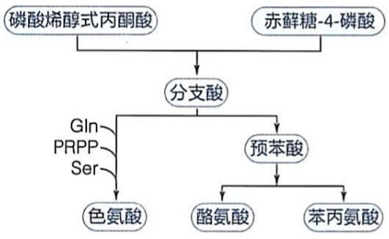

<details>
<summary>flowchart</summary>

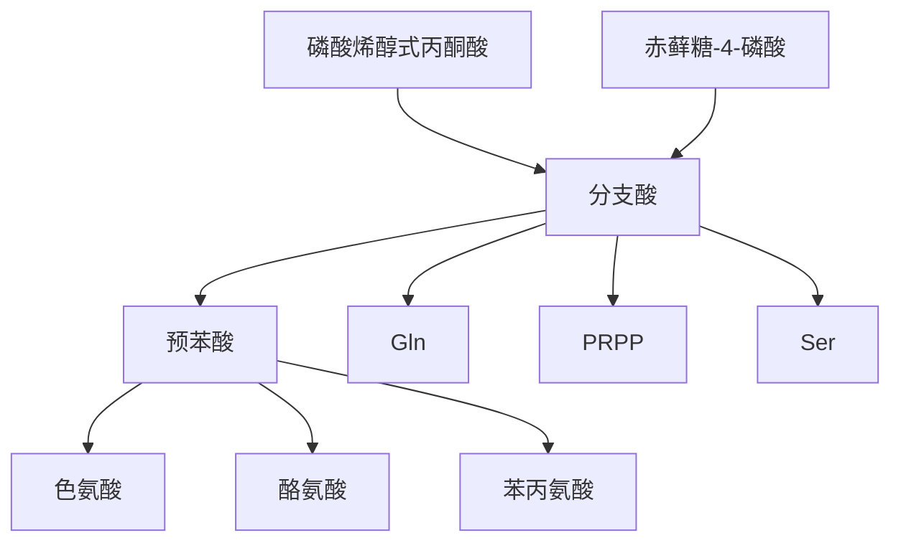
</details>

芳香族氨基酸——酪氨酸、苯丙氨酸和色氨酸在细菌和植物中的合成过程高度保守，均开始于磷酸烯醇式丙酮酸（糖酵解中间物）与赤藓糖-4-磷酸（戊糖磷酸途径中间物）之间的缩合反应。它们在细胞内的合成过程共享前面的七步反应，在此期间还需缩合另一分子磷酸烯醇式丙酮酸；直到生成分支酸（chorismate）后，合成路径才开始出现分叉:一条通路经预苯酸（prephenate）中间体衍生出苯丙氨酸和酪氨酸；另外一条通路则继续从5-磷酸核糖-1-焦磷酸

(5-phosphoribosyl-1-pyrophosphate, PRPP) 和丝氨酸获取碳原子，并从谷氨酰胺侧链获取生成吲哚基的氮原子，衍生出色氨酸。

总体而言，这些合成途径都需经过很多步的酶促反应。尽管细菌和植物具备合成这些氨基酸的能力，但包括人类在内的哺乳动物却丧失了这种合成能力。但动物能够将苯丙氨酸转化为酪氨酸（由苯丙氨酸羟化酶催化，见图24-28，细菌和植物不含这种酶），因此苯丙氨酸和色氨酸通常被视为必需氨基酸，而酪氨酸与半胱氨酸类似，被视为条件必需氨基酸。

图 25-18 合成分支酸的七步反应过程

(1) 芳香族氨基酸的合成始于磷酸烯醇式丙酮酸与赤藓糖 -4- 磷酸的缩合并转化为分支酸的七步反应

在细菌和植物细胞内，芳香族氨基酸合成的前七步反应如图 25-18 所示。

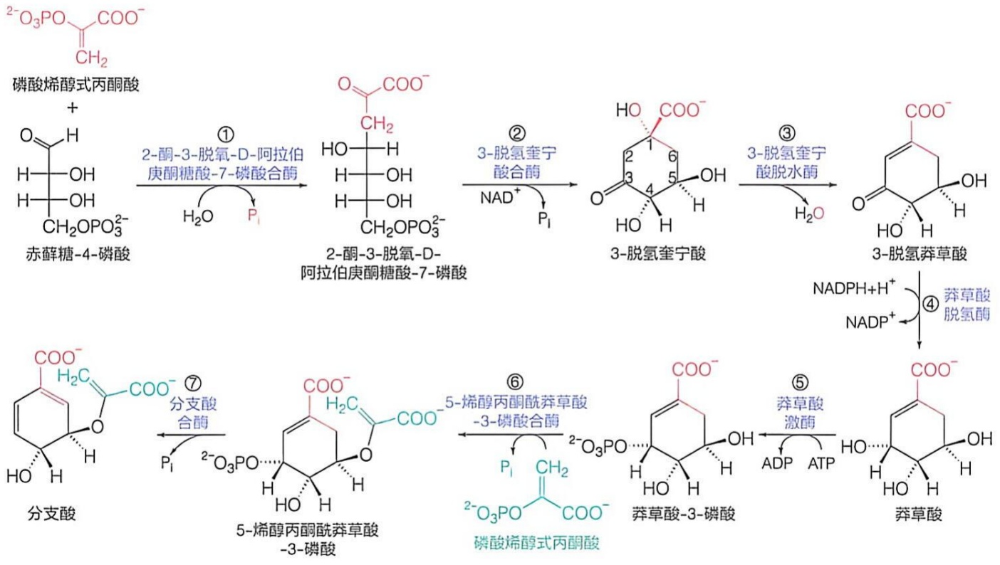

<details>
<summary>flowchart</summary>


</details>

这七步酶促反应可简单描述如下。第①步:经同一种合酶（细菌中存在三种不同的同工酶，分别由细菌中的aroF、aroG和aroH基因编码）催化，1分子磷酸烯醇式丙酮酸与1分子赤藓糖-4-磷酸缩合，生成含有7个碳原子的2-酮-3-脱氧-D-阿拉伯庚酮糖酸-7-磷酸。第②步:在3-脱氢奎宁酸合酶（3-dehydroquinate synthase；由细菌中的aroB基因编码）的催化下，上述中间产物发生脱磷酸并环化，形成具有六元环结构（为苯环前体）的3-脱氢奎宁酸。该酶以一种独特方式利用NAD+作为辅因子，所形成的NADH在活性部位被重新氧化，所以总体氧化还原当量守恒，并不净产生NADH。第③步:由3-脱氢奎宁酸脱水酶（3-dehydroquinate dehydratase；由细菌中的aroD基因编码）催化，使其脱水形成3-脱氢莽草酸（3-dehydroshikimate），产生苯环中的第一个双键。第④步:由莽草酸脱氢酶（shikimate dehydrogenase；由细菌中的aroE基因编码）催化，3-脱氢莽草酸环中的C3位羰基还原，形成莽草酸，该反应由NADPH提供电子。第⑤步:莽草酸在莽草酸激酶（由细菌中的aroK或aroL基因编码）的催化下，生成莽草酸-3-磷酸。第⑥步:由5-烯醇丙酮酰莽草酸-3-磷酸合酶（5-enolpyruvylshikimate-3-phosphate synthase；由细菌中的aroA基因编码）催化，莽草酸-3-磷酸中间体再与1分子磷酸烯醇式丙酮酸缩合，生成5-烯醇丙酮酰莽草酸-3-磷酸。第⑦步:由分支酸合酶（chorismate synthase；由细菌中的aroC基因编码）催化，5-烯醇丙酮酰莽草酸-3-磷酸通过消除反应（非水解反应）脱下一个磷酸，生成分支酸，产生苯环中的第二个双键。

在形成分支酸后，芳香族氨基酸的合成途径分化为两条独立分支。一条最终生成酪氨酸和苯丙氨酸，另一条最终生成色氨酸。

## (2) 分支酸转化为预苯酸后生成酪氨酸和苯丙氨酸

在大肠杆菌等细菌细胞中，酪氨酸和苯丙氨酸从分支酸衍生的过程如图 25-19 所示。

图 25-19 从分支酸生成苯丙氨酸和酪氨酸的代谢过程

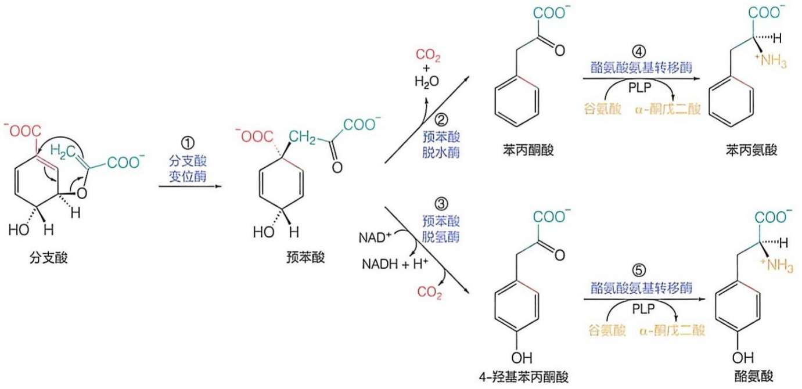

<details>
<summary>flowchart</summary>


</details>

在分支酸变位酶-预苯酸脱水酶（chorismate mutase-prephenate dehydratase；由pheA基因编码）双功能酶的催化下，分支酸先转化为预苯酸（prephenate），再转化为苯丙酮酸（phenylpyruvate）（图25-19，第①、②步）。其中，变位酶催化的是一种异构反应；脱水酶催化的是脱羧及之后的脱水反应，产生完整苯环。最终，由酪氨酸氨基转移酶（tyrosine aminotransferase；由tyrB基因编码）催化，苯丙酮酸从谷氨酸获取α-氨基，生成苯丙氨酸（图25-19，第④步）。

在另外一种双功能酶，即分支酸变位酶-预苯酸脱氢酶（chorismate mutase-prephenate dehydrogenase；由tyrA基因编码）的催化下，分支酸被先转化为预苯酸，再转化为4-羟基苯丙酮酸（图25-19，第①、③步）；其中，脱氢酶催化的是一种氧化脱羧的过程（产生苯环的第三个双键）。最终，酪氨酸氨基转移酶催化4-羟基苯丙酮酸从谷氨酸获取α-氨基，生成酪氨酸（图25-19，第⑤步）。值得注意的是，植物细胞并不存在上述两种双功能酶，而是以独立的分支酸变位酶、预苯酸脱水酶、预苯酸脱氢酶形式存在。

(3) 从分支酸合成色氨酸的过程还需核糖和丝氨酸提供碳原子

从分支酸到色氨酸的转化还需从其他前体获取碳原子，这一过程如图25-20所示。

图 25-20 从分支酸到色氨酸的转化过程

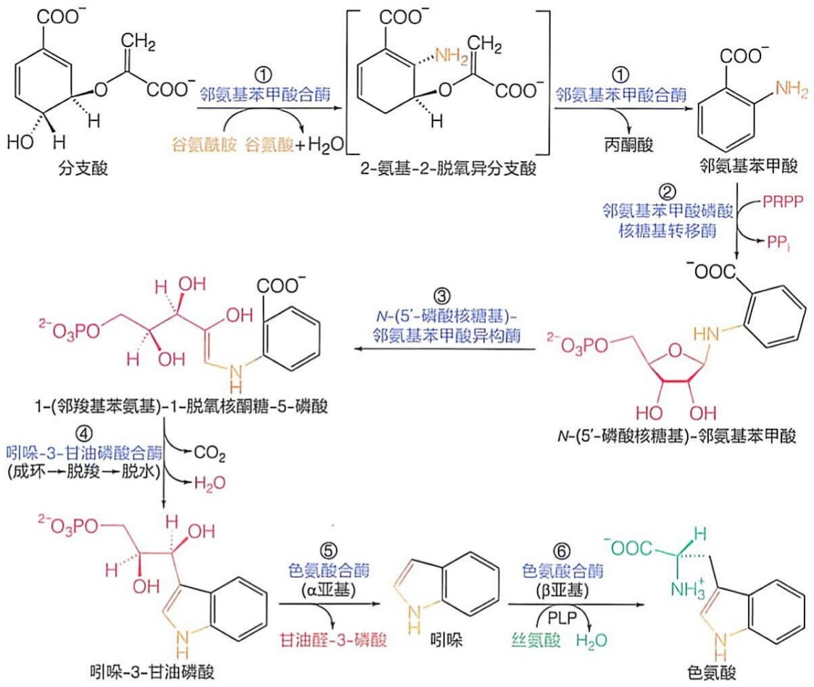

<details>
<summary>flowchart</summary>


</details>

在大肠杆菌等细菌细胞中，这涉及以下六步酶促化学反应。第①步:由邻氨基苯甲酸合酶（anthranilate synthase；由 trpE 和 trpD 两种基因编码产物形成的异源四聚体  $\alpha_{2}\beta_{2}$ ）催化，并从谷氨酰胺的侧链基团获取氨基，然后脱水生成 2-氨基-2-脱氧异分支酸（注意碳原子编号与前面不同）。接下来，异分支酸中的烯醇式丙酮酸基团以丙酮酸的形式脱去，最后，形成邻氨基苯甲酸。该酶催化的先氨基化（C2 位）、然后脱水、再脱去丙酮酸的顺序在细菌、植物和真菌中高度保守。第②步:由邻氨基苯甲酸磷酸核糖基转移酶（anthranilate phosphoribosyltransferase；也由 trpD 基因编码）催化，5-磷酸核糖-1-焦磷酸的 5-磷酸核糖基转移至邻氨基苯甲酸的氨基，生成 N-(5'-磷酸核糖基) 邻氨基苯甲酸。值得注意的是，该酶作为邻氨基苯甲酸合酶的一部分（其 β 亚基具酶活性）存在，因此，具有这两种活性的酶复合物称为邻氨基苯甲酸合酶-磷酸核糖基转移酶。第③步:由 N-(5'-磷酸核糖基) 邻氨基苯甲酸异构酶（由 trpC 基因编码）催化，将底物转化为含有烯醇结构的 1-(邻羧基苯氨基)-1-脱

氧核酮糖-5-磷酸。第④步:由吲哚-3-甘油磷酸合酶（indole-3-glycerol phosphate synthase；也由trpC基因编码）催化，使上一步反应的产物生成吲哚-3-甘油磷酸（先后发生成环、脱羧和脱水）。值得注意的是，催化第③步和第④步的酶是一种双功能酶，均由trpC基因编码。第⑤、⑥步:色氨酸合酶（tryptophan synthase；由trpA和trpB两个基因编码）以 $\alpha_{2}\beta_{2}$ 异源四聚体形式存在。在色氨酸合酶α亚基的催化下，吲哚-3-甘油磷酸脱去甘油醛-3-磷酸后生成吲哚（indole）（第⑤步）。最终，在色氨酸合酶β亚基（含PLP辅因子）的催化下，吲哚与丝氨酸缩合，生成色氨酸（第⑥步）。

色氨酸合酶的  $\alpha$  和  $\beta$  亚基的活性中心通过底物通道相连。对色氨酸合酶开展的催化机制研究及其结构测定结果表明，色氨酸合酶  $\alpha$  和  $\beta$  亚基的活性部位之间存在一个底物通道（图 25-21）。

具体而言，色氨酸合酶  $\alpha$  亚基活性部位形成的不稳定的吲哚中间体，会通过一条长约 25 Å 的疏水性通道，直接抵达其  $\beta$  亚基的活性中心。

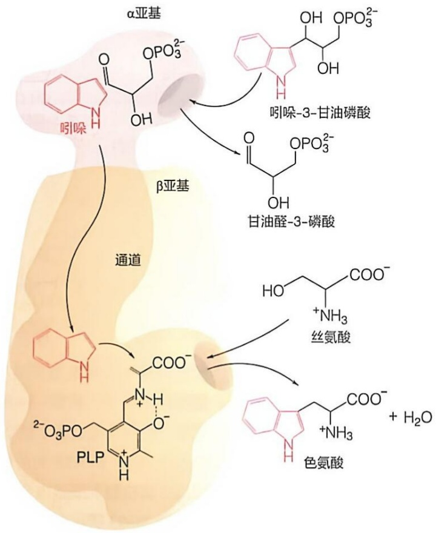

<details>
<summary>flowchart</summary>

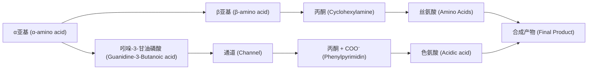
</details>

图 25-21 色氨酸合酶中连接  $\alpha$  和  $\beta$  亚基两个活性中心的底物通道示意图

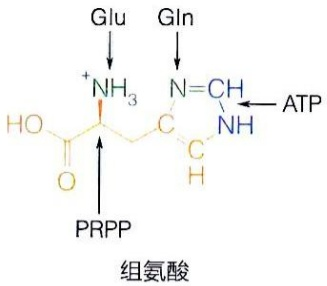

<details>
<summary>chemical</summary>

Chemical reaction diagram showing protonation of amino acid to form a group amine, with labeled components: Glu, Gln, ATP, and PRPP
</details>

图 25-22 组氨酸分子碳原子和氮原子的来源

PRPP: 5-磷酸核糖-1-焦磷酸。

## 25.3.6 组氨酸的碳骨架来自核糖分子及 ATP 分子中的腺嘌呤环

细菌和植物合成组氨酸时，其碳骨架来源较为独特。组氨酸的生成不仅获取PRPP的全部5个碳原子，还从ATP这种核苷酸分子的嘌呤环上获取1个碳原子和1个氮原子，并分别从谷氨酰胺和谷氨酸获取1个氮原子，具体来源如图25-22所示。

(1) 核糖 -5- 磷酸需被激活成 5- 磷酸核糖 -1- 焦磷酸

核糖-5-磷酸在参与组氨酸生成之前，需从ATP获取一个焦磷酸基团，从而被激活成5-磷酸核糖-1-焦磷酸（PRPP）。该反应由磷酸核糖焦磷酸合成酶（phosphoribosylpyrophosphate synthetase；由细菌prs基因编码）催化:

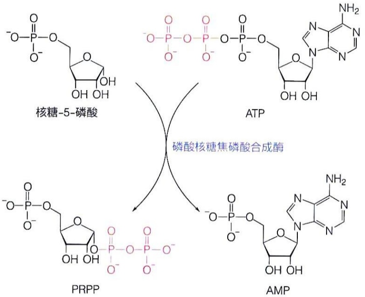

<details>
<summary>chemical</summary>

Chemical reaction diagram showing the conversion of nucleic acid-5-phosphate to ATP, PRPP, and AMP via phosphatidyl radical formation
</details>

经该酶催化焦磷酰基直接从 ATP 转移至底物，因而也称其为核糖磷酸焦磷酸激酶。值得注意的是，核糖 -5- 磷酸必须先激活为 PRPP，才能参与色氨酸、组氨酸及核苷酸等的生物合成过程（第 26 章）。

（2）以PRPP和ATP为前体生成组氨酸的过程涉及九步反应

细菌（或植物）细胞内合成组氨酸的过程开始于PRPP与ATP之间的缩合，其具体过程如图25-23所示。

细菌细胞内合成组氨酸的过程相当复杂，具体涉及以下九步反应。

第①步:由 ATP 磷酸核糖转移酶（ATP phosphoribosyl transferase；由细菌 hisG 基因编码）催化。PRPP 中的 5'-磷酸核糖组分中的 1 号异头碳与 ATP 分子中嘌呤环中的 1 号氮原子通过 N-糖苷键缩合 $^{①}$ ，从而生成  $N^{1}-5'$ -磷酸核糖-ATP，同时释放 1 分

<small><span class="docvortex-page-footnote" data-block-type="page_footnote" style="color:#6b7280">① 在正常的核苷酸分子如 ATP 中，通常是核糖组分的 1 号异头碳与嘌呤环的 9 号氮原子形成糖苷键。</span></small>

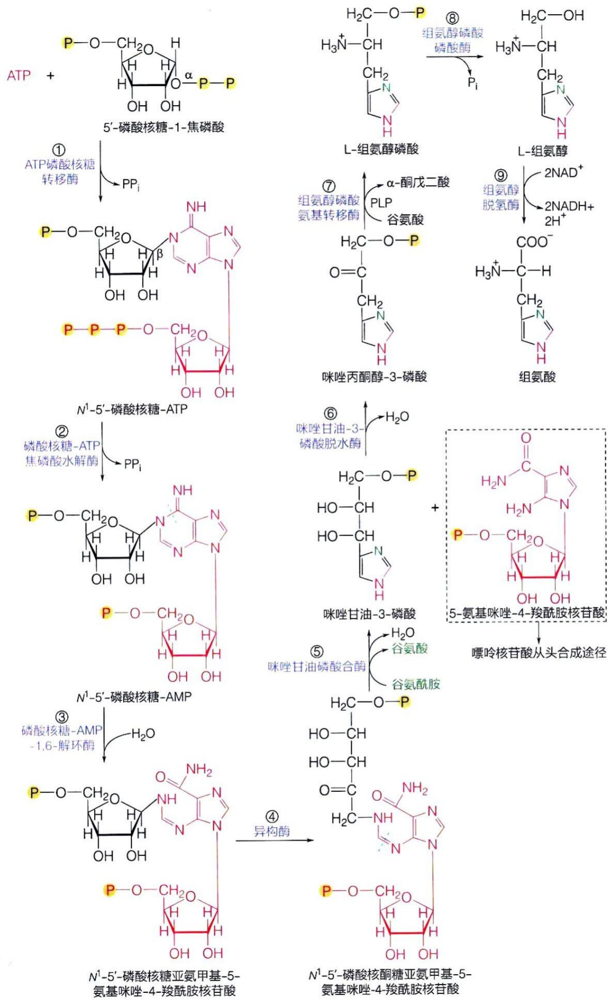

<details>
<summary>flowchart</summary>

This image displays a biochemical reaction pathway diagram illustrating the synthesis and conversion of N1'-5'-phosphoryl enolase (N1'-5'-phosphoryl enolase) into various amino acids and related enzymes.
</details>

图 25-23 细菌细胞内生成组氨酸的反应过程

子焦磷酸。与PRPP参与核苷酸等合成过程类似，在该反应过程中，核糖异头碳从 $\alpha$ 构型转变成 $\beta$ 构型。

第②步:由磷酸核糖-ATP焦磷酸水解酶（phosphoribosyl-ATP pyrophosphohydrolase；由hisI基因编码）催化， $N^{1} - 5^{\prime}$ -磷酸核糖-ATP中的ATP部分发生水解，脱去1分子焦磷酸，从而生成 $N^{1} - 5^{\prime}$ -磷酸核糖-AMP。

第③步:由磷酸核糖-AMP-1,6-解环酶（phosphoribosyl-AMP-1,6-cyclohydrolase；也由hisI基因编码）催化， $N^{1} - 5^{\prime}$ -磷酸核糖-AMP中嘌呤环的C6和N1之间形成的化学键通过水解打开，生成 $N^{1} - 5^{\prime}$ -磷酸核糖亚氨甲基-5-氨基咪唑-4-羧酰胺核苷酸。值得注意的是，这里的第②、③步反应由一种双功能酶催化。

第④步:由一种异构酶（由hisA基因编码）催化，使来自PRPP的核糖部分从环状结构转化为线性结构，并使核醛糖异构化为核酮糖，生成 $N^{1} - 5^{\prime}$ -磷酸核酮糖亚氨甲基-5-氨基咪唑-4-羧酰胺核苷酸。

第⑤步:由咪唑甘油磷酸合酶（imidazole glycerol phosphate synthase；由 hisI 和 hisF 基因编码，为一种转酰胺酶）催化，从谷氨酰胺侧链获取 1 个氨基，同时原腺嘌呤环中的 C2 和 N3 之间的化学键断裂，生成咪唑甘油 -3- 磷酸和 5- 氨基咪唑 -4- 羧酰胺核苷酸（英文缩写为 AICAR，为嘌呤核苷酸从头合成的中间体，见图 26-4）；在这样形成的五元咪唑环中，1 个氮原子源自谷氨酰胺，1 个碳原子和 1 个氮原子源自嘌呤环，其余 2 个碳原子源自 PRPP。

第⑥步:由咪唑甘油-3-磷酸脱水酶（由hisB基因编码）催化，咪唑甘油-3-磷酸发生脱水，生成的烯醇式产物通过互变异构转化为咪唑丙酮醇-3-磷酸。

第⑦步:由以PLP为辅因子的组氨醇磷酸氨基转移酶（histidinol phosphate aminotransferase；由hisC基因编码）催化，将谷氨酸的氨基转移至咪唑丙酮醇-3-磷酸上，生成L-组氨醇磷酸。

第⑧步:由组氨醇磷酸磷酸酶（histidinol phosphate phosphatase；由 hisB 基因编码）催化脱去磷酸基团，生成 L- 组氨醇（L-histidinol）。

第⑨步:由组氨醇脱氢酶（由 hisD 基因编码）催化，以  $NAD^{+}$  为电子受体，组氨醇经过连续两次脱氢反应，先转化为组氨醛，最后生成组氨酸。

值得注意的是，在细菌的组氨酸生成过程中，其前体物质均为核酸组成成分:核糖和腺嘌呤核苷酸。因此，这一过程为“RNA世界”向“蛋白质世界”的演化过渡提供了某种支持性证据。

## 25.3.7 氨基酸分子中的氮原子源自谷氨酸和谷氨酰胺等供体分子

在细菌和植物细胞中从头合成20种氨基酸时，关于其 $\alpha-$ 氨基氮的来源，可大致总结如下。谷氨酸的 $\alpha-$ 氨基直接来自 $\mathrm{NH}_4^+$；因此，以谷氨酸为前体而生成的谷氨酰胺、脯氨酸、精氨酸的 $\alpha-$ 氨基也可被视为来自 $\mathrm{NH}_4^+$。其他氨基酸（包括丝氨酸、天冬氨酸）大多通过在合成途径中的某一步中形成 $\alpha-$ 羰基，再利用谷氨酸进行转氨基

## 知识延展 25- 2

## 氨基酸消旋酶可使 L- 氨基酸与 D- 氨基酸相互转化

构成蛋白质的20种氨基酸中，除甘氨酸外，其余19种氨基酸的α-碳原子为不对称碳，且均为L构型。然而，D构型氨基酸却广泛存在于细菌的肽聚糖细胞壁以及肽类抗生素中。例如，细菌的肽聚糖分子中就含有D-丙氨酸和D-谷氨酸。D-氨基酸是由特异的氨基酸消旋酶（amino acid racemase）催化相应的L-氨基酸转化而成的，如丙氨酸消旋酶（alanine racemase）催化L-丙氨酸转化为D-丙氨酸。与转氨酶相似，氨基酸消旋酶一般也以PLP为辅因子。这类氨基酸消旋酶可能的催化机制如图25-24A所示。

在氨基酸消旋酶催化的反应中，其关键步骤是L-氨基酸底物与PLP形成外醛亚胺后，其α-碳连接的氢（H\*）酸性大幅提高，可被邻近的一个广义碱-B₂:夺取，形成-B₂:H\*(图25-24B下)，这使得α-碳带上负电荷。随后，通过将负电荷分散至整个吡哆醛环，形成具平面结构的醌类中间体（图 25-24B 中）。若失去质子的  $\alpha-$  碳从反方向获取一个质子（比如从位于平面上方（即 re 面）的广义酸  $-B_{1}:H$ ），则最终形成 D- 氨基酸（图 25-24B 上）。

尚不清楚的问题是:质子从  $\alpha-$  碳的一侧（si 面）失去后，是否可发生特异转移，从其对侧（re 面）加上。由于质子极其微小（在 X 射线晶体衍射分析中难以直接观测），目前只能通过同位素标记实验并结合酶动力学分析来研究该过程。氨基酸消旋酶（或其他类型消旋酶）的催化机制仍是一个活跃的研究领域。

鉴于丙氨酸或谷氨酸消旋酶仅存在于细菌细胞，而在人类细胞中完全缺失，因此它们被视为研发抗菌药物的理想靶点。以抗结核药物 D-环丝氨酸为例，该药物能够不可逆地抑制丙氨酸消旋酶的活性，进而阻断 D-丙氨酸的生成，最终干扰细菌细胞壁的合成。

(A)

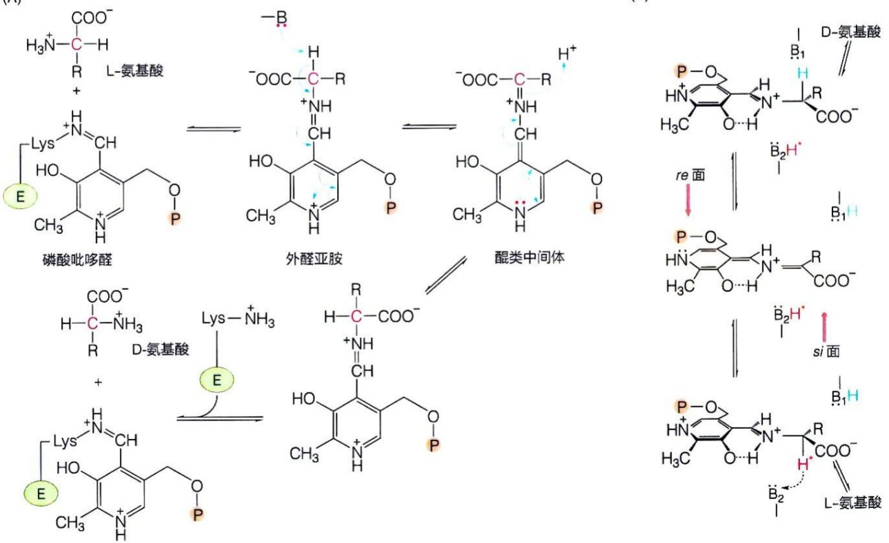

(B)

图 25-24 氨基酸消旋酶催化反应的机制示意图

反应，从而获取  $\alpha-$  氨基。有趣的是，甘氨酸、半胱氨酸、色氨酸的  $\alpha-$  氨基均直接来自丝氨酸，天冬酰胺、苏氨酸、甲硫氨酸等的  $\alpha-$  氨基则来自天冬氨酸。

对于20种氨基酸中的非 $\alpha-$ 氨基，即侧链R基团中的氮原子，其来源可大致总结如下。谷氨酰胺侧链的氨基来自 $\mathrm{NH}_4^+$，其他氨基酸侧链中的氮原子来源比较多样化。具体而言，色氨酸吲哚侧链中的氮原子和组氨酸咪唑侧链中的一个氮原子均来自谷氨酰胺的侧链氨基，组氨酸侧链上的另外一个氮原子来自ATP分子的嘌呤环，精氨酸侧链上的三个氮原子分别来自谷氨酸、氨基甲酰磷酸和天冬氨酸，赖氨酸侧链的氮原子并非来自谷氨酰胺的侧链而是来自谷氨酸或天冬氨酸。

对于哺乳动物氨基酸合成而言，以甘油酸-3-磷酸和 $\alpha-$ 酮戊二酸为前体生成的氨基酸均为非必需氨基酸（见图25-7）。这一特征可能与这些氨基酸的从头合成过程相对简单有关。

## 25.3.8 细胞合成氨基酸需消耗能量和还原力

在第 16 章 “代谢总论” 里我们介绍过，在生物体内，分解代谢释放能量，并以 ATP、NADPH 或 NADH 等形式用于合成代谢（图 16-3）。糖类和脂肪酸类分子通过分解所释放的能量和产生的还原力，可用于氨基酸合成等。细菌和植物细胞内合成 20 种氨基酸所消耗 ATP 和 NAD(P)H 的总体情况，如图 25-25 所示。

在氨基酸合成代谢途径中，存在许多还原反应，这些反应需要 NAD(P)H 提供电子。大约 12 种氨基酸的合成需消耗 ATP，ATP 的作用主要是通过将底物分子进行磷酰基修饰而促进羧基的还原、碳氮单键（C—N）及碳氮双键（C=N）的形成等反应的发生。在色氨酸和组氨酸的合成过程中，需要消耗 ATP 以将磷酸核糖活化为 PRPP。PRPP 中的焦磷酸基团在反应中被释放，这相当于消耗 2 分子 ATP。此外，四种氨基酸（甲硫氨酸、半胱氨酸、精氨酸、赖氨酸）的合成需要利用乙酰辅酶 A 或琥珀酰辅酶 A，使中间体发生乙酰化或琥珀酰化，从而活化碳骨架或保护氨基。从某种意义上说，这也是一种消耗能量的过程。

值得注意的是，在氨基酸合成的某些步骤中，也产生 NADH。这些产生的 NADH 原则上可以进入呼吸链，继续被氧化释放能量，用于 ATP 的合成。

## 25.3.9 氨基酸合成与分解途径之间存在关联性

我们在前面了解到，葡萄糖的分解与合成途径中存在某些可逆反应是共用的（见图21-4A），然而，脂肪酸的合成与分解之间并无任何可逆反应是共用的（见图23-1）。我们也对氨基酸的分解与合成途径进行一番比较。

特定氨基酸的分解与合成代谢之间一般共享可逆转氨反应等。尽管从整体上看，氨基酸的合成并非分解的逆过程；但 $\alpha-$ 氨基酸与 $\alpha-$ 酮酸之间的转氨反应一般都具有可逆性，并且这些反应在合成和分解途径中均发挥重要作用，可被视为氨基酸合成与分解途径共享的可逆反应。具体而言，在涉及转氨酶催化的可逆转氨基反应中，分解途径中的反应方向均是从某种氨基酸向  $\alpha-$  酮戊二酸（氨基受体）转移  $\alpha-$  氨基，而在合成途径中，则是从谷氨酸（氨基供体）向某种  $\alpha-$  酮酸转移  $\alpha-$  氨基（见图 24-6），正是转氨酶的立体异构专一性决定了生成的氨基酸均为 L 构型（图 25-10）。

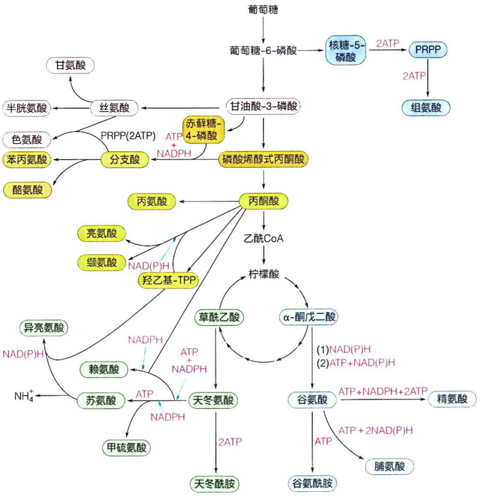

<details>
<summary>flowchart</summary>

```mermaid
graph TD
  A["葡萄糖"] --> B["葡萄糖-6-磷酸"]
  B --> C["核糖-5-磷酸"]
  C -->|2ATP| D["PRPP"]
  D -->|2ATP| E["组氨酸"]
  F["甘氨酸"] --> G["丝氨酸"]
  G --> H["半胱氨酸"]
  G --> I["色氨酸"]
  G --> J["苯丙氨酸"]
  G --> K["酪氨酸"]
  L["甘油酸-3-磷酸"] --> M["磷酸烯醇式丙酮酸"]
  M --> N["丙酮酸"]
  O["赤藓糖-4-磷酸"] --> P["乙酰CoA"]
  Q["丙氨酸"] --> R["亮氨酸"]
  Q --> S["缬氨酸"]
  T["异亮氨酸"] --> U["NAD(P)H"]
  V["羟乙基-TPP"] --> W["草酰乙酸"]
  V --> X["α-酮戊二酸"]
  Y["赖氨酸"] --> Z["苏氨酸"]
  AA["甲硫氨酸"] --> AB["天冬氨酸"]
  AC["谷氨酸"] --> AD["精氨酸"]
  AE["天冬酰胺"] --> AF["脯氨酸"]
  AG["NAD(P)H"] -.-> V
  AH["NADPH"] -.-> V
  AI["ATP + NADPH"] -.-> V
  AJ["ATP + NAD(P)H"] -.-> V
  AK["ATP + 2NAD(P)H"] -.-> V
  AL["ATP + 2NAD(P)H"] -.-> V
  AM["ATP + 2NAD(P)H"] -.-> V
  AN["ATP + NAD(P)H"] -.-> V
  AO["NAD(P)H"] -.-> V
  AP["NAD(P)H"] -.-> V
  AQ["NAD(P)H"] -.-> V
  AR["NAD(P)H"] -.-> V
  AS["NAD(P)H"] -.-> V
  ATB["NAD(P)H"] -.-> V
  AV["NAD(P)H"] -.-> V
  AW["NAD(P)H"] -.-> V
  AX["NAD(P)H"] -.-> V
  AY["NAD(P)H"] -.-> V
  AZ["NAD(P)H"] -.-> V
  BA["NAD(P)H"] -.-> V
  BC["NAD(P)H"] -.-> V
  BD["NAD(P)H"] -.-> V
  BE["NAD(P)H"] -.-> V
  BF["NAD(P)H"] -.-> V
  BG["NAD(P)H"] -.-> V
  BH["NAD(P)H"] -.-> V
  BI["NAD(P)H"] -.-> V
  BJ["NAD(P)H"] -.-> V
  BK["NAD(P)H"] -.-> V
  BL["NAD(P)H"] -.-> V
  BM["NAD(P)H"] -.-> V
  BN["NAD(P)H"] -.-> V
  BO["NAD(P)H"] -.-> V
  BP["NAD(P)H"] -.-> V
  BR["NAD(P)H"] -. ~2000 (implied by context)
```
</details>

图 25-25 20 种氨基酸生成过程中的能量和还原力消耗概况

在分解和合成过程中均使用可逆转氨反应的氨基酸中，最典型的是那种在合成的最后一步（或仅需一步合成的氨基酸）发生转氨基反应的氨基酸。这些氨基酸包括天冬氨酸、丙氨酸、缬氨酸、亮氨酸、异亮氨酸、酪氨酸等。

对于从  $\alpha-$  酮戊二酸经谷氨酸衍生而来的氨基酸而言，在分解过程中，均先经一系列反应转化为谷氨酸，再转化为  $\alpha-$  酮戊二酸。这些氨基酸包括谷氨酰胺、脯氨酸、精氨酸等；对于由丙酮酸衍生而来的氨基酸，某些在分解过程中也产生丙酮酸，例如丙氨酸；对于由草酰乙酸衍生而来的氨基酸，某些在分解过程中也最终被转化为草酰乙酸，例如天冬氨酸与天冬酰胺。这些反应均体现了氨基酸合成与氨基酸分解途径之间的可逆性，即合成与分解途径之间的关联性。

## 25.4 氨基酸合成代谢主要通过反馈抑制调节

与糖类和脂类等分子的合成代谢相似，生物体内氨基酸的合成过程也根据细胞需求而进行有效调节，实现供需平衡。

1950年代，美国学者埃德温·昂巴格（Edwin Umbarger，1921—1999）等观察到，异亮氨酸可特异性地抑制苏氨酸脱水酶/脱氨酶，该酶催化从苏氨酸合成异亮氨酸途径五步反应中的第一步（图25-13）。

自那时起，大量研究结果表明，氨基酸合成代谢途径主要通过类似的反馈抑制方式进行调节。具体而言，生物合成代谢途径中的终产物别构抑制催化其上游某步（大多是第一步）反应的酶的活性，如:

$$
A \xrightarrow {E 1} B \xrightarrow {E 2} C \xrightarrow {E 3} D \xrightarrow {E 4} P
$$

反馈抑制调节的总体结果是维持特定产物（如某种氨基酸）的供需平衡。正如前面提到的，这样的别构调节酶通常以寡聚体（而非单体）形式存在，并且它们催化的反应一般为一个限速步骤（即高自由能释放的不可逆反应）。

从前面的介绍我们了解到，与糖异生和脂肪酸合成的线性途径不同的是，氨基酸（以及核苷酸）合成途径以存在分支为其典型特征。对于具有发散性特征的氨基酸合成代谢途径而言，如何维持最终生成的多种不同氨基酸之间含量的平衡，是生物演化过程所需要解决的重要问题。为此，演化筛选出了多重反馈抑制模式，包括协同（concerted）或累积（cumulative）反馈抑制、酶的多型性（enzyme multiplicity）以及顺序（sequential）反馈抑制等。通过这些机制，生物体可实现不同氨基酸合成量的供需平衡。下面将对这些不同的反馈抑制模式分别进行简要介绍。

## （1）不同终产物可对共同途径的某种酶实施协同或累积反馈抑制

从天冬氨酸生成赖氨酸、甲硫氨酸、苏氨酸和异亮氨酸的代谢途径（图25-11），以及从磷酸烯醇式丙酮酸和赤藓糖-4-磷酸等生成酪氨酸、苯丙氨酸和色氨酸的代谢途径（图25-18、图25-19和图25-20），均属于典型的分支代谢途径。这些合成代谢途径均产生不同的氨基酸终产物；一种常见的情况是，两种或更多种不同的终产物（如下图中的P和S）可以共同抑制催化共享合成过程第一步反应的酶（即E1）的活性:

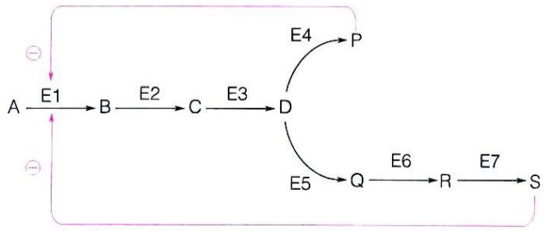

<details>
<summary>flowchart</summary>

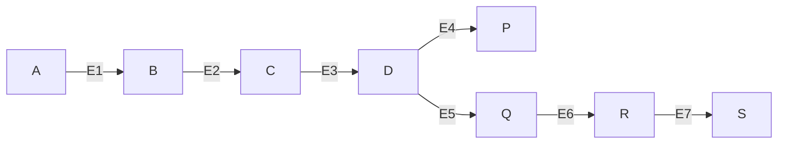
</details>

这种协同（或累积）反馈抑制方式在氨基酸合成代谢途径中颇为常见。具体而言，协同反馈抑制是指多种终产物必须同时过量，才可完全抑制一种调节酶的活性，单一产物过量仅产生部分抑制或无抑制效应。累积反馈抑制稍有不同，多种别构效应物可独立地部分抑制某种酶，且抑制效应具有累加性，最终可完全抑制酶活性。协同反馈抑制的典型例子是参与赖氨酸、苏氨酸、甲硫氨酸和异亮氨酸生成的一种天冬氨酸激酶同工酶，它只有当赖氨酸和异亮氨酸同时过量时，才被完全抑制。累积抑制的典型例子是谷氨酰胺合成酶，其活性受9种不同产物的累积抑制作用（图25-5）。

## (2) 酶的多型性导致不同同工酶呈现差异化的别构调节特性

在该调节方式中，细胞产生两种或更多种可催化同一步反应的同工酶。不同的同工酶对终产物的响应行为不同，也就是说它们可以各自被不同的终产物特异性抑制，或者不被任何终产物抑制。如下图中催化A生成B的反应可由三种同工酶（E1，$\mathrm{E}1'$ 和 $\mathrm{E}1''$）同时催化，但是，其中的E1只被终产物P别构抑制，$\mathrm{E}1'$ 则只被终端产生S别构抑制（即P对 $\mathrm{E}1'$ 或S对E1均无别构抑制效应），而 $\mathrm{E}1''$ 不被任何终产物抑制:

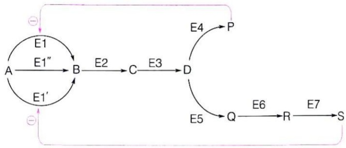

<details>
<summary>flowchart</summary>

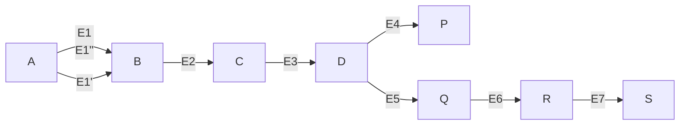
</details>

通过酶的多型性进行反馈抑制调节的方式在多组氨基酸合成代谢途径中存在，包括由天冬氨酸生成赖氨酸、甲硫氨酸、苏氨酸与异亮氨酸的合成途径（图25-11，如其中催化第①步反应的天冬氨酸激酶和催化第③步反应的高丝氨酸脱氢酶），以及从磷酸烯醇式丙酮酸和赤藓糖-4-磷酸生成三种芳香族氨基酸的过程（图25-18，催化磷酸烯醇式丙酮酸与赤藓糖-4-磷酸缩合的酶含三种同工酶，分别受苯丙氨酸、酪氨酸和色氨酸的反馈抑制）。

## （3）顺序反馈抑制属于一种分段式调节方式

在该调节方式中，终产物（下图中的P或S）分别抑制其各自独特的代谢途径上游的一种酶（E4和E5）；这样的结果可能导致它们的共同中间产物（D）的积累；高浓度的D进而反馈抑制催化更加上游的一步合成反应的酶（E1）:

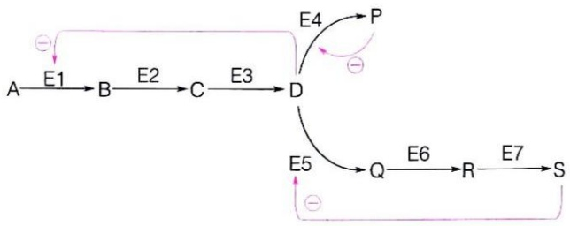

<details>
<summary>flowchart</summary>


</details>