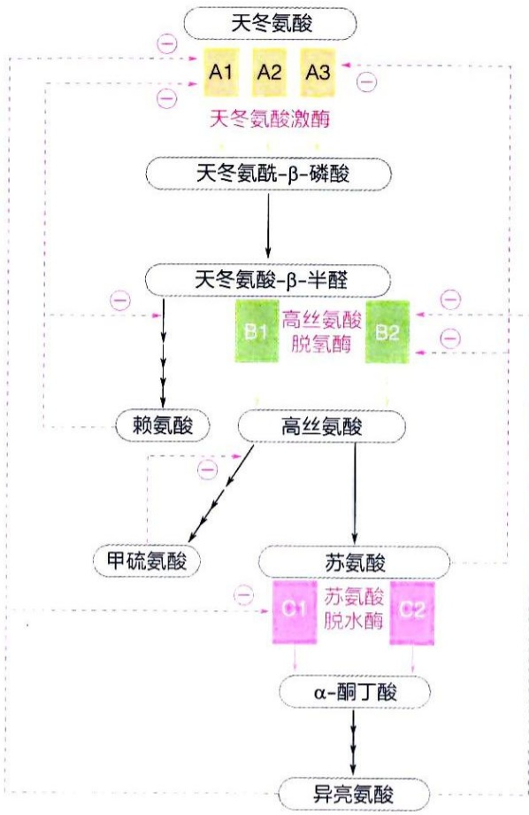

flowchart

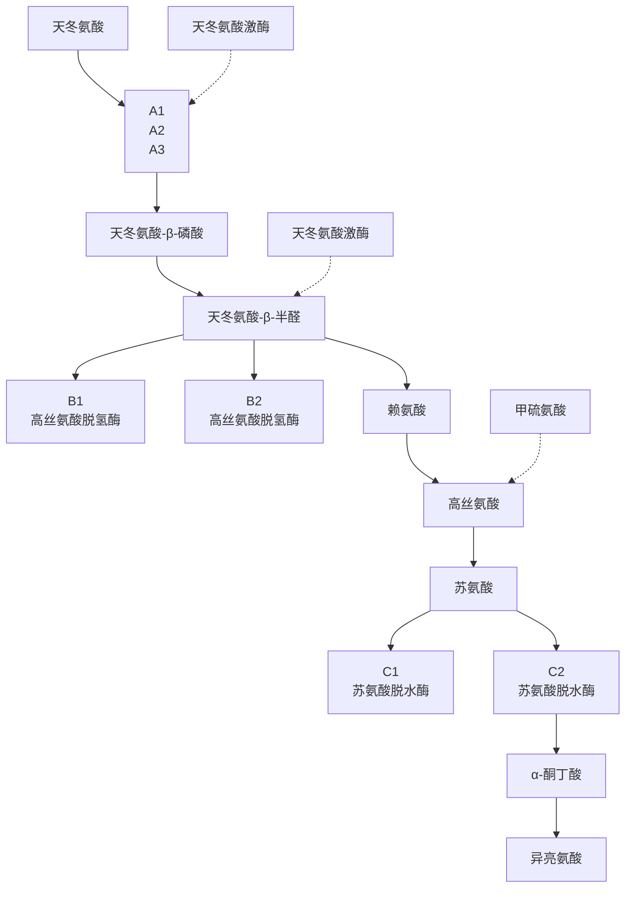

图25-26 细菌从天冬氨酸生成赖氨酸、甲硫氨酸、苏氨酸和异亮氨酸过程中存在的不同反馈抑制调节方式

（4）多种反馈抑制方式可共同调节某组氨基酸的合成代谢途径

针对某组氨基酸的合成过程，可能同时利用上述三种类型的反馈抑制方式进行调控。这里仅以如图25-26所示的从天冬氨酸生成赖氨酸、甲硫氨酸、苏氨酸和异亮氨酸的合成途径为例（图25-11）进行说明。需要注意的是，为了方便描述，在图25-26中所涉及的酶仅以字母表示，但这些酶均经实验鉴定确认存在于细菌细胞内。

如图 25-26 所示，在这组氨基酸的合成途径中，酶的多型性在至少三个反应步骤得以体现。例如，A1、A2 和 A3 均为天冬氨酸激酶的同工酶，B1 和 B2 均为高丝氨酸脱氢酶的同工酶，C1 和 C2 均为苏氨酸脱水酶 / 脱氨酶的同工酶。其中的 A1 和 A3 同工酶的活性分别受到分支产物赖氨酸和苏氨酸的抑制，以确保赖氨酸和苏氨酸合成的平衡。

协同反馈抑制作用发生于同工酶 A1 和 B2 上。A1 受到终产物赖氨酸和异亮氨酸的协同抑制:这两种产物各自对酶的活性产生部分抑制，只有当它们均积累到较高浓度时，酶的活性才会被彻底或高度抑制。同样，B2 同时受到终产物异亮氨酸和中间物苏氨酸的协同抑制。

顺序反馈调节方式体现在以下过程中:终产物异亮氨酸对催化以苏氨酸为起始中间体的第一种酶（C1）产生抑制作用，导致苏氨酸的累积；而累积的苏氨酸可继续抑制

合成途径上游分别催化以天冬氨酸和天冬氨酸- $\beta$ -半醛为起始中间体的两步反应的酶（A3、B2）的活性。通过这种调节方式，实现苏氨酸和异亮氨酸生成量的平衡。

值得注意的是，A2、B1和C2这几种同工酶不受任何别构调节因子的抑制作用，然而，编码它们基因的转录却可被积累的特定终产物与特异的抑制蛋白的结合所抑制（当这些终产物没有积累时，编码它们基因的转录正常进行）。这种类型的酶被称为可阻遏酶（repressible enzyme）。例如，细菌色氨酸合成途径中相关酶的编码基因通过色氨酸操纵子实现调控:当细菌合成的色氨酸或从环境中获取的色氨酸量超过需求时，特定抑制蛋白与色氨酸结合，进而与操纵子上的调控DNA序列结合，抑制相关酶的编码基因的表达，从而降低酶的产量；而当色氨酸不足时，这一抑制效应被解除，相关酶的编码基因的表达得以恢复，酶的合成重新启动。

综上所述，通过多种方式的精细调控，不同氨基酸合成的速率得以有效调节，从而确保不同氨基酸终产物的生成量之间维持高度平衡状态。

## 25.5 氨基酸是合成多种生物分子的重要前体

除了作为蛋白质的基本组成单位之外，20种氨基酸中的某些氨基酸还是合成多种其他生物分子的前体，例如:谷胱甘肽、磷酸肌酸、一氧化氮、多种激素、多种神经递质、血红素以及核苷酸等。这一现象与核苷酸作为多种生物分子合成前体的特征相似。这表明，在生命演化过程中似乎存在一种充分利用现有生物分子的“最大效应”原则:充分利用现有生物分子。以下选取一些代表性的例子介绍动物如何利用氨基酸合成其他生物分子。与氨基酸合成过程类似，这些合成过程有的简单，有的复杂。

## 25.5.1 谷胱甘肽由谷氨酸、半胱氨酸和甘氨酸缩合而成

谷胱甘肽（glutathione，其还原形式被缩写为 GSH）是一种广泛存在于各类生物细胞中且含量较高（一般为 2 mmol/L 左右）的重要抗氧化剂。GSH 通过酶促反应（如谷胱甘肽过氧化物酶）和非酶促反应，能够将活性氧分解为无毒形式，从而发挥核心抗氧化作用。谷胱甘肽最早于 1880 年代被鉴定到；1920 年代，其短肽结构被确定，且被发现具有较强的热稳定性；1950 年代，其抗氧化的分子机制逐渐被阐明。

谷胱甘肽的合成过程相对简单，仅由两种酶催化，通过 $\gamma-$ 肽键和 $\alpha-$ 肽键将谷氨酸、半胱氨酸和甘氨酸连接成三肽。其分子中所含的巯基（—SH）是发挥清除活性氧作用的关键基团。谷胱甘肽在细胞内的合成过程分两步进行，如图25-27所示。第一步:由 $\gamma-$ 谷氨酰半胱氨酸合成酶（$\gamma-$ glutamylcysteine synthetase；由细菌gshA基因编码）催化，谷氨酸的 $\gamma-$ 羧基与半胱氨酸的 $\alpha-$ 氨基缩合形成 $\gamma-$ 肽键（也称异肽键，表明并非 $\alpha-$ 羧基与 $\alpha-$ 氨基之间所形成）。这一过程需要消耗ATP，活化谷氨酸的 $\gamma-$ 羧基，生成 $\gamma-$ 谷氨酰磷酸，随后被活化的羧基与半胱氨酸的 $\alpha-$ 氨基缩合，形成异肽键并释放磷酸。第二步:由谷胱甘肽合成酶（glutathione synthetase；由细菌gshB基因编码）催化，$\gamma-$ 谷氨酰半胱氨酸中间体半胱氨酸残基的游离 $\alpha-$ 羧基与甘氨酸的 $\alpha-$ 氨基缩合形成肽键，最终形成谷胱甘肽。这一反应机制与第一步反应类似，也需要利用ATP活化半胱氨酸的羧基，使其易于与甘氨酸的 $\alpha-$ 氨基发生缩合反应。

细胞内存在的还原形式的谷胱甘肽（GSH）可被谷胱甘肽过氧化物酶（glutathione peroxidase；一种含硒的酶）利用，将有害的过氧化物转化为 $\mathrm{H}_2\mathrm{O}$，同时生成氧化型谷胱甘肽（GSSG；这是一种胱氨酸衍生物，由2分子谷胱甘肽通过二硫键连接而成）。随后，在谷胱甘肽还原酶的催化下，利用NADPH作为电子供体，GSSG被还原为2分子GSH，从而可以再次被谷胱甘肽过氧化物酶利用，以清除过氧化物。除了参与这一循环外，动物细胞内的GSH还可发挥解毒（通过形成可溶物性复合物排出体外）以及使蛋白质中的二硫键处于具有活性的还原态等多种其他功能。

图 25-27 谷胱甘肽的生物合成途径

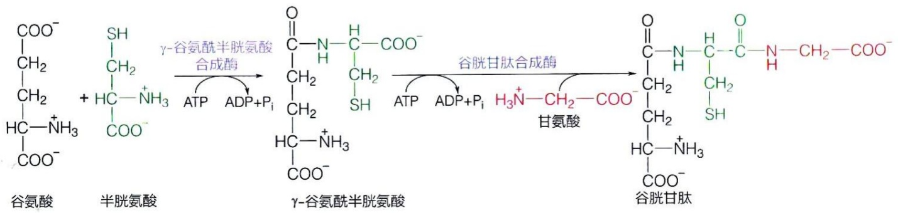

chemical

Reaction pathway of glutamine showing conversion to glutamate via γ-glucosaminoglycan and glutamine acylation

## 25.5.2 肌酸以甘氨酸、精氨酸和甲硫氨酸为前体生成

磷酸肌酸（phosphocreatine，也称为肌酸磷酸）是1920年代从动物肌肉组织中鉴定的一种含磷酸基的物质。研究表明，它在肌肉收缩过程中被水解，而在肌肉恢复阶段又被重新合成。后续研究表明，它是一种重要的能量储存分子，能够作为动物体内的能量缓冲剂，通过快速产生ATP，为细胞提供即时能量。

磷酸肌酸的生物重要性体现在以下两个方面。在肌酸激酶的催化下，磷酸肌酸所携带的磷酰基能够被可逆地转移至ADP，生成ATP和肌酸；反之，ATP所携带的磷酰基也可以被转移至肌酸分子中，形成磷酸肌酸:

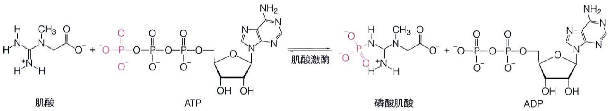

chemical

Chemical reaction equation showing the enzymatic conversion of肌酸 to ATP, phosphoric acid, and ADP under muscle activation

动物细胞内的肌酸以甘氨酸、精氨酸及甲硫氨酸为前体的合成过程如图25-28所示。

具体过程涉及两步酶促反应。第一步:由L-精氨酸:甘氨酸转脒基酶（L-arginine: glycine amidinotransferase）催化，精氨酸侧链末端的脒基（amidine group；含一个碳原子、两个氮原子）被转移至甘氨酸的氨基上，生成胍基（含一个碳原子，该碳原子同时连接两个氨基和一个亚氨基）乙酸（guanidinoacetate）中间体，同时释放鸟氨酸。第二步:由S-腺苷甲硫氨酸:胍基乙酸甲基转移酶（S-adenosyl methionine: guanidinoacetate methyltransferase）催化，S-腺苷甲硫氨酸分子中的1个甲基被转移至胍基乙酸的3号氮原子上，生成肌酸（即N-甲基胍基乙酸）。

值得注意的是，动物体内肌酸的合成过程发生在两个不同的器官中。上述第一步反应发生在肾脏中，而第二步却发生在肝脏中。随后，肌酸通过血液被运输至肌肉、大脑等高耗能组织储存和利用。胍基乙酸或肌酸可通过细胞质膜上存在的特异转运蛋白实现细胞内外的跨膜转运。这种器官分工分别利用了肾脏富含精氨酸和甘氨酸，以及肝脏合成 $S-$ 腺苷甲硫氨酸能力更强的特点。

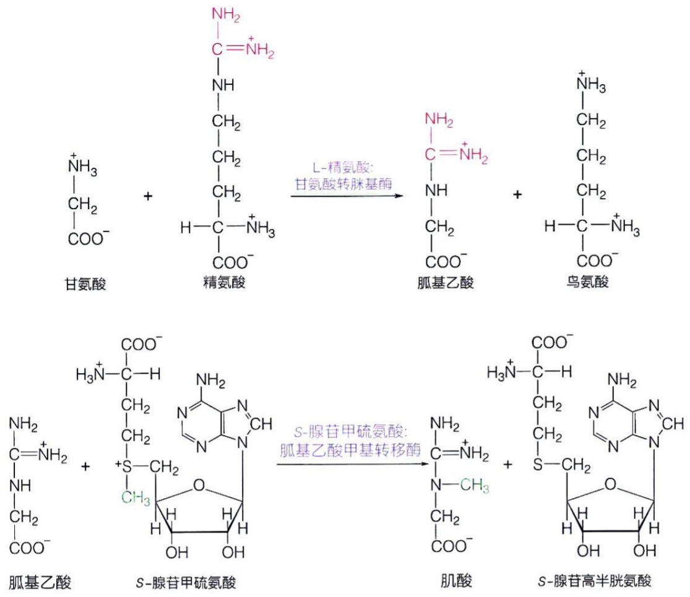

图 25-28 肌酸的生成以甘氨酸、精氨酸和甲硫氨酸为前体

## 25.5.3 一氧化氮以精氨酸为前体合成

一氧化氮（nitric oxide，NO）是一种气体信号分子，于1980年代在脊椎动物血管内皮细胞内被发现。它在生理过程中发挥多种重要作用，包括血管扩张、神经传递、免疫调节以及呼吸调节等。一氧化氮可自由地扩散跨膜，但由于其存在时间极短（仅存在几秒钟），因此是细胞内及细胞间短寿命的信号分子。

一氧化氮的生成由结构复杂的一氧化氮合酶（nitric oxide synthase，NOS）催化，利用1分子精氨酸和2分子氧气作底物。NOS是一种典型的单加氧酶（即一个氧原子进入底物，而另一个氧原子被还原为水）。在生成一氧化氮的同时，还产生瓜氨酸，反应过程如图25-29A所示。

自1980年代末期被鉴定和纯化以来，一氧化氮合酶的结构及其催化机制一直是研究热点。然而，该酶催化的反应极为复杂，对其机制的认识还远非深入。以下是目前对该酶催化机制的理解:它催化两步单加氧反应，每步反应需要1分子 $\mathrm{O}_2$ 和1个NADPH参与。在第一步反应中，一种单加氧酶活性催化精氨酸与 $\mathrm{O}_2$ 反应，生成$N - \omega -$ 羟基精氨酸；在第二步反应过程中，加氧酶活性进一步催化 $N - \omega -$ 羟基精氨酸与另1分子 $\mathrm{O}_2$ 反应，生成瓜氨酸的同时释放1分子NO。

图 25-29 一氧化氮合酶催化的反应（A）和酶的结构示意图（B）

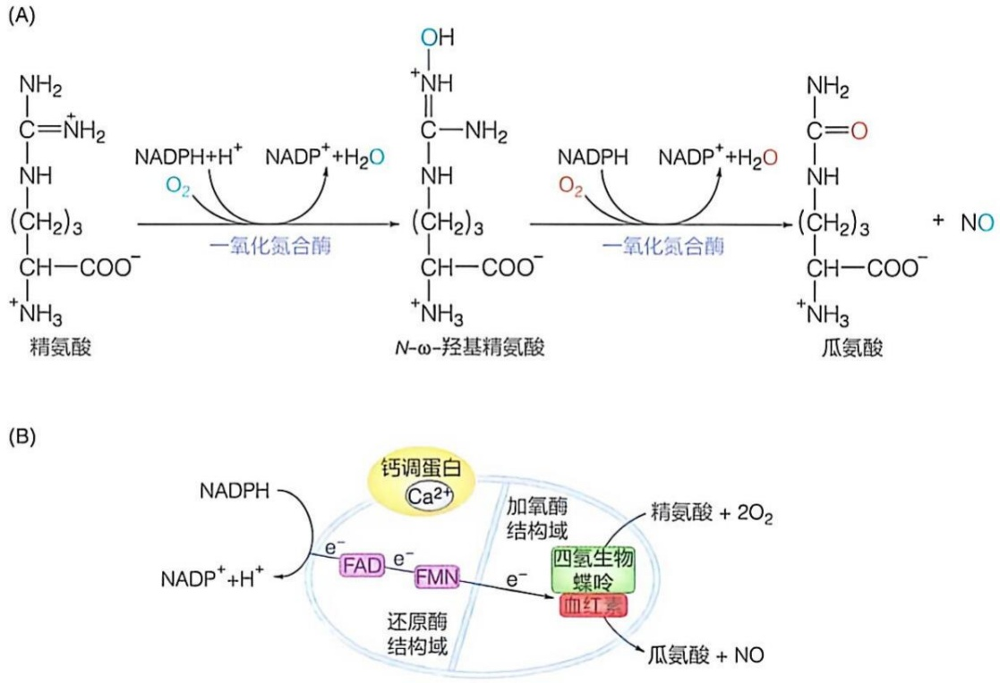

一氧化氮合酶必须以同源二聚体形式存在才具有催化活性。其每个单体可分为还原酶和加氧酶两个结构域。还原酶结构域含有1个FAD和1个FMN，加氧酶结构域含有一个血红素和一个四氢生物蝶呤（tetrahydrobiopterin，$\mathrm{BH}_4$）。此外，该酶还必须结合钙调蛋白（calmodulin，CaM）才具有酶活性，CaM可能通过拉近还原酶结构域和加氧酶结构域发挥作用。因此，电子传递的路径被认为是 $\mathrm{NADPH} \rightarrow \mathrm{FAD} \rightarrow \mathrm{FMN} \rightarrow$ 血红素。血红素是酶的活性中心，是精氨酸结合、发生两次单加氧反应并最终生成NO的位点（图25-29B）。四氢生物蝶呤并不位于电子传递链上，它可能具有为血红素-$\mathrm{O}_2$ 复合物提供电子，即为 $\mathrm{O}_2$ 的快速激活提供偶联的质子/电子，及其他多重关键作用。

## 25.5.4 多种胺类活性物质分别以酪氨酸、色氨酸、组氨酸和谷氨酸为前体生成

动物体内存在一类含有氨基的低分子量有机化合物，被称为生物胺（biogenic amine），它们主要作为神经递质或激素等在生物体内发挥重要的生理功能。其中，最早被鉴定的是肾上腺素（在美国和英国分别被称为 epinephrine 和 adrenaline）:它在 1890 年代作为一种能够影响人体血压的肾上腺提取物被鉴定并分离；在 1900 年代，其化学结构被推导出来，并通过化学方法实现了人工合成。由于肾上腺素等化合物属于含有氨基的儿茶酚（catechol，即邻苯二酚）类物质，因此在 1940 年代被统称为儿茶酚胺（catecholamine）。

后续研究表明，酪氨酸、色氨酸、组氨酸和谷氨酸等氨基酸均可通过羟基化和脱羧等简单转化反应生成各种具有不同生物活性的生物胺类分子。下面简单介绍这些生物胺在生物体内的合成过程。

（1）多巴胺、去甲肾上腺素、肾上腺素等儿茶酚胺类分子均衍生自酪氨酸

动物体内从酪氨酸开始依次合成多巴胺、去甲肾上腺素和肾上腺素的过程如图 25-30 所示。

具体过程涉及以下酶促反应。第①步:由酪氨酸羟化酶（tyrosine hydroxylase）催化，以 $\mathrm{O}_2$ 作为另外一种底物，酪氨酸被转化为多巴（dopa，即3,4-二羟基苯丙氨酸）。该酶也是一种单加氧酶，利用四氢生物蝶呤作为电子供体（产生的二氢生物蝶呤利用NADPH再生为四氢生物蝶呤）。第②步:由芳香族氨基酸脱羧酶（aromatic amino acid decarboxylase；该酶也催化5-羟色氨酸的脱羧）（图25-31）催化，多巴脱去羧基生成多巴胺（dopamine，即2-(3,4-二羟基苯基)乙胺）。该酶利用PLP作为辅因子。多巴胺是动物体内的神经递质或神经激素。第③步:由多巴胺-β-羟化酶催化，以 $\mathrm{O}_2$ 作为另外一种底物，多巴胺被转化为去甲肾上腺素（norepinephrine，即1-(3,4-二羟苯基)-2-氨基乙醇）。该酶也是一种单加氧酶，却利用抗坏血酸（维生素C）作为电子供体，而且利用铜离子而非铁离子作为辅因子。第④步:由苯基乙醇胺-N-甲基转移酶（phenylethanolamine-N-methyltransferase）催化，利用S-腺苷甲硫氨酸作为甲基供体，去甲肾上腺素最终被转化为肾上腺素。去甲肾上腺素和肾上腺素均可作为神经递质和激素发挥生物学功能。在此过程中生成的多巴、多巴胺、去甲肾上腺素和肾上腺素均属于儿茶酚胺类分子。

(2) 5-羟色胺由色氨酸羟化和脱羧而成

5-羟色胺（5-hydroxytryptamine，5-HT）最早在1860年代被鉴定为一种存在于血液中的化合物，因其具有引起血管收缩的作用，故被称为血管收缩素（serotonin）。其结构于1940年代末期被测定为5-羟色胺。1950年代，它被发现也存在于大脑中，并进一步被鉴定为一种多功能神经递质，参与情绪、睡眠、食欲调节等多种生理功能。

动物体内 5-羟色胺的生成是以色氨酸为前体，经过两步反应完成的（图 25-31）。

由色氨酸转化为5-羟色胺的过程如下:第①步:在色氨酸羟化酶的催化下，色氨酸被转化为5-羟色氨酸中间体。该酶也是一种单加氧酶，其催化机制与酪氨酸羟化酶高度类似，也依赖 $\mathrm{O}_2$ 并利用四氢生物蝶呤作为电子供体。第②步:在芳香族氨基酸脱羧酶（该酶也催化多巴脱羧形成多巴胺）的催化下，以PLP为辅因子，使5-羟色氨酸脱羧，生成5-羟色胺。

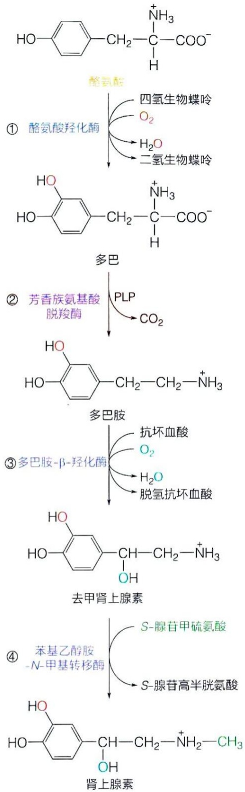

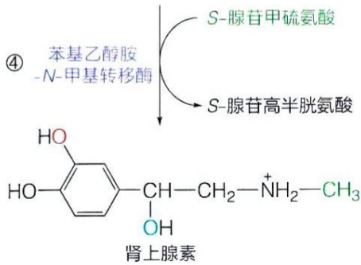

图25-30 从酪氨酸生成多巴胺、去甲肾上腺素和肾上腺素的代谢过程

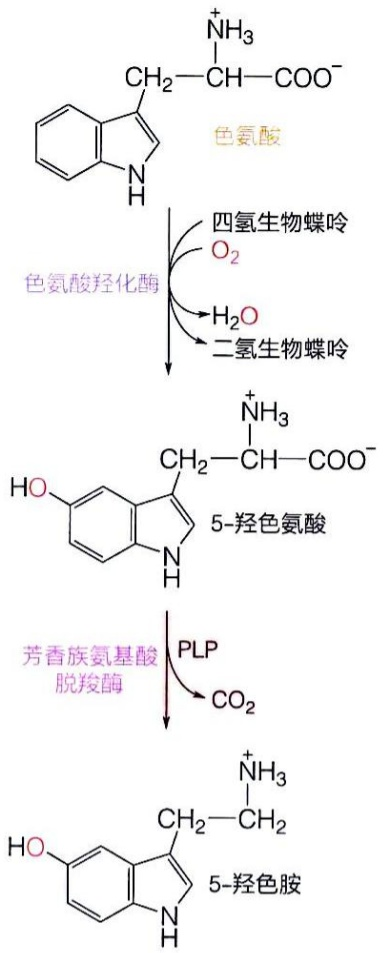

chemical

Chemical reaction pathway showing conversion of naphthalene to 5-羟色胺 via coloric acid and 5-羟色氨酸, followed by acetylation with phenylalanine derivatives.

图 25-31 从色氨酸生成 5-羟色胺的代谢过程

## (3) $\gamma-$ 氨基丁酸神经递质由谷氨酸脱羧生成

γ-氨基丁酸（γ-aminobutyrate，GABA）最初于1950年代被鉴定为一种来自哺乳动物大脑的成分，它能够引起甲壳动物的神经活动（最初被称为因子I）。随后其结构被确定，并在1960年代被确定为哺乳动物中的一种神经递质。后续研究表明，尽管谷氨酸是一种兴奋性神经递质，但γ-氨基丁酸却是一种抑制性神经递质。

从谷氨酸生成 $\gamma-$ 氨基丁酸仅需一步酶促反应，即谷氨酸在谷氨酸脱羧酶的作用下脱去羧基，生成 $\gamma-$ 氨基丁酸:

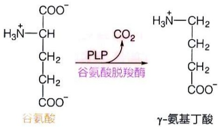

chemical

Chemical reaction diagram showing conversion of glutamine to γ-aminobutyric acid using PLP and CO2

与转氨酶类似，谷氨酸脱羧酶也利用 PLP 作为辅因子。

## (4) 组胺由组氨酸脱羧生成

组胺（histamine）是一种广泛存在于动物体内的生物胺，其化学结构在1900年代通过化学合成（利用组氨酸脱羧反应）被确定。1910年代，它被发现可以使动物的多种平滑肌产生强烈的收缩效应。到了1920年代，人们观察到动物肝脏和肺组织抽提物也可诱发类似的平滑肌收缩效应；随后组胺被确认是动物体天然产生的物质，其主要生理效应是促进血管舒张，从而导致血压降低。

组胺的生成由组氨酸脱羧酶催化，该酶也以PLP为辅因子:

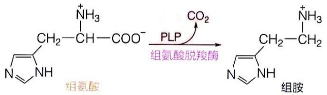

chemical

Chemical reaction equation showing the conversion of amine to amide using PLP and CO2 catalysis

## 25.5.5 动物体内的血红素以甘氨酸、谷氨酸等为前体生成

血红素作为一类蛋白质辅因子，广泛存在于各类生物体中，根据所结合蛋白质的不同而发挥不同的生物学功能（如可逆结合氧气或可逆结合电子等）。早在1870年代，血红素就被鉴定为一种用酸处理血红蛋白分离得到的热稳定红色含铁物质。1920年代，戴维·基林利用分光光度计发现血红素（以细胞色素形式存在）存在于所有动物组织中。血红素的化学结构于1920年代后期被德国学者汉斯·费歇尔等人确定。

动物、植物和原核生物中血红素合成的主要途径基本类似。只是在合成含有五个碳的中间体 $\delta-$ 氨乙酰丙酸（$\delta-$aminolevulinic acid，$\delta-$ALA）的起始阶段存在一定的差异（图25-32），但后续的合成过程几乎完全相同。

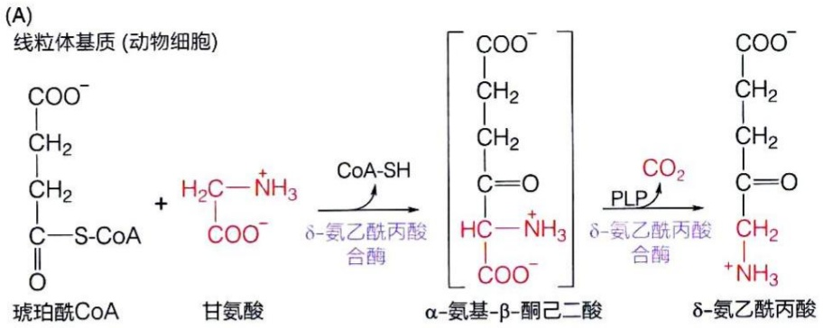

chemical

Reaction pathway of α-amino-β-dimethylbutyric acid to δ-amino-ethylbutyric acid, showing enzymatic steps with COA-SH and PLP enzymes

(B) 叶绿体基质 (植物细胞)

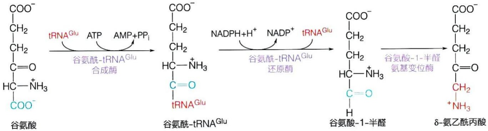

flowchart

(C)
胞质溶胶 (动物细胞) 或叶绿体基质 (植物细胞)

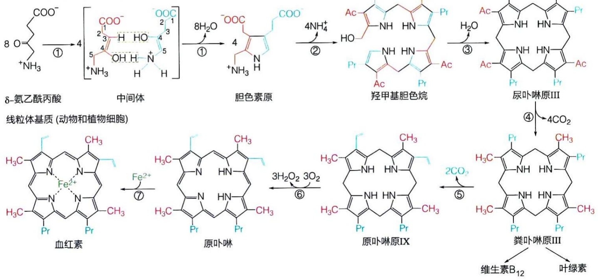

flowchart

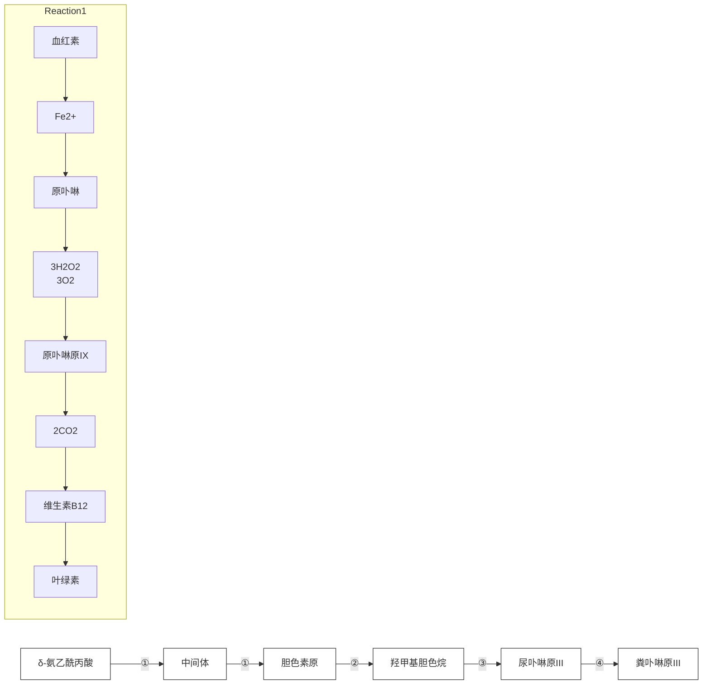

图 25-32 动物与植物生成 δ-氨乙酰丙酸及血红素的不同途径

（A）动物生成δ-氯乙酰丙酸中间物的方式。（B）植物生成δ-氯乙酰丙酸中间物的方式。（C）由δ-氯乙酰丙酸生成血红素。Ac代表$\mathrm{CH_2COO^-}$，Pr代表 $\mathrm{CH_2CH_2COO^-}$。

动物细胞一般利用甘氨酸和琥珀酰辅酶 A 作为前体，通过缩合和脱羧反应生成 δ-氨乙酰丙酸。该反应由依赖 PLP 的 δ-氨乙酰丙酸合酶催化，发生于线粒体基质中（图 25-32A）。

植物细胞却利用谷氨酸作为前体合成 $\delta-$ 氨乙酰丙酸（图25-32B），其具体过程如下:谷氨酸先与 $\mathrm{tRNA}^{\mathrm{Glu}}$ 缩合（由谷氨酰- $\mathrm{tRNA}^{\mathrm{Glu}}$ 合成酶催化），生成谷氨酰- $\mathrm{tRNA}^{\mathrm{Glu}}$ ；后者再在谷氨酰- $\mathrm{tRNA}^{\mathrm{Glu}}$ 还原酶的催化下，利用NADPH提供电子，生成谷氨酸-1-半醛。谷氨酸-1-半醛在一种特异的氨基变位酶催化下，可转化为 $\delta-$ 氨乙酰丙酸。上述两种不同的生成 $\delta-$ 氨乙酰丙酸的方式在细菌中都存在。

动物细胞血红素合成开始于线粒体基质，中间阶段发生于胞质溶胶，但结束于线粒体基质，合成的血红素被线粒体内膜蛋白所利用。相比之下，植物细胞中的血红素合成则开始于叶绿体（或质体）基质，结束于线粒体基质。

生物利用 $\delta-$ 氨乙酰丙酸生成血红素还需经过七步反应，其具体过程如图25-32C所示。

在动物细胞线粒体基质中合成的 $\delta-$ 氨乙酰丙酸需被转运至胞质溶胶后继续完成以下四步反应。第①步:2分子含5个碳原子的 $\delta-$ 氨乙酰丙酸缩合形成含10个碳原子的胆色素原（porphobilinogen；每个胆色素原中含一个吡咯环）。该反应由 $\delta-$ 氨乙酰丙酸脱水酶催化，胆色素原可能由2分子烯醇中间体缩合而成（图25-32C）。第②步:4分子含10个碳原子的胆色素原进一步进行“头-尾”缩合，脱去4个 $\mathrm{NH}_{3}$ 后生成含有40个碳原子的羟甲基胆色烷（hydroxymethylbilane；含线性四吡咯结构），该反应由胆色素原脱氨酶（porphobilinogen deaminase）催化。第③步:羟甲基胆色烷中间体发生环化和重排，形成尿卟啉原Ⅲ（uroporphyrinogen Ⅲ；含四个吡咯环的大环结构），该反应由尿卟啉原Ⅲ合酶催化。第④步:尿卟啉原Ⅲ脱去4个羧基，生成粪卟啉原Ⅲ（coproporphyrinogen Ⅲ），该反应由尿卟啉原Ⅲ脱羧酶催化。动物细胞胞质溶胶或植物细胞叶绿体基质中形成的粪卟啉原Ⅲ需要通过线粒体内膜转运蛋白进入线粒体基质，才可进行后续的代谢反应。第⑤步:粪卟啉原Ⅲ再次发生氧化脱羧反应，脱去2分子 $\mathrm{CO}_{2}$，生成原卟啉原IX（protoporphyrinogen IX），该反应由粪卟啉原Ⅲ氧化酶催化。第⑥步:原卟啉原IX发生氧化，生成原卟啉（protoporphyrin），该反应由原卟啉原IX氧化酶催化（反应过程中消耗3分子 $\mathrm{O}_{2}$，生成3分子 $\mathrm{H}_{2} \mathrm{O}_{2}$，并形成一个大的共轭环）。第⑦步:原卟啉的环中央插入一个二价亚铁离子，最终形成血红素。该反应由亚铁螯合酶（ferrochelatase）催化。至此，动物细胞在其线粒体基质中完成了血红素的合成过程。

值得注意的是，上面第④步反应生成的粪卟啉原Ⅲ同时也是植物细胞合成叶绿素和细菌细胞合成维生素 $\mathrm{B}_{12}$ 的前体。所以在植物或细菌细胞中，这里存在一个分支代谢途径。

## 知识延展 25- 3

## 卟啉症

卟啉症（porphyria）是一种大约于1870年代被医生发现并关注的人类疾病。其主要特征之一是患者的尿液呈现深红色。后来对这些患者的尿液色素进行的化学分析表明，这些尿液中排出的色素与血红素的吸收光谱特征高度相似，但并非完全相同。1940年代以后，随着人们对体内血红素合成过程的逐渐揭示，这类患者尿液中红色色素的来源也逐渐清晰:患者的某些催化血红素合成过程的酶存在遗传缺陷，导致血红素合成途径中的不同中间体积累并从尿液排出。特定的血红素（卟啉）合成前体还可在红细胞、体液和肝脏等器官积聚，进而引发相关病症。例如，在典型的急性间歇性卟啉病中，δ-氨乙酰丙酸和胆色素原的积聚可引发患者的急性腹痛和神经功能障碍。全球约有 5 000 至 10 000 人患有另一种血卟啉病，其病人体内的亚铁螯合酶活性较低，导致组织中原卟啉浓度异常高。过量的原卟啉会导致患者对光照高度敏感，光照所释放的自由基将损伤细胞蛋白质和膜脂质，引发皮肤内皮细胞损伤和炎症，导致剧烈疼痛，这样的患者必须避免阳光和强光辐射。还有一种较为罕见的血卟啉病会导致尿卟啉原I的积累，这种化合物会使患者尿液变红，使牙齿在紫外线照射下发出强烈荧光，并使皮肤对阳光异常敏感。许多患有血卟啉病的人都会贫血，这是因为患者无法合成足够的血红素所致。当前，多数卟啉病的症状可通过调整饮食或补充血红素及其衍生物得以缓解。

## ※展望

20 种氨基酸的平衡供应是蛋白质正常翻译的前提，也是生物维持正常生命活动所需。对于人类等高等动物而言，只能从头合成其中的大约 10 种氨基酸。以下是氨基酸合成代谢方面有待研究的几个问题:

细胞合成不同氨基酸的途径之间如何“对话”，以确保所有20种氨基酸的平衡合成？特别是那些相对独立的氨基酸合成途径之间，是否形成某种超级代谢复合物以协调不同氨基酸的合成量？

无论是在原核细胞还是真核细胞中，谷氨酸的含量都远高于其他氨基酸（100倍以上），这提示谷氨酸在细胞内发挥多种重要的生物学功能，并能解释我们为什么偏爱味精。但对谷氨酸在细胞内含量远超过其他氨基酸的机制和意义尚需深入研究。

组成蛋白质的氨基酸除了常见的 20 种之外，还发现有硒代半胱氨酸（selenocysteine, Sec, U）和吡咯赖氨酸（pyrrolysine, PyI, O），这两种氨基酸也是由遗传密码（终止密码子的兼职功能）编码的扩展氨基酸，它们的合成方式及其与半胱氨酸和赖氨酸的合成途径的关系仍有待于进一步研究。

在生物演化过程中，动物是如何丧失合成某些氨基酸能力的？这一过程是否与动物丧失某些不饱和脂肪酸合成能力的事件同步发生？

## ※ 本章小结

生物体内组成蛋白质的 20 种常见氨基酸可通过两条途径获得:蛋白质的降解（氨基酸的循环利用）和以其他小分子为前体通过系列酶促反应进行的从头合成。

氨基酸等生物分子中的氮主要来自由少数微生物利用氮气固定形成的氨，固氮微生物利用其固氮酶分子中几种独特辅因子催化氮气获取电子还原为氨。

谷氨酸和谷氨酰胺是合成其他氨基酸和核苷酸等含氮生物分子的主要氨基供体，其中谷氨酸是其余19种氨基酸 $\alpha-$ 氨基的主要供体。氨在进入含氮生物分子之前，需在L-谷氨酸脱氢酶、谷氨酸合酶、谷氨酰胺合成酶等的催化下，同化为谷氨酸的 $\alpha-$ 氨基和谷氨酰胺的侧链氨基。然后，在各种转氨酶和转酰胺酶的作用下，为合成其他氨基酸（以及其他含氮有机分子）提供氨基。

合成 20 种氨基酸所需碳骨架主要衍生自糖酵解、柠檬酸循环和戊糖磷酸途径的中间体，包括甘油酸 -3- 磷酸、丙酮酸、α- 酮戊二酸、磷酸烯醇式丙酮酸、草酰乙酸、赤藓糖 -4- 磷酸及核糖 -5- 磷酸等。植物和微生物具备从头合成所有 20 种氨基酸的能力；动物只能合成其中的一部分，另外一部分则为须从食物中获取的必需氨基酸。

氨基酸的合成代谢是一个网络体系，其与氨基酸的分解代谢既具有一定的独立性又有机连接，构成一个复杂的氨基酸代谢网络。

细胞内的氨基酸合成主要通过产物的反馈抑制机制进行调节，以确保20种氨基酸的平衡供应。此外，某些氨基酸合成相关酶的表达水平也会受到调控，从而实现代谢过程的精细调节。

通过细胞内的酶促反应，某些氨基酸可转化为具有生理功能的其他含氮活性分子，如核苷酸、谷胱甘肽、磷酸肌酸、一氧化氮、各种激素、神经递质及血红素。

## ※ 思考题

1. 什么是必需氨基酸？人体有哪些必需氨基酸？这些必需氨基酸分别由什么前体物反应生成？
2. 20 种氨基酸如何获得其 $\alpha$ -氨基?
3. 微生物的谷氨酰胺合成酶的活性是如何受到快速调节的？
4. 在氨基酸生物合成中哪些氨基酸和柠檬酸循环有联系？哪些氨基酸和糖酵解以及戊糖磷酸途径有联系？
5. 芳香族氨基酸生物合成的共同前体是什么？它们以哪种中间产物作为合成路线的分支点？说明微生物合成色氨酸的代谢途径。
6. 简述生物体内糖、脂和氨基酸三类物质之间的主要转化关系。
7. 生物体内氨基酸合成是如何进行调控的？
8. 一氧化氮作为重要的生物信息分子，在体内如何形成？

## ※ 推荐阅读

- 1. KIM J, REES D C. Nitrogenase and biological nitrogen fixation [J]. Biochemistry, 1994, 33(2):389-397.
- 该文综述了固氮酶系统的结构与功能，重点阐述了通过晶体学解析揭示的独特金属中心结构。
- 2. GU W Y, MILTON R D. Natural and engineered electron transfer of nitrogenase [J]. Chemistry, 2020, 2 (2): 322-346.
- 该文综述了天然及人工设计的固氮酶电子传递途径，包括通过体内重构或优化电子流向以促进  $NH_{3}$  合成的策略，同时探讨了体外人工还原固氮酶的方法。
- 3. CHRISTEN P, JAUSSI R, JURETIC N, et al. Evolutionary and biosynthetic aspects of aspartate aminotransferase isoenzymes and other aminotransferases [J]. Ann N Y Acad Sci, 1990, 585: 331-338.
- 该文综述了天冬氨酸氨基转移酶同工酶在基因结构和进化上的重要特征。通过序列分析证实了天冬氨酸、酪氨酸和组氨醇磷酸氨基转移酶的同源关系。
- 4. EISENBERG D, GILL H S, PFLUEGL G M, et al. Structure-function relationships of glutamine synthetases [J]. Biochim Biophys Acta, 2000, 1477 (1/2): 122–145.
- 该文针对谷氨酰胺合成酶的研究进展进行综述，涵盖了其在细菌和真核生物中的结构与功能，特别聚焦于酶抑制剂的开发与应用。
- 5. PAN P, WOEHL E, DUNN M F. Protein architecture, dynamics and allostery in tryptophan synthase channeling [J]. Trends Biochem Sci, 1997, 22 (1): 22-27.
- 该文综述了色氨酸合成酶的 $\alpha_{2}\beta_{2}$ 型双酶复合体负责催化L-色氨酸生物合成的最后两步反应。这两个连续反应通过一条分子隧道，实现了中间代谢物吲哚在 $\alpha$ 和 $\beta$ 亚基活性中心之间的高效传递。
- 6. KRAPPMANN S, LIPSCOMB W N, BRAUS G H. Coevolution of transcriptional and allosteric regulation at the chorismate metabolic branch point of Saccharomyces cerevisiae [J]. Proc Natl Acad Sci USA, 2000, 97 (25): 13585-13590.
- 该研究揭示了芳香族氨基酸生物合成首个代谢节点的调控机制:必须通过特定的调控模式组合才能维持代谢通量的正常分配。研究进一步阐明，酵母分支酸变位酶进化出精密变构调控机制需满足特定的基因表达调控前提。
- 7. JIN J, BYUN J K, CHOI Y K, et al. Targeting glutamine metabolism as a therapeutic strategy for cancer [J]. Exp Mol Med, 2023, 55 (4): 706–715.
- 该文涵盖谷氨酰胺代谢通路、关键靶点、耐药机制与逆转策略，并探讨其阻断对肿瘤微环境的“双刃剑”效应及联合免疫的协同治疗前景。

（撰写:李森，秦咏梅，李珍，党永岩；审修:杨广笑，丁智）

## 26

# 核苷酸的合成与分解代谢

通过对第6章的学习，我们了解到细胞内的DNA和RNA均由四种不同的核苷酸组成。通过对第8章的学习，我们也知道DNA和RNA分别以四种核苷三磷酸（dNTP和NTP）为前体缩合而成。此外，核苷酸及其衍生物还具有多种其他生物学功能；这包括ATP作为能量货币、$\mathrm{NAD^{+}}$ 、FAD和辅酶A等作为酶的辅因子、cAMP和cGMP作为第二信使等。然而，细胞内游离核苷酸（除ATP外）的储存量通常较少，又需要持续提供。那么，这些核苷酸在细胞内是如何生成的？

在第 25 章中我们学习到，植物和微生物的细胞能合成组成蛋白质的所有 20 种氨基酸，而包括人类在内的哺乳动物细胞却只能合成其中大约一半种类的氨基酸。与此不同的是，包括哺乳动物在内的几乎所有生物都具备利用简单小分子前体合成全部核苷酸的能力，也就是说，我们无须从饮食中获取任何核苷酸（尽管我们需从饮食中获取必需氨基酸和必需脂肪酸）。这表明在生物演化过程中，具备随时合成所有类型核苷酸的能力是必要的自然选择条件。

本章依次介绍嘌呤核苷酸和嘧啶核苷酸的从头合成途径、它们的补救合成途径、以核苷酸为前体合成脱氧核苷酸的过程，以及四种核苷酸和四种脱氧核苷酸各自平衡生成的调节机制。此外，还将介绍胸腺嘧啶核苷酸的独特酶促合成过程。本章还将简单介绍核酸和核苷酸的降解过程，特别是嘌呤碱基转化为尿酸的过程。

## 26.1 细胞通过从头合成途径或补救合成途径生成核苷酸

核苷酸在细胞内可以通过从头合成途径（de novo pathway）或补救合成途径（salvage pathway）生成。

核苷酸的从头合成途径是指利用氨基酸和一碳单位等简单前体，通过多步酶促反应生成核苷酸的过程。该途径的能量消耗包括:消耗2分子ATP将1分子核糖-5-磷酸活化为5-磷酸核糖-1-焦磷酸（5-phosphoribosyl-1-α-pyrophosphate，PRPP；这里的异头碳C1是α构型，而非β构型），消耗3\~4分子ATP用于合成1个嘧啶或嘌呤碱基环。

补救合成途径是指利用从环境中获取的或细胞内核酸降解产生的碱基，通过与PRPP缩合，直接生成核苷酸的过程。若需重新合成PRPP，则消耗2分子ATP；与从头合成相比，其能量成本更低。这实际上是对核酸降解产物的一种循环利用，类似于对蛋白质降解产物氨基酸的循环利用。

对核苷酸从头合成途径的认识始于20世纪二三十年代。那时，人们观察到动物即使摄入缺少核酸的食物，也能正常生长发育，这表明动物细胞能够自身从头合成核苷酸。而对核苷酸的补救途径的认识，则源于以下观察:当给动物喂食同位素标记的碱基或核苷时，这些标记物能够被掺入到核苷酸和核酸分子中。

我们先介绍从头合成途径，然后再介绍补救合成途径。

## 26.1.1 嘌呤核苷酸碱基环中所有原子的来源由同位素示踪分析揭示

与胆固醇等生物合成途径被揭示的过程类似，生物体内嘌呤核苷酸的从头合成过程的揭示也大致分两步进行。首先，通过同位素示踪技术等揭示碱基环中各原子的来源；随后，揭示所涉及的具体酶促化学反应。嘌呤核苷酸的从头合成研究大约在20世纪四五十年代开展，主要由美国学者约翰·布坎南（John Buchanan，1917—2007）和罗伯特·格林伯格（Robert Greenberg，1918—2005）等完成。

具体而言，布坎南等首先利用重同位素  ${}^{14}C$  或  ${}^{15}N$  等标记各种潜在前体分子，然后喂食鸽子等鸟类，再收集它们的半固体尿酸排泄物，并通过化学分解和质谱分析等方法分析嘌呤环中各原子被标记情况。尿酸作为鸟类嘌呤核苷酸分解代谢的终产物，仍保留着嘌呤碱的母环结构。由于其难溶于水，易于分离，成为研究的理想材料。后来，他们建立了更为有效的鸽子肝脏无细胞抽提液探究体系，利用  ${}^{13}C$  或  ${}^{15}N$  以及放射性同位素  ${}^{14}C$  标记的不同前体，对嘌呤核苷酸从头合成的详细酶促化学反应过程进行了深入阐明。

他们通过同位素示踪分析观察到以下现象:当给鸽子喂食 $^{14}\mathrm{C}-\mathrm{HCO}_{3}^{-}$时，其排出的尿酸分子中的C6被 $^{14}\mathrm{C}$ 标记，这表明嘌呤碱中的6号碳原子源自 $\mathrm{CO}_{2}$ （在溶液中以$\mathrm{HCO}_3^-$ 形式存在）。后来，他们在肝脏抽提物中加入 $^{14}\mathrm{C}-$ 甲酸（它将成为四氢叶酸携带的甲酰基一碳单位），观察到嘌呤环的 C2 和 C8 被标记；通过加入  ${}^{14}$ C-甘氨酸（含放射性同位素）以及  ${}^{15}$ N-甘氨酸（含重同位素，通过质谱分析），揭示了嘌呤环上的 C4、C5 和 N7 均来自甘氨酸。此外，利用  ${}^{15}$ N-谷氨酰胺和  ${}^{15}$ N-天冬氨酸等，在鸽子无细胞系统中观察到嘌呤环上的 N3 和 N9 均来自谷氨酰胺的侧链氨基，而 N1 则是来自天冬氨酸的 α-氨基。这样，就揭示了嘌呤环上所有 9 个原子（5 个碳原子和 4 个氮原子）的来源，具体如图 26-1 所示。

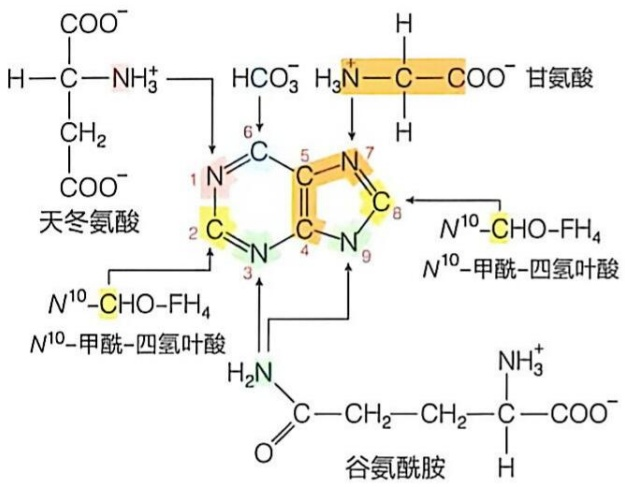

chemical

Reaction pathway diagram showing enzymatic conversion of acetic acid to glutamine and its subsequent hydrolysis with various intermediates

图 26-1 嘌呤核苷酸的嘌呤环上 9 个原子的来源示意图

在此基础上，嘌呤核苷酸从头合成的完整路径得以阐明。嘌呤环以附着于核糖磷酸的形式，通过7\~8步酶促反应逐渐组装形成。

## 26.1.2 嘧啶核苷酸嘧啶环中所有原子的来源也通过同位素示踪分析揭示

嘧啶核苷酸合成的阐明主要由美国学者阿瑟·科恩伯格（Arthur Kornberg，1918—2007）等于20世纪五六十年代完成。嘧啶核苷酸嘧啶环中各原子的来源也通过利用鸽子肝脏无细胞体系的同位素示踪实验而被揭示。利用 $^{14}\mathrm{C}-$ 天冬氨酸、$^{14}\mathrm{C}-\mathrm{HCO}_{3}^{-}$（溶液中 $\mathrm{HCO}_{3}^{-}$）、$^{15}\mathrm{N}-$ 谷氨酰胺和 ${}^{15}\mathrm{N}-$ 天冬氨酸，揭示了嘧啶核苷酸嘧啶环中6个原子的来源，具体如图26-2所示。

在此基础上，嘧啶核苷酸从头合成的完整路径被阐明。

值得注意的是，研究表明，嘌呤核苷酸和嘧啶核苷酸的从头合成途径以两种不同的方式发生。嘌呤核苷酸的从头合成途径从磷酸核糖开始，逐步加入嘌呤环上的1个或3个原子进行组装；而嘧啶核苷酸的合成则是先合成一种嘧啶碱基（乳清酸），然后再将其连接至核糖磷酸基上。

图 26-2 嘧啶核苷酸中的嘧啶环上 6 个原子的来源示意图

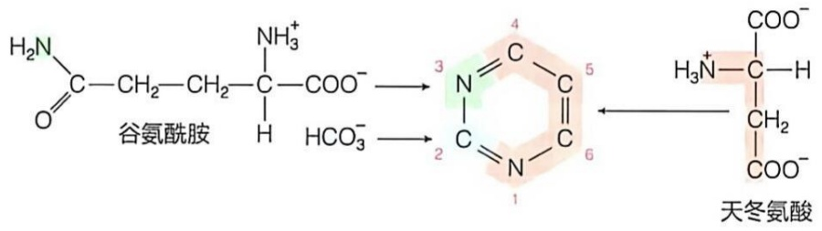

chemical

Reaction pathway of glutamine acetoacetate to diethylamine via pyruvate and carboxylic acid intermediates

## 26.2 嘌呤核苷酸的从头合成是以核糖 -5- 磷酸为起点逐步组装嘌呤环

嘌呤核苷酸从头合成可大致分为三个阶段。第一阶段:从核糖-5-磷酸活化形成PRPP。第二阶段:PRPP从多种前体获取碳原子和氮原子、通过一系列酶促反应，生成次黄嘌呤核苷单磷酸（IMP）中间体。第三阶段:次黄嘌呤核苷单磷酸转变为腺嘌呤核苷单磷酸（AMP）和鸟嘌呤核苷单磷酸（GMP）。

## 26.2.1 核糖 -5- 磷酸需要被活化形成磷酸核糖焦磷酸

在对鸽子肝脏无细胞体系开展嘧啶核苷酸合成过程的酶促反应研究时，1950年代科恩伯格等鉴定到PRPP这种被激活核糖分子的存在。后来的研究表明，这种分子是嘌呤核苷酸和嘧啶核苷酸从头合成及补救合成所必需的。也就是说，参与核苷酸中糖苷键形成的核糖-5-磷酸前体中的C1'，需通过焦磷酰化而被活化 $^{①}$ 。

从核糖 -5- 磷酸活化为 PRPP 的反应由 PRPP 合成酶 [PRPP synthetase，也称核糖磷酸焦磷酸激酶（ribose-phosphate pyrophosphokinase）] 催化（图 26-3）。具体而言，ATP 分子中的 1 个焦磷酰基被转移至核糖 -5- 磷酸的 C1' 半缩醛羟基上，形成 PRPP。核糖 -5- 磷酸主要源于戊糖磷酸途径。少量核糖 -5- 磷酸可源于核苷的磷酸解（由嘌呤核苷磷酸化酶或嘧啶核苷磷酸化酶催化，依赖无机磷酸），该过程生成核糖 -1- 磷酸并释放游离碱基，核糖 -1- 磷酸再经异构化（由戊糖磷酸变位酶催化）生成。

PRPP 是一种活化的核糖，参与细胞内多条合成代谢途径。例如，它不仅是核苷酸从头合成和补救合成途径所必需的，还参与  $NAD^{+}$ 、 $NADP^{+}$ 、色氨酸（见图 25-20）以及组氨酸（见图 25-23）的生成。

PRPP 的生成反应是核苷酸合成代谢途径中的一个关键步骤，因此，PRPP 合成酶是一种重要的调节酶。该酶主要受到 ADP 的别构抑制。此外，PRPP 本身可别构激活嘌呤和嘧啶核苷酸从头合成途径中下游的限速酶（具体见后）。

显然，PRPP 合成酶的功能异常会对人类健康产生严重影响。遗传突变导致其活

图 26-3 从核糖 -5- 磷酸（R5P）生成 5- 磷酸核糖 -1-α- 焦磷酸（PRPP）的反应

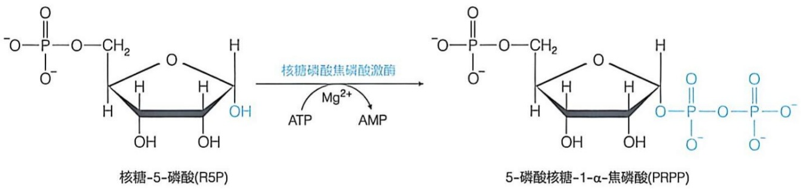

chemical

Chemical reaction diagram showing the enzymatic conversion of 5-phosphate (R5P) to 5-phosphate (PRPP) using Mg²⁺ catalysis

<small>① 在核苷酸分子中，核糖的 C 原子编号加一撇，以区别于碱基环中原子的编号。</small>