性下降或升高都将引发健康问题:当该酶活性过高时（例如，突变使其不受别构抑制剂的抑制），导致高尿酸血症（hyperuricemia），进而引发痛风等症状；而若突变导致其活性下降，则使核苷酸补救合成途径无法有效进行，核苷酸的积累可导致重症联合免疫缺陷症（类似于腺苷脱氨酶缺陷所引起的症状，表现为免疫细胞无法正常生成）或智力障碍和发育停滞（类似于次黄嘌呤-鸟嘌呤磷酸核糖转移酶缺陷所导致的莱施-奈恩综合征）等疾病。

## 26.2.2 以 PRPP 为起始物经大约十步酶促反应生成次黄嘌呤核苷单磷酸（IMP）

从 PRPP 开始，经过大约十步酶促反应化学反应，最终生成次黄嘌呤核苷单磷酸（inosine monophosphate，IMP），其反应过程如图 26-4 所示。所生成的 IMP 是生成腺嘌呤核苷单磷酸（AMP）和鸟嘌呤核苷单磷酸（GMP）的共同前体。以下将分别介绍这些酶促反应。

## (1) 嘌呤核苷酸合成的第①步酶促反应

PRPP 从谷氨酰胺获取 1 个氨基，生成 5-磷酸 -1-β-核糖胺。这步反应是由谷氨酰胺 - 磷酸核糖基焦磷酸酰胺基转移酶（glutamine-PRPP amidotransferase，Gln-PRPP酰胺基转移酶）催化的。在此反应中，谷氨酰胺分子侧链氨基形成的氨分子中间体取代 PRPP 中的焦磷酸基，生成 5-磷酸 -1-β-核糖胺（5-phospho-1-β-ribosylamine，PRA）。

在第①步反应中，有以下几点值得注意:①催化该反应的酶是一种典型的酰胺基转移酶，其第一个活性中心结合谷氨酰胺底物，所产生的氨通过一个特定通道运输至第二个活性中心，并在此转移至第二种底物（PRPP）。②在核糖-5-磷酸分子的C1'上引入了氨基后，异头碳原子的构型从α型转变为β型。③此步反应形成的产物是一种高度不稳定的中间体。④新引入的氮原子最终成为嘌呤环中的N9。⑤由于反应过程中所释放的焦磷酸将水解为2分子无机磷酸（$P_{i}$），从能量消耗角度来看，可以认为第①步反应消耗了2分子ATP。

更为重要的是，第①步反应是一个释放能量且高度不可逆的限速步骤。催化该反应的酶为一种调节酶，它可被嘌呤从头合成途径的终产物 AMP、GMP、ADP、GDP 以及中间体 IMP 协同别构抑制，其中 ADP 和 GDP 的抑制效应比其他别构因子更加显著。较为独特的是，该酶还可被其底物 PRPP 别构激活。

## (2) 嘌呤核苷酸合成的第②步酶促反应

5- 磷酸 -1-β- 核糖胺中间体的氨基与甘氨酸的羧基缩合形成酰胺键，从而形成甘氨酰胺核糖核苷酸（glycinamide ribonucleotide，GAR）。该反应是由甘氨酰胺核糖核苷酸合成酶（GAR synthetase，GAR 合成酶）催化的，并需消耗 1 分子 ATP 来激活甘氨酸的羧基。值得注意的是，在嘌呤核苷酸从头合成途径中，这是唯一的一步添加超过 1 个（总共添加 3 个）嘌呤环原子的反应。

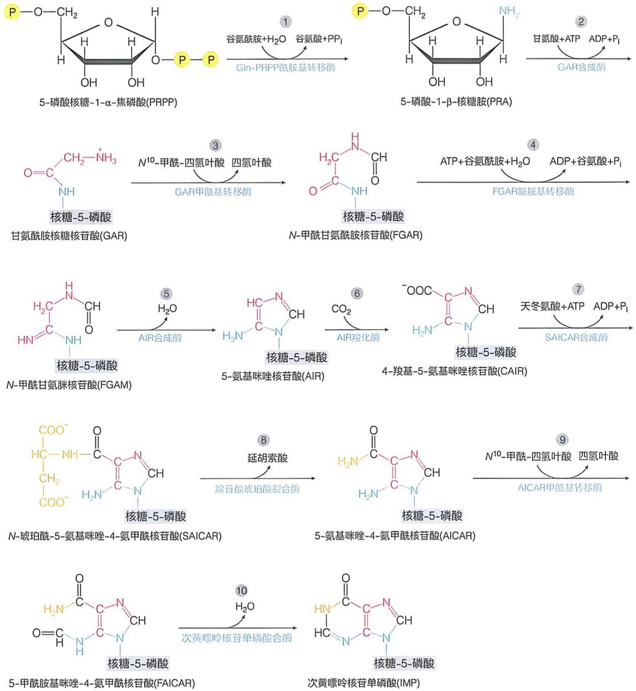

图 26-4 从 5-磷酸核糖 -1-α- 焦磷酸（PRPP）生成次黄嘌呤核苷单磷酸（IMP）的反应过程

## (3) 嘌呤核苷酸合成的第③步酶促反应

甘氨酰胺核糖核苷酸中间体中的末端氨基与 $N^{10}$-甲酰-四氢叶酸上的甲酰基缩合，再形成一个酰胺键，生成 $N$-甲酰甘氨酰胺核苷酸（$N$-formylglycinamide ribonucleotide, FGAR）。该反应由甘氨酰胺核糖核苷酸甲酰基转移酶（GAR transformylase，GAR 甲酰基转移酶）催化。

## (4) 嘌呤核苷酸合成的第④步酶促反应

N-甲酰甘氨酰胺核苷酸中间体再从谷氨酰胺侧链获取1个氨基，形成N-甲酰甘氨脒核苷酸（formylglycinamidine ribonucleotide，FGAM），该氨基最终将成为嘌呤环的N3。该反应由N-甲酰甘氨酰胺核苷酸酰胺基转移酶（FGAR amidotransferase，FGAR酰胺基转移酶）催化，并消耗1分子ATP用于活化中间体的羰基。

## (5) 嘌呤核苷酸合成的第⑤步酶促反应

N-甲酰甘氨脒核苷酸通过协同进行的环化脱水反应，生成5-氨基咪唑核苷酸（5-aminoimidazole ribonucleotide，AIR）。该反应由氨基咪唑核苷酸合成酶（AIR synthetase，AIR合成酶）催化。由于该反应不消耗ATP，因此严格来说，它是一种“合酶”而非“合成酶”。

## (6) 嘌呤核苷酸合成的第⑥步酶促反应

5-氨基咪唑核苷酸中间体与1分子 $\mathrm{CO}_{2}$ 缩合，形成4-羧基-5-氨基咪唑核苷酸（4-carboxy-5-aminoimidazole ribonucleotide，CAIR）中间体。新加入的碳原子将最终成为嘌呤环上的C6。该反应由5-氨基咪唑核苷酸羧化酶（AIR carboxylase，AIR羧化酶）催化，该酶不依赖生物素辅因子，也不消耗ATP分子。然而，在细菌中，从AIR生成CAIR的过程分为两步进行:首先在 $N^{5}$-羧基氨基咪唑核苷酸（$N^{5}$-CAIR）合成酶的催化下，$\mathrm{CO}_{2}$ 被活化并转移至AIR的咪唑环N5上，生成 $N^{5}$-CAIR，同时消耗1分子ATP；随后，$N^{5}$-CAIR经其变位酶（$N^{5}$-CAIR mutase）催化发生异构化反应，生成CAIR。也就是说，细菌中催化这两步反应的两种独立的酶，在演化到真核生物时融合成了单一的多功能酶（同时催化羧化和重排）。

值得注意的是，这里的羧化反应均无须生物素辅因子参与，与核酮糖-1,5-二磷酸羧化酶/加氧酶（Rubisco）催化的反应类似。这与底物的高反应活性降低了羧化反应的活化能垒有关。

## (7) 嘌呤核苷酸合成的第⑦步酶促反应

4-羧基-5-氨基咪唑核苷酸中的羧基与天冬氨酸的氨基缩合，形成N-琥珀酰-5-氨基咪唑-4-氨甲酰核苷酸（N-succinyl-5-aminoimidazole-4-carboxamide ribonucleotide，SAICAR）。该反应由SAICAR合成酶（SAICAR synthetase）催化，需消耗1分子ATP用来活化进行缩合的羰基。值得注意的是，该反应与尿素循环中由精氨酸代琥珀酸合成酶催化的反应（见图24-17）以及从IMP生成AMP过程中由腺苷琥珀酸合成酶催化的反应（具体见后）具有高度相似性。

## (8) 嘌呤核苷酸合成的第⑧步酶促反应

N-琥珀酰-5-氨基咪唑-4-氨甲酰核苷酸发生裂解，保留天冬氨酸上的氨基，同时脱去 1 分子延胡索酸（也被称为富马酸），从而形成 5-氨基咪唑-4-氨甲酸核苷酸（5-aminoimidazole-4-carboxamide ribonucleotide，AICAR）。该反应由腺苷酸琥珀酸裂合酶（adenylosuccinate lyase）催化（并非水解反应）。值得注意的是，催化该反应的酶与催化从 IMP 生成 AMP 过程中的反应的酶完全相同，而且该酶催化的反应与尿素循环中由精氨酸代琥珀酸裂合酶催化的反应（见图 24-17）高度相似。上述第⑦和第⑧步反应是典型的由天冬氨酸提供一个氨基的反应:首先与中间体缩合，然后裂解，保留氨基，而碳骨架被脱去。

## 知识延展 26- 1

## 嘌呤体可提高嘌呤核苷酸的合成效率

基于真核细胞中嘌呤核苷酸生成的十步反应仅涉及六种酶蛋白，以及部分中间体（如5-磷酸-1-β-核糖胺）高度不稳定等事实，人们早就预测这些酶可能形成多酶复合物，即所谓的代谢复合物（metabolon；1980年代针对催化一种代谢通路的多种酶提出的假说）。到了2000年代，利用活细胞成像等技术，人们直接观察到参与嘌呤核苷酸从头合成的多种酶可暂时聚合在一起，形成一种动态的多酶复合物——嘌呤体（purinosome）。嘌呤体作为一种无膜亚细胞结构，如图26-5所示；其中的酶名称和所催化嘌呤核苷酸合成步骤与图26-4中相同。催化第②、③、⑤步，⑥至⑦步，以及⑨至⑩步的酶分别形成三种多功能酶。

值得注意的是，嘌呤体为一种动态组装体。当细胞无须合成嘌呤核苷酸时，这些酶分散于胞质溶胶中；只有当细胞存在需求时，才组装成复合物，形成临时性的“代谢工厂”。

通过形成这样的动态多酶复合物，嘌呤核苷酸从头合成途径中的中间体可直接经由底物通道从一个活性中心转移至下一个活性中心。这一过程显著提升了合成过程的效率。嘌呤体主要定位于细胞中的微管和线粒体附近，这可能有利于为合成途径提供ATP、氨基酸底物和 $N^{10}$ -甲酰-四氢叶酸等。对于此类多蛋白质动态组合体（代谢复合物）在活细胞中的形成机制和功能调控尚有待深入探究。

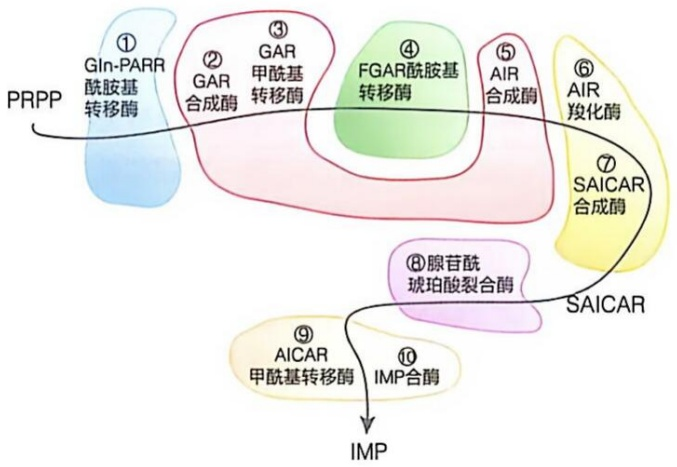

flowchart

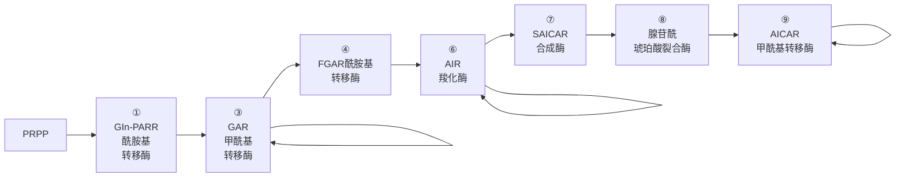

图 26-5 嘌呤体结构示意图

## (9) 嘌呤核苷酸合成的第⑨步酶促反应

5-氨基咪唑-4-氨甲酰核苷酸再次从 $N^{10}$-甲酰-四氢叶酸获取1个甲酰基（形成嘌呤环上的最后一个碳原子），形成5-甲酰胺基咪唑-4-氨甲酰核苷酸（5-formylaminoimidazole-4-carboxamide ribonucleotide，FAICAR）。该反应是由5-氨基咪唑-4-氨甲酰核苷酸甲酰基转移酶（AICAR transformylase，AICAR甲酰基转移酶）催化的。这次添加的碳原子最终将成为嘌呤环中的C2。

## (10) 嘌呤核苷酸合成的第⑩步酶促反应

5- 甲酰胺基咪唑 -4- 氨甲酰核苷酸再次发生环化脱水，从而形成次黄嘌呤核苷单磷酸（IMP）。该反应由次黄嘌呤核苷单磷酸合酶（IMP synthase）催化，与第⑤步发生的第一次环化脱水反应类似，该反应无须消耗 ATP。

## 26.2.3 次黄嘌呤核苷单磷酸是生成腺嘌呤核苷单磷酸和鸟嘌呤核苷单磷酸的共同前体

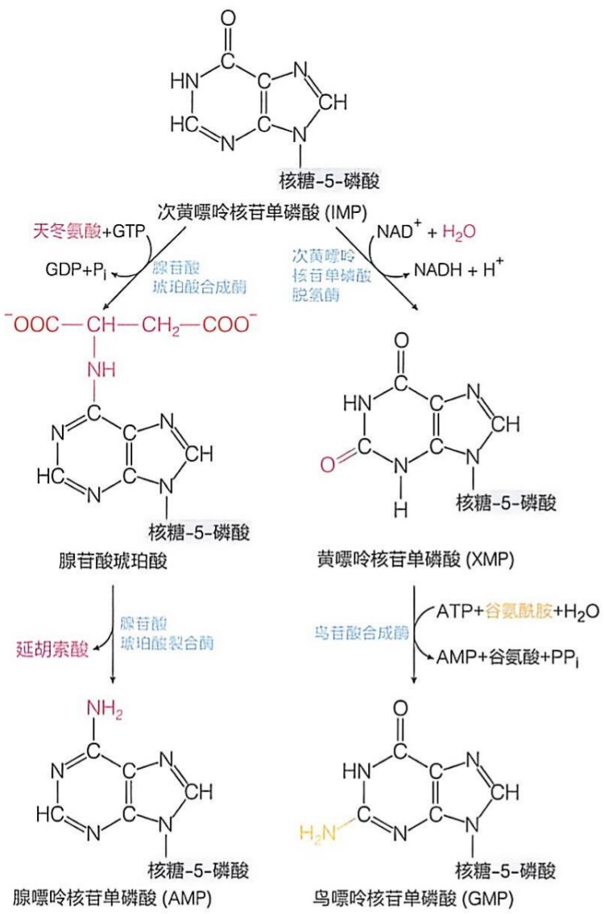

flowchart

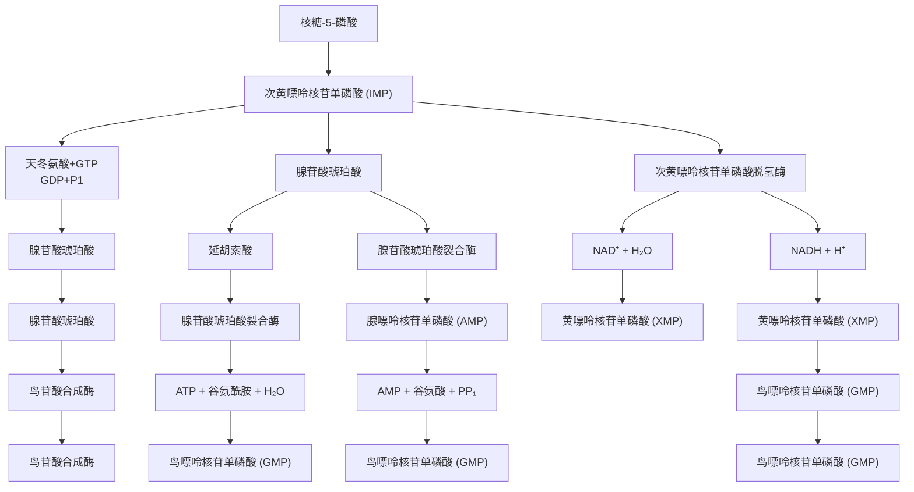

图 26-6 从 IMP 生成 AMP 和 GMP 的反应过程

与氨基酸合成代谢途径类似，核苷酸合成也是先形成共同前体。经过上述十步反应所形成的次黄嘌呤核苷单磷酸（IMP）是一个关键的分叉点，它将分别衍生出 AMP 和 GMP，具体过程如图 26-6 所示。

## (1) IMP 经由两步酶促反应生成 AMP

在该分支通路中，IMP 的 C6 羰基首先与天冬氨酸的氨基缩合，生成腺苷酸琥珀酸（adenylo-succinate）。该反应是由腺苷酸琥珀酸合成酶催化的，需要消耗 1 分子 GTP（而非 ATP）。IMP 分子中的 C6 羰基以羟基形式发生磷酸化修饰，随后再与天冬氨酸缩合，形成腺苷酸琥珀酸。这是天冬氨酸提供氨基的第一步反应，其本质与上述 IMP 合成过程中的第⑦步（见图 26-4）以及尿素循环中瓜氨酸与天冬氨酸的缩合反应（见图 24-17）具有一定相似性。与上述两种反应相同，这里并不产生  $H_{2}O$ ，嘌呤环上的 C6 羰基以  $P_{i}$  形式释放。

腺苷酸琥珀酸随后发生裂解，生成AMP，同时释放出延胡索酸。该反应催化由腺苷酸琥珀酸裂合酶催化，该酶也参与了上述IMP合成路径中的第⑧步反应（见图26-4）。此外，该反应还与尿素循环中精氨酸代琥珀酸的裂合反应（见图24-17）相似。

## (2) IMP 经由两步酶促反应生成 GMP

在该分支通路中，IMP首先被氧化生成黄嘌呤核苷单磷酸（xanthosine monophosphate，XMP，黄苷酸）。该反应由次黄嘌呤核苷单磷酸脱氢酶催化，以NAD $^{+}$ 作为电子受体。这是一个相当复杂的反应，酶活性中心的一个半胱氨酸侧链巯基先与IMP分子中的C2形成共价中间体，随后相继发生氧化（氢负离子转移）和水解，最终形成黄嘌呤核苷单磷酸。

接下来，黄嘌呤核苷单磷酸的 C2 羰基接受谷氨酰胺侧链上的氨基（细菌中为游离的氨），从而生成 GMP。该反应由鸟苷酸合成酶（也称黄嘌呤核苷单磷酸-谷氨酰胺酰胺基转移酶）催化，消耗 1 分子 ATP，使黄嘌呤核苷单磷酸的 C2 羰基发生腺苷酰化修饰（而非磷酸化修饰），从而被活化，随后被氨取代生成 GMP。

值得注意的是，从 IMP 生成 AMP 的过程中，是由 GTP 提供磷酰基来活化底物，而从 IMP 生成 GMP 的过程中，则是由 ATP 提供腺苷酰基来活化底物。这种交叉活化机制相当独特，理论上可以调节细胞内所生成 GMP 和 AMP 的比例。然而，作为能量货币，细胞内的 ATP 水平通常远高于 GTP，因此这种调节的生物学意义还有待深入探究。

## 26.2.4 嘌呤核苷酸的从头合成途径通过反馈别构抑制方式调节

与某些氨基酸的合成途径类似，两种嘌呤核苷酸的从头合成过程也是先共享多步反应，随后分叉为不同的支路。这些合成途径的流量调节也与氨基酸合成的调节类似，均通过顺序反馈抑制等策略，以实现所有生成产物的供需平衡，既满足需求，也不浪费。

细胞中嘌呤核苷酸从头合成途径的主要调节方式如图 26-7 所示。

有三种催化嘌呤核苷酸合成途径上游反应的酶属于调节酶，它们可被来自下游的中间体或产物别构抑制。具体而言，催化核糖-5-磷酸转化成PRPP的PRPP合成酶受到ADP的反馈别构抑制。催化PRPP发生氨基化这一限速步骤的Gln-PRPP酰胺基转移酶可被来自下游的IMP、AMP、GMP和GDP协同抑制。三者各自结合于不同的别构位点，三者的联合抑制效果远大于单独抑制之和，表现出协同效应。催化IMP分别生成 AMP 和 GMP 的分叉通路也受到下游产物的抑制:AMP 别构抑制腺苷酰琥珀酸合成酶，GMP 则别构抑制次黄嘌呤核苷单磷酸脱氢酶。

图 26-7 嘌呤核苷酸合成途径通过顺序反馈别构抑制进行调节

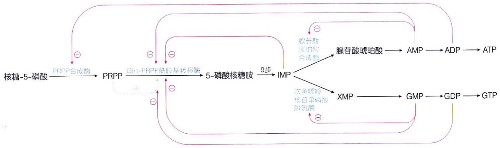

flowchart

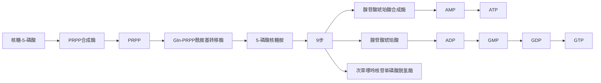

此外，作为底物，PRPP可别构激活Gln-PRPP酰胺基转移酶的活性。也就是说，当PRPP处于低浓度时，酶几乎无活性；而当PRPP处于高浓度时，它将结合于别构位点，使酶激活产生正协同效应（希尔系数 $>1$），表现出S形动力学曲线，而且上述终产物的反馈抑制可被高浓度的PRPP逆转。

## 26.3 嘧啶核苷酸的从头合成是先合成嘧啶环再与核糖磷酸缩合

如前所述，嘌呤核苷酸的从头合成途径是通过在PRPP的基础上逐步组装其嘌呤环而完成的。与之不同的是，嘧啶核苷酸从头合成是先形成一种共同的嘧啶中间体（乳清酸），随后再与PRPP缩合形成核苷酸（乳清酸核苷酸），最终分别衍生出UTP和CTP。值得注意的是，这一从头合成途径并不产生任何形式的脱氧胸腺嘧啶核苷酸（dTTP），dTMP是由dUMP衍生而成的（具体见后）。此外，尽管嘌呤核苷酸从头合成的所有反应均在胞质溶胶中完成，但真核细胞内催化嘧啶核苷酸从头合成的酶则分布于不同的亚细胞部位，如其中一种酶存在于线粒体内（具体见后）。

## 26.3.1 嘧啶核苷酸从头合成途径先形成乳清酸嘧啶然后与 PRPP 缩合衍生成 UMP

与尿素生成过程类似，细胞内从头生成尿嘧啶核苷单磷酸和胞嘧啶核苷单磷酸的途径也起始于氨基甲酰磷酸的合成。但这里的氨基甲酰磷酸随后与天冬氨酸缩合（而生成尿素时则与鸟氨酸缩合），并获取嘧啶环的全部6个原子。接下来，生成乳清酸这种嘧啶碱中间体，后者再与PRPP缩合成乳清酸核苷单磷酸，最终经脱羧形成尿苷单磷酸（UMP）。具体而言，生成UMP的六步酶促反应如图26-8所示。

下面先介绍真核生物中这六步酶促化学反应。

## （1）嘧啶核苷酸合成的第①步酶促反应

在胞质溶胶中，$\mathrm{HCO}_3^-$（即液体中的 $\mathrm{CO}_2$）与谷氨酰胺侧链提供的氨基（尿素循环过程中一般利用游离的铵离子）缩合，形成氨基甲酰磷酸。该反应是由氨基甲酰磷酸合成酶Ⅱ（carbamoyl phosphate synthetase Ⅱ，CPS Ⅱ）催化的。它与存在于动物肝细胞线粒体基质中负责尿素生成的氨基甲酰磷酸合成酶I（CPS I）为同工酶，它们的具体特征存在差异，如表26-1所示。从中可以看出，这两种酶尽管催化完全相同的化学反应，但在多个方面存在差异。这反映出同工酶之所以被演化产生的原因:适应不同组织或不同亚细胞部位的生理需求。

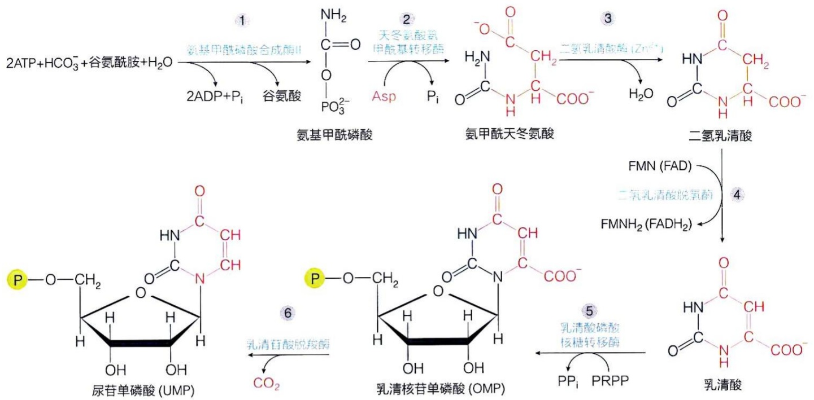

flowchart

```mermaid
graph LR
  A["2ATP+HCO3- + 谷氨酰胺 + H2O"] --> B["氨基甲酰磷酸合成酶 II"]
  B --> C["2ADP + Pi"]
  C --> D["谷氨酸"]
  D --> E["氨基甲酰磷酸"]
  E --> F["天冬氨酸乳甲酰基转移酶"]
  F --> G["Asp"]
  G --> H["Pi"]
  H --> I["氨甲酰天冬氨酸"]
  I --> J["二氢乳清酸酶 (Zn2+)"]
  J --> K["H2O"]
  K --> L["二氢乳清酸"]
  L --> M["FMN (FAD)"]
  L --> N["二氧乳清酸脱氧酶"]
  N --> O["FMNH2 (FADH2)"]
  O --> P["乳清酸"]
  P --> Q["乳清单磷酸 (UMP)"]
  Q --> R["乳清苷酸脱羧酶"]
  R --> S["CO2"]
  S --> T["乳清核苷单磷酸 (OMP)"]
  T --> U["PPi"]
  U --> V["PRPP"]
  V --> W["乳清酸"]
```

表 26-1 动物体内的氨基甲酰磷酸合成酶Ⅰ和Ⅱ的主要差异

| 特征 | 氨基甲酰磷酸合成酶I | 氨基甲酰磷酸合成酶II |
| --- | --- | --- |
| 代谢途径 | 尿素循环 | 嘧啶核苷酸从头合成 |
| 亚细胞部位 | 肝细胞线粒体基质 | 几乎所有活跃增殖细胞的胞质溶胶 |
| 氮源 | 游离的铵离子 | 谷氨酰胺侧链提供的氨 |
| 别构激活剂 | N-乙酰谷氨酸 | ATP、PRPP |
| 别构抑制剂 | 无 | UTP |
| 酶的结构 | 单功能酶 | 多功能酶中的一个结构域 |
| 酰胺基转移酶 | 不是 | 是 |

图 26-8 从头合成尿苷酸的六步酶促化学反应

值得注意的是，氨基甲酰磷酸合成酶Ⅰ中仅含有两个催化位点，二者之间通过一条长约40 Å的底物通道相连（见图24-16）。但在氨基甲酰磷酸合成酶Ⅱ中，却存在三个催化位点，三者之间通过一条长约100 Å的底物通道相连，多出一个酰胺基转移酶活性位点（谷氨酰胺在此位点脱氨，产生 $NH_{3}$ ），而这无须在前一种同工酶中发生。

氨基甲酰基所提供的碳和氮将最终成为嘧啶环中的 C2 和 N3。在动物细胞中，由氨基甲酰磷酸合成酶Ⅱ催化的反应是嘧啶核苷酸从头合成过程中的限速步骤，该酶是一种调节酶；然而，在细菌细胞中的氨基甲酰磷酸合成酶（无同工酶）并非调节酶（催化后一步反应的酶才是）。

## (2)嘧啶核苷酸合成的第②步酶促反应

上一步生成的氨基甲酰磷酸中的羰基与天冬氨酸的氨基缩合形成一个酰胺键，生成氨甲酰天冬氨酸（carbamoyl-aspartate）。该反应是由天冬氨酸氨甲酰基转移酶（aspartate transcarbamoylase，ATCase）催化的。

## （3）嘧啶核苷酸合成的第③步酶促反应

上一步生成的氨甲酰天冬氨酸中间体分子内的羧基和氨基之间可发生环化脱水反应形成一个酰胺键，生成具有稳定六元环的二氢乳清酸（dihydroorotate）。该反应是由二氢乳清酸酶（dihydroorotase）催化的，使用锌离子为辅因子（使羰基极化，便于氨基发生亲核进攻），所催化的反应为可逆反应。

真核细胞内催化嘧啶核苷酸合成的第①、②、③步反应的三种酶存在于同一条肽链上，由三个不同的活性中心组成，而在细菌细胞内，这三种酶是各自独立的。1970年代，人们就观察到，尽管在细菌细胞内这三种酶的活性可被有效分离，但在真核细胞内却无法被分离；1980年代，人们分离到一种分子量约为240 kDa的单一肽链，该肽链具催化这三步反应的活性，随后的基因克隆确认了这是一种三功能酶。这种多功能酶通常用三种酶的英文首字母代表，缩写为CAD（Carbamoyl phosphate synthetase II-Aspartate transcarbamoylase-Dihydroorotase）。后续研究发现，这种三功能酶可组装形成同源六聚体（1 400 kDa）甚至更大的复合物形式。

## （4）嘧啶核苷酸合成的第④步酶促反应

上述生成的二氢乳清酸经氧化脱氢后生成乳清酸（orotate）。该反应是由二氢乳清酸脱氢酶（dihydroorotate dehydrogenase）催化的。在动物细胞内，该酶定位于线粒体内膜，其活性中心位于内膜的外侧，以FMN和辅酶Q作为辅因子，能够将所释放的电子经由辅酶Q直接传递至呼吸链；而在细菌细胞内，该酶通常为可溶性蛋白质（并非膜蛋白），且一般利用FAD为辅因子（后续电子受体为醌类或 $\mathrm{NAD^{+}}$ ）。

## （5）嘧啶核苷酸合成的第⑤步酶促反应

作为一种嘧啶分子，乳清酸与PRPP缩合形成乳清核苷单磷酸（orotidylate, OMP）中间体。该反应由乳清酸磷酸核糖转移酶（orotate phosphoribosyl transferase）催化。该酶还可催化抗癌药物5-氟尿嘧啶（5-fluorouracil）转化为5-氟尿嘧啶核苷单磷酸，后者进一步转化为5-氟尿嘧啶脱氧核苷单磷酸后，可成为胸苷酸合酶（合成dTMP）的自杀性抑制剂，进而抑制细胞增殖。

## (6) 嘧啶核苷酸合成的第⑥步酶促反应

乳清核苷单磷酸中间体经脱羧后，即生成UMP。该反应由乳清苷酸脱羧酶（orotidylate decarboxylase）催化。值得注意的是，尽管大多数脱羧酶均需硫胺素焦磷酸（TPP）作为辅因子，但该酶无需辅因子。此外，该酶被认为是最为高效的酶之一，与该反应的无催化速率相比，它使反应加速大约 $10^{17}$ 倍。

真核细胞内催化第⑤和第⑥步反应的两种酶形成双功能酶。1970年代的酶纯化实验表明，真核细胞内的乳清酸磷酸核糖转移酶和乳清苷酸脱羧酶无法被分离开，1980年代的基因克隆实验以及后续的蛋白质结构测定结果表明，这两种酶以一种双功能酶的形式存在。这种双功能酶被统称作尿苷单磷酸合酶（UMP synthase），它位于胞质溶胶中。

位于细胞溶胶中的两种多功能酶 CAD 和尿苷单磷酸合酶，与位于线粒体内膜上的二氢乳清酸脱氢酶，可能通过线粒体外膜上的电压依赖性阴离子通道蛋白 3 (voltage-dependent anion channel 3) 形成一种动态多酶复合物，这种复合物被称为嘧啶体（pyrimidinosome）。其中的中间体二氢乳清酸和乳清酸均为阴离子代谢物，它们可能通过电压依赖性阴离子通道蛋白穿过线粒体外膜；而二氢乳清酸脱氢酶辅因子FMN（FAD）在还原后，可将电子通过辅酶Q传递至呼吸链，用于产生ATP。

## 26.3.2 UMP 可继续依次转化为 UTP 和 CTP

经上述六步反应所生成的 UMP，在被转化为 UTP 后再从 Gln 获取一个氨基形成 CTP。UTP 和 CTP 是合成 RNA 所需的两种嘧啶核苷酸前体。下面简要介绍从 UMP 生成 UTP 和 CTP 的过程。

## (1) UMP 经两种激酶催化转化为 UTP

首先，UMP 经特异的尿苷-胞苷单磷酸激酶（UMP-CMP kinase）催化，从 ATP 获取 1 个磷酰基，生成 UDP:

$$
\mathrm{UMP} + \mathrm{ATP} \rightleftharpoons \mathrm{UDP} + \mathrm{ADP} \tag {26-1}
$$

随后，UDP 经非特异性的核苷二磷酸激酶（nucleoside diphosphate kinase）催化，再从 ATP 获取 1 个磷酰基，生成 UTP:

$$
\mathrm{UDP} + \mathrm{ATP} \rightleftharpoons \mathrm{UTP} + \mathrm{ADP} \tag {26-2}
$$

## (2) UTP 经氨基化生成 CTP

UTP 从谷氨酰胺侧链获取一个氨基，生成 CTP，如图 26-9 所示。

该反应由 CTP 合成酶（CTP synthetase）催化。CTP 合成酶是一种酰胺基转移酶，含有两个催化中心。在反应过程中，CTP 合成酶利用谷氨酰胺侧链提供的氨基，消耗 1 分子 ATP，通过磷酸化而活化尿嘧啶环中的 C4 位羟基（羰基的互变异构形式），从而便于氨分子对其进行亲核进攻。

## 26.3.3 哺乳动物与细菌在嘧啶核苷酸合成途径的调节模式上存在差异

如上所述，在哺乳动物等真核细胞内，催化嘧啶核苷酸合成途径的酶分布于不同的亚细胞部位，而在细菌细胞内，这些酶则全部定位于胞质溶胶中。除此之外，两者在调节方式上也存在差异。

（1）哺乳动物细胞中的嘧啶核苷酸合成途径主要通过 CAD 三功能酶中的氨基甲酰磷酸合成酶结构域调节

该酶可被嘧啶核苷酸合成途径的末端产物 UTP 等别构抑制，但可被其底物 PRPP 和 ATP（表明细胞的能量状态充足）等别构激活（表 26-1）。此外，在哺乳动物细胞中，CTP 合成酶可被其产物 CTP 别构抑制，但可以被 GTP 别构激活。理论上，GTP 的激活效应可使嘧啶和嘌呤核苷酸的生成量达到一种相对平衡的状态。

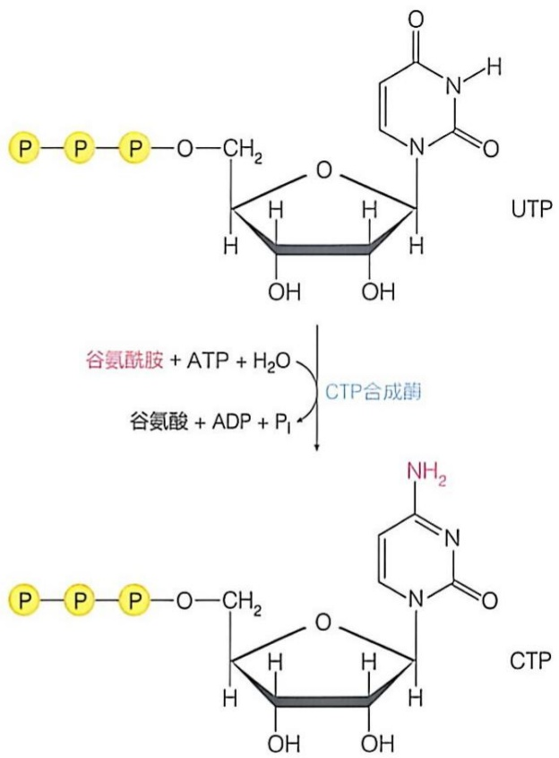

图 26-9 从 UTP 生成 CTP 的反应过程

## (2) 细菌中的嘧啶核苷酸从头合成途径主要通过天冬氨酸氨甲酰基转移酶调节

在大肠杆菌等细菌细胞中，嘧啶核苷酸从头合成途径的调节酶并非催化第①步反应的氨基甲酰磷酸合成酶，而是催化下一步的天冬氨酸氨甲酰基转移酶。该酶可被终产物 CTP 别构抑制，但被 ATP 别构激活。大肠杆菌的天冬氨酸氨甲酰基转移酶是一种被深入研究的、表现出经典协同效应动力学的调节酶，别构调节因子 CTP 和 ATP 结合于其调节亚基，通过亚基间的相互作用，进而影响催化亚基的结构和酶活性（详见第 4 章）。

为何哺乳动物细胞以氨基甲酰磷酸合成酶Ⅱ作为嘧啶核苷酸合成途径的调节酶，而细菌细胞则以天冬氨酸氨甲酰基转移酶作为调节酶？从理论上可以这样理解:在哺乳动物细胞的胞质溶胶中，CPS Ⅱ所催化的反应是嘧啶合成途径的一个去向确定步骤（committed step），即生成的氨基甲酰磷酸只能用于合成嘧啶核苷酸，别无他用。然而，在细菌细胞中，氨基甲酰磷酸合成酶所催化生成的氨基甲酰磷酸不仅可以进入嘧啶合成途径，还可以进入精氨酸合成途径（见图25-9），因此它并非一个去向确定步骤。所以，氨基甲酰磷酸合成酶Ⅱ作为哺乳动物细胞中的调节酶是合理的，但在细菌细胞中的则不适合作为调节酶。因此，细菌细胞中的天冬氨酸氨甲酰基转移酶被演化为调节嘧啶核苷酸合成途径的调节酶。

## 26.4 核苷或碱基经补救途径可直接转化为核苷酸

在核苷酸从头合成途径通过同位素标记等实验被揭示后，碱基或核苷补救途径也很快通过利用同位素标记胸腺嘧啶等碱基或核苷的示踪实验等被揭示。特别是1950年代几种催化补救途径的酶被鉴定后，人们对核苷酸的补救合成途径的认识不断深入。

通过利用 $^{14}\mathrm{C}-$ 甲酸（它可以进入 $N^{10}-$ 甲酰-四氢叶酸并参与嘌呤核苷酸的从头合成）等示踪实验，人们观察到，在哺乳动物体内，嘌呤核苷酸从头合成过程虽然在所有组织中均可发生，但肝脏是主要发生场所。神经元、肌肉细胞和成熟红细胞等似乎主要通过补救途径合成嘌呤核苷酸。代谢高度活跃的肝脏细胞可能为那些无法通过从头途径合成嘌呤核苷酸的外周组织（如大脑和肌肉）提供合成嘌呤核苷酸的前体底物，包括嘌呤碱基和嘌呤核苷等。这些底物可能通过红细胞进行运输。然而，近期通过同位素等技术开展的活细胞研究显示，补救途径可能在不同组织中也广泛存在。因此，对于从头合成途径和补救途径在活细胞内的具体发生情况，仍需深入探究。

## 26.4.1 核苷酸的补救合成途径可使核苷酸降解所产生的碱基或核苷得以重新利用

研究表明，所有生物体内的核苷酸合成补救途径均始于碱基或核苷（而非直接从核苷单磷酸开始）。其原因可能在于带电的核苷酸难以穿过细胞质膜，而相对不带电的碱基或核苷则更容易通过。事实上，人们已在细胞质膜上鉴定到主动的（钠离子依赖的）和被动的（非钠离子依赖的）核苷或碱基转运蛋白，以协助核苷或碱基有效地进出细胞。

在 20 世纪五六十年代，人们从细菌或动物细胞中鉴定到两种催化嘌呤碱基转化的酶。一种是次黄嘌呤-鸟嘌呤磷酸核糖转移酶（hypoxanthine-guanine phosphoribosyltransferase，HGPRT）。该酶催化次黄嘌呤转化为次黄嘌呤核苷单磷酸（IMP）以及鸟嘌呤转化为鸟苷单磷酸（GMP），均由 PRPP 提供磷酸核糖单位，具体如图 26-10A 所示。另一种是腺嘌呤磷酸核糖转移酶（adenine phosphoribosyltransferase，APRT）。该酶催化腺嘌呤转化为腺苷单磷酸（AMP），也由 PRPP 提供磷酸核糖单位，具体反应如图 26-10B 所示。腺嘌呤磷酸核糖转移酶也存在于细菌细胞中（由 apt 基因编码），并催化相同的转化过程。

催化嘌呤核苷转化为嘌呤核苷酸的酶统称为核苷激酶（nucleoside kinase），它们均利用ATP提供磷酰基，主要包括以下两种具体种类:①腺苷激酶（adenosine kinase）催化腺苷转化为腺苷酸（AMP）；②脱氧鸟苷激酶（deoxyguanosine kinase）催化脱氧鸟苷转化为脱氧鸟苷单磷酸（dGMP）。

## 26.4.2 尿嘧啶通过补救合成途径生成尿嘧啶核苷酸

总体而言，在包括哺乳动物在内的大多数生物体内，嘧啶核苷酸补救合成途径不如嘌呤核苷酸补救途径普遍。原因之一是:与嘌呤环（被最终转化为尿酸）不同，嘧啶环可以被有效降解成 $CO_{2}$ 、 $NH_{3}$ 以及 $\beta-$ 氨基酸等。

（1）直接利用嘧啶碱基的补救合成途径并非常见

在哺乳动物体内，几乎没有酶能像 HGPRT 和 APRT 那样，利用 PRPP 将嘧啶碱基直接转变为嘧啶核苷酸。相应地，与嘌呤补救合成途径明显不

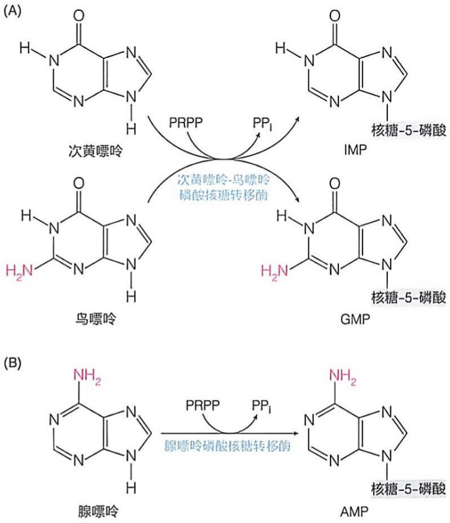

图 26-10 催化嘌呤碱基转化为嘌呤核苷酸的反应  
（A）由次黄嘌呤-鸟嘌呤磷酸核糖转移酶催化。（B）由腺嘌呤磷酸核糖转移酶催化。

## 知识延展 26- 2

## 次黄嘌呤 - 鸟嘌呤磷酸核糖转移酶的遗传缺陷可导致莱施 - 奈恩综合征

莱施-奈恩综合征（Lesch-Nyhan syndrome）是1960年代由莱施（Michael Lesch，1939—2008）和奈恩（William Nyhan）两位美国医生在两兄弟（分别为4和8岁）中观察到的。这两位小孩表现出自残、高尿酸血症和智力障碍等症状。很快，人们利用嘌呤环中的C8被 $^{14}$ C放射性同位素标记的次黄嘌呤、鸟嘌呤和腺嘌呤三种碱基分析了几位不相关患者（即相互之间非兄弟关系，该缺陷为伴性遗传）的红细胞裂解物和成纤维细胞抽提物中的次黄嘌呤-鸟嘌呤磷酸核糖转移酶（HGPRT）和腺嘌呤磷酸核糖转移酶（APRT）的活性。结果表明，这几位患者的前一种酶的活性几乎完全丧失（即检测不到被 $^{14}$ C标记的IMP和GMP），但后一种酶的活性几乎不受影响（即被 $^{14}$ C标记的AMP含量正常）。

后续研究表明，这些患者的确存在 HGPRT 的遗传缺陷。

次黄嘌呤-鸟嘌呤磷酸核糖转移酶遗传缺陷，将导致次黄嘌呤和鸟嘌呤转化为 IMP 和 GMP 的过程受阻，其后果是两方面的。一方面，通过补救途径合成 IMP 和 GMP 减少的同时，次黄嘌呤和鸟嘌呤在体内积累，后者可能转化为某些有毒物质（如尿酸）或产生其他效应。另一方面，HGPRT 活性的缺失，可能导致 PRPP 浓度的升高，而这可能激活嘌呤核苷酸和嘧啶核苷酸从头合成途径中的调节酶，而增加它们的产量。这两个方面都可能导致体内嘌呤碱基含量的显著提高，从而导致血液和尿液中的尿酸水平上升。然而，HGPRT 遗传缺陷所引起的人体致病机制（特别是对神经系统的毒性等）仍在研究和认识之中。

同的是，尚未观察到任何与嘧啶补救途径遗传缺陷有关的人类疾病。仅在植物和细菌细胞内，观察到尿嘧啶磷酸核糖转移酶（uracil phosphoribosyltransferase，UPRT）可将尿嘧啶转化为UMP。

## (2) 哺乳动物体内含有嘧啶核苷激酶参与补救合成途径

在哺乳动物体内，已鉴定到以下嘧啶核苷激酶，这些酶催化嘧啶核苷的磷酸化反应，从而生成嘧啶核苷酸。

胸苷激酶（thymidine kinase）催化脱氧胸苷转化为脱氧胸苷单磷酸（dTMP）:

$$
2 ^ {\prime} - \text {脱氧胸苷} + \mathrm{ATP} \longrightarrow \mathrm{dTMP} + \mathrm{ADP} \tag {26-3}
$$

尿苷-胞苷激酶（uridine-cytidine kinase）催化尿苷和胞苷分别转化为尿苷单磷酸（UMP）和胞苷单磷酸（CMP）:

$$
\text {尿苷} + \mathrm{ATP} \longrightarrow \mathrm{UMP} + \mathrm{ADP} \tag {26-4}
$$

$$
\text {胞苷} + \mathrm{ATP} \longrightarrow \mathrm{CMP} + \mathrm{ADP} \tag {26-5}
$$

脱氧胞苷激酶（deoxycytidine kinase）催化脱氧胞苷、脱氧腺苷和脱氧鸟苷分别转化为脱氧胞苷单磷酸（dCMP）、脱氧腺苷单磷酸（dAMP）和脱氧鸟苷单磷酸（dGMP):

$$
\text {脱氧胞苷} + \mathrm{ATP} \longrightarrow \mathrm{dCMP} + \mathrm{ADP} \tag {26-6}
$$

$$
\mathrm{脱氧腺苷} + \mathrm{ATP} \longrightarrow \mathrm{dAMP} + \mathrm{ADP} \tag {26-7}
$$

$$
\mathrm{脱氧鸟苷} + \mathrm{ATP} \longrightarrow \mathrm{dGMP} + \mathrm{ADP} \tag {26-8}
$$

其中的胸苷激酶因帮助细胞循环利用胸腺核苷而具有特别重要的意义。毕竟，胸苷单磷酸是组成DNA的特有核苷酸，是活跃增殖细胞在进行DNA复制和修复时不可或缺的原料分子。人们还观察到，在增殖细胞内（包括肿瘤细胞内），胸苷激酶的活性明显提高。它的存在甚至决定细胞是否能够进入细胞周期中进行DNA复制的S期（synthesis phase，即合成期），因此被称为“S期关键酶”。以胸苷激酶为例，在正常肝细胞中，其活性较低；但在再生肝细胞或肿瘤细胞中，其活性显著升高。因此，胸苷激酶被作为监测肿瘤细胞形成及其他细胞的异常增殖行为的生物标志物。

某些病毒编码的胸苷激酶具有更广谱的底物特异性，可作为抗病毒药物的靶点计。例如，被用作抗疱疹病毒的阿昔洛韦（acyclovir；碱基类似物），可被病毒胸苷激酶转化为相应的活性核苷酸形式，进而通过抑制病毒特异的 DNA 聚合酶（但对宿主 DNA 聚合酶影响极小）而达到抗病毒效果。

## 26.4.3 核苷单磷酸通过磷酸化生成核苷二磷酸的过程

在 26.3.2 节中，我们提及从 UMP 生成 UDP 的过程是由特异的尿苷-胞苷单磷酸激酶催化完成的（式 26-1），而从 UDP 生成 UTP 的过程则是由非特异的核苷二磷酸激酶催化完成的（式 26-2）。这种原则实际上可以推广至所有其他核苷酸。也就是说，核苷单磷酸激酶（nucleoside monophosphate kinase）通常表现出底物的特异性。例如，腺苷酸激酶（adenylate kinase）仅催化 AMP 到 ADP 之间的可逆反应:

$$
\mathrm{AMP+ATP} \rightleftharpoons 2 \mathrm{ADP} \tag {26-9}
$$

这个反应对细胞而言非常重要。它不仅能使 AMP 发生磷酸化转变为 ADP，更为重要的是，当细胞处于能量缺乏状态，即 ATP 水平较低时，通过该反应将 2 分子 ADP 转化为 1 分子 AMP 和 1 分子 ATP，从而为细胞提供额外的 ATP。因此，当 AMP（而非 ADP）浓度升高时，反映出细胞能量供给严重不足，它将激活 AMP 活化激酶（AMP-activated kinase，AMPK）（详见第 27 章），该酶将调节大量酶的活性（图 27-25）。值得注意的是，腺苷酸激酶并不识别 dAMP，只对 AMP 起作用。

其他具有代表性的核苷酸单磷酸激酶包括以下几种:胸苷酸激酶（thymidylate kinase）催化 dTMP 转化为 dTDP（该酶与腺苷酸激酶正好相反，不识别 TMP 作为底物）；脱氧胞苷酸-脱氧尿苷酸激酶（deoxycytidylate-deoxyuridylate kinase）催化 dCMP/dUMP 转化为 dCDP/dUDP，该酶不识别 dAMP 或 dGMP 作为底物；鸟苷酸激酶（guanylate kinase）催化 GMP 转化为 GDP，该酶不识别 AMP 或 dGMP 作为底物。

## 26.4.4 核苷二磷酸通过非特异性激酶催化的磷酸化生成核苷三磷酸

细胞内合成 DNA 和 RNA 的底物既非核苷单磷酸，也非核苷二磷酸，而是核苷三磷酸形式（见第 8 章和第 10 章）。因此，通过特异激酶催化形成的各种核苷二磷酸还需进一步磷酸化生成核苷三磷酸。

从核苷二磷酸到核苷三磷酸的转化由核苷二磷酸激酶（nucleotide diphosphate kinase）催化。该酶缺乏底物的碱基或核糖特异性，催化所有从NDP（或dNDP）到NTP（或dNTP）的磷酸化过程:

$$
\mathrm{NDP} + \mathrm{ATP} \rightleftharpoons \mathrm{NTP} + \mathrm{ADP} \tag {26-10}
$$

或  $dNDP + ATP \rightleftharpoons dNTP + ADP$  (26-11)

以下两点值得注意。首先，上述反应中的磷酰基通常均由 ATP 提供，这是因为细胞内的 ATP 浓度远高于其他核苷三磷酸。从理论角度而言，如果细胞内某种除 ATP 之外的核苷三磷酸达到较高浓度，那么它也可以作为磷酰基的供体。其次，尽管核苷激酶所催化的磷酸化反应（式 26-3 至式 26-8）均为不可逆反应，但是，无论是核苷单磷酸（式 26-1、式 26-2），还是核苷二磷酸的磷酸化（式 26-9 至式 26-11）反应，自由能变化均接近零，因此这些反应是完全可逆的。

## 26.5 核苷酸还是衍生其他重要生物分子的前体

核苷酸不仅用于合成 RNA 和 DNA，也用于合成多种其他重要生物分子。这些分子作为酶的辅因子和细胞内的信号分子发挥作用。当然，核苷酸还作为载体参与糖类和脂质的代谢转化过程。

这里主要介绍几种以核苷酸为前体合成的酶辅因子和细胞内的第二信使。含有核苷酸组分的酶辅因子包括 FMN、FAD、 $NAD^{+}$ 、 $NADP^{+}$  和辅酶 A 等。它们均含有腺苷酸组分。而以核苷酸为前体合成的细胞内第二信使主要有环磷酸腺苷（环腺苷酸）和环磷酸鸟苷（环鸟苷酸）。下面分别进行简要介绍。

## 26.5.1 动物细胞利用核黄素（维生素 $B_{2}$ ）和ATP生成FMN和FAD

生物体内的黄素蛋白（flavoprotein）类酶均以黄素单核苷酸（FMN）或黄素腺嘌呤二核苷酸（FAD）作为辅因子，催化氧化还原类（电子传递）反应。动物细胞可利用从食物中获取的核黄素（riboflavin，即维生素 $B_{2}$ ；它由一个异咯嗪环与一个核糖醇相连而成，因呈现黄色而得名）生成FMN和FAD。

具体而言，核黄素通过核黄素转运蛋白进入动物细胞后，在核黄素激酶（riboflavin kinase）的催化下，其5'-羟基发生磷酸化（由ATP提供磷酰基）修饰，生成FMN。随后，再经FMN腺苷酰基转移酶（FMN adenylyltransferase）催化，与ATP分子提供的一个AMP组分缩合，生成FAD。核黄素生成FMN和FAD的具体反应过程如图26-11所示。

值得注意的是，在动物细胞内，核黄素激酶和 FMN 腺苷酰基转移酶形成一种双功能酶，被称作 FAD 合成酶（FAD synthetase）。

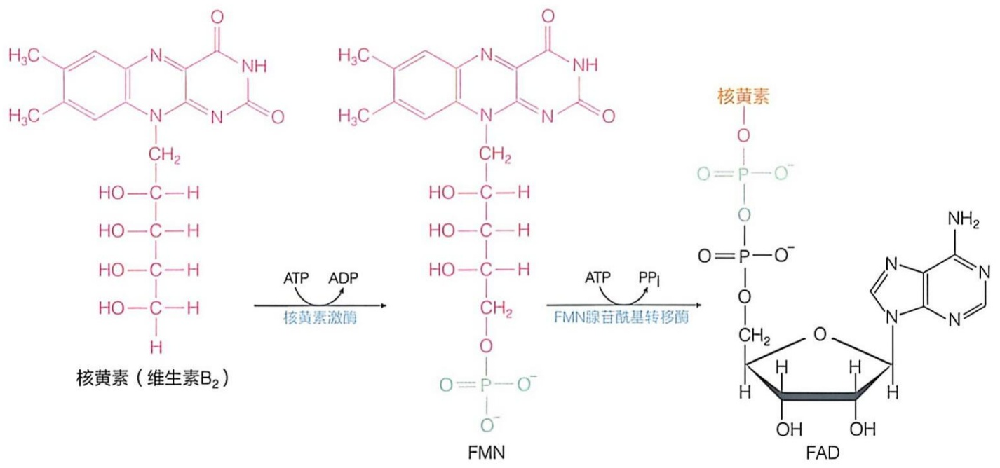

chemical

Chemical reaction pathway showing enzymatic conversion of N-adenosine to FMN and FAD via ATP and PPI enzymes

图 26-11 动物细胞内从核黄素（维生素 ${\mathrm{B}}_{2}$ ）生成FMN和FAD的反应过程

## 26.5.2 动物细胞利用烟酸（维生素 ${\mathrm{B}}_{3}$ ）生成 ${\mathrm{{NAD}}}^{ + }$ 和 ${\mathrm{{NADP}}}^{ + }$

生物体内存在数百种（接近千种）酶以烟酰胺腺嘌呤二核苷酸（nicotinamide adenine dinucleotide，NAD $^{+}$ ）和烟酰胺腺嘌呤二核苷酸磷酸（NADP $^{+}$ ；由NAD $^{+}$ 发生磷酸化修饰而成）作为辅因子，催化脱氢（氧化）加氢（还原）反应。这些酶广泛参与生物体内的合成和分解代谢途径，帮助维持生物体的氧化还原稳态。

动物细胞中的  $NAD^{+}$  主要利用从饮食中获取的烟酸（nicotinic acid，即维生素  $B_{3}$ ）来生成，其具体过程如图 26-12 所示。

## (1) 烟酸可通过三步酶促反应转化为 $\mathrm{NAD}^{+}$

烟酸通过位于细胞质膜上特异的转运蛋白进入细胞后，在胞质溶胶中经由以下三步酶促反应转化为  $NAD^{+}$ 。

第①步:烟酸转化为烟酸单核苷酸。烟酸首先与PRPP缩合生成烟酸单核苷酸（nicotinic acid mononucleotide）。这步反应是由烟酸磷酸核糖转移酶（nicotinic acid phosphoribosyltransferase）催化的。该反应与碱基补救合成途径的反应高度可比，其中的核糖磷酸也来源于PRPP。

第②步:烟酸单核苷酸转化为烟酸腺嘌呤二核苷酸。烟酸单核苷酸从 ATP 获取一个 AMP 单位后，生成烟酸腺嘌呤二核苷酸（nicotinic acid adenine dinucleotide）。这步反应是由烟酸单核苷酸腺苷酰转移酶（nicotinic acid mononucleotide adenylytransferase）催化的。

第③步:烟酸腺嘌呤二核苷酸分子中的羧基从谷氨酰胺侧链获取一个氨基，生成NAD $^{+}$ 。这步反应由NAD $^{+}$ 合成酶（NAD $^{+}$ synthetase）催化。后者是一种典型的酰胺基转移酶。