图 26-12 动物细胞中从烟酸或烟酰胺生成 NAD $^{+}$ 的反应过程

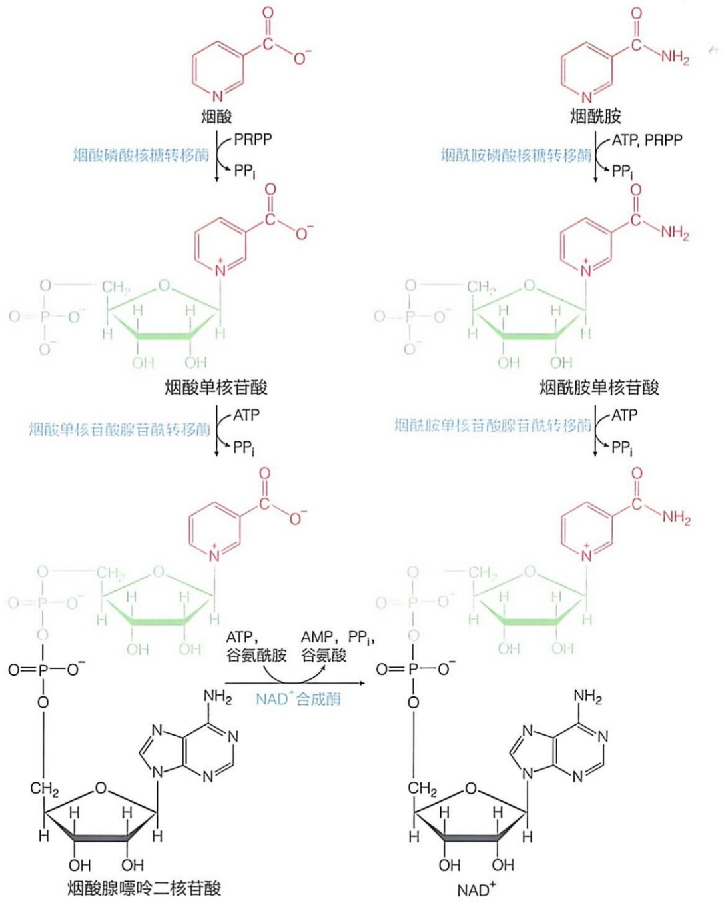

<details>
<summary>flowchart</summary>

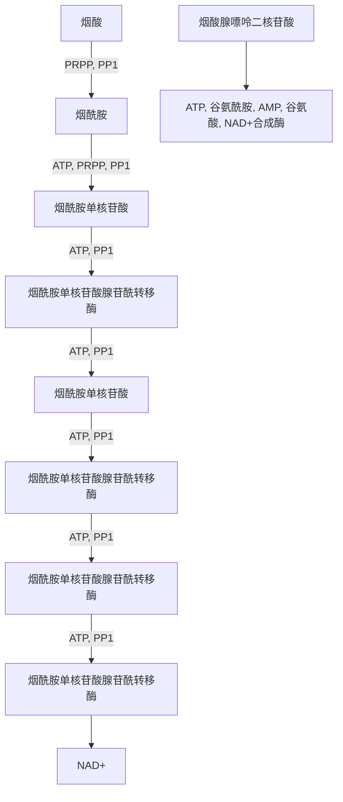
</details>

## (2) 烟酰胺可通过两步酶促反应转化为 $\mathrm{NAD}^{+}$

动物细胞内也含有烟酰胺（nicotinamide），其来源包括从食物中摄取以及细胞内成分的循环利用。由烟酰胺生成  $NAD^{+}$  的过程包括两步酶促反应，通常被称作补救途径（图 26-12）。第①步是烟酰胺在烟酰胺磷酸核糖转移酶的催化下，形成烟酰胺单核苷酸。第②步，在烟酰胺单核苷酸腺苷酰转移酶的催化下，从 ATP 分子获取一个 AMP 组分，生成  $NAD^{+}$ 。

还有一条 $\mathrm{NAD^{+}}$ 从头合成途径，以色氨酸为前体生成 $\mathrm{NAD^{+}}$ 。然而，该途径在动物细胞中极少发生，因此在这里不做详细介绍。

$NAD^{+}$ 经一步酶促反应即生成  $NADP^{+}$ ，这步反应由  $NAD^{+}$ 激酶催化:

$$
\mathrm{NAD} ^ {+} + \mathrm{ATP} \rightleftharpoons \mathrm{NADP} ^ {+} + \mathrm{ADP} \tag {26-12}
$$

从 ATP 获取一个磷酰基，使腺苷酸组分中的 C2' 羟基发生磷酸化修饰。NADP $^{+}$ 与 NAD $^{+}$ 仅相差一个磷酸基团，但它们的生物学功能却截然不同，具体可见第 16 章。

## 26.5.3 动物细胞利用泛酸（维生素 $B_{5}$ ）、半胱氨酸和ATP等生成辅酶A

生物体内的柠檬酸循环、脂肪酸氧化、脂肪酸合成、血红素合成以及组蛋白乙酰化等诸多过程，均需要利用辅酶 A（coenzyme A，CoA）作为辅因子。

辅酶 A 由泛酸（pantothenic acid，即维生素  $B_{5}$ ）、巯基乙胺、腺苷酸和磷酸等组分构成，其生成途径在细菌、古菌和真核生物体内高度保守。从泛酸，即 N-(2,4-二羟基 -3,3-二甲基丁酰)-β-丙氨酸出发，经过几步反应即可生成辅酶 A。

动物细胞中生成辅酶 A 包括以下五步反应（图 26-13）。第①步:泛酸→4'-磷酸泛酸，由泛酸激酶催化；第②步:4'-磷酸泛酸→4'-磷酸泛酰半胱氨酸（4'-phosphopantothenoyl-cysteine），由4'-磷酸泛酰半胱氨酸合成酶催化；第③步:4'-磷酸泛酰半胱氨酸→4'-磷酸泛酰巯基乙胺，由磷酸泛酰半胱氨酸脱羧酶催化；第④步:4'-磷酸泛酰巯基乙胺→3'-脱磷酸-辅酶 A（3'-dephospho-CoA），由4'-磷酸泛酰巯基乙胺腺苷酰转移酶催化；第⑤步:3'-脱磷酸-辅酶 A→辅酶 A，由脱磷酸-辅酶 A 激酶催化，从 ATP 获取一个磷酰基。

值得注意的是，催化最后两步反应的酶（4'-磷酸泛酰巯基乙胺腺苷酰转移酶和脱磷酸-辅酶 A 激酶）为同一种双功能蛋白质的两个结构域。这种蛋白质被称为辅酶 A 合酶（CoA synthase）。

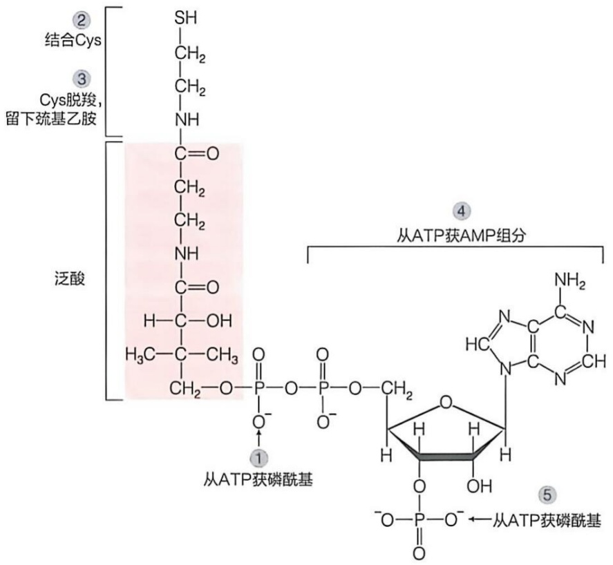

<details>
<summary>chemical</summary>

肽链结构示意图，展示泛酸与ATP获磷酰基的连接及碱基分组成
</details>

图 26-13 动物细胞中的辅酶 A 的生成过程的示意图

## 26.5.4 环磷酸核苷从核苷三磷酸衍生而成

环磷酸腺苷（cyclic AMP，cAMP）和环磷酸鸟苷（cyclic GMP，cGMP）分别于1950年代和1960年代在生物体内被鉴定到。后续研究表明，它们均为细胞内重要的第二信使，由激素等第一信使诱发产生。这类特异的环磷酸核苷由核苷酸环化酶催化核苷三磷酸发生环化而生成。

腺苷酸环化酶（adenylyl cyclase）催化 ATP 生成 cAMP，以及鸟苷酸环化酶（guanylyl cyclase）催化 GTP 生成 cGMP 的过程如图 26-14 所示。

图 26-14 细胞内 cAMP 和 cGMP 的生成和降解过程的示意图

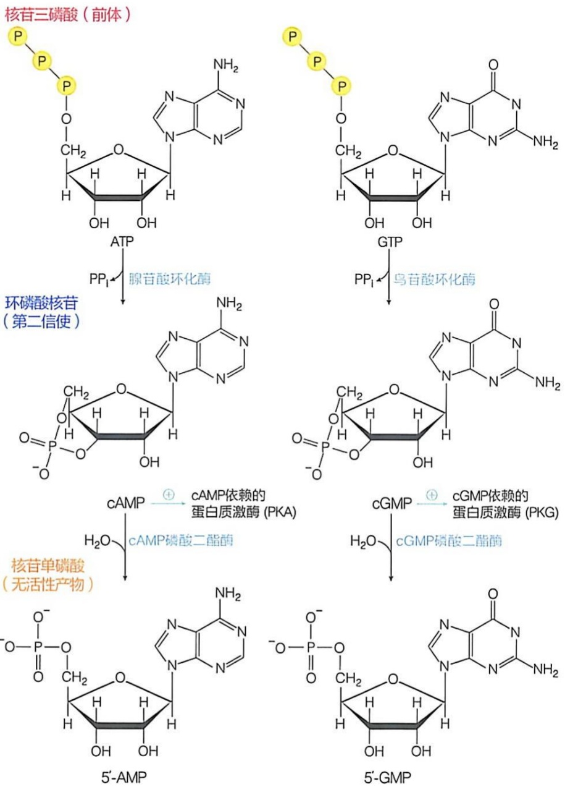

<details>
<summary>flowchart</summary>

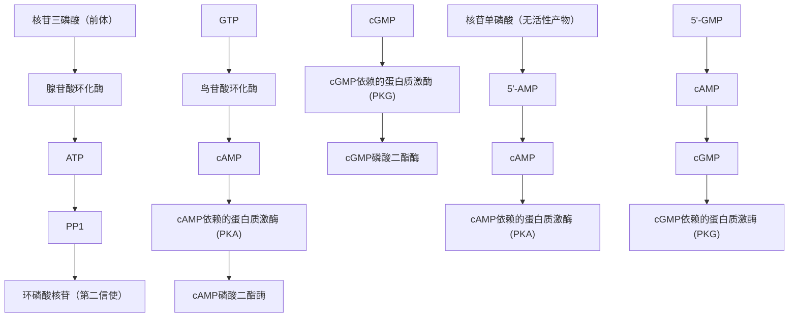
</details>

腺苷酸环化酶和鸟苷酸环化酶均需要被激素等信号分子诱导后才具有活性。生成的 cAMP 和 cGMP 可进一步诱导特异的蛋白质激酶（分别是 PKA 和 PKG）激活（详见第 27 章）。此外，cAMP 和 cGMP 还会被细胞内特异的磷酸二酯酶（phosphodiesterase），如 cAMP 磷酸二酯酶、cGMP 磷酸二酯酶，催化水解，分别生成 5'-AMP 和 5'-GMP，从而失去其作为第二信使的诱导活性（图 26-14）。

除了 cAMP 和 cGMP 之外，环磷酸胞苷（cCMP）和环磷酸尿苷（cUMP）也在某些生物（如细菌）中被发现。然而，目前对于它们在细胞内的生成过程以及功能等方面的认识还远不够深入（cCMP 和 cUMP 可能是细菌抵抗病毒反应中的第二信使）。

## 26.6 细胞内的脱氧核苷酸由核糖核苷酸还原生成

在嘌呤和嘧啶核苷酸的从头合成途径被揭示之后，合成 DNA 所需的脱氧核苷酸的合成机制仍不明确。细胞是首先生成用于 RNA 合成所需的核糖核苷酸后，再进一步生成脱氧核苷酸，还是存在一条独立的从头合成途径专门用于合成脱氧核苷酸？脱氧过程究竟是在何种分子形式上发生的？例如，细胞内是否形成类似于 PRPP 的 5-磷酸脱氧核糖焦磷酸？当时，这些问题仍有待解答。

在探索上述相关机制的过程中，1950年代，人们观察到大肠杆菌抽提物可以将$^{32}\mathrm{P}$ 标记的CDP转化为dCDP（而CMP或CTP却不会转化为相应的脱氧核苷酸），并且这种反应依赖于电子供体。不久，核糖核苷酸还原酶（ribonucleotide reductase, RNR）被分离纯化。后续研究揭示，该酶可能通过一种自由基催化机制将ADP、CDP、GDP和UDP分别转化为对应的dADP、dCDP、dGDP和dUDP，生成的dUDP再被用于合成dTTP（具体见后）。到了1980年代，通过电子顺磁共振波谱实验，人们检测到了该酶催化过程中稳定自由基的存在。这种自由基信号在酶失活时消失，而在补给 $\mathrm{Fe}^{2+}/\mathrm{O}_2$ 后重新出现。

核糖核苷酸还原酶有 I、II、III 三种类型。它们的氨基酸序列以及自由基生成机制等特征存在差异。其中，I 型核糖核苷酸还原酶分布最广，存在于绝大多数细菌、古菌和真核生物中。该酶依赖  $O_{2}$ ，其催化反应依赖于通过  $Fe^{3+}-Fe^{3+}$  双铁中心辅因子所产生的基于酪氨酸残基侧链的稳定自由基的存在。具有催化活性的 I 型核糖核苷酸还原酶以异源四聚体的形式存在，其亚基组成为  $\alpha_{2}\beta_{2}$ 。大肠杆菌中存在的  $\alpha_{2}\beta_{2}$  异源四聚体结构模型如图 26-15A 所示。

I 型核糖核苷酸还原酶内部包含三种关键位点。除了将底物 NDP 转化为 dNDP 的 “催化中心” 之外，还存在另外两个位点:一个是用于调节酶整体催化活性的 “酶活性调节位点”；另一个则是用于调节酶底物特异性的 “底物特异性调节位点”（它们各自的具体功能见后）。

Ⅱ型核糖核苷酸还原酶不依赖  $O_{2}$ ，主要存在于厌氧生物体内，其依赖的辅因子为 5'-脱氧腺苷钴胺（即辅酶  $B_{12}$ ），通过该辅因子产生的自由基催化转化反应。该酶通常由单一亚基组成。

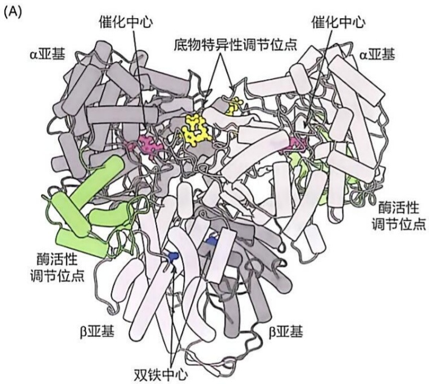

<details>
<summary>text_image</summary>

(A)
α亚基
催化中心
底物特异性调节位点
催化中心
α亚基
酶活性调节位点
酶活性调节位点
β亚基
β亚基
双铁中心
</details>

图 26-15 大肠杆菌Ⅰ型核糖核苷酸还原酶异源四聚体 ( $\alpha_{2}\beta_{2}$ ) 结构

（A）蛋白酶的整体结构展示（PDB:6W4X），图中所示两个α亚基在上方，两个β亚基在下方。其中每个α亚基包含三个活性位点，分别是结合CDP、UDP、GDP、ADP的催化中心，结合效应因子dATP、

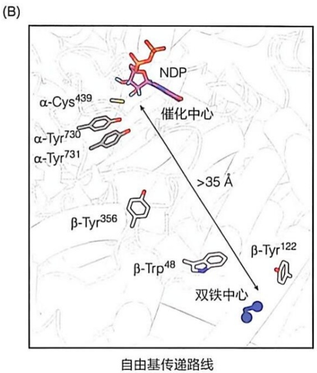

<details>
<summary>chemical</summary>

自由基传递路线图，展示α-Tyr、β-Tyr及α-Cys439等分子的催化与双铁中心位置
</details>

ATP、dTTP、dGTP的底物特异性调节位点，以及结合ATP或者dATP的酶活性调节位点。每个β亚基结合两个Fe³⁺，称为双铁中心。（B）自由基传递路线（其传递距离约35 Å）。图中的底物NDP为GDP，其核糖部分的C2′和C3′均连接一个羟基，氧原子展示为红色，氢原子展示为青色。

Ⅲ型核糖核苷酸还原酶对  $O_{2}$  敏感，只存在于厌氧细菌和某些古菌等绝对厌氧生物中，该酶利用铁硫（Fe-S）簇和 S-腺苷甲硫氨酸产生甘氨酸自由基，且通常以同源寡聚体的形式存在。

大肠杆菌细胞同时拥有这三种不同类型的核糖核苷酸还原酶，这表明它在无氧和有氧环境中均可产生脱氧核苷酸，从而使大肠杆菌能够在多样化的环境条件下生长增殖。

总体看，三种类型核糖核苷酸还原酶在空间结构、别构调控以及催化机制方面具有较高的相似性，表明它们可能起源于共同的祖先。这里主要介绍存在最为广泛、研究最为深入的Ⅰ型核糖核苷酸还原酶的催化特征。

## 26.6.1 核糖核苷酸还原酶利用自由基催化 C2' 碳原子的脱氧还原

核糖核苷酸还原酶的催化作用既依赖自由基传递也依赖电子传递，以下分别对它们进行简要描述。

## （1）细菌Ⅰ型核糖核苷酸还原酶中的自由基传递路径

该酶分子中的自由基传递路径（图 26-15B）如下。自由基在 β 亚基中的双铁中心处产生，可能通过以下机制生成:原本无活性的  $Fe^{2+}-Fe^{2+}$  与  $O_{2}$  发生反应，形成具活性的  $Fe^{3+}-O-Fe^{3+}$  形式（参考图 26-19A）。此时，位于双铁中心辅因子附近的酪氨酸残基（如  $\beta-Tyr^{122}$ ）启动自由基的传递过程（从  $\beta$  亚基至  $\alpha$  亚基），自由基依次经过 3 个酪氨酸残基，即  $\beta-Tyr^{356}$ 、 $\alpha-Tyr^{731}$  和  $\alpha-Tyr^{730}$ （可能也经过  $\beta-Trp^{48}$ ），最终定位于  $\alpha$  亚基酶催化中心的半胱氨酸残基（ $\alpha-Cys^{439}$ ），使其巯基氧化为自由基（—S·），启动对底物 NDP 的还原过程。

## (2) 细菌 I 型核糖核苷酸还原酶中的电子传递路径

该酶分子中的电子来源是 NADPH，主要通过两条路径传递，分别利用硫氧还蛋白（thioredoxin，TrX）和谷氧还蛋白（glutaredoxin，GrX）。利用硫氧还蛋白的路径如图 26-16 所示。源于 NADPH 的电子依次经过硫氧还蛋白还原酶中的辅因子 FAD 和半胱氨酸巯基、硫氧还蛋白中的半胱氨酸巯基，核糖核苷酸还原酶 α 亚基 C 端的 Cys $^{754}$  和 Cys $^{759}$  的巯基，最终传递至催化中心的 Cys $^{462}$  和 Cys $^{225}$ ，维持其各自的还原状态（即以巯基形式存在，而非形成分子内或分子间二硫键）并参与催化过程。

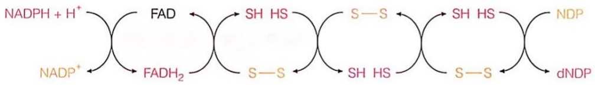

<details>
<summary>flowchart</summary>

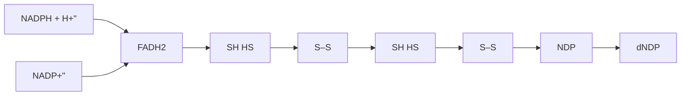
</details>

硫氧还蛋白还原酶

硫氧还蛋白 核糖核苷酸还原酶

图 26-16 细菌Ⅰ型核糖核苷酸还原酶活性中心的硫氧还蛋白电子传递路径

在许多生物体内，还存在谷氧还蛋白电子传递路径:NADPH→谷胱甘肽（由谷胱甘肽还原酶催化，使氧化型谷胱甘肽转变为还原型谷胱甘肽）→谷氧还蛋白→核糖核苷酸还原酶α亚基C端的 $Cys^{754}$ 和 $Cys^{759}$，最终传递至催化中心的 $Cys^{462}$ 和 $Cys^{225}$。

在上述两条电子传递路径中，硫氧还蛋白和谷氧还蛋白均属于低分子量（低于12 kDa）蛋白质，且均含有CXXC模体及二硫键。它们的主要功能是还原目标蛋白质（如核糖核苷酸还原酶）中的二硫键。在某些生物（如大肠杆菌）中同时存在这两条电子传递路径。这条备份电子传递通路的存在，可以确保酶的活性得以更有效地维持。

## (3) 核糖核苷酸还原酶通过一种自由基催化机制来实现 NDP 的还原

人们对细菌Ⅰ型核糖核苷酸还原酶的催化机制已有较为深入的认识。结合其结构信息以及对酶动力学等多方面的观察，目前被广泛认可的核糖核苷酸还原酶催化机制如图26-17所示。

核糖核苷酸还原酶的催化机制可描述为下面6步反应。第①步是形成3'-碳自由基:酶活性中心 $\alpha-Cys^{439}$ 残基形成的自由基（—S·）（图26-15B）将核糖C3'上的H转移，形成3'-碳自由基。第②步是2'-羟基发生质子化:活性中心的 $\alpha$ 亚基上 $Cys^{225}$ 的—SH基团提供质子。第③步是C2'位置发生脱水:脱水后形成的碳正离子由3'-C上的自由基进行稳定。第④步是C2'的还原:催化中心 $Cys^{462}$ 的—SH上的一个氢负离子被转移至核糖的C2'上，使碳正离子得以还原。同时，在 $\alpha-Cys^{225}$ 和 $\alpha-Cys^{462}$ 之间形成一个二硫键。第⑤步是H的转移与dNDP产物形成:催化残基 $\alpha-Cys^{439}$ 暂时保存的H被转移回到核糖的C3'上，消除后者的自由基，使其恢复至最初状态，形成dNDP产物；同时， $\alpha-Cys^{439}$ 恢复其自由基状态；这也促使 $Tyr^{122}$ 恢复其自由基状态。

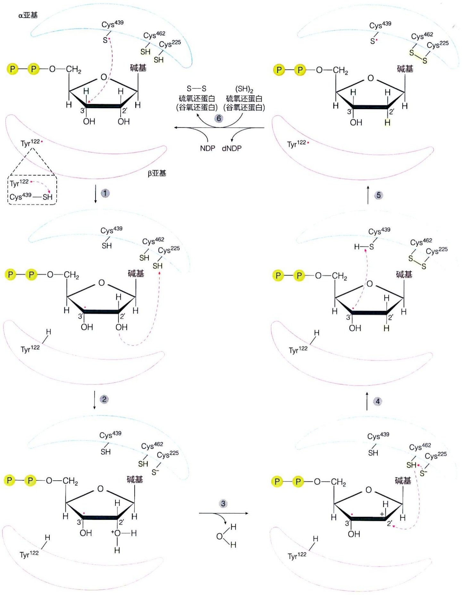

图26-17 大肠杆菌I型核糖核苷酸还原酶催化机制的示意图

第⑥步是 dNDP 产物的释放与酶活性中心的恢复:dNDP 产物得以释放。同时，核糖核苷酸还原酶催化中心的 $\alpha -\mathrm{Cys}^{225}$ 和 $\alpha -\mathrm{Cys}^{462}$ 所形成的二硫键被还原型的硫氧还蛋白或谷氧还蛋白还原为自由巯基形式，活性中心完全恢复，可进入下一轮催化过程。

核糖核苷酸还原酶的催化作用离不开催化中心的巯基自由基以及双铁中心的参与，其中双铁中心能够帮助这些自由基再生。一旦上述结构遭到破坏，酶的活性便无法正常发挥。例如，使用羟基脲（hydroxyurea）清除酶活性中心的自由基，会导致核糖核苷酸还原酶失活，这也证明了自由基在该酶促反应过程中的关键作用。

## 26.6.2 dTMP 衍生自 dUMP

1950 年代的同位素示踪实验等观察结果表明，细胞内的 dTMP 是以 dUMP 为前体生成的，而且该反应是由胸苷酸合酶（thymidylate synthase）催化的。下面将介绍从 dUDP 到 dUMP，再到 dTMP 的生成过程。

## (1) dUDP 经磷酸化形成 dUTP 后再转化为 dUMP

研究表明，dUDP 并不会直接发生甲基化而生成 dTDP，而是经历了如下间接的过程。dUDP 首先在非特异性的核苷二磷酸激酶的催化下，转化为 dUTP（式 26-11）；随后，在独特的脱氧尿苷三磷酸酶（dUTPase，dUTP 酶）的催化下，dUTP 脱去一个焦磷酸，生成 dUMP。

$$
\mathrm{dUTP} + \mathrm{H} _ {2} \mathrm{O} \longrightarrow \mathrm{dUMP} + \mathrm{PP} _ {\mathrm{i}} \tag {26-13}
$$

dUTP 酶是在 20 世纪六七十年代从大肠杆菌和哺乳动物细胞抽提物中鉴定到的。具体而言，人们利用放射性同位素标记的 dUTP，观察到了这种将 dUTP 分解为 dUMP 和焦磷酸（PP$_{i}$）的酶活性。这种酶具有高度特异性，不作用于 dTTP 等其他类似核苷酸。后续的遗传学实验表明，当细菌缺失这种酶（由细菌 dut 基因编码）活性时，所合成的 DNA 含有大量的 dUTP，导致其因被修复而出现大量 DNA 断裂的现象。显然，dUTP 酶的生物学功能之一是阻止细胞内积累过多的 dUTP，从而避免它取代 dTTP 而被掺入到 DNA 分子中（形成异常 DNA）。事实上，存在 dUTP 酶突变的细菌细胞可大幅提高其 DNA 的突变频率（这种突变菌株可用于产生 DNA 的随机突变）。后续研究揭示，dUTP 酶广泛存在于所有生物中:不仅哺乳动物和细菌体内含有该酶，甚至噬菌体和其他病毒亦编码产生自身的 dUTP 酶。这种高度的保守性，充分体现了 dUTP 酶在形成 dTMP 和阻止 DNA 变异等生物学过程中的重要作用。

1960 年代，通过同位素标记实验，人们又从大肠杆菌和哺乳动物细胞抽提物中鉴定到另一种酶。它可直接将 dCTP 转化为 dUTP。这种酶后来被确定为脱氧胞苷三磷酸脱氨酶（dCTP deaminase，dCTP 脱氨酶）:

$$
\mathrm{dCTP} + \mathrm{H} _ {2} \mathrm{O} \longrightarrow \mathrm{dUTP} + \mathrm{NH} _ {3} \tag {26-14}
$$

dCTP 脱氨酶对 dCMP 和 dCDP 均无催化活性，反映了其高度的底物特异性。然而，在人体细胞内尚未明确鉴定这种酶的存在。也就是说，人体内的 dUMP 可能主要通过 dUTP 酶催化的反应生成（式 26-13）。

## (2) dUMP 通过甲基化转化为 dTMP

由上述途径生成的 dUMP 中间体继续在胸苷酸合酶的催化下，在其 C5 上发生甲基化修饰，生成 dTMP（图 26-18）。

早在 1950 年代，人们通过细菌或哺乳动物细胞抽提物开展的实验发现，胸苷酸合酶催化 dUMP 转化为 dTMP 的过程依赖于四氢叶酸辅因子的存在。后续研究表明，在胸苷酸合酶的催化过程中， $N^{5}, N^{10}$  - 亚甲基四氢叶酸先向尿嘧啶环的 C5 提供一个亚甲基，随后再从其 C6 转移一个质子，使亚甲基还原为甲基。

在这一过程中，作为电子供体， $N^{5}, N^{10}$ -亚甲基四氢叶酸在提供亚甲基的同时，也被氧化为二氢叶酸（dihydrofolate）。若要使酶恢复其原有的催化活性状态，二氢叶酸需要被还原为四氢叶酸。这步反应由二氢叶酸还原酶（dihydrofolate reductase，DHFR）催化，其所需的电子来源于NADPH。随后，在丝氨酸转羟甲基酶的催化下，四氢叶酸从丝氨酸获取一个亚甲基，重新转变为 $N^{5}, N^{10}$ -亚甲基四氢叶酸（图26-18）。

值得注意的是，在某些原生动物中，胸苷酸合酶和二氢叶酸还原酶以双功能酶的形式存在。这提高了这些生物体内腺苷酸生成的效率，同时也反映二者的演化相关性。

图26-18 胸苷酸合酶催化dUMP发生甲基化修饰并将其转化为dTMP及辅因子的再生过程

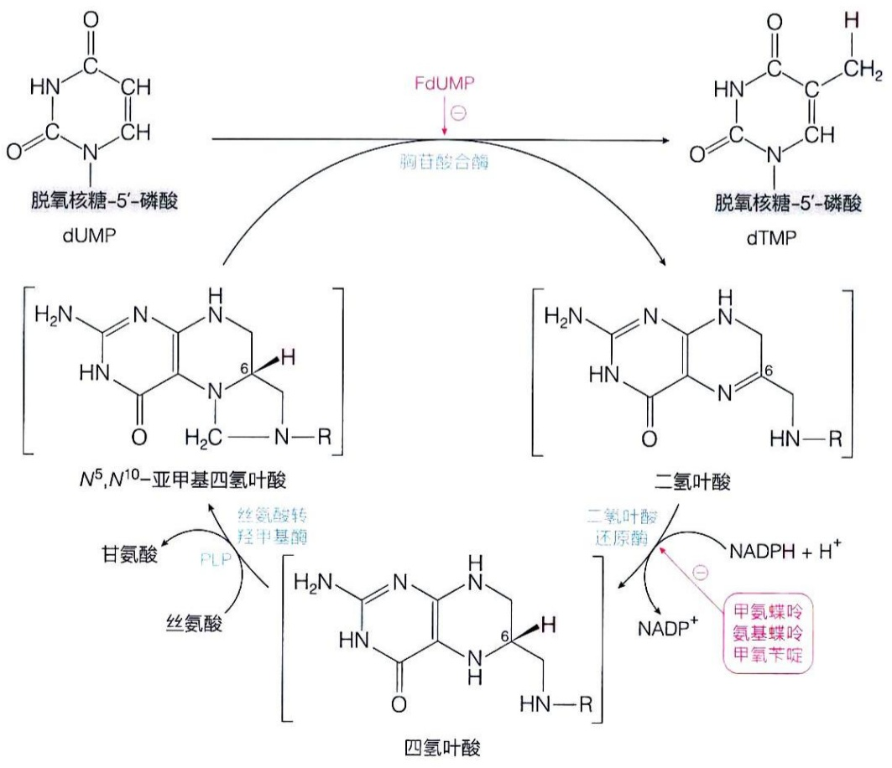

<details>
<summary>flowchart</summary>

This flowchart illustrates the enzymatic synthesis pathways of various nucleosides (dUMP, dTMP, N5N10-亚甲基四氢叶酸, 二氢叶酸, 四氢叶酸) from deuterated glucose derivatives to form final products.
</details>

## 26.6.3 核糖核苷酸还原酶的酶活性和底物特异性均被调节

作为一种催化多种 NDP 还原为 dNDP 的酶，核糖核苷酸还原酶的调节机制具有其独特性。

早在 1960 年代，人们就发现，ATP 可明显提高核糖核苷酸还原酶的活性，而 dATP 则明显抑制该酶的活性。后续研究揭示，ATP 和 dATP 可竞争性地结合到该酶 α 亚基的同一个调节位点上。后来，人们观察到核糖核苷酸还原酶的底物特异性因不同核苷酸的存在（如 ATP、dTTP、dGTP 或 dATP）也出现显著差异。具体而言，ATP 的存在促进 CDP/UDP 的还原，dTTP 的存在则促进 GDP 的还原，dGTP 的存在促进 ADP 的还原。这些观察结果暗示，除了上面提到的结合 ATP 和 dATP 的活性调节结合位点之外，可能还存在另一个调节底物选择性的位点。总结来说，在催化中心（通常被称为 C 位点）之外，核糖核苷酸还原酶还存在酶活性调节位点（通常被称为 A 位点）和底物特异性调节位点（通常被称为 S 位点）。这三种位点的存在后来都在结构水平得到了证实，具体如图 26-15A 和图 26-19A 所示。

## (1) 核糖核苷酸还原酶活性调节位点参与酶整体活性的调节

当 dATP 结合于该位点时，导致酶的  $\alpha_{2}\beta_{2}$  四聚体活性状态打开，形成  $\alpha_{4}\beta_{4}$  八聚体（图 26-19B）:因为  $\alpha$  和  $\beta$  亚基的分离，酶的活性中心随之消失，处于无活性状态。因此，高浓度的 dATP 则是酶的别构抑制剂，它通过调节酶的寡聚体状态来调节酶的活性。

图 26-19 大肠杆菌I型核糖核苷酸还原酶的活性与无活性结构

（A）具有活性的 $\alpha_{2}\beta_{2}$ 四聚体模式。（B）结合dATP后形成的无活性 $\alpha_{4}\beta_{4}$ 八聚体结构。

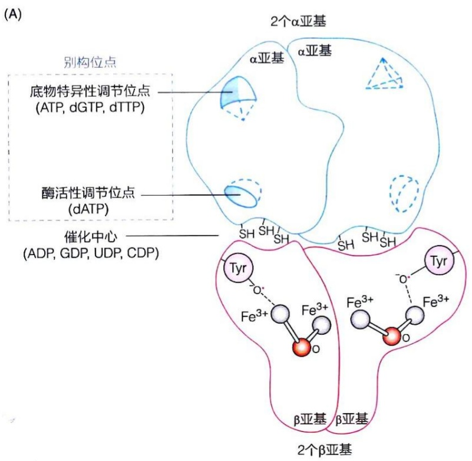

<details>
<summary>text_image</summary>

(A)
2个α亚基
α亚基
α亚基
底物特异性调节位点
(ATP, dGTP, dTTP)
酶活性调节位点
(dATP)
催化中心
(ADP, GDP, UDP, CDP)
β亚基
β亚基
2个β亚基
</details>

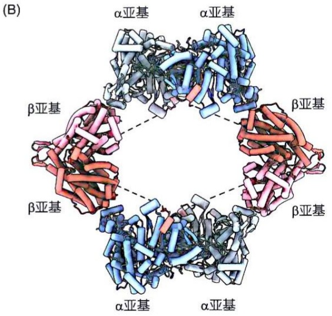

<details>
<summary>chemical</summary>

3D protein structure diagram showing alpha-amino and beta-amino helices with labeled subunits α亚基
</details>

值得注意的是，dATP 与该活性调节位点的亲和力远高于 ATP。也就是说，该位点可能主要作为 dATP 的反馈抑制别构位点发挥作用，从而诱发无活性寡聚体的形成。

（2）核糖核苷酸还原酶通过其底物特异性调节位点调控不同脱氧核苷酸的平衡合成

在细胞合成 DNA 过程中，需要 dATP、dGTP、dTTP、dCTP 这四种脱氧核苷酸前体的平衡供应。缺乏其中任何一种都会导致致死表型，但其中任何一种的过量则可能引发 DNA 突变。

为了平衡所有四种脱氧核苷酸的供应，在核糖核苷酸还原酶的2个 $\alpha$ 亚基上，各存在一个专门调节底物特异性的位点（图26-19A）。与酶活性调节位点不同，该位点可与ATP、dTTP或dGTP结合；不同核苷酸的结合将促进或抑制对特定底物的结合。具体的调节方式如图26-20所示（参看图26-19A）。

底物特异性调节的模式大致如下:①当 ATP 水平较高时，它们将结合到底物特异性调节位点，从而增强核糖核苷酸还原酶对底物 CDP 和 UDP 的亲和力，促进 dCDP 和 dUDP 这两种嘧啶脱氧核苷酸的生成。②当 dTTP（由 dUMP 衍生而成）水平较高时，它结合到底物特异性调节位点，增强酶对底物 GDP 的亲和力，提高 dGDP 的产量，但同时降低酶对底物 CDP 和 UDP 的亲和力，减少 dCDP 和 dUDP 的生成。③当 dGTP 的水平较高时，它结合到底物特异性调节位点，增强酶对底物 ADP 的亲和力，提高 dADP 的产量，但同时降低酶对底物 UDP 或 GDP 的亲和力，减少 dUDP 和 dGDP 的生成。④当 dATP 浓度处于较高水平时，它结合到活性调节位点，诱发无活性核糖核苷酸还原酶寡聚体的形成（图 26-19B）。

上述别构调节网络可确保细胞内四种脱氧核苷酸生成量的比例保持平衡。从某种意义而言，核糖核苷酸还原酶和胸苷酸合酶催化的反应反映了遗传信息从 RNA 向 DNA 转化的演化历程，即合成 DNA 的前体衍生自合成 RNA 的前体。具体而言，脱氧核糖核苷酸衍生自核糖核苷酸（由核糖核苷酸还原酶催化，见图 26-16 和图 26-17），而脱氧胸苷单磷酸则衍生自脱氧尿苷单磷酸（由胸苷酸合酶催化，见图 26-18）。这可能是 DNA 取代 RNA 成为遗传信息携带者的关键演化过程，也有力支持了 “RNA 世界” 的假说（即 RNA 先于 DNA 和蛋白质演化产生）。

图 26-20 核糖核苷酸还原酶的底物特异性调节示意图

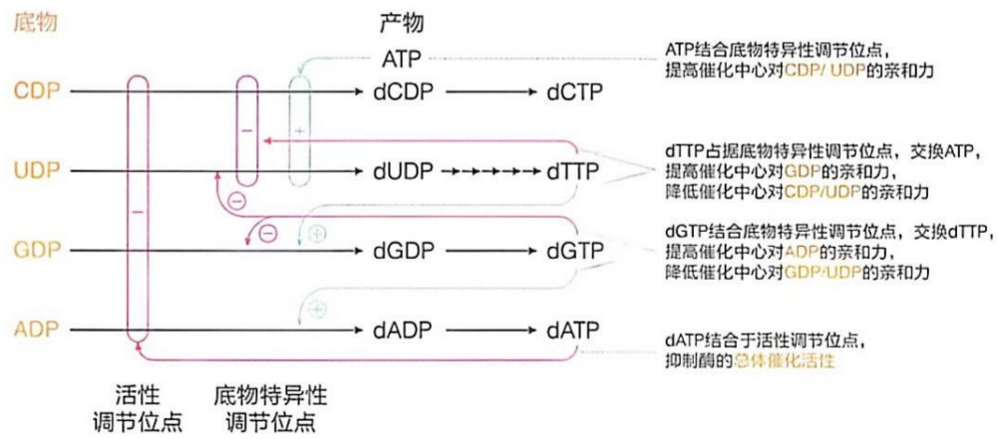

<details>
<summary>flowchart</summary>

```mermaid
graph LR
  A["底物"] --> B["产物"]
  C["CDP"] --> D["dCDP"]
  E["UDP"] --> F["dUDP"]
  G["GDP"] --> H["dGDP"]
  I["ADP"] --> J["dADP"]
  
  subgraph Top_Process
    K["ATP"] -.-> L["ATP结合底物特异性调节位点，提高催化中心对CDP/UDP的亲和力"]
  end
  
  subgraph Bottom_Process
    M["dTTP"] -.-> N["dTTP占据底物特异性调节位点，交换ATP，提高催化中心对GDP的亲和力，降低催化中心对CDP/UDP的亲和力"]
  end
  
  subgraph Bottom_Process
    O["dGTP"] -.-> P["dGTP结合底物特异性调节位点，交换dTTP，提高催化中心对ADP的亲和力，降低催化中心对GDP/UDP的亲和力"]
  end
  
  subgraph Bottom_Process
  Q["dATP"] -.-> R["dATP结合于活性调节位点，抑制酶的总体催化活性"]
  
  style Top_Process fill:#f9f9f9,stroke:#333,stroke-width:2px
  style Bottom_Process fill:#f9f9f9,stroke:#333,stroke-width:2px
```
</details>

## 26.6.4 抑制胸苷酸合酶和二氢叶酸还原酶活性可有效阻止肿瘤细胞的增殖

胸苷单磷酸是 DNA 所独有的组成成分，如果能够阻止细胞合成胸苷单磷酸，细胞中的 DNA 就无法复制，细胞也就无法增殖。正因如此，催化胸苷单磷酸生成的关键酶——胸苷酸合酶和二氢叶酸还原酶，成为开发抑制肿瘤生长药物的重要靶点。

## (1) 二氢叶酸还原酶抑制剂被开发为抗肿瘤药物

二氢叶酸还原酶催化二氢叶酸还原为四氢叶酸（图 26-18）。在 1940 年代，人们利用叶酸的可抑制二氢叶酸还原酶活性的类似物氨基蝶呤（aminopterin）（图 26-21），将其开发为治疗儿童白血病的药物。1950 年代，人们开发出毒性更低的氨基蝶呤衍生物氨甲蝶呤（methotrexate，MTX）（图 26-21），将其用于治疗白血病和自身免疫等疾病，一直沿用至今。

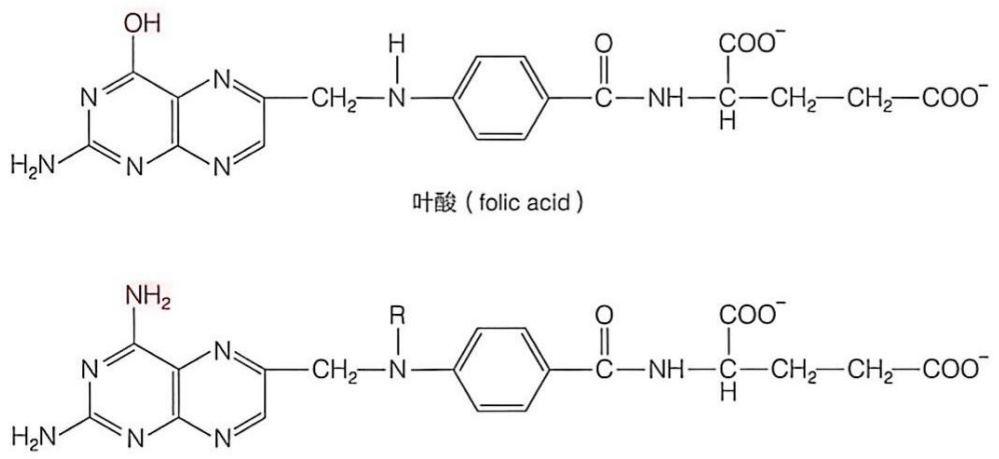

氨基蝶呤（R = H）；甲氨蝶呤（R = CH₃）

图 26-21 叶酸类似物:氨基蝶呤和氨甲蝶呤

## (2) 胸苷酸合酶抑制剂也被开发为抗肿瘤药物

人们还开发了胸苷酸合酶抑制剂，用于阻止肿瘤细胞的快速增殖。其中最为典型的是1950年代研发的尿嘧啶类似物5-氟尿嘧啶（5-fluorouracil，5-FU）（图26-22）。该化合物在细胞内转化为5-氟-尿嘧啶脱氧核苷单磷酸（5-fluoro-deoxyuridinemonophosphate，FdUMP）后，能够抑制胸苷酸合酶的活性。

具体的抑制过程可描述如下:当5-氟尿嘧啶进入肿瘤细胞时，在胸苷磷酸化酶（thymidine phosphorylase）的催化下，经下列可逆反应，5-氟尿嘧啶转化为5-氟-尿嘧啶脱氧核苷（5-fluoro-deoxyuridine，FdU):

5-氟尿嘧啶+2-脱氧核糖-1-磷酸⇌5-氟-尿嘧啶脱氧核苷+ $P_{i}$  (26-15)

随后，5-氟尿嘧啶脱氧核苷在胸苷激酶（thymidine kinase）的催化下，转化为5-氟-尿嘧啶脱氧核苷单磷酸（FdUMP）:

5-氟-尿嘧啶脱氧核苷+ATP→5-氟-尿嘧啶脱氧核苷单磷酸+ADP (26-16)

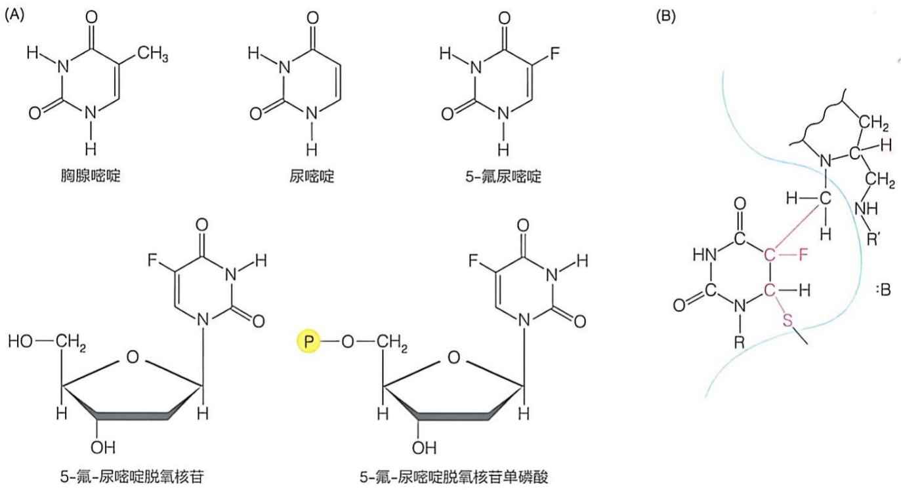

图 26-22 胸腺嘧啶相关类似物的化学结构及5-氟-尿嘧啶脱氧核苷单磷酸抑制胸苷酸合酶的机制（A）胸腺嘧啶、尿嘧啶、5-氟尿嘧啶、5-氟-尿嘧啶脱氧核苷和5-氟-尿嘧啶脱氧核苷单磷酸的化学结构式。（B）5-氟-尿嘧啶脱氧核苷单磷酸通过形成共价中间体而抑制胸苷酸合酶的机制示意图。

5-氟-尿嘧啶脱氧核苷单磷酸是胸苷酸合酶的自杀性抑制剂，能够不可逆地抑制该酶的活性，从而阻断细胞内dTMP的生成，达到阻止癌细胞增殖的效果。

5-氟-尿嘧啶脱氧核苷单磷酸抑制胸苷酸合酶的过程如下:作为dUMP的类似物，它可有效进入胸苷酸合酶的活性中心。与底物dUMP类似，5-氟-尿嘧啶脱氧核苷单磷酸在与活性中心的一个半胱氨酸残基形成共价连接后，其C5与 $N^5, N^{10}$-亚甲基四氢叶酸辅因子中的亚甲基形成共价连接；然而，由于氟原子与C5的紧密结合，无法发生脱氟反应，从而导致一种稳定共价中间体的形成，实现对胸苷酸合酶的不可逆抑制（图26-22B）。

## 26.7 动物可将体内多余的嘌呤和嘧啶碱基进行代谢分解

在细胞内或在动物的消化道内，核酸可被降解成核苷酸、核苷、碱基等不同形式的产物。其中，有的产物可被细胞内补救途径重新利用（详见26.4节），而有的产物则被转化后排出体外。在动物消化道内，由胰腺等分泌的DNA酶（DNase）和RNA酶（RNase）等磷酸二酯酶（phosphodiesterase）可分别将DNA和RNA降解为核苷酸。这样的降解也可在细胞内的溶酶体中发生，由其中的DNA酶和RNA酶催化。

## 26.7.1 核苷酸、核苷可进一步水解或磷酸解形成不同产物

核苷酸可在核苷酸酶（nucleotidase）、核苷酶（nucleosidase）或核苷磷酸化酶（nucleoside phosphorylase）等的作用下，分解为碱基、核糖和核糖磷酸等产物。

其中的核苷酸酶催化以下类型的反应:

$$
\text {核苷酸} + \mathrm{H} _ {2} \mathrm{O} \longrightarrow \text {核苷} + \mathrm{P} _ {\mathrm{i}} \tag {26-17}
$$

$$
(\text {如} \mathrm{AMP}) \quad (\text {如腺苷})
$$

即催化不同核苷单磷酸的水解。其中的部分酶具有特异性（如仅催化连接在核糖特定羟基上的磷酸基团水解），而有些酶则不具特异性（可催化连接于核糖任何羟基上的磷酸基团水解），并且这些反应均为不可逆反应。

核苷酶催化以下类型的反应:

$$
\mathrm{核苷} + \mathrm{H} _ {2} \mathrm{O} \longrightarrow \mathrm{碱基} + \mathrm{单糖} \tag {26-18}
$$

$$
(\text {如腺苷}) \quad (\text {如腺嘌呤}) (\text {如核糖})
$$

所催化的核苷水解反应为不可逆反应。

核苷磷酸化酶催化以下类型的反应:

$$
\text {核苷} + \mathrm{P} _ {\mathrm{i}} \rightleftharpoons \text {碱基} + \text {单糖 -1- 磷酸} \tag {26-19}
$$

$$
(\text {如次黄苷}) \quad (\text {如次黄嘌呤}) (\text {如核糖 -1 - 磷酸})
$$

值得注意的是，核苷磷酸化酶催化的是磷酸解反应（非水解反应），而且是可逆的（见式26-15）。核苷磷酸化酶可分为嘌呤核苷磷酸化酶和嘧啶核苷磷酸化酶两类。嘌呤核苷磷酸化酶（purine nucleoside phosphorylase）主要催化次黄苷和鸟苷发生磷酸解 $^{①}$ ，尿苷和胸苷的磷酸化通常分别由两种专一性很强的不同嘧啶核苷磷酸化酶分别催化 $^{②}$ 。这可能是因为尿苷和胸苷分别源自RNA和DNA，这种差异可能演生出了不同酶的特异性。

在动物和大多数细菌中，核苷磷酸化酶催化产生的核糖-1-磷酸在磷酸核糖变位酶（phosphoribomutase）的催化下转化为核糖-5-磷酸。后者进入戊糖磷酸途径进一步代谢，或转化为PRPP参与核苷酸的生成等。类似地，在动物和大多数细菌中，脱氧核糖-1-磷酸通常在磷酸脱氧核糖变位酶（phosphodeoxyribomutase）的催化下转化为脱氧核糖-5-磷酸，后者可被核苷磷酸化酶（式26-19）利用以合成脱氧核苷，进一步由脱氧核苷激酶（式26-6至式26-8）催化转变为脱氧核苷单磷酸（如dCMP、dAMP、dGMP）。在大肠杆菌等微生物中，脱氧核糖-1-磷酸可在脱氧核糖磷酸醛缩酶（deoxyribose-phosphate aldolase）的催化下，裂解为甘油醛-3-磷酸和乙醛。生成的甘油醛-3-磷酸可进入糖酵解途径，而乙醛可在乙醛脱氢酶的催化下被氧化为乙酸，乙酸通过活化为乙酰辅酶 A 后可进入柠檬酸循环进一步代谢。

<small><span class="docvortex-page-footnote" data-block-type="page_footnote" style="color:#6b7280">① 但不催化腺苷发生磷酸解，腺苷需先脱氨生成次黄苷后再进行磷酸解。</span></small>

<small><span class="docvortex-page-footnote" data-block-type="page_footnote" style="color:#6b7280">② 在嘧啶核苷磷酸化酶催化的反应中，尿苷磷酸化酶专一分解尿苷，不作用于胸苷；而胸苷磷酸化酶也几乎不作用于尿苷，仅作用于胸苷。</span></small>

碱基也可进一步分解。下面简要介绍碱基在哺乳动物体内的分解代谢过程。

## 26.7.2 哺乳动物体内多余的嘌呤碱基一般转化为尿酸排出

在哺乳动物细胞内，多余的腺嘌呤或鸟嘌呤通常转化为尿酸（图 26-23）排出体外。

(1) 腺嘌呤核苷单磷酸（AMP）中的嘌呤碱基先被转化为次黄嘌呤

腺嘌呤核苷单磷酸可通过两种方式转化为次黄嘌呤。第一种方式:腺嘌呤核苷单磷酸在核苷酸酶的催化下发生水解，生成腺苷（式26-17）。随后，腺苷在腺苷脱氨酶（adenosine deaminase，ADA）的催化下脱去 C6 位氨基，生成次黄苷；接着，次黄苷在嘌呤核苷磷酸化酶的催化下，生成次黄嘌呤和核糖 -1- 磷酸（式 26-19；图 26-23）。第二种方式:腺嘌呤核苷单磷酸在腺苷酸脱氨酶（AMP deaminase）的催化下脱去 C6 位氨基，生成次黄嘌呤核苷单磷酸（IMP）；IMP 随后在核苷酸酶催化下发生水解，脱去磷酸基团，生成次黄苷；最终，次黄苷在嘌呤核苷磷酸化酶的催化下，生成次黄嘌呤和核糖 -1- 磷酸。通常情况下，第一种方式（先脱磷酸再脱氨）主要发生在淋巴组织和红细胞中，而第二种方式（先脱氨再脱磷酸）则主要发生在肌肉、肝脏和大脑组织内。如果 AMP 先脱磷酸转化为核苷，则因为不带电荷有可能被排出细胞外；而先脱氨生成的 IMP，仍保持带电形式，故不易排出。

图 26-23 哺乳动物细胞内多余的腺嘌呤和鸟嘌呤最终被转化为尿酸

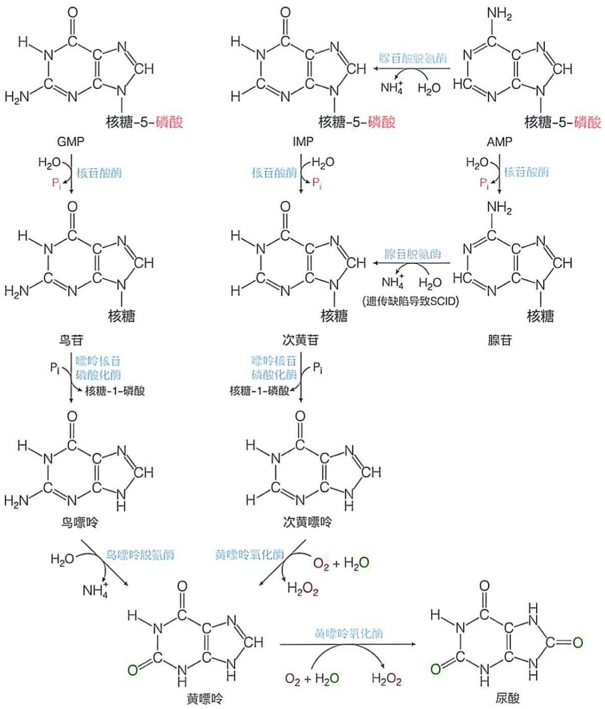

## (2) 鸟嘌呤核苷单磷酸（GMP）中的嘌呤碱基被转化为黄嘌呤

鸟嘌呤核苷单磷酸是先在核苷酸酶催化下脱去磷酸基团，生成鸟苷（式26-17）。鸟苷在嘌呤核苷磷酸化酶催化下，转变为鸟嘌呤和核糖-1-磷酸（式26-19）。随后，鸟嘌呤在鸟嘌呤脱氨酶催化下脱去氨基，转变成黄嘌呤（图26-23）。

腺苷脱氨酶的遗传缺陷可引起人类的重症联合免疫缺陷病（severe combined immunodeficiency disease, SCID）。患者的T细胞和B细胞不能正常发育，导致免疫力严重低下，患者必须生活在无菌环境中（患儿因需要被隔离，故被形象地称作“泡泡儿童”）。腺苷脱氨酶的缺陷可使细胞内dATP浓度升高约100倍，而高浓度的dATP可抑制核糖核苷酸还原酶的活性，导致细胞内dNDP不能被有效生成（图26-20），这必然会对细胞内DNA的复制过程产生严重影响。

SCID 的治疗方法主要包括骨髓移植、腺苷脱氨酶注射和基因治疗。其中前两种治疗方法存在移植排斥、感染和疗效逐渐下降等问题。1990 年，美国学者对一名 4 岁的 SCID 患儿尝试了腺苷脱氨酶的基因治疗。他们先从患儿体内获取 T 淋巴细胞，随后用病毒载体将正常的腺苷脱氨酶编码基因导入这些细胞，经体外培养扩增后，再输回至患者血液。该案例是人类基因治疗的首次尝试，获得了部分成功 $^{①}$ 。

## (3) 次黄嘌呤和黄嘌呤进一步氧化生成尿酸

次黄嘌呤首先被氧化为黄嘌呤，随后黄嘌呤进一步氧化，生成尿酸（uric acid）。这两步氧化反应均由黄嘌呤氧化酶（xanthine oxidase，XO）催化完成（图26-23）。黄嘌呤氧化酶是一种广泛存在于所有生物体内的酶，它于1930年代首次从牛奶中被纯化。当时人们发现它含有呈黄色的核黄素，但直到1950年代，才被确认为FAD，并被鉴定为一种活性中心含有钼原子的酶。这是金属钼首次被鉴定为酶的辅因子，固氮酶中的钼是之后才被鉴定的。后续研究确定钼以钼蝶呤（molybdopterin）的形式存在于该酶活性中心中。1960年代，酶中的铁硫中心被发现，且进一步被鉴定含2个2Fe-2S。在该酶的一个亚基的晶体结构中（图26-24A），钼蝶呤辅因子（图26-24B）、铁硫中心及FAD都明显可见。

值得注意的是，尽管黄嘌呤氧化酶的催化活性需要 $\mathrm{O}_2$ 的参与，但嘌呤环C2和C8

<small><span class="docvortex-page-footnote" data-block-type="page_footnote" style="color:#6b7280">① 改造的 T 细胞具有限寿命，需反复输注。</span></small>