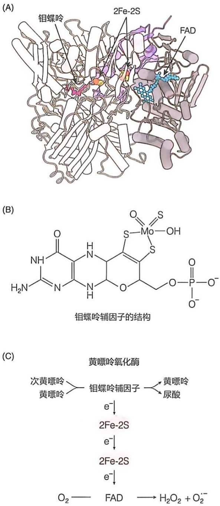

图 26-24 黄嘌呤氧化酶的晶体结构与两种底物氧化过程的示意图

（A）牛源黄嘌呤氧化酶的晶体结构（PDB:1FIQ）包含三个结构域:含有两个铁硫中心2Fe-2S的N端结构域；结合FAD的中间结构域；结合钼蝶呤的C端结构域。N端结构域展示为紫色，2Fe-2S铁硫中心的Fe原子为橙色，硫原子为黄色，中间结构域展示为灰色，FAD为青色，C端结构域展示为浅灰色，钼蝶呤为玫红色。（B）钼蝶呤辅因子的结构式。（C）黄嘌呤氧化酶中可能的电子传递路径。

发生羟基化修饰的氧原子却来自水分子（而非  $O_{2}$ ）。在反应过程中，黄嘌呤氧化酶是产生而非消耗了还原当量。电子传递路径为:从钼蝶呤出发，依次经过两个 2Fe-2S 铁硫中心，最终传递至 FAD。随后，电子与  $O_{2}$  结合形成过  $H_{2}O_{2}$  和氧自由基等活性氧产物（图 26-24C）。尽管人们认识到钼原子在将  $H_{2}O$  中的氧原子（以  $OH^{-}$ 形式）插入嘌呤环的过程中发挥了重要作用，但该酶的详细催化机制仍不清楚。

## (4) 尿酸在不同动物体内的去向存在差异

作为嘌呤碱基的一种氧化降解产物，尿酸的代谢去向在不同种类生物中差异较大。在灵长类、鸟类、爬行类和昆虫等动物中，尿酸不再进一步分解而被直接排出体外。但在大多数哺乳动物中，尿酸可被进一步分解，以尿囊素（allantoin）等形式排出（图26-25）。在海洋无脊椎动物中（如水母），它可经过如图26-25所示的七步酶促反应，最终被分解为铵离子和 $CO_{2}$ 等产物排出体外。

尿酸分解为铵的具体七步反应如下:第①步:尿酸在尿酸酶 [uricase，也称尿酸氧化酶（urate oxidase）] 的催化下，被氧化生成 5-羟基异尿酸（5-hydroxyisourate），同时产生  $H_{2}O_{2}$ ；第②步:5-羟基异尿酸在其水解酶催化下，生成 2-氧代 -4-羟基 -4-羧基 -5-脲基咪唑啉（2-oxo-4-hydroxy-4-carboxy-5-ureidoimidazoline，OHCU）；第③步:在 OHCU 脱羧酶的催化下，2-氧代 -4-羟基 -4-羧基 -5-脲基咪唑啉脱羧，生成尿囊素（大多数哺乳动物的终产物）；第④步:在尿囊素酶（allantoinase）的催化下，尿囊素被转化为尿囊酸（allantoate；硬骨鱼类以这种形式排出）；第⑤步:在尿囊酸酶（allantoicase）的催化下，尿囊酸水解，生成脲基乙醇酸（ureidoglycolate）和尿素；第⑥步:同样在尿囊酸酶的催化下，脲基乙醇酸经水解生成乙醛酸（glyoxylate）和尿素；第⑦步:在脲酶（urease）的催化下，1 分子尿素经水解生成 2 个铵离子和 1 分子  $CO_{2}$ 。

在鸟类和爬行动物等排尿酸动物的演化过程中，催化第①步反应的尿酸酶的编码基因发生了突变，转变成了无功能的假基因，导致尿酸无法被继续分解。这种表型对爬行动物和鸟类而言可能是有益的，因为这有助于机体更好地保持水分。此外，爬行动物和鸟类恰好有一个泄殖腔，尿酸可以在此处沉积，从而实现尿酸的有效排泄，避免其阻塞尿道。

与其他哺乳动物不同，灵长类的尿酸酶基因在演化

灵长类、鸟类、爬行类、昆虫

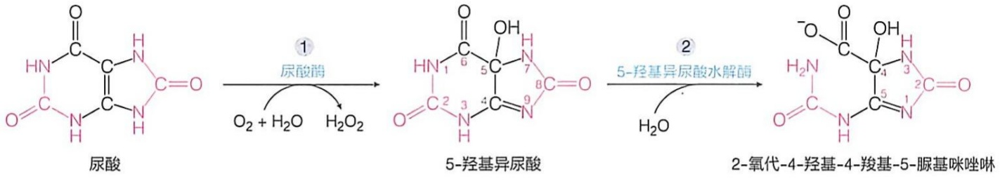

chemical

Reaction pathway of urea to form 5-羟基异尿酸, then to form 2-氧代-4-羟基-4-羧基-5-脲基咪唑啉

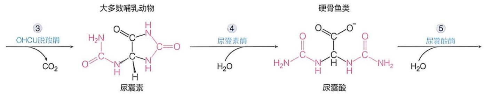

flowchart

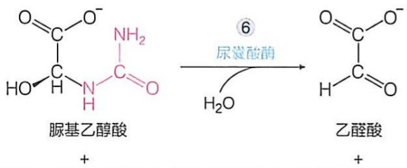

chemical

Chemical reaction equation showing oxidation of uracilic acid to aldehyde using urea hydrochloride

两栖动物、软骨鱼

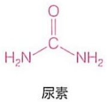

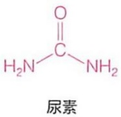

海洋无脊椎动物

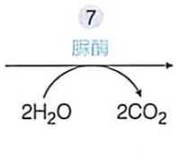

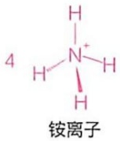

图 26-25 尿酸被分解为铵离子和二氧化碳的反应过程

中也发生突变，转变为无活性的假基因。因此，人类血清中的尿酸水平相对较高（240～360  $\mu$ mol/L），远高于其他哺乳动物（如小鼠为30～120  $\mu$ mol/L）。此外，人类个体的血清尿酸水平与其对嘌呤核苷酸的摄入量及分解代谢能力密切相关，血清尿酸水平较高的人群患痛风（gout）和肾结石的风险增加。痛风是一种由尿酸生成过多或排泄不畅引起的疾病，其临床特征为高尿酸血症和反复发作的急性关节炎。由于尿酸盐的溶解度有限，当其在血浆中的浓度超过580  $\mu$ mol/L时，容易形成结晶，沉积在关节、软组织和肾脏等部位，从而引发关节炎、尿路结石和肾脏疾病等。

如前所述，在嘌呤核苷酸从头合成途径中的调节酶（如PRPP合成酶和谷氨酰胺-磷酸核糖基焦磷酸酰胺基转移酶）可被下游中间体或终产物反馈别构抑制（见图26-7）。若这些调节酶发生突变，使其活性不再受到别构抑制，就可能会导致嘌呤核苷酸合成过量。此外，若参与嘌呤核苷酸补救合成途径的次黄嘌呤-鸟嘌呤磷酸核糖转移酶（HGPRT）和腺嘌呤磷酸核糖转移酶（APRT）因遗传缺陷而失活，也会导致嘌呤碱基底物的积累。这些情况都可能使个体尿酸水平升高，引发痛风等疾病。

灵长类动物在演化过程中为何耐受尿酸酶失活这一基因突变？尿酸凭借其独特的化学结构与氧化还原特性，为动物提供了有效的抗氧化活性。这表明尿酸能够与一些高度活跃的自由基（例如羟基自由基·OH）发生反应，进而生成相对稳定且危害较小的尿酸自由基，发挥清除体内活性氧的作用。这一特性可能对人类寿命的延长起到了重要作用。然而，当尿酸在体内过度积累时，却又会因其化学结构特征而对机体造成损害。

## (5) 黄嘌呤氧化酶的抑制剂被开发为治疗痛风的药物

20 世纪五六十年代，人们尝试通过抑制黄嘌呤氧化酶来治疗痛风等疾病。为此，他们通过理性设计，开发了别嘌呤醇（allopurinol）作为治疗痛风的有效药物。别嘌呤醇是次黄嘌呤的类似物，由正常的嘌呤环中的 N7 和 C8 互换位置而设计产生（图 26-26）。

别嘌呤醇是一种针对黄嘌呤氧化酶的自杀性抑制剂。当它进入细胞后，可由黄嘌呤氧化酶催化生成别黄嘌呤 [alloxanthine，也称别嘌呤二醇（oxypurinol）]。生成的别黄嘌呤能够与黄嘌呤氧化酶的钼蝶呤辅因子紧密结合，形成稳定的复合物，进而抑制该酶的活性。通过这种方式，可以有效减少体内尿酸的生成，从而达到治疗痛风的效果。

图 26-26 用于治疗痛风的别嘌呤醇是黄嘌呤氧化酶的自杀性抑制剂

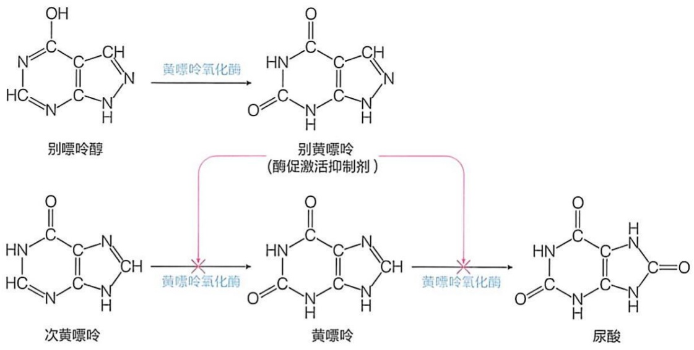

flowchart

## 26.7.3 哺乳动物体内多余的嘧啶碱可被有效分解为 $\beta-$ 氨基酸、氨和二氧化碳等

与嘌呤碱的分解过程相比，嘧啶碱的分解过程更为简单有效，具体过程如图 26-27 所示。

由嘧啶核苷酸所产生的多余嘧啶碱可被有效分解，其分解过程涉及脱氨、氧化、

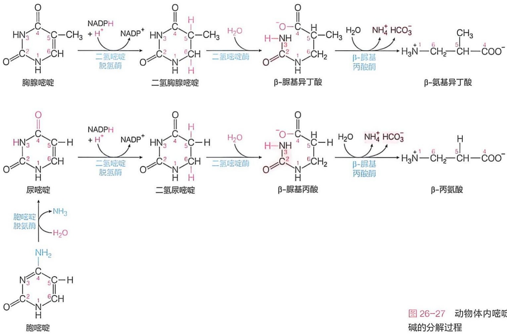

flowchart

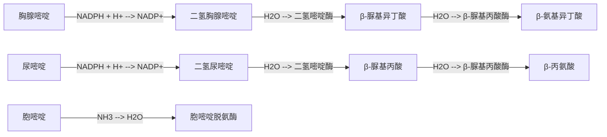

还原及脱羧等反应。

具体而言，胞嘧啶首先在胞嘧啶脱氨酶（cytidine deaminase）的催化下脱氨，转化为尿嘧啶。尿嘧啶和胸腺嘧啶均可在二氢嘧啶脱氢酶（dihydropyrimidine dehydrogenase）的催化下，使嘧啶环上位于C5和C6之间的双键被还原，分别生成二氢尿嘧啶和二氢胸腺嘧啶，这一反应过程由NADPH提供电子。接下来，在二氢嘧啶酶（dihydropyrimidinase）的催化下，嘧啶环上位于N3和C4位置的酰胺键发生水解，二氢尿嘧啶被转化为β-脲基丙酸，而二氢胸腺嘧啶则被转化为β-脲基异丁酸（β-aminoisobutyrate）。最后，β-脲基丙酸和β-脲基异丁酸均在β-脲基丙酸酶（β-ureidopropionase）的催化下，依次发生脱氨和脱羧，分别被转化为β-丙氨酸和β-氨基异丁酸排出体外，或被继续完全分解。

## ※展望

细胞合成核酸所需核苷酸前体必须根据细胞的需求持续不断合成并供应。以下是几个有关核苷酸合成代谢有待回答的科学问题。

细胞内参与嘌呤和嘧啶核苷酸从头合成途径的所有酶各自形成的复合物（即嘌呤体和嘧啶体）之间是否存在空间上的关联？

所有的脱氧核苷酸均通过利用核糖核苷酸前体，并经由同一种酶——核糖核苷酸还原酶的催化而实现。这种酶不仅要催化四种不同脱氧核苷酸的形成，还需使得它们以平衡的量被产生。这种酶在活细胞内是如何完成其复杂的催化和调节功能的？根据体外研究提出的它通过改变其寡聚体状态而调节其催化活性的机制是否的确在活细胞内发生？

在人体内，核苷酸、核苷或碱基的含量过高，可产生毒性。例如，当人体的腺苷脱氨酶存在遗传缺陷时，人体的免疫系统就无法正常发育，而出现重症联合免疫缺陷病；当次黄嘌呤-鸟嘌呤磷酸核糖转移酶存在遗传缺陷时将出现智力迟钝和自毁行为。这些因为某些核苷酸代谢物的积累而导致的机体紊乱的机制尚不清楚，有待深入探究。

## ※ 本章小结

食物中的核酸在肠道降解为基本单位后被吸收，游离的碱基在细胞内可通过补救合成途径与磷酸核糖焦磷酸（PRPP）缩合，重新转化为核苷酸。

嘌呤核苷酸合成分为两个阶段。首先在PRPP基础上，利用Gln、Gly、 $N^{10}-$ 甲酰-四氢叶酸、 $\mathrm{CO}_{2}$ 和天冬氨酸合成次黄嘌呤核苷单磷酸（IMP），然后再合成AMP和GMP。嘧啶核苷酸则是利用 $\mathrm{CO}_{2}$ 、谷氨酰胺和天冬氨酸为原料，先合成乳清酸，再与PRPP缩合成乳清酸核苷单磷酸（OMP），然后脱羧生成UMP，再衍生出CTP。

核苷酸的从头合成途径通过反馈抑制机制调控。同时，ATP 和 GTP 分别为 IMP 转变为 GMP 和 AMP 提供能量，形成一种相互制约机制，维持 AMP 和 GMP 生成的平衡。

三磷酸核苷酸可以环化生成相应的环核苷酸，发挥信号分子作用。ATP 还用于 FAD、CoA、NAD $^{+}$ 、NADP $^{+}$ 等辅因子的合成。

脱氧核苷二磷酸（dNDP）是在核苷二磷酸（NDP）水平经由核糖核苷酸还原酶催化合成，该酶通过复杂的底物特异性调节机制实现四种 dNTP 之间比例的平衡。

dTMP 从 dUMP 甲基化生成，该反应由胸苷酸合酶催化发生。胸苷酸合酶及二氢叶酸还原酶抑制剂可阻断 dTMP 的合成，进而阻止肿瘤细胞的增殖。

嘌呤环在人体内的终产物为尿酸，黄嘌呤氧化酶是该转化过程中的一种关键酶。痛风是嘌呤代谢异常，导致尿酸水平升高、结晶，沉积在关节引发的炎症和疼痛。嘧啶环可以被打开，转变为 $\beta-$ 氨基酸等排出体外，或被完全代谢分解。

## ※ 思考题

1. 从头合成四种 NTP 各需要消耗多少个 ATP 分子？
2. 自由基除参与核糖核苷酸还原酶的催化，还有哪些功能？
3. 你认为核苷酸代谢所涉及的哪些酶是治疗癌症药物的重要靶点？为什么？

4. 灵长类动物基因组上有两个重要的酶基因因为突变而变成了假基因，一个是尿酸氧化酶基因，另一个是催化维生素 C 合成最后一步反应的 L- 古洛糖酸 -γ- 内酯氧化酶（L-gulono-γ-lactone oxidase, GULO）基因。你认为这两个酶的基因成为假基因是进化

上的巧合还是有什么特别的生物学意义？

5. 你如何解释脱氧核苷酸的合成主要在 NDP 的水平进行还原，dTMP 在 dUMP 水平进行甲基转移，而胞苷酸在 UTP 水平进行氨基转移？

6. 羟基脲具有清除酪氨酸自由基的功能，为何它具有抗肿瘤作用？

## ※ 推荐阅读

1. MITTAL R, PATEL K, MITTAL J, et al. Association of PRPS1 mutations with disease phenotypes [J]. Dis Markers, 2015 (1): 1–7.
该文综述了磷酸核糖焦磷酸合成酶 1（PRPS1）基因突变相关综合征的分子机制，并对其靶向治疗策略进行了探讨。
2. SCHULMAN M P, BUCHANAN J M. Biosynthesis of the purines. II. metabolism of 4-amino-5-imidazolecarboxamide in pigeon liver [J]. J Biol Chem, 1952, 196 (2): 513–526.
该研究揭示了 4-氨基-5-咪唑甲酰胺在鸽子肝脏嘌呤合成中的核心作用:它通过特定酶促反应被转化为嘌呤核苷酸；同位素标记实验结果表明，它作为前体直接参与嘌呤核苷酸的生物合成。
3. AN S, KUMAR R, SHEETS E D, et al. Reversible compartmentalization of de novo purine biosynthetic complexes in living cells [J]. Science, 2008, 320 (5872): 103–106.
该研究首次在细胞内发现“嘌呤体”多酶复合物的存在，揭示了其介导嘌呤从头合成的分子机制。
4. YANG C Z, ZHAO Y L, WANG L, et al. De novo pyrimidine biosynthetic complexes support cancer cell proliferation and ferroptosis defense [J]. Nat Cell Biol, 2023, 25 (6): 836-847.
该研究发现嘧啶从头合成通路中的关键酶在电压依赖性阴离子通道蛋白3的介导下，于细胞内组装形成“嘧啶体”多酶复合物。
5. JONES M. Pyrimidine nucleotide biosynthesis in animals: genes, enzymes, and regulation of UMP biosynthesis [J]. Annu Rev Biochem, 1980, 49: 253-279.
该文综述了尿苷单磷酸（UMP）的生物合成途径，并阐述了其代谢通路的调控机制与生物学意义。
6. ZALKIN H, DIXON J. De novo purine nucleotide biosynthesis [J]. Prog Nucleic Acid Res Mol Biol, 1992, 42: 259-287.
该文综述了从嘌呤核苷酸从的头合成途径及关键酶的作用机制。
7. ELIASSON R, PONTIS E, SUN X, et al. Allosteric control of the substrate specificity of the anaerobic ribonucleotide reductase from Escherichia coli [J]. J Biol Chem, 1994, 269 (42): 26052-26057.

该研究揭示了厌氧型核糖核苷酸还原酶底物特异性的别构调节机制。

8. FAIRMAN J W, WIJERATHNA S R, AHMAD M F, et al. Structural basis for regulation of human ribonucleotide reductase by nucleotide-induced oligomerization [J]. Nat Struct Mol Biol, 2011, 18 (3): 316-323.

基于 X 射线晶体学与单颗粒冷冻电镜的结构分析，该研究揭示了人源核糖核苷酸还原酶在 dATP 诱导下发生寡聚化实现其活性调节的分子机制。

(撰写: 杨荣武, 秦咏梅, 李珍, 黄春洪; 审修: 杨广笑, 李森, 赵晶, 丁智)

# 哺乳动物代谢整合与激素调控

通过前面各章的学习，我们对各类生物分子的结构特征、生物功能以及它们在生物体内的分解与合成代谢过程等有了较为全面的了解。然而，任何动物个体都是一个由功能各异的不同器官组成的有机整体。尽管动物的每一个器官均独立进行各种合成与分解代谢，但这些器官的代谢活动之间存在着密切的相互关联，需进行协调整合，才可维持和延续动物个体的生命。例如，当骨骼肌进行剧烈运动时，肺部需要获取足够的氧气；当消化道摄入各种食物后，肝脏、脂肪组织等器官需要密切配合，对摄取的营养分子进行合理的分配处理并调控这些代谢过程。

对于 19 世纪的生理学家而言，无论他们是倾向于机械论（mechanism）还是活力论（vitalism），都认识到动物机体能通过神经系统调节全身生理活动。例如，1850 年代，法国学者贝尔纳就强调了神经控制在肝脏生糖功能中所扮演的角色。到了 1870 年代，已经有相当多的实验证据表明，像肾上腺和甲状腺这样的无导管的内分泌腺（endocrine gland）能将影响机体功能的化学物质分泌到血液中。到了 1890 年代，人们逐渐认识到内分泌腺分泌的物质在代谢调控中表现出一种独特的工作模式；每一种组织，甚至机体的每一个细胞，都被认为可以将特殊的产物或酵素（酶）分泌到血液中。这些分泌物通过血液循环影响机体的所有细胞，从而通过一种独立于神经系统的机制将动物个体所有细胞的代谢活动整合在一起。其中，肾上腺素这种从肾上腺提取物中分离的、能够影响血压的物质，其结构被鉴定出来。此外，人们也观察到，内分泌腺的损伤或手术切除会导致严重的生理后果。

1900 年代，英国学者威廉·贝利斯（William Bayliss，1860—1924）

## 27

和欧内斯特·斯塔林（Ernest Starling，1866—1927）观察到胰液分泌受小肠分泌物质调节的现象。具体而言，当向一条脊髓和小肠神经均被切断的犬的十二指肠中注入稀释的盐酸溶液时，可引发含碳酸氢盐的碱性胰液分泌。这表明，这样的胰液分泌并非由神经反射引起，而是受到某种化学物质的调控。他们由此推断，小肠黏膜在盐酸的刺激下会产生一种被称为分泌素（secretin）的化学物质，这种物质通过血液循环被运输至胰腺，诱发胰液分泌。随后，他们创造了“激素”（hormone）这一术语（其词义是“引起”或“使兴奋”），用于定义这种能够通过血流循环从一个细胞传递到另一个细胞（或一种器官到另一种器官）的化学信使。它们引发相应的生理效应，从而协调机体不同部位的代谢活动。

后续研究表明，生物分子的分解与合成代谢在动物个体水平的整合，主要通过神经系统和内分泌系统所分泌的神经递质和激素等化学信使来实现。其中，神经递质主要在短距离内发挥作用，而激素可以在长距离范围内对机体不同器官中的代谢活动进行协调整合。

本章将从细胞、组织和器官的不同层次出发，介绍哺乳动物个体不同器官之间的代谢分工与整合，特别是激素所发挥的重要作用。通过对个体不同器官的代谢活动进行时空整合，哺乳动物个体可有序高效地进行生命活动，以适应不同生理状态下的不同需求。器官间代谢整合的失调与紊乱往往会引发多种疾病（如糖尿病）。因此，认识这种长距离代谢整合过程，对于人类更好地维护自身健康具有重要意义。

## 27.1 动物体内代谢过程的可调节性特征被逐渐揭示

动物个体水平的代谢整合依赖于细胞和分子水平的代谢调节。据估计，人体每个细胞中约有一千种酶，这些酶催化不同的代谢反应。这些代谢反应被人为地归纳为不同的代谢途径，但这些代谢途径在细胞内并非独立存在，也并非相互容易区分，而是紧密交织在一起，形成一种复杂的网络（见图 16-5） $^{①}$ 。

## 27.1.1 动物个体和细胞水平的代谢活动动态响应不断变化的环境条件

对哺乳动物等的长期研究观察表明，其内部环境相对稳定。从代谢角度而言，主要体现在其代谢物浓度的相对恒定等方面。这种恒定性是通过反馈抑制等调节过程实现的，而且这一特征在所有生物中都普遍存在。下面简单回顾对哺乳动物代谢特征的认识历程。

<small>① 也请参考由英国学者唐纳德·尼科尔森（Donald Nicholson，1916—2012）专为国际生物化学与分子生物学联合会（IUBMB）制作的代谢通路图:http://www.iubmb-nicholson.org/。</small>

1860 年代，贝尔纳凭借对动物血液化学组成的分析以及对高等恒温动物的体温通过交感神经等途径维持恒定的观察，首次提出了高等动物 “内环境” 的概念，以区别于其周围的外环境。特别是在 1870 年代，贝尔纳宣称:内环境的恒定性是自由且独立生命出现的关键条件。

美国学者坎农研究了交感神经对消化道运动的影响，同时观察到肾上腺提取物（即肾上腺素）对情绪（恐惧或愤怒）的自我调节效应。在此研究基础上，他于1920年代末提出了“稳态”（homeostasis，也称内稳态）的概念。他特意使用“homeo”而非“homo”，旨在强调生物体内的这种稳态并非绝对恒定，而是在一定范围内上下波动，用以解释贝尔纳所观察到的高等动物内环境稳定的现象。

1940 年代，美国学者诺伯特·维纳（Norbert Wiener，1894—1964）等将负反馈等工程和信息学概念引人生理学领域，以解释动物内环境的稳态是如何维持的。这一理论很快得到了验证，人们在激素分泌体系中观察到明显的负反馈现象。例如，脑垂体分泌激素的过程受到甲状腺激素的负反馈调控。

1950 年代，随着细菌营养缺陷型突变体在有关氨基酸、嘌呤和嘧啶生物合成代谢途径研究中的有效应用，以及对相关酶的分离纯化和表征，人们获得了反馈抑制现象在细胞水平发生的证据。这包括胞苷三磷酸（CTP）抑制大肠杆菌胞苷三磷酸生物合成途径中第一个限速步骤以及异亮氨酸特异抑制从苏氨酸开始合成异亮氨酸过程中的第一步酶促反应等。美国学者厄尔·萨瑟兰（Earl Sutherland，1915—1974）等在探究肾上腺素或胰高血糖素对狗的肝脏切片中糖原磷酸化酶活性的影响时，观察到肝细胞中环状 3',5'- 磷酸腺苷（cyclic AMP，cAMP）的产生。1960 年代他们将此定义为第二信使（second messenger），以区别于 1900 年代贝利斯和斯塔林等发现的第一信使——激素。

1960 年代，人们观察到，一些调节酶（典型的如大肠杆菌天冬氨酸转氨甲酰酶）的动力学特征不遵守米氏方程。当用初速度对底物浓度作图时，这些调节酶呈现的是与血红蛋白氧合曲线类似的 S 形。为此，人们提出了酶的别构调节机制。

至此，人们对代谢现象和代谢调节机制的认识从个体水平进入到了细胞和分子水平。

细胞内复杂而密集的代谢网络意味着:一方面，当一种代谢中间物（如葡萄糖-6-磷酸）进入某条代谢途径进行（分解或合成）代谢时，其参与的其他代谢途径的流量也将受到影响。另一方面，随着生理条件的改变，细胞需调节每条代谢通路的流量，以维持各种代谢物浓度的基本稳定，从而在整体水平维持生物个体的稳态特征。

动物血液中的各种物质大多维持在一种稳态。对于认识代谢物的稳态而言，最典型的例子可能就是动物的血液。血液中不仅包含大量不同的蛋白质成分，也存在大量不同的小分子物质。对于健康的成年动物而言，其血液中的代谢物被维持在各自的稳态，这可以通过对动物个体处于不同状态下其血液中某种代谢物浓度的测定进行观察。例如，人体血液中的葡萄糖浓度及胰岛素浓度在一日三餐前后的变化（图 27-1），就能很好地反映代谢物的稳态。

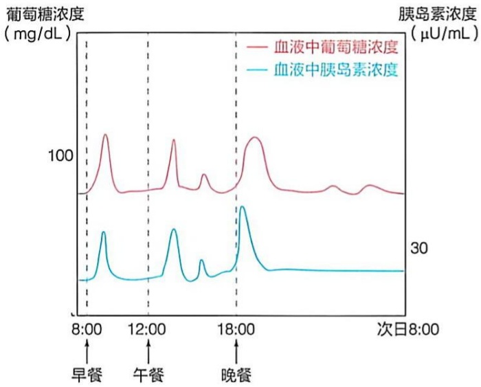

line

| 时间 | 血液中葡萄糖浓度 (mg/dL) | 血液中胰岛素浓度 \((\mu U/mL)\) |
| --- | --- | --- |
| 8:00 | ~75 | ~25 |
| 12:00 | ~75 | ~25 |
| 18:00 | ~75 | ~25 |

图 27-1 人体在一日三餐前后血液中葡萄糖和胰岛素浓度的波动和稳态现象

具体而言，每餐进食后，随着血液中葡萄糖水平的升高，胰岛素水平也会相应上升。然而，在两餐之间，葡萄糖和胰岛素的浓度均会下降。尽管存在这种波动，但它们在血液中的浓度始终被维持在一定的范围内。

在动物个体和细胞水平表现出来的代谢物稳态现象，在分子水平上可以简化为特定代谢物的产生和消耗速率基本持平:

$$
\mathrm{A} \xrightarrow {\nu_ {1}} \mathrm{S} \xrightarrow {\nu_ {2}} \mathrm{P}
$$

对处于细胞代谢途径中的代谢物 S 而言，如果将它从代谢物 A 产生的速率以  $v_{1}$  代表，而它转化为代谢物 P 的速率以  $v_{2}$  代表，则细胞所维持的状况使得  $v_{1}$  和  $v_{2}$  基本相等，这样代谢物 S 的含量就基本处于稳态。当受到暂时性扰动时，代谢物 S 的浓度可能升高或降低。这可通过代谢酶活性的调节而保持稳态。

## 27.1.2 细胞中催化远离平衡反应的酶常为代谢途径的调节点

在特定条件下，细胞中的每一种酶促化学反应都具有特定的质量作用比（mass-action ratio），即产物与底物的物质的量浓度的比值（用 Q 表示）。如果一个酶促化学反应的 Q 值与其平衡常数  $K'_{eq}$  接近（注意:酶的催化并不影响反应的平衡常数），则表明该酶促化学反应接近平衡状态，也就是说酶促化学反应的正向速率与逆向速率接近。但是，如果一个酶促化学反应的质量作用比远低于其平衡常数，比如低 3～5 个数量级，这意味着产物浓度远低于平衡态时的浓度，而反应物则远高于平衡态时的浓度。根据公式

$$
\Delta G = R T \ln \frac {\left[ \mathrm{C} \right] \left[ \mathrm{D} \right]}{\left[ \mathrm{A} \right] \left[ \mathrm{B} \right] K _ {\mathrm{eq}} ^ {\prime}}
$$

该酶促反应的  $\Delta G$  大多为大的负值，为放能反应。与一条代谢途径中的其他酶促化学反应相比，这样的远未达到平衡状态的酶促反应的正向速率一般较低，而其逆向反应的速率更低，接近 0。细胞中这样的酶促化学反应一般难以达到平衡状态；如果要其达到平衡状态，其产物浓度必须远高于正常水平（在细胞内几乎不可实现）。

这样的低速率酶促化学反应通常是一条代谢途径的限速步骤（rate-limiting step）；在这种情况下，该酶促反应的净正向（或前向）反应速率（net forward reaction rate）将决定代谢途径中间物流经其他处于平衡状态的酶促反应的速率。催化这种远离平衡状态反应的酶一般都是调节酶（regulatory enzyme）:当其活性增强时，可使限速步骤达到平衡状态的时间缩短，即加快整个代谢途径的流量。相应地，代谢途径中的其他接近平衡状态的反应被称为非限速步骤。

在不同的代谢途径中，可以鉴定到一步甚至多步酶促化学反应满足上述条件，这些反应都被认为是可能的调节步骤。例如，在糖酵解途径中，已糖激酶、磷酸果糖激酶-1和丙酮酸激酶所催化的化学反应，其质量作用比是平衡常数的大约十万分之一；也就是说，它们所催化的化学反应远离平衡状态，其净正向反应速率将决定糖酵解途径的净流量。体外实验表明，这些酶的活性的确可以被不同的别构调节剂调节（见第17章）。

## 27.1.3 调节酶的活性可通过不同方式被调节

尽管调节酶活性被调节的方式有多种，但总体可分为两大类。第一类是在不改变细胞内酶含量的前提下，对酶的活性进行调节；第二类则是通过改变酶的含量来调节其活性。前一类可被视作细胞适应环境变化的核心策略，具有快速响应和更低能量消耗的优势。我们在第16章代谢总论中对这些内容进行了介绍（图16-16），在此仅作简单回顾。

## (1) 不改变酶含量的酶活性调节

在细胞内酶的含量保持恒定的条件下，其活性可以通过以下方式调节。①底物的可利用性:与体外酶活性测定系统不同的是，细胞内其底物的浓度可能会很低，在这种情况下，酶的活性当然也就无法充分发挥；在这种情况下，通过增加底物的浓度可以提高酶的活性。②别构因子的作用:在很多情况下，一种调节酶的活性可以被代谢途径的终端（或下游）产物（或代谢物）别构抑制。然而，在少数情况下，也可以被代谢途径的上游因子别构激活。③可逆共价修饰:酶的活性可通过可逆磷酸化等修饰方式调节，这是很多激素信号的作用方式。④调节蛋白的作用:在某些情况下，酶与调节蛋白发生相互作用时，其活性会发生改变。⑤酶定位的区隔化:当调节蛋白与酶结合时，会使酶定位于不同的亚细胞部位，使其无法接触到酶的底物而失活。例如，肝细胞中的己糖激酶IV（又称葡萄糖激酶），可与一种定位于细胞核内的调节蛋白可逆结合，这种结合使得己糖激酶IV被锁定在细胞核中，无法接触到其底物（如葡萄糖），从而无法发挥活性（见图17-9）。

## (2) 改变酶含量的酶活性调节

这主要通过以下几种途径实现:调控调节酶编码基因的转录过程；调控编码特定调节酶 mRNA 的降解或翻译活性；调控特异调节酶的降解，如通过泛素-蛋白酶体途径。这里不做详述。

综上，代谢途径的流量调节可通过调节其中某种或几种调节酶的活性而实现。通常情况下，这些调节是暂时性的，经过一定时间后，酶的活性会逐渐恢复，最终维持代谢中间物的稳态。然而，当受到长期和大幅扰动，代谢途径中调节酶的活性可能发生更为剧烈且持续的变化。在这种情况下，代谢中间物的水平可能会升高或降低，并最终达到一种新的稳态。

## 27.1.4 一种调节酶对代谢途径流量控制的贡献可用通量控制系数表征

代谢通路的调控本质上是一种定量现象，不能仅进行定性描述。因此，必须建立定量的表征方法。从 1970 年代开始，人们就试图建立一种基于定量分析的代谢控制表征方法。

为此，人们建立了通量控制系数（flux control coefficient；一般以 C 表示）这一概念:它为代谢途径中的每种酶促化学反应对整体代谢途径通量控制的贡献提供了一种定量表征方式，其数值反映一种特异酶活性的增加对代谢通路流量的影响程度。所有的相关方法都在一定程度上涉及对非线性函数导数（即切线斜率）的测定。由于具体方法涉及大量数学概念和复杂公式，因此这里仅对通量控制系数这一概念做简要介绍。

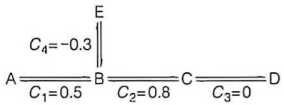

text_image

C₄ = -0.3
A ———— B ———— C ———— D
      C₁ = 0.5       C₂ = 0.8       C₃ = 0

图 27-2 单个酶促反应对整个代谢通路流量的贡献可通过通量控制系数（C）反映

简而言之，一条代谢途径的总通量控制系数（C）被定义为1。因此，每种酶促化学反应的C值通常介于0.0和1.0之间。其中，0.0表示该酶促反应对代谢途径的代谢通量完全无影响，1.0则表明该酶促反应是代谢途径流量的主要决定者，可被视作代谢途径的唯一限速步骤。每种酶促化学反应的C值反映了该酶在决定整条代谢途径代谢物流量（flux；通常以符号J代表）过程中的相对贡献程度（图27-2）。此外，C值还可以是负数。如果某种特定的酶促化学反应将代谢途径的某一代谢物引入另外一条代谢途径，那么该酶活性的提高将降低原代谢途径的流量（如图27-2中从B到E这步反应，其 $C_{4}=-0.3$ ）。

但是，每种酶的 C 值并非一个常数，也并非由该酶的内在性质所决定，也不与所催化反应远离平衡的程度存在直接关联，而是综合反映整个代谢网络系统的特征。这一概念的提出，旨在揭示代谢网络通量控制的构建特征。由于缺乏可靠的体内动力学模型，目前人们还难以基于对活生物体的分析而获取准确的 C 值；大部分 C 值是基于无细胞抽提液这样的体外系统获得，但活细胞同位素示踪和基因扰动等测定技术也开始被广泛利用。

这些观察结果表明，一种被别构因子高度调节且显示大幅活性变化的酶，可能对代谢途径流量的影响有限。也就是说，这种高调节性酶的流量控制系数 C 值可能不高。一个典型例子是对糖酵解途径中几种催化远离平衡的酶促化学反应的 C 值分析（主要基于对细胞抽提物的分析）。尽管早期的体外研究表明，磷酸果糖激酶 -1（PFK-1）是糖酵解过程中最重要的调节酶，因为它可被多种别构因子调节（见图 17-7）。然而，代谢控制分析结果表明，其 C 值显著低于己糖激酶的 C 值（分别约为 0.21 和 0.79），这表明 PFK-1 可能更多起代谢调节（metabolic regulation）作用（维持代谢物稳态），而己糖激酶更多是起代谢控制（metabolic control）作用（改变代谢途径的流量）。

因此，人们将代谢途径中某种酶活性改变所扮演的角色分为两类:代谢调节和代谢控制。代谢调节旨在维持代谢物的稳态，即在不同细胞条件下，维持代谢物浓度基本恒定，即使在代谢通路流量发生显著变化时也不例外，其调节的结果是使代谢物水平恢复至恒定状态。而代谢控制则是在一定条件下（如响应外部信号或环境发生改变时），使代谢途径的输出发生永久性改变，也就是说，在改变代谢途径流量的同时，促使代谢物达到新的稳态（浓度被提高或降低）。

通过分析通量控制系数，人们逐渐认识到，一条代谢途径的流量常由多种酶共同控制，并非像早期人们所设想的那样，仅依赖于某种催化限速步骤的酶。

## 27.2 哺乳动物个体的不同器官各具独特代谢特征

动物个体由多种器官构成，这些器官既各自承担独特的生理功能，又相互依存和配合，共同服务于整个个体。细胞内的代谢网络通过酶活性别构调节等进行自我调控。然而，动物个体水平的代谢则依赖于各器官间代谢的有效协调与整合。

哺乳动物个体水平代谢的协调和整合依赖于神经系统、内分泌系统和循环系统。特别是血液循环系统，它可以将一种器官所产生的代谢物或调节因子有效地传递至其他所有器官。例如，肝脏与肌肉之间进行的“乳酸循环”（即所谓的科里循环；见图17-15）就是一个典型的例子:肌肉通过无氧糖酵解将葡萄糖转化为乳酸，后者经血液循环运输至肝脏；肝脏通过糖异生途径将乳酸重新转化为葡萄糖，再通过血液运回至肌肉，供肌肉分解释放能量。这一过程形成了一种基于血液循环完成的肌肉和肝脏两种器官之间的代谢协调机制。

本节先介绍哺乳动物主要器官的代谢特征，然后介绍不同器官之间通过神经系统和内分泌系统实现代谢整合的机制。

哺乳动物的各器官因所含蛋白质不同，其功能及代谢特征也存在差异。其中，肝脏是哺乳动物代谢网络的中心枢纽。肝细胞中存在几乎所有主要的代谢途径，是一种代谢全能型器官。在描述哺乳动物的代谢特征时，一般将肝脏与其他器官分开论述，将其他器官统称为肝外器官。例如，为了满足大脑和红细胞等对葡萄糖的高度依赖，肝脏在动物饥饿时，利用各种前体分子通过糖异生途径合成葡萄糖，并将其释放入血液供大脑等器官利用。也就是说，肝脏的正常代谢是大脑等器官正常运行的基础。

因此，哺乳动物各器官代谢之间既分工又合作的机制，是个体生长发育和生存的基础。这犹如人类的社会或国家，不同部门和机构之间的有效分工和协作，是其正常运行的基础。

下面介绍哺乳动物各主要器官的代谢特征。

## 27.2.1 作为代谢中枢的肝脏为其他器官提供广泛的代谢支持

早在 1840 年代，贝尔纳等就观察到，未从饲料中获取过糖分的哺乳动物，其肝脏流出的血液中却含有糖。他们还将犬的肝脏切下后彻底清洗以去除残留血液，结果发现第二天又有糖的生成；但如果将清洗过的肝脏煮沸，糖的生成就会停止。基于这些实验现象，贝尔纳得出结论，生成葡萄糖是肝脏组织的一种特性，肝脏具有从非糖物质生成葡萄糖的功能，从而否定了人们长期持有的错误观点——动物体内的所有糖类物质均来源于食物。这一发现是在已知肝脏具有生成胆汁酸功能的基础上，进一步认识到的第二种生物学功能。在 1850 年代，贝尔纳等还在肝脏中发现了糖原的存在。这种物质在水中溶解性极低，可通过当时被认为是类似发酵的过程而被缓慢地转化为葡萄糖。后来，在化学家的协助下，糖原被鉴定为一种类似于淀粉的物质（被称为“动物淀粉”）。

在 1880 年代，肝脏的第三种功能——尿素生成功能也被认识到。具体而言，沃尔德马·冯·施罗德（Woldemar von Schröder，1850—1898）等观察到，当给犬的肝脏灌注铵盐时，会导致大量尿素的生成。

在 1900 年代，人们通过向肝脏灌注含有不同物质的盐溶液，对肝脏代谢转化各种物质的能力进行了大量的观察和分析。

这些研究表明，肝脏是哺乳动物体内的代谢反应中心，其中涉及大量不同的生物合成和分解过程。肝细胞以极高的代谢速率，对糖类、脂质、蛋白质、维生素、微量元素乃至外来药物和毒素等多种物质进行分解、合成、转化和储存。这些物质经过肝脏的加工处理后，被输送至其他器官，供后者利用或进一步处理。与其他组织器官相比，肝脏表现出明显的代谢多样性，从而成为哺乳动物的代谢中枢（metabolic hub）。

作为核心代谢器官，肝脏是哺乳动物体内最大的内脏器官。人体肝脏的平均重量

约为 1.5 kg，约占人体总重的 2%。肝脏位于腹腔右上方，紧邻胃部。哺乳动物的肝脏通过肝门静脉（portal vein）、肝动脉（hepatic artery）、肝静脉（hepatic vein）和胆总管（common bile conduct）等与其他器官相连（图 27-3），这为肝脏作为代谢中心提供了重要保障。

肝门静脉收集来自消化道（以及脾脏和胰腺）等器官的血液，将饮食中摄入的各种营养（及有毒）物质（但不包括长链脂肪酸和乳糜微粒等）直接运输至肝脏。肝脏对这些摄入物质进行处理，包括对糖类、脂肪和蛋白质等营养物质的代谢以及对有毒物质的解毒等。因此，口服药物在被胃肠道吸收后，也会通过肝门静脉首先进入肝脏，经历所谓的首过效应（first pass effect）:药物在进入全身循环之前，部分药物会被肝脏代谢。此过程可能减少最终进入全身循环的药物量，因此，在设计药物治疗方案时，需要将此因素考虑在内。

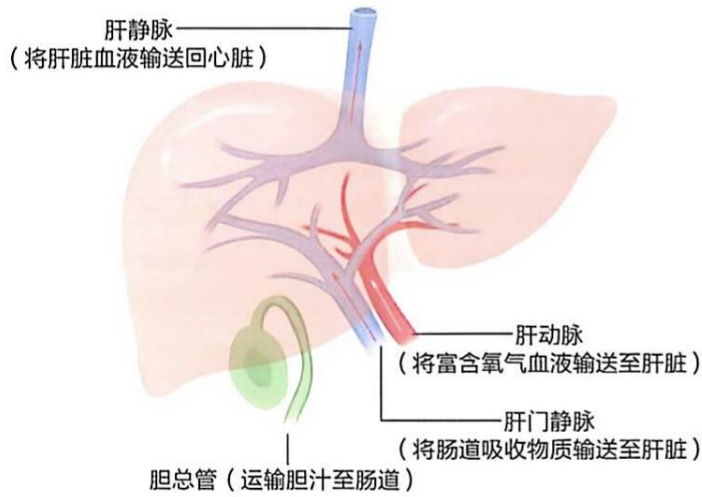

text_image

肝静脉
（将肝脏血液输送回心脏）
肝动脉
（将富含氧气血液输送至肝脏）
肝门静脉
（将肠道吸收物质输送至肝脏）
胆总管（运输胆汁至肠道）

图27-3 肝脏通过其肝门静脉、肝动脉、肝静脉和胆总管与其他器官连接

肝脏是哺乳动物的代谢中枢，这不仅基于其较大的体积以及通过血液与各器官之间建立的有效连接，更与肝细胞所具备的大量代谢转化功能密切相关。据估计，单个肝细胞内可发生大约500种酶促化学反应；肝细胞含有与糖类、脂质和蛋白质这三大类营养物质相关的几乎所有代谢转换酶促途径。此外，肝脏还是储存多种维生素（如维生素A、 $B_{12}$ 、D、E、K）和微量元素（如铁、铜、锌、硒）的重要场所。因此，作为人类的食物，动物肝脏的营养成分极其丰富。从营养学角度来看，食肉动物通常先吃猎物的内脏部分（包括肝脏），而非其肌肉部分，这一行为是合理的。肝脏的解毒功能主要表现为能够对血液中的有害物质以及微生物抗原等进行酶促化学修饰，将其转化为毒性较低或更易溶于水的物质，随后通过胆汁或尿液排出体外。肝脏的解毒功能一方面有助于维持哺乳动物内环境的稳定，另一方面也为哺乳动物机体构筑一道重要的安全屏障。

## （1）肝脏可摄取、生成、储存和输出葡萄糖

肝脏通过完成对葡萄糖的摄取、生成、储存和输出等功能，成为维持哺乳动物血液葡萄糖稳态的最重要器官。作为肝脏的主要细胞类型，肝细胞（hepatocyte），也称肝实质细胞，占肝总细胞数的70%以上，具备摄取或释放葡萄糖以及使葡萄糖进入糖酵解、糖原合成、戊糖磷酸途径进行化学转化的能力（图27-4）。

具体而言，进食后，肠道吸收的葡萄糖、半乳糖和果糖等单糖经肠静脉进入肝门静脉。当肝门静脉血液中的葡萄糖浓度较高时，肝细胞质膜中的葡萄糖转运蛋白2

（glucose transporter 2，GLUT2；也存在于胰腺β细胞质膜中）将血液中的葡萄糖摄入到细胞内。GLUT2的解离常数 $K_{d}$ 为15\~20 mmol/L，对葡萄糖的亲和力较低，因此只有当门静脉血中的葡萄糖浓度较高时，葡萄糖才会被有效摄入肝细胞，直到门静脉血中和肝细胞内的葡萄糖浓度相等。

进入肝细胞的葡萄糖由己糖激酶IV催化生成葡萄糖-6-磷酸。与肌肉细胞中的同工酶己糖激酶I不同的是:一方面，肝细胞中的己糖激酶IV对葡萄糖的亲和力较低（$K_{\mathrm{m}}$ 值约 $10 \mathrm{mmol} / \mathrm{L}$），而已糖激酶I对葡萄糖的亲和力高出约100倍（$K_{\mathrm{m}}$ 值约 $0.1 \mathrm{mmol} / \mathrm{L}$）（见图17-9A）；另一方面，己糖激酶IV不受产物葡萄糖-6-磷酸的反馈抑制。这意味着只有当肝细胞中的葡萄糖浓度较高时，己糖激酶IV才能有效发挥作用，将葡萄糖转化为糖原或脂肪等进行短期或长期储存；当肝细胞（以及血液）中的葡萄糖浓度较低时，从肝糖原降解产生的葡萄糖将从肝细胞转运至血液，供其

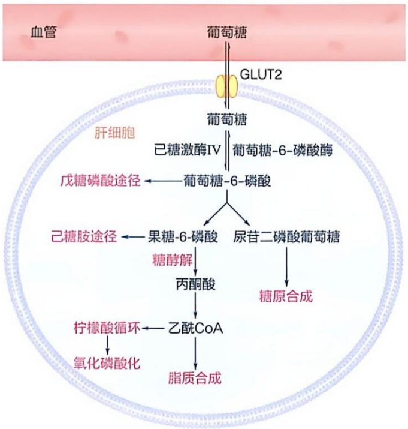

flowchart

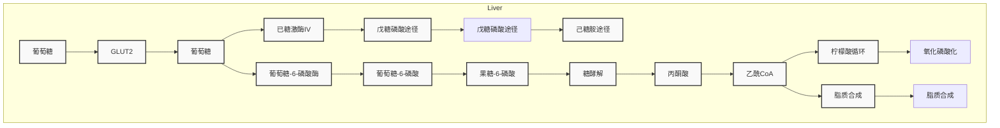

图 27-4 肝细胞中葡萄糖的多种去向