他组织利用。

当肝细胞中葡萄糖处于高水平时，磷酸化的葡萄糖将主要依次进入糖原合成途径、糖酵解途径和戊糖磷酸途径。糖酵解途径产生的乙酰辅酶A将进入脂质（包括脂肪酸、胆固醇和胆汁酸等）合成途径；若进入肝糖原合成途径，葡萄糖-6-磷酸需变位形成葡萄糖-1-磷酸，再活化为尿苷二磷酸葡萄糖（UDP-Glucose）。所产生的果糖-6-磷酸有少量可进入己糖胺途径（hexosamine pathway；利用谷氨酰胺侧链氨基，果糖-6-磷酸可转化为葡萄糖胺-6-磷酸）并最终生成使蛋白质发生糖基化修饰的糖基——尿苷二磷酸-N-乙酰葡萄糖胺（uridine diphosphate-N-acetyl glucosamine, UDP-GlcNAc）。

在哺乳动物的非进食阶段，肝脏将通过糖原降解和糖异生来产生葡萄糖并释放到血液中，以维持血糖水平。在进食时，肝脏中的糖原磷酸化酶处于低活性状态，糖原合酶处于激活状态，糖原被合成且储存在于肝脏中；而在饥饿初期，糖原磷酸化酶处于高活性状态，糖原发生降解，生成的葡萄糖用于补充血糖。动物处于压力状态下分泌的肾上腺素和饥饿时分泌的胰高血糖素激素都可激活糖原磷酸化酶，促进糖原降解；其中，肾上腺素既作用于肝细胞也作用于肌细胞，而胰高血糖素则主要作用于肝细胞（见图 17-32）。

肝脏糖异生途径的调控涉及多种机制，包括胰高血糖素诱导的相关基因表达水平的上调、乙酰辅酶A对丙酮酸羧化酶的别构激活、AMP对果糖-1,6-二磷酸酶的别构抑制，以及糖异生底物可利用性等。胰高血糖素通过信号转导途径，促进某些酶和转录因子的磷酸化，通过提高限速酶的活性和酶的含量而促进糖异生过程。

如果葡萄糖 -6- 磷酸进入戊糖磷酸途径，则可产生 NADPH 和核糖 -5- 磷酸（见图 17-24）。NADPH 不仅用于脂肪酸和胆固醇等的生物合成，还可用于肝脏解毒过

程中清除药物和其他外来物质。此外，肝脏是处理半乳糖和超出肠道转化能力而“溢出”的果糖的主要场所，这些物质在肝脏中转化为葡萄糖或糖酵解的中间体，被进一步利用。在肝门静脉以外的循环血中，几乎无法检测到半乳糖和果糖，这凸显了肝脏在这些单糖代谢转化过程中的核心作用。

（2）肝脏可将来自食物或肌肉等的氨基酸进行多种代谢转换肝细胞中也存在氨基酸的多种代谢转换途径（图 27-5）。

肝脏中的氨基酸主要有三种来源:食物蛋白质的消化产物（进食时）、肌肉组织中蛋白质的降解产物（饥饿时）以及肝细胞自身从头合成的氨基酸。进入肝脏中的游离氨基酸首先被用于合成各种蛋白质。这包括生成肝细胞自身具高周转率的蛋白质，也包括生成血浆蛋白质。肝脏是生成血浆蛋白质（如白蛋白、凝血因子以及载脂蛋白）的主要场所，血浆中除免疫球蛋白之外的几乎所有蛋白质均由肝细胞生成后分泌至血液中。

肝细胞还可以利用柠檬酸循环和糖酵解等的中间体来生成哺乳动物的非必需氨基酸。这些氨基酸作为前体，可用于生成血红素、嘌呤和嘧啶等含氮化合物。肝细胞中多余的氨基酸可以通过血液运输至其他器官，用于生成各器官所需的特异蛋白质。

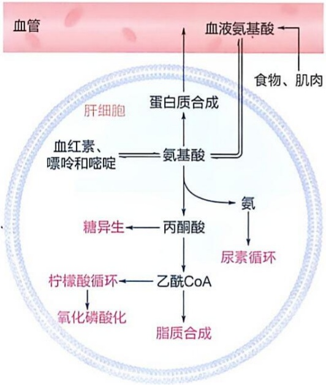

flowchart

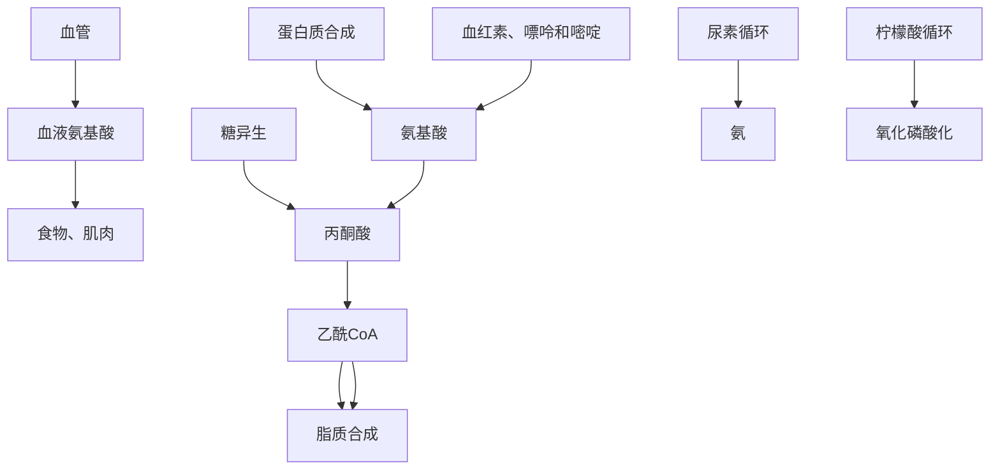

图 27-5 肝细胞中氨基酸的多种去向

在哺乳动物中，肝脏是唯一能够有效降解所有氨基酸（支链氨基酸在肝外组织脱去氨基后进入肝脏氧化分解）的器官。满足合成肝脏和血液中的蛋白质后，剩余的氨基酸通过转氨或脱氨作用，其碳骨架被分解为琥珀酰辅酶A、$\alpha-$ 酮戊二酸和延胡索酸等柠檬酸循环中间体，或丙酮酸和乙酰辅酶A等可进入柠檬酸循环氧化的产物（见图24-19）。在这些代谢产物中，乙酰辅酶A可通过柠檬酸循环彻底氧化，或通过脂质从头合成途径转化为脂肪酸（或酮体，相应的氨基酸被称为生酮氨基酸）、胆固醇；其余的代谢产物则可通过糖异生途径转化为葡萄糖和糖原，以维持血糖水平（相应的氨基酸被称为生糖氨基酸）。肝脏生成的脂肪酸和胆固醇等脂质将以脂蛋白形式通过血液被运输至脂肪组织等储存或利用。

氨基酸的 $\alpha-$ 氨基在肝脏中可通过转氨或脱氨作用被利用或排出体外。在哺乳动物中，除作用于亮氨酸、异亮氨酸和缬氨酸三种支链氨基酸的转氨酶外，介导其他氨基酸转氨作用的酶在肝细胞中的含量是所有类型细胞中最高的，而在血液中则含量较低。只有当肝细胞受损时，转氨酶才会泄漏至血液中，导致血液中转氨酶含量升高，因此成为临床检测肝细胞损伤的重要指标。转氨或脱氨所释放的有毒铵离子在肝脏中通过尿素循环被转化为几乎无毒的尿素，最终随尿液排出。而在鸟类和爬行动物中，铵离子进入嘌呤核苷酸，最终以尿酸的形式被排出体外；在绝大多数水生非脊椎动物、硬骨鱼中和两栖类的蝌蚪阶段，铵离子以氨的形式直接排出到周围环境中（见图24-5）。

总之，肝脏内存在多种酶促化学反应，可使氨基酸发生代谢转化，进而参与蛋白质合成、糖异生和脂质生成等代谢过程。

（3）肝脏能将脂肪酸彻底氧化或转化为胆固醇、胆汁酸或酮体等产物

通常情况下，肝细胞中的脂肪酸代谢可以大致分为三个方面。其一为脂肪酸获取:这包括对食物中甘油三酯的摄取以及脂肪酸的从头合成等。其二为脂肪酸储存:这包括脂肪组织中甘油三酯的生成和脂滴的形成等。其三为脂肪酸消耗:这包括甘油磷脂、鞘脂和类二十烷酸等的合成，脂肪酸通过β氧化途径的分解以及极低密度脂蛋白的分泌等。由此可见，肝细胞中活跃地进行着脂质合成与分解活动，这不仅能满足自身的能量和物质的需求，还能为其他器官输送脂肪酸和酮体等（图27-6）。

肝细胞中脂肪酸的来源主要包括三个方面:一是从食物摄取；二是脂肪酸的从头合成（利用来自葡萄糖的乙酰辅酶A）；三是脂肪的动用。脂肪酸在肝细胞中的主要去向通常是氧化供能。在大多数情况下，肝细胞氧化的主要燃料分子是脂肪酸而不是葡萄糖（或氨基酸）。例如，棕榈酸（16:0）、硬脂酸（18:0）和油酸（18:1 $\Delta^{9}$ ）等长链脂肪酸均为肝细胞常用的燃料分子。

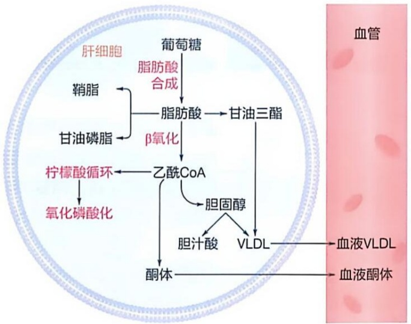

flowchart

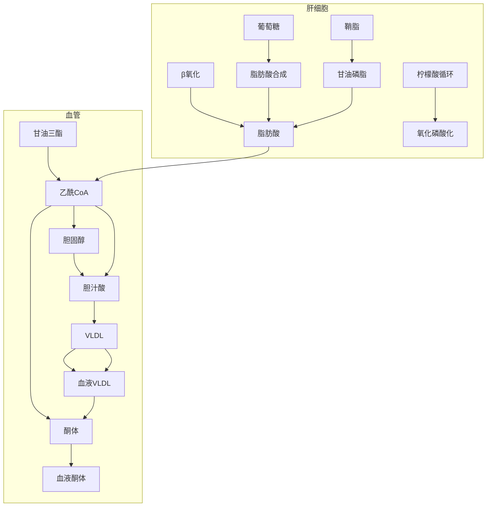

图 27-6 肝细胞中脂肪酸的多种去向 VLDL:极低密度脂蛋白。

在饥饿（或热量限制）状态下，肝细胞线粒体中的乙酰辅酶A主要来源于脂肪酸的β氧化分解；此时，由于柠檬酸循环中间体被用于糖异生，导致柠檬酸循环运转效率大幅下降，促使乙酰辅酶A转化为酮体（见图22-20）。酮体对大脑尤为重要，因为在血糖水平较低时，酮体可作为大脑的重要替代能源物质。值得注意的是，在饥饿状态下，大部分氨基酸的碳骨架都进入糖异生途径用于生成葡萄糖，而氨基酸对酮体生成的贡献相对较小（只有亮氨酸和赖氨酸的碳骨架氧化产物可用于生成酮体）。

肝细胞中的脂肪酸还可转化为甘油三酯和胆固醇，并主要以极低密度脂蛋白的形式运输至肝外组织消耗利用。值得注意的是，与脂肪组织不同，肝细胞在生理状态下，不会将游离脂肪酸直接释放到血液中。

## 27.2.2 脂肪组织活跃参与脂肪酸的储存与释放

与肝脏不同的是，哺乳动物脂肪组织的主要代谢功能是储存甘油三酯，以作为长期可用的能源。对人类以外的哺乳动物，以及过去的人类（即使是100多年前的人类）而言，在寻找食物的过程中，两次进食之间可能需要间隔数天甚至更长。在这种不规律进食模式下，脂肪组织储存的能量对于人类或动物的生存可能是不可或缺的。

## (1) 哺乳动物的脂肪细胞可大致划分为白色脂肪细胞和棕色脂肪细胞

白色脂肪细胞（white adipocyte）主要负责储存甘油三酯，而棕色脂肪细胞（brown adipocyte）主要负责利用脂肪酸产热。棕色脂肪细胞早在1550年代就已被观察到，但

其产热功能到 1960 年代才被认识。其在成年人体中的存在则直到 2000 年代才得以确认。

两种脂肪细胞的主要区别体现在以下方面（图27-7）:一是白色脂肪细胞的直径明显大于棕色脂肪细胞，分别约为120  $\mu$ m和40  $\mu$ m；二是每个白色脂肪细胞内仅含一个大的脂滴，该脂滴占细胞总体积的约90%；而每个棕色脂肪细胞含有多个小脂滴。此外，白色脂肪细胞内线粒体数量相对较少，且细胞核和线粒体被脂滴挤压而靠近细胞膜；相比之下，棕色脂肪细胞内线粒体数量远为丰富，这也是其外观呈棕色的主要原因。

## (2) 脂肪组织行使储存和动用脂肪的功能

尽管哺乳动物的进食是间歇性的，但对于其组织或细胞而言，能量供应必须保持连续性，以维持正常生理活动的进行。因此，在进食期间，机体需要将多余的能量储存起来，并适时释放和利用。

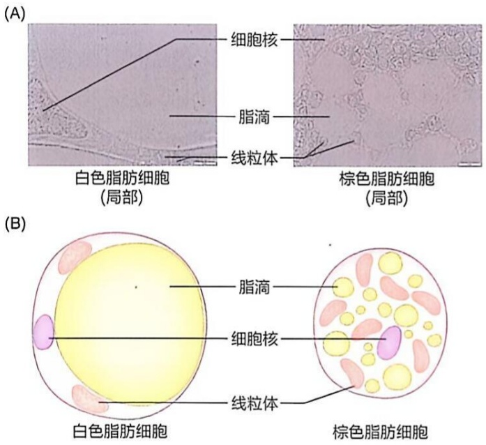

图27-7 白色脂肪细胞和棕色脂肪细胞（A）白色脂肪细胞和棕色脂肪细胞的电镜照片（由北京大学陈晓伟实验室提供）。（B）白色脂肪细胞和棕色脂肪细胞的结构示意图。

脂肪组织正是这样一种能量储存者。然而，只有与肝脏相互协调，脂肪组织储存和动用甘油三酯的功能才能有效发挥（图 27-8）。

脂肪组织储存甘油三酯的过程如下:饱食状态下，膳食来源的脂肪酸先以乳糜微粒形式运输至外周组织（如肌肉、脂肪），并非直接进入肝脏；但膳食中多余的葡萄糖则在肝细胞内先转化为脂肪酸，随后再进一步转化为甘油三酯，后者再以极低密度脂蛋白颗粒形式运输至脂肪组织的毛细血管，经毛细血管中的脂蛋白脂肪酶（lipoprotein lipase，LPL）催化水解，重新生成脂肪酸。脂肪酸经由脂肪细胞质膜上的脂肪酸转运体进入细胞，并转化为脂酰辅酶A。

在脂肪细胞中的脂酰辅酶 A 参与甘油三酯生成之前，脂肪细胞中还需产生甘油 -3- 磷酸前体。这依赖发生于脂肪细胞中的糖酵解过程。具体而言，血液中的葡萄糖在细胞质膜上的葡萄糖转运蛋白 4（glucose transporter 4，GLUT4；它在胰岛素诱导下从胞质溶胶中的囊泡转运至细胞膜上）的协助下进入脂肪细胞。葡萄糖在脂肪细胞内经过糖酵解途径生成磷酸二羟丙酮，随

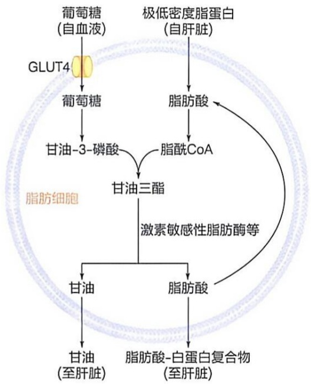

flowchart

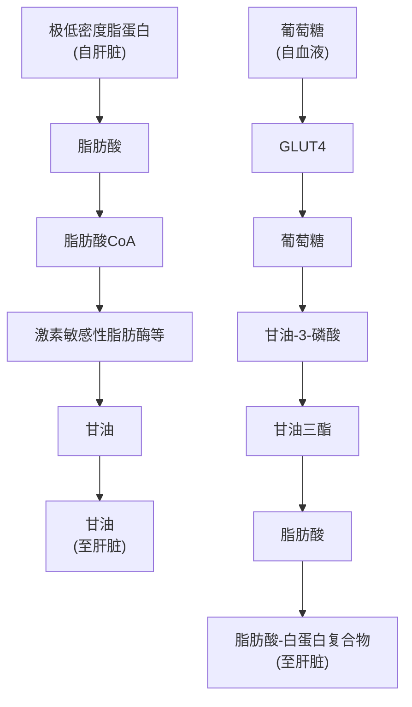

图 27-8 脂肪细胞通过与肝细胞协调而储存和动用甘油三酯

后还原为甘油-3-磷酸。脂肪细胞中的脂酰辅酶A再与甘油-3-磷酸缩合生成甘油三酯（见图23-13，图23-14）。

在小肠腔中，食物脂肪在胰腺脂酶的作用下水解，生成脂肪酸和甘油单酯，然后被小肠上皮细胞吸收。在小肠上皮细胞内，脂肪酸和单酰甘油重新酯化，形成甘油三酯，甘油三酯通过乳糜微粒经淋巴管进入血液循环（见图22-2）。当乳糜微粒流经脂肪组织和肌肉组织的毛细血管时，被脂蛋白脂肪酶催化水解，重新生成脂肪酸和甘油，它们进入脂肪细胞后也参与甘油三酯的生成。脂肪细胞中生成的所有甘油三酯均储存于其脂滴中（即白色脂肪细胞的单一脂滴中，或棕色脂肪细胞的多个脂滴中）。

脂肪组织以甘油三酯的形式储存能量，相较于肝脏或肌肉以糖原的形式储存能量，具有更高的储存效率。这是因为甘油三酯的碳链高度还原，在相同质量条件下，其储存的能量更多。其能量密度约为糖原的两倍。若普通成年人的脂肪组织被能量相等的糖原所取代，其体重将增加约60%。

值得注意的是，白色脂肪组织内的甘油三酯主要来源于食物中所摄入的以及肝细胞从头合成的脂肪酸，脂肪细胞将葡萄糖转化成脂肪酸的量相对较低。肝脏才是将多余葡萄糖转化为脂肪酸的主要场所。因为脂肪细胞中的乙酰辅酶A羧化酶和脂肪酸合酶的活性都远低于肝脏和泌乳期的乳腺组织。这表明脂肪细胞的主要功能是储存，而非合成。

当动物处于饥饿或长时间运动状态时，白色脂肪组织中储存的甘油三酯将被动用，即发生脂解，转化为甘油和脂肪酸。脂肪动用过程一般受到像胰高血糖素或肾上腺素等激素信号的诱发（见图22-3），所产生的脂肪酸被释放进入血液，由白蛋白等携带运输至肝脏等器官进行利用。在这样的情况下，肝脏和肌肉组织更多利用脂肪酸氧化分解来供能，而将有限的葡萄糖节约下来，供大脑和红细胞等主要依赖葡萄糖为能量来源的组织和细胞使用。

脂肪细胞脂解甘油三酯后所释放的甘油分子，通常无法在脂肪组织内被重新用于生成甘油三酯，因为脂肪组织缺乏甘油激酶。这些甘油分子进入血液后，会被肝细胞摄取，并在甘油激酶的催化下，转化为甘油-3-磷酸。随后，甘油-3-磷酸在甘油磷酸脱氢酶的催化下，被氧化为磷酸二羟丙酮，进入糖异生途径用于葡萄糖的生成。由于胰高血糖素或肾上腺素的信号会促进肝细胞的糖异生，因此在脂肪组织脂解甘油三酯的情况下，肝细胞更倾向于利用甘油生成葡萄糖（而非氧化产能），并将生成的葡萄糖释放至血液中。

值得注意的是，脂肪细胞通过脂解所产生的脂肪酸中，有相当一部分在脂肪细胞中被重新酯化为甘油三酯。此外，在被转运至肝脏的脂肪酸中，也有相当一部分被重新酯化。这种看似为无义循环的所谓“甘油三酯轮换”的生物学意义包括产热和更新脂肪酸以代谢掉多不饱和脂肪酸氧化产生的有毒物质等（见图23-19）。

## (3) 棕色脂肪组织的主要功能是产热

自1960年代，棕色脂肪组织的非颤抖性产热（non-shivering thermogenesis）功能被确认以来，人们对其作用机制开展了广泛探究。结果表明，棕色脂肪细胞内的脂肪酸氧化所产生的跨线粒体内膜的质子梯度，并非用于驱动ATP的合成；相反，质子通过线粒体内膜中的解偶联蛋白1（uncoupling protein 1，UCP1）顺质子梯度返回到线粒体基质，所储存的能量因此以热量的形式散发（见图19-26）。

## 27.2.3 骨骼肌和心肌以不同模式使用燃料分子供能

骨骼肌和心肌都属于使用能量进行机械运动的组织。在能量概念被引入以阐释生命活动过程之初，人们率先认识到，肌肉是必须要消耗能量的组织。

## (1) 人们对肌肉收缩的直接能量提供者的本质进行了长期探索

大约在 1840 年代，德国学者尤斯图斯·冯·李比希（Justus von Liebig，1803—1873）等认为，肌肉收缩的能量来源于蛋白质的氧化分解（因为肌肉主要由蛋白质构成）。然而，1860 年代的研究表明，肌肉收缩并没有导致氮排泄量的增加。1910 年代，人们尝试通过研究肌肉收缩时的热量变化来理解肌肉收缩的能量转换问题。1920 年代，乳酸被认为是一种为肌肉收缩提供能量的分子。

值得注意的是，在1920年代后期，人们首次从肌肉组织中提取了磷酸肌酸和ATP等化合物。而且，磷酸肌酸在肌肉收缩期间发生水解，而在其恢复阶段又被重新合成。1930年代，丹麦学者伦斯高等观察到，被碘乙酸（$\mathrm{ICH}_2\mathrm{COOH}$）毒化的肌肉可以在不生成乳酸的情况下收缩，并且在此过程中磷酸肌酸会消失。基于此，他提出磷酸肌酸是直接为肌肉收缩提供能量的物质，而在正常肌肉中，乳酸的不断产生则为磷酸肌酸的重新合成提供能量。同时，人们也观察到，大量的乳酸是在肌肉收缩之后才形成的。因此，乳酸提供能量的概念被抛弃，磷酸肌酸开始被认为是肌肉收缩时的能量供应者。

美国学者李普曼等对糖酵解过程中 ATP 的形成、消耗以及中间物均发生磷酸化这样的现象进行理论思考后，于 1940 年代提出 ATP 为能量货币的概念。后来，人们从多方面证实，肌肉中的肌球蛋白具 ATP 水解酶活性，而且肌肉收缩的直接能量来源是 ATP 分子。

## (2) 骨骼肌可通过氧化各种燃料分子供能

作为一种通过消耗能量来产生机械运动的特化器官，骨骼肌可依据其所处生理状态的不同，分解不同种类的燃料分子以提供能量。这些燃料分子包括由糖原降解和血液循环提供的葡萄糖以及源自血液的脂肪酸和氨基酸（在饥饿状态下，氨基酸可通过肌肉蛋白质分解获取）等。

空腹静息状态下骨骼肌细胞的能量代谢特征包括（图 27-9A）:①血液中的葡萄糖被用于合成肌糖原；②肌酸处于磷酸化状态；③主要利用氧气氧化脂肪酸产生ATP。餐后则以葡萄糖为主要燃料分子。这时胰岛素将促进肌细胞摄取血糖。胰岛素将抑制脂解过程，减少游离脂肪酸的供应。

中等运动强度的骨骼肌细胞的能量代谢特征包括（图 27-9B）:①糖原降解产生以及从血液获取的葡萄糖，被彻底氧化产生 ATP；②利用氧气氧化脂肪酸产生 ATP。

剧烈运动的骨骼肌细胞的能量代谢特征包括（图 27-9C）:①磷酸肌酸被转化为肌酸，同时产生 ATP；②糖原降解为葡萄糖，并在无氧条件下进行发酵，产生 ATP 的同时也产生乳酸（乳酸通过血液循环被运输至肝脏，用于重新生成葡萄糖）。

值得注意的是，相较于静止状态，骨骼肌处于剧烈运动时，ATP的消耗量会显著增加，甚至可提高百倍以上，占身体总能量消耗的95%以上。在这种情况下，骨骼肌会迅速动用其内部储备的少量ATP。然而，肌肉中ATP的含量非常低，仅能维持大约1.2秒剧烈运动的需求。ATP本身并不适合用作长期储存能量的分子:一方面，ATP可参与细胞内的众多化学反应；另一方面，许多酶，尤其是与产能相关的酶，可被ATP别构抑制。因此，肌肉细胞很快转向利用磷酸肌酸作为暂时性的能量缓冲分子，以维持ATP水平的稳定。最后，肌肉主要通过无氧糖酵解获取能量。

在骨骼肌、心肌、大脑等组织中，肌酸-磷酸肌酸穿梭系统完成将高能磷酸基团从细胞的线粒体基质转运至胞质溶胶的传递过程（图27-10），具体过程如下。肌酸进入线粒体膜间隙后，在位于线粒体内膜的膜间隙侧的线粒体肌酸激酶（creatine kinase，CK）的催化下，将ATP分子（通过位于线粒体内膜上的 ADP/ATP 载体蛋白转运而来）中的磷酰基转移至肌酸分子，形成磷酸肌酸。磷酸肌酸进入胞质溶胶。磷酸肌酸的浓度一般比 ATP 浓度高大约 5 倍。胞质溶胶中的肌酸激酶再催化磷酸肌酸中的磷酰基转移至 ADP，形成 ATP。这就完成了将线粒体基质 ATP 高效转运至胞质溶胶的过程。

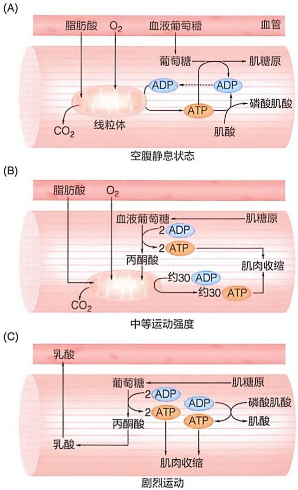

图 27-9 骨骼肌处于空腹静息状态、中等运动强度和剧烈运动时使用不同的燃料分子供能

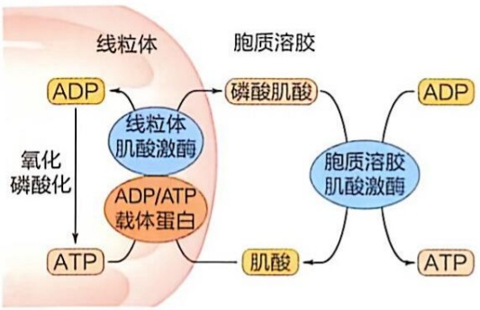

flowchart

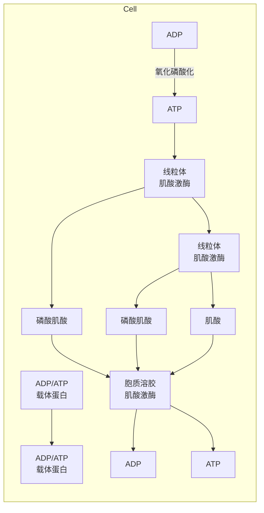

图 27-10 磷酸肌酸穿梭系统将肌肉细胞线粒体基质中的高能磷酸基团带至胞质溶胶

然而，肌肉细胞中的磷酸肌酸储备的能量也仅能供应不到10秒的剧烈运动。对于更长时间的剧烈运动，需要依赖肌糖原、甘油三酯以及血浆中的葡萄糖和脂肪酸等共同为骨骼肌提供能量。通常情况下，剧烈运动1分钟后，由于血管舒张使运动中肌肉血液供给大幅增加，血浆中的葡萄糖和脂肪酸等得以进入肌肉细胞。

但在剧烈运动过程中，骨骼肌无法从血浆中获取足够的氧气，因此必须动用其第三级能量储备池——肌糖原（ATP 为第一级，磷酸肌酸为第二级）。随着运动强度的增加，糖原降解和糖酵解过程同时被激活，使通过无氧糖酵解的产能占比明显上升，而依赖氧气的脂肪酸产能占比明显下降。

在上述过程中，由消耗 ATP 而引起 AMP 含量的大幅增加、由骨骼肌收缩引起的肌质网中  $Ca^{2+}$  的释放，以及高强度运动导致的肾上腺素的释放是调控骨骼肌产能的三种重要信号。尽管骨骼肌因为缺乏葡萄糖 -6- 磷酸酶而无法通过糖原降解将葡萄糖释放入血液，供其他组织使用；但骨骼肌通过糖酵解所产生的乳酸（图 27-9C），以及分解蛋白质所产生的丙氨酸，进入血液后，均可用于肝脏和肾脏中的糖异生。这一过程涉及肝脏和肌肉之间的代谢协作，包括发生于激烈运动时的乳酸循环，和发生于饥饿或长时间运动状态下的葡萄糖-丙氨酸循环（见图 24-11）。

与骨骼肌多样化的能量代谢方式形成鲜明对比的是，心肌在正常情况下主要以脂肪酸作为燃料分子。然而，在饥饿状态下，心肌会转而利用酮体作为燃料分子。也就是说，氧气对于心肌细胞能量代谢是不可或缺的。一方面，脂肪酸作为燃料分子，通常能够长期且足额供应（而葡萄糖的供应则难以做到这一点），这体现了心脏的坚韧性；另一方面，一旦处于缺氧状态，心脏的功能就会立刻受到严重影响，这又反映了心脏的脆弱性。

## 27.2.4 大脑主要依赖葡萄糖氧化获取能量

每种器官所执行的功能不同，其对应的能量代谢活动也存在差异。大脑堪称耗能大户:在静息状态下，仅占成人体重2%的大脑却消耗全身大约20%的能量。相比之下，占成人体重约40%的骨骼肌，在静息状态下仅消耗全身大约30%的能量。然而，当骨骼肌处于剧烈运动状态时，其能量消耗可能会增加10～25倍，甚至更高（如300倍），而大脑的能量消耗在不同条件下，变化幅度不大。因此，各器官的能量代谢情况各有特点。

## (1) 大脑被认为主要利用葡萄糖作为燃料分子

尽管脂肪酸氧化是肝脏、骨骼肌和心脏等“耗能大户”的重要能量来源，但根据目前的认知，人们普遍认为大脑主要依靠葡萄糖的氧化提供能量，主要证据包括:神经元中肉碱脂酰基转移酶1表达量极低，导致长链脂肪酸无法从胞质溶胶有效进入线粒体基质进行β氧化；大脑神经元细胞中的某些催化脂肪酸β氧化的酶（如硫解酶）的活性远低于其他组织；等等。在正常情况下，葡萄糖氧化产生的ATP占大脑总ATP产量的大约95%。大脑中的神经元是主要的能量消耗者，而神经胶质细胞消耗能量的比例则低得多。神经元将能量主要用于维持其细胞质膜的跨膜电势:具体而言，这些能量被质膜上的 $Na^{+}/K^{+}-ATP$ 酶所消耗，这是神经元传递电脉冲的基础。此外，神经突触囊泡的外排、内吞以及重复利用的循环过程也消耗大量能量。由于大脑几乎不储存糖原（或其他燃料分子），因此强烈依赖外部葡萄糖的稳定供应。

## 知识延展 27- 1

## 科里循环

科里夫妇，即卡尔·科里和格蒂·科里，因发现了“糖原催化转化过程”而获得了1947年诺贝尔生理学或医学奖。在始于1925年的一系列实验中，他们研究了完整大鼠体内乳酸、葡萄糖以及糖原之间的代谢关系。这些工作揭示了肌肉和肝脏内发生糖代谢的化学过程以及这两种器官之间的协作关系。以他们名字命名的“科里循环”是骨骼肌和肝脏两种器官之间进行代谢协调和整合的典型例子。简单地说，骨骼肌在缺氧条件下通过氧化葡萄糖产生乳酸，乳酸通过血液循环被运至肝脏后重新生成葡萄糖。在机体内，葡萄糖分子被循环性地消耗和产生。他们的发现始于“血糖水平受什么调节”这个科学问题。当时，尽管已经明确胰岛素对血糖水平调控起关键作用，但其中的机制并不清楚。起初，科里夫妇通过生理学实验揭示，胰岛素可促进葡萄糖氧化，并使葡萄糖转化为肌糖原，这将导致低血糖现象，其次导致肝糖原的逐渐消耗；与之相反，肾上腺素可抑制血糖向肌糖原的转化，但加速肌糖原向肝糖原的转化。结果是葡萄糖在血液中被积累。但是，当时已经明确，肌糖原降解不会提高血糖水平，也无法为肝糖原的生成提供前体。基于此，科里夫妇推测，肌糖原可能会被转化为某种物质，这种物质通过血液循环进入肝脏，从而成为肝糖原合成的前体。他们在 1929 年提供的证据表明，这种物质正是乳酸。

在那个时期，大多数研究者都在动物整体水平开展研究工作。虽然这种方法能够帮助人们了解代谢调控过程，但却难以理解代谢机制的本质。

科里夫妇察觉到这个问题，于是尝试采用动物组织匀浆开展实验，进行真正的生物化学研究。他们利用青蛙的骨骼肌匀浆，发现了一种由糖原降解产生的中间体，开始时该物质被命名为“科里酯”（Cori ester），后来被鉴定为葡萄糖-1-磷酸。在此基础上，他们进一步发现了催化糖原转化为“科里酯”的酶，即糖原磷酸化酶，并使用无细胞体系（cell-free system）证明了该反应的逆反应可以生成糖原。糖原也因此成为首个在试管中被成功合成的生物大分子，打破了长期以来人们认为生物大分子合成必须在完整细胞中进行的传统观念（后来人们认识到糖原合成由糖原合酶催化，利用UDP-葡萄糖提供前体）。然而，他们却错误地认为这就是细胞内合成糖原的方式。

大脑主要以葡萄糖为燃料分子，而不利用脂肪酸的具体原因还有待澄清。从理论上而言，这可能与多种因素有关。例如，脂肪酸可能无法有效地通过血脑屏障；游离脂肪酸的存在可能会对大脑结构造成损伤；脂肪酸氧化比葡萄糖氧化产生更高比例的 $\mathrm{FADH}_2$ ，更多的电子经复合物Ⅱ/ETF-QO传递，可能会产生更多有害的活性氧（复合物I的NADH途径的电子传递效率高且ROS泄漏较少）；等等。血脑屏障是中枢神经系统毛细血管网中的一层选择性通透的膜结构，能够阻止多种大分子和小分子进入神经元微环境。在血脑屏障膜中，葡萄糖转运蛋白1（GLUT1）是主要的葡萄糖转运体，负责将葡萄糖从血液转运至脑间质液，且在内皮细胞的两侧都有表达。而葡萄糖转运蛋白3（GLUT3）则是神经元细胞质膜上的主要葡萄糖转运体，对葡萄糖具有较高的亲和力，即使在低葡萄糖浓度条件下，也可有效地将葡萄糖转运至神经元细胞内。

## (2) 酮体是动物处于饥饿状态下大脑的重要替代燃料

在特定条件下，如长期饥饿或极低碳水化合物饮食，大脑会使用酮体作为替代能量来源。如前所述，酮体主要包括D-β-羟基丁酸、乙酰乙酸和丙酮。其中D-β-羟基丁酸是最主要的酮体分子，约占肝脏产生酮体总量的70%。β-羟基丁酸和乙酰乙酸均易溶于水，这有利于它们通过血液进行运输。在健康动物处于非饥饿状态下，血浆中酮体的浓度低于0.1 mmol/L；在数天（长期）饥饿后，酮体浓度显著升高，可达5\~6 mmol/L；在生酮饮食和糖尿病酮症等特殊情况下，酮体浓度甚至可高达25 mmol/L。肝脏产生的酮体进入血液循环后，会通过血脑屏障膜上的单羧酸转运蛋白（monocarboxylate transporter，MCT）进入大脑，从而被大脑利用。在脑细胞内，酮体被重新转化为乙酰辅酶A，随后进入柠檬酸循环进行氧化，生成ATP，以满足大脑的能量需求。此外，还有少量酮体可能参与大脑（如星形胶质细胞）中脂质分子的合成。

## 27.2.5 血液循环将氧气、代谢物及激素等从一个器官运送至另一个器官

哺乳动物通过血液循环实现各器官之间的物质交换，这也是各器官之间进行代谢协调与整合的关键途径。除了氧气需要借助红细胞中的血红蛋白从肺部运输至全身各器官外，体内的营养物质、代谢物、电解质和激素等也需通过血液运输。其中的水溶性成分，如葡萄糖、氨基酸、酮体、乳酸、甘油等可直接通过血浆（非细胞组分）转运；而疏水性成分则需要与载体蛋白结合后才能转运，如脂肪酸、甘油三酯、类固醇激素等。

正是血液循环使得肝脏、肌肉、大脑、心脏、脂肪组织和消化道等器官之间可以进行有效的物质交换和信息交流。对血液中各种小分子种类与含量的监测，也是我们了解人体健康状况的重要手段。在医疗上，大多药物也是先进入血液，再通过血液循环到达特异的靶器官或组织。

## 27.3 哺乳动物通过神经系统和内分泌系统实现对不同组织器官代谢的协调和整合

如前所述，哺乳动物的不同器官由于功能上的差异，在物质和能量代谢模式上也存在差异。在动物个体应对生理或病理变化时，各组织器官代谢的模式通常也会相应地进行调整，以维持代谢的稳态。无论在个体发育过程中、还是在应激条件下，动物的各组织器官之间（乃至细胞之间）都需进行信息的交流，以协调和整合不同组织器官的代谢活动。

自 1900 年代以来，人们逐渐认识到，哺乳动物个体主要借助神经信号和激素这两大类化学分子作为信使来协调和整合不同组织器官的代谢。这些化学信使通过诱发不同细胞产生相关的生理响应，实现对代谢的协调。神经信号和激素分别由特异的神经组织或内分泌腺产生，它们通过与靶细胞上的特异受体（信息接收器）结合，并借助细胞内的第二信使，将信息传递到靶细胞内部。在某种意义上，这一过程是在向靶组织传递“他处发生了什么事件，它们应当做出合适的响应”的信息。值得注意的是，不仅哺乳动物可以借助激素进行信息传递，昆虫、蠕虫和植物也都拥有各自特异的激素调控系统，其基本的运作方式与哺乳动物可以类比。

## 27.3.1 激素是一类低浓度、间歇性释放并在不同细胞和组织间传递信息的化学分子

作为信使分子，激素由内分泌腺或具有内分泌功能的组织或细胞产生，它们的第一种普遍特征是，以间歇性的方式释放到血液中，随后被运输至靶组织或靶器官，诱导后者产生生理响应。与激素不同，在动物（如昆虫）个体之间传递信息的信息素（pheromone）以及诱发细胞生长的生长因子却都是持续存在的，尽管它们也通过与靶细胞受体结合产生与激素类似的效应。

此外，激素的第二种普遍特征是，其在血液或组织液中的浓度极低，通常为皮摩尔每升（$10^{-12} \mathrm{~mol/L}$）或纳摩尔每升（$10^{-9} \mathrm{~mol/L}$）量级。与此相呼应的是，激素与其受体之间通常都具较高的亲和力（其解离常数 $K_{\mathrm{d}}$ 一般为 $10^{-7} \sim 10^{-10} \mathrm{~mol/L}$ 甚至更低）；因此，激素无需高浓度即可与其受体有效结合而诱发生理响应。此外，激素信号在传递过程中存在级联放大效应（具体见后），这使得微量的激素便可产生显著的生理响应。这与酶催化的情况类似，酶的含量通常也极低，但由于其催化效应，微量的酶分子即可产生明显的生物学效应。而且，激素和酶都是在化学本质尚未明确之前，人们已经通过它们所产生的特异生物学效应进行探究。

自其被发现以来，人们对激素的认识一直在不断深入。例如，激素的作用并非一定是“激活”生物过程，它们同样可以抑制生物过程。又如，激素的运输方式并非仅限于血液运输；某些激素可直接释放至附近区域（针对邻近细胞）发挥效应，甚至对分泌激素的组织自身发挥调节作用。

## 27.3.2 激素分子的化学结构类型多样

激素是一种功能定义，就其化学结构而言，呈现高度的多样性。代表性动物激素的化学结构如图 27-11 所示。

## （1）激素可根据化学结构和其他特征进行分类

具体而言，根据化学结构，可将激素分为肽类（包括蛋白质）、脂质类以及氨基酸衍生物等类型（表 27-1）。

动物肽类激素的氨基酸残基数量差异很大，少则不足10个，多则超过100个。例如，催产素仅由9个氨基酸残基组成，而生长激素则由近200个氨基酸残基组成。肽类激素主要由下丘脑（hypothalamus）、脑垂体（pituitary）、胰腺、脂肪组织和肠道等内分泌腺（或内分泌细胞）分泌。

脂类激素是以脂质为前体生成的激素，主要包括类固醇类激素（steroid hormone）和类二十烷酸类（eicosanoid）激素。类固醇类激素的共同前体是胆固醇，不少类固醇类激素分子在结构上仅存在微小差异。典型代表包括皮质醇、孕酮、醛固酮、睾酮、雌二醇等。类二十烷酸类激素以二十碳多不饱和脂肪酸为前体，通过环氧化酶等催化生成前列腺素、白三烯、血栓素等。

氨基酸衍生物类激素是酪氨酸或色氨酸等氨基酸的衍生物。在这类激素的化学结构中，除甲状腺激素外，氨基酸的羧基被脱去，而其氨基则被保留。具体而言，去甲肾上腺素和甲状腺激素均源自酪氨酸（见图25-30）。褪黑素（N-乙酰-5-甲氧色胺，melatonin）和5-羟色胺均由色氨酸衍生而来。此外，一氧化氮（NO）作为一种激素，在1980年代才被发现，主要以精氨酸为前体产生。从严格意义上讲，NO不属于激素类分子，被视为“类激素”或气体信使可能更合适。

图27-11 代表性动物激素的化学结构

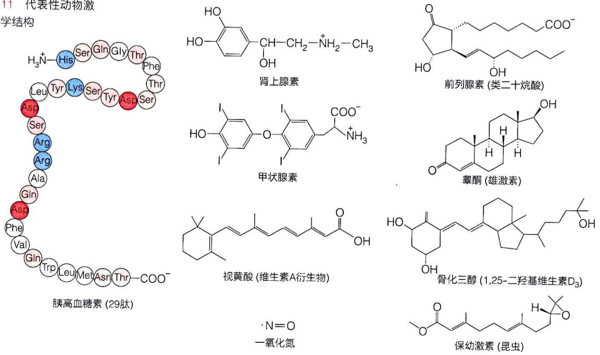

表 27-1 哺乳动物代表性激素的特征

<table><tr><td>大类</td><td>亚类</td><td>举例</td><td>合成和运输特点</td><td>作用方式</td></tr><tr><td rowspan="2">肽类</td><td>短肽</td><td>胰高血糖素(29肽)</td><td>预先合成;直接溶于血浆运输</td><td>作用于细胞表面受体,诱发靶细胞产生第二信使及后续信号转导</td></tr><tr><td>蛋白质/糖蛋白</td><td>胰岛素(51肽)、生长激素(191肽)、促卵泡激素(203肽)</td><td>预先合成;直接溶于血浆运输</td><td>作用于细胞表面受体,诱发靶细胞产生第二信使及后续信号转导</td></tr><tr><td rowspan="2">脂质类</td><td>类固醇</td><td>糖皮质激素、盐皮质激素、性激素</td><td>按需合成;依赖载体蛋白质运输</td><td>大多作用于胞内受体,调控基因转录;也有的作用于细胞表面受体,诱发靶细胞产生第二信使及后续信号转导</td></tr><tr><td>类二十烷酸</td><td>前列腺素,血栓素、白三烯</td><td>按需合成;迅速分解,在邻近发挥作用</td><td>大多作用于细胞表面受体,诱发靶细胞产生第二信使及后续信号转导;也有的作用于核受体,调控基因转录</td></tr><tr><td rowspan="3">氨基酸衍生物</td><td>儿茶酚胺</td><td>肾上腺素、去甲肾上腺素</td><td>预先合成;直接溶于血浆运输</td><td>作用于细胞表面受体,诱发靶细胞产生第二信使及后续信号转导</td></tr><tr><td>甲状腺激素</td><td>四碘甲状腺原氨酸( $T_4$ )、三碘甲状腺原氨酸( $T_3$ )</td><td>预先合成;依赖载体蛋白运输</td><td>作用于核受体,改变靶细胞基因表达</td></tr><tr><td>色氨酸衍生物</td><td>褪黑素,5-羟色胺</td><td>预先合成;直接溶于血浆运输</td><td>作用于细胞表面受体,诱发靶细胞产生第二信使及后续信号转导</td></tr><tr><td>其他</td><td>气体</td><td>一氧化氮(NO)</td><td>按需合成;自由扩散</td><td>作用于鸟苷酸环化酶,诱发靶细胞产生第二信使及后续信号转导</td></tr></table>

除了依据化学结构对激素进行归类之外，我们还可以从其他角度进行归类。依据生物来源，激素可分为脊椎动物类、无脊椎动物类和植物类。依据分子的溶解性特征，激素又可分为水溶性激素（包括肽类和氨基酸衍生物类）和脂溶性激素（包括固醇类）。依据作用机制，激素可分为与细胞表面受体结合类和与细胞内受体结合类；依据作用范围，可分为局部性激素和全局性激素；依据其生理效用，可分为代谢类激素和形态发生类激素；等等。

## (2) 微量肽类激素可通过高灵敏的放射免疫方法进行定量测定

激素因为含量极低而难以被检测和纯化。在早期对激素的研究中，大多只能依据各自产生的特异生理效应而进行检测。对任何激素（包括肽类激素）进行纯化，以获得足够量开展化学和物理分析，都是一个巨大的挑战。例如，在1940年代，桑格等在测定胰岛素氨基酸序列时，就消耗了数量巨大的牛胰腺。

1950 年代，美国学者罗莎琳·亚洛（Rosalyn Yalow，1921—2011）等建立了放射免疫法（radioimmunoassay），被有效用于定量分析血液中的胰岛素等微量肽类激素。其具体策略和原理如图 27-12A 所示。

放射免疫法是基于抗原-抗体结合的特异性与放射性同位素标记（如 $^{131}\mathrm{I}$ 标记肽类激素）检测的灵敏度而设计的。为此，我们需先制作一条标准曲线。在含有固定量一抗（这里以5个IgG抗体分子代表）和固定量同位素标记抗原肽（这里以10个红色圆球代表）的溶液体系中，抗体与抗原特异结合形成复合物（图27-12A中的第①步）。这时加入较低量（如 $1\mathrm{pg}$，这里以10个绿色圆球代表）的未标记抗原肽（第②步），通过竞争，部分结合于抗体的标记抗原肽被未标记抗原肽替换而成为游离状态（第③步），加入与一抗恒定区特异结合的二抗（第④步），使一抗形成沉淀（第⑤步），然后测定沉淀和上清液中的放射性，计算与抗体结合的标记抗原肽与游离标记抗原肽的比值（$R$）。我们假设这样测定的 $R$ 值为1.0（或其他测定值）。然后依次增加未标记抗原肽的量，依次测定 $R$ 值。比如两次分别加入 $9\mathrm{pg}$ 和 $100\mathrm{pg}$，以这些未标记抗原肽加入量与 $R$ 作图（图27-12B），测定 $R$ 值分别为0.5（第⑥步）和0.3（第⑦步），等等。显然，随着未标记肽类激素含量的增加，上述 $R$ 值降低。

(A)

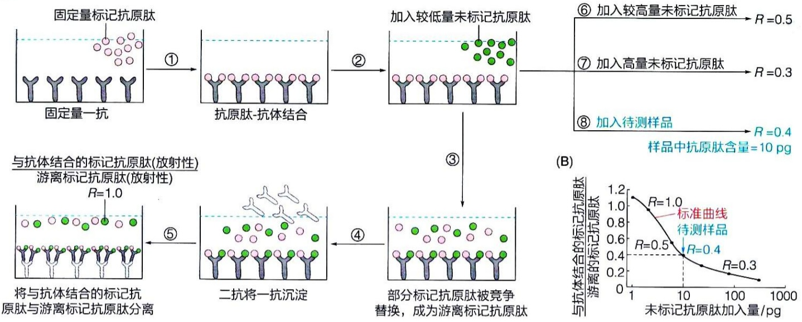

flowchart

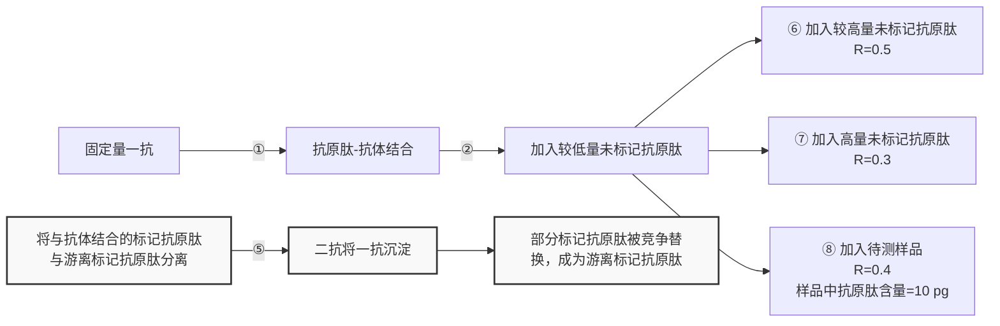

图 27-12 微量肽类激素可通过放射免疫法进行定量分析

根据加入待测样品至上述固定标记抗原肽和一抗的溶液体系中所测定的 $R$ 值（如0.4），则可在标准曲线上直接读出待测样品中所含肽类激素的含量（如 $10\mathrm{pg}$，第⑧步）。

通过放射免疫法，可检测到样品中低至皮克（pg， $10^{-12}$ g）级的肽类激素。

## 27.3.3 哺乳动物的激素释放通过多种方式控制

哺乳动物不同器官之间通过激素进行通信，以在细胞和组织水平协调各自的功能节律。如上所述，激素的释放是间歇性的。也就是说，激素的释放仅在特异诱发因子的作用下发生，而特定激素释放的时机则由动物的内外环境条件共同决定并调节。哺乳动物的内分泌系统分泌激素是一个高度动态的过程，受到动物个体多种内外因子的调节。为了优化各器官的代谢等生理过程，激素的释放模式和方式必须高度准确。长期的研究表明，哺乳动物的激素释放存在多种控制方式（图 27-13）。

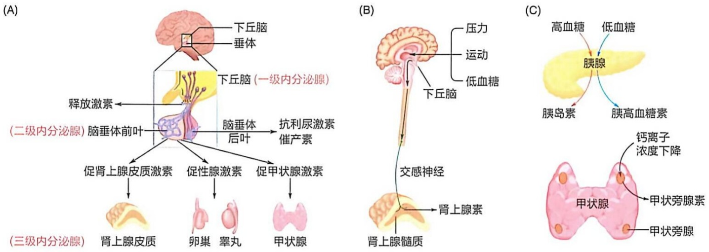

图 27-13 哺乳动物控制激素释放的不同模式

## (1) 哺乳动物控制激素释放的最重要方式是自上而下的三级模式

哺乳动物激素释放的三级控制模式如图 27-13A 所示。这是一种基于下丘脑-脑垂体前叶-外周内分泌腺这三级的级联调控模式。通过该模式，下丘脑和脑垂体共同形成了对哺乳动物生理功能进行统一调控的关键体系。

在这种激素释放控制模式中，中枢神经系统中的下丘脑是核心，被视为第一级内分泌腺。下丘脑所释放激素的主要功能是控制（促进或抑制）脑垂体前叶这种第二级内分泌腺所产生激素的释放。然而，下丘脑也产生少数几种激素，如抗利尿激素（antidiuretic hormone，也称血管升压素；9肽）和催产素（oxytocin；9肽），并不控制脑垂体前叶激素的分泌，而是通过其延伸至脑垂体后叶的神经末梢直接释放到血液中。抗利尿激素直接作用于肾脏等，催产素则直接作用于子宫和乳腺等。

下丘脑产生和分泌的激素均为肽类激素，其中，控制脑垂体前叶激素分泌的肽类激素统称为释放激素（releasing hormone），如生长激素释放激素（growth hormone-releasing hormone, GHRH; 44肽）、促肾上腺皮质激素释放激素（corticotropin releasing hormone, CRH; 41肽）、促甲状腺激素释放激素（thyrotropin-releasing hormone, TRH; 3肽）、促性腺激素释放激素（gonadotropin-releasing hormone, GnRH; 10肽）、生长抑素（somatostatin, 14肽）、催乳素释放激素（prolactin releasing hormone, PRH; 199肽）。此外，下丘脑还产生和分泌一种催乳素释放抑制因子（prolactin release-inhibiting factor, PIF），目前认为这种抑制因子为多巴胺，即3,4-二羟基苯乙胺，它以酪氨酸为前体的生成过程如图25-30所示。

作为二级内分泌腺，脑垂体（pituitary gland）前叶所产生和分泌的激素也均为肽类激素。这包括生长激素（growth hormone，GH；191肽）、促肾上腺皮质激素（adrenocorticotropic hormone，ACTH；39肽）、促甲状腺激素（thyroid stimulating hormone，TSH；204肽）、卵泡刺激素（follicle-stimulating hormone，FSH；203肽）和黄体生成素（luteinizing hormone，LH；204肽）等。这里的卵泡刺激素和黄体生成素统称为促性腺激素。脑垂体前叶产生和分泌的激素功能，大多为促进三级（即外周）内分泌腺的分泌，因此被统称为“促激素”。此外，脑垂体前叶所产生和释放的生长

（A）沿下丘脑-脑垂体前叶轴的自上而下分泌控制模式。（B）中枢神经系统直接控制三级内分泌腺分泌的自上而下模式。（C）血液成分直接诱发的三级内分泌腺分泌模式。

激素和催乳素等不调节下游内分泌腺，而是直接作用于外周靶组织:生长激素直接作用于骨骼和肝脏，而催乳素则作用于乳腺。

脑垂体前叶所产生的激素释放至血液后，将控制三级内分泌腺分泌激素。三级内分泌腺包括肾上腺皮质、性腺（包括卵巢和睾丸）和甲状腺等。它们产生和分泌诸如皮质醇、醛固酮、雌二醇、孕酮、睾酮、雄酮、甲状腺素等激素，这些由外围内分泌腺产生和分泌的激素最终作用于肝脏、肌肉、生殖器官、骨骼等外周靶组织。

（2）哺乳动物某些外周内分泌腺释放激素的过程受中枢神经系统直接控制

这种机制如图 27-13B 所示:肾上腺髓质是一个典型例子，它通过交感神经受中枢神经系统支配。当机体受到压力、运动或低血糖等刺激时，下丘脑会通过交感神经直接向肾上腺髓质发出指令，促使其分泌肾上腺素或去甲肾上腺素。也就是说，肾上腺髓质分泌激素的过程，直接受中枢神经系统的控制。

(3) 哺乳动物某些外周内分泌腺释放激素的过程受血液成分控制

其中的主要代表是胰腺和甲状旁腺。胰腺分泌胰岛素或胰高血糖素受血糖水平的调节:高血糖刺激胰岛素的分泌，而低血糖则刺激胰高血糖素的分泌（图27-13C）。甲状旁腺分泌的甲状旁腺素则受血液中 $\mathrm{Ca^{2+}}$ 浓度下降的刺激。

动物体内外环境条件的变化诱发不同激素的分泌。比如，当动物遭遇恐惧、饥饿、感染、疼痛，或者面临环境温度的急剧变化、血液物理化学特性改变等信号时，其中枢神经系统会将感受到的信号传递至内分泌控制中心——下丘脑；随后，下丘脑通过控制特定激素的释放，将信息传递至机体的其他组织器官。换句话说，激素的分泌最终受到中枢神经系统的控制。

比如，当动物的中枢神经系统感知到不同的胁迫条件时（如恐惧、疼痛、低血糖、出血、感染），将对接收的信号进行整合，随后激活下丘脑的内分泌系统以协调机体各组织器官的功能。具体而言，下丘脑将分泌促肾上腺皮质激素释放激素（CRH）；后者通过连接下丘脑和脑垂体前叶的特殊毛细血管（被称为下丘脑垂体门脉系统）传递至脑垂体前叶，促使其分泌促肾上腺素皮质激素（ACTH）；后者经血液循环到达肾上腺皮质后，将触发其释放皮质醇。皮质醇作用于肌肉、肝脏和脂肪组织等外周靶组织细胞核内的受体，从而诱发相应的代谢响应，在胁迫条件下维持个体生存。

（4）激素释放的三级控制方式能够将初始信号级联放大

在上述的激素三级控制方式中（图 27-13A），激素信号在每一级都会被放大。换句话说，当下丘脑（一级内分泌腺）分泌的某种激素量仅为纳克（ng）级时，其控制的脑垂体前叶（二级内分泌腺）分泌的激素则可达微克（ $\mu g$ ）级，而后续的三级内分泌腺（如肾上腺皮质等）分泌的激素则可达到毫克（mg）级。此外，在激素诱发靶细胞产生响应的细胞内信号转导过程中，还存在另外的信号放大过程，如在肾上腺素促进糖原降解的过程中，1 分子肾上腺素产生的效应可使糖原降解产生数千乃至数百万个葡萄糖 -1- 磷酸分子。

（5）三级内分泌腺分泌的激素可对二级或一级内分泌腺的分泌过程进行反馈抑制当甲状腺、肾上腺皮质和性腺等三级内分泌腺所产生的多种激素达到一定浓度时，均可抑制下丘脑或脑垂体前叶对激素的分泌过程（图 27-14）。例如，三级内分泌腺肾上腺皮质分泌的皮质醇可作为负反馈信号，抑制下丘脑分泌促肾上腺皮质激素释放激素（CRH）。然而，在某些情况下，还可通过正反馈机制发挥作用，如在排卵周期中，雌激素（雌二醇）的水平高到一定阈值时将通过正反馈机制促进下丘脑分泌促性腺激素释放激素，进而促进脑垂体分泌黄体生成素。

这是生物体内的反馈抑制现象被最初揭示的生物过程，早于在氨基酸和核苷酸等合成代谢途径中鉴定到的反馈抑制现象。对于必须间歇性发挥作用的激素而言，其产生、释放和信号转导等都是其有效地发挥协调整合作用的关键环节。

## 27.3.4 肽类激素通常以无活性的前体形式产生

下丘脑-垂体-次级内分泌腺体系统

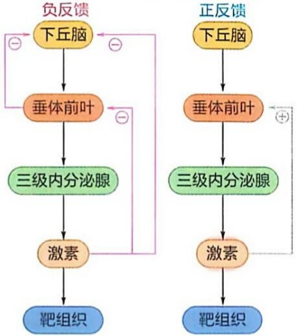

flowchart

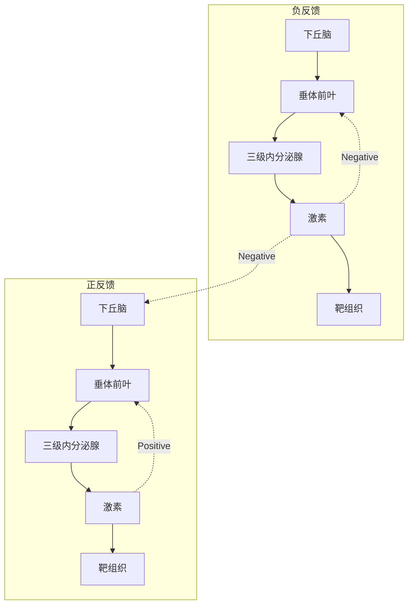

图 27-14 哺乳动物激素分泌的反馈调节模式示意图

1960 年代，肽类激素以无活性前体形式产生的假说被提出，主要基于对多种脑垂体肽类激素的氨基酸序列测定结果。具体而言，人们观察到脑垂体中产生的 β- 促脂素（β-lipotropin；91 肽）和 γ- 促脂素（adiponectin；58 肽）均含有 β- 促黑素细胞激素（β-melanocyte-stimulating hormone；18 肽）的完整氨基酸序列。1970 年代，人们利用促肾上腺皮质激素（39 肽）的抗体鉴定到一种高分子量形式的多肽，且它还可被多种其他激素的抗体沉淀。1970 年代末期，人们对这种多肽的 cDNA 进行了克隆和序列测定，结果表明，该 cDNA 在编码促肾上腺皮质激素的同时还编码其他激素（包括 β- 促脂素、γ- 促脂素和 β- 促黑素细胞激素等）。进一步分析发现，这种由 241 个氨基酸残基组成的前体肽链，即阿黑皮素原（pro-opiomelanocortin，POMC），经过多种转化酶的切割，可产生至少九种肽类激素。

后续研究表明，肽类激素通常先被合成为无活性的前体蛋白（proprotein），即激素原（prohormone），随后通过蛋白质水解作用被切割成一种或多种肽类激素。由于肽类激素需要分泌至细胞外，因此这种前体多肽的N端还额外带有一段信号肽。当新生的前体肽链完成跨膜转运进入内质网腔之后，这段信号肽将被切除。

在人类胰腺  $\beta$  细胞内，胰岛素生成过程如图 27-15 所示，胰岛素最初以前胰岛素原（preproinsulin；110 肽）的形式生成。

当前胰岛素原进入内质网腔内后，其 N 端信号肽（含 24 个氨基酸残基）被切除，形成胰岛素原（proinsulin；含 86 个氨基酸残基，第①步）。之后，胰岛素原在内质网腔中折叠并形成二硫键（第②步）。后续加工很可能发生于分泌颗粒中，先由激素原转化酶 1 和 2 分别在残基 32～33 和残基 65～66 处切割（第③步）。然后，由羧肽酶去除 B 链和 C 肽 C 端的各 2 个碱性残基，形成最后的成熟胰岛素和 C 肽（第④步）。

不少肽类激素在其肽链上含糖基化修饰（不包括胰岛素），形成糖蛋白；某些则像胰岛素一样还形成链内和链间二硫键。这两方面特征都是分泌到血液等细胞外环境中的肽类分子所共有的性质。