# 1 生物现象中的物理学

原始 PDF 第 27–42 页。

## 生物现象中的物理学

所有的生命体都是由无数个微小的分子构成的。从单细胞生物到复杂的哺乳动物，生命体都展现出惊人的复杂性和多样性。然而，不论大小，所有生命体都遵循着共同的物理和化学规律。

本章将带领读者进入生物与物理交叉的世界。我们将看到，生命现象发生在极大跨度的尺度上，从纳米级的分子，到微米级的细胞，再到宏观的组织和器官。在这些尺度上，力、热、电、光等物理因素与生物分子相互作用，驱动着生命的基本过程。例如，蛋白质分子在细胞内的折叠和运动，神经元的电信号传递，以及植物的光合作用，都离不开这些物理作用。

生命体的一个显著特征是高度的有序性，这使得生命体能够高效地完成各种复杂的生理功能。本章将简单介绍生命体如何维持这种高度有序的状态，以及其中的物理机制。

1

---

004

1 生物现象中的物理学

## 1.1 生命的时空尺度

现代生物学的研究对象跨越的时间和空间尺度极大。例如，结构生物学关注原子层面的事件，而生态学则研究物种层面的变化，两者的空间大小差异超过13个数量级。在物理学中，原子等微观世界的规律由量子力学主导，而我们日常所接触的世界则可以由经典物理学描述。了解生命现象的空间和时间尺度，可以让我们选择恰当的物理规律去理解对应的生命现象。在本节中，我们简单介绍生命中的空间尺度、时间尺度以及细胞中的能量尺度和常见的相互作用。

## 1.1.1 生命现象涉及极大的空间尺度

生命涉及的空间尺度小到埃（Å， $10^{-10}$  m），大到上百米（m），覆盖电子显微镜、光学显微镜以及人裸眼观察的尺度（图1-1）。蜂鸟不到拳头大小，我国成年男性和成年女性平均身高约为1.7 m和1.6 m。最大的动物——蓝鲸可达30 m，最高的植物——加州红杉高达120 m。

与无生命的系统一样，构成生命的底层物质是原子和分子，它们的尺度在 Å 到几个纳米（nm）的量级。小分子，如碳氢键长约 0.9 Å，水分子之间的氢键约为 2.8 Å。大分子包括脂质、蛋白质、核酸（DNA、RNA）等。脂质分子可以视为 2 nm 长的棒，大量脂质分子形成约 4 nm 厚的双层膜结构，成为细胞隔离外界影响的屏障。蛋白质在细胞内折叠成几个 nm 的有序结构。由原子构成分子时，量子力学的作用是最主要的。例如，共价键是相邻原子之间通过共用电子形成的强烈相互作用。

细胞是构成生命的基本单元。动、植物细胞的尺寸通常在几十至上百微米（$\mu \mathrm{m}$），细菌细胞的大小通常为几个 $\mu \mathrm{m}$，而动物的卵细胞常常裸眼可见。在亚细胞尺度下，可见到各种细胞器和病毒。例如，T2噬菌体的大小为 $30\sim 60\mathrm{nm}$，叶绿体约为$1\mu \mathrm{m}$。在细胞环境中，常见的力有静电相互作用、疏水相互作用、排空力，等等。静电相互作用是物理学中的基本相互作用。生物大分子通常带电，因此分子间存在静电

图1-1 生命中的空间尺度:从埃到百米

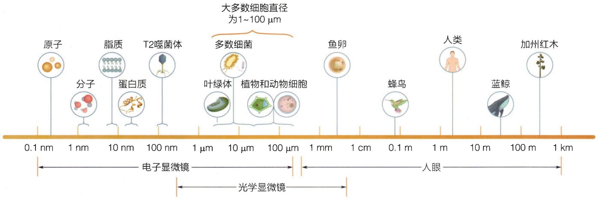

text_image

原子
分子
脂质
蛋白质
T2噬菌体
叶绿体
植物和动物细胞
鱼卵
蜂鸟
人类
蓝鲸
加州红木
100 m
10 m
1 cm
100 µm
1 µm
10 µm
100 µm
1 mm
1 cm
0.1 m
1 m
10 m
100 m
1 km
电子显微镜
光学显微镜
大多数细胞直径为1~100 µm
人眼

---

1.1 生命的时空尺度

005

相互作用。细胞中的离子会产生静电屏蔽，这使得细胞中的分子间静电相互作用呈现短程性。疏水相互作用来自水中氢键网络的熵效应。我们将在2.2节详细讨论疏水相互作用的起源。

## 1.1.2 生命现象有极广的时间尺度

如同生命空间尺度的范围，生命发生变化的时间尺度也极大，从分子相互作用的飞秒到生命演化跨越的上亿年历史。一般而言，时间尺度与空间尺度之间存在相关性。例如，原子尺度的运动都极快，在纳秒量级；而宏观生物个体，其运动通常用秒为单位来衡量；在演化历史中，物种的变化通常都发生在百万年的时间尺度上。

如图1-2所示，细胞生命过程涉及很多化学反应，化学键断裂的时间尺度为飞秒（fs），光合作用中的初级反应时间尺度为纳秒（ns）。蛋白质折叠的时间尺度在微秒（$\mu \mathrm{s}$）到秒（s）的量级。细胞内分子马达负责胞内货物的长程运输，每“走”一步时间约为1毫秒（ms）。

人类日常常用的时间是秒（s）、分（min）、小时（h）、天（d）、年（a）。人类心跳间隔约为1秒，蜉蝣的寿命约为1天，病毒寿命约为几天，人类红细胞寿命约为3个月，蝴蝶等昆虫寿命约为1年，人类平均寿命不满百年，目前已知植物寿命最长的已达5500年。

## 1.1.3 热运动能量是生命的能量标尺

细胞是生命的基本单元。细胞内是一个动荡的环境，热运动无处不在。分子的无规热运动会产生多种效应，这是本章和后面的章节会多次讨论的问题。因此，在讨论细胞内的能量时，我们用热运动对应的能量 $k_{\mathrm{B}}T$ 作为基本能量单位，其中温度 $T$ 是以绝对零度为起点，单位为开尔文（K）， $k_{\mathrm{B}} = 1.38 \times 10^{-23} \, \mathrm{J/K}$ 是玻尔兹曼常量。当 $T$ 为室温（$25^{\circ}\mathrm{C}$）时， $k_{\mathrm{B}}T = 4.1 \times 10^{-21} \, \mathrm{J}$ 。对于细胞内发生的过程，力的大小通常是在皮牛（pN，$10^{-12} \, \mathrm{N}$）大小，而运动的幅度都发生在分子水平，也就是nm量级。因此，如果采用pN和nm为单位，热运动能量是

$$
k _ {\mathrm{B}} T \approx 4. 1 \mathrm{pN} \cdot \mathrm{nm} _ {\circ}
$$

图 1-2 生命中的时间尺

度:从飞秒到千年

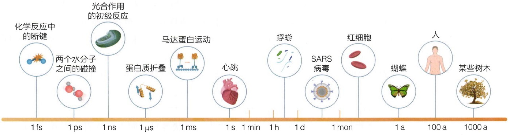

text_image

化学反应中的断键
两个水分子之间的碰撞
光合作用的初级反应
蛋白质折叠
马达蛋白运动
心跳
蜉蝣
SARS病毒
红细胞
蝴蝶
人
某些树木
1 fs
1 ps
1 ns
1 µs
1 ms
1 s
1 min
1 h
1 d
1 mon
1 a
100 a
1000 a

---

006

1 生物现象中的物理学

图1-3 细胞中的能量尺度

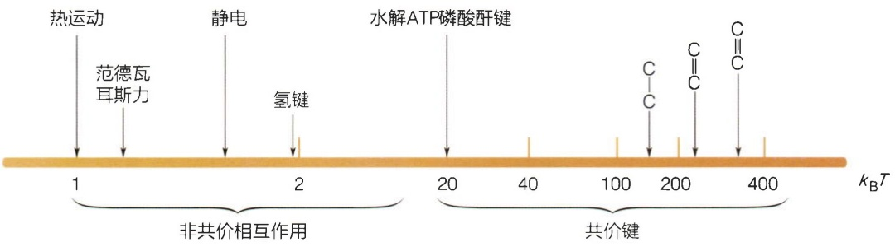

text_image

热运动
范德瓦
耳斯力
静电
氢键
水解ATP磷酸酐键
1
2
20
40
100
200
400
共价键
C
C=C
C≡C

在考虑电荷的热运动时，我们会使用  $k_{B}T = 25 \, meV$ 。

我们可以用热运动能量作为标尺来估算细胞中相互作用的强度。如图1-3所示，细胞中的基本相互作用分两类，一类是比较强的共价键，一类是比较弱的非共价键。ATP作为细胞的主要能量货币，在生理条件下，水解释放的能量约为 $20k_{\mathrm{B}}T$ 。碳碳单键（C—C）和双键（ $\mathrm{C = C}$ ）断裂释放的能量分别为 $150k_{\mathrm{B}}T$ 和 $250k_{\mathrm{B}}T$ 。碳碳三键（ $\mathrm{C}\equiv \mathrm{C}$ ）释放的能量高达 $300k_{\mathrm{B}}T$ 。较弱的非共价键包括范德瓦耳斯力、氢键、静电作用等，其相互作用能量在 $k_{\mathrm{B}}T$ 量级。

## 1.2 生物中的力

## 1.2.1 生物与重力

“鹰击长空，鱼翔浅底，万类霜天竞自由。”生命自诞生起就需要时刻应对地球无处不在的引力——重力。引力是四大基本力之一，是地球上生物体所经历的自然力量之一，它对生物产生了广泛的影响。无论是生物体的形态和结构，还是生长、发育、运动和行为等，都受到重力的影响。

细胞是生物体最基本的结构单元，其形态和结构受重力的影响。在重力作用下，细胞如果没有其它因素影响，实际上无法保持稳定的球形结构，而会在水平方向扩展。因此，生物需要特定的细胞结构或环境来应对重力影响。早期生命形式起源于水环境，受到渗透压和表面张力的影响，一定程度上抵抗了重力的影响，可以帮助维持细胞的立体结构（图1-4A）。

在漫长的演化过程中，细胞进化出各种复杂的系统来对抗重力，以保持细胞结构的稳定。真核细胞形成细胞骨架系统以维持刚性结构；植物细胞演化出细胞壁来保持结构稳定（图1-4B）。这些微观尺度上演化而来的特殊结构在执行其生理功能的同时，帮助生物抵抗重力和其它机械力。因此，尽管重力对微观结构的作用力较小，但其对生命的影响却无处不在，是形成目前生命多态性的重要影响因素。

令人惊奇的是，一些单细胞微生物能够巧妙利用重力来调控其生命过程。例如，某些生存在水环境中的气囊细菌会在细胞内形成气囊或空泡，以调节浮力和定位。这些气囊通常由蛋白质等物质构成，形状各异。源自巨大芽孢杆菌（Bacillus

---

1.2 生物中的力

007

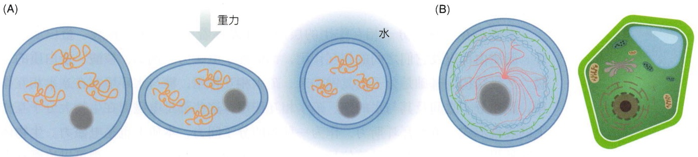

图1-4 重力对细胞结构的影响

megaterium）的气囊结构中，单体蛋白 GvpA 通过有序排列形成特殊的纺锤形囊泡结构，实现浮力调节（图 1-5）。

## 1.2.2 生物与电磁力

从个体、细胞，再到分子层面，生命的构成形成了一个错综复杂的世界。在这个多姿多彩的生命世界中，电磁力统一了一切。

自然界存在四种基本力:引力、强相互作用、弱相互作用和电磁力。我们在前面已经提到过引力对生物的影响。强相互作用和弱相互作用主要在原子核层面发挥作用，而电磁力则构成了生物体各个层次（从宏观生命活动到微观分子功能）的基础，在生命体中扮演核心角色。电磁力负责带电粒子的相互作用，不仅在维持原子和分子的稳定结构方面至关重要，还构成了光、电和磁等现象的基础。

原子核带正电荷，而电子带负电荷，它们通过电磁相互作用，形成稳定的原子结构。分子是由原子组成的，其构建涉及电子与原子核、多个邻近原子之间的电子以及原子核之间的电磁相互作用。在化学键（如离子键、共价键和配位键等）的形成和断裂过程中，同样是电磁力在发挥作用，它们主导并推动各种化学反应，促进了所有生命

（A）正常的细胞结构在重力作用下向水平方向展开。在水环境中的细胞可以部分抵消重力的影响。（B）在重力下，细胞骨架与细胞壁可以帮助细胞维持结构的稳定性。

(A)

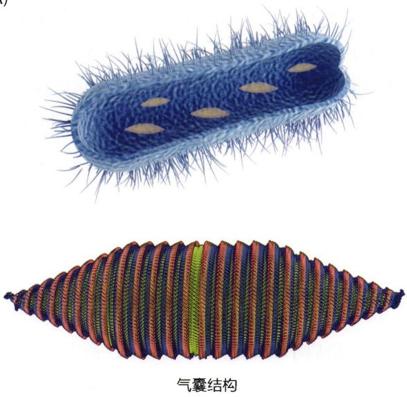

natural_image

Illustration of two types of bacteria: a spiky blue bacterium and a colorful, ribbed patterned bacterium (no text or labels)

(B)

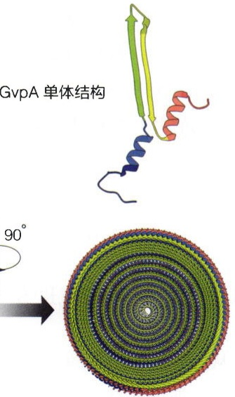

text_image

GvpA 单体结构
90°

图 1-5 气囊细菌的气囊结构

（A）巨大芽孢杆菌及其中的气囊结构。（B）构成气囊的单体结构（PDB编号:7WLT）。（C）完整的气囊冷冻电镜三维结构及其剖面图。

---

008

1 生物现象中的物理学

过程的进行。

电磁力在生物大分子相互作用的层面同样发挥着关键作用。核酸、蛋白质、糖类、脂质内部以及它们之间的相互作用，都依赖于电磁力。例如，核酸、蛋白质的二级、三级结构的基础是分子内氢键和亲、疏水相互作用，糖与水环境存在亲水相互作用，脂质分子之间及其与水的亲、疏水相互作用，这些都是电磁力在生物大分子互作上的表现形式。范德瓦耳斯力，作为一种弱的分子间力，本质上也是电磁力。生物体感知外界声、光、电和磁场等信号，以及维持生命所需的各种功能，都可以追溯到电磁相互作用。

## 1.2.3 力的产生与力的感知

在个体、细胞和分子层面，机械力实质上是由微观层面的电磁相互作用所引起的。当物体之间接触或相互作用时，其表面的原子和分子之间电荷分布和电子云的运动会导致物体之间产生电磁相互作用，进而产生机械力作用（知识窗1-1）。大量分子的规则排布与定向运动，如肌纤维的肌动蛋白与肌球蛋白等，可以产生宏观力的作用。

我们对机械力的感知本质上是通过电磁力来实现的。人类和许多生物能通过皮肤的感觉器官感知外部物体对其施加的力，即触觉，这使得我们能够感知物体的硬度、质地、温度等特性。例如，当外部力的刺激超过身体组织所能承受的阈值时，我们会感受到疼痛；通过手我们可以感知物体表面光滑度、轻重差异。高等动物可以利用内耳中的感觉器官感知速度变化，帮助它们调节身体平衡。植物通过根系和茎来感知土壤的力学特性，以调整它们的生长方向。

从分子层面来看，生物体感知外界力刺激的途径多种多样。其中一种经典的方式是通过生物体内存在的一类特殊蛋白质通道，称为机械力敏感通道（mechanosensitive channel）。这些通道能够感知和响应机械力（如压力和拉力）刺激。它们在细胞膜上形成微小通道，允许离子（通常是 $\mathrm{Na^{+}}$ 、 $\mathrm{K^{+}}$ 和 $\mathrm{Ca^{2+}}$ ）进出细胞，改变细胞的膜电位，产生响应信号。机械力敏感通道广泛存在于各种生物体中，从细菌到高等动物，它们以不同方式利用这些通道感知外部机械力刺激，将刺激转化为胞内信号或神经信号，实现力的感知。我们在第11章会用一个简单模型来理解离子通道如何响应力信号。

## 1.3 生物中的电

## 1.3.1 生物中的电现象

从大到我们所在的地球，到生物个体，最后小到细胞、分子层面，都广泛存在着电现象。地球本身是带有电场的，地球电场对于某些动物的行为和导航能力、植物的

---

1.3 生物中的电

009

## 知识窗1-1

## 甜麦圈效应

生物中的表面张力是一种重要的物理现象。表面张力是液体表面上分子间相互作用力所产生的现象，例如液滴的形状、蜉蝣浮于水面等都是表面张力的体现。在生物体内，表面张力能够影响细胞的形态、功能和相互作用。它在维持细胞结构、细胞间相互作用以及液体在生物体内传输等方面发挥着一定作用。

甜麦圈效应（cheerios effect）是一个有趣的现象，指的是小浮动物体在液体表面聚集的行为。它得名于甜麦圈的例子，当甜麦圈在牛奶碗中浮动时，有相互吸引并粘在一起的倾向（图1-6A）。在生命系统中，我们可以在各种小颗粒中观察到这种效应，比如细胞、微生物甚至分子，它们倾向于在液体表面聚集形成聚集体。这些聚集体的形成主要是由于表面张力和黏附力的平衡（图1-6B）。表面张力试图最小化表面积并将物体拉到一起，导致颗粒聚集。这种效应可以影响细胞和微生物在细胞黏附等过程中的行为。

(A)

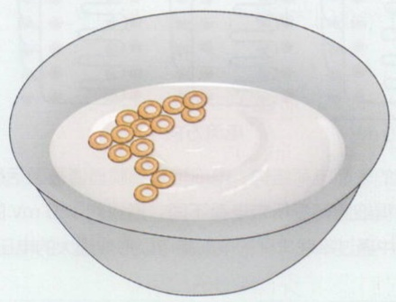

natural_image

Illustration of a bowl containing a cluster of small round objects floating in liquid (no text or symbols)

(B)

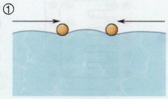

natural_image

Diagram showing two spheres aligned along a curved surface with directional arrows indicating motion (no text or symbols)

②

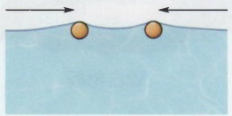

③

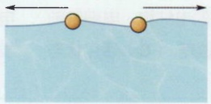

④

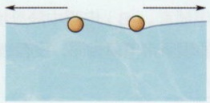

图 1-6 甜麦圈效应

（A）牛奶中的甜麦圈会自发地聚集在一起。（B）由于表面张力的存在，非浸润或浸润表面的小球在水溶液中会倾向于聚集在

一起（①，②），而半浸润或者浸润和非浸润混合的小球倾向于分离（③，④）。通过不同的聚集或分离的形式来降低液体的表面积。

根系生长和水分吸收都会产生影响。

从小的个体来看，生物都是有电现象的，特别是某些发电的动物更加明显。这些生物都具有特殊的电器官，能够产生电场或电流，并以此来进行捕食、防御或传递信息。例如电鳗（知识窗1-2），它的所有脏器都集中在身体前部五分之一，剩下的五分之四由三种发电器官组成（图1-7A）。

在细胞和分子层面，生物也有很多重要的电现象，如神经元、肌纤维、心肌等细胞的电活动。这些细胞存在跨膜电位，在接受刺激时，膜上的离子通道产生动作电位，并传递电信号，使得生物个体可以完成感知刺激、控制肌肉运动以及其它生理功能。

---

010

1 生物现象中的物理学

## 知识窗1-2

## 电鳗的发电机制

电鳗（图1-7A）通过特殊的电细胞结构和发电机制产生强大电压，电击是通过电细胞的串联和膜离子通道激活来实现的。每个电细胞都带有特殊的离子通道，控制着离子的通透，从而改变细胞内外电位。电细胞排布在电器官中，具有侧膜离子通道系统，包括钠通道和钾通道，可调控电位变化。静息电细胞的前后细胞膜电位差约为 $0\mathrm{mV}$ （图1-7B）。当电细胞受刺激时，通过脊髓神经元的突触将单侧膜钠通道同时打开，使  $Na^{+}$  进入细胞，将该侧膜电位翻转，从而产生约 150 mV 的跨细胞的电位。在电器官中，电细胞串联排布。整个序列中的电细胞电位变化同步改变，并通过电细胞之间的串联效应累积，产生高电压脉冲，即电鳗的电击（图 1-7C）。

(A)

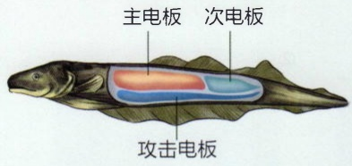

text_image

主电板
次电板
攻击电板

(B)

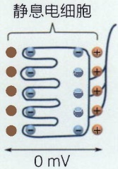

text_image

静息电细胞
0 mV

图 1-7 电鳗的发电机制

（A）电鳗的发电器官。（B）电鳗中静息状态下的电细胞。电细胞前后两侧的细胞质膜所带电荷相同，没有表面电位差。（C）活化状态

(C)

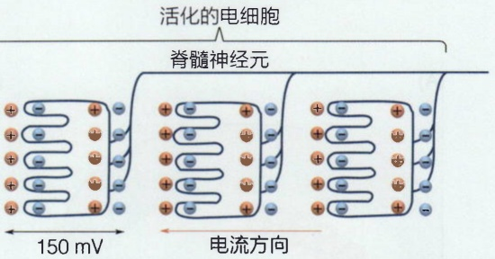

text_image

活化的电细胞
脊髓神经元
150 mV
电流方向

下电细胞的表面电荷结构。电细胞单侧膜通道被激活后，将翻转膜电位，使得细胞两侧所带电荷不同，形成约 150 mV 的电位差，在发电器官中通过串联排列的电细胞可以形成强大的电压。

## 1.3.2 生物电的产生

一些关键离子，如 $\mathrm{Na^{+}}$ 、 $\mathrm{K^{+}}$ 、 $\mathrm{Ca^{2+}}$ 等，在细胞内外的不均等分布及选择性的跨膜运动，是形成生物膜电位的基础。在哺乳动物细胞内外，存在许多不同离子的浓度梯度（表1-1），这些梯度在维持细胞正常功能、电位平衡、膜通透性等方面起着重要作用。这些离子的平衡和调控受到细胞膜上各种离子通道、转运蛋白等的调节。

膜电位的形成是由于细胞质膜对离子的选择性通透而产生的。由于离子跨膜浓度差的存在，离子会顺浓度梯度扩散，而与此同时，由于发生电荷分离，会产生反向的电势差来拮抗这种扩散作用。当电势差达到与浓度差（或化学势差）平衡的时候，称之为能斯特（Nernst）平衡电位（ $E_{Nernst}$ ）（表1-1）。细胞质膜通过不同的离子通道来控制离子的流动，因此具有选择通透性。正常可兴奋性细胞主要对 $K^{+}$ 具有较高的通透性，因此正常细胞质膜两侧的平衡膜电位（约-70\~-90 mV）主要是 $K^{+}$ 平衡电位。我们将在第2、12章进一步描述离子分布的电化学势、跨膜电位的形成。

---

1.4 生物中的光学现象

011

表 1-1 哺乳动物细胞的离子浓度梯度

| 离子 | 膜外浓度/(mmol·L-1) | 膜内浓度/(mmol·L-1) | 膜外浓度/膜内浓度 | ENerust/mV |
| --- | --- | --- | --- | --- |
| Na+ | 145 | 12 | 12 | +67 |
| K+ | 4.5 | 155 | 0.029 | -95 |
| Cl- | 116 | 4.2 | 27.6 | -89 |
| Ca2+ | 1.0 | 10-4 | 10 000 | +123 |

## 1.4 生物中的光学现象

## 1.4.1 光与生物感知

光是一种电磁波，光与物质的相互作用的本质是电磁力的一种表现形式。光是万物色彩斑斓的感知基础。生物体内存在对应的光受体分子或者细胞结构，能够感知和响应光信号。在生物中，有多种光受体用于感知不同波长和强度的光，从而调节生物体的行为、生理和生态。

视蛋白是动物眼中用于感知光信号的主要受体。在人的视网膜中，存在大量的视杆细胞和视锥细胞，在这些视细胞的外节部分，存在高度有序折叠的膜结构，这些膜结构中存在有序排布的视蛋白，如视紫红质、绿色感光蛋白、蓝色感光蛋白等，使得动物能够灵敏地感知不同波长的光（图1-8A）。

在植物中，也有各种各样的蛋白质来帮助它们感知和利用不同波段的光。光合色素是植物和一些原核生物（如藻类和细菌）中的光受体。它们包括叶绿素和类胡萝卜素等，用于吸收太阳光的能量并参与光合作用；光敏色素家族（phytochrome, PHYA\~E），能感受红光/远红光，对植物的生长、开花、休眠和光周期等生理过程有重要影响。蓝光受体是一类感知蓝光的蛋白质，包括隐花色素（cryptochrome, CRY）、向光素（phototropin, PHOT）和光受体ZEITLUPE（ZLF）等，参与植物的光周期调节、光合作用、光敏性和生长发育。紫外光受体UVR8用于感知和响应紫外光B（UV-B）波段的光辐射，它在植物的生长和适应环境变化中发挥着重要作用（图1-8B）。

## 1.4.2 生物对光的利用

光在生物学过程中的利用是多样且重要的，它为生物体提供了能量和信息，支持了生物体的生长、发育和适应环境的能力。

光合作用一般是指生物体利用光能将二氧化碳和水转化为有机物质和氧气这一过

---

012

1 生物现象中的物理学

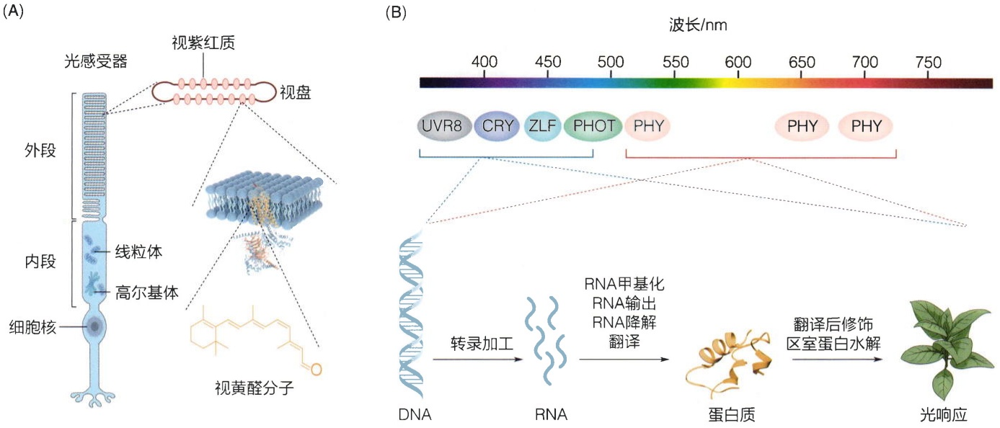

图1-8 不同的光受体蛋白

（A）视杆细胞中视紫红质对光的感知。（B）植物中不同类型的光感受蛋白及其光响应过程。

程。在自然界中，光合作用是地球上几乎所有生物生存的基石，主要在植物、藻类和某些细菌中进行。不同类型生物的光合作用有着不同的途径和机制。

硫细菌使用硫化物而不是二氧化碳作为最终电子受体，它们能在低氧环境下进行光合作用。非硫细菌使用硝酸盐等作为最终电子受体来完成光合作用。

绿藻在光合作用中使用叶绿素来捕获光能，并通过光合反应将二氧化碳和水转化为有机物和氧气。红藻和褐藻中除叶绿素外还含有大量其它不同种类的色素分子，使得它们呈现不同的颜色。

高等植物如大多数陆生植物使用叶绿素a和叶绿素b来捕获光能，将二氧化碳和水转化为有机物和氧气。高等植物光合作用涉及两个重要的光系统:光系统I（PSI）和光系统Ⅱ（PSII）。这两个光系统在植物光合作用中协同工作，负责将光能转化为化学能。捕获的光能在反应中心将水（电子供体）分解产生氧气和质子，并将电子传递到电子受体（图1-9）。

植物光合作用包含两个关键阶段:光反应和暗反应。在光反应阶段，光能被叶绿

图 1-9 光合作用中的电子传递过程

光能被捕光复合体中的色素分子吸收并传递到反应中心，在反应中心将电子从供体传递到受体中。

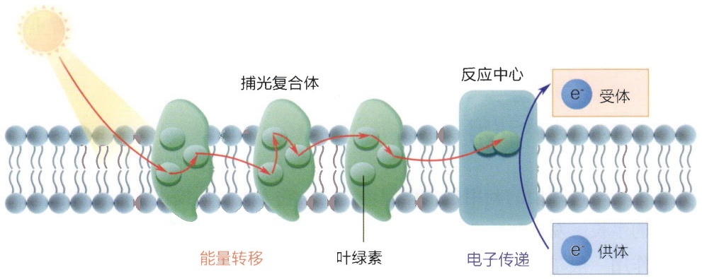

flowchart

---

1.5 生物与温度

013

素等色素吸收，激发电子，将水分子分解为氧气和氢离子，并产生高能化合物ATP和NADPH。这些高能化合物是后续暗反应所需的能量来源。在暗反应阶段，利用光反应阶段产生的ATP和NADPH，二氧化碳被固定，并通过一系列酶催化的反应，将二氧化碳转化为有机物质，最终产生葡萄糖等有机化合物。这些有机化合物不仅为植物自身提供生长和代谢的能量，也为其它生物提供能量和养分，是整个生物圈食物链的基础。

## 1.5 生物与温度

## 1.5.1 温度对生物的影响

温度是生物体内和周围环境的重要物理参数，对生物的生理和行为产生深远影响。温度是生物体内化学反应速率的重要调节因素，它影响着生物的代谢水平和能量利用情况。此外，温度还参与调控生物体的生长和发育过程，在植物的开花、动物卵的孵化（知识窗1-3）等很多过程中都发挥着重要的作用。

通常情况下，随着温度的升高，化学反应速率也会加快，而温度的降低则会导致反应速率减慢。这种关系可以通过阿伦尼乌斯方程（Arrhenius equation）来描述，该方程表达了温度与反应速率之间的指数关系:

$$
k = A \mathrm{e} ^ {- \frac {E _ {\mathrm{a}}}{k _ {\mathrm{B}} T} _ {\circ}}
$$

其中， $k$ 是反应速率常数， $A$ 是阿伦尼乌斯常数， $E_{\mathrm{a}}$ 是活化能， $k_{\mathrm{B}}$ 是玻尔兹曼常量，$T$ 是反应的热力学温度。

这个方程表明，温度升高会导致指数项增大，从而使得反应速率常数 $k$ 增加。换句话说，提高温度会使反应物分子更容易克服活化能能垒，从而加快反应的进行速率。因此，温度对于生物体内的生化反应和酶催化过程十分重要。在适宜的温度范围内，生物体内的代谢反应会加快，从而维持生物体正常的生理功能。温度过高或过低会对生物体产生不良影响。

生物对温度变化表现出不同的生理适应性。动物通过调节体温或生理反应来适应不同的温度条件，动物的活动模式、食性和繁殖行为通常与温度密切相关。

## 1.5.2 生物体温的维持

维持适宜的体温对生物的生存和正常生理功能至关重要。体温调节是通过一系列复杂的生理和行为反应来实现的。恒温动物，如哺乳动物和鸟类，能够通过内部代谢来调节体温。它们拥有高代谢率，能够产生足够的热量来保持体温。在环境温度降低时，它们会增加代谢率，产生更多的热量以抵抗寒冷。相反，在环境温度升高时，它

---

014

1 生物现象中的物理学

## 知识窗1-3

## 温度性别决定

温度性别决定（temperature-dependent sex determination，TSD）是在某些动植物中普遍存在的性别决定方式。在这种机制中，生物的性别发育和分化受到环境温度的影响。在一些爬行动物（如鳄、海龟和蜥蜴）、鱼类以及一些昆虫等生物中，它们产卵孵化时的温度范围决定了后代的性别（图1-10）。例如，彩龟就是著名的温度性别决定者，其性别由海龟蛋在沙滩上的温度条件所决定。较高的温度会导致更多的雌性孵化，而较低的温度则会导致更多的雄性孵化。

温度性别决定是一种独特的性别决定机制，与传统的性染色体决定（如 XX/XY 系统）不同，它使得生物的性别在不同环境条件下具有一定的可塑性，为其生态适应性提供了一种灵活的方式。

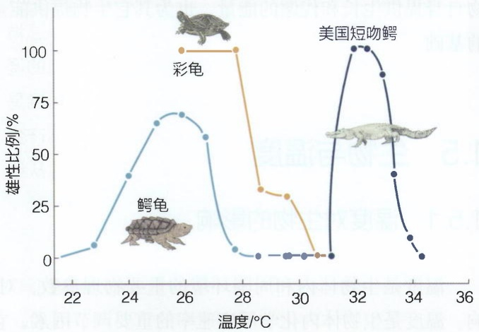

line

| 温度 \(({}^{\circ}C)\) | 彩龟 (雄性比例/%) | 鳄龟 (雄性比例/%) | 美国短吻鳄 (雄性比例/%) |
| --- | --- | --- | --- |
| 22.5 | — | ~8 | — |
| 23.5 | — | ~40 | — |
| 24.5 | — | ~65 | — |
| 25.5 | 100 | ~70 | — |
| 26.5 | 100 | ~60 | — |
| 27.5 | 100 | ~5 | — |
| 28.5 | ~33 | ~2 | — |
| 29.5 | ~30 | ~2 | — |
| 30.5 | ~2 | ~2 | — |
| 31.5 | — | — | ~100 |
| 32.5 | — | — | ~90 |
| 33.5 | — | — | ~40 |
| 34.5 | — | — | ~10 |
| 35.5 | — | — | ~2 |

图1-10 三种爬行动物的温度依赖性别决定

图中不同曲线代表鳄龟、彩龟和美国短吻鳄在不同温度下雄性孵化的比例。

们会减少代谢率，防止体温过高。变温动物，如爬行动物和无脊椎动物，其体温会随着环境的变化而波动，它们依赖于外部环境来调节体温。

通常生物通过多种机制来维持体温在适宜的范围。当生物体进行营养物质的代谢过程时，会产生能量，其中一部分能量以热量的形式散发出来，称为代谢热。这种热量的产生是生物体维持体温的重要机制。肌肉运动也会消耗能量并产生大量热量。此外，某些哺乳动物拥有特殊的组织——棕色脂肪组织，其主要功能是产生热量而不是储存能量。当生物体需要额外的热量时，棕色脂肪组织会被激活，产生大量热量以维持体温（知识窗1-4）。

## 1.6 生物维持有序结构的一般规律

细胞作为生命的基本单元，其微小尺寸和高度有序性一直以来都吸引着科学家的目光。细胞的直径通常在微米量级，却包含着种类繁多的生物大分子，数量从1（例如DNA分子）到 $10^{6}$ （例如大肠杆菌中的总蛋白质数目）不等。然而，细胞却能够一直维持自身的稳定有序状态，并将这种状态精确地遗传给后代。

---

1.6 生物维持有序结构的一般规律

015

## 知识窗1-4

## 解耦联蛋白

棕色脂肪组织通过解耦联蛋白（decoupling protein, DCP）的解耦联作用产生大量热量来帮助维持体温稳定。DCP对细胞能量代谢和体温维持发挥着关键的调节作用，它们主要存在于线粒体内膜，其主要功能是解耦联氧化磷酸化。氧化磷酸化是细胞内线粒体产生ATP的过程。当DCP活跃时，它会将质子直接从线粒体膜间隙释放到线粒体基质，导致质子的跨膜电化学势蕴含的能量无法转化为 ATP，而直接以热量的形式散失。

DCP 的解耦联作用使细胞能够调节 ATP 合成和消耗的平衡，以满足不同的能量需求，这对于维持细胞内能量代谢的平衡和稳定至关重要。

在分子生物学大发现之前的时代，细胞的微小与高度有序性似乎与经典统计物理理论相矛盾，其中最核心的问题是涨落（fluctuation）。涨落描述了物理量（如温度、压强和体积等）偏离平均值的程度，就像一个正态分布的随机数偏离平均值一样。对于经典平衡态系统，系统中粒子数越少，涨落就越明显。从这个角度看，由于数量有限，构成细胞的那些分子（或原子）似乎根本无法支撑一个精确有序的结构。

最早注意到这个问题的是一群物理学家。在X射线诱导突变的遗传实验中，马克斯·德尔布吕克（Max Delbrück，1906—1981）等人估算出一个“基因基本单元”大约包含了1000个原子。如果将这个基本单元假设为一团平衡态的理想气体，那么这种系统大约会有 $3\%$ 的涨落，这意味着基因大约有 $3\%$ 的自发突变率。这显然远远高于遗传学观察到的结果:普通基因的自发突变率仅在 $10^{-9}$ 数量级。

这两个差异巨大的数字促使物理学家思考生命维持有序性的物理基础是什么。1943年，奥地利物理学家埃尔温·薛定谔（Erwin Schrödinger，1887—1961）基于当时的遗传学实验和最新的量子力学理论，提出了遗传物质稳定性和生命系统维持有序性的理论雏形，并总结在《生命是什么？》一书中。薛定谔认为，为了抵抗热涨落，基因中的原子显然不能像理想气体分子一样随意晃动，而应该像晶体中的原子一样被固定在特定的位置。固定原子的这种力就是化学键，是一种量子力学效应。由于化学键键能很高，因此几乎不可能被热运动破坏（详细计算见第2章）。同时，为了记录庞大的遗传信息，这些构成基因的原子不能像晶体一样简单地重复排列，而是要像一本宏大巨著中的字母一样非周期地、有意义地展开。薛定谔称这种遗传物质结构为“非周期晶体”。现在看来，薛定谔提出的关于遗传物质的大致图像是很有前瞻性的（需要说明的是，这个观点并非薛定谔原创，多个物理学家和生物学家都有过类似的猜测）。

薛定谔对于生命物理基础的追问并没有止步于此，而是提出了一个更宏大的问题:是不是知道了染色体的全部序列，我们就掌握了全部的生命奥秘呢？薛定谔提出，即使知道了全部的基因编码，我们还是面临一个基本难题:现有的物理理论无法

---

016

1 生物现象中的物理学

回答遗传物质是如何工作的。遗传密码就像一部书，人类基因组计划已经让我们知道了书的每一个字符，但是我们离完整地理解这部书还有很远的距离；就像只知道一本英文小说的字母排列，并不意味着我们读懂了这本小说。

从物理角度来看，对于复杂的生命系统，有什么一般性规律呢？如果我们坚信物理原理对生命系统同样适用，那么热力学第二定律所断言的孤立系统无序程度永不减少似乎就是所有生命不可避免的命运。然而，生命并没有陷入这种最大无序的状态，其根本原因是生命并不是一个孤立系统，而是不停地与外界在进行“新陈代谢”。新陈代谢过程到底交换了什么？薛定谔指出，生命吸收“负熵”，抵抗体内熵增加的趋势，从而维持一个稳定的“活”的状态。负熵本质就是自由能（$F$），包含能量（$E$）与熵（$S$）两个部分:

$$
F = E - T S,
$$

我们会在第2章中仔细讨论熵和自由能的概念。在随后的章节中，我们会发现熵和自由能是生物物理中最核心的物理量。

## 1.6.1 生物体中不同尺度的物质运输

当我们走进一家餐厅，嗅觉神经元能迅速捕捉到空气中弥漫的气味分子，这些分子通过自由扩散的方式，在极短的时间内抵达鼻腔，引发嗅觉。同样，当我们品尝果汁时，甜味物质（如蔗糖和果糖）在口腔唾液中迅速扩散，与味蕾上的受体结合，产生甜味。这些日常的体验都展示了自由扩散在生命系统中的重要性。

在长度大约 $2\mu \mathrm{m}$ 的大肠杆菌细胞中，mRNA、蛋白质分子从细胞的一端自由扩散到另一端只需要几秒钟（按照扩散系数约为 $1\mu \mathrm{m}^2 /\mathrm{s}$ 估算，不同大小的蛋白质扩散系数有很大差异，详见第2章）。然而，对于多细胞生物而言，仅仅依靠自由扩散是远远不够的。例如，在人类神经系统中，神经元轴突的长度可达数米。若神经递质的运输完全依赖自由扩散，那么从细胞体到达轴突末梢可能需要长达千年，无法满足神经系统快速传递信息的需求。为了克服这一限制，细胞进化出了主动运输机制。通过消耗能量，细胞可以将物质逆浓度梯度或长距离运输，从而保证细胞内物质的动态平衡。为什么气体分子和水中的糖分子自由扩散可以这么快？为什么大肠杆菌中的物质运输通过自由扩散就可以满足细胞的需要，而坐骨神经元的物质运输必须通过主动运输来实现？主动运输与自由扩散现象的物理学原理差异在哪里？

在第2章中，我们会学习扩散的基本规律。扩散的本质是分子的无规热运动，从宏观上看，分子从高浓度区域扩散到低浓度区域，是一种自发的行为，不需要外部能量输入。扩散所需时间与距离的平方成正比。因此，在生物体内短距离的物质运输可以依靠扩散，例如在大肠杆菌中的分子扩散；而长距离的物质运输由于所需时间过长，几乎不可能由扩散来完成。这时，定向的主动运输就会成为主角。主动运输通过消耗能量（例如ATP的化学能、质子的浓度梯度等）克服无规热运动，使得所载物质在微观上定向快速运动。在细胞内，主动运输的两种重要机制是分子马达驱动和细

---

本章小结

017

胞质的输运。我们将在第2、13和14章等相关章节中仔细研究这个问题。在个体层面，扩散和主动运输都会起到重要作用，例如，氧气和二氧化碳的交换是通过肺泡和血液之间的扩散来实现；而营养物质、激素的吸收等则通过血管壁上的主动运输来完成。扩散和主动运输是生命系统中物质运输的两个基本机制，它们互相配合，共同维持着细胞内、细胞间以及整个生物体内的物质平衡，为生命活动的正常进行提供必要支持。

## 1.6.2 生物中的周期性

从猎豹皮毛上的斑纹，到动物身体的体节结构，我们会发现很多生物体的空间周期性现象。而生物体中的时间周期性现象更是无处不在，从宏观的动物睡眠周期和植物生长周期，到微观的细胞分裂周期和细胞骨架的动态组装。这些周期现象的物理学规律是什么？

无论是时间上的周期性，还是空间中的周期性，本质都是一系列有序的事件依次发生。这种有序性的根源是什么？在第2章中，我们会仔细讨论平衡态。在平衡态系统中，有序性最小，无序度最大，因此不可能出现这样的周期性事件（严格地说，平衡态系统不可能产生时间上的周期性事件，但是空间的周期排布是可能的，例如晶体，但是这种排布是平衡态的一种现象）。历史上，正是对于化学振荡等周期性现象的研究，伊利亚·普里戈金（Ilya Prigogine，1917—2003）等物理学家提出了耗散结构的概念。由于生命系统是一个开放系统，能够不停地耗散自由能，进而远离平衡态，产生各种有序的结构。更重要的是，这些有序结构不是由外界控制的，而是由于系统内部的相互作用自发形成的，我们称之为自组织（self-organization）现象。因此，这种自组织现象体现了结构（生命体内部相互作用）与功能（周期性）之间密不可分的关系。在第10章将会讨论生物体中产生自组织现象的基本原理。现代生物学的核心内容之一就是探索生物内部结构与功能之间的关系。从这个角度而言，研究非平衡态系统的物理学与生物学有异曲同工之妙。通过深入了解这些周期性现象的物理基础，我们能更好地理解生物体内部的秩序和生命活动的奥妙。

## ※ 本章小结

在这一章里，我们简单介绍了生命体的一些基本尺度，以及生命感知和操控力、热、电、光等物理效应的机制，并简单讨论了生物中有序性的基本物理规律。在本书后面的章节中，我们会详细展开讨论相关的内容。想要理解这些过程和生物功能，我们首先要了解相应过程的结构基础，然后运用物理学原理理解该结构在特定物理因素下的工作机制。结构与功能的对应关系是本书最核心的认知方法。

---

018

1 生物现象中的物理学

## ※ 扩展阅读

## 图书

- Harold F M. The way of the cell: molecules, organisms, and the order of life[M]. Oxford: Oxford University Press, 2001.
- Parthasarathy R. So simple a beginning: how four physical principles shape our living world[M]. New Jersey: Princeton University Press, 2022.
- Schrödinger E. What is life?: the physical aspect of the living cell[M]. Cambridge: Cambridge University Press, 1944.
