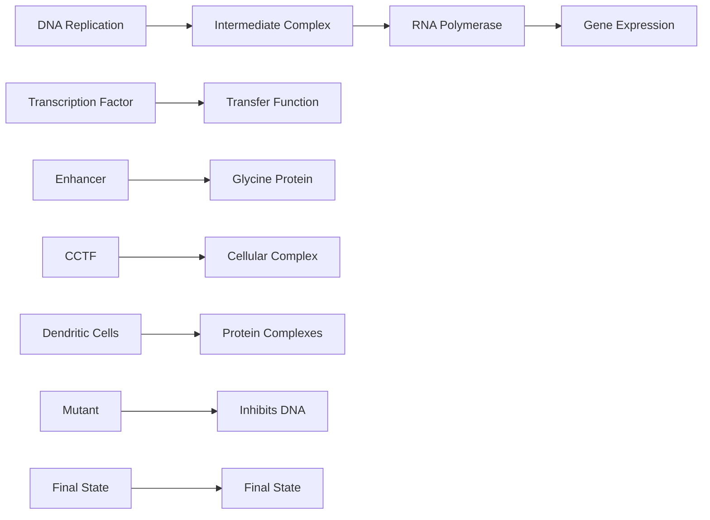
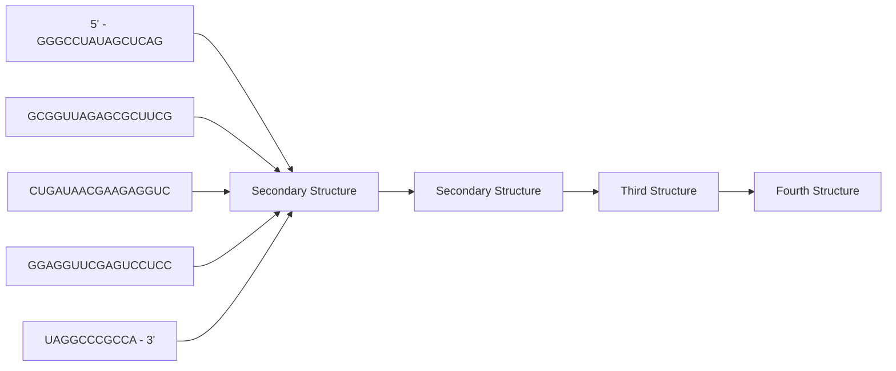
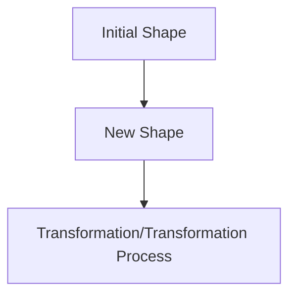

# 3 生物大分子的结构

原始 PDF 第 81–134 页。

## 生物大分子的结构

生物大分子包括蛋白质、脱氧核糖核酸（DNA）、核糖核酸（RNA）、多糖等。蛋白质的结构丰富多彩，是各种生命活动的执行者，在基本的呼吸作用、细胞增殖、高等生物的免疫应答、神经活动等等过程中发挥作用。DNA携带遗传密码，控制生物性状，是构建生命的蓝图。RNA是传递遗传密码的信使，指导蛋白质的合成。近来研究显示，细胞转录大量没有编码蛋白质的RNA，它们同样具有重要的生物学功能。

发现并理解生物大分子的功能是生命科学的核心问题，而解析生物大分子的结构，可以透过现象看本质，揭示功能背后的机理，并为理解生物学功能提供新的视角和思路。例如，DNA 的双螺旋结构揭示了遗传信息的存储和传递机制；肌红蛋白和血红蛋白的结构揭示了机体存储和运输氧气的机制。这些生物大分子结构研究也是现代分子生物学开端的标志性事件。同时，生物大分子的结构研究在药物研发和医学领域中发挥着重要作用。例如，通过解析蛋白质的结构，可以帮助开发新药物，并优化现有的药物。

本章将介绍蛋白质、DNA、RNA以及它们复合物的基本结构。在这些大分子结构尤其是蛋白质结构中，有两个反复出现的主题。首先，结构决定功能。为了实现某种生物学功能，往往需要特定的三维结构作支撑。因此，揭示生物大分子的结构特点，洞见其功能背后的机制是生物物理研究的核心内容。其次，生物大分子结构具有可塑性，而非静止不变。这种可塑性体现在构象的变化上，有些构象变化很细微，有些则很剧烈。有些变化是由于自发的热力学涨落，有些是由于应答环境的变化和信号刺激。正是这些特点使得生物大分子结构研究重要而且有趣。

3

---

058

3 生物大分子的结构

表征和测定生物大分子结构需要不同的生物物理实验方法。例如，质谱技术常用于测定蛋白质的一级结构（序列信息），吸收和发射光谱常用于分析蛋白质的二级和三级结构，而晶体学、核磁共振以及电子显微镜技术可以解析蛋白质的精细三维结构。三种常用的结构解析方法的初步介绍见第4—7章，而更多的生物物理方法介绍见第五部分。

## 3.1 蛋白质结构

本节主要介绍蛋白质的多层次结构，以及推动这些结构形成的分子相互作用力。

## 3.1.1 蛋白质一级序列决定三维结构

蛋白质是复杂的生物分子，执行广泛的功能，对许多生物过程都至关重要。如酶催化生化反应，可以成千上万，甚至百万倍地加快反应速度；抗体分子特异识别病毒、细菌等病原体，对机体有重要的免疫保护作用；分子马达移动核小体，调节基因表达，控制细胞发育分化；离子通道蛋白质调节细胞内外离子的流动，控制神经信号

的传导和效应。为什么蛋白质作为同一类的生物大分子，却具有如此丰富多样的功能呢？蛋白质的功能与其独特的结构和氨基酸序列密切相关。序列中的每个氨基酸都影响最终的三维结构，并最终确定其功能。

蛋白质序列指的是蛋白质多肽链中的氨基酸线性序列。氨基酸是蛋白质的基本组成单位。为什么一维的氨基酸序列能够控制蛋白质的三维结构？这是一个复杂的蛋白质折叠问题，涉及到蛋白质主链的肽键共价链接、侧链的非共价键作用、分子伴侣等，进一步讨论见第7章。克里斯蒂安·安芬森（Christian B. Anfinsen，1916—1995）在1958年发现核糖核酸酶A（一种切割RNA的小蛋白质）在去除变性剂后可以恢复原来活性，从而证明蛋白质折叠成天然构象所需的信息包含在其氨基酸序列中。安芬森因此获得到了1972年的诺贝尔化学奖。

chemical

Protein secondary structure diagram showing helical conformations with labeled N and C termini, pH range 5~6

图 3-1 流感病毒 HA 细胞膜融合区在不同 pH 条件下的结构

流感病毒 HA 细胞膜融合区形成卷曲螺旋三聚体，图中显示其中一个单体的结构。左图，在中性 pH 的结构（PDB 编号:2HMG）；右图，在酸性 pH 的结构（PDB 编号:1HTM）。酸性条件下，流感病毒 HA 细胞膜融合区的 N 端（蓝色部分）往外翻，延长中央螺旋（绿色部分）；同时，C 端（橙色部分）重新折叠。

蛋白质的结构由其序列确定，但也受外在环境（如 $\mathrm{pH}$ 、温度、化学修饰和其它分子的存在）影响。例如，流感病毒血凝素蛋白（hemagglutinin，HA）的构象随 $\mathrm{pH}$ 值发生巨大变化（图3-1）。HA蛋白是流感病毒的外膜蛋白，在感染过程中，HA蛋白与宿主细胞表面的受体结合，流感病毒通过内吞作用进入宿主细胞。而病毒外膜在内吞体（endosome）与宿主细胞膜的融合则由HA的细胞膜融合区的构象变化所介导。在中性条件下，HA蛋白的细胞

---

3.1 蛋白质结构

059

膜融合区被隐藏在蛋白内部；在内吞体的酸性环境中（$\mathrm{pH} = 5 \sim 6$），细胞膜融合区发生构象变化，疏水性（hydrophobic）区域暴露在蛋白表面，并与宿主细胞膜融合，从而把病毒的基因组释放到宿主细胞内。

“序列决定结构，结构决定功能”这一逻辑范式是理解蛋白质的基础。一些蛋白质在不同物种中保留了相似的功能。相应地，它们的序列中出现相同的片段，而且它们折叠成相似的三维结构。这些在演化上不变或相似的序列被称为保守序列（conserved sequence），相关蛋白被称为同源蛋白（homologous protein）。同时，蛋白质序列中也含有非保守序列，这些序列是不同蛋白质之间的差异所在，它们可以影响蛋白质的特异性。例如，RecA家族蛋白利用ATP水解能量，介导同源DNA链交换。它们在演化上高度保守，在细菌中称RecA，在古菌中称RadA，而在真核生物中被命名为Rad51。比较不同物种的RecA蛋白序列，可以发现核心序列高度保守（图3-2A），折

text_image

(A) EcRecA RIVEIYGPESSGKTTLTLQVIAAAQ
MkRadA VIVGMYGPPGAGKSQFATQVAAHAL
ScRad51 SITEMFGEFRTGKTQICHTLAVTCQ
HsRad51 SITELFGEFRTGKSQLCHTLAVTCQ
* . : *   : ** : : .

(B)

chemical

Molecular interaction diagram showing BeF4, Mg, and ADP binding to a protein secondary structure

(C)

chemical

Molecular structure diagram showing Mg and ATP binding sites with a helical helix

图3-2 RecA家族蛋白序列和结构比较

（A）RecA 家族蛋白的核苷酸结合区域的多序列比对。EcRecA，大肠杆菌（Escherichia coli）RecA；MkRecA，甲烷嗜热菌（Methanopyrus kandleri）RadA；ScRad15，酿酒酵母（Saccharomyces cerevisiae）Rad51；hsRad51，人类（Homo sapiens）Rad51。“\*”表示相同的氨基酸残基，橙色高亮。“:”和“.”分别表示高度类似和类似的氨基酸残基。（B）EcRecA 核苷酸结合区域的结构（PDB 编号:3CMW）。（C）HsRad51 核苷酸结合区域的结构（PDB 编号:7EJC）。

叠成相似的结构（图3-2B、C），执行相似的功能。因此，分析蛋白质序列，并与已知蛋白对比，可以获得蛋白质功能的提示。

序列-结构-功能范式在研究基因突变相关的疾病以及蛋白工程等方面发挥作用。例如，表皮生长因子受体（EGFR）是一种位于细胞膜表面的受体酪氨酸激酶，参与细胞生长、增殖和分化等生物学过程。EGFR的突变会导致其在肺癌等恶性肿瘤中的异常表达和活化，进而引起肺癌的发生和发展。抑制EGFR激酶活性成为肺癌治疗的重要策略。第一代EGFR抑制剂吉非替尼（Gefitinib）竞争性结合EGFR的ATP结合位点，阻止其活化（图3-3）。然而，第一代EGFR抑制剂容易出现耐药性，其中一个常见抗药机制是T790M突变。药物分子虽然仍可以结合新出现的突变体，但失去相对于ATP的结合优势。人们根据EGFR激酶的结构特点，筛选设计出新一代的共价结合小分子抑制剂，如奥西马替尼（Osimertinib）。奥西马替尼不影响正常的EGFR，能够选择性地结合EGFR突变体T790M，并通过化学键与ATP结合口袋的Cys797侧链共价结合，从而锁定EGFR的失活状态。

总之，分析蛋白质的一维序列和三维结构特点，不仅可以揭示其精妙的功能机制，而且有助人们开发新型的药物。目前，对于许多蛋白质，可以根据其序列进行结构预测，其精度跟实验测量相差无几，更多讨论见本书8.1节。另一方面，通过有针对性地改变氨基酸序列，可以创建具有新的或改进功能的蛋白质，例如具有更高活性的酶或具有更高特异性的抗体。这种方法通常用于生物技术和药物开发，以创造具有特定性质的蛋白质，更多讨论见本书8.4节。

---

060

3 生物大分子的结构

(A)

natural_image

3D protein structure visualization with alpha helices and beta sheets (no labels or text)

(B)

natural_image

3D protein structure visualization with alpha helices and beta sheets, no text or labels present

(C)

natural_image

3D protein structure visualization with alpha helices and beta sheets, no text or labels present

chemical

Molecular structure diagram showing T790 and AMP-PNP labeled residues in a protein binding site

text_image

T790M
吉非替尼

text_image

T790M
奥西马替尼
C797

chemical

Chemical structure of a nucleoside derivative with amine and phosphate groups

chemical

Chemical structure of a substituted quinazoline derivative with chloro, fluorine, and amide groups

chemical

Complex organic molecule structure with indole, amide, and amide functional groups

图 3-3 EGFR 激酶部分的结构及其与小分子抑制剂的作用

(A) EGFR激酶部分结合ATP类似物（AMP-PNP）的晶体结构（PDB编号:2ITV），中图是结合口袋的放大图，下图是ATP的化学结构。（B）EGFR激酶T790M突变体结合吉非替尼的晶体结构（PDB编号:4I22），下图是吉非替尼的化学结构。（C）EGFR激酶部分结合奥西马替尼的晶体结构（PDB编号:6JX4），下图是奥西马替尼的化学结构。

## 3.1.2 蛋白质结构

## (1) 一级结构与肽键

蛋白质是以氨基酸残基为基本重复单元，通过肽键（peptide bond）链接起来的复杂生物大分子。多肽链中的氨基酸残基序列被称为蛋白质的一级结构。氨基酸由一个中心碳原子（$\mathrm{C}_{\alpha}$）、氨基（$-\mathrm{NH}_{2}$）、羧基（—COOH）和一个侧链（—R）组成（图3-4）。在自然界中存在着20种常见天然氨基酸，它们的侧链分别具有不同的化学性质，包括亲水性、疏水性、酸性、碱性等。为了方便表示，通常使用缩写字母来表示不同的氨基酸。例如，甘氨酸用字母“Gly”或者“G”表示，天冬氨酸用字母“Asp”或者“D”表示等等。氨基酸残基的侧链性质决定了蛋白质的独特结构和功能。除了甘氨酸外，其它氨基酸的中心碳原子 $\mathrm{C}_{\alpha}$ 连接有四个不同的化学基团，具有镜像异构体，即手性。天然的蛋白质中所含的氨基酸大部分是L型氨基酸。

蛋白质多肽链的主链由一个氨基酸的羧基与另一个氨基酸的氨基通过脱水反应生成一个酰胺键（肽键）而链接起来。肽键的C—N键与 $\mathrm{C = O}$ 键有单-双键共振，使得肽键具有部分双键特性，从而使得相邻的两个 $\mathrm{C}_{\alpha}$ 位于一个平面上，称之为肽平面（图3-5A）。4个相连原子的相对位置可以用二面角（dihedral angle或torsion angle）进

---

3.1 蛋白质结构

061

图3-4 20种常见氨基酸的化学结构及分类

行描述，它指前三个原子形成的平面和后三个原子平面之间的夹角（图3-5B）。沿着肽键方向的二面角（$\mathrm{C}_{\alpha} - \mathrm{C} - \mathrm{N} - \mathrm{C}_{\alpha}$）称为 $\omega$（omega），其取值只有 $0^{\circ}$ 或者 $180^{\circ}$。因为空间位阻作用，$\mathrm{C}_{\alpha}$ 碳原子位于肽键两侧的反式（trans，$\omega = 180^{\circ}$）构象较为稳定；而顺式（cis，$\omega = 0^{\circ}$）肽键非常罕见。出现脯氨酸残基时，顺式构象会常见一些（顺式脯氨酸）（图3-5C、D）。

多肽主链的构象可以由每个氨基酸残基 $C_{\alpha}$ 两侧的两个二面角——$\psi$（psi）和 $\varphi$（phi）来描述（图3-5E）。相对于 $\omega$ 角，$\psi$ 和 $\varphi$ 可取值范围较大。但同样由于空间位阻作用，$\psi$ 和 $\varphi$ 只能取有限范围内的值。$\psi$ 和 $\varphi$ 允许的取值区域用拉氏图（Ramachandran plot）来表示（图3-6）。拉氏图有两个主要的允许区域，对应蛋白结构中的两种主要构象类型:右手 $\alpha$ 螺旋（$\alpha$-helix）和 $\beta$ 片层（$\beta$-sheet）。此外，还有一个较小的稳定区域，对应结构中的柔性环区以及左手 $\alpha$ 螺旋（Lα）。因为没有侧链的限制，甘氨酸残基的 $\psi$ 和 $\varphi$ 允许的取值区域较大，结构柔性显著，贡献了柔性环区的大部分事例。拉氏图是实验测定的蛋白质结构模型立体化学质量评估的一个重要指标。一个高质量的结构模型，绝大部分氨基酸残基的 $\psi$ 和 $\varphi$ 角落在允许区。一些落在不允许区内的氨基酸残基，可能是由于模型构建不准确，但也有可能是蛋白质特定功

---

062

3 生物大分子的结构

图 3-5 多肽链中氨基酸的肽键链接

（A）肽键和肽平面示意图。（B）二面角示意图。（C）顺式肽键的构象角示意图（$\omega = 180^{\circ}$）。两端的 $C_{\alpha}$ 位于肽键的异侧。（D）顺式脯氨酸肽键示意图。两端的 $C_{\alpha}$ 位于脯氨酸肽键的同一侧。（E）氨基酸残基 $C_{\alpha}$ 两侧的构象角（$\psi$ 和 $\varphi$）示意图。$\varphi$ 是 $C - N - C_{\alpha} - C$ 四个原子间的二面角，$\psi$ 是 $N - C_{\alpha} - C - N$ 四个原子间的二面角。

能所需强烈相互作用扭曲了局部结构，是真实存在。

氨基酸残基的侧链构象同样具有偏好性。由于空间位阻，侧链的C—C单键旋转，使四面体碳原子侧链上的取代基呈交错构象而远离其它原子（图3-7）。这些侧链的偏好构象被称为旋转异构体（rotamer）。构建旋转异构体数据库，可以得知氨基酸侧链的优势构象，对蛋白质建模具有重要指导作用。

## (2) 二级结构

多肽链的氨基酸残基主链相互作用，形成局部的空间折叠结构，称为蛋白质的二级结构。常见的二级结构有 $\alpha$ 螺旋、$\beta$ 片层，以及环（loop）等。其中，前两种是有规则的结构（见图3-10），涉及的构象角 $\psi$ 和 $\varphi$ 集中分布在拉氏图的两个稳定区域（见图3-6）。除了 $\alpha$ 螺旋与 $\beta$ 片层外，有规则的蛋白质二级结构还包括 $\beta$ 转角（beta-turn）、$3_{10}$ 螺旋、左手螺旋、$\beta$ 凸起，等等。蛋白质中还含有大量的不规则的二级结构，例如环结构，它们柔性强，构象角变化大，可以把不同的有规则二级结构单元链接起来。相对于规则的二级结构，动态性的环结构往往具有重要的生物学功能，例如分子识别、蛋白互相作用、配体结合、酶催化，等等。

1951年，化学家、分子生物学创始人之一——莱纳斯·鲍林（Linus Carl Pauling，1901—1994）（知识窗3-1）根据肽键的平面性等化学特性提出了蛋白质$\alpha$ 螺旋的结构模型，从而打开了结构生物学的大门，

图3-6 拉氏图

（A）蛋白质中非甘氨酸残基的  $\psi$  和  $\varphi$  角度分布。（B）甘氨酸残基的  $\psi$  和  $\varphi$  角度分布。（引自 Hovmöller S, et al. Acta Crystallogr D, 2002, 58(145): 768-776）

图3-7 氨基酸侧链的旋转异构体

（A）沿  $C_{\alpha}-C_{\beta}$  单键的旋转异构体的纽曼式投影图。（B）谷氨酸残基的侧链旋转异构体的扭转角（torsion angle） $\chi_{1}$ 、 $\chi_{2}$  和  $\chi_{3}$ 。

---

3.1 蛋白质结构

063

## 知识窗3-1

## 莱纳斯·鲍林

莱纳斯·鲍林，美国著名的化学家，20世纪最杰出的科学家之一。1954年因在化学键方面的工作获得诺贝尔化学奖，1962年因反对核武器的行动获得诺贝尔和平奖。

1925 年，鲍林在加州理工学院获得化学博士学位。1926 年，鲍林前往欧洲，在量子力学家尼尔斯·玻尔（Niels Bohr）和薛定谔等人的指导下学习，1927 年入职加州理工学院。鲍林提出了原子的杂化轨道理论，分析了碳原子的正四面体结构。此外鲍林还提出许多重要的化学概念和理论，如共振论、共价半径、电负性等。随后，他把研究兴趣转向生物学。

鲍林长期关注蛋白质的分子结构。20世纪30年代，人们已经知道蛋白质由氨基酸构成，氨基酸以肽键形式从一端链接到另一端。但是，多肽链如何折叠成有功能的形式是生命的秘密。1938年，鲍林解析了甘氨酸的晶体结构，这是历史上第一个得到精确解析的氨基酸结构。第二次世界大战结束后，鲍林继续研究蛋白质结构。

同一时期，英国的科学家采用自上而下策略，研究某个具体的蛋白质。例如，弗雷德里克·桑格（Frederick Sanger，1918—2013）研究胰岛素，马克斯·佩鲁茨（Max F. Perutz，1914—2002）研究血红蛋白，约翰·肯德鲁（John Cowdery Kendrew，1917—1997）研究肌红蛋白等。而鲍林则从化学键的键长、键角，肽键的平面性出发，搭建原子模型。1951年，鲍林发表工作，详细描述了α螺旋的结构（图3-8）。

鲍林提出的 $\alpha$ 螺旋结构是分子生物学的转折事件。20世纪30年代早期，人们对蛋白质这一神秘的生命物质知之甚少。而现在，分子生物学被用于提供更有效的药物，提高粮食产量，开发各种新产品。鲍林坚持用化学原理解析蛋白质结构，他摒弃了关于周期的“凑整”习惯，迅速找到方法解释冲突的数据。然而，$\alpha$ 螺旋只是一种二级结构，它不能完全解答蛋白质的功能问题。鲍林的工作启发了后续的探索，研究蛋白质的结构和功能是一个漫长而持续的过程，一直到今天。

图3-8 鲍林与其提出的 $\alpha$ 螺旋结构左图是鲍林（左）与其助手在讨论；右图是鲍林1951年提出的 $\alpha$ 螺旋结构。这个最初的模型没有考虑手性，实际上是左手螺旋结构。（左，拍摄于1951年，源自Oregon State University；右，引自Pauling L, et al. Proc Natl Acad Sci USA, 1951, 37(4): 205-211）

---

064

3 生物大分子的结构

并启发了紧接着的 DNA 双螺旋结构的研究。

经典的 $\alpha$ 螺旋是右手螺旋（知识窗3-2），也称 $3.6_{13}$ 螺旋，每圈螺旋含3.6个氨基酸残基（图3-10C）。$\alpha$ 螺旋中，氨基酸残基（$i$ 残基）的主链羰基（—CO—）与下一个周期氨基酸残基（$i + 4$ 残基）的氨基（—NH—）之间形成了一个氢键，这是 $\alpha$ 螺旋的主要结构特征。每个氨基酸残基的侧链大约以 $100^{\circ}$ 的夹角指向螺旋轴外，$\mathrm{C}_{\beta}$ 原子伸向螺旋的N端，其延伸方向呈圣诞树的样子。每个氨基酸残基沿螺旋轴线有 $1.5\AA$ 的上升，一个 $\alpha$ 螺旋周期为 $5.4\AA$。

单独的 $\alpha$ 螺旋并不稳定，表皮、毛发、豪猪棘刺等的角蛋白是由两股 $\alpha$ 螺旋互相缠绕形成的卷曲螺旋（coiled-coil，图3-10D）。这种卷曲螺旋（一种三级结构）增加了角蛋白的机械强度。卷曲螺旋中，两股 $\alpha$ 螺旋的螺旋轴互相缠绕扭曲，解释了鲍林 $\alpha$ 螺旋结构的 $5.4\AA$ 周期与角蛋白 $5.1\AA$ 周期的不一致性。

不同氨基酸残基形成 $\alpha$ 螺旋的倾向性不一样，这与它们的侧链特性有关，也与周围的氨基酸相关。丙氨酸（Ala）最倾向于形成 $\alpha$ 螺旋。相反，脯氨酸（Pro）缺失形成氢键的氢原子，不利于 $\alpha$ 螺旋形成。甘氨酸由于较大的柔性，不倾向形成稳定的 $\alpha$ 螺旋。连续多个同电荷氨基酸，如多聚谷氨酸（Glu），由于电荷排斥，也不利于形成 $\alpha$ 螺旋。

另外一种有规则的二级结构是 $\beta$ 片层（图3-10B）。与 $\alpha$ 螺旋相比，$\beta$ 片层的主链更加延展，呈扇面状结构（略有起伏，不完全在一个平面上）。$\beta$ 片层中每一股

## 知识窗3-2

## 螺旋的手性

螺旋的旋转方向有两种排列方式:左手螺旋（left-handed helix）和右手螺旋（right-handed helix）（图3-9）。例如，DNA的双螺旋结构以及蛋白质中的 $\alpha$ 螺旋是右手螺旋。微丝中的肌动蛋白以及核小体中的DNA缠绕方式是左手螺旋。

判断螺旋的手性可以对照手指的方向。螺旋从开始到结束，有一个前进方向。右手握住螺旋，使四指的指向与螺旋的旋转方向一致，如果拇指指向与螺旋的前进方向一致，则该螺旋是右手螺旋；如果拇指指向与螺旋的前进方向相反，则为左手螺旋。同理，也可以通过左手比照，判断螺旋的方向。

text_image

左手螺旋
右手螺旋

图3-9 螺旋的手性

---

3.1 蛋白质结构

065

(A)

chemical

Molecular structure diagram showing a helical chain with labeled bond length of 5.4 Å

(B)

chemical

Chemical structure diagram showing parallel polymer chain with labeled bond angles (150°)

chemical

Chemical structure diagram showing a repeating unit with labeled 180H coordination sites and an arrow indicating reverse direction

图3-10 蛋白质的二级结构

(A) α螺旋结构示意图。氢键用虚线表示。(B) 平行与反平行两种类型的β片层结构示意图。(C) 经典的α螺旋（3.6$_{13}$螺旋）的原子排布示意图。(D) 人皮肤角蛋白的卷曲螺旋结构（PDB编号:6UUI）。(E) 绿色荧光蛋白β桶结构（PDB编号:6JGJ）。

(C)

chemical

Molecular structure diagram showing carbon, nitrogen, and oxygen atoms with labeled hydrogen bonding distances (i+1 to i+4)

(D)

natural_image

Two helical strands in blue and yellow, no text or symbols present

(E)

natural_image

3D ribbon diagram of a protein structure with alpha helices and beta sheets (no labels or text)

肽段称为β股（β-strand）。β股中，肽平面呈锯齿状伸展。β股之间相互平行，主链通过氢键结合，侧链R基垂直交替分布在片层的两侧。β股走向分平行（也称正平行）和反平行两种。反平行β股之间的形成氢键的原子（N—H…O）几乎在同一直线上，因此较为稳定。而平行β股之间形成的氢键不在一直线上，是一个弱氢键，稳定性较差。因此，平行β片层一般含有较多的β股，很少低于5个，而且经常被包埋在蛋白质内部。β片层的首尾β股相互作用，形成一个封闭的桶装结构，称为β桶（β-barrel，图3-10E），例如绿色荧光蛋白（GFP）。

因为空间上较大的延展性，$\beta$ 片层能够容纳一些侧链有分支的氨基酸残基。因此，Val、Ile、Leu、Phe、Tyr、Trp以及Thr等出现在 $\beta$ 片层的倾向较高。当然，侧链无分支的氨基酸残基也可以出现在 $\beta$ 片层。相反，Pro的刚性环结构限制了它的构象角。Pro不会出现在 $\beta$ 片层内部，但可以出现在 $\beta$ 片层的边缘。

## (3) 三级结构

一条多肽链的多个二级结构进一步盘绕折叠，形成特定的空间结构，称为三级结构。三级结构通常由模体（motif，又称基序）和结构域（domain）组成。多肽链的二

---

066

3 生物大分子的结构

图3-11 蛋白质的三级结构

（A）肌红蛋白结构（PDB编号:1MBN）。氧分子和铁原子分别用红色和黄色球表示。（B）大肠杆菌的DNA聚合酶I的结构域组织（上图）和alphaFOLD2预测结构（下图）。5'-exo、3'-exo和Pol分别是5'-外切核酸酶、3'-外切核酸酶和DNA聚合酶结构域。

(A)

natural_image

3D ribbon diagram of a protein structure with a highlighted active site (no text or labels)

(B)

text_image

5'-exo - 3'-exo - Pol

级结构形成主要靠主链的氢键相互作用，而三级结构则涉及侧链的各种作用，如氢键、电荷作用、范德瓦耳斯力（van der Waals force，又称范德华力）、疏水作用、二硫键（disulfide bond）等。更多关于分子间相互作用的讨论见3.1.4节。

结构域通常是指围绕单一疏水核心，独立折叠的蛋白质结构。一些较小的蛋白质自身折叠成一个紧凑的空间结构，就是一个结构域，如历史上第一个三维结构得到解析的蛋白质，肌红蛋白（myoglobin，图3-11A）。肌红蛋白的结构由英国剑桥大学的肯德鲁于1959年通过X射线晶体学的方法解析出来。有些较大、较复杂的蛋白质则包含多个结构域。如大肠杆菌的DNA聚合酶I包含3个结构域，分别是 $5^{\prime}$ -外切核酸酶、 $3^{\prime}$ -外切核酸酶和DNA聚合酶结构域（图3-11B）。

常见的有规则的二级结构只有两种，但由它们为主组成的结构域有许许多多，如碱性亮氨酸拉链结构域（basic leucine zipper domain，bZIP domain）、溴结构域（bromodomain，BrD）、免疫球蛋白样结构域（immunoglobulin-like domain，Ig domain）、SH2结构域（SH2 domain）等（图3-12）。结构域因为稳定的三维结构，往往具有特定的功能。例如，bZIP结合DNA，BrD识别组蛋白尾肽，Ig结构域介导蛋白质-蛋白质相互作用，SH2识别磷酸化酪氨酸。目前，CATH数据库中收录了5000多个结构

代找电子书资源，新书可代做扫描制作加微信 asxiao90

图3-12 四种常见结构域

（A）bZIP结构域结合DNA的结构（PDB编号:1GD2）。  
（B）BrD识别组蛋白尾肽的结构（PDB编号:3UVW）。  
（C）抗体的Ig结构域识别抗原（灰色表面）的结构（PDB编号:7VUX）。  
（D）SH2结构域识别磷酸化酪氨酸结构（PDB编号:1SHB）。

(A)

natural_image

3D protein structure visualization with alpha helices and beta sheets (no labels or text)

(B)

natural_image

3D protein structure diagram with a magnified inset showing secondary structure (no text or labels)

(C)

natural_image

3D protein structure visualization with alpha helices and beta sheets (no labels or text)

(D)

natural_image

3D protein structure visualization with alpha helices and beta sheets (no labels or text)

---

3.1 蛋白质结构

067

flowchart

图3-13 转录因子的结构域及其作用

（A）转录因子的两个相对独立的结构域示意图。（B）一些转录因子招募转录激活因子，促进基因表达（左）；而另一些转录因子招募转录抑制因子，沉默基因表达（右）。

域超家族。探索结构域单独以及协同作用的功能是蛋白质研究的重要内容。

一些结构域自身具有独立的功能，这一点在转录因子上尤为突出。转录因子一般包含相对独立的DNA结合结构域（DNA-binding domain，DBD）和转录效应结构域（effector domain，ED）（图3-13）。DBD识别特异DNA序列，ED招募下游效应蛋白，例如转录机器，染色质调控蛋白等。一些效应结构域促进基因表达，一些抑制基因表达，而一些则具有双重功能。DBD与ED往往没有直接相互作用，但串联起来可以调控基因表达。人基因组编码约1600种不同的转录因子，它们的DBD结构可以被准确预测，但ED结构往往可塑多变。

一些结构域单独没有功能，它们的作用是调控其它结构域的活性，或者几个结构域协同完成一个功能。例如，分子马达ISWI是调控染色质结构的蛋白，它具有多个结构域，包括自抑制结构域AutoN、ATP水解酶结构域（Lobe1和Lobe2），以及DNA结合结构域（DBD）（图3-14）。单独的Lobe1或Lobe2都不能水解ATP。ISWI结合核小体后被激活，Lobe1结合ATP，Lobe2提供催化ATP水解的元素（精氨酸手指，arginine finger），两个结构域协同作用促进ATP水解。辅助结构域调控中央ATP水解酶结构域的活性，其中，AutoN结构域锁定ISWI在自抑制构象，而DBD结构域促进ISWI结合底物。

结构域作为一个功能单元，演化的模块，可以被反复利用，出现在不同的蛋白质中，例如前边提到的bZIP结构域、Ig结构域、SH2结构域反复出现在多种蛋白质中。另一方面，要实现一个新功能，简单有效的方式不是从头演化出一个新的结构域，而是把已有的结构域配置在一起，就如上述ISWI例子。大自然更多时候不是一个从0到1的发明家，而是一个搬运工、修补匠，把不同结构域组织在一起，实现一个新的功能。

结构域内部，由相邻二级结构相互作用，排列成规则的二级结构组合体称为模体或者基序。常见的模体有β发夹（β-hairpin）、锌指（zinc finger）、螺旋-环-螺旋（helix-loop-helix，HLH）、HEAT重

图3-14 分子马达ISWI的结构域及其活性调控机制

（A）ISWI蛋白的结构域示意图。（B）ISWI的自抑制机理模型。AutoN把水解酶结构域Lobe1和Lobe2锁定在没有活性的构象。（C）ISWI结合核小体被激活的机理模型。右图放大显示结合和水解ATP的两个关键模体。

---

068

3 生物大分子的结构

图3-15 结构模体示意图（A）四种常见结构模体示意图。（B）前列腺受体DNA结合结构域-DNA复合物的结构（PDB编号:1R4I）。(C) Myc-MAX DNA结合结构域-DNA复合物的结构（PDB编号:1NKP)。(D) 蛋白磷酸酶2A（PP2A）的结构（PDB编号:2IAE）。

(A)

锌指

HLH

HEAT 重复

(B)

natural_image

Molecular docking visualization showing protein structure with alpha helices and beta sheets (no text or labels)

(C)

natural_image

3D ribbon diagram of a protein structure with alpha helices and beta sheets (no labels or text)

(D)

chemical

Molecular structure diagram showing a chain of blue helices with terminal groups

复（HEAT repeat）等（图3-15A）。β发夹是模体结构中最简单的一种，由两段反平行的β股和一段小环（2\~5氨基酸残基）组成。锌指模体有多种，如 $Cys_{2}His_{2}$ 、 $Cys_{4}$ 、 $Cys_{6}$ 等。锌指模体常见于转录因子，可以识别特征的DNA序列（图3-15B）。HLH由两股螺旋和螺旋间的环构成。多种 $Ca^{2+}$ 结合蛋白含有这种结构，常称为EF手相（EF-hand）。另外，许多转录因子也含有这种结构，其中一股螺旋含有碱性氨基酸残基（bHLH），可以结合DNA（图3-15C）。HEAT重复由两股螺旋和一段短环构成，多个HEAT重复模体可以形成α螺线管结构（α-solenoid）（图3-15D）。α-螺线管结构常作为活性界面结合其它蛋白质。HEAT名字来源于发现这种结构的四个蛋白质的缩写[huntingtin、elongation factor 3（EF3）、protein phosphatase 2A（PP2A）和TOR1]。

一些结构域内部的模体有特定的功能。例如，ISWI蛋白的解旋酶模体I（helicase motif I）结合ATP（见图3-14），以及解旋酶模体VI催化ATP水解。这些解旋酶模体在不同的解旋酶超家族蛋白质中的功能保守。分析蛋白质的模体和结构域，可以对该蛋白质的功能有初步的了解。

## (4) 四级结构

由多条（2至数百条）多肽链组成的蛋白质有第四级（最高级）的结构。每一条多肽链是一个亚基（subunit）。四级结构指多亚基蛋白质复合物中亚基的空间排布。由二、三、四个亚基组成的蛋白质聚合体分别称为二聚体（dimer）、三聚体（trimer）和四聚体（tetramer）。相同亚基组成的蛋白质通常是对称的，如钾通道四聚体，每个对称单元称为原体（protomer）。更多关于对称性的介绍见3.4.2节。

一些酶由多个功能不同的亚基构成，常被称为全酶（holoenzyme）。其中，催化亚基是功能核心，其它亚基起不同的调控作用:增强或抑制活性、靶向特定位置、招募下游分子，等等。多元复合物的四级结构改变，即一些亚基的变化引起其它亚基的变化，体现了蛋白质构象变化的协同效应（cooperativity）或者变构效应（allostery，又称别构）。更多的复合物讨论见3.4节。

---

3.1 蛋白质结构

069

## 3.1.3 结构的可塑性和动态性

蛋白质的功能与其结构密切相关，但是这不意味着为了实现某种特定功能，蛋白质只呈现一种特定的结构。实际上，蛋白质的结构可以随外界环境改变而变化。结构的可塑性对许多蛋白质的功能起重要作用。例如，血红蛋白在不同氧气浓度的变构效应；分子马达在ATP水解过程中的构象变化，离子通道在不同条件下的开关，等等。另外，蛋白质也有自发的热力学摆动（动态性），尤其是具有多结构域的蛋白质。一些负责招募作用的结构域，例如SH2结构域、溴结构域，往往通过柔性序列链接催化核心，这些招募结构域相对于催化核心的不停摆动，有助于搜索识别靶点。因此，认识到结构的可塑性和动态性才能正确理解蛋白质的工作机制。

变构是蛋白质结构可塑性的突出表现。变构效应是指调控分子结合在活性位点以外的位点，导致蛋白质构象发生变化，从而增强或抑制蛋白质活性。变构蛋白具有两个或多个不同的结合位点，即活性位点和变构位点。活性位点是底物结合的位置。变构位点是蛋白质上另外的位置，可以结合调节分子，称为变构效应子（allosteric effector）。变构调节对于新陈代谢、信号转导和基因表达等许多生物过程至关重要。

血红蛋白是一个经典的变构蛋白。血红蛋白质有4个亚基，一个亚基与氧的结合引起构象变化，从而促进其它亚基与氧的结合。这种积极的变构效应被称为协同性，它使血红蛋白能够有效地结合和释放氧气。变构蛋白的另一个经典例子是分解代谢激活蛋白（catabolite activator protein，CAP）。CAP是细菌的一种转录因子，调节糖代谢相关基因表达。CAP是同源二聚体，在基态时，关键的DNA结合螺旋被包埋，没有活性（图3-16）。在葡萄糖稀缺时，CAP被cAMP激活。cAMP与CAP结合引起构象变化，DNA结合螺旋暴露在外，使CAP与DNA结合并激活参与糖代谢的基因的转录。

可塑性和动态性是蛋白质结构的本征特性，其物理基础是形成某种构象的推动力

text_image

DNA结合螺旋
DBD
LBD
cAMP
DNA结合螺旋
cAMP

图3-16 CAP蛋白应答cAMP信号的变构机制（A）CAP在基态没有结合cAMP时的结构（PDB编号:3FWE）。DBD，DNA结合结构域；LBD，配体结合结构域。（B）CAP被cAMP激活后，结合DNA的结构（PDB编号:1CGP）。

---

070

3 生物大分子的结构

大都是较弱的作用力，如氢键、疏水作用等，而且多肽链的柔性环区的构象角可变范围较大，它们在外力作用下容易发生改变。因此，酶等大部分蛋白质是脆弱的，在高温、机械力等作用下容易发生结构改变，失去活性。下一小节将介绍这些分子作用力。

## 3.1.4 形成蛋白质结构的力和能量基础

如前所述，形成蛋白质结构依赖于分子（残基）的相互作用力，包括二硫键、配位键、静电相互作用、氢键、范德瓦耳斯力和疏水作用等。这些相互作用力也是蛋白识别其它分子并发挥功能的基础。下面将进一步介绍这些相互作用力。

## (1) 二硫键

二硫键是由两个半胱氨酸在氧化条件下形成的一种共价键。二硫键的键能约 $260\mathrm{kJ / mol}$，耐热稳定，但在还原性环境中可以打开。一些分泌到细胞外的蛋白质，如核糖核酸酶A（RNase A）、胰岛素、抗体等，在胞外的氧化条件下常常形成二硫键（图3-17A），这对它们形成正确的结构和行使功能至关重要。相反，因为细胞内部的还原性环境，胞内蛋白质很少形成二硫键。

## (2) 配位键

配位键是一种特殊的共价键，其中共用的电子对由其中一个原子独自提供，常见于一些金属蛋白质。以大肠杆菌的碱性磷酸酯酶（EcAP）为例，这种由429个氨基酸组成的蛋白质形成同源二聚体（图3-17B）。每个EcAP单体含有由2个 $\mathrm{Zn}^{2+}$ 和1个

图3-17 蛋白质三维结构中的二硫键和配位键

（A）核糖核酸酶 A 结构（PBD 编号:1RNX），四对二硫键用球棒模型显示。下图是二硫键形成的化学反应。（B）碱性磷酸酯酶局部结构（PDB 编号:1ALK）。 $Mg^{2+}$ （绿色）和 $Zn^{2+}$ （灰色）的金属配位键分别放大显示。

(A)

natural_image

3D ribbon diagram of a protein structure, showing alpha helices and beta sheets (no labels or text)

(B)

natural_image

3D molecular model of a protein structure with blue helices and colored active sites (no text or labels)

chemical

Molecular interaction diagram showing Mg binding to a protein with labeled amino acid residues (Thr, Glu, Asp)

chemical

Chemical reaction diagram showing oxidation and还原 of a protein structure with labeled functional groups SH and HS

chemical

Molecular interaction diagram showing zinc ion (Zn¹) binding to a phosphorus-containing molecule with Asp and His ligands

chemical

Molecular structure of a zinc complex with His and Asp ligands, showing metal centers and oxygen atoms

---

3.1 蛋白质结构

071

$\mathrm{Mg}^{2+}$ 组成的活性中心，可在核苷酸、蛋白质、生物碱等分子上去除磷酸基，在碱性（$\mathrm{pH}$ 为8.0）环境下最为有效。其中，$\mathrm{Zn}^{2+}$ 与天冬氨酸、组氨酸以及磷酸基团形成配位键；而 $\mathrm{Mg}^{2+}$ 与天冬氨酸、苏氨酸、谷氨酸以及水分子形成配位键。这些配位键中，组氨酸侧链的氮原子，天冬氨酸、苏氨酸、谷氨酸侧链的氧原子提供共用的电子对，与金属离子形成配位键，键长为 $1.8 \sim 2.5 \AA$ 。配位键对EcAP形成正确的三维结构以及酶活性具有关键作用。

## (3) 氢键

氢键（hydrogen bond）是由氢原子与电负性较高的原子，如氧、氮等形成的非共价相互作用力。在氢键中，氢原子核裸露，带有部分的正电性。这是因氢键中的氢原子与一个电负性较高的原子（氢键供体，hydrogen-bond donor）形成了一个共价键，

这种键的电子密度偏向电负性较高的原子，使得该原子带有一定的负电荷，而氢原子带部分正电。当两个分子之间存在氢键的时候，它们的极性部分会相互靠近，使得部分裸露的氢原子核与电负性较高的原子（氢键受体，hydrogen-bond acceptor）的电子相互作用，从而形成一个氢键（图3-18A）。相对于共价键，氢键是一种弱的相互作用力，如水分子间氢键键能约为 $20\mathrm{kJ / mol}$ 。

图3-18 氢键作用示意图

（A）氢键形成原理示意图。（B）水分子间的氢键作用。

氢键的形成需要满足一定的几何和电子结构要求（图3-18B）:

① 氢键供体、受体原子间的间距较短，通常小于  $3.4 \, Å$ 。例如水分子的氢键中 O—H…O 距离为  $2.8 \, Å$ ，而  $\alpha$  螺旋中主链氢键 N—H…O 距离是  $3.1 \, Å$ 。
② 氢键的形成通常需要满足一定的几何限制条件，如线性或近线性的排列方式。如反平行的  $\beta$  片层的氢键 N—H…O 键角接近  $180^{\circ}$ ，而平行的  $\beta$  片层的氢键接近  $150^{\circ}$ （作用力较弱）。
③ 电负性较高的原子作为氢键的供体和受体。除了常见的氧、氮原子外，半胱氨酸的硫原子也可以参与氢键的形成。

在蛋白质分子中，氢键非常普遍，稳定多肽链二级结构的氢键来自主链原子，而稳定三级结构的氢键通常来自侧链原子。因为需要特定的空间构造以及化学特性，氢键在生物大分子的特异识别上具有重要作用，包括核酸碱基的互补配对、蛋白质对DNA的识别、抗原-抗体识别等。

## (4) 静电相互作用

带相反电荷的离子基团产生静电吸引力（electrostatic interaction）。在生理 $\mathrm{pH}$ 条件下，精氨酸和赖氨酸的侧链带正电荷，而天冬氨酸和谷氨酸侧链带负电荷，（见图3-4）。多肽链最末端的氨基（$-\mathrm{NH}_3^+$）和羧基（$-\mathrm{COO}^-$）分别带正电和负电。一些可以电离的氨基酸残基，例如组氨酸、酪氨酸，依赖于外界环境对侧链 $\mathrm{pK_a}$ 的影响，在适合的条件下也可以带电，参与静电作用（图3-19A）。此外，带负电荷的核酸磷酸骨架以及脂质膜的磷酸基团也可以与正电荷氨基酸残基产生静电吸引力（图3-19B）。在距离和空间构型合适时，静电作用和氢键作用可以同时发生在同一离

---

072

3 生物大分子的结构

图3-19 氨基酸残基的静电及盐桥作用

（A）正-负电荷氨基酸残基的静电作用。谷氨酸残基（Glu）带负电，赖氨酸（Lys）带正电。（B）赖氨酸与DNA磷酸骨架的静电作用。（C）天冬氨酸（Asp）与精氨酸（Arg）的盐桥作用。

(A)

chemical

Chemical structure of a glycosylated peptide with lysine and glucose components

(B)

chemical

Chemical structure of lysine polymer with ammonium ion and phosphate groups, showing DNA side chain

(C)

chemical

Chemical structures of Asp and Arg showing amide linkages and functional groups

子对上，这种作用也常被称为盐桥（salt bridge）或盐键（salt bond）（图3-19C）。

静电吸引力的大小可以用库仑定律描述，也就是正比于 $e^2 / \varepsilon r^2$ ，这里 $e$ 是单位电荷，$\varepsilon$ 是介电常数，$r$ 是电荷当作点电荷时两个电荷的间距。从库仑定律可知，静电吸引力与共价作用不同，是一种长程的作用，而且依赖于周围的介质环境。在水溶液中，介电常数 $\varepsilon$ 约等于80，而在蛋白质内部或者脂质双层膜中，介电常数 $\varepsilon$ 低得多（约为4）。因此，包埋在蛋白质内部，距离较近的盐桥作用产生显著的稳定作用。一般，蛋白质的盐桥的键能约为 $10\mathrm{kJ / mol}$ 。

## (5) 范德瓦耳斯力

范德瓦耳斯力是两个相邻不带电的非成键原子间的相互作用力。范德瓦耳斯力是由于电子密度的瞬态波动产生。电子密度可能暂时分布在原子核的一侧，这种转变会产生瞬时电荷，附近的原子可以被吸引或排斥（图3-20）。原子间的范德瓦耳斯力对距离变化非常敏感，在非常短的距离处是排斥力，在平衡距离为零，在大于平衡距离呈现为吸引力。这个平衡距离称为原子的范德瓦耳斯半径。不同原子有其特征的范德瓦耳斯半径（表3-1）。例如，碳原子的范德瓦耳斯半径是 $1.7\AA$ 。当两个非成键碳原子的距离小于 $3.4\AA$ ，它们互相排斥；当距离大于 $3.4\AA$ ，它们互相吸引。这解释了石墨的碳原子层间距为 $3.4\AA$ 。同理，DNA双螺旋结构中碱基对的步长为 $3.4\AA$ 。当碳原子的间距大于 $4\AA$ ，范德瓦耳斯吸引力很弱而经常被忽略。

---

3.1 蛋白质结构

073

图3-20 范德瓦耳斯力示意图

瞬时电子云分布的不均匀引起原子的电荷极化，以及原子间的范德瓦耳斯作用

范德瓦耳斯力是一个弱相互作用，键能约为 1 kJ/mol。范德瓦耳斯力是非特异性的，在极性以及非极性环境都可以发生。在蛋白质等生物大分子中，范德瓦耳斯作用普遍存在，对三维结构的稳定以及生物大分子的聚集不可或缺。

## (6) 疏水相互作用

疏水相互作用是指在水性环境中，非极性（疏水）物质相互靠拢，以最小化其与水分子的接触，从而产生的驱动力和趋势。疏水相互作用的产生机制可以从水分子的结构和性质入手来解释。水分子是一个极性分子，其中的氧原子具有较强的电负性，使其形成部分负电荷，而氢原子则形成部分正电荷。这种极性使得水分子具有相互吸引的特性，形成水的氢键网络。当有非极性物质存在时，如疏水氨基酸残基（异亮氨酸、苯丙氨酸等，见图3-4），它们与水分子之间的相互作用主要是范德瓦耳斯力，相对较弱。这是因为非极性物质无法与水分子形成氢键或其它极性相互作用。相反，非极性物质相互间靠拢（范德瓦耳斯力），以释放水分子，增加系统的自由度（熵增）（图3-21）。因此，疏水相互作用与氢键、范德瓦耳斯力等作用力不同，它不是疏水基团之间形成更强的相互吸引力（焓驱动），而是水溶液的一种熵最大化效应。

在蛋白质中，疏水相互作用对于蛋白质折叠、稳定性和功能发挥至关重要。在蛋白质的折叠过程中，疏水残基会聚集在蛋白质内部，远离水相。这种聚集形成了疏水核心，有助于蛋白质的稳定性和紧密折叠。疏水相互作用还在蛋白质

表 3-1 一些元素的范德瓦耳斯半径

| 元素 | 范德瓦耳斯半径/Å |
| --- | --- |
| H | 1.1 |
| O | 1.5 |
| N | 1.5 |
| C | 1.7 |
| S | 1.8 |
| P | 1.9 |

(数据自 Chauvin R. J Phys Chem, 1992, 96: 9194–9197)

chemical

Chemical reaction diagram showing the formation of monomers from organic and non-organic water molecules, with molecular structures and enthalpy changes.

图3-21 疏水效应的热力学本质

---

074

3 生物大分子的结构

的功能区域起着重要作用。疏水相互作用的存在可以提供特定的疏水环境，有助于稳定和促进蛋白质与其它分子的相互作用。例如，绿色荧光蛋白的发光基团位于其 $\beta$ 桶的疏水核心（见图3-10E）。

驱动蛋白质结构形成的要素除了二硫键、配位键、氢键、静电作用、范德瓦耳斯力和疏水相互作用外，还有偶极作用和阳离子 $-\pi$ 电子作用等。这些分子间的相互作用力是蛋白质折叠成特定三维结构的基础。细胞中有另一些蛋白质不能折叠成稳定的三维结构，而是处于一种天然无序状态。这些天然无序蛋白质能聚集一起，发挥重要生物学功能。推动蛋白质聚集的机制同样是由于这些分子间的作用力。更多关于天然无序蛋白质的介绍见第10章。

## 3.2 DNA 的结构

与蛋白质千变万化的功能不同，DNA的功能单一，即储存和传递遗传信息。DNA作为遗传物质，与其独特的结构密不可分。DNA一级结构（序列）储存遗传信息，其高级结构调控遗传信息的复制、转录、重组和修复等。真核细胞中，DNA与蛋白质相互作用，形成染色质（chromatin）。染色质折叠成不同的结构，如核小体（nucleosome）、染色质环（chromatin loop）、拓扑相关结构域（topologically-associating domain，TAD），以及更大尺度的染色区室（chromatin compartment）等。这些染色质结构对调控遗传信息的可及性（accessibility）具有重要作用。本节主要介绍这些不同层次的DNA结构。

## 3.2.1 DNA 的一级结构

DNA的一级结构是指构成DNA链上的核苷酸（nucleotide）或碱基（base）的排列顺序。核苷酸是核酸的基本组成单元。DNA的核苷酸由三部分组成，分别是:碱基、脱氧核糖（deoxyribose）和磷酸（phosphate）（图3-22A）。磷酸提供DNA的酸性（负电荷）特征。核糖的 $5^{\prime}$ -羟基（—OH）与磷酸连接，而糖环（sugar ring）是区分DNA与RNA的依据。RNA的糖环上 $2^{\prime}$ -碳原子上连接一个羟基，而DNA的糖环上 $2^{\prime}$ -碳原子连接一个氢原子。因为失去了具有化学活性的羟基，DNA比较稳定，适合作为遗传物质长期保存遗传信息。而RNA反应性高，寿命比较短，适合作为中间信使，调控遗传信息在特定条件下的表达。更多关于RNA的介绍见下一节。

一个核苷酸的糖环 3'-羟基与下一个核苷酸的磷酸基团发生脱水反应，形成 3'-5' 磷酸二酯键，从而把核苷酸连接成长链聚合物（图 3-23）。核糖和磷酸组成 DNA 链的糖磷酸骨架。糖磷酸骨架具有方向性，通常书写成从 5' 开始，指向 3' 端，这也是 DNA 发生聚合反应的延伸方向。磷酸骨架不是一成不变，一些细菌的磷酸骨架可以发生化学修饰，形成磷硫酰键。这是细菌特定的“自我”信号，用于区分外来的“非

---

3.2 DNA的结构

075

(A)

脱氧核糖核苷酸 (deoxyribosenucleotide)

核糖核苷酸 (ribosenucleotide)

图 3-22 核酸的组成元素

(A) 三磷酸核苷酸的结构。

(B) 核酸上常见碱基的结构。

(B)

(A)

chemical

Chemical structure of phospholipid (磷酸二酯键) showing its molecular arrangement with phosphate groups and sugar moieties

(B)

chemical

Chemical reaction diagram showing phosphorus-containing polymer chains reacting with phosphorus-sulfuride (P=S) to form a phosphorus-alkyl chain, with phosphorus hydroxyl group and hexagonal ring structure.

图3-23 DNA磷酸骨架结构

（A）DNA 通过磷酸二酯键连接成长链聚合物。（B）DNA 磷酸骨架可以发生磷硫酰化修饰。

---

076

3 生物大分子的结构

(A)

chemical

Five chemical compounds with molecular structures and their corresponding molecular weights in Chinese

(B)

chemical

Chemical reaction pathway showing conversion of cytosine to 5'-methylpyrimidine and then to cysteine via methylation and deprotection steps

图 3-24 DNA 碱基的化学修饰

(A) 常见的 DNA 碱基的化学修饰。(B) 化学修饰引起的胞嘧啶到胸腺嘧啶的转换。

我”DNA，是细菌的一种自我保护的免疫机制。

DNA的碱基排列顺序是遗传信息的关键。DNA有四种常见的碱基，它们分别是腺嘌呤（adenine，A）、鸟嘌呤（guanine，G）、胞嘧啶（cytosine，C）和胸腺嘧啶（thymine，T）（图3-22B）。尿嘧啶（uracil，U）是RNA中常见碱基，但在少数情况下，也可以出现在DNA中。相对于磷酸骨架，DNA的碱基可以发生多种化学修饰，例如形成 $5^{\prime}$ -甲基胞嘧啶（5mC）， $5^{\prime}$ -羟甲基胞嘧啶（5hmC）， $N^4$ -甲基胞嘧啶（4mC），$N^6$ -甲基腺嘌呤（6mA）等（图3-24A）。这些化学修饰不改变DNA编码的遗传信息，但具有独特的功能。例如，5mC在细菌中保护自身的DNA不被甲基化敏感的限制性内切酶切割；而在真核细胞中，5mC是一种表观遗传信号，招募或抵抗甲基化敏感的DNA结合蛋白的结合，从而调控基因的表达。5mC形成后，容易进一步发生氧化脱氨反应，转换成胸腺嘧啶，从而改变遗传密码（图3-24B）。这是人群中引起单核苷酸多态性（single nucleotide polymorphism，SNP）的重要原因。

## 3.2.2 DNA 的 B 型双螺旋结构

20世纪40年代，奥斯瓦尔德·埃弗里（Oswald Theodore Avery，1877—1955）等发现，把从致病性肺炎链球菌提取的DNA注入到非致病性菌株中，可以把非致病菌转变成致病菌，从而推断DNA携带了致病的遗传信息。1952年，艾尔弗雷德·赫尔希（Alfred Day Hershey，1908—1997）等通过同位素实验确定无疑地指明，是DNA而不是蛋白质携带了遗传信息。赫尔希因此获得了1969年的诺贝尔生理学或医学奖。

但组成简单的DNA，它如何行使如此重要的生物学功能，存储和传递遗传信息？1953年，詹姆斯·沃森（James Dewey Watson）和弗朗西斯·克里克（Francis Harry Compton Crick，1916—2004）提出了DNA双螺旋模型，从而揭示了遗传物质的传递、转录、修复等机制的结构基础，并直接导致了分子生物学的诞生（知识窗3-3）。1962

---

3.2 DNA的结构

077

## 知识窗3-3

# 詹姆斯·沃森与 DNA 双螺旋结构的发现

詹姆斯·沃森 1928 年出生于美国的芝加哥市。1947 年进入印第安纳大学攻读博士学位，导师是萨尔瓦多·卢里亚（Salvador Edward Luria，1912—1991，研究病毒的遗传物质结构和复制机制）与马克斯·德尔布吕克（Max Delbrück，1906—1981，和赫尔希一起获得 1969 年的诺贝尔生理学或医学奖）。

德尔布吕克、卢里亚及赫尔希等人组成一个生物学家社团“噬菌体社团”（phage group），该社团研究基因的物理本质。当时流行的观点是蛋白质是基因，可以自我复制。在“噬菌体社团”影响下，沃森知道埃弗里的实验结果，认识到遗传物质可能是DNA。1951年，沃森在意大利的一个会议上得知威尔金斯的DNA X射线衍射数据。沃森希望可以学习X射线衍射的实验方法，解析DNA的结构。随后，沃森到英国剑桥大学的分子生物学实验室（LMB）做博士后研究。在那里，沃森遇到正在攻读博士学位的克里克，两人共同研究DNA结构。起初，他们提出碱基朝外的DNA三螺旋结构。在科学交流中，另一个科学家罗莎琳德·富兰克林(Rosalind Elsie Franklin, 1920—1958) 指出这个结构的缺陷。富兰克林与威尔金斯通过 X 射线衍射方法研究 DNA 结构，并发现 DNA 是螺旋结构，至少有两股。无独有偶，1953 年 2 月，鲍林（蛋白质 α 螺旋的发现者，见 3.1 节）也提出 DNA 三螺旋结构。1953 年 4 月，沃森和克里克根据富兰克林的 DNA X 射线衍射数据，尤其是一张编号 51 的清晰的 DNA 衍射图，以及 DNA 碱基的定量关系等信息，提出了具有划时代意义的 DNA 双螺旋结构。Nature 杂志同期发表了威尔金斯和富兰克林分别报道的 DNA X 射线衍射数据，以及他们推断的 DNA 结构（图 3-25）。

1956 年，沃森到哈佛大学任教，大力推动从经典生物学到分子生物学的转变。1968 年沃森任冷泉港实验室（Cold Spring Harbor Laboratory）主任，使冷泉港实验室发展为世界重要的教育和研究机构之一。1990 年，沃森领导了人类基因组计划（Human Genome Project，HGP）。2018 年，沃森重提种族和遗传的言论。次年，冷泉港实验室取消了沃森的荣誉称号。

(A)

natural_image

Two men in suits observing a scientific display of aircraft models (no visible text or symbols)

(B)

natural_image

Diagram of a DNA double helix structure with directional arrows indicating rotation (no text or labels)

图 3-25 DNA 双螺旋结构的发现

（A）沃森和克里克在搭建DNA模型。（B）沃森和克里克在1953年提出的DNA结构模型。（C）左图和右图分别是威尔金斯和富兰克林在1953年发表的DNA纤维的X射线衍射图案。

(C)

natural_image

Two circular grayscale images showing concentric rings with a central bright spot, no text or symbols present.

(A, 经 Science Photo Library 授权使用; B, 引自 Watson J D, et al. Nature, 1953, 171(4356): 737-738; C 左, 引自 Wilkins M H F, et al. Nature, 1953, 171(4356): 738-740; C 右, 引自 Franklin R E, et al. Nature, 1953, 171(4356): 740-741)

---

078

3 生物大分子的结构

图 3-26 B 型 DNA 的双螺旋结构

（A）B型DNA的空间填充结构模型。（B）B型DNA的丝带模型。（C）B型DNA的A-T以及G-C碱基互补配对。A-T大沟边的疏水基团以及可形成氢键基团分别用蓝色和浅棕色表示。

(A)

chemical

Molecular structure diagram of a DNA double helix with labeled interatomic distances

(B)

chemical

DNA double helix structure with labeled helices and size annotation

(C)

年，沃森、克里克以及莫里斯·威尔金斯（Maurice Hugh Frederick Wilkins，1916—2004）因为DNA结构的工作，共同获得了1962年诺贝尔生理学或医学奖。

沃森与克里克提出的 DNA 模型的结构特征包括以下几点（图 3-26）:

① DNA 由两条反平行的链组成，呈右手双螺旋结构，直径是  $20 \, Å$ 。
② 两条 DNA 链的碱基是互补的，它们形成特定的碱基配对。其中，一条链的碱基 A 通过 2 个氢键与另一条链的 T 配对，G 通过 3 个氢键与 C 配对。这种碱基配对方式被称为沃森-克里克碱基配对（Watson-Crick base pairing）。
③ 碱基对位于双螺旋内部，相邻碱基对通过范德瓦耳斯力以及疏水相互作用堆叠在一起。
④ 双螺旋表面有大沟（major groove）和小沟（minor groove），宽度分别为 22 Å 和 12 Å。
⑤ 相邻碱基对平面垂直于螺旋轴，间距为  $3.4 \, Å$ ，相差  $36^{\circ}$ 。一个完整螺旋的周期含 10 个碱基对，螺距是  $34 \, Å$ 。（这些结构参数非常接近细胞内 DNA 的实际螺旋周期:每周 10.5 碱基对。）

这些特征中，最关键的是碱基的互补配对原则，这为DNA的复制、同源重组以及损伤修复提供了理论依据。此外，暴露的大沟和小沟为蛋白质阅读碱基对的序列信息提供识别位点，而无需解开双螺旋结构。例如，A-T碱基对的大沟边缘含有3个位点可以参与氢键形成，一个基团提供疏水作用，而小沟边缘含有2个氢键位点（图3-26C）。因此，蛋白质在结合DNA时，经常通过氢键识别大沟边缘的特异位点，通过电荷与小沟边缘的磷酸骨架形成非特异的相互作用。DNA结构的解析揭示了生命的秘密，为遗传信息的储存、复制、转录等关键生物学过程提供了重要的指导作用，极大地推动后续分子生物学的发展。

沃森与克里克提出的DNA模型是B型DNA结构，是DNA在生理条件下主要的存在形式。DNA是柔性的，其结构可以用不同参数描述（知识窗3-4）。而且，在不同湿度、盐种类和浓度以及特定碱基组成等条件下，DNA可以形成非B型结构。

---

3.2 DNA的结构

079

## 知识窗3-4

## DNA 的结构参数

蛋白质结构具有柔性，DNA 结构同样具有柔性。除了可以形成 B 型、A 型、Z 型结构外，DNA 在蛋白质等外力作用下可以发生形变，例如在组蛋白的作用下发生弯曲，盘绕形成核小体。可以用几组参数系统描述双螺旋结构中碱基的几何结构（图3-27）。这些参数没有考虑糖磷酸骨架的构象，只关注碱基的空间取向。例如，相邻两个碱基对的构象用6个参数描述，即移动（shift）、滑动（slide）、升起（rise）、倾斜（tilt）、

剪切 (shear, Sx)

弯曲 (buckle, $\kappa$)

移动 (shift, Dx)

倾斜 (tilt, τ)

拉伸 (stretch, Sy)

螺旋(propeller, $\pi$ )

滑动 (slide, Dy)

滚动 (roll, $\rho$)

错开 (stagger, Sz)

打开 (opening, $\sigma$)

升起 (rise, Dz)

扭转 (twist, $\omega$)

text_image

z
x
y
坐标系

$x$ 位移 $(x$-displacement, $dx)$

倾斜 (inclination, η)

y位移 (y-displacement, dy)

翻倒 (tip, $\theta$)

图3-27 DNA的构象参数

(数据自 Lu X J, et al. Nat Protoc, 2008, 3(7): 1213-1227)

---

080

3 生物大分子的结构

滚动（roll）、扭转（twist）。两条链上的一对互补碱基不是完全平面的，1989年在英国剑桥举行的EMBO研讨会定义了6个参数描述碱基对偏离平面的构象，即剪切（shear）、拉伸（stretch）、错开（stagger）、弯曲（buckle）、螺旋（propeller）、打开（opening）。另外，碱基对保留了平面构象，但偏离了理想位置，可以用4个参数定义，即x位移（x-displacement）、y位移（y-displacement）、倾斜（inclination）、翻倒（tip）。

## 3.2.3 其它非 B 型 DNA 结构

在脱水条件下，DNA可以转变成A型结构。此外，DNA与RNA配对形成杂化双螺旋时，也可以形成A型结构。A型DNA保持右手螺旋结构，但螺旋变得短而粗，一个螺旋周期含 $11\mathrm{bp}$，螺距 $28\AA$，碱基对不再垂直于螺旋轴，而是有 $20^{\circ}$ 倾斜，大沟变深而小沟变浅（图3-28）。A型结构可以在脱水条件下，例如细菌孢子内，保护DNA。一些嗜热病毒的DNA采用A型结构，可能是一种在极端环境下的适应性机制。

在高盐条件下（如 2 mol/L NaCl），或者含多聚 CG 序列，DNA 可以形成 Z 型结构。Z 型 DNA 为左手螺旋，二核苷酸为重复单元，每圈螺旋含 6 个二核苷酸（共 12 bp），螺距较大（45 Å），呈特征性的 Z 型骨架（图 3-28）。细胞内，胞嘧啶的甲基化（5mC）被认为有助于促进 B 型到 Z 型的转变，可能调控一些基因的表达。

一些非经典的DNA结构还包含3条以及4条链。在G-C、A-T形成Watson-Crick碱基配对后，其大沟边含有额外的氢键供体和受体，可以接纳第三条链，形成铰链DNA（hinged DNA，H-DNA）。例如G-C碱基对可以结合质子化的胞嘧啶 $\mathrm{C}^+$，形成 $\mathrm{C}^+ \cdot \mathrm{G}-\mathrm{C}$ 三碱基配对；A-T碱基对可以结合胸腺嘧啶，形成T·A-T三碱基配对（图3-29）。这种非Watson-Crick碱基配对方式被称为Hoogsteen碱基配对（胡斯坦碱基配对）。由于更强的磷酸骨架负电荷排斥，三链DNA结构没有双链结构稳定，RNA-DNA-DNA三链结构相对比较稳定。三链DNA是最早发现的多链DNA结构。

图3-28 B型、A型和Z型DNA结构比较

B型DNA和A型DNA的结构图来自标准结构，Z型DNA的结构图来自PBD（编号:4OCB）。

chemical

Diagram of a DNA double helix structure with labeled helices and 34 Å distance measurement

B型DNA

chemical

Diagram of a DNA double helix structure with labeled helices and 28 Å scale bar

A型DNA

chemical

3D ribbon diagram of a protein structure with labeled helices and 45 Å distance indicator

Z型DNA

---

3.2 DNA的结构

081

natural_image

3D ribbon diagram of a DNA double helix structure with blue and green strands (no text or labels)

(A)

chemical

Chemical structure of a heterocyclic compound with amide and pyridine ligands, labeled T·A = T

(B)

chemical

Chemical structure of a nucleoside analog with C⁺ and G≡C ligands

(C)

图 3-30 四链 DNA结构

natural_image

3D protein structure visualization with alpha helices and beta sheets (no text or labels)

natural_image

Abstract 3D ribbon diagram with colored ribbons and spheres (no text or symbols)

chemical

Molecular structure of sodium (Na) complex with oxygen and nitrogen ligands

图3-29 三链DNA结构蓝色和橙色DNA链发生Watson-Crick碱基配对，第三链（绿色）通过胡斯坦作用配对（PDB编号:1D3X）。

在细胞内，基因组中的嘌呤镜像重复序列有助于构成分子内的三链DNA结构。近年来，多个非编码RNA被发现结合启动子DNA，形成RNA-DNA三链结构，从而调控基因表达。

四链 DNA 结构包括 X 型的 Holliday 交叉（Holliday junction）结构以及 G 四链体（G-quadruplex）（图 3-30）。Holliday 交叉结构中，两条双链通过一个十字交叉位点连接在一起。这种结构在 DNA 发生同源重组时形成，有助于 DNA 链交换，从而形成新的遗传信息。G 四链体发生在基因组中富含 G 的序列，例如端粒 DNA 以及富含 CG 序列的启动子区。G 四链体结构异常稳定，被认为可以保护端粒 DNA 的稳定性，或者抑制基因的转录。

## 3.2.4 核小体与染色质的结构

基因组DNA在真核细胞中被折叠压缩，储存在细胞核中。例如，人的基因组含大约30亿个碱基对（bp），如果这些DNA以B型DNA形式连接起来，将长达 $2\mathrm{m}$ 。实际上，这些DNA与蛋白质形成复合物，即染色质，储存在直径只有 $10\mu \mathrm{m}$ 大小的细胞核中（图3-31）。染色质的结构是动态变化的。在细胞周期的间期，染色质结构稍松散，但也成千上万倍地被压缩。在细胞周期的分裂期，染色质固缩成染色体

（A）四链 DNA Holliday 交叉结构（PDB 编号:7OA5）。（B）G 四链体结构（PDB 编号:244D）。 $Na^{+}$ 结合在 G 四链体中央，起稳定结构作用。（C）G 四链体的平面结构

---

082

3 生物大分子的结构

图3-31 染色质结构示意图

染色质是以核小体为基本重复单元组成的复杂DNA-蛋白质复合物。核小体排列成不同的阵列，并折叠形成不同层次结构，包括染色质环、拓扑相关结构域，以及A/B区室。

text_image

DNA
组蛋白
核小体
核小体阵列
常染色质
异染色质
A/B区室
拓扑相关结构域
DNA结合蛋白
染色质环

natural_image

Microscopic image showing scattered particles or structures with a 1μm scale bar (no text or symbols beyond scale indicator)

图3-32 果蝇胚胎染色质的核小体串珠结构（引自McKnight S L, et al. Cell, 1976, 8(2):305-319）

(chromosome)，呈最紧密状态。即使在同一时间，不同染色质区域压缩状态也不一样。在细胞周期间期，DNA高度压缩的区域称为异染色质（heterochromatin），而较为松散的染色质区域称为常染色质（euchromatin）。DNA折叠压缩形成染色质，不仅对遗传物质储存很重要，而且对复制、基因转录、DNA修复等产生深刻的影响。

有趣的是，染色质中的DNA缠绕组蛋白（histone），形成一个特定的重复结构单元，被称为核小体（nucleosome）。染色质经过处理，通过电子显微镜可以观察到连续的小球串在一条线上（图3-32）。每一个小球是一个核小体，核小体间的线是连接DNA（linker DNA）。这种核小体的串珠结构常被称为 $10\mathrm{nm}$ 染色质纤维，是染色质的一级结构。

核小体的核心由组蛋白八聚体组成，其中包含4种核心组蛋

---

3.2 DNA的结构

083

(A)

natural_image

3D protein structure visualization with alpha helices and beta sheets (no text or labels)

顶视图

chemical

Molecular structure diagram showing labeled hydrogen atoms (H1–H4) arranged in a ring with dashed boxes highlighting specific regions.

natural_image

3D protein structure visualization with alpha helices and beta sheets (no labels or text)

侧视图

chemical

Molecular structure diagram showing labeled hydrogen atoms H1 to H4 connected by a curved ligand

(B)

natural_image

3D protein structure visualization with green helices and gray side chains, no text or symbols present

(D)

natural_image

Abstract 3D ribbon diagram of a protein structure (no text or labels)

(C)

chemical

Molecular interaction diagram showing hydrogen bonding between residues H3, H4, and a central ligand

图 3-33 核小体结构

（A）核小体的顶视和侧视图（PDB编号:4QLC）。右图是组蛋白布局图。方框内结构局部放大在图（B）、（C）显示。（B）H1与DNA的相

互作用。（C）H3-H4与DNA的相互作用。图中虚线表示组蛋白与磷酸骨架之间的氢键相互作用。（D）核小体中DNA的左手超螺旋结构。

白H2A、H2B、H3和H4（图3-33）。约147bp的DNA以左手超螺旋形式环绕八聚体1.7圈，形成直径约 $10\mathrm{nm}$ 、高 $6\mathrm{nm}$ 的盘状结构。这种紧密缠绕的结构被称为核小体核心颗粒（nucleosome core particle，NCP）。H3-H4形成四聚体位于NCP的内部，而两个H2A-H2B二聚体分别位于NCP外围的两端。这种组蛋白布局方式使得H2A-H2B二聚体容易从核小体解离出来，具有较大的动态性（自发的以及酶促的）。DNA的螺旋轴因与组蛋白作用发生弯曲而偏离经典B型结构，但大体上保留了大沟和小沟特征及其周期性。组蛋白具有多个精氨酸和赖氨酸残基，它们带正电荷的侧链深入到DNA的小沟中，通过氢键和静电作用结合磷酸骨架，从而稳定核小体中DNA的弯曲结构。

在核小体核心颗粒外周，还有接头组蛋白（linker histone）H1。H1带有更多的正电荷，与核小体进出口两端的接头DNA作用，使结构更紧凑。接头DNA连接相邻的核小体，其长度在不同染色质区域、不同物种中各不相同（10～90 bp）。

核小体中，组蛋白灵活且非结构化的 N 端尾部从核小体核心向外延伸突出。组蛋白尾部可以发生多种翻译后修饰，如乙酰化、甲基化、磷酸化以及泛素化等。这些组蛋白修饰在调节 DNA 可及性和基因表达方面发挥着至关重要的作用。

核小体不是静态结构，而是表现出动态特性。核小体的组蛋白构成、稳定性以及在基因组的定位受到多种因素的影响，包括 DNA 自身的柔性、DNA 结合蛋白、ATP

---

084

3 生物大分子的结构

flowchart

图 3-34 染色质环结构

增强子-启动子DNA通过转录因子、染色质调控因子、中介复合物等形成染色质环结构。

依赖的染色质重塑复合物等。组蛋白尾部的翻译后修饰，例如乙酰化和甲基化，可以改变组蛋白-DNA相互作用，招募下游效应蛋白，调控染色质结构，激活或抑制基因表达，从而塑造细胞发育、衰老、疾病等过程。

以核小体为重复单元，染色质折叠成更复杂的高级结构，包括 $30\mathrm{nm}$ 纤维、染色质环，以及拓扑相关结构域等等。两段在基因组DNA序列上远离的染色质可以在物理空间上彼此靠近，形成环状结构（图3-34）。其中，一种常见的形式是增强子-启动子染色质环。通过染色质环结构，结合在增强子序列上的转录因子、中介复合物（mediator complex）、染色质调控因子等蛋白质被带到基因的启动子附近，招募和稳定RNA聚合酶，从而调控基因表达。大部分染色质环的形成需要DNA结合蛋白CTCF（CCCTC-binding factor）和黏连蛋白（cohesin）。CTCF识别特定的DNA序列，锚定在染色质环的根部；而黏连蛋白

不但作为索套分子，稳定环结构，而且作为分子马达，通过挤压作用推动染色质环的扩展。

拓扑相关结构域是一段自相互作用的染色质区域，其内部的DNA发生物理作用的频率较高，而拓扑相关结构域之间的作用较少（见图3-31）。拓扑相关结构域内部有相同的组蛋白修饰状态，一般认为这有助于调控基因表达。拓扑相关结构域的形成同样依赖于CTCF和黏连蛋白。

尽管DNA的双螺旋结构在70多年前已经被阐明，但染色质结构近10年才逐步被揭示。染色质结构在调控基因表达的作用，在发育、衰老、疾病状态下的变化规律及其机理等许多重要问题需要回答。

## 3.3 RNA结构

RNA是由核糖核苷酸（ribonucleotide）经缩合反应而形成的多聚核苷酸链生物大分子。RNA有着多种多样的功能，可在遗传编码、催化化学反应、基因表达、基因调控等过程发挥作用。RNA的突变或代谢失衡也往往导致多种疾病。RNA功能的多样性与其可形成复杂的多层次结构密不可分。和蛋白质一样，RNA的多层次结构也可划分为一级结构、二级结构、三级结构和四级结构。以tRNA为例，其多层次结构如图3-35所示。

---

3.3 RNA结构

085

flowchart

图3-35 tRNA的多层次结构

## 3.3.1 RNA的一级结构

RNA的一级结构指的是多聚核苷酸链中核糖核苷酸的组成、连接方式和顺序。

核糖核苷酸由碱基、核糖和磷酸三部分组成。和DNA一样，RNA也包含4种含氮碱基，其中C、A、G为DNA和RNA共有，不同的是，RNA中还包含U，DNA中的则为T。这些含氮碱基的化学结构式及各原子编号如图3-22所示。核糖（ribose）是一种五碳醛糖，有D-核糖和L-核糖两种构型，其中D-核糖是组成RNA的主要成分。为与含氮碱基的原子编号区别，核糖的各原子编号加有上撇号（'）。核糖通过其 $\mathrm{C}1^{\prime}$ 与嘌呤的N9或嘧啶的N1以C—N糖苷键连结形成核苷（nucleoside）。核苷中的核糖与磷酸以磷酸酯键连结形成核糖核苷酸（见图3-22）。

细胞内大多数核糖核苷酸是通过其核苷的核糖 C5' 羟基发生磷酸化，核糖的 C5' 羟基除可被单磷酸化形成一磷酸酯外，还可被二磷酸化或三磷酸化形成二磷酸酯或三磷酸酯。磷酸化也可发生在核糖的 C2' 或 C3' 羟基，或同时发生在 C2'/C3' 或 C3'/C5' 羟基。以核糖腺苷酸为例，除 5'- 单磷酸腺苷（AMP，又称腺苷单磷酸）、5'- 二磷酸腺苷（ADP，又称腺苷二磷酸）、5'- 三磷酸腺苷（ATP，又称腺苷三磷酸）外，还可以形成 2'- 单磷酸腺苷，3'- 单磷酸腺苷，2',3'- 环单磷酸腺苷，或 3',5'- 环单磷酸腺苷等，它们的化学结构式如图 3-36 所示。三磷酸核糖核苷酸是参与核酸合成的直接前体，也是生理储能和供能的重要分子，而其它形式的核糖核苷酸多为代谢中间产物或酶活性及代谢的调节物质。在三磷酸核糖核苷酸中，三个磷酸基团按距离核糖从近到远依次编号为 α、β 和 γ（见图 3-22）。

RNA链的走向定义为从 $5^{\prime}$ 到 $3^{\prime}$ 方向，其中每个基本核糖核苷酸单元按原子顺序包含 $5^{\prime}$ 端的磷原子到核糖的 $3^{\prime}$ 氧原子，以及核糖和碱基上的所有原子（图3-37A）。细胞利用三磷酸核糖核苷酸为底物沿 $5^{\prime}$ 向 $3^{\prime}$ 方向合成RNA，其中三磷酸核糖核苷酸的 $\alpha$ 磷原子可以亲电进攻另一核糖核苷酸或核酸分子的 $3^{\prime}$ 羟基形成磷酸二酯键，同时脱去一分子焦磷酸，而将两个核糖核苷酸的 $3^{\prime}$ 和 $5^{\prime}$ 端以 $3^{\prime}, 5^{\prime}-$ 磷酸二酯键连接在一起（图3-37B）。RNA通常为线性分子，不同核糖核苷酸之间不仅可以 $3^{\prime}, 5^{\prime}-$ 磷酸二酯键连接，也可以 $2^{\prime}, 5^{\prime}-$ 磷酸二酯键连接（图3-37C）。RNA链也可以通过 $3^{\prime}, 5^{\prime}-$ 磷酸二酯键或 $2^{\prime}, 5^{\prime}-$ 磷酸二酯键进行首尾相连，形成环状RNA（circRNA）

---

086

3 生物大分子的结构

图3-36 核糖腺苷酸的多种形式

腺嘌呤

chemical

Chemical structure of a nucleotide sugar with phosphate group and ribose sugar, labeled in Chinese

5'-单磷酸腺苷

chemical

Chemical structure of glucose showing ribose sugar and phosphate group with labeled nucleotide positions

2'-单磷酸腺苷

chemical

Chemical structure of a sugar derivative with phosphorus and carboxylate groups, labeled as '腺嘌呤'

2',3'-环单磷酸腺苷

chemical

Chemical structure of a sugar derivative with hydroxyl and phosphorus groups, labeled as '腺嘌呤'

3'-单磷酸腺苷

chemical

Chemical structure of a nucleotide sugar derivative with phosphate group and labeled as phospholipid

3',5'-环单磷酸腺苷

(A)

chemical

Chemical structure of a nucleoside analog with labeled sugar units and glycosidic linkages

(B)

chemical

RNA聚合酶催化反应示意图，展示碱基与磷酸二甲酸结合形成磷酸二甲酸的化学反应路径

(C)

chemical

Chemical structure of a phosphate nucleotide with labeled bases and 3'-5' connection annotation

chemical

Chemical structure of a polysaccharide with labeled bases and 2'-5' connection annotation

(D)

chemical

DNA分子结构示意图，展示环形RNA与首尾相连RNA的连接及磷酸二酯键的化学结构

图3-37 RNA链的方向及核糖核苷酸间的连接方式

---

3.3 RNA结构

087

(图 3-37D)。

对RNA来说，组成主链骨架的磷酸和核糖对每一个核糖核苷酸都是一样的，因此RNA一级结构通常以碱基（A、C、G、U）的排列顺序从 $5^{\prime}$ 到 $3^{\prime}$ 书写。如果RNA一级结构上的特定位置可能出现一种以上的核糖核苷酸或其组合，则可用其它字母符号表示，如:R表示 $\mathrm{A + G}$；Y表示 $\mathrm{C + U}$；M表示 $\mathrm{A + C}$；K表示 $\mathrm{G + U}$；S表示 $\mathrm{C + G}$；W表示 $\mathrm{A + U}$；H表示 $\mathrm{A + C + U}$；B表示 $\mathrm{C + G + U}$；V表示 $\mathrm{A + C + G}$；D表示 $\mathrm{A + G + U}$；N表示 $\mathrm{A + C + G + U}$ 的组合，等等。

RNA链的核糖核苷酸上还可能发生化学修饰。例如在人细胞质tRNA的不同位置上发现有丰富的化学修饰（图3-38）。修饰位点可能在碱基、核糖或磷酸上。目前已鉴定的RNA化学修饰高达170种，包括核苷的甲基化修饰（如$\mathrm{m^6A}$ 、 $\mathrm{m}^{1}\mathrm{A}$ 、 $2^{\prime} - \mathrm{O - Me}$ 等）、糖基化修饰，不常见碱基如肌苷（I）、二氢尿苷（D）、假尿嘧啶

chemical

Molecular structure diagram showing nucleotide positions and corresponding amino acid residues

图3-38 tRNA上存在多种化学修饰图中仅展示了部分化学修饰。

（$\psi$）等，以及 $\alpha-$ 磷硫酰化等，这些化学修饰进一步丰富了 RNA 中核糖核苷酸的类型（图 3-39）。

相比于DNA，RNA的化学稳定性较差。RNA核糖上的 $2^{\prime}$ -OH可以形成环磷酸中间产物，导致RNA容易被水解或被核酸酶切割而降解（图3-40）。由于能够有效周转并减少细胞内RNA的活跃浓度，RNA能够调节许多重要的生物学过程。此外，RNA上的 $2^{\prime}$ -OH也使得其能够与其它RNA分子或配体形成氢键相互作用，在RNA三级结构的折叠、分子识别等过程中发挥着重要作用。

## 3.3.2 RNA 的二级结构

RNA 的二级结构指的是 RNA 链中核糖核苷酸碱基间的氢键配对范式。

在RNA中，任一核糖核苷酸的碱基要么处于未配对的单链状态，要么与其它碱基通过氢键相互作用形成碱基对或碱基三联体（base triple）。通常大多数碱基对彼此相邻并形成反平行的双螺旋结构，在某些情况下，还可进一步形成三链螺旋（triple helix）或四链体（quadruplex）结构。根据单链和双螺旋结构的穿插范式，RNA二级结构又可细分为双链（duplex）、发夹环（hairpin loop）、对称内环（symmetric internal loop）、不对称凸起（asymmetric bulge）、凸起（bulge）、二路接合（two-way junction）、三路接合（three-way junction）、四路接合（four-way junction）、吻式环（kissing loop）、假结（pseudoknot）、三链螺旋等（图3-41）。其中，假结是一类特殊的RNA二级结

---

088

3 生物大分子的结构

图3-39 多种代表性的RNA化学修饰

chemical

Chemical reaction pathway showing the conversion of a phosphorylated sugar molecule to a modified sugar with phosphate groups, including hydroxyl and carboxylate functional groups.

图 3-40 RNA 不稳定性的结构基础

---

3.3 RNA结构

089

text_image

单链
双螺旋
发夹环
对称内环
不对称内环
单核苷酸凸起
三核苷酸凸起
吻式环
假结
二路接合或同轴堆积
三路接合
四路接合
三链螺旋

图3-41 RNA二级结构的类型

构，可视为同一链上的茎环结构与单链区通过碱基配对而形成。

相比于DNA，RNA中核苷酸碱基配对的模式更为多样化，粗略可分为沃森-克里克碱基配对和非沃森-克里克碱基配对（图3-42）。在RNA双螺旋中，A、U、C、

G 可以类似于双链 DNA 中的沃森-克里克碱基配对原则形成 A-U 和 G-C 碱基对，这种模式在能量上最为稳定，被称为规范碱基配对。此外，RNA 中碱基间还可以不同于沃森-克里克碱基配对的模式形成氢键配对，被称为非规范碱基配对。最常见的非规范碱基配对是鸟嘌呤（G）和尿嘧啶（U）通过两个氢键形成 G·U 摇摆碱基对（wobble base pair），G·U 碱基对的稳定性与 A-U 碱基对相当。在 RNA 中，A-U，G-C 和 G·U 这三种碱基配对最为常见，它们的三维尺寸几乎相同，互相排列组合在一起后，可以堆积形成刚性的 A 型双螺旋，具有窄而深的大沟和浅而宽的小沟（靠近 2'—OH 一侧）。

RNA 也可以通过胡斯坦碱基配对（Hoogsteen base pairing）形成比 A 型双螺旋更复杂而多样化的结构。例如，poly(U) 单链可与 poly(A-U) 双螺旋的大沟结合，第 3 个 U 可与 A-U 碱基对中的 A 进行胡斯坦配对形成 U·A-U 碱基三联体并互相堆积形成三螺旋结构。类似的，C 可以和 G-C 碱基对中的 G 通过胡斯坦配对形成 C⁺·G-C 碱基三联体（图 3-43）。与 U·A-U 碱基三联体不同，C⁺·G-C 碱基三联体对 pH 敏感，这是因为 C 的 N3 的 pKₐ 为 4.6，在酸性条件下，C 的 N3 可质子化从而可与 G 的 N7 形成氢键而稳定胡斯坦配对。因此，含 C⁺·G-C 碱基三联体的三螺旋 RNA 在低

图3-42 RNA中沃森-克里克碱基对（G-C和A-U）和$\mathrm{G}\cdot \mathrm{U}$ 摇摆碱基对的几何构型

---

090

3 生物大分子的结构

图3-43 RNA碱基三联体

$\mathrm{pH}$ 下（如 $\mathrm{pH} = 5$）会比在中性条件下更稳定。

对于一段或多段包含串联重复 G 的 RNA 序列，鸟嘌呤可通过分子内或分子间的胡斯坦氢键相互连接，形成鸟嘌呤以正方形方式排列的 G 四分体，并通过多层堆积形成 G 四链体结构（图 3-44A、B）。对于一段或多段包含串联重复 C 的 RNA 序列，在酸性条件下，C 的 N3 可质子化，从而可稳定形成 i 模体（i-motif）的四链体结构（图 3-44C、D）。

为了对RNA中不同碱基配对模式进行准确描述和分类，尼奥克利斯·莱昂蒂斯（Neocles Leontis）和埃里克·韦斯特霍夫（Eric Westhof）基于参与碱基配对的碱基相

图3-44 RNA四链体结构

(A) G 四分体俯视图，图中 M 为一价金属阳离子。(B) G 四链体侧视图。(C) C-C 配对俯视图。(D) i 模体侧视图。

chemical

Molecular structure diagram showing a central M atom surrounded by six G atoms and three R atoms, with dashed lines indicating bonds or interactions.

chemical

Diagram of a DNA double helix structure with labeled positions and mutation sites

chemical

Molecular structure diagram showing a fused ring system with labeled carbon (C), oxygen (O), and R groups, featuring dashed bonds indicating hydrogen bonding.

chemical

Diagram of a cyclic molecular structure with labeled bond lengths 3' and 5'

---

3.3 RNA结构

091

互作用边和氢键的取向，提出了Leontis-Westhof分类和展示系统（图3-45）。RNA中不同核苷酸的碱基总体上均为共平面的含氮杂环，根据分布于其上的氢键受体和供体，可将其分为三个边:沃森-克里克边（Watson-Crick edge，W边）、胡斯坦边（Hoogsteen edge，H边）和糖边（sugar edge，S边）。A-U、G-C以及G·U碱基对主要通过沃森-克里克边形成氢键相互作用，其它碱基对也可通过胡斯坦边或糖边形成氢键。因此，在不同碱基对中，可能出现6类相互作用边的组合，如沃森-克

(A)

(B)

顺式 W边/W边（cWW）AU碱基对

chemical

Molecular structure diagram showing two fused aromatic rings with color-coded atoms and directional arrows indicating bonds or interactions.

反式 W边/W边（tWW）AU碱基对

chemical

Molecular structure diagram showing a complex organic compound with green, blue, and red atoms

(C)

(D)

chemical

Molecular structure diagram showing labeled atoms A, G, and U with color-coded bonds

图 3-45 Leontis-Westhof 分类和展示系统

（A）RNA碱基的边。根据参与氢键的配对，碱基可以分为沃森-克里克边（W边）、胡斯坦边（H边）和糖边（S边）。（B）根据糖苷键形成的方向不同，可以分为顺式的和反式的沃森-克里克碱基配对。

（C）根据糖苷键的顺式和反式、参与形成氢键的碱基的边等，碱基配对可以分成12类碱基配对家族。图中参与形成氢键的W、H和S边分别用圆形、正方形和三角形表示，顺式和反式配对分别用实心和空心图形表示。（D）tHW/cHS AUG 碱基三联体的几何构型。

---

092

3 生物大分子的结构

里克边/沃森-克里克边（W:W）、沃森-克里克边/胡斯坦边（W:H）、沃森-克里克边/糖边（W:S）、胡斯坦边/胡斯坦边（H:H）、胡斯坦边/糖边（H:S）以及糖边/糖边（S:S）。考虑到每个碱基对的两个糖苷键可能位于氢键主轴的同一侧（cis，顺式）或不同侧（trans，反式），RNA中的碱基配对方式则可分为12类。不考虑碱基互补配对原则，组成RNA的4种碱基每种均可以3种相互作用边与任意碱基互作，以及糖苷键相对于氢键主轴存在顺式和反式取向，则共有超过100种可能的非规范碱基配对形式，这也是RNA可形成多样性结构的原因之一。

RNA的二级结构可用多种方法表示，其中最常规的是以二维平面图形表示（图3-46A），从中可直观了解RNA的序列、单链区和最常见的A-U、G-C、G·U的碱基配对模式。用Leontis-Westhof分类和展示系统表示的RNA二级结构（图3-46B），则可直观了解规范碱基配对和非规范碱基配对模式。RNA二级结构的点-括号表示法则是最常见的文本表示方法（图3-46C）。该表示法用“.”表示RNA中的单链未配对碱基，而用圆括号表示互补配对的两个碱基[其中相对靠近 $5^{\prime}$ 端的用“（”表示，而相对靠近 $3^{\prime}$ 端的用“）”表示]，假结则可以用方括号表示（其中相对靠近 $5^{\prime}$ 端的用“[”表示，而相对靠近 $3^{\prime}$ 端的用“]”表示）。由于该表示法仅采用了少数几种符号，而且可以被计算机识别，因而在很多数据库和计算软件中常用这种

图3-46 RNA二级结构的不同表示方式

（A）常规二维平面图表示。（B）Leontis-Westhof系统表示，图中红色结构为结合的小分子。（C）点-括号表示。

(A)

chemical

DNA sequencing chromatogram showing nucleotide bases and corresponding base pair annotations

(C)

GGAACCUCCGCGAAAGCGGUGAAGGAGAGGCGCAAGGUUAACCGCCUCAGGUUCC
((((((((((((...)))))(....)(((((((....)))))))))))))

(B)

chemical

RNA secondary structure diagram showing nucleotide base pairing and mutation sites

---

3.3 RNA结构

093

方式来表示 RNA 的二级结构。

## 3.3.3 RNA 的三级结构

RNA的三级结构指的是RNA在多种非共价键相互作用下稳定连结并折叠形成的三维空间结构。RNA在三维空间的实际结构形态并不是线性伸展的，而是按一定方式折叠盘绕形成特定的构象（conformation）。RNA构象指的是RNA分子中的原子和基团在三维空间上的排列、分布以及核苷酸链的走向。RNA构象的改变并不导致共价键的断裂和生成，稳定RNA构象的主要为非共价键相互作用，包括氢键、范德瓦耳斯力、$\pi - \pi$ 堆积作用等。

相比于蛋白质，RNA的构象具有更大的柔性。蛋白质的多肽链可看作是由一系列刚性的肽平面通过 $\alpha$ 碳原子连接而成的长链，其主链上只有 $\alpha-$ 碳原子两侧的两个单键可以自由旋转，肽平面绕 $\mathrm{C}_{\alpha}-\mathrm{N}1$ 旋转的二面角称为 $\varphi$ ，而绕 $\mathrm{C}_{\alpha}-\mathrm{C}2$ 旋转的二面角称为 $\psi$ ，因而蛋白质主链的构象可由肽平面之间的这两个二面角的角度决定。而RNA的每一个基本核苷酸单元的主链构象需要多达6个二面角（ $\alpha$ 、 $\beta$ 、 $\gamma$ 、 $\delta$ 、 $\varepsilon$ 、 $\zeta$ ）的角度决定（图3-47）。然而，由于空间位阻的存在，这些二面角的实际取值只能在有限的范围，使得柔性的RNA依然能形成某个稳定的构象。

核糖的呋喃糖环并非平面结构，通常可采取信封式和扭船式的构象，并可在不同构象态之间快速转换（图3-48A）。在核糖的信封式构象中，环上的3个碳原子和1个氧原子接近于共平面，另一个碳原子则向上折起。若 $\mathrm{C2^{\prime}}$ 或 $\mathrm{C3^{\prime}}$ 在 $\mathrm{C5^{\prime}}$ 的同一侧突出平面，分别称为 $\mathrm{C2^{\prime}-}$ 内式（ $\mathrm{C2^{\prime}-endo}$ ）和 $\mathrm{C3^{\prime}-}$ 内式（ $\mathrm{C3^{\prime}-endo}$ ）（图3-48B）。

核糖的 C1' 通过 C—N 糖苷键与嘧啶的 N1 或嘌呤的 N9 连接形成核苷，由于空间位阻的限制，碱基在糖苷键上的旋转受到限制，导致核苷能以同位（syn）和反位（anti）两种构象存在（图 3-49）。定义糖苷键的扭转角为  $\chi$ （图 3-47），对于嘌呤和嘧啶来说， $\chi$  分别为 O4'-C1'-N9-C4 和 O4'-C1'-N1-C2 的二面角。如果  $\chi = 0^{\circ}$ ，则

图3-47 RNA主链核苷酸基本单元的二面角

chemical

Chemical structure and reaction pathway of a phosphorus-containing organic molecule with labeled atoms and reaction conditions

---

094

3 生物大分子的结构

图 3-48 RNA 核糖的基本构型

(A)

chemical

Chemical structure of a cyclic sugar molecule with hydroxyl and hydrogen substituents

β-D-核糖

natural_image

Diagram showing a curved arrow pointing from an open plane to a tilted plane, with no text or symbols present.

信封式

flowchart

扭船式

(B)

chemical

Chemical structure of a cyclic ether with labeled atoms and bonds

text_image

C5'
3'
4' O O
2' 1'
N

C3'-内式

chemical

Chemical structure diagram showing labeled atoms and bonds including C5', 4', 3', O, 2', 1', and N

C2'-内式

(A)

text_image

0°
60°
同位
4'
3'
2'
120°
180°
300°
-60°
O4'
C4
-120°
嘌呤
240°

同位 $(\chi = 0^{\circ}\pm 90^{\circ})$

(B)

chemical

Chemical structure of a nucleoside analog with hydroxyl and carboxylic acid functional groups

同位

chemical

Chemical structure of a nucleoside analog with hydroxyl and amide functional groups

反位

(C)

chemical

Chemical structure of a nucleoside analog with hydroxyl and amine functional groups

同位

chemical

Chemical structure of a nucleoside analog with hydroxyl and amino substituents

反位

text_image

0°
60°
4'
3'
2'
120°
O4'
-60°
C4
χ
C2
-120°
240°
180°
反位

反位 $(\chi = 180^{\circ}\pm 90^{\circ})$

(D)

chemical

Chemical structure of a nucleoside analog with hydroxyl and amine functional groups

同位

chemical

Chemical structure of a nucleoside analog with hydroxyl and amine functional groups

反位

(E)

chemical

Chemical structure of a nucleoside analog with hydroxyl and carbonyl groups

同位

chemical

Chemical structure of a nucleoside analog with hydroxyl and amino substituents

反位

图3-49 糖苷键及不同核苷的构型

嘌呤的N9—C4键和嘧啶的N1—C2键的投影与糖环的 $\mathrm{O}4^{\prime}$ —C1'键重叠。同位核苷（$\chi = 0^{\circ} \pm 90^{\circ}$）的碱基与戊糖环在同一个方向，反位核苷（$\chi = 180^{\circ} \pm 90^{\circ}$）的碱基与戊糖环在相反的方向。由于嘧啶环O2和戊糖环C5'之间的空间位阻，嘧啶核苷通常为反位构象。嘌呤核苷可采取两种构象，自由的嘌呤核苷（特别是鸟苷）更容易形成同位构象。

相比于双链DNA，RNA主要以单链形式存在，但RNA也可以通过分子内的碱基互补配对形成双螺旋结构，或三链螺旋结构。与自然界的DNA双螺旋至少可以形成

---

3.3 RNA结构

095

三种构象（即A-DNA、B-DNA和Z-DNA）不同，RNA双螺旋主要以 $\mathrm{A}^{\prime}$ -RNA构象存在。对螺旋结构的描述通常需要用到如下参数: $① n$ ，围绕螺旋轴旋转一圈的碱基对数； $② h$ ，每个碱基对绕螺旋轴上升的高度； $③ t = 360 / n$ ，即每个碱基对绕螺旋轴扭转的角度； $④ p = n\cdot h$ ，即碱基对绕螺旋旋转一周上升的高度。不同核酸螺旋的结构参数如表3-2所示。

相比于DNA，RNA可形成的三级结构更加复杂多样，但它们往往都包含有易于识别且重复出现的三级结构模体（tertiary structural motif）。常见的RNA三级结构模体主要有共轴堆积（coaxial stacking）、接合点拓扑结构（junction topology）、假结、吻式环、A小沟模体（A-minor motif）、K转角（K-turn）、S转角（S-turn）、四元环-环受体（tetraloop-receptor）、核糖拉链（ribose zipper）以及金属离子等。这些结构模体充当了RNA分子的构建模块。随着更多RNA的三级结构得到解析，新的三级结构模体将被揭示。

下面举例简要介绍一些结构特征已知的RNA三级结构模体。

## (1) 共轴堆积

共轴堆积指两个RNA螺旋的末端碱基对相互堆积，导致两个螺旋的轴重合。RNA碱基对之间的 $\pi -\pi$ 堆积作用是RNA三级结构形成过程中的最主要驱动力之一。一般来说，RNA折叠会试图最大化碱基堆积作用，尤其是在螺旋的末端。如图3-50所示，tRNA三级结构中观察到的共轴堆积螺旋决定了分子的整体形状。tRNA具有三叶草形的二级结构，包含四个螺旋分别是受体臂、D臂、反密码子臂以及 $\mathrm{T}\psi \mathrm{C}$ 臂，其中D臂和反密码子臂、受体臂和 $\mathrm{T}\psi \mathrm{C}$ 臂分别以末端-末端的方式互相堆积形成两个较长的螺旋，最终使tRNA折叠为L形的三级结构。

表 3-2 不同核酸螺旋的结构参数

| 参数 | A'-RNA 双螺旋 | RNA 三链螺旋 | $A-RNA$双螺旋a | $A-RNA$双螺旋b | $B-DNA$双螺旋a | $B-DNA$双螺旋b |
| --- | --- | --- | --- | --- | --- | --- |
| 螺旋方向 | 右手螺旋 | 右手螺旋 | 右手螺旋 | 右手螺旋 | 右手螺旋 | 右手螺旋 |
| 螺旋扭曲 | 31.4°±8.1 | 30°±5.3 | 32.7° | 33.7°±4.7 | 36° | 36.2°±3.9 |
| 碱基轴升 | 2.9 ű0.1 | 2.9 ű0.2 | 2.8 Å | 2.6 ű0.3 | 3.4 Å | 3.4 ű0.3 |
| 螺距 | 32.8 Å | 35.1 Å | 31 Å | 27.5 Å | 34 Å | 33.7 Å |
| X位移 | -4.9 ű1 | -5 ű1 | -4.3 Å | -3.9 ű0.6 | 0.6 Å | 0.3 ű0.6 |
| 每圈碱基数 | 11.5 | 12 | 11 | 10.7 | 10 | 10 |
| 大沟 | 宽(8.4 ű0.3) | 宽 | 窄(4 Å) | 窄(3.1 ű0.5) | 宽(11.4 Å) | 宽(11.4 ű0.8) |
| 小沟 | 宽(9.7 ű0.7) | 宽(9 ű0.5) | 宽(11 Å) | 宽(9.9 ű0.9) | 窄(5.9 Å) | 窄(4.9 ű1.4) |
| 直径 | 24 Å(均方根偏差1.6) | 24 Å(均方根偏差1.6) | 23.3 Å | 22.9 Å(均方根偏差1.7) | 23.8 Å | 23.9 Å(均方根偏差1.0) |
| 螺旋外原子 | O2' | O2' | O2' | O2' | OP1 | OP1 |
| 糖环折叠 | C3'-内式 | C3'-内式 | C3'-内式 | C3'-内式 | C2'-内式 | C2'-内式 |

注:a，理想条件下的参数；b，实验所得的参数。

---

096

3 生物大分子的结构

text_image

(A)
CCA末端
受体臂
D环
D臂
TψC臂
TψC环
可变环
反密码子臂
反密码子环
mRNA 5'
1 2 3
密码子
3'

图 3-50 tRNA 的二级结构与三级结构

（A）tRNA的二级结构呈三叶草形，由受体臂、D臂、反密码子臂以及$\mathrm{T}_{\psi}\mathrm{C}$臂四个螺旋组成，形成一个四路接合的结构。（B-C）tRNA的三

级结构呈L形，D臂和反密码子臂、受体臂和 $\mathrm{T}\psi \mathrm{C}$ 臂分别以末端-末端的方式互相共轴堆积形成两个较长的螺旋。图中各部分结构颜色与（A）中一致（PDB编号:6TNA）。

## (2) 接合点拓扑结构

在多路接合RNA中，接合点的拓扑结构约束了螺旋之间的相对取向，使其仅可形成有限数目的构象状态，最终通过形成三级相互作用而折叠为稳定的三级结构。

众多研究表明，接合点的拓扑结构可以显著影响共轴堆积对象的选择，因而是RNA形成特定三级结构的重要决定因素。在RNA中，紧邻的双螺旋倾向于共轴堆积，使折叠自由能最小化，而位于接合点的核苷酸往往可以通过形成非规范碱基配对，如A·G、C·C和G·U配对，进一步延伸螺旋的末端，从而作为与其它螺旋共轴堆积的界面。对于三路接合RNA，如腺苷核糖开关（图3-51），其由三个单链（J12、J23、

图3-51 三路接合腺苷核糖开关RNA的二级结构（A）与三级结构（B）

---

3.3 RNA结构

097

J31）连接三个螺旋（P1、P2、P3）形成。三路接合RNA中形成共轴堆积的螺旋遵循以下规则:①如果两个螺旋直接连接，而第三个螺旋与其它螺旋以较长的单链区连接，那么连续的螺旋会形成共轴堆积；②如果连接螺旋的单链区的长度是一样的，此时则主要取决于沃森-克里克碱基配对在堆积自由能上的稳定性。对于四路接合的RNA，如tRNA（图3-50），最常见的共轴堆积方式为第一个和第四个螺旋堆积，而第二和第三个螺旋堆积。

## (3) 假结

假结结构是一种在RNA中普遍存在的结构模体。假结结构可分为H型、B型和I型等。若碱基配对发生在茎环的顶环（apical loop）与单链区，称为H型假结，这也是最常见的类型。如碱基配对发生在茎环的凸起环与单链区，称为B型假结。如碱基配对发生在茎环的内环与单链区，称为I型假结。长距离的碱基配对往往导致形成第二个螺旋，通常会与紧邻的螺旋共轴堆积（图3-52）。

图 3-52 假结结构

图中 L 和 S 分别表示环（loop）和茎（stem）。

---

098

3 生物大分子的结构

(A)

chemical

DNA sequence diagram showing nucleotide bases and complementary strands with labeled positions

(B)

chemical

Molecular structure diagram showing DNA double helix with labeled residues A-8, G-9, and G-9 (in inset)

图3-53 HIV-1病毒的二聚起始位点（DIS）RNA通过吻式环相互作用共轴堆积形成同源二聚体（PDB编号:1K9W）

0

chemical

Molecular structure diagram showing small and large hydrocarbon chains with labeled atoms A and AU

I

chemical

Molecular structure diagram showing A (small channel) and CG (large channel) with labeled atoms

II

chemical

Molecular structure diagram showing A (small channel) and CG (large channel) with labeled bonds

III

chemical

Molecular structures of A (small channel) and AU (large channel) showing atom connectivity

图 3-54 四种类型的 A 小沟相互作用

(A)

(B)

chemical

3D molecular structure diagram showing labeled amino acid residues 3', 5', and 3' with color-coded regions

图3-55 K转角结构模体的序列（A）与结构（B）

## (4) 吻式环

吻式环是由具有回文序列的茎环结构或具有互补序列的不同茎环结构的顶环之间通过沃森-克里克碱基互补配对介导形成的。吻式环在许多RNA例如tRNA与mRNA的相互识别中普遍存在（图3-50），甚至在只有两对碱基配对的情况下也可以形成稳定的环-环相互作用（图3-51）。逆转录病毒可以利用吻式发夹环相互作用起始基因组RNA的二聚过程，比较典型的例子是HIV-1病毒的二聚起始位点（dimerization initiation site，DIS），自身互补的环形成了包含六个碱基对的相互作用，并在包含凸起嘌呤的连续的螺旋内共轴堆积（图3-53）。

## (5) 小沟三联体和 A 小沟相互作用

RNA结构中可由未配对的核苷酸插入RNA双链的小沟中形成小沟三联体（minor-groove base triple）。以腺苷酸为例，插入碱基的N1-C2-N3面可以和双链中的一个或两个核苷酸上的核糖的 $2^{\prime}$-OH或者碱基形成氢键相互作用。尽管鸟苷酸、胞苷酸和尿苷酸都可以形成小沟三联体，但由腺苷酸参与的小沟三联体相互作用最为普遍的被称为A小沟相互作用。在核糖体RNA中，大量腺苷酸参与形成A小沟相互作用，甚至比参与形成长距离的沃森-克里克碱基配对更为普遍。根据小沟中腺苷酸的 $2^{\prime}$-OH取向不同，可将小沟三联体分为四种不同类型（图3-54）。其中类型I和II是特异性针对腺苷酸的，类型0和III尽管更偏向于腺苷酸，也可以是除了腺苷酸之外的其它核苷酸。A小沟模体是组成更大的三级结构模体的重要结构单元，例如在K转角和四元环受体中则有许多连续的A小沟相互作用。

## (6) K 转角 (K-turn)

K转角是一种可以将RNA螺旋轴弯折 $120^{\circ}$ 的螺旋-环-螺旋结构模体（图3-55）。K转角模体具有明显的序列特征，其中一侧螺旋是规范碱基配对，而另外一侧螺旋则含有串联的G-A非规范碱基配对，富含嘌呤的三核苷酸凸环则引起螺旋的弯折，G-A配对形成的堆积相互作用扭曲主链进而促进环中的扭结，G-A配对中的腺苷酸则互相堆积参与形成A小沟相互

---

3.3 RNA结构

099

(A)

text_image

T框茎II
dsRNA模型
S转角
凹陷的沟
凹陷的沟

(B)

chemical

3D molecular structure diagram with labeled amino acid residues and 90°/180° rotation angles

chemical

Molecular structure diagram showing labeled amino acid residues (A38, A39, A69, U68, G37, G67) in a protein binding site

chemical

3D protein structure diagram showing labeled amino acid residues (A66, A67, A68, A38, A39, G37, G67, A69)

茎II(近端)

chemical

DNA strand diagram showing homologous sequence with labeled nucleotides and a highlighted region for homologous transcription

图3-56 S转角结构模体

(A) T框核糖开关（PDB编号:6UFM）茎Ⅱ的双链RNA中S转角模体的结构。（B）S转角结构模体的三级结构。（C）S转角结构模体的二级结构，图中黄色所示为连续的5个嘌呤。

作用。K 转角可通过结合特异性蛋白质稳定其结构（如核糖体蛋白 L7A）。K 转角单独存在时，其扭结构象和伸展构象处于动态平衡，而高浓度的金属离子可以稳定扭结构象。因此普遍认为 K 转角不能单独为 RNA 三级结构折叠提供热力学上的驱动力，而需要与周围的蛋白质或其它三级结构相互协作。

## (7) S 转角 (S-turn)

S 转角是另外一种广泛存在于核糖体 RNA、T 框（T-box）核糖开关、卫星核酶等 RNA 的三级结构模体，也被称为 E 环（loop E）或 G 凸起（bulged-G）模体，其特征是磷酸-糖骨架上存在两个连续的弯折，形成一个特征的 S 形（图 3-56）。不像 K 转角或 U 转角模体可以使得 RNA 螺旋弯折  $120^{\circ}$  或  $180^{\circ}$ ，S 转角是嵌入在 RNA 双链中的螺旋结构元件，不会引起 RNA 螺旋主链轨迹的弯曲。S 转角比典型的 RNA 双链要窄，形成两个较宽的、凹陷的沟，通常可以参与和其它蛋白质或 RNA 的相互作用。

## (8) 四元环 - 环受体模体

四元环-环受体模体通常由包含特征序列如GNRA、GANC的末端发夹环和与之对应的有多种类型的、结构复杂程度不同的环受体组成。一种最普遍的环受体是具有高度保守结构的内环模体例如11-nt模体，可以特异性地识别GAAA四元环（图3-57）；而IC3模体则特异性地结合GNRA环（N代表任意碱基，R代表嘌呤）。GAAA环与11-nt受体的相互作用特别稳定，主要包括:①GAAA环的第二个腺苷酸与受体环中形成的A-A平台（某些情况下是A-C平台）

(A)

chemical

DNA double-strand break diagram showing complementary strands with nucleotide bases and base pairing

(B)

chemical

3D molecular structure diagram showing labeled amino acid residues (3', 5') in a protein backbone

图3-57 groupI内含子P4-6结构域的四元环-环受体相互作用

---

100

3 生物大分子的结构

图3-58 T环模体的结构

(A) group II 内含子的 T 环模体（PDB 编号:3IGI）。(B) RNase P 特异性结构域的 T 环模体（PDB 编号:1NBS）。环上的碱基用深蓝色表示。

相互堆积，并且形成氢键相互作用；②GAAA环中的其它核苷酸则与相邻的受体螺旋中的G-C碱基配对形成氢键相互作用网络。有趣的是，其它类型的环-环受体只用到了其中一种相互作用策略。

## (9) 嵌入式相互作用

类 GNRA 环也可以通过嵌入环内部形成长距离的 T 环（T-loop）三级相互作用（图 3-58）。GNRA 环的 U 转角骨架结构在结构形式上也有很多变体，包括碱基的插入甚至是碱基的缺失。在嵌入的 U 转角（T 环模体的亚型）中，环的第四个核苷酸是“缺失”的，

代替的是从结构的其它区域插入的碱基，这也使得两个模体可以一起滑动，使结构上较远的区域连接起来。

## (10) RNA 三链体结构

碱基三联体在RNA三级结构中频繁出现。三链体RNA结构可视为以沃森-克里克碱基配对形成的双链RNA通过与第三条链形成氢键而形成。碱基三联体可以在RNA双螺旋的小沟内部形成（A小沟模体），也可以在RNA双螺旋的大沟内部形成。在大沟内部的碱基三联体通常利用嘌呤的胡斯坦边参与相互作用（如U·A-U和 $\mathrm{C}^{+}\cdot \mathrm{G}-\mathrm{C}$ ）。例如在核糖体的50S亚基和30S亚基中分别有27对和10对碱基三联体，而在四膜虫groupI内含子中，活性位点包含一个四层的碱基三联体。类似地，在groupII内含子活性位点，一系列堆积的大沟三联体组成了保守的催化三联体，在反应化学中发挥着重要的作用。此外，在真核生物的剪接体的活性位点中可能也存在类似的三联体网络。胡斯坦三联体中比较普遍的是U-A·U，腺苷酸的N7与尿苷酸的N3形成氢键。碱基三联体 $\mathrm{C - G\cdot C^+}$ 与U-A·U是类似的，但是第三条链中的C必须是质子化的，这样才能与鸟苷酸的N7形成氢键。来自卡波西肉瘤相关疱疹病毒

图3-59 碱基三联体相互作用

（A）U-A·U三联体碱基配对的结构。（B）卡波西肉瘤相关病毒多聚腺苷化细胞核RNA ENE元件的结构（PDB编号:3P22），ENE RNA（蓝色）与多聚A（橙色）之间的三联体相互作用。

的多聚腺苷化 RNA（PAN）中包含着一个核表达元件（element for nulcear expression，ENE），可以阻止 mRNA 的降解，ENE 包含一个由尿苷酸组成的内部环与 mRNA 的多聚 A 尾相互作用形成三联体 U-A·U 结构（图 3-59）。

## (11) RNA 四链体结构

富含串联重复鸟嘌呤的 RNA 序列可以形成 G 四链体（G-quadruplex）结构（图 3-60）。形成 G 四链体的基本结构单元是 G 四分体（G-quartet），由 4 个 G 通过 Hoogsteen 氢键连接形成环状平面，两层或以上的四分体则通过  $\pi-\pi$  堆积形成 G 四链体。根据参与形成 G 四链体的 RNA 链的数目，可分为分子内（intramolecular）、双分子（bimolecular）或四分子

---

3.3 RNA结构

101

（tetramolecular）等不同类型；根据G四链体RNA链的方向，可将结构分为平行和反平行。端粒DNA包含有串联重复的鸟苷酸序列，可以被转录为可形成G四链体的长非编码RNA[端粒重复RNA（telomeric repeat-containing RNA，TERRA)]，通过抑制端粒酶和染色质重塑调控端粒的长度。 $\mathrm{K}^{+}$ 可以稳定G四链体的结构，位于四链体中心的 $\mathrm{K}^{+}$ 可被鸟苷酸上的氧螯合。越来越多的证据表明G四链体结构在调控mRNA的翻译和一些前体mRNA（pre-mRNA）的剪接中发挥着重要作用。

图3-60 RNA碱基四链体相互作用

（A）人端粒重复RNA（TERRA）四链体的结构（PDB编号:3IBK）。  
（B）G四链体结构的俯视图，蓝色球代表 $\mathsf{K}^{+}$，蓝色虚线代表氢键相互作用。

## (12) 核糖拉链

一条 RNA 链上的不同区域或两条不同的、反平行的 RNA 链上多个连续的核苷酸通过核糖上的 2'-OH 形成的氢键相互作用网络被称为核糖拉链（图 3-61）。核糖拉链最早在核酶的晶体结构中被发现，其在稳定核酶的核心结构中发挥重要作用。在多种具有序列特征的三级相互作用模体如环-环受体模体、吻式发夹环和 S 转角模体等中，核糖拉链可作为“胶水”发挥辅助作用维持整个三级结构的稳定性。尽管大多数的核糖拉链形成是不依赖序列的，但一些类型的核糖拉链模体仅存在于特定的序列中，其形成受到周围结构的影响。

## (13) 金属离子 - 核心模体

RNA的折叠及其稳定性对所处溶液环境中的离子条件非常敏感。普遍认为生理条件下的单价阳离子可以促进RNA二级结构的形成，而 $\mathrm{Mg}^{2+}$ 可以稳定RNA的三级结构，但在RNA结构中单价阳离子和二价阳离子还有多种不同的作用。在核酶的活性位点和一些折叠结构域中普遍存在可特异性螯合金属离子的结构元件。其中一个例子是M框核糖开关，其可特异性结合和感知 $\mathrm{Mg}^{2+}$ （图3-62）。由于M框晶体结构的分辨率较高，人们可以深入分析M框RNA与单价和二价阳离子的相互作用。在

图3-61 RNA结构中的核糖拉链

(A) group I 内含子的 P456 结构域中的核糖拉链。
(B) Group II 内含子中连接 I、II、III 结构域的核糖拉链网络（PDB 编号:3IGI）。

---

102

3 生物大分子的结构

图 3-62 M 框核糖开关 RNA 内螯合的金属离子结合位点

（A）二价金属离子（灰色小圆）可以与A101、C102、A103的磷酸氧以及U104的O4、两个 $\mathrm{H}_2\mathrm{O}$ （红色小圆）形成配位键。（B）图（A）中所展示的金属离子结合位点的结构环境（PDB编号:3PDR）。

其中一个金属离子结合位点，三个磷酸氧和鸟苷酸上的一个酮氧参与金属离子配位，使得RNA主链骨架相互靠近（磷酸间的距离分别为 $5.3\AA$ 和 $5.4\AA$），最终产生一个非常紧凑折叠的区域。

## 3.3.4 RNA 的四级结构

RNA四级结构指的是RNA与其它生物大分子（蛋白质、DNA、RNA等）形成的复合体中各亚基的空间排布以及亚基间接触部位的布局和相互作用。

RNA可以与自身相互作用形成同源二聚体或多聚体。例如来自HIV-1基因组上的DIS RNA可以通过吻式发夹相互作用形成对称的同源二聚体，这对于逆转录病毒基因组RNA的包装过程非常必要。如图3-53所示，DIS RNA顶环上的六个核苷酸通过沃森-克里克碱基配对相互作用，与两个螺旋共轴堆积。环上的另外两个碱基AG向外凸起并互相堆积，通过螺旋的大沟对称地加入到两个螺旋中。另外一个例子则是来自噬菌体 $\phi 29$ 的前头RNA（prohead RNA，pRNA）所形成的同源寡聚体（图3-63）。噬菌体 $\phi 29$ 利用ATP依赖的DNA包装马达将约 $20\mathrm{kb}$ 的基因组包装在衣壳中。pRNA的环可以与包装马达的其它元件相互作用，包括驱动DNA进入衣壳的ATP酶和将包装马达连接到衣壳的头尾连接器。单独的pRNA原体（174个核苷酸）可以通过两个不同的RNA序列之间的吻式发夹相互作用，发生寡聚化，形成封闭的五聚体或六聚体，其中一个pRNA原体的凸起B23（螺旋2和螺旋3之间的凸起）和邻近pRNA原体的L4环相互作用，如此循环直到最后一个pRNA原体的B23与第一个pRNA原体的L4环相互作用。尽管相互作用只发生在四个碱基配对之间，但是由此形成的4bp的双链却可以与pRNA原体的P4与P3形成连续的共轴堆积相互作用，从而维持其结构的稳定性。

不同的RNA分子之间也可以组装成RNA-RNA复合物以执行特定的生理功能。其中一个例子是来自细菌的核糖核酸酶P（RNase P）与底物tRNA形成的复合物（图3-64A）。RNaseP是一种核糖核酸内切酶，其主要功能是移除前体tRNA的 $5^{\prime}$ 端

---

3.3 RNA结构

103

(A)

chemical

DNA secondary structure diagram showing nucleotide bases and helices with labeled positions

(B)

chemical

3D molecular structure diagram showing labeled helices P1' to P4' in a ring-like arrangement

图3-63 RNA形成的寡聚体

（A）两个pRNA单元的二级结构示意图，其中一个pRNA的凸起B23和另一个RNA的L4形成分子内的吻式发夹相互作用。（B）基于噬菌体前头的冷冻电镜图像重构的五聚体pRNA模型图。每个pRNA单体由P1、P2、P3和P4四个螺旋组成。

(A)

natural_image

Illustration of a protein structure with green and blue highlighted regions (no text or labels)

(B)

natural_image

Illustration of a green leafy branch with surrounding light blue shapes (no text or symbols)

(C)

natural_image

Illustration of a chain of folded paper with green and blue segments (no text or symbols)

图3-64 RNA-RNA复合物

(A) RNase P 与底物 tRNA 形成的复合物（PDB 编号:3Q1Q）。(B) 转录型 T 框核糖开关与 tRNA 复合物（PDB 编号:6POM）。(C) 翻译型 T 框核糖开关与 tRNA 复合物（PDB 编号:6UFG）。

的先导序列，其结构由催化结构域和特异性结构域组成。RNaseP可以识别tRNA的共轴堆积的接受臂和T臂，两者之间存在众多的相互作用包括 $\mathrm{T}\psi \mathrm{C} / \mathrm{D}$ 环与S结构域之间的碱基堆积，A小沟相互作用及核糖拉链等。此外，tRNA的 $3^{\prime}$ 端NCCA序列可以与RNaseP的催化结构域中的L15环通过碱基配对相互作用，该结合受到金属离子和L15区域的核糖拉链作用的稳定。另外一类典型的例子是T框核糖开关与其所识别的tRNA配体的复合物（图3-64B、C）。T框核糖开关是一大类普遍存在于革兰氏阳性细菌mRNA的 $5^{\prime}$ 非翻译区（UTR）上的结构元件，可以特异性地结合tRNA并感知其末端的氨酰化状态，进而发生不同构象状态的转变，最终在转录水平或翻译水平调控下游基因的表达。T框核糖开关与tRNA之间存在三处（转录型）或两处（翻译型）直接的结合位点。其中tRNA的反密码子区和T框的specifier区域结合，tRNA $3^{\prime}$ NCCA末端与T框表达平台（expression platform）结构域的凸起区域结合。虽然这两部分相互作用分别只包含 $3\sim 4$ 个碱基配对，但是其可以进一步被其它相互作用包括共轴堆积、A小沟相互作用、S转角结构模体等进一步稳定。

---

104

3 生物大分子的结构

## 3.4 生物大分子复合物结构

生命机体复杂多元，生命过程错综关联。为了完成一个生物学过程，多个生物大分子往往组装在一起形成复合物，连接多个中间步骤，协调作用，形成一个精妙的分子机器。从功能角度，复合物整体大于各部分之和。组成复合物的亚基单独可能不具有活性，或者具有复合物的一部分功能。生物大分子复合物的三维结构解析，有助于揭示复合物组成和发挥功能的机制，阐明生命的最深层次的奥秘。

## 3.4.1 生物大分子可组成大小不同的分子机器

与蛋白质一样，复合物的功能也千差万别，展现不同的特征尺寸。细胞内一些超大复合物直径达 $20\mathrm{nm}$，分子量 ${}^{*}$ 超1MDa，有些甚至形成直径大于 $100\mathrm{nm}$ 的巨大分子机器（图3-65）。随着复合物越来越大，分析其结构变得越来越具有挑战性，所使用的研究工具也随之经历着日新月异的发展，最近10年冷冻电子显微镜技术被广泛使用。

前面提到，核小体核心颗粒大小约 $10\mathrm{nm}$，由约147bp DNA与8个核心组蛋白形成蛋白质-DNA复合物，分子量约 $200\mathrm{kDa}$。DNA携带遗传信息，而组蛋白提供DNA压缩存储的基质，从而调控遗传信息的可及性。这样，核小体复合物把存储和调控遗传信息读取整合在一起。1997年，核小体高分辨率晶体结构的解析为染色质组装、基

图3-65 大小不同的生物大分子复合物

N, 核小体（PDB 编号:1KX5）；P, RNA 聚合酶Ⅱ（PDB 编号:116H）；R，核糖体（PDB 编号:4UG0）；核孔复合物（PDB 编号:7R5K）。图中各复合物以相同比例缩小。（藻胆体-捕光复合物-光系统图像由隋森芳惠赠；非洲猪瘟病毒颗粒图像由饶子和惠赠）

text_image

N P R 剪接体 藻胆体-捕光复合物-光系统 核孔复合物 非洲猪瘟病毒颗粒
10 nm

<small>\* 分子量（molecular weight, $M_{\mathrm{r}}$）和分子质量（molecular mass）是两个不同的概念。分子质量是指分子的实际质量，国际单位制下其单位为 $\mathrm{kg}$，涉及生物大分子时，常用道尔顿（Da）作为质量单位。1 Da被定义为 ${}^{12}\mathrm{C}$ 原子质量的 $1/12$（$1.6605402 \times 10^{-27} \mathrm{~kg}$）。分子量是指分子质量与 ${}^{12}\mathrm{C}$ 原子质量的 $1/12$ 之比，无量纲。当分子质量以 Da 为单位时，其数值与分子量数值相同。为兼顾学科领域习惯和行文需要，本书不再刻意区分“分子量”和“分子质量”这两个概念。</small>

---

3.4 生物大分子复合物结构

105

因调控等基本生物学问题提供了物理基础，推动表观遗传学的发展。

RNA聚合酶Ⅱ（RNA polymeraseⅡ）复合物负责把DNA的遗传信息转录成mRNA。酵母核心RNA聚合酶Ⅱ由12个亚基组成，分子量约 $500\mathrm{kDa}$，大小约为 $15\mathrm{nm}$。罗杰·科恩伯格（Roger David Kornberg，2006年诺贝尔化学奖获得者）2000年通过X射线晶体学解析出酵母RNA聚合酶的高分辨率三维结构，随后又解析出RNA聚合酶结合DNA-RNA复合物的结构。这系列工作揭示了蛋白质-DNA和蛋白质-RNA的相互作用，阐明了真核生物基因转录的分子基础。

核糖体（ribosome）是细胞合成蛋白质的分子机器，由1个大亚基（催化肽键合成和结合tRNA）和1个小亚基（结合mRNA）组成。不同物种的核糖体大小不一，大肠杆菌的核糖体由3条rRNA和52个蛋白质组成，全酶大小约为 $20\mathrm{nm}$ ；而真核细胞核糖体更大一些，由4段rRNA和82个蛋白质组成，分子量约4MDa，大小$25\sim 30~\mathrm{nm}$ 。核糖体太大太复杂，其结构解析是长期存在的问题。直到2000年，托马斯·施泰茨（Thomas Steitz，1940—2018）、文卡特拉曼·拉马克里希南（Venkatraman Ramakrishnan）和阿达·约纳特（Ada Yonath）等人使用晶体学方法，解析出核糖体的高分辨率结构，阐明了核糖体的组装和催化蛋白质合成的机制以及多种抗生素的工作机制。他们因此获得了2009年的诺贝尔化学奖。目前，人们常规使用冷冻电子显微镜技术解析核糖体的结构。

剪接体（spliceosome）是另外一种由多种蛋白质（约100种）和RNA组成、大小约为 $30\mathrm{nm}$ 的超大复合物，负责移除真核细胞未成熟的pre-mRNA中的内含子（intron）序列，并把外显子（exon）序列连接起来。剪接体结构高度动态，随着剪接反应进行到不同阶段，可以结合不同的蛋白质。利用冷冻电子显微镜，不同状态的剪切体结构得到解析。剪接体是一个蛋白质协调的金属核酶（metalloribozyme），核小RNA（snRNA）构成了剪接反应的催化中心，而蛋白质稳定复合物的结构，协调RNA的移动，促进剪接反应。而且pre-mRNA剪接机制从酵母到人严格保守。这一系列工作揭示了pre-mRNA剪接的动态过程和反应机理。

光合作用是一个复杂的过程，从捕获可见光开始，光能被耦合到分解水、释放氧气、固定二氧化碳并转化为糖等多个反应。不同物种演化出不同的光反应机制。红藻利用藻胆体（phycobisome）以及捕光复合物（light-harvesting complex）吸收光的能量，并把光能传输到光系统（photosystem）进行水光解以及合成NADPH等反应。藻胆体-捕光复合物-光系统相互作用，耦合光捕获以及水分解等过程，以提供光合作用后续反应所需的能量（更多介绍见12.4节）。通过原位冷冻电子断层成像和单颗粒电子显微镜技术，红藻的光反应系统的结构得到了解析。藻胆体-捕光复合物-光系统形成一个分子量超过 $30\mathrm{MDa}$ 、大小约为 $50\mathrm{nm}$ 的超大复合物。其中，色素分子形成一张巨大的复杂网络，把光能传递到化学反应中心。

核孔复合物（nuclear pore complex）是更大的复合物，镶嵌在核膜上，选择性地允许RNA、蛋白质等物质通过核膜。不同物种核孔复合物大小不一，酵母核孔复合物约 $52\mathrm{MDa}$，而人的核孔复合物由500多个蛋白质组成，分子量超 $100\mathrm{MDa}$，直径超

---

106

3 生物大分子的结构

100 nm。面对如此庞大的分子机器，人们通过综合运用冷冻电子显微镜、X射线晶体学以及基于机器学习的结构预测，逐步解析出核孔复合物的三维结构。

非洲猪瘟病毒（African swine fever virus）是一个巨大的双链DNA病毒（基因组达 $189\mathrm{kb}$）。1919年于肯尼亚被发现并命名，2017年在世界范围内广泛流行，在家猪中引起急性出血热，发病率和死亡率可高达 $100\%$。非洲猪瘟病毒颗粒由3万多个蛋白质亚基组成，直径达 $260\mathrm{nm}$。其三维结构展示了病毒表面衣壳的结构特征和组装机制，为非洲猪瘟疫苗开发开辟新途径。

重要的生物大分子复合物不胜枚举。生命过程层出不穷，从物理化学角度看，可以有信息传递、能量转换、物质变化；从生物角度看，可以有发育、衰老、免疫、神经活动等。这些生命过程无不由生物大分子复合物介导。解析生物大分子复合物的结构，揭示其工作机制，是一项具有挑战性且非常有意义的工作，将有力地推动生命科学向前发展。

## 3.4.2 复合物组装的对称性

尽管大部分复合物的内部结构没有固定的周期，但是由多个相同蛋白质组成的复合物往往具有优美的对称性（图3-66）。通过对称性组装，简单的相同的亚基被重复利用，从而构筑成复杂、庞大的复合物。

例如，PCNA（proliferating cell nuclear antigen）是一种DNA钳，促进真核细胞DNA聚合酶在DNA复制时的持续性，对于复制至关重要。PCNA同源三聚体组装成具有三重对称的带正电荷的封闭环状结构，内径约 $3.0\mathrm{nm}$，可以把DNA链夹在环内，让复制机器在DNA链上连续移动而不脱落。

钾通道是形成膜电位、产生神经信号的关键蛋白质。四个钾通道蛋白围成一个具有四重对称性的复合物，复合物中心有一个通道。通道中有一段狭小的区域，其大小正好让位于通道壁的氨基酸残基与 $\mathbf{K}^{+}$ 形成配位作用，从而选择性地让 $\mathbf{K}^{+}$ 通过。

有些蛋白质复合物的对称性较为复杂，具有在不同方向上的多重对称轴。例如铁

代找电子书资源，新书可代做扫描制作加微信 asxiao90

图 3-66 生物大分子组装的常见对称性

为了显示其对称性，图中各复合物不是以同一比例缩小（从左到右PDB编号:1P1Q、1BL8、1FHA、8D15、5SYF）。

PCNA

三重对称

钾通道

四重对称

natural_image

Circular abstract pattern with multicolored dots and curved lines, no text or symbols present

铁蛋白

八面体对称

natural_image

3D molecular structure visualization with color-coded regions (no text or labels)

微丝

螺旋对称

natural_image

3D molecular surface model with blue, orange, and gray regions (no text or labels)

微管

螺旋对称

---

3.4 生物大分子复合物结构

107

蛋白（ferritin）负责细胞内存储和运输铁元素。24个铁蛋白亚基组装成一个中空的球状复合物。铁蛋白复合物的外壳呈八面体（octahedron）对称，有四重、三重和二重对称轴。铁蛋白外壳围成的球状结构内部直径为 $8\mathrm{nm}$，可以存储大量的铁离子（磷酸盐和氢氧化物形式）。

螺旋对称性也是一种常见的组装形式。例如，单个的球状肌动蛋白（globular actin）大小只有 $5\mathrm{nm}$，成百上千的肌动蛋白可组装成具有双螺旋结构的微丝（microfilament），其长度达微米。微丝的一股原丝（protofilament）中，相邻两个肌动蛋白旋转 $167^{\circ}$，上升 $2.7\mathrm{nm}$。微丝的组装一方面提供力学支撑，塑造细胞形状；另一方面引起肌动蛋白结构变化，并激活其ATPase酶活性。ATP结合与水解使得新旧不同的微丝携带不同核苷酸，具有不同的结构稳定性，从而调控细胞骨架的动态行为。类似地，由微管蛋白（tubulin）组装成螺旋对称的微管（microtubule）。微管的重复单元是 $\alpha$ 微管蛋白和 $\beta$ 微管蛋白异源二聚体。微管直径为 $25\mathrm{nm}$，提供细胞所需的力学支撑作用，同样具有核苷酸状态依赖的动态不稳定性。

在对称组装方面，病毒是一个突出的例子（图3-67）。稳定的衣壳结构在保护病毒基因组（DNA或者RNA）方面有重要作用。病毒基因组编码几个主要的衣壳蛋白，相同的衣壳蛋白重复出现，形成高度对称的衣壳结构。病毒常出现两种不同的对称性:螺旋对称和二十面体对称（icosahedral symmetry）。螺旋对称导致病毒颗粒包装成杆状，如烟草花叶病毒（tobacco mosaic virus）、埃博拉病毒（Ebola virus）等；二十面体对称导致病毒颗粒包装成球状结构，如引起普通感冒的腺病毒（adenovirus）等。有些病毒有复杂的对称性，例如T4噬菌体（T4 phage），具有二十面体对称的头部和螺旋对称的尾部，头和尾还带有其它重要的蛋白质。

正二十面体对称是封闭系统可能产生的最高对称性。它是一种由12个顶角及20个面组成的多面体，每一个面是一个等边三角形，具有五重、三重和二重对称性。例

(A)

natural_image

3D molecular model of a protein structure with alpha helices and beta sheets, shown against a white background (no text or labels)

(B)

natural_image

3D molecular surface model with green and blue regions, no visible text or labels

(C)

chemical

Molecular structure diagram showing a 3D crystal lattice with labeled carbon atoms C2, C3, and C5

(D)

text_image

头部
尾部

图3-67 病毒组装的对称性

（A）烟草花叶病毒衣壳结合DNA（红色）的结构。黄色标记其中一个衣壳蛋白亚基（PDB编号:2OM3）。（B）埃博拉病毒衣壳结合RNA（红色）的结构。黄色标记其中一个衣壳蛋白亚基（PDB编号:

5Z9W)。(C)腺病毒衣壳组装成二十面体结构(PDB编号:3IYN)。下图显示规则二十面体的五重($C_5$)、三重($C_3$)和二重($C_2$)对称轴。(D)完整的T4噬菌体结构。

---

108

3 生物大分子的结构

图 3-68 细胞的超结构

（A）粗面内质网上的核糖体阵列的电子显微镜照片。（B）类囊体膜上的藻胆体阵列的电子显微镜断层照片。（C）线粒体的电子显微镜照

片，内膜凹陷形成线粒体嵴。（D）细胞核的电子显微镜照片，深色区是异染色质（A、C、D，刘轶群惠赠；B，隋森芳惠赠）。

如，腺病毒衣壳呈二十面体对称，其表面有两种主要蛋白:六邻体蛋白（hexon，每个排列成六边形）和五邻体基质蛋白（penton-base，PB，每个排列成五边形）。人腺病毒的颗粒直径约 $100\mathrm{nm}$，二十面体的每个面有4个六邻体蛋白三聚体，每个顶点上有1个五邻体基质蛋白五聚体。人腺病毒是一种广泛传播的病原体，也常用作基因递送的工具。揭示病毒的结构为抗病毒和应用开发提供了基础。

## 3.4.3 细胞的超结构

多种生物大分子机器可以相互作用，在细胞内形成超结构（ultrastructure），组织成分子社会（molecular society），实现特定细胞功能（图3-68）。例如，核糖体可以在内质网上排列成有规则的结构。另一个令人惊叹的例子是由藻胆体等组成的光合作用光反应系统在叶绿体组装成密集堆积的有序结构。线粒体同样展现出丰富的超结构，其中与ATP合成相关的蛋白质复合物富集在线粒体嵴（cristate）上。类似地，核小体紧密排布形成异染色质，目前尚不清楚这些核小体阵列如何折叠成三维结构。

## ※ 本章小结

本章介绍了跨越不同尺度的生物结构，从单个的蛋白质、DNA、RNA，到复合物、分子机器，再到分子社会。无论是蛋白质、DNA、RNA，或者各种复合物，组成这些不同结构的底层作用机制是共通的，主要是范德瓦耳斯力、氢键、电荷作用、疏水效应等。不同层次的结构是支撑细胞内各种生物功能的物理基础，而且物质结构的变化产生相应的功能改变。阐明这些结构的特征需要使用不同的生物物理手段和工具，包括晶体学、核磁共振波谱学、电子显微镜学，等等。本书第4—7章将简单介绍这些方法，更多的说明见第五部分。

---

扩展阅读

109

## ※ 思考题

1. 细胞内各种不同层次结构的形成有什么规律？
2. 在蛋白质-RNA复合体中，RNA一般结合在蛋白质的哪些位置，能否通过它们的序列进行准确预判？
3. 相当一部分肺癌患者中有EGFR基因的突变，导致细胞过度生长。靶向EGFR蛋白，成为治疗肺癌的重要策略。小分子药物吉非替尼是EGFR激酶活性的特异性抑制剂，取得了很好的临床使用效果。但使用不久，患者会出现抗药性。其中一个原因是EGFR出现T790M突变。针对这种情况，新一代的EGFR抑制剂奥希替尼（Osimertinib）被研发出来。请说明奥希替尼为什么能克服T790M引起的抗药性，同时对正常细胞毒性较少。
4. 氨基酸是构成蛋白质的基本单元，请简要思考一下为什么生物体只选用了20种常见氨基酸就可以合成形形色色的蛋白质，进而发挥它们的生物学功能。

## ※ 扩展阅读

## 研究论文

Ban N, Nissen P, Hansen J, et al. The complete atomic structure of the large ribosomal subunit at 2.4 Å resolution[J]. Science, 2000, 289(5481):905–920.

Cho Y, Gorina S, Jeffrey P D, et al. Crystal structure of a p53 tumor suppressor-DNA complex: understanding tumorigenic mutations[J]. Science, 1994, 265(5170):346-355.

Doyle D A, Cabral J M, Pfuetzner R A, et al. The structure of the potassium channel: molecular basis of  $K^{+}$ conduction and selectivity[J]. Science, 1998, 280(5360):69–77.

Gnatt A L, Cramer P, Fu J, et al. Structural basis of transcription: an RNA polymerase II elongation complex at 3.3 Å resolution[J]. Science, 2001, 292(5523):1876–1882.

Luger K, Mäder A, Richmond R, et al. Crystal structure of the nucleosome core particle at 2.8 Å resolution[J]. Nature, 1997, 389(6648):251–260.

Mahamid J, Pfeffer S, Schaffer M, et al. Visualizing the molecular sociology at the HeLa cell nuclear periphery[J]. Science, 2016, 351(6276):969–972.

Rosenbaum D M, Cherezov V, Hanson M A, et al. GPCR engineering yields high-resolution structural insights into $\beta_{2}$-adrenergic receptor function[J]. Science, 2007, 318(5854):1266-1273.

Wang N, Zhao D M, Wang J L, et al. Architecture of African swine fever virus and implications for viral assembly[J]. Science, 2019, 366(6465):640–644.

---

110

3 生物大分子的结构

- Watson J, Crick F. Molecular structure of nucleic acids: a structure for deoxyribose nucleic acid[J]. Nature, 1953, 171(4356):737–738.
- Yan C Y, Hang J, Wan R X, et al. Structure of a yeast spliceosome at 3.6-angstrom resolution[J]. Science, 2015, 349(6253):1182-1191.
