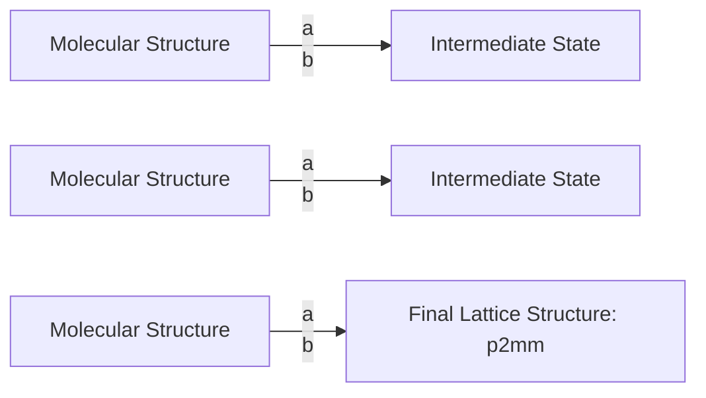
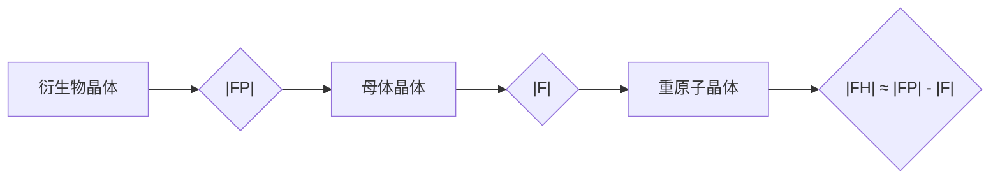
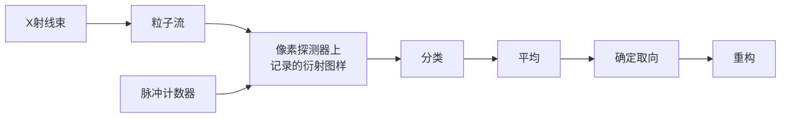

# 4 晶体学导论

原始 PDF 第 135–159 页。

## 晶体学导论

蛋白质 X 射线晶体学专注于探究蛋白质晶体结构及其功能。当 X 射线束照射到蛋白质晶体上并对其产生的衍射图案进行分析时，可以揭示蛋白质分子中原子排布和结合的详细信息，这对于后续探索蛋白质的功能和相互作用至关重要。此外，借助晶体学数据，可以识别蛋白质与配位化合物、药物或其它小分子的结合模式，这对于药物设计和治疗研究具有重要价值。总体而言，蛋白质 X 射线晶体学在揭示生物分子结构与功能、药物研发、生物技术等多个领域扮演着关键角色，为我们理解生命的奥秘和应用生命科学提供了强大的技术支持。

## 4

---

112

4 晶体学导论

## 4.1 由外窥内:通过晶体外形推测其内部结构

## 4.1.1 晶体的早期研究

“晶体”（crystal）一词源于希腊语 κρύσταλλος，最初的意义是冰，早期主要用于描述透明的冰块。随着时间的推移，这个词汇开始用于描述透明的矿物，尤其是石英。晶体的外表通常呈现出规则的几何形状，如立方体和六角柱等（图 4-1）。晶体在光线传播和相互作用中表现出独特的性质，如双折射和偏振等。晶体的硬度取决于其成分，例如，钻石是自然界中最坚硬的物质之一。此外，晶体还具有特定的热膨胀性、电导性、磁性等物理性质。这些特征使得晶体在科学、技术和美学领域都有着广泛的应用和研究价值。

尽管晶体的规则形状和独特光泽令人着迷，但在20世纪以前，由于技术限制，科学家们难以直接观察和研究晶体的内部结构。因此，推断晶体的特性和结构的一种常见方法就是通过观察其外观和表面特征。科学家们会仔细观察晶体的对称性、光滑度、角度和棱角的形状，对矿物晶体进行分类和描述。其中，面角守恒定律（law of constancy of interfacial angle）是一项重要的原理，它指出:在相同的温度和压力条件下生长、具有相同化学组成和内部结构的晶体，其晶面之间的夹角将保持不变。即使晶体的形状和大小有所差异，但如果这些晶体属于同一种物质，那么其晶面夹角始终恒定。这个定律的发现对矿物学和晶体学的发展起到了重要的推动作用。通过观察和测量晶体的夹角，科学家们可以推断出晶体的内部结构和晶胞参数，从而进一步研究晶体的物理和化学性质。面角守恒定律是矿物分类的重要依据，同时也奠定了晶体结构研究的基础。

## 4.1.2 空间晶格概念的提出及几何晶体学的发展

长久以来，人们一直努力揭示晶体内部结构，尤其是隐藏在其规则外形下的细节。在17世纪，罗伯特·胡克（Robert Hooke，1635—1703）和克里斯蒂安·惠更斯（Christiaan Huygens，1629—1695）首次提出了描述晶体最密堆积的理论。他们将球体以六边形最密堆积结构排列在平面上，每个球体有六个邻居（图4-2，左）。接着在这一层上又放置了第二层球体，这些球体位于下方一层球体的凹陷处（图4-2，中），

图4-1 一些矿物晶体样品

text_image

FALEITE

方解石

text_image

JULIO EVA

黄铁矿

natural_image

Blue crystalline object with a rough, irregular surface against a black background (no text or symbols visible)

硫酸铜

---

4.1 由外窥内:通过晶体外形推测其内部结构

113

text_image

A
A
A
A
A
A

单层

chemical

Diagram of a crystal lattice structure with labeled atoms A and B

双层

chemical

Diagram of a molecular arrangement with labeled atoms (A, B, C) and bonds, likely representing a chemical or structural system.

三层

图4-2 面心立方和六方密堆模型

形成一个与三个下层球体相接触的等边三角形。第三层球体继续堆积在第二层的凹陷处（图4-2，右）。通过这种方式，他们不断重复堆叠球体，形成多层最密堆积结构。这种方法被称为胡克-惠更斯最密堆积方法，可以模拟出晶体最紧凑的排列方式，确保每个球体尽可能与邻近球体相接触，以最大限度地填充空间。这一方法可解释很多晶体的密集堆积结构，如六方密堆积和面心立方密堆积。

18世纪末至19世纪初，被誉为“现代晶体学之父”的法国科学家雷内-尤斯特·阿雨（René-Just Haüy，1743—1822）提出了“原始晶体”的概念。阿雨认为，每个结晶体都由一系列相继堆积的“原始晶体”构成，并在无外界干扰的情况下，形成了一种规则的几何形状（图4-3）。这种几何形状具有特定的角度，各面间的角度可以用简单的整数比来表示。阿雨将晶体化学分子的基本概念引入到矿物分类中。他认为不同的矿物种类是由具有不同结晶形状和成分的原始晶体相互堆积形成的。通过观察和研究矿物晶体的形态和夹角，可以推测晶体的成分和结构。阿雨的理论为晶体学的发展奠定了基础，对后续的晶体结构研究产生了深远的影响。

19世纪中叶，法国数学家奥古斯特·布拉维（Auguste Bravais，1811—1863）提出了空间晶格理论，为现代晶体学奠定了基础。布拉维认为，在三维空间中，晶体内的原子、离子或分子按照规则的方式排列，形成了一种周期性结构。他详细描述了14种不同的晶格类型（图4-4），这些类型被称为布拉维晶格或布拉维格子（Bravais lattice），并用点阵描述其基本结构。根据晶体内对称性元素的组合，晶体可以分为不

同类型。例如:旋转、镜面反射和反演等操作可以形成32种不同的对称性，这些对称性被称为点群（point group）。每个点群代表一种特定的对称性，可描述晶体的平面、轴线和中心排列方式。这些点群在晶体学研究和结构分析中扮演重要角色。将这32个点群的对称操作与平移对称性相结合，可以形成230种空间群（space group）。这些空间群描述了在无限格子中排列相同物体的唯一方式。国际晶体表A卷（https://it.iucr.org）中罗列了这些空间群的符号、编号，它们的对称操作、起源、反射条件和空间群投影图等信息。

空间群是一种理论概念，用于描述晶体的对称性和周期性特征。它确定了晶体中原子或分子排列的重复模式，并规定了晶体中所有可能的对称操作。X射线衍射技术的出现为晶体学研究提供了重要的实验工具和证据，推动了空间群理论的广泛应用和进一步发展。关于点

text_image

P
Q
E
O
I
S
E'
O'
I'

图 4-3 阿雨的晶体模型

---

114

4 晶体学导论

图4-4 七种晶系和十四种布拉维晶格

根据晶胞的对称性和轴长（a、b、c）、轴角（ $\alpha$ 、 $\beta$ 、 $\gamma$ ）的关系分为七类:三斜晶系、单斜晶系、正交晶系、四方晶系、三方晶系、六方晶系、立方晶系。在七种晶系中，根据结点分布（简单、底心、体心、面心）进一步细分为14种布拉维晶格。底心（C）:仅在单斜和正交晶系中出现，指一对晶面中心有额外结点。体心（I）:晶胞中心有一个结点（如正交、四方、立方）。面心（F）:所有晶面中心均有结点（如正交、立方）。

三斜

text_image

P: 简单
C: 底心
I: 体心
F: 面心
a≠b≠c
α≠β≠γ≠90°
a≠b≠c
α=γ=90°
β≠90°
a≠b≠c
α=β=γ=90°
a=b≠c
α=β=γ=90°
a=b=c
α=β=γ≠90°
a=b≠c
α=β=90°
γ=120°
a=b=c
α=β=γ=90°

单斜

text_image

a≠b≠c
α=γ=90°
β≠90°

a≠b≠c
α=β=γ=90°

a=b≠c
α=β=γ=90°

a=b=c
α=β=γ≠90°

a=b≠c
α=β=90°
γ=120°

a=b=c
α=β=γ=90°

正交

text_image

a≠b≠c
α=β=γ=90°

a=b≠c
α=β=γ=90°

a=b=c
α=β=γ≠90°

a=b≠c
α=β=90°
γ=120°

a=b=c
α=β=γ=90°

四方

text_image

a=b≠c
α=β=γ=90°

a=b=c
α=β=γ≠90°

a=b≠c
α=β=90°
γ=120°

a=b=c
α=β=γ=90°

三方

text_image

a=b=c
α=β=γ≠90°

a=b≠c
α=β=90°
γ=120°

a=b=c
α=β=γ=90°

六方

text_image

a=b≠c
α=β=90°
γ=120°
a=b=c
α=β=γ=90°

立方

---

4.2 实验探索:精确测定晶体

115

阵、对称操作和点群的更多信息，我们将在第五部分的第23章进行详细介绍。

## 4.2 实验探索:精确测定晶体

## 4.2.1 X射线衍射的发现

1895 年，威廉·伦琴（Wilhelm Conrad Röntgen, 1845—1923）在实验室进行阴极射线实验时，偶然发现了一种具有极强穿透力的射线（图 4-5）。这种射线

能够穿透人体组织和许多其它物质，从而形成阴影照片。后来被称为X射线或伦琴射线。如今，X射线在科学研究中得到广泛应用，尤其在生物医学领域，可用于分析和测定蛋白质结构，观察某些器官的形态和病变。此外，X射线还被用于物品检查、工业探伤、鉴定美术古画珍品的真伪等方面。

到了1912年，马克斯·冯·劳厄（Max von Laue，1879—1960；知识窗4-1）了解到晶体中原子的周期性排列模型（图4-3），并结合托马斯·杨（Thomas Young，1773—1829）的双缝干涉实验，提出了一种大胆而创新的理论。他认为，晶体中原子的周期性排列可以类比为一个三维的光栅结构，这个结构可以对入射光进行衍射，并形成特定的衍射图样（图4-6A-D）。当入射光照射在单个分子上时，它会被散射成为二次波，这种现象称为漫散射（diffuse scattering）。由于存在探测器噪声，我们还不能准确地记录并利用这些漫散射信号进行原子分辨率结构解析。当多个分子形成一维等间距周期排列时，每个分子散射的二次波互相发生干涉，形成明暗相间的条状图案，这些条纹称为干涉条纹或者干涉图案。分子数越多，干涉信号强度也会增加（图4-6E、F），推广到三维空间后，干涉图案将形成一些衍射点。

为了验证他的理论，劳厄等人使用铂靶产生X射线，并将其照射到硫酸铜晶体上，他们观察到了预期的衍射图样（图4-7）。这一发现有力地证实了之前提出的晶

text_image

灯丝/阴极
电子束
金属靶/阳极
X射线

图 4-5 阴极射线管的结构

当阴极灯丝被加热后，释放出的电子在高压电场的作用下迅速飞向阳极与靶碰撞，从而释放出X射线。

图4-6 分子的衍射图案（A）单个分子及其漫散射图案。（B）分子周期性的线性阵列。（C）两排线性分子阵列。（D）二维分子晶格。（E）噪声干扰漫散射信号的检测。（F）分子周期排列引起信号的干涉增强。

---

116

4 晶体学导论

## 知识窗4-1

## 马克斯·冯·劳厄

马克斯·冯·劳厄（1879—1960）出生于德国，于1913年晋升为世袭贵族，他的父亲是普鲁士军事管理部门的高级公务员。劳厄1902年定居于柏林的弗里德里希-威廉大学，开始在马克斯·普朗克的指导下进行博士研究。他于1903年7月获得博士学位，然后返回哥廷根进行为期两年的博士后研究工作。随后，他通过了高中教学所需的考试，取得了高中教师资格。1905年，劳厄成为普朗克助手，并于1906年获得了关于“干涉光束熵”的讲师资格。1909年，他前往慕尼黑，在阿诺德·索默菲尔德（Arnold Sommerfeld）的研究所担任讲师。1912年夏天，他被任命为苏黎世大学理论物理学教授，1914年成为法兰克福大学教授，最终在1919年成为柏林大学理论物理学教授，并一直任职至1943年退休。从1946年到1951年，他担任哥廷根大学物理学教授和马克斯·普朗克物理研究所的代理所长。1951年，他成为柏林-达勒姆的弗里茨-哈伯物理化学研究所所长，直至1958年。劳厄因“发现晶体对X射线的衍射”而于1914年获得诺贝尔物理学奖。1920年，他当选为普鲁士科学院院士，1926年当选为德国自然科学院院士。1948年，国际晶体学联合会成立时，他被选为名誉主席。

体结构模型以及X射线波动性的本质，对于X射线晶体学技术的发展具有重要意义。劳厄的工作奠定了固体物理学和晶体学的基础，为后续研究提供了重要的指导。他的发现也为确定晶体中原子排列的方式提供了关键手段，推动了晶体学的发展。

在对硫酸铜晶体进行实验后，劳厄等人建立了新的实验装置，开始对闪锌矿（ZnS）晶体发射的次级辐射进行初步测试。在实验中，他们获取了一张展示了四重轴对称和两个与其平行的对称面的衍射照片。这张照片直观地展示了晶体晶格的存在，并且证明了晶格本身与衍射图样的形成密切相关（图4-8）。这项实验结果标志着晶体学的重要突破，不仅提供了对晶体结构的直接证据，还为进一步研究晶体的性质和行为提供了基础。事实上，这张衍射照片成了晶体学研究的经典图像之一，展示了晶体的美丽和复杂性。

图4-7 晶体衍射实验装置和第一张X射线衍射照片左:劳厄使用的实验设备，现存放于德国博物馆。X射线源（左边）是一个克鲁克斯（Crookes）管，它有一个铂阳极。右:第一张硫酸铜晶体的X射线衍射照片。

图4-8 闪锌矿晶体的劳厄衍射图案左:入射光垂直于（001）晶面。右:入射光垂直于（111）晶面。

---

4.2 实验探索:精确测定晶体

117

## 4.2.2 X射线结构分析的诞生及布拉格方程

当劳厄的实验结果传到英国后，威廉·亨利·布拉格（William Henry Bragg，1862—1942）和威廉·劳伦斯·布拉格（William Lawrence Bragg，1890—1971；知识窗4-2）父子提出一个假设，旨在解释晶格尺寸和衍射图案之间的数学关系。他们假设入射波在晶体中的平行原子面上发生镜面反射，类似于镀银的镜子，每个平面只反射少量的辐射。根据这一假设，反射角等于入射角（图4-9）。尽管大多数角度照射到晶体表面的X射线束并不会发生增强衍射，原因是与原子碰撞而偏转的X射线会产生相位差（out of phase），从而相互抵消。但当X射线束以特定角度照射晶体，使得晶体中原子层间的距离接近X射线的波长时，偏转的射线将会同相（in phase），并在探测器上产生一个衍射点。基于这个理论，劳伦斯·布拉格推导出了布拉格方程（Bragg equation）: $2d\sin\theta=n\lambda$ 。该方程描述了X射线波长与晶格距离之间的关系，其中d表示平行晶面间的距离， $\theta$ 是从镜面开始测量的角度，而n为衍射级数。相邻平行晶面的反射波之间的光程差为 $2d\sin\theta$ 。布拉格定律概述了X射线或其它电磁波在晶体中产生衍射的条件，为确定晶体结构和晶格参数提供了一种高效的方法。通过分析衍射图案、测量衍射角度和波长，我们可以获取有关晶体内部原子排列的重要信息。

劳厄曾假设闪锌矿晶体具有简单立方结构，每个立方体角上均有一个原子。然而，劳伦斯·布拉格提出了一个新的晶体结构模型，即面心立方晶格（图4-10A）。在布拉格的模型中，晶体的每个面心都有原子，而不仅仅是角上有原子。这个模型符合实际晶体结构，并能解释劳厄实验中观察到的衍射现象（图4-10B）。

在此基础上，劳伦斯·布拉格成功地完成了碱金属卤化物的全面晶体结构分析。他利用X射线衍射技术和布拉格定律，确定了这些化合物的晶体结构和晶格参数。通过测量X射线在晶体中的衍射图样，劳伦斯·布拉格能够确定晶体中原子的排列方式和相互作用。他的研究揭示了碱金属卤化物晶体的面心立方结构，并确定了原子之

text_image

θ
d sinθ
d

图 4-9 布拉格定律

假设入射波从晶体中的平行原子平面进行镜面反射，当来自这些平行原子平面的反射波产生相互干涉时，就会形成衍射束。

图4-10 布拉格根据闪锌矿面心立方模型解析其劳厄衍射图谱

（A）闪锌矿晶体的面心立方模型。（B）对闪锌矿的劳厄衍射图谱（见图4-8）的解析。

---

118

4 晶体学导论

## 知识窗4-2

## 威廉·劳伦斯·布拉格

威廉·劳伦斯·布拉格爵士（1890—1971）出生于澳大利亚的阿德莱德。1909年，他与父亲一同移居英国，进入剑桥大学三一学院，并于1912年以一等荣誉获得自然科学三一学位。1914年，他成为剑桥大学三一学院的研究员，在约瑟夫·汤姆孙和父亲威廉·亨利·布拉格的指导下准备论文，并被任命为讲师。第一次世界大战期间，劳伦斯·布拉格在法国地图部门总部担任声音测量技术顾问。1919年，他被任命为曼彻斯特大学物理学教授，直至1937年。1938年，他成为剑桥大学卡文迪许实验室实验物理学教授，直至1953年退休。他的研究主要集中在利用X射线和电子显微镜研究金属结构方面，但他也积极推动生物大分子结构的研究，开辟了实验室的新方向。他招募了佩鲁茨、肯德鲁等学者，并在1953年的索尔维会议上首次发布了沃森-克里克的DNA双螺旋模型。他与父亲因“通过X射线分析结晶结构所作出的贡献”，共同获得了1915年的诺贝尔物理学奖，他成为有史以来最年轻的自然科学诺贝尔奖获得者。1921年，他当选为英国皇家学会会员，并于1941年被封爵士。他与保罗·厄瓦耳一道对国际晶体学联合会的建立发挥了重要作用，并担任该组织的首任主席（1948—1951）。

间的距离和排列方式。这项工作为研究和理解其它化合物的晶体结构提供了重要的方法和技术。

## 4.2.3 X射线衍射的几何解释——厄瓦耳球方法

1921年，保罗·厄瓦耳（Paul Peter Ewald，1888—1985）提出了“厄瓦耳球”（Ewald sphere）理论，为描述衍射光束的方向提供了一种直观的几何解释（图4-11）。在这一理论中，假设X射线照射在点 $O_{\mathrm{c}}$ 上发生衍射，以 $O_{\mathrm{c}}$ 为球心，以X射线波长的倒数 $1 / \lambda$ 为半径，构建一个球，这个球便是所谓的厄瓦耳球。入射束与球面的交点 $O_{R}$ 被定义为倒易原点。根据布拉格定律 $2d\sin \theta = n\lambda$ ，我们可以推导出，在厄瓦耳球面上的每个倒易阵点 $(x,y,z)$ 对应着可能产生衍射的实空间晶面。倒易阵点的坐标与衍射光束的方向有关，其坐标表示了不同散射角度下的衍射效果。借助厄瓦耳球，我们可以简要确定哪些晶面会产生衍射，并进一步计算出相应的散射角度。这对于分析衍射实验结果和确定晶体结构具有重要意义。厄瓦耳球的引入使衍射的解释更加直观和几何化，为晶体学的发展和研究提供了重要的几何工具。

同时，厄瓦耳引入了倒易空间的概念。倒易空间是晶体学中的一个重要概念，它与实空间相对应。在实空间中，我们描述原子的位置和晶格的结构；而在倒易空间中，我们描述的是倒易晶格的结构和性质。通过对晶体进行傅里叶变换，我们可以将原子在实空间的周期性排列转换为倒易空间中的衍射格点。倒易空间和实空间是对偶空间，实空间的晶格矢量是倒易晶格的倒数。倒易空间的概念在晶体学中具有很大的

---

4.3 阿贝成像理论与晶体学中的相位问题

119

text_image

入射光
1/λ
Oc
s=x/λ|x|
x,y,z
d*
s0
OR
z
y
(x,y)
x
Ob
y
晶体与探测器的距离D
s-s0=d*=RGC Bh
{ x=X/[λ(X²+Y²+D²)¹/²]
  y=Y/[λ(X²+Y²+D²)¹/²]
  z=D/[λ(X²+Y²+D²)¹/²]
h 密勒指数 (h,k,l) R 旋转轴矩阵
B 晶体正交化矩阵 (a,b,c,α,β,γ) d* 倒易空间矢量
C 晶体取向矩阵 s₀ 入射波矢
G 晶体测角器矩阵 s 散射波矢

图4-11 厄瓦耳球的构建相机的坐标系采用普渡大学的标准。

意义。它提供了一种理解和分析晶体的衍射图样和散射数据的方法。通过研究倒易空间的性质，我们可以推断出原子的排列方式、晶格参数以及晶体的对称性等信息。倒易空间的引入使得晶体结构的研究更加全面和深入，为解析晶体学中的复杂问题提供了有效的数学工具。同时，倒易空间的概念也在其它领域如凝聚态物理和材料科学中得到广泛应用。

## 4.3 阿贝成像理论与晶体学中的相位问题

在早期的晶体结构分析中，氯化钠等碱金属卤化物以及金刚石都是面心立方晶体，所有的原子位置都可以通过晶格对称性指定。随着解析结构复杂度的增加，除了部分位置可以通过晶格对称性指定外，还有一些参数需要通过衍射点的强度确定，比如黄铁矿（$\mathrm{FeS}_2$）和方解石（$\mathrm{CaCO_3}$）晶体包含一个自由参数。为了测定这些结构，布拉格发展了一种称为蝇眼法（Fly's Eye）的方法（知识窗4-3）。在这个方法中，布拉格首先构建一个可能的晶体模型，然后根据该模型预测产生的衍射图案，并将其与从实验中得到的衍射照片进行比较，以此验证模型的正确性。这种方法在解析透辉石（$\mathrm{CaMg(SiO_3)_2}$）和苯的衍生物等结构时，取得了显著的成果。著名的DNA双螺旋结构的发现也是利用了这种方法。然而，随着科学家们研究更加复杂的晶体结构，定性的蝇眼法开始显得力不从心。为了更准确地解析复杂的晶体结构，科学家们开始寻找

---

120

4 晶体学导论

## 知识窗4-3

## 蝇眼法

蝇眼法最早是由劳伦斯·布拉格提出（Bragg WL, et al. Nature, 1945, 156(3959): 332—333）。该方法的步骤是制造出可能产生 X 射线衍射图样的特定结构的光学模拟版本:在金属罩上按照特定结构的图案进行打孔，并反复进行，使强光透过，投影到平面上。由此产生的光学衍射图案可以与实际晶体衍射图案进行比较，从而判断该特定结构是否与晶体的实际结构相匹配。详见 DNA 双螺旋结构的解析:https://physicsopenlab.org/2019/10/01/double-helix-optical-diffraction-pattern/。

## 知识窗4-4

## 傅里叶变换

傅里叶变换是一种数学工具，能够将函数或信号从时间（或空间）域转换到频率（或倒空间）域。对于时间域的函数 $h(t)$，可以用频率域的函数表示 $H(f)$，其中 $f$ 的范围为负无穷到正无穷。它们之间的关系由傅里叶变换给出:

$$
H (f) = \int_ {- \infty} ^ {\infty} h (t) \mathrm{e} ^ {2 \pi \mathrm{i} f t} \mathrm{d} t
$$

以及

$$
h (t) = \int_ {- \infty} ^ {\infty} H (f) \mathrm{e} ^ {- 2 \pi \mathrm{i} f t} \mathrm{d} f,
$$

$h(t)$ 和 $H(f)$ 都是复数。然而，在时间域中，如果 $h(t)$ 只能取实数值，那么相应的频率域就需要满足 $H(-f) = [H(f)]^{*}$ 的对称性，即负频率处的函数值等于其正频率处的共轭。在晶体学中，电子密度分布必须是实数，因此在倒异空间中存在一个中心反演对称。电子密度不仅为实数，还必须大于等于0，这是直接法和电子密度修正的理论基础。

新的方法。其中，傅里叶变换方法应运而生（知识窗4-4），它为求解晶体中的电子密度分布提供了一种定量的手段。在晶体学中，傅里叶变换能将衍射图样转换为电子密度分布，进而揭示出晶体的内在结构。然而，傅里叶变换方法并非完美无瑕，它引入了一个被称为“相位问题”的新挑战。在X射线晶体衍射实验中，我们可以测量到衍射波的强度，但是无法直接测量到衍射波的相位。然而，恢复电子密度分布需要知道衍射波的完整信息，包括强度和相位。因此，如何从只有强度信息的衍射数据中恢复出相位的信息，成为了晶体学中的一个重要问题。

## 4.3.1 相位问题的起源

19世纪末期，德国物理学家恩斯特·阿贝（Ernst Karl Abbe，1840—1905）提出了光学显微镜中图像形成原理，即阿贝成像原理（图4-12）。根据这一原理，光源发

---

4.3 阿贝成像理论与晶体学中的相位问题

121

出的光线经过准直透镜或准直镜筒照射到样品上，在后焦面形成一个中间图像，这个中间图像可以看作是样品的傅里叶变换。然后，物镜再对这个中间图像进行反傅里叶变换，实现对样品的收集、放大和成像。然而，在X射线成像中，我们面临着一个挑战。由于X射线的折射率几乎为1.0，这意味着X射线几乎不会被透镜聚焦。因此，在X射线系统中，我们只能获得后焦面的数据，也就是通过探测器记录到的X射线强度信息。当我们试图通过反傅里叶变换将这些数据转换回实空间时，我们只能得到振幅信息，相位信息则丢失了。

然而，相位信息至关重要。如图4-13所示，如果我们将两位晶体学家、诺贝尔奖获得者赫伯特·豪普特曼（Herbert A. Hauptman，1917—2011）和杰罗姆·卡尔勒（Jerome Karle，1918—2013）照片的相位互换，最终的图像将更像哪一个，完全取决于相位信息。这个例子清楚地展示了相位信息在图像重建中的重要性；此外，丢失的相位信息也是晶体学中所谓的“相位问题”的核心。如何从仅有的衍射数据中恢复相位信息，成为晶体学中的一个重要问题。卡尔勒和豪普特曼发展了解决小分子相位问题的直接法（见4.3.3.2节），并因此获得了1985年的诺贝尔化学奖。马克斯·佩鲁茨（Max Ferdinand Perutz，1914—2002）和约翰·肯德鲁（John Cowdery Kendrew，1917—1997）发明了同晶置换法，解决了蛋白质晶体的相位问题，并因此获得了1962年的诺贝尔化学奖。

## 4.3.2 晶体的衍射

理想晶体是通过单胞密度和无限延伸的周期性平移点阵的卷积来描述的三维周期性结构第一排是卡尔勒（左）和豪普特曼（右）的照片，他们因为在解决小分子晶体相位问题上的工作而获得了诺贝尔奖。我们可以将这些照片视为密度图，并计算它们的傅里叶变换，以获得振幅和相位信息。如果我们将豪普特曼照片的相位与卡尔勒照片的振幅结合起来，我们就得到了左下方的图像。右下方的图像则将卡尔勒的相位与豪普特曼的振幅结合起来。显然，相位决定了我们所观察到的内容。当我们考虑使用原子模型的相位时，模型相位的偏差也就非常令人担忧。

text_image

可见光
电子束
透镜/物镜
后焦面
X射线
晶体
衍射线

图4-12 阿贝成像理论和晶体学相位问题

natural_image

Four black-and-white portraits of men in formal attire, no visible text or symbols

图4-13 相位信息的重要性

（图4-14）。针对无限延伸的晶格，整个晶体的电子密度 $\rho_{\text{晶}}(r)$ 可以表示为单胞的电子密度 $\rho_{\text{单胞}}(r)$ 与沿着 $a$、$b$、$c$ 方向周期性重复的点阵的卷积:

---

122

4 晶体学导论

图4-14 晶体的周期平移性形成

text_image

周期平移点阵
δ (r-na-mb-pc)
卷积
⊗
单胞
=
b
a
ρ单胞(r) = ρ晶(r)

$$
\rho_ {\mathrm{晶}} (r) = \sum_ {n = - \infty} ^ {\infty} \sum_ {m = - \infty} ^ {\infty} \sum_ {p = - \infty} ^ {\infty} \rho_ {\mathrm{单胞}} (r) * \delta (r - n a - m b - p c)  . \tag {4-1}
$$

其中 $a$ 、 $b$ 、 $c$ 是晶胞矢量， $n$ 、 $m$ 和 $p$ 是整数，代表实空间的分数坐标， $\delta$ 是狄拉克$\delta$ 函数。根据阿贝成像理论，晶体的弹性相干散射是对 $\rho_{\text{晶}}(r)$ 的傅里叶变换。根据傅里叶卷积定理，两个函数的卷积的傅里叶变换是单个函数的傅里叶变换的乘积（知识窗4-5），故有

$$
\hat {F} \left[ \rho_ {\mathrm{晶}} (r) \right] = \sum_ {n} \sum_ {m} \sum_ {p} \hat {F} \left[ \rho_ {\mathrm{单胞}} (r) \right] \hat {F} \left[ \delta (r - n a - m b - p c) \right] _ {\circ}
$$

实空间中的狄拉克 $\delta (r - na - mb - pc)$ 函数的傅里叶变换是倒易空间中的狄拉克$\delta (S - ha^{*} - kb^{*} - lc^{*})$ 函数，代表了倒易晶格，其中 $h,k,l$ 是倒易空间的分数坐标:

$$
\hat {F} \left[ \rho_ {\mathrm{晶}} (r) \right] = \hat {F} \left[ \rho_ {\mathrm{单胞}} (r) \right] \sum_ {n} \sum_ {m} \sum_ {p} \delta (S - h a ^ {*} - k b ^ {*} - l c ^ {*})  . \tag {4-2}
$$

因此，晶体的散射 $\hat{F} [\rho_{\text{晶}}(r)]$ 与单胞的散射 $\hat{F} [\rho_{\text{单胞}}(r)]$ 成正比，并且仅在离散的散射矢量方向上发生:

$$
S = h a ^ {*} + k b ^ {*} + l c ^ {*} \circ
$$

实验测量了倒易空间的衍射振幅 $|F(hkl)|$ 后，再重现相位信息 $\phi (hkl)$，通过反傅里

## 知识窗4-5

## 卷积

卷积是一种积分变换的数学方式，两个时间域函数 $h(t)$ 和 $g(t)$ 的卷积一般表示为

$$
g * h = \int_ {- \infty} ^ {\infty} g (\tau) h (t - \tau) \mathrm{d} \tau 。
$$

卷积的物理意义是:一个函数 $g$ （如:晶胞）在另一

个函数 $h$ （如:平移点阵）上的加权叠加。卷积定理是傅里叶变换的一个重要性质，它表明两个函数在时间域的卷积对应于频率域中的乘积，如果 $F$ 表示傅里叶变换，那么

$$
F (g * h) = F (g) \times F (h) _ {\circ}
$$

---

4.3 阿贝成像理论与晶体学中的相位问题

123

叶变换就可以获得晶胞内的电子密度分布函数 $\rho (xyz)$ :

$$
\rho (x y z) = \frac {1}{V} \sum_ {h} \sum_ {k} \sum_ {l} | F (h k l) | \cos 2 \pi [ h x + k y + l z - \phi (h k l) ] _ {\circ}
$$

## 4.3.3 晶体相位求解的方法

X射线晶体衍射实验中丢失的相位信息可以通过帕特森法（Patterson method）或直接法（direct method）求解。这两种方法常用于小分子晶体学的相位求解，或者蛋白质晶体学中重原子或者反常散射原子位置坐标的求解。Shelx程序包集成了帕特森法和直接法，是目前使用最广泛的结构分析软件，在我们研究晶体性质时发挥着至关重要的作用。

## (1) 帕特森法

由于相位信息无法通过实验直接观测到，阿瑟·帕特森（Arthur Lindo Patterson, 1902—1966）提出，直接对衍射强度进行傅里叶变换:

$$
P (r) = \hat {F} ^ {- 1} (I (h)) = \hat {F} ^ {- 1} (\left| F (h) \right| ^ {2}) = \frac {1}{V} \sum_ {h} \left| F (h) \right| ^ {2} \mathrm{e} ^ {- 2 \pi \mathrm{i} h r} 。
$$

然而，

$$
\mid F (h) \mid^ {2} = F (h) F ^ {*} (\overline {{h}}) = \sum_ {j = 1} ^ {N} \sum_ {k = 1} ^ {N} f _ {j} f _ {k} \mathrm{e} ^ {2 \pi \mathrm{i} h (r _ {j} - r _ {k})}
$$

正如上式所示， $|F(h)|^2$ 也可视为倒易空间中的结构因子。在实空间中，它是由位于位置 $r_j - r_k$ 的散射体和散射因子 $f_{j}f_{k}$ 的结构构成。帕特森函数是根据晶格中原子位置之间的差异计算得出的一种函数（图4-15），具有以下特点:

① 帕特森晶胞与晶体晶胞相同。
② 由晶胞中 $N$ 个原子形成的晶体的帕特森函数将显示 $N^2$ 个峰值（即所有可能的

flowchart

图4-15 晶体与帕特森函数的关系

---

124

4 晶体学导论

原子间矢量），即使不考虑每个原子与自身的矢量，峰值数量也为 $N^2 - N$。

③ 峰值的高度与参与原子的原子数的乘积成比例，这在检测结构中较重原子时提供了很大的优势。
④ 帕特森函数的对称性可以通过去除每个对称操作的平移部分并添加一个中心反演进行推导。

利用帕特森重叠方法（Patterson superimposition method），可以获得单个晶体的电子密度分布（图4-16），其中包括求和函数、乘积函数以及广泛使用的最小值函数。在蛋白质晶体学软件SOLVE中，寻找重原子或者反常散射原子位置的方法是通过帕特森最小值函数重叠法实现的，简称为HASSP。在Shelxd程序首次应用双空间迭代法之前，初始原子位置的种子生成也可以通过帕特森最小值函数重叠法获得。

帕特森法被用于解析多个含有重原子的晶体结构，如铂酞菁（platinum phthalocyanin）和胆固醇碘化物结构。尽管一些晶体中存在重原子，但它们并未占据主导地位，这对于使用帕特森法解析结构构成了挑战。多罗西·霍奇金（Dorothy Crowfoot Hodgkin，1910—1994）凭借毅力和化学直觉，成功利用帕特森法解析了具有挑战性的结构，如青霉素和维生素 $B_{12}$ ，从而获得了1964年的诺贝尔化学奖。

## (2) 直接法

然而，大多数有机分子的原子（如碳、氮和氧，氢的散射强度较弱通常可以忽略不计）仅展现出近似相等的散射强度，因此，引入重原子并不总是那样简单。幸运的是，随着晶体学直接法的进步，对解决相位问题的需求得到了满足。直接法的发展可以追溯到哈克-卡斯珀（Harker-Kasper）不等式和卡尔勒-豪普特曼（Karle-Hauptman）行列式不等式的早期研究。通过塞尔（Sayre）、科克伦（Cochran）和查哈里阿森（Zachariasen）引入的符号关系，以及豪普特曼和卡尔勒撰写的美国晶体学会专论，这些方法在处理中心对称结构时的适用范围显著扩大。1952年，塞尔基于原子性，推导出了适用于中心对称和非中心对称结构的结构因子 $F(h)$ 、 $F(h')$ 和 $F(h-h')$

图4-16 帕特森函数重叠法

将（A）中帕特森函数复制一份，沿着红色箭头平移到原点，然后与原始的帕特森函数重叠，得到（B）。在（B）中抹去单独的、较低的峰，得到（C）。再次复制原始的帕特森函数（A），并沿着绿色的箭头平移，然后与（C）重叠，得到（D）。清除较低的峰，就可以获得晶体的结构。

chemical

Diagram illustrating molecular structure changes with labeled components (A), (B), (C), and (E)

---

4.4 劳厄衍射、布拉格单色仪法的区别

125

之间的确切方程，即塞尔等式，其中 $h = (h, k, l)$ 是倒易矢量。1950年，卡尔勒和豪普特曼提出了基于正定性行列式因子的结构因子 $F(h), F(h')$ 和 $F(h - h')$ 相位之间的关系:对于振幅足够大的 $|F(h)|$、$|F(h')|$ 和 $|F(h - h')|$ 的三元组，相位关系 $\varphi(h) \approx \varphi(h') + \varphi(h - h')$ 大致成立。基于三相位不变量，最终推导出了一个著名的正切公式:

$$
\tan \varphi_ {h} = \frac {\sum_ {h ^ {\prime}} \kappa_ {h , h ^ {\prime}} \sin \left(\varphi_ {h ^ {\prime}} + \varphi_ {h - h ^ {\prime}}\right)}{\sum_ {h ^ {\prime}} \kappa_ {h , h ^ {\prime}} \cos \left(\varphi_ {h ^ {\prime}} + \varphi_ {h - h ^ {\prime}}\right)} ,
$$

$$
\kappa_ {h, h ^ {\prime}} = 2 \sigma_ {3} \sigma_ {2} ^ {- 3 / 2} E _ {h} E _ {h ^ {\prime}} E _ {h - h ^ {\prime}} \circ
$$

其中， $E_{h}$ 是归一化结构因子。该公式以已知的部分相位为基础，通过使用三相位不变量关系式，可以推导出剩余的相位值。直到1964年，卡尔勒夫妇才使用他们的符号加法程序（symbolic addition）首次用直接法解决了第一个非中心对称结构。计算机的问世使得自动解决方法如MULTAN、SHELX成为解决小结构的主要工具。它们已成功解决了大量晶体结构的相位问题，从而使药物分子结构分析成为一种常规的研究手段。在后续的研究中，豪普特曼引入了双空间（dual space）的概念，这极大地增强了直接法的能力，使其可以解析包含更多原子的晶体结构。

1985年诺贝尔化学奖授予两位直接法先驱者豪普特曼和卡尔勒，这是对这些方法在晶体学特别是在科学领域中所获得重要性的认可。

## 4.4 劳厄衍射、布拉格单色仪法的区别

在晶体衍射实验中，一个关键的考虑是如何将倒易晶格点映射到厄瓦耳球的表面上，或者如何调整厄瓦耳球的半径，以便不同的衍射点能够落在其球面上。实现这一目标主要有两种方法:劳厄法和布拉格单色仪法。

## 4.4.1 劳厄法

使用固定晶体和连续波长光谱（也称为白光辐射）的方法被称为劳厄法（Laue method）。在这种方法中，晶体保持静止，连续频谱的X射线照射在晶体上，不同的晶面会筛选出并偏转不同波长的X射线。在厄瓦耳球模型中，每一个波长都会形成一个厄瓦耳球，因此，连续波的波长将形成连续的多个厄瓦耳球，而晶体的倒易空间点是离散的。当某个倒易空间点接触到某个厄瓦耳球时，在相应方向上会发生衍射（图4-17）。然而，劳厄法存在一个主要挑战，即一张照片上记录了多种波长的衍射点，这可能导致衍射点过于密集，甚至有时会发生重叠，给结构分析带来困难。因此，这种方法通常只在需要快速收集衍射数据的特殊应用中使用，特别是在衍射受到某些方式影响的情况下（例如:微小的晶体或对氧气、湿度高度敏感的样品）。该方

---

126

4 晶体学导论

(A)

text_image

1/λmin
1/λmax

(B)

natural_image

Grayscale abstract pattern with radial lines and a central dot (no text or symbols)

图 4-17 劳厄衍射技术中的厄瓦耳球的构造

（A）最大球的半径为  $1/\lambda_{min}$ ，最小球的半径为  $1/\lambda_{max}$ 。分辨率球的半径为  $1/d_{min}$ 。在阴影区域内的倒易晶格点会引起衍射。（B）一幅劳厄衍射图像。

法获得的优势主要是双重的。首先，由于单个图像上可以有比单色实验更多的衍射点，因此有可能在单个图像上获得一个有用的完整数据集。只要已知底层结构，劳厄实验收集的数据（可能只有 $50\% \sim 70\%$ 的完整性）就足以明确识别配体。其次，由于同步辐射的衍射图样可以由单个电子束团的辐射形成，因此可以观察到非常短时间尺度上的变化，达到皮秒级别。在20世纪80年代中期到晚期，人们投入了相当大的努力来发展同步辐射上的劳厄晶体学，用于收集蛋白质数据。由于当时的样品几乎普遍处于室温，单色方法需要在数小时内收集多张衍射图像，然而晶体总是显示出明显的辐射损伤。单个劳厄曝光所关联的极短曝

光时间和实质的完整性意味着可以避免这种情况。

处理劳厄实验的图像比使用单色辐射进行数据收集的图像要复杂得多，这主要是由于每个单独数据的波长依赖性。只要事先知道晶体对称性和单位细胞尺寸，这个困难就可以克服。目前同步辐射的主要实际问题是，鉴于处理数据的软件和计算资源的状态，全世界可用于该技术的光束线非常少。

## 4.4.2 布拉格单色仪法

为了解决劳厄法中衍射点过于密集的问题，研究者们选择使用固定的厄瓦耳球，这需要选取特定的波长（单色辐射），并通过旋转晶体使不同的倒易晶格点进入衍射状态，此方法被称为单色法。晶体围绕与入射X射线束垂直的轴旋转，即单轴仪器中的 $\varphi$ 轴和多圆仪器中的 $\omega$ 轴；将旋转轴如此定位的额外优点是可将盲区的尺寸最小化。这种方法被称为旋转法（rotation method）。旋转法是在大分子晶体学中记录衍射数据的最常用方法（图4-18）。在实际操作中，家用衍射仪通常使用波长为 $1.5418\AA$ 的 $\mathrm{CuK}\alpha$ 射线作为入射光源。晶体被放置在测角仪上，并以恒定的速度进行旋转。在

text_image

1/λ
O
1/λ
O

图4-18 布拉格单色仪法

旋转过程中，入射线与晶体中的不同晶面发生相互作用，从而产生衍射。利用X射线探测器，研究者们可以记录晶体在不同旋转角度时的衍射图像。这些衍射图像是由晶体中的原子散射形成的，可以提供丰富的信息，帮助我们理解其内部结构并进行解析。

衍射图像收集完成后，自从布拉格使用离子化室技术来确定简单盐类结构以来，估计衍射点的强度一直是结构生物学的一个组成部分。现代数据处理可以分为一系列步骤:

---

4.4 劳厄衍射、布拉格单色仪法的区别

127

① 自动指标化。这需要一个峰提取程序，然后分析峰的位置以确定单位细胞尺寸、布拉维格子和晶体取向。
② 相机参数的预校正（晶体到探测器的距离，相对于振荡方向的扫描方向，探测器偏离 X 射线束正射的倾斜角度），晶体取向和有效镶嵌扩散（实际镶嵌扩散与束流发散的卷积）。
③ 通过剖面拟合进行强度积分，假设衍射位置是根据预校正的相机和晶体参数计算得出的。[可以为每个衍射点估计误差；可以应用重叠和过载（探测器的非线性响应）校正；可以计算衍射的部分性。]
④ 洛伦兹和偏振校正，然后归约到倒易空间中的唯一不对称单位（这依赖于劳厄群）。然后需要根据它们在倒易空间中选定的不对称单位的指标对衍射进行排序。这便于比较对称相关的衍射，它们将在衍射列表中相邻。
⑤ 对称相关和重复测量的衍射强度确保相等，使得数据内部一致（假设已经确定了正确的劳厄群）。在最终数据处理后，分析观测衍射点强度之间的差异，可以作为数据质量的指示，但不一定表明其绝对正确性。

大分子晶体结构的质量在一定程度上取决于数据的质量和数量。那么，如何利用数据质量指标来选择高分辨率截止值以获得最佳模型呢？数据精度的通用指标包括:

(1) $R_{\mathrm{merge}}$

传统的内部一致性度量是 $R_{\mathrm{merge}}$ （也称为 $R_{\mathrm{sym}}$ ），其定义如下:

$$
R _ {\mathrm{merge}} = \frac {\sum_ {h} \sum_ {l} | I _ {h l} - \langle I _ {h} \rangle |}{\sum_ {h} \sum_ {l} \langle I _ {h} \rangle},
$$

即对所有衍射 $h$ 的观察强度 $I$ 求和。但这种方法存在一个缺点，那就是即使通过平均更多的观测点来改善合并数据，它也会随着数据冗余性的增加而增加。

(2) $\mathrm{CC}_{1/2}$

引入 $\mathrm{CC}_{1/2}$ 来评估合并数据的精度，它是独立观测集之间的皮尔森（Pearson）相关系数（CC）。完全相关数据与反相关数据的CC值范围为 $1\sim -1$ ，但对于指标化正确的数据，这些指标的范围应该从接近1的高度精确数据到接近0的非常不精确数据。基于CC的指标的一个优点是，它们具有经过充分研究的统计特性，因此，给定一个CC值和有多少观测结果对其有贡献，就可以计算出该值偶然出现的概率，即零假设成立的可能性有多大。类似地，通过关联两个半数据集产生的强度值，在分辨率壳层中计算出 $\mathrm{CC}_{1/2}$，它提供了可辨别信号水平的无模型经验测量，相当于冷冻电镜研究中判别分辨率的傅里叶壳层相关统计。

---

128

4 晶体学导论

## 4.5 蛋白质晶体学的发展

## 4.5.1 胃蛋白酶晶体的 X 射线衍射照片

1934年4月，约翰·贝尔纳（John Desmond Bernal，1901—1971）获得了一些胃蛋白酶（pepsin）的晶体。当他首次将这些晶体置于X射线下时，并未观察到预期的衍射图像，而只得到了一个模糊的图像，与前人在处理蛋白质晶体时得到的结果类似。然而，贝尔纳并没有放弃。他通过显微镜观察发现，当晶体从母液中取出时，它们会发生变质，变得发白且失去双折射现象。这让贝尔纳意识到，为了保持晶体的完整性和活性，必须将其保持在母液中。于是，他用一个薄壁玻璃毛细管装载了一颗湿晶体，并成功保持了其透明度。当这颗晶体再次置于X射线下时，就产生了优秀的衍射图案，胶片上布满大量的衍射点。在这项工作中，贝尔纳得到了霍奇金的帮助。她协助贝尔纳通过测定晶胞尺寸、空间群等特征来表征X射线照片。1934年5月，他们在Nature杂志上发表了来自蛋白质晶体的第一张X射线照片。完成这项工作后，霍奇金回到了牛津，在那里她通过解析胆固醇、青霉素、维生素 $B_{12}$ 和胰岛素的X射线晶体结构，为结构生物学作出了杰出的贡献。因此，与剑桥的同事们一起，她被认为是蛋白质晶体学的创始人之一。然而，在使蛋白质结构测定成为可能的过程中，还缺少一个至关重要的信息——相位。解决蛋白质晶体学中的相位问题几乎需要额外20年的时间。以下只介绍蛋白质晶体学的发展历程，更详细的蛋白质晶体学相位问题的解析方法，包括同晶置换法、反常散射法、分子置换法等，会在第五部分的第23章中进行详细介绍。

## 4.5.2 多对同晶置换法的诞生

1936年，来自奥地利的年轻研究生佩鲁茨（知识窗4-6）加入了贝尔纳的团队。佩鲁茨获得了血红蛋白的蛋白质晶体，并在团队成员的帮助下确定了晶体的基本参数，包括晶胞尺寸和空间群。高质量X射线图案清晰展示了晶体中的蛋白质分子结构，但进一步解析这些结构并不容易。佩鲁茨尝试了各种相位求解方法，如帕特森法和直接法，但对于如此大的蛋白质分子，这些方法都未能提供正确的相位。直到1953年，佩鲁茨开始研究一种早已被讨论和使用过的方法。这种方法的基本思路是引入重原子到分子中，结晶改性分子，以获得略有改变的X射线衍射强度。这种方法已经成功地应用于较小的分子，但没有人认为它适用于如血蛋白这样巨大的分子。即使是具有80个电子的重原子，也不被期望会对含有一千个或更多轻原子的分子的衍射图案产生可测量的变化。然而，佩鲁茨没有放弃。他成功地结晶了血红蛋白的汞化合物“衍生物”，并将其中的一个晶体暴露在X射线下。当他显影照片时，与未经改性的蛋白质晶体的衍射强度相比，他都可以看到明显的变化（图4-19）。汞原子并没有在衍射图案中占主导地位，而仅仅是改变了“未经改性”的胶片上的强度，产生了微小但可

---

4.5 蛋白质晶体学的发展

129

## 知识窗4-6

## 马克斯·佩鲁茨

马克斯·佩鲁茨出生于奥地利，后来成为英国一位杰出的生物化学家。因为对血红蛋白结构进行了开创性的X射线衍射分析，他与约翰·肯德鲁共同荣获了1962年的诺贝尔化学奖。佩鲁茨曾在维也纳大学和剑桥大学接受教育，并于1940年获得博士学位。在剑桥大学的职业生涯初期，他于1937年加入了著名的卡文迪许实验室，并成功拍摄了血红蛋白晶体的首批X射线衍射图像。

随后，他利用 X 射线晶体学进行了血红蛋白结构的研究。1947 年，佩鲁茨与肯德鲁共同在剑桥创建了医学研究委员会（MRC）下研究生物系统分子结构的部门，佩鲁茨担任该部门的负责人。从 1962 年起，该部门成为 MRC 的“分子生物学实验室”（LMB），佩鲁茨继续担任负责人直到 1979 年退休。

测量的差异，可以用于确定相位。然而，实际上，需要两种不同的衍生物（理论上）才能计算出唯一的相位。这就是多对同晶置换法（multiple isomorphous replacement，MIR），该方法被用于解析蛋白质晶体的原子结构。

佩鲁茨的学生肯德鲁（知识窗4-7）在获得博士学位后，决定将他的研究重点从血红蛋白转移到体积只有其四分之一但功能密切相关的肌红蛋白上。血红蛋白由四个蛋白链和四个血红素基团组成，其作用是将氧输送到细胞中，而单链肌红蛋白只有一个血红素基团，在肌肉中储存氧气（作为氧气的储备）。肯德鲁选择这个新的项目可能是因为确定这种较小分子的结构会更容易，且由于它和血红蛋白在功能上如此密切相关，有可能在这两种结构之间进行有趣的比较。

flowchart

图4-19 同晶置换法在这个“假想实验”中，我们考虑了从完全同晶的衍生物晶体中减去一个天然蛋白质晶体的情况。这样做相当于将实空间中的轻原子“抵消”，只留下重原子在差异晶体中。尽管我们无法制备出差异晶体，但我们可以通过观察衍生物和天然蛋白质晶体实验数据之间的差异来推导一个“差异衍射模式”。这个模式在倒易空间中具有相同数量的衍射，但代表了一个更简单化的“差异晶体”情景。

---

130

4 晶体学导论

## 知识窗4-7

## 约翰·肯德鲁

约翰·肯德鲁爵士1917年出生于英格兰牛津郡，1997年于剑桥郡去世，是一位英国生物化学家，他确定了肌肉蛋白肌红蛋白的三维结构，这种蛋白在肌肉细胞中储存氧气。由于他的成就，他与佩鲁茨共同获得了1962年的诺贝尔化学奖。肯德鲁在剑桥大学三一学院接受教育，并于1949年获得博士学位。1946年至1947年，他与佩鲁茨共同创立了剑桥医学研究委员会分子生物学单位。他们使用X射线晶体学技术来研究蛋白质的结构，其中佩鲁茨研究血红蛋白，而肯德鲁试图确定相对简单的肌红蛋白的结构。到1960年，随着特殊衍射技术的使用和计算机帮助分析X射线数据，肯德鲁能够获得肌红蛋白分子中氨基酸单元排列的三维模型，这是首次在蛋白质领域完成此类成就。

肯德鲁决定使用佩鲁茨的多对同晶置换法来求解相位。在制备并测试了大量衍生物后，他最终成功地制备了五种化合物，这些衍生物的衍射强度与未修饰的蛋白质晶体相比呈现出合理的强度变化。肯德鲁使用帕特森法确定了重原子的位置，同时使用手绘的相位图进行相位求解。最后，他使用400个来自未经改性晶体的测定强度数据和相应的相位来计算电子密度。根据计算的电子密度图，他构建了分辨率为6Å的肌红蛋白分子模型（图4-20A）。这一研究成果在1957年初完成，并于次年发表在Nature杂志上。这是第一张蛋白质分子结构的图像，后来在1959年，肌红蛋白（分辨率为2.0Å；图4-20B）和血红蛋白（分辨率为5.5Å）的高质量结构测定也随之完成。1962年佩鲁茨和肯德鲁因对肌红蛋白和血红蛋白结构的研究而获得了诺贝尔化学奖。至此，蛋白质晶体学的方法已经全面建立，更多重要的蛋白质结构随后被解析出来。

## 4.5.3 同步辐射光源与多波长反常散射技术

在20世纪40年代，科学家首次观察到，在磁场中受到加速的带电粒子能够产生电

磁辐射（图4-21A），这种现象被称为同步辐射源。它所产生的辐射强度非常高，比传统的X射线管要强几个数量级。然而，直到20世纪70年代，人们仍然普遍怀疑生物样品是否能够承受同步辐射光源产生的高强度X射线。1976年，一项实验对在同步辐射光束中的蛋白质晶体的稳定性进行了测试，结果令人鼓舞。所有不同蛋白质（包括红色氧化蛋白、蓝铜蛋白、神经生长因子和L-谷氨酰胺酶）的晶体在测试中仅受到了相对较小的辐射损伤，足以获得高质量的衍射图像。因此，这个实验确立了使用同步辐射来确定生物

(A)

natural_image

Abstract 3D light blue ribbon-like structure resembling a stylized letter or symbol (no text or symbols present)

(B)

natural_image

3D ribbon diagram of a protein structure, showing helices and beta sheets (no labels or text)

图 4-20 肌红蛋白的结构

（A）6 Å 分辨率的电子密度图。（B）2 Å 分辨率的结构。

---

4.5 蛋白质晶体学的发展

131

分子晶体结构的可行性。2008年上海同步辐射光源的建成为我国结构生物学发展做出了巨大的贡献（图4-21B）。同步辐射的主要优势之一是高强度，这使得数据收集更加高效，研究人员可以从较小的蛋白质晶体中获得高分辨率的衍射图像，这对于难以结晶的蛋白质或难以形成大晶体的蛋白质尤为重要。此外，同步辐射束的高强度还减少了数据收集所需的曝光时间，从而最大限度地减少了对蛋白质晶体的辐射损伤。同步辐射在高分辨率蛋白质结构研究中发挥着重要的作用。

同步辐射的另一个优势在于其宽能谱特性。同步辐射源能够产生不同能量的X射线，使研究人员能够根据实验需求定制X射线波长，这对于发展反常散射等技术至关重要。反常散射，又称为共振散射，是指当入射X射线的能量接近原子激发到激发态的跃迁能量时发生的散射现象（图4-22）。利用蛋白质结构中某些原子（如硫或硒）的反常散射特性，在多个波长下收集数据，可以解决相位问题，这就是多波长反常散射法（multi-wavelength anomalous diffraction，MAD）。MAD方法在蛋白质晶体学中得到了广泛应用，因为它省却了在多对同晶置换法中摸索多个衍生物晶体的烦琐步骤。

图4-21 同步加速器的示意图

（A）同步加速器储存环中各基本组件的位置。在小型电子枪或注入器（injector）中产生的电子首先经过助推环（booster）进行预加速，然后再注入储存环中。射频发生器（radio-frequency generator）或脉冲补偿器（kicker）可补偿电子环绕过程中的能量损失，以保持其恒定能量。弯曲磁铁（bending magnet）作为插入装置位于直线段中，产生切向的白色（多色）X射线束，将其单色化，最终到达装有衍射设备的实验舱（hutch）。（B）上海同步加速器的布局。

## 4.5.4 分子置换法

肌红蛋白和血红蛋白在分子量和生理功能上有着明显的相似性。科学家们在详细解析了它们的结构之后发现，肌红蛋白的分子结构与血红蛋白的 $\alpha$ 和 $\beta$ 多肽链保持着显著的相似性。这一发现催生了一个思路:如果两个蛋白质的结构高度相似，那么可以使用已知的蛋白质结构作为模型，来解析另一个未知结构的相位问题（图4-23）。1962年，迈克尔·罗斯曼（Michael G. Rossmann，1930—2019）和戴维·布洛（David Blow，1931—2004）提出了分子置换法（molecular replacement method）。在这种方法中，研究者首先需要确定已知模型在未知晶格中的旋转和平移参数。这可以通过将预测的衍射图与实验数据进行比

图 4-22 反常散射原理

（A）当入射光子能量较低时，它们要么发生散射，要么不被吸收，因为这些光子的能量不足以激发任何可用的电子跃迁。（B）当入射光子具有足够高的能量时，一部分光子被吸收并以较低能量重新发射（产生荧光），另一部分光子则被吸收并立即以相同的能量重新发射（与吸收边能量强耦合）。（C）A、B两图轨道能级示意图。

---

132

4 晶体学导论

text_image

旋转矩阵
R
X未知 = RXX已知 + T
同源已知结构
X已知
T
平移矢量
未知结构
X未知

图4-23 分子置换法的原理

分子置换法是蛋白质晶体结构解析中常用的一种重要基本方法。通过已知结构，结合晶体学的结构修正方法，可以推导出另一个未知结构。

较，并优化这些参数以使二者尽可能一致。一旦这些参数被确定，研究者就可以利用已知模型结构提供的相位信息，结合未知结构的实验强度数据，来解析出未知蛋白质的结构。

## 4.5.5 蛋白质晶体结构的验证

由于宏观分子晶体学通常处理的有限分辨率和不完美的相位信息，建立和优化蛋白质模型并不是一门精确的科学。相反，这是一个主观过程，受经验、偏见、期望和实践的影响。这意味着在此过程中犯错几乎是不可避免的，但晶体学家的任务是在分析、发表和提交结构之前尽可能多地消除这些错误。对于高分辨率数据和良好相位，得到的模型可能 $95\%$ 以上是由数据

决定的，尽管在原子分辨率下，仍需主观选择:使用哪个优化程序，是否包含备选构象，是否模拟显式氢原子，如何模拟温度因子，应用哪些限制和约束，哪些峰在电子密度图里解释为溶剂分子，以及如何处理非晶体学对称性。一旦分辨率降至 $2\AA$ 以下，这种平衡就会发生变化，一些发表的蛋白质模型似乎是由某些晶体学家的想象决定的，而非实验数据。主观性不一定是问题，前提是晶体学家经验丰富，知道自己在做什么，并意识到实验数据对模型的限制。然而，即使是缺乏经验的人也可以避免许多模型构建和优化的陷阱。除了实践经验，还有许多其它方法可以减少或避免错误。这些包括:①在模型构建中使用从良好优化结构数据库中得出的信息，例如，从 $\mathrm{C}_{\alpha}$ 轨迹生成主链坐标和从首选的旋转异构体构象生成侧链坐标；②使用各种局部质量检查（以检测出因一个或多个理由被认为是“异常”的残基，这些残基需要进一步审查和可能的调整）；③使用全局质量指标，例如，使用 $R_{\mathrm{free}}$ 值来指示重大错误，防止过拟合，并监控重建和优化过程的进展。

## 4.6 自由电子激光

自由电子激光器（free electron laser，FEL）的发展可追溯到20世纪70年代，但建造X射线自由电子激光（X-ray free electron laser，XFEL）的最初提议是在1992年。经过十多年的努力，直到2009年才出现了第一台运行的硬XFEL。XFEL是基于自由电子激光技术的创新，它利用高速电子束产生极强且极短脉冲的X射线束（图4-24）。XFEL能够产生极高强度的X射线脉冲，其辐射强度可达传统X射线源的数十亿倍。这种高辐射强度使得XFEL能够探测到微弱信号，例如蛋白质晶体的衍射图像，即使样品微小或非常稀薄，也能获得高质量的数据。XFEL产生的脉冲极短，通常在飞秒（$10^{-15}\mathrm{s}$）至阿秒（$10^{-18}\mathrm{s}$）的时间尺度内。这意味着XFEL能够捕捉到物质内部极短暂的动态过程，例如化学反应、原子振动和电子转移等现象。由于XFEL

---

4.6 自由电子激光

133

图 4-24 X 射线自由电子激光

产生自由电子激光的过程:首先，将电子束加速至接近光速，并通过周期性横向磁场（扭摆器）使其产生摆动，形成正弦状路径，电子在这个过程中会发射电磁辐射（A）。最初的电磁辐射是低能且不相干的（B，上）。通过足够长的扭摆器阵列，使电磁辐射与电子束长时间相互作用，在自放大自发辐射模式下，电子沿着运动方向聚集形成尺寸接近光波波长的周期性束团（B，下）。在这个过程中，束团将自身动能转化为光场能量，增大光场振幅直到饱和，从而产生自由电子激光（C）。X射线自由电子激光也被称为第四代光源，其亮度更高，全相干，可调谐，并且以超短脉冲形式发射。

采用自由电子束，研究者可以根据实验需求调整电子束的能量和强度，以选择最适合研究不同样品的条件，并获取最佳的实验结果。

在理论上，由于XFEL具有高强度性和高度聚焦性，使得单分子散射技术成为可能（见图4-6A）。然而，目前的技术尚不能实现对单分子散射结构的解析。因此，科学家们将XFEL应用于研究非常小的或难以获得完整晶体的样品（图4-25），从而催生了串行晶体学技术（serial crystallography）。在串行晶体学中，样品以微小晶体微滴的形式，通过X射线或电子束进行快速扫描。这些微滴中含有单个或少量晶体，每个晶体会连续被扫描并记录其衍射图像。由于扫描速度非常快，每个晶体只被照射一次，因此避免了对晶体的损伤。所获得的散射图像用于确定晶体的结构。由于每个晶体都是独立的，可以用不同的图像来解析晶体的结构，并通过采用大量数据的平均值来提高信噪比。此方法有效地用于研究动态过程、非晶态物质或难以获得完整晶体的生物大分子等样品。

为了实现单分子成像，科学家们采取了一种独特的策略:向X射线束中注入一系列孤立的分子。在这种强烈的X射线脉冲与分子相互作用的过程中，X射线会从分子的原子上散射出来，从而形成一个独特的散射图案。通过分析这些散射图案，科学家

们能够重建出分子详细的三维电子密度图，展现其微观原子结构。X射线自由电子激光单分子成像技术面临着一个挑战:如何从单个分子中准确收集数据。这是因为X射线脉冲的强度极高，有可能对被研究的分子造成损害或破坏。为了解决这一问题，科学家们采用了一种名为“破坏前衍射”的技术。破坏前衍射是一种巧妙的解决方案，该技术在分子被X射线束破坏之前捕捉其散射衍射图案的快照，然后将这些快照组合起来，以此重建出分子的原子结构（图4-26）。

text_image

气液喷射机
LCLS X射线脉冲
互动点
前置探测器
后部探测器

图 4-25 串行晶体学

---

134

4 晶体学导论

flowchart

图 4-26 X射线自由电子激光单分子成像技术

XFEL 单粒子衍射成像涉及记录目标物体在因电离和库仑爆炸而破坏之前的单粒子衍射图案（上图）、单粒子衍射图案的分类、2D 类平均、方向确定以及倒易空间中强度的三维重构。傅里叶幅度随后被用于合成物体的真实空间图像，但仅在恢复衍射实验中丢失的相位信息之后。相位信息是使用迭代相位检索算法实现的。

## ※ 本章小结

本章从天然矿物晶体入手，讨论了人们对于晶体内部结构的早期推测。基于晶体平移对称性的假设，引入了14种布拉维晶格、32个点群和230种空间群的概念。随着X射线的发现和晶体相干衍射实验的成功，人们首次在实验中直接观察到晶体内部的平移对称性，并开发出了通过衍射图像来推断晶体分子结构的技术。为了解析更为复杂的分子结构，晶体学中的相位问题变得日益显著，为此研究者们发展了多种解决相位问题的技术。蛋白质晶体学同样围绕着这一相位问题，经过70多年的发展，逐渐成为现代的结构生物学。

## ※ 思考题

1. 为什么晶体结构分析中要选择晶体作为衍射物质？
2. X射线晶体学中相位问题的根源是什么？
3. 劳厄衍射法和布拉格单色仪法之间的区别是什么？
4. 小分子晶体学中，有哪些方法可以解决相位问题？

## ※ 扩展阅读

图书

Aroyo M I. International tables for crystallography: Volume A: Space-group symmetry[M]. 6th ed. Hoboken: Wiley, 2017.

Authier A. Early days of X-ray crystallography[M]. Oxford: Oxford University Press,

---

扩展阅读

135

- 2013.
- Blundell T L, Johnson L N. Protein crystallography[M]. London: Academic Press, 1976.
- Drenth J. Principles of protein X-ray crystallography[M]. Berlin: Springer, 2007.
- Judson H F. The eighth day of creation: makers of the revolution in biology[M]. Cold Spring Harbor: Cold Spring Harbor Laboratory Press, 1996.
- McRee D E, David P R. Practical protein crystallography[M]. San Diego: Academic Press, 1999.
- Rossmann M G, Arnold E V. International tables for crystallography: crystallography of biological macromolecules[M]. Berlin: Springer, 2001.
- Rupp B. Biomolecular crystallography: principles, practice, and application to structural biology[M]. New York: Garland Science, 2010.
- Woolfson M M. An introduction to X-ray crystallography[M]. Cambridge: Cambridge University Press, 1997.
- Woolfson M M, Fan H F. Physical and non-physical methods of solving crystal structures[M]. Cambridge: Cambridge University Press, 1995.
