# 5 核磁共振

原始 PDF 第 160–188 页。

## 5

## 核磁共振

上一章的X射线晶体结构解析和下一章的冷冻透射电子显微镜可以说都是“所见即所得”的方法——实验数据在倒易空间采集或者重构后，再回到实空间转化为三维的结构密度，在某种意义上可以说我们“亲眼”看到了生物大分子。核磁共振与此迥异，它所采集的是较为“抽象”的核磁谱图，从中提取出结构约束，再通过计算结构生物学方法，尤其是分子动力学模拟，获得生物大分子的三维结构。因此，核磁结构都是通过“计算”间接得到的。这种结构解析方式优缺点都很鲜明:一方面让核磁共振在面对其它两种方法的竞争时，由于学习曲线陡峭、解析步骤烦琐以及对样品限制较多而落于下风；另一方面也赋予了核磁共振在处理生物大分子的柔性区域、固有无序蛋白或者核酸分子时的独特优势。

核磁共振本质上是一种量子现象，其发展与上世纪初量子力学的革命密切相关，所成就的自然科学方面的诺贝尔奖得主不在少数。生物大分子的核磁测量最早可追溯到20世纪50年代，并在此后数十年里蓬勃发展。尤其是上世纪末到本世纪初的十余年堪称生物核磁发展的黄金时代，新方法层出不穷，硬件也日新月异，为核磁共振成为与晶体衍射和冷冻电镜并列的生物大分子结构解析的三大方法之一奠定了坚实的基础。尽管如此，核磁共振技术的进一步发展仍面临着诸多挑战。展望未来，核磁共振领域迫切需要更多革新性方法的出现。

本章以核磁共振发展的历史脉络开始，讲解了核磁共振的基本概念和它在生物大分子结构研究中的应用。在学习中注意体会核磁共振与另外两种结构解析方法相比优缺点分别在哪里，什么情况下适合采用核磁共振方法。

---

5.1 核磁共振技术的发展历史

137

## 5.1 核磁共振技术的发展历史

1921年斯特恩（Otto Stern）提出可以通过在不均匀磁场下测量原子束的分裂来验证角动量空间量子化的假说。在合作者盖拉赫（Walther Gerlach）的协助下斯特恩在1922年完成了著名的斯特恩-盖拉赫实验，证实原子的角动量在磁场中的空间取向是量子化的，并测量了银原子的磁矩（图5-1）。1933年斯特恩成功测量了氢原子核

state_timeline

| 年份 | 事件 |
| --- | --- |
| 1922 | 斯特恩和盖拉赫证实了原子角动量在磁场中的空间量子化，并测量了银原子的磁矩 |
| 1938 | 拉比引入射频电磁场，观察到了核磁共振现象 |
| 1946 | 布洛赫和珀塞尔分别在液态的水和固态的石蜡中独立观察到了核磁共振现象 |
| 1948 | 布隆伯根、珀塞尔和庞德提出BPP理论来解释弛豫现象 |
| 1950 | 普罗克特和虞福春发现了化学位移现象 |
| 1951 | 古托夫斯基和麦考尔提出J耦合来解释谱峰分裂现象 |
| 1953 | 奥弗豪泽提出了原子核动态极化理论 |
| 1955 | 所罗门提出了所罗门方程来描述交叉弛豫过程 |
| 1957 | 雷德菲尔德进一步完善了弛豫理论，即BWR理论 |
| 1966 | 恩斯特提出了傅里叶变换核磁共振方法 |
| 1971 | 耶纳提出了二维核磁共振方法 |
| 1973 | 劳特伯和曼斯菲尔德分别独立提出了用梯度场实现磁共振成像的方法 |
| 1985 | 维特里希利用核磁NOE约束获得了溶液中BPTI蛋白的三维结构 |

图5-1 核磁共振技术发展的重要历史节点

---

138

5 核磁共振

（即质子）的磁矩。因其所发展的原子束方法以及对质子磁矩的发现和测量，斯特恩独享了1943年诺贝尔物理学奖。

1924年泡利（Wolfgang Pauli）提出了描述微观粒子量子属性的新自由度，即后来所命名的自旋量子数。两年后他又引入泡利矩阵（Pauli matrix）作为自旋算符。1945年泡利因其提出的泡利不相容原理独享了诺贝尔物理学奖。

1929年拉比（Isidor Rabi）在跟随斯特恩做了两年博士后之后在哥伦比亚大学建立了分子束实验室。随后拉比改进了斯特恩的分子束实验，通过引入射频电磁场观察到核磁共振现象。因其在核磁共振测量方法上的贡献，拉比独享了1944年诺贝尔物理学奖。

1946年斯坦福大学的布洛赫（Felix Bloch）和哈佛大学的珀塞尔（Edward Purcell）分别在液态的水和固态的石蜡中独立观察到了核磁共振现象，两人因此分享了1952年诺贝尔物理学奖。

1948年布隆伯根（Nicolaas Bloembergen）、珀塞尔和庞德（Robert Pound）提出BPP理论（Bloembergen-Purcell-Pound theory）来解释弛豫现象；1955年所罗门（Ionel Solomon）提出所罗门方程来描述交叉弛豫（cross-relaxation）过程；1957年，雷德菲尔德（Alfred Redfield）进一步完善了弛豫理论，即BWR理论（Bloch-Wangsness-Redfield theory）。

1950年布洛赫课题组的博士生普罗克特（Warren Proctor）和中国博士后虞福春在测量硝酸铵的 ${}^{14}\mathrm{N}$ 核磁谱时意外得到了两个共振峰，从而发现了后来被命名为化学位移的核磁现象；在同一时期，MIT的迪金森（W.C.Dickinson）在用核磁共振方法测量含有两种含氟化合物的样品时也观察到类似的现象。普罗克特和虞福春还首次发现了同一谱峰有时会产生分裂，但没有给出正确的解释。

1951年古托夫斯基（Herbert Gutowsky）和麦考尔（David McCall）提出核磁谱峰的分裂是由于相邻原子核之间的J耦合；同年拉姆齐（Norman Ramsey）和珀塞尔提出了多个化学键介导的J耦合。

1952年瓦里安（Varian）公司研制出世界上第一台商用核磁共振仪Varian HR-30。该公司由瓦里安兄弟创建，两兄弟中的罗素·瓦里安（Russell Varian）曾经是布洛赫的同事汉森（William Hansen）的实验助手，因而敏锐地意识到核磁共振在化学分析领域的应用前景和巨大商机。

1953年奥弗豪泽（Albert Overhauser）提出了原子核动态极化的理论，认为电子的极化状态可以转移给原子核，即奥弗豪泽效应（Overhauser effect）。基于该效应的动态核极化（dynamic nuclear polarization，DNP）测量可以极大提高核磁共振的灵敏度，近年来得到广泛的应用并且仍在蓬勃发展。而极化状态在原子核之间的转移后来被命名为核奥弗豪泽效应（nuclear Overhauser effect，NOE），在30年后成为生物大分子核磁共振结构解析的基础。

1966年恩斯特（Richard Ernst）提出了傅里叶变换核磁共振（FT-NMR）方法。该方法由于高灵敏度和分辨率，很快成为核磁实验方法的主流。

---

5.1 核磁共振技术的发展历史

139

1958年到1959年，安德鲁（Edward Andrew）和洛（Irving Lowe）分别提出了魔角旋转（magic angle spinning）；1972年，派因斯（Alexander Pines）和沃（John Waugh）提出了交叉极化（cross polarization）。这两个技术对于固体核磁技术的发展至关重要。

1961 年亚伯拉罕（Anatole Abragam）出版了 The Principles of Nuclear Magnetism 一书，系统总结并重新阐述了核磁共振理论，成为核磁发展史上里程碑式的著作。

1971年耶纳（Jean Jeener）首次提出了二维核磁共振实验的构想，但当时的硬件水平无法实现这一实验；1976年在苏黎世联邦理工大学任职的恩斯特与耶纳合作，实现了耶纳提出的COSY二维核磁共振实验。恩斯特因其发明的傅里叶变换核磁共振方法以及在核磁理论方面的卓越贡献，独享了1991年诺贝尔化学奖。

1971年美国科学家达马迪安（Raymond Damadian）发现实验鼠体内的肿瘤组织和正常组织由于弛豫时间不同，核磁信号有明显不同。1973年，美国科学家劳特伯（Paul Lauterbur）和英国科学家曼斯菲尔德（Peter Mansfield）分别独立地发表文章，提出了用梯度场实现磁共振成像的原理。1974年劳特伯获得活鼠的核磁共振图像，1976年曼斯菲尔德获得世界上第一幅人体断层像。两人于2003年分享了诺贝尔生理学或医学奖。

1985年苏黎世联邦理工大学的维特里希（Kurt Wüthrich）利用核磁NOE现象得到氢原子间的距离约束，解析出溶液中BPTI蛋白完整的三维结构。该方法最初仅适用于分子量较小的蛋白质和多肽；而 $40\sim 50\mathrm{kDa}$ 以上的生物大分子由于谱峰展宽和严重重叠，难以进行谱峰指认和后续的结构解析。为了缓解这个问题，维特里希和合作者发明了TROSY核磁实验，将适用于核磁研究的分子大小推进到 $100\mathrm{kDa}$ 以上。凭借着用核磁方法解析蛋白质三维结构的开创性贡献，维特里希与质谱科学家共享了2002年诺贝尔化学奖。

从上世纪80年代末到90年代初，${}^{15}\mathrm{N}$ 和 ${}^{13}\mathrm{C}$ 的同位素标记日渐普及。核磁科学家们利用异核同位素标记，开发了三维和四维的核磁共振实验，极大减轻了核磁谱峰的重叠问题，使得生物大分子的核磁结构解析和动力学研究得到高速的发展。

回顾核磁共振的百年发展史，可以看到技术的发展不是几位诺贝尔奖得主就能够实现的，而是一代代才华横溢的科学家和工程师们合力建造了核磁共振方法的大厦。部分研究者之间的师承关系也令人印象深刻，例如斯特恩的博士后拉比改进了老师的分子束方法，开创性地引入了横向射频脉冲，至今仍是核磁技术的基石。另外，布洛赫实验室的普罗克特和虞福春意外发现了化学位移现象后，在布洛赫的帮助下正确解释了化学位移的来源，这使得他们的工作比迪金森在同时期观察到 $^{19}\mathrm{F}$ 化学位移现象的工作影响更为深远。代找电子书资源，新书可代做扫描制作加微信 asxiao90

---

140

5 核磁共振

## 5.2 核磁共振的原理

## 5.2.1 核磁共振的基本概念

在外磁场作用下，自旋非零的原子核产生的磁矩在空间取向上不是任意的，而是需要满足量子化的条件，即采取两个或更多特定的倾角，对应于不同的能级。这时如果在垂直于外加磁场的方向上施加射频电磁波，那么当电磁波的频率与两个能级的能量差匹配时，原子核会吸收电磁波并从低能量状态跃迁到高能量状态；当停止施加电磁波后，原子核会释放出能量并回到原来的状态。这就是核磁共振现象。正如其字面含义所示，核磁共振现象有三个要素:外加磁场、原子核、共振。这里我们简要讨论磁场，而另两个要素则在下面几个小节中阐释。

要产生可测量的核磁现象需要施加很强的外加静磁场，并且磁场的空间均匀度和时间稳定性都必须达到很高的要求。商用核磁共振仪所用的静磁场大小在 $7\sim 28\mathrm{T}$ 的范围。要理解这个场强有多大，我们可以将它与其它常见的磁场作对比:地磁场的大小在 $50\sim 60~\mu \mathrm{T}$，冰箱贴表面的磁场大小约在 $5\mathrm{mT}$，工业上常用的磁铁通常在1T以下。换个方式来说，一把铁质扳手在靠近核磁共振仪时可以产生数百公斤的吸力！要产生如此强的均匀磁场，核磁共振仪所采用的方法是在超导状态下对金属线圈施加很大的电流，而超导现象则通过将线圈置入液氦的极低温度中来实现。

## 5.2.2 原子核的自旋

原子核具有不同的物理属性，例如大小、质量、电荷和自旋。与核磁共振现象直接相关的属性是原子核的自旋。按照经典力学的观点，自旋指的是原子核绕自身高速旋转，由此产生了自旋角动量。由于原子核带正电，旋转后产生电荷环流，可以等

效为一个电流线圈（图5-2）。电流线圈在磁场中具有磁矩，倾向于沿着外磁场方向取向，于是在不同取向之间就产生了能量差异。但这种经典力学的视角无法解释一些重要的实验现象，例如氢原子核的自旋角动量（或者磁矩）只有两种朝向:要么顺着磁场方向，要么逆着磁场方向。而在量子力学的框架下，这些实验现象都能得到合理的解释。具体来说，自旋是原子核的内禀属性，以自旋量子数 $I$ 来表征。$I$ 可以取非负的整数或半整数，具体取值由原子核的质子数 $p$ 和中子数 $n$ 决定。当 $p$ 和 $n$ 均为偶数时，$I = 0$，例如 ${}^{12}\mathrm{C}$ 和 ${}^{16}\mathrm{O}$；当 $p$ 和 $n$ 均为奇数时，$I$ 为正整数，例如 ${}^{14}\mathrm{N}$；当 $p$ 和 $n$ 是一奇一偶时，$I$ 为半整数，例如 ${}^{1}\mathrm{H}$、${}^{13}\mathrm{C}$ 和 ${}^{15}\mathrm{N}$。$I = 0$ 的原子核不会产生核磁共振现象。常用于核磁共振测量的原子核如表5-1所示。

原子核自旋角动量 $I$ 的方向由右手定则确定（图5-2），其大

text_image

μ = γI

图5-2 原子核自旋的经典物理图像带正电的原子核绕自身旋转产生了电荷环流，从而产生了磁矩。电荷环流的方向和自旋角动量以及磁矩的方向遵循右手定则。

---

5.2 核磁共振的原理

141

表 5-1 能够产生核磁共振信号的常用原子核

| 原子核 | I | $\gamma / (s^{-1} \cdot T^{-1})$ | 天然丰度/% |
| --- | --- | --- | --- |
| $^{1}H$ | 1/2 | $2.6752 \times 10^{8}$ | 99.99 |
| $^{2}H$ | 1 | $4.107 \times 10^{7}$ | 0.012 |
| $^{13}C$ | 1/2 | $6.728 \times 10^{7}$ | 1.07 |
| $^{14}N$ | 1 | $1.934 \times 10^{7}$ | 99.63 |
| $^{15}N$ | 1/2 | $-2.713 \times 10^{7}$ | 0.37 |
| $^{17}O$ | 5/2 | $-3.628 \times 10^{7}$ | 0.038 |
| $^{19}F$ | 1/2 | $2.518 \times 10^{8}$ | ~100 |
| $^{23}Na$ | 3/2 | $7.081 \times 10^{7}$ | ~100 |
| $^{31}P$ | 1/2 | $1.0839 \times 10^{8}$ | ~100 |
| $^{113}Cd$ | 1/2 | $-5.961 \times 10^{7}$ | 12.22 |

小是量子化的，由自旋量子数 I 决定:

$$
\mid I \mid = \hbar \sqrt {I (I + 1)} 。 \tag {5-1}
$$

其中 $\hbar$ 为约化普朗克常数（reduced Planck constant）。当原子核置于静磁场中时，自旋角动量的空间取向也是量子化的。定义静磁场的方向为 $z$ 轴，则自旋角动量的 $z$ 分量为

$$
I _ {z} = \hbar m _ {\circ} \tag {5-2}
$$

其中 m 为自旋磁量子数（下文中简称为磁量子数），取值从 -I 到 I 且间隔为 1，即  $m = -I, -I + 1, \cdots, I - 1, I$ 。

核磁实验中最常见的是自旋量子数为 $1 / 2$ 的原子核（$^{1}\mathrm{H}$、$^{13}\mathrm{C}$、$^{15}\mathrm{N}$ 等），其角动量大小为 $\hbar \sqrt{\frac{1}{2} \left(\frac{1}{2} + 1\right)} = \frac{\sqrt{3}}{2} \hbar$，而其 $z$ 分量可以取两个值:$-\frac{1}{2} \hbar$（当 $m = -\frac{1}{2}$ 时）和

$\frac{1}{2} \hbar$ （当 $m = \frac{1}{2}$ 时），所以角动量与 $z$ 轴之间必然有一个倾斜角 $\theta$ （图5-3）。该角度满足关系式 $\cos \theta = 1 / \sqrt{3}$，因此 $\theta \approx 54.7^\circ$。这意味着角动量只能有两种取向，要么分布在上锥面，要么分布在下锥面，且两个锥面的锥角均为 $54.7^\circ$ 左右。对应于 $m = \frac{1}{2}$ 的取向称作自旋向上，定义为 $\alpha$ 态；对应于 $m = -\frac{1}{2}$ 的取向称作自旋向下，定义为 $\beta$ 态。

自旋角动量会产生磁矩，磁矩  $\mu$  与自旋角动量成正比: $\mu = \gamma I$ 。比例系数  $\gamma$  由原子核的种类决定，称为旋磁比（gyromagnetic ratio）。常用原子核的旋磁比见表 5-1。磁矩  $\mu$  在静磁场  $B_{0}$  中的能量为

text_image

B₀
½ħ
θ
√3/2ħ
-½ħ

图5-3 自旋为 $1 / 2$ 的原子核在磁场中只有两种取向

---

142

5 核磁共振

text_image

能级
Eβ
m=-1/2
Eα
m=+1/2

图 5-4 自旋为 1/2 的原子核所对应的能级图

$$
E = - \boldsymbol {\mu} \cdot \boldsymbol {B} _ {0} = - \mu_ {z} B _ {0} = - \gamma I _ {z} B _ {0} = - \gamma \hbar m B _ {0} 。 \tag {5-3}
$$

仍以 $1 / 2$ 自旋核为例，假定 $\gamma$ 值为正，那么 $\alpha$ 态比 $\beta$ 态能量低，这时两个能级间的能量差为 $\Delta E = \hbar \gamma B_0$ ，如图5-4所示。

我们定义 $\omega_0 = \gamma B_0$ ，称为拉莫尔频率（Larmor frequency）$^*$。这样能量差就可以写为 $\Delta E = \hbar \omega_0$ 。显然，$\omega_0$ 代表能级跃迁时系统吸收或者发射的电磁波频率。习惯上人们以氢原子核的拉莫尔频率来标定核磁仪。例如 $600\mathrm{MHz}$ 核磁仪意味着氢原子核（${}^{1}\mathrm{H}$）在该仪器中的拉莫尔频率为 $600\mathrm{MHz}$，对应的磁感应强度是 $14.1\mathrm{T}$。${}^{13}\mathrm{C}$ 和 ${}^{15}\mathrm{N}$ 的 $\gamma$ 值分别是 ${}^{1}\mathrm{H}$ 的大约 $1/4$ 和 $1/10$（见表5-1和知识窗5-1），因此它们在 $600\mathrm{MHz}$ 核磁仪中的拉莫尔频率约为 $150\mathrm{MHz}$ 和 $60\mathrm{MHz}$。

核磁共振是一种灵敏度很低的检测技术，其原因可通过玻尔兹曼分布定律（Boltzmann distribution law）来解释。在平衡状态下处于 $\alpha$ 态的原子核数目 $N_{\alpha}$ 比处于 $\beta$ 态的数目 $N_{\beta}$ 多，比值为

$$
\frac {N _ {\alpha}}{N _ {\beta}} = \exp \left(\frac {\Delta E}{k _ {\mathrm{B}} T}\right) = \exp \left(\frac {\hbar \omega_ {0}}{k _ {\mathrm{B}} T}\right) \approx 1 + \frac {\hbar \omega_ {0}}{k _ {\mathrm{B}} T} \tag {5-4}
$$

如果在 $300\mathrm{K}$ 温度下用 $600\mathrm{MHz}$ 核磁仪测量氢原子核，那么 $N_{\alpha} / N_{\beta} \approx 1 + 0.000096$ 。也就是说，此时 $\alpha$ 态的核比 $\beta$ 态仅仅多了不到万分之一，而核磁信号正是由这近万分之一的原子核数量差所产生的。这种低灵敏度导致了核磁测量对样品量的需求比较大。

## 知识窗5-1

## 氢原子核与核磁共振

氢在元素周期表中位列第一，是宇宙中最常见的化学元素，其身影遍布化学小分子和生物大分子。例如，生物大分子中氢原子占其原子总数的一半左右，通过形成氢键，在生物大分子的折叠和功能发挥中起着至关重要的作用。氢原子核（${}^{1}\mathrm{H}$）也称为质子（proton），天然丰度高达 $99.99\%$，并且具有最高的旋磁比，因而是核磁共振研究中最灵敏最易于测量的原子核（见表5-1）。由于氢是最小的原子，只有一个电子，无论使用 X 射线晶体衍射还是冷冻电镜都难以检测，但是核磁共振恰恰是对氢原子检测最为灵敏的技术，与另两种技术形成了优势互补。由于其在分子中分布的广泛性、检测的便捷性，以及对结构和构象变化的高度敏感性，氢原子核成为了核磁共振研究中最常用和最重要的原子核。如果没有氢原子核，很难想象核磁共振的世界将会是何种景象。从这个意义上，可以说氢原子是上苍送给核磁共振的礼物。

<small>\* 严格来说，拉莫尔频率通常定义为 $-\gamma B_0$ ，以便其正负可直接对应进动方向的正负。详情见知识窗5-2。</small>

---

5.2 核磁共振的原理

143

## 5.2.3 核磁共振的矢量模型

核磁共振的矢量模型是用来描述和理解核磁共振现象的一个经典物理模型。这个模型通过分析原子核自旋的总磁矩在磁场中的行为，帮助我们理解核磁共振的基本原理。下面仍以1/2自旋核为例。在核磁样品中存在极大数量的原子核，它们要么自旋向上，要么自旋向下，其磁矩只能分布于锥角固定的两个圆锥面上。在平衡状态下，上锥面（$\alpha$ 态）的原子核比下锥面（$\beta$ 态）的略多一点，因此总磁矩在 $z$ 方向的分量是向上的；而在每个锥面上，磁矩位于锥面何处是完全随机的，因此总磁矩在 $xy$ 平面上的分量为零。由此便产生了一个沿正 $z$ 轴方向的总磁矩（图5-5）。我们将单位体积里的总磁矩定义为宏观磁化矢量，用 $M$ 表示，这种描述方法称为核磁共振的矢量模型。在核磁实验中，我们所操纵和观测的正是这个宏观磁化矢量。

text_image

B₀
M
α
z
y
x
β

## 5.2.4 核磁信号的产生

下面我们以最简单的一维氢谱实验为例解释核磁信号是如何获得的。早期的核磁共振仪采用扫频（改变入射电磁波的频率）或扫场（改变静磁场的强度）的方式来测量共振频率，而现代核磁仪使用脉冲傅里叶变换的方式进行测量。如图5-6所示，在样品被静磁场激发出宏观磁化矢量并达到平衡后，从横向施加一个射频脉冲信号。当脉冲信号的频率匹配待测原子核的拉莫尔频率时，宏观磁化矢量转向 $xy$ 平面，系统偏离平衡态。当脉冲信号撤除后，宏观磁化矢量从 $xy$ 平面逐渐回到 $z$ 轴，在此过程中产生随时间振荡的可检测信号，直到系统恢复至平衡态，此时振荡信号衰减至零。最后，对检测到的时域信号做傅里叶变换，就能获得频域上的核磁共振谱。整个过程可以类比为向一个平静的湖面投入小石子（施加射频脉冲信号），湖面产生小涟漪（振荡衰减的信号），最后对小涟漪做傅里叶频谱分析即得到水波的振动频率。

那么为什么横向的射频脉冲可以让磁化矢量转向 $xy$ 平面？要回答这个问题，我们需要研究宏观磁化矢量在静磁场中的运动规律。根据布洛赫方程（知识窗5-2），当磁化矢量偏离 $\pmb{B}_0$ 的方向时，将绕着 $\pmb{B}_0$ 以拉莫尔频率旋转。这种转动类似于陀螺

图 5-6 一维核磁共振氢谱实验的原理

（A）对装在核磁管里的样品施加静磁场 $B_{0}$ ，激发出宏观磁化矢量M；然后应用射频脉冲信号（标记有 $\pi/2$ 的蓝色矩形），记录随时间振荡衰减的信号；最后对时域信号应用傅里叶变换，获得频域上的核磁共振谱。（B）傅里叶变换核磁共振方法可以类比于在湖面上激起涟漪，检测涟漪的振动频率。

(A)

text_image

B₀
M
π/2
傅里叶变换
6.0
5.0
ppm

(B)

natural_image

Close-up of a droplet creating a ripple effect on a water surface (no text or symbols visible)

---

144

5 核磁共振

的进动（precession），即陀螺的自转轴偏离重力方向时，除了保持高速自转外，其自转轴同时还绕着重力方向转动。因此，宏观磁化矢量的这种转动我们也称之为进动（知识窗5-3）。

## 知识窗 5-2

## 布洛赫方程

当外磁场与磁矩不共线时，磁场对磁矩将产生一个力矩，使得磁矩发生转动。类比于描述物体平动的牛顿运动方程（动量对时间的导数等于作用力），物体转动的动力学方程可以表述为角动量对时间的导数等于力矩:

$$
\frac {\mathrm{d} \boldsymbol {I}}{\mathrm{d} t} = \boldsymbol {\mu} \times \boldsymbol {B} _ {\circ}
$$

方程两边同乘以  $\gamma$ ，并把“微观”的  $\mu$  替换为“宏观”的 M，我们得到

$$
\frac {\mathrm{d} \boldsymbol {M}}{\mathrm{d} t} = \gamma \boldsymbol {M} \times \boldsymbol {B} _ {\circ} \tag {5-5}
$$

式（5-5）即著名的布洛赫方程（Bloch equation）。对该方程进行求解得到

$$
\left\{ \begin{array}{l} M _ {z} (t) = M _ {z} (0) \\ M _ {x y} (t) = M _ {x y} (0) \mathrm{e} ^ {- \mathrm{i} \omega_ {0} t} \end{array} \right. \tag {5-6}
$$

从式（5-6）可知，宏观磁化矢量 M 在静磁场中将绕着磁场以角速度  $-\omega_{0}$  进行转动，这里  $\omega_{0}$  为拉莫尔频率（如图5-7所示）。由于 $\omega_0$ 前的负号会带来不便，人们重新定义了拉莫尔频率，即 $\omega_0 = -\gamma B_0$ 。在该定义下，$M$ 的角速度即拉莫尔频率 $\omega_0$ 。注意 $\gamma$ 和 $\omega_0$ 都是可正可负的，$\omega_0$ 为正代表逆时针转动（在图中从上往下观察），为负代表顺时针转动。

text_image

B₀
x
y
z

图 5-7 宏观磁化矢量的进动

当宏观磁化矢量偏离 z 轴后将绕着静磁场做进动，类似于陀螺偏离竖直方向后产生的进动。

## 知识窗 5-3

## 珀塞尔的诺贝尔奖获奖演说

布洛赫教授已经向大家展示了如何在一滴水中检测原子核的进动。这种实验在我们的实验室里已经司空见惯了，然而我还没有失去对这种现象的好奇和喜悦。这种精妙的运动竟然存在于我们周围所有的普通事物中，但是只有寻找它的人才能发现它。我记得，在我们第一次实验的冬天，就在七年前，我用新的眼光看雪。这些雪就躺在我的家门口——我看到了一大堆的氢原子核在地球磁场中静静地做进动。在某一瞬间把世界看成是丰富而奇特的东西，这是许多科学发现给予科学家的私人馈赠。

——珀塞尔在 1952 年诺贝尔奖获奖演说的开场白

---

5.2 核磁共振的原理

145

假设偏转的宏观磁化矢量不存在进动，那么只要在横向额外施加一个静磁场 $B_{1}$，即可造成磁化矢量依照右手定则从 $z$ 轴出发绕着 $B_{1}$ 向 $xy$ 平面转动（图5-8A）。但实际上宏观磁化矢量一旦偏离 $z$ 轴，就会绕 $z$ 轴以拉莫尔频率做高速进动。此时 $B_{1}$ 必须在 $xy$ 平面上追随磁化矢量同样以拉莫尔频率旋转（此即共振条件），才能够使磁化矢量正常转向 $xy$ 平面。最终的效果是，宏观磁化矢量将经历螺旋线的轨迹倒向 $xy$ 平面（图5-8B）。为了在技术上达到这一效果，只需要把 $B_{1}$ 从一个静磁场改为一个交变磁场（或者说电磁波）即可，因为一个在 $xy$ 平面上绕 $z$ 轴旋转的磁场在 $x$ 轴或者 $y$ 轴上的投影正是交变磁场，两者等效（知识窗5-4）。

可以看到，我们在这里从经典力学的角度解释了核磁体系的“共振”，和前面从能级跃迁的角度所做的量子解释交互辉映，启人深思。

最后，介绍核磁共振中的一个重要现象:饱和（saturation）。具体是指在自旋体系处于平衡状态时，横向射频场以同样的机率诱导上行的跃迁和下行的跃迁，由于 $\alpha$ 态的核数目多于 $\beta$ 态，因此上行的跃迁数目也多于下行的跃迁数目，最终两个能级上的自旋核数目趋同。

(A)

text_image

z
M
B₁
y
x
旋转坐标系

(B)

text_image

B₀
M
B₁e^{lω₀f}
实验室坐标系
x
y
z

图 5-8 在旋转坐标系中的恒定横向磁场（A）与在实验室坐标系中的交变横向磁场（B）对磁化矢量的影响

flowchart

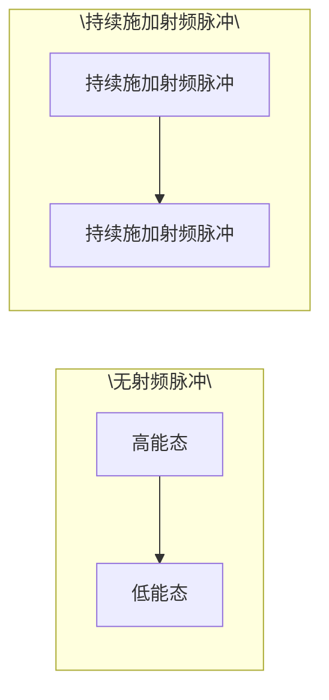

图5-9 核磁共振的饱和现象

如果长时间地施加 $B_{1}$，那么这个 $B_{1}$ 会以同样的概率诱导 $\alpha$ 态到 $\beta$ 态的跃迁以及 $\beta$ 态到 $\alpha$ 态的跃迁。随着时间的推移，处于两个能级上的自旋核数量逐渐接近，最终导致 $M_{z} = 0$（图5-9）。此时自旋体系达到了饱和，不再产生核磁信号。

## 知识窗5-4

## 射频脉冲导致宏观磁化矢量转动的进一步解释

当宏观磁化矢量处于平衡态时，为了让它向 $xy$ 平面旋转，简单的想法是施加一个横向的恒定磁场 $\pmb{B}_{1}$，但这种方式显然行不通。如图5-10所示，$\pmb{M}$ 一旦偏离 $z$ 轴，就会绕 $z$ 轴以拉莫尔频率高速进动。假设 $\pmb{B}_{1}$ 沿 $y$ 轴放置，根据右手定则，相当于有一个人站在 $x$ 轴上用绳子拉动 $\pmb{M}$。当 $\pmb{M}$ 转到了正 $x$ 轴一侧时，$\pmb{M}$ 确实可以被拉离 $z$ 轴；可是当 $\pmb{M}$ 转到了负 $x$ 轴一侧时，$\pmb{M}$ 又被绳子拉回 $z$ 轴了（图5-10A）。要解决这个问题，我们可以让人站在一个圆台上，而圆台也绕着 $z$ 轴以拉莫尔频率旋转。此时，圆台成为一个旋转坐标系（rotating frame），在圆台上的人眼里，M不再有进动，因此可以被顺利地拉离z轴（图5-10B）。

在核磁实验里，要实现转动圆台的效果，我们只需把施加的恒定磁场 $B_{1}$ 替换为交变磁场，即让 $B_{1}$ 以角频率 $\omega_0$ 在 $y$ 轴上做简谐振动。简谐振动可以分解成一个逆时针转动和一个顺时针转动的叠加，其中顺时针转动实现了圆台的效果，而逆时针方向由于其转动与 $M$ 的转动加倍地不同步，所以对 $M$ 运动的影响可以忽略不计。

---

146

5 核磁共振

如果在旋转坐标系里观察，M 从 z 轴出发，按右手定则绕着 y 轴转向 x 轴（图 5-8A）；如果在实验室坐标系里观察，M 则是一边以拉莫尔频率进动，一边绕着 y 轴转向 x 轴，呈现出螺旋形的轨迹（图 5-8B）。

图5-10 射频脉冲对宏观磁化矢量的作用

（A）横向的恒定磁场无法将磁化矢量拉离 $z$ 轴。（B）横向的交变磁场在频率匹配拉莫尔频率时可以将磁化矢量拉离 $z$ 轴。B图左侧是实验室坐标系，右侧是以圆台为参照的旋转坐标系，人站在以拉莫尔频率转动的圆台上。

## 5.3 核磁共振实验

## 5.3.1 一维核磁谱的原理

有了核磁共振的理论知识，我们接下来就可以具体解释一维和二维核磁共振实验。我们先了解一下核磁共振仪的硬件组成。现代的核磁共振仪主要由超导磁体（magnet）、探头（probe）、机柜（console）和控制电脑四部分组成（图5-11）。磁体呈圆柱形，中央有一个贯通的竖直空腔。探头从下方插入空腔，而核磁样品从上方孔道进入，在气流控制下递送到探头的检测线圈中央。圆柱形容器被分隔为两部分，内腔

图5-11 核磁共振仪的组成

（A）从左至右:超低温平台、磁体和探头、机柜、控制电脑。（B）磁体和探头的剖面示意图。探头位于下方，磁体内灌注有液氦（深蓝色）和液氮（浅蓝色）。

natural_image

Laboratory setup with equipment including a cylindrical apparatus, control unit, and computer monitor (no visible text or labels)

---

5.3 核磁共振实验

147

灌注液氦，超导线圈浸泡在其中并包围着竖直空腔。超导效应使得线圈能承载很大的恒定电流，从而产生极强的竖直向上的静磁场。容器的外腔灌注液氮，可以大幅降低内腔中液氦的挥发 $^{*}$ 。机柜里有射频信号发生器、射频信号接收器和模数转换器等重要部件。

在核磁实验中，特定的脉冲序列（pulse sequence）从控制电脑发送到射频信号发生器，生成精确的射频脉冲信号，经功率放大后施加在探头里的激发线圈上，产生横向的电磁波脉冲。如上文所述，横向电磁波如果频率与待测原子核的拉莫尔频率匹配，可以让宏观磁化矢量向着 $xy$ 平面运动。如果控制射频脉冲的长度，使得磁化矢量到达 $xy$ 平面时脉冲结束，那么磁化矢量就停留在 $xy$ 平面上进行进动。我们将这种脉冲叫作 $90^{\circ}$ 脉冲，因为在它的作用下磁化矢量的有效转动角度为 $90^{\circ}$ 。此时原来的激发线圈被接入到检测电路中，成为检测线圈。进动的磁化矢量在 $xy$ 平面上的分量将在检测线圈中激发出感生电动势，也就是核磁信号。核磁信号经由探头附近的前置放大器放大后，送入机柜中的射频信号接收器进一步放大，然后被模数转换器转换为数字信号，再送到控制电脑中进行后续处理。

在核磁信号的检测过程中，磁化矢量不会一直在 $xy$ 平面上进动，而是逐渐返回平衡态。自旋体系在受扰动偏离平衡态后重新回到平衡态的过程称为弛豫（relaxation）。从实验室坐标系观察，在弛豫过程中磁化矢量一边进动一边（A）磁化矢量被转到 $xy$ 平面后将逐渐沿着螺旋线轨迹返回平衡态。（B）磁化矢量在返回 $z$ 轴平衡态的过程中，其纵向分量 $M_z$ 和横向分量 $M_{xy}$ 对时间的变化曲线分别是指数恢复曲线（上）和指数衰减曲线（下）。它们的特征时间 $T_{1}$ 和 $T_{2}$ 定义为达到距离目标值的 $1 / \mathrm{e}$ 所需要的时间，$\mathrm{e}$ 为自然常数。

(A)

text_image

B₀
z
M
y
x

(B)

line

| Time (t) | Mz (M) | Mxy (M) |
| --- | --- | --- |
| 0 | 0 | M^0_xy |
| T_1 | M_0/e | — |
| T_2 | — | M^0_xy/e |

图 5-12 核磁共振的弛豫过程

图 5-13 核磁信号的正交检测

$M_{xy}$ 在 $x$ 轴上的分量（左）和 $y$ 轴上的分量（右）都是振荡衰减的时域信号。两者合并才是完整的核磁信号。

回到沿 $z$ 轴的平衡态（图5-12A）。如果把 $M$ 分解到纵向分量 $M_z$ 和横向分量 $M_{xy}$，那么 $M_z$ 从零开始随着时间以指数曲线恢复到平衡态 $M_0$，而 $M_{xy}$ 从 $M_{xy}^0$ 出发随着时间以指数曲线衰减到零。前者称为纵向弛豫（longitudinal relaxation），后者称为横向弛豫（transverse relaxation）。由指数恢复曲线和指数衰减曲线可以分别定义特征时间 $T_1$ 和 $T_2$ （图5-12B），以及弛豫速率 $R_1 (=1/T_1)$ 和 $R_2 (=1/T_2)$。

在 $M$ 的两个分量中，能产生核磁信号的是 $xy$ 平面上的分量 $M_{xy}$ 。$M_{xy}$ 绕着 $z$ 轴以拉莫尔频率旋转，并逐渐衰减。$M_{xy}$ 可以进一步分解到 $x$ 轴和 $y$ 轴上，同时进行检测（知识窗5-5），得到振荡衰减的核磁信号 $S_x$ 和 $S_y$ （图5-13）。

接下来需要通过傅里叶变换将时域信号转换成最终的频域信号。在做变换前，先把 $x$ 分量信号 $S_{x} = S_{0}\cos \omega_{0}t\cdot \mathrm{e}^{-R_{2}t}$ 和 $y$ 分量信号 $S_{y} = S_{0}\sin \omega_{0}t\cdot \mathrm{e}^{-R_{2}t}$ 合成为一个复数信号（注意:这里的 $R_{2}$ 是上文中定义的磁化矢量在 $xy$ 平面上衰减的速率），

$$
S (t) = S _ {x} (t) + \mathrm{i} S _ {y} (t) = S _ {0} \mathrm{e} ^ {\mathrm{i} \omega_ {0} t} \cdot \mathrm{e} ^ {- R _ {2} t} = S _ {0} \mathrm{e} ^ {(\mathrm{i} \omega_ {0} - R _ {2}) t}, \tag {5-7}
$$

<small>\* 液氦的价格远高于液氮的价格。</small>

---

148

5 核磁共振

## 知识窗5-5

## 为什么需要同时检测 $x$ 分量和 $y$ 分量

假设只检测 $x$ 分量，则无法区分顺时针和逆时针转动，也即无法区别频率的正负，如图5-14所示。此外，两个分量可以组装成复数，使得核磁信号具有相位信息。

逆时针转动

text_image

y
x
顺时针转动
y
x

图5-14 核磁信号正交检测的必要性

如果  $M_{xy}$  从 x 轴的位置开始进动，那么它在逆时针旋转时（上）和顺时针旋转时（下），在 x 轴上的投影信号是完全一样的。

得到的复数形式的振荡衰减信号称为自由感应衰减（free induction decay，FID）。对式（5-7）进行傅里叶变换，就得到频域上的信号:

$$
\begin{array}{l} F (\omega) = \int_ {0} ^ {\infty} S _ {0} \mathrm{e} ^ {(\mathrm{i} \omega_ {0} - R _ {2}) t} \cdot \mathrm{e} ^ {- \mathrm{i} \omega t} \mathrm{d} t = S _ {0} \int_ {0} ^ {\infty} \mathrm{e} ^ {[ \mathrm{i} (\omega_ {0} - \omega) - R _ {2} ] t} \mathrm{d} t \\ = S _ {0} \frac {R _ {2}}{R _ {2} ^ {2} + (\omega - \omega_ {0}) ^ {2}} - \mathrm{i} S _ {0} \frac {\omega - \omega_ {0}}{R _ {2} ^ {2} + (\omega - \omega_ {0}) ^ {2}} 。 \tag {5-8} \\ \end{array}
$$

式（5-8）的实部是洛伦兹函数的形式，称为吸收峰型（absorptive），函数曲线如图5-15所示。通常核磁谱仅展示实部分部分。

在核磁共振的谱图分析中，共振峰的峰高（peak height）和半峰宽（half-width）是两个重要参数。峰高与噪声幅度的比值是信噪比，反映核磁谱的灵敏度（sensitivity）；

半峰宽也简称峰宽（linewidth），决定了谱峰的尖锐程度，反映的是核磁谱的分辨率（resolution）。从式（5-8）可以推导出半峰宽等于 $2R_{2}$ （知识窗5-6）。换句话说，FID衰减得越快，共振峰的半峰宽越大（图5-16）。容易证明，如果FID的初始幅值不变，那么共振峰的面积也不变。所以，半峰宽越大，峰高就越小。

这是一个很重要的结论，解释了液态核磁共振技术在测量大分子量的生物分子时为什么会面临很大的挑战。分子量越大，生物大分子在溶液里的翻转越慢，导致弛豫速率 $R_{2}$ 越大（参见25.1.3节），即峰宽越大。图5-17展示了蛋白质分子量从8 kDa增加到100 kDa的过程中，酰胺区域一维氢谱的模拟结果。可以看到，50 kDa的蛋白质氢谱已经展宽得非常严重，到100 kDa就难以分辨了。

contour

| Feature | Description |
| --- | --- |
| Peak Position | \(\omega_{0}\) |
| Peak Height | \(\Delta\omega_{1}/_{2}\) |

图 5-15 核磁共振的吸收峰

频率为  $\omega_{0}$  的 FID 信号经过傅里叶变换得到的吸收峰，图上标识出的宽度是半峰宽。

---

5.3 核磁共振实验

149

## 知识窗 5-6

## 如何推导半峰宽的大小

对式（5-8）的实部做如下变形:

$$
S _ {0} \frac {R _ {2}}{R _ {2} ^ {2} + (\omega - \omega_ {0}) ^ {2}} = S _ {0} \frac {R _ {2} / R _ {2} ^ {2}}{\left[ R _ {2} ^ {2} + (\omega - \omega_ {0}) ^ {2} \right] / R _ {2} ^ {2}} = S _ {0} \frac {1 / R _ {2}}{1 + \left(\frac {\omega - \omega_ {0}}{R _ {2}}\right) ^ {2}}
$$

由此可见，当 $\omega = \omega_0 \pm R_2$ 时，信号下降到峰值的一半，也就是说，半峰宽 $\Delta \omega_{1/2} = 2R_2$。

## 5.3.2 化学位移

在图5-17所示的酰胺区域的氢谱中，共振峰远远不止一个。为什么同样是氢原子核的共振峰，甚至连氢所在的基团都相同，但共振频率却如此不同呢？原因在于这些核所处的环境有所差别。原子核周围分布着电子云，在外磁场的作用下，核外电子围绕磁场产生运动，催生出次生磁场。该次生磁场部分屏蔽了外加磁场。在一个分子里不同位置上的氢核所处的化学环境是不一样的，因此每个氢核周围电子云的分布也呈现出差异性，导致对外部静磁场的屏蔽程度不同。这样每个氢核感受到的实际磁感应强度都有所不同，共振频率也就有些微的差别。这个现象称为化学位移(chemical shift)。

text_image

时间
频率

图 5-16 横向弛豫速率与半峰宽的关系不同的弛豫速率 $R_{2}$ 下得到的核磁谱峰。从左至右，$R_{2}$ 逐渐增大（上），核磁谱峰的峰高逐渐降低，峰宽逐渐增加（下）。

理论上我们可以用共振频率来定量描述化学位移现象，但在

实践中很不方便，体现在:①共振频率与静磁场的磁感应强度成正比，因此同一样品在不同场强的核磁仪测量到的共振频率是不一样的，给比较结果带来了不便；②同种原子核的共振频率区别很小，往往在有效数字好多位后才会有差异。为了解决这些问题，人们把化学位移 $\delta$ 作了如下定义:

$$
\delta = \frac {\omega - \omega_ {\mathrm{ref}}}{\omega_ {0}} \times 1 0 ^ {6} 。 \tag {5-9}
$$

spectrogram

| X | Y |
| --- | --- |
| ~9.5 | ~0.8 |
| ~8.2 | ~0.7 |
| ~7.3 | ~1.0 |

化学位移/ppm

line

| X | Y |
| --- | --- |
| 10 | ~0.1 |
| 9 | ~0.3 |
| 8 | ~0.4 |
| 7 | ~0.2 |
| 6 | ~0.1 |

化学位移/ppm

line

| X | Y |
| --- | --- |
| 10 | ~0.2 |
| 9 | ~0.5 |
| 8 | ~0.8 |
| 7 | ~0.4 |
| 6 | ~0.2 |

化学位移/ppm

line

| X | Y |
| --- | --- |
| 10 | ~0.2 |
| 9 | ~0.4 |
| 8 | ~0.5 |
| 7 | ~0.3 |
| 6 | ~0.2 |

化学位移/ppm

图5-17 不同分子量的蛋白质样品在酰胺区域的模拟一维氢谱

---

150

5 核磁共振

其中 $\omega_{\mathrm{ref}}$ 是样品中参考小分子共振峰的频率。采用这样的定义后，我们测量的是待测峰和参考峰的频率差值，使得微小的差异可以凸显出来。以拉莫尔频率 $\omega_0$ 做分母则保证了不同核磁仪的测量结果可以直接比较。由于这样得到的比值非常小，所以又放大了 $10^{6}$ 倍，因此化学位移的单位是ppm（part per million）。

在有机小分子样品中，通常使用四甲基硅烷（tetramethylsilane，TMS）作为参考小分子。在生物样品中，则通常使用水溶性比较好的DSS（2,2-dimethyl-2-silapentane-5-sulfonic acid）。

化学位移对生物大分子的构象变化非常敏感。构象改变会导致待测原子核周围电子云分布的不同，进而影响屏蔽作用。因此，化学位移里蕴含着丰富的结构信息。化学位移受多种因素的影响。当所测原子核的自身或相邻核经历了氢键形成或破坏、互变异构、电负性改变等能够引起电子云重分布的过程，化学位移将产生很大的变化。在空间上靠近的基团对化学位移也会造成显著影响:芳香环基团通过环流效应（ring-current effect）在待测核上产生附加磁场；带电基团通过电场极化效应（electric-field-induced polarization effect）改变待测核周围的电子云分布。两者都会导致化学位移发生明显改变。此外，一些物理因素如溶剂、温度、$\mathrm{pH}$ 等也会影响化学位移。

蛋白质、DNA 和 RNA 的一维氢谱如图 5-18 所示。

蛋白质分子的一维氢谱可以提供蛋白质的折叠信息。当蛋白质折叠得比较好，那么在酰胺基区域（6.5～10.5 ppm），谱峰分布得比较均匀（图5-18A）；如果蛋白质以无序区域为主，其酰胺基的谱峰会集中在8～8.5 ppm的一个比较窄的区域内（图5-18B）。产生该现象的原因是无序蛋白处于构象的快速切换中，化学位移被平均化从而趋向于往中间靠拢。DNA和RNA分子的一维氢谱可以提供核酸二级结构的信息，这主要反映在亚氨基区域（10～15 ppm），因为只有稳定配对的碱基才会在这个区域产生鸟嘌呤（guanine）和尿嘧啶（uracil）的共振峰（图5-18C、D；知识窗5-7）。

## 5.3.3 J耦合

在核磁共振谱中，有时本应以单峰形式出现的谱峰会发生分裂现象，其产生的原因是该原子核与经由一个或者多个化学键相连的另一个原子核之间可以通过化学键发生核自旋的相互作用，称为自旋-自旋耦合（spin-spin coupling）或者J耦合（J-coupling）。这种相互作用会影响所测核自旋的能级结构，从而引起谱峰的分裂（图5-19）。J耦合的大小由分裂谱峰的距离来衡量，单位为 $\mathrm{Hz}$ 。值得注意的是，J耦合的数值与外加磁场的大小无关，而化学位移在以 $\mathrm{Hz}$ 为单位时与外加磁场的大小成正比。

J耦合导致的谱峰分裂的数目和相对峰高取决于跟所测原子核耦合的原子核数目。例如在一维氢谱中，如果一个质子与邻近的两个质子发生相同大小的J耦合，它的谱

---

5.3 核磁共振实验

151

图5-18 蛋白质、DNA和RNA的一维氢谱

（A）折叠蛋白样品的核磁谱。（B）无序蛋白样品的核磁谱。（C）发夹DNA样品的核磁谱，谱图左侧谱峰代表碱基配对中G和T的亚氨基，

右端展示了脱氧核苷酸的结构。（D）发夹RNA样品的核磁谱，谱图左侧谱峰代表碱基配对中G和U的亚氨基，右端展示了核苷酸的结构。

## 知识窗5-7

## 沃森 - 克里克碱基配对的实验验证

在沃森与克里克于 1953 年揭示了革命性的 DNA 双螺旋结构之后，对这一模型的关键特征——碱基配对的实验验证也随之如火如荼地展开。1959 年胡斯坦（Karst Hoogsteen）解析了含有 9-甲基腺嘌呤和 1-甲基胸腺嘧啶的共晶结构，观察到腺嘌呤和胸腺嘧啶采取了与沃森-克里克碱基对迥异的配对模式，后来被命名为胡斯坦配对（Hoogsteen basepair）（参见3.2.3节）。60年代，晶体衍射学家们陆续解析了包含嘌呤和嘧啶的衍生物或

---

152

5 核磁共振

寡核苷酸链的共晶结构，发现涉及鸟嘌呤和胞嘧啶的共晶结构形成了预期的沃森-克里克碱基对，但涉及腺嘌呤和胸腺嘧啶（或尿嘧啶）的共晶结构则无法形成这样的碱基对，并且在大多数情况下，倾向于形成胡斯坦碱基对。这些实验结果以及同时期Z型DNA的发现，为DNA双螺旋结构模型蒙上了一层阴影，一时间质疑声此起彼伏。其中一位怀疑者是鲍林，他认为诺贝尔奖颁给沃森等人为时过早，因为DNA三维结构的实验证据还存在争议。

到了70年代，正是液态核磁共振首先为沃森-克里克碱基对，特别是A-T（和A-U）的经典配对提供了宝贵的实验支持。对tRNA和双链寡核苷酸的核磁测量发现，在生理溶液条件下这些样品的一维谱在亚氨基区域呈现出特征峰，这些谱峰的化学位移与沃森-克里克碱基对的化学位移计算值相符，但是与胡斯坦碱基对的计算值有显著差异。

1973 年，里奇（Alexander Rich）等人解析了包含 A-U 和 G-C 配对的两条二核苷酸形成的晶体结构，该结构展现出期待已久的右手双螺旋和沃森-克里克碱基对。这是人们第一次直接观察到涉及腺嘌呤的沃森-克里克经典配对，而这一结构也被誉为“原子分辨率的双螺旋”。沃森在收到论文预印本后马上给里奇打电话，告诉他:“二十年来，我第一次睡了个好觉！”

1980 年，迪克森（Richard Dickerson）等人第一次解析了真正的 B 型 DNA 双螺旋的高分辨率晶体结构。该 DNA 链被设计为包含 12 个核苷酸的回文序列:C-G-C-G-A-A-T-T-C-G-C-G，这就是著名的迪克森十二聚体 DNA（Dickerson dodecamer）。至此，DNA 双螺旋结构的实验验证被画上了完美的句号。

代找电子书资源，新书可代做扫描制作加微信 asxiao90

峰将分裂为峰高 $1:2:1$ 的三重峰（图5-20A）；如果与邻近的三个质子发生相同大小的J耦合，谱峰将分裂为峰高 $1:3:3:1$ 的四重峰（图5-20B）。因此，J耦合提供了关于分子结构的信息，在有机小分子包括药物分子的鉴定和分析中尤其重要。

对于生物大分子，J耦合也可以提供某些结构信息。例如，蛋白质中 $\mathrm{H}^{\mathrm{N}}$ 与 $\mathrm{H}^{\alpha}$ 之间有三个化学键相连，其耦合常数 $^{3}J(\mathrm{H}^{\mathrm{N}},\mathrm{H}^{\alpha})$ 与蛋白质主链二面角的关系由卡普拉斯

(A)

other

| Sample | Chemical Shift Difference (JHF) |
| --- | --- |
| Top Left | ~0.25 |
| Top Right | ~0.25 |
| Bottom Left | ~0.25 |
| Bottom Right | ~0.25 |

(B)

chemical

Feynman diagram showing electronic states H^αF^β and H^βF^α with spin-parity labels

图 5-19 J 耦合导致的谱峰分裂

（A）对于HF分子，${}^{1}\mathrm{H}$ 和 ${}^{19}\mathrm{F}$ 之间的J耦合导致它们各自出现相同赫兹数的谱峰分裂。（B）以 ${}^{1}\mathrm{H}$ 的谱峰为例，相邻的 ${}^{19}\mathrm{F}$ 如果自旋向上则导致 ${}^{1}\mathrm{H}$ 的 $\alpha$ 态和 $\beta$ 态能级差变小，如果自旋向下则导致能级差变大。

(A)

text_image

AX₂
JAX
JAX
ββ βα αβ
αα

(B)

text_image

(B)
AX₃
JAX
JAX
JAX
βββ
ββα
βαα
ααα
βαβ
αββ
βαα
αβα
ααβ
ααα

图 5-20 J 耦合产生的裂峰数与邻近核数目的关系

（A）两个邻近核的自旋状态有4种排列，产生峰高为1:2:1的三个裂峰。（B）三个邻近核的自旋状态有8种排列，产生峰高为1:3:3:1的四个裂峰。

---

5.3 核磁共振实验

153

方程（Karplus equation）\*所描述:

$$
J = A \cos^ {2} \theta + B \cos \theta + C _ {\circ} \tag {5-10}
$$

其中，$\theta \approx \varphi - 60^{\circ}$，代表二面角 $\mathrm{H}^{\mathrm{N}} - \mathrm{N} - \mathrm{C}^{\alpha} - \mathrm{H}^{\alpha}$，而 $\varphi$ 为主链二面角 $\mathrm{C}' - \mathrm{N} - \mathrm{C}^{\alpha} - \mathrm{C}'$。

## 5.3.4 核磁二维谱的原理

前面我们解释了核磁一维谱是如何产生的，下面我们讨论如何获得核磁二维谱。图5-21A展示了在蛋白质测量中最常用的NH-HSQC（heteronuclear single-quantum correlation）二维谱的脉冲序列，该脉冲序列在25.1.2节中有较为详细的解释。简单地说，起始的 $90^{\circ}$ 脉冲在 ${}^{1}\mathrm{H}$ 上激发出宏观磁化矢量，然后磁化矢量传递到 ${}^{15}\mathrm{N}$ 上并经历时长为 $t_1$ 的演化，接着磁化矢量又被传回 ${}^{1}\mathrm{H}$，最后在 $t_2$ 时间内采集FID信号。二维实验是通过采集一系列的一维FID来完成的，采集这些一维FID所使用的 $t_1$ 渐次增大。由于 $t_1$ 对应于磁化矢量在 ${}^{15}\mathrm{N}$ 上的演化，这样就间接实现了对 ${}^{15}\mathrm{N}$ 共振频率的探测。将这些一维FID排列成一个二维阵列，先对 $t_2$ （横轴）进行傅里叶变换，然后再对 $t_1$ （纵轴）进行傅里叶变换，这样两个轴都从时域转换到了频域，最终产生了二维谱峰（图5-21B）。在HSQC实验中，蛋白质分子里每个氨基酸的NH基团都通过这样的过程产生各自的共振峰，最后就得到了包含众多谱峰的HSQC二维谱，每个谱峰都对应着某个氨基酸残基的一个NH基团（图5-21C）。上述二维谱的采集策略可以推广到三维和四维核磁谱中，只需要在脉冲序列中磁化矢量转移到相应原子核时插入一段可变的时间延迟，让信号在该维度上间接地演化。

由于化学位移对生物大分子的构象变化很敏感，所以HSQC二维谱常常作为生物大分子构象的指纹图谱使用。对蛋白质来说，最常用的指纹图谱是NH-HSQC谱。此外，甲基区域的CH-HSQC谱也比较常用，尤其是对于分子量比较大的蛋白质。HSQC谱一个重要的应用是化学位移映射（chemical shift mapping），用于表征大分子与配体

(A)

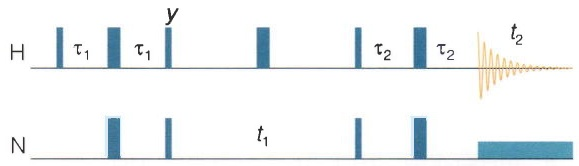

text_image

H
τ₁ τ₁ y
τ₂ τ₂ t₂
N
t₁

(B)

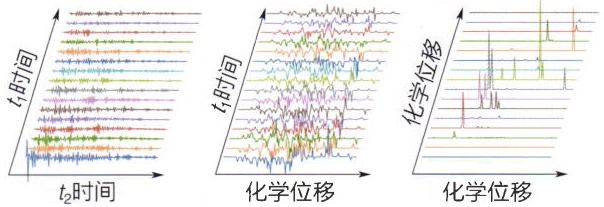

text_image

t₂时间
t₁时间
化学位移
化学位移

(C)

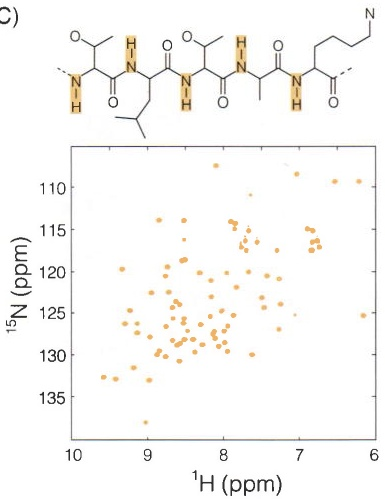

scatter

| Series | 1H (ppm) (range) | 15N (ppm) (range) |
| --- | --- | --- |
| Data Points | 6.0~9.5 | 110~134 |

图 5-21 HSQC 二维核磁谱的原理

（A）NH-HSQC实验的脉冲序列。（B）从一系列不同 $t_1$ 时长产生的FID得到二维谱的原理。（C）NH-HSQC的每个谱峰都对应于蛋白质分子不同的酰胺基团，因此提供了蛋白质构象的指纹谱。

<small>\* 该方程由马丁·卡普拉斯（Martin Karplus，2013年诺贝尔化学奖得主）提出。</small>

---

154

5 核磁共振

(A)

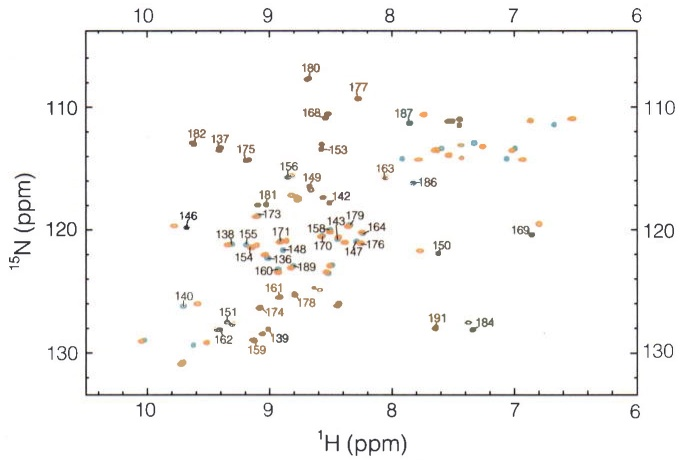

scatter

| Label | 1H (ppm) | 15N (ppm) |
| --- | --- | --- |
| 180 | ~9.3 | ~107 |
| 177 | ~8.6 | ~108 |
| 182 | ~9.6 | ~112 |
| 137 | ~9.4 | ~113 |
| 175 | ~9.2 | ~114 |
| 168 | ~8.9 | ~109 |
| 153 | ~8.8 | ~108 |
| 187 | ~8.2 | ~109 |
| 163 | ~8.0 | ~115 |
| 186 | ~8.2 | ~117 |
| 146 | ~9.7 | ~120 |
| 181 | ~9.2 | ~117 |
| 156 | ~9.3 | ~116 |
| 149 | ~9.0 | ~117 |
| 142 | ~8.7 | ~117 |
| 173 | ~9.2 | ~118 |
| 158 | ~9.3 | ~120 |
| 143 | ~8.9 | ~120 |
| 179 | ~8.7 | ~120 |
| 164 | ~8.5 | ~120 |
| 150 | ~8.3 | ~122 |
| 155 | ~9.2 | ~120 |
| 171 | ~9.0 | ~120 |
| 148 | ~9.2 | ~122 |
| 170 | ~9.0 | ~122 |
| 147 | ~8.8 | ~122 |
| 176 | ~8.6 | ~122 |
| 160 | ~9.3 | ~123 |
| 189 | ~9.3 | ~124 |
| 140 | ~9.8 | ~126 |
| 161 | ~9.3 | ~125 |
| 178 | ~9.3 | ~126 |
| 154 | ~9.3 | ~127 |
| 136 | ~9.3 | ~127 |
| 147 | ~8.8 | ~127 |
| 150 | ~8.3 | ~128 |
| 169 | ~7.3 | ~120 |
| 191 | ~8.4 | ~133 |
| 184 | ~7.4 | ~133 |
| 159 | ~9.0 | ~130 |
| 139 | ~9.0 | ~130 |
| 174 | ~9.0 | ~133 |
| 151 | ~9.0 | ~133 |
| 162 | ~9.0 | ~134 |
| 140 | ~9.6 | ~135 |
| 137 | ~9.4 | ~135 |
| 150 | ~8.3 | ~135 |
| 159 | ~9.0 | ~136 |
| 139 | ~9.0 | ~136 |
| 159 | ~9.0 | ~137 |
| 159 | ~9.0 | ~138 |
| 159 | ~9.0 | ~139 |
| 159 | ~9.0 | ~140 |
| 159 | ~9.0 | ~142 |
| 159 | ~9.0 | ~144 |
| 159 | ~9.0 | ~146 |
| 159 | ~9.0 | ~148 |
| 159 | ~9.0 | ~150 |
| 159 | ~9.0 | ~152 |
| 159 | ~9.0 | ~154 |
| 159 | ~9.0 | ~156 |
| 159 | ~9.0 | ~158 |
| 159 | ~9.0 | ~160 |
| 159 | ~9.0 | ~162 |
| 159 | ~9.0 | ~164 |
| 159 | ~9.0 | ~166 |
| 159 | ~9.0 | ~168 |
| 159 | ~9.0 | ~170 |
| 159 | ~9.0 | ~172 |
| 159 | ~9.0 | ~174 |
| 159 | ~9.0 | ~176 |
| 159 | ~9.0 | ~178 |
| 159 | ~9.0 | ~180 |
| 159 | ~9.0 | ~182 |
| 159 | ~9.0 | ~184 |
| 159 | ~9.0 | ~186 |
| 159 | ~9.0 | ~188 |
| 159 | ~9.0 | ~190 |
| 159 | ~9.0 | ~192 |
| 159 | ~9.0 | ~194 |
| 159 | ~9.0 | ~196 |
| 159 | ~9.0 | ~198 |
| 159 | ~9.0 | >-300 |
| 159 | ~9.0 | >-302 |
| 159 | ~9.0 | >-304 |
| 159 | ~9.0 | >-306 |
| 159 | ~9.0 | >-308 |
| 159 | ~9.0 | >-320 |
| 159 | ~9.0 | >-322 |
| 159 | ~9.0 | >-324 |
| 159 | ~9.0 | >-326 |
| 159 | ~9.0 | >-328 |
| 159 | ~9.0 | >-330 |
| 159 | ~9.0 | >-332 |
| 159 | ~9.0 | >-334 |
| 159 | ~9.0 | >-336 |
| 159 | ~9.0 | >-338 |
| 159 | ~9.0 | >-340 |
| 159 | ~9.0 | >-342 |
| 159 | ~9.0 | >-344 |
| 159 | ~9.0 | >-346 |
| 159 | ~9.0 | >-348 |
| 159 | ~9.0 | >-350 |
| 159 | ~9.0 | >-352 |
| 159 | ~9.0 | >-354 |
| 159 | ~9.0 | >-356 |
| 159 | ~9.0 | >-358 |
| 159 | ~9.0 | >-360 |
| 159 | ~9.0 | >-362 |
| 159 | ~9.0 | >-364 |
| 159 | ~9.0 | >-366 |
| 159 | ~9.0 | >-368 |
| 159 | ~9.0 | >-370 |
| 159 | ~9.0 | >-372 |
| 159 | ~9.0 | >-374 |
| 159 | ~9.0 | >-376 |
| 159 | ~9.0 | >-378 |
| 159 | ~9.0 | >-380 |
| 159 | ~9.0 | >-382 |
| 159 | ~9.0 | >-384 |
| 159 | ~9.0 | >-386 |
| 159 | ~9.0 | >-388 |
| 159 | ~9.0 | >-390 |
| 159 | ~9.0 | >-392 |
| 159 | ~9.0 | >-394 |
| 159 | ~9.0 | >-396 |
| 159 | ~9.0 | >-398 |
| 159 | ~9.0 | >-400 |

图5-22 表征蛋白质与多肽结合位点的化学位移映射实验（A）crkSH3蛋白在自由态（蓝色）和结合态（橙色）的NH-HSQC二维谱。（B）化学位移的变化通过颜色映射到crkSH3晶体结构后的

(B)

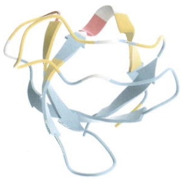

natural_image

3D ribbon diagram of a protein structure with alpha helices and beta sheets (no text or labels)

(C)

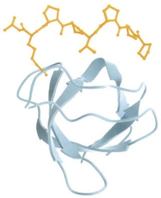

chemical

Molecular structure diagram showing a protein backbone with highlighted secondary structure elements

结果，红色表示化学位移变化较大，黄色表示中等变化，而蓝色表示基本没有变化。（C）crkSH3（蓝色）与Sos多肽（橙色）复合物的晶体结构。

的相互作用。下面以蛋白质分子和多肽的NH-HSQC化学位移映射为例来说明。在这个实验中，蛋白质分子需要进行 ${}^{15}\mathrm{N}$ 同位素标记，而多肽不做标记。首先获取蛋白质分子单独的HSQC二维谱，然后加入多肽，再次采集HSQC二维谱。在蛋白质表面结合多肽的区域，由于化学环境的变化其对应的谱峰会发生移动（图5-22A），这样的移动称为化学位移扰动（chemical shift perturbation，CSP）。如果蛋白质分子的三维结构已知，我们就可以把化学位移有变化的残基在三维结构上以一定的颜色标记（图5-22B）。在本例中，化学位移的映射区域与蛋白质-多肽复合物晶体结构所揭示的结合区域高度一致（图5-22C），说明了这种方法的有效性。

最后，不管是一维谱还是多维谱，谱图质量通常用分辨率和灵敏度来衡量（知识窗5-8）。

## 知识窗5-8

## 核磁谱图的分辨率和灵敏度

在了解了核磁一维谱和二维谱之后，我们下面简要介绍核磁谱图的分辨率和灵敏度。如前所述，分辨率由谱峰的半峰宽决定，而后者又由 $R_{2}$ 弛豫速率决定。灵敏度由信噪比（signal-to-noise，s/n）来衡量，而核磁信号的信噪比由下式决定:

$$
\mathrm{s/n} \propto N \gamma_ {\mathrm{exc}} \gamma_ {\mathrm{det}} ^ {\frac {3}{2}} B _ {0} ^ {\frac {3}{2}} \sqrt {n _ {\mathrm{s}}} 。 \tag {5-11}
$$

其中， $N$ 为样品中待测原子核的总数， $\gamma_{\mathrm{exc}}$ 和 $\gamma_{\mathrm{det}}$ 分别是脉冲序列中激发核和检测核的旋磁比， $B_{0}$ 为外加磁感应强度， $n_{s}$  为扫描次数。由于  ${}^{1}H$  具有最高的  $\gamma$  值，所以大多数核磁脉冲序列都是以  ${}^{1}H$  激发和  ${}^{1}H$  检测的原则来设计的。

这个公式告诉我们，信噪比与样品浓度成正比，与场强的3/2次方成正比，还与核磁实验扫描时间的平方根成正比。因此，提高样品浓度和选择更高场的核磁仪都是提高信噪比的有效方法。此外，就只能依靠积累测量时间来达到目的，但效率不高，有时候甚至完全不可行。

---

5.4 核磁共振在结构研究中的应用

155

## 5.4 核磁共振在结构研究中的应用

核磁共振技术在生物大分子的结构研究中有广泛的应用，主要包括生物大分子溶液状态下的三维结构解析、生物大分子与配体的相互作用、构象动态、折叠与去折叠机制、代谢组学、靶向生物大分子的药物开发等。半个多世纪以来，生物核磁共振的快速发展为理解生物大分子结构、动态和功能三者间的关系，揭示生物大分子的相互作用和调控机制，以及推动药物研发提供了重要的研究手段。特别值得一提的是，与X射线晶体衍射及冷冻电镜方法相比，核磁共振在研究生物大分子的构象动态上有独特的优势。关于这方面的内容将在25.1.3节讨论。

## 5.4.1 生物大分子的谱峰指认

在采集到生物大分子的核磁谱图后，通常都需要进行谱峰指认（resonance assignment；也称作化学位移归属），即确定每个谱峰是由哪些原子核产生的。谱峰指认是一个烦琐耗时的过程，而且很容易出错，需要反复检查修正。早期的核磁研究中，蛋白质和核酸的谱峰指认是通过NOESY（nuclear Overhauser effect spectroscopy）（原理见5.4.2节）二维谱确定的，只要分子量稍大一些就相当困难。此后随着同位素标记技术的广泛应用以及三维和四维异核脉冲序列的发明，蛋白质谱峰指认的难度明显降低，但对于较大的蛋白质分子（例如 $50\mathrm{kDa}$ 以上）仍然比较困难。对于核酸分子来说，由于其磷酸骨架不像蛋白质主链那样可以通过 ${}^{15}\mathrm{N}-{}^{13}\mathrm{C}$ 或者 ${}^{13}\mathrm{C}-{}^{13}\mathrm{C}$ 之间较强的J耦合串联起来，仍然需要依靠NOESY二维谱来进行谱峰指认。下面我们简要介绍蛋白质主链的谱峰指认。

蛋白质主链的归属主要依靠两个异核三维实验:HNCACB（或者CBCANH）和HN(CO)CACB（或者CBCA(CO)NH）。前者把当前氨基酸残基的 $\mathrm{H}^{\mathrm{N}}$ 、N与当前残基的 $\mathrm{C}^{\alpha}$ 、 $\mathrm{C}^{\beta}$ 以及前一个残基的 $\mathrm{C}^{\alpha}$ 和 $\mathrm{C}^{\beta}$，通过J耦合关联起来；后者仅把当前 $\mathrm{H}^{\mathrm{N}}$ 、N与前一个残基的 $\mathrm{C}^{\alpha}$ 、 $\mathrm{C}^{\beta}$ 关联起来（图5-23A）。HNCACB/CBCANH的作用尤其重要，正是通过它才能把当前残基和前一个残基串联起来；而HN(CO)CACB/CBCA(CO)NH的作用是帮助区分前者获取的两组 $\mathrm{C}^{\alpha} / \mathrm{C}^{\beta}$ 谱峰，即哪组来自当前残基，哪组来自前一个残基（图5-23B）。不同残基 $\mathrm{C}^{\alpha} / \mathrm{C}^{\beta}$ 的化学位移区别比较明显，可作为每个残基的“指纹”信息来使用。部分残基（Ala、Ser、Thr、Gly）从 $\mathrm{C}^{\alpha}$ 和 $\mathrm{C}^{\beta}$ 两个峰的位置可以很容易判断出氨基酸种类，这个特点可以方便我们找到主链归属从哪个残基开始尝试。

上述两个三维实验灵敏度不高，因此当样品浓度比较低时可能采集不到质量足够好的谱图。这种情况下可以选择测量HNCA、HN(CO)CA、HNCO、HN(CA)CO这四个灵敏度比较高的三维谱，这时 $\mathrm{C}^{\alpha} / \mathrm{C}^{\beta}$ 的作用由 $\mathrm{C}^{\alpha} / \mathrm{C}'$ 替代。值得注意的是，后者对各个残基的区分度没有前者高，因此会给谱峰指认带来一定的难度。

侧链的化学位移归属比主链更加烦琐，主要依靠HCCH-TOCSY三维或者四维谱来完成。在获得主链和侧链完整的化学位移归属后，接下来就可以利用这些结果来指

---

156

5 核磁共振

(A)

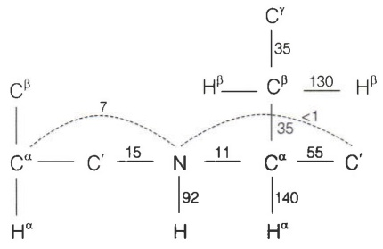

chemical

Chemical structure diagram showing hydrogen bonding distances between carbon and nitrogen atoms

(B)

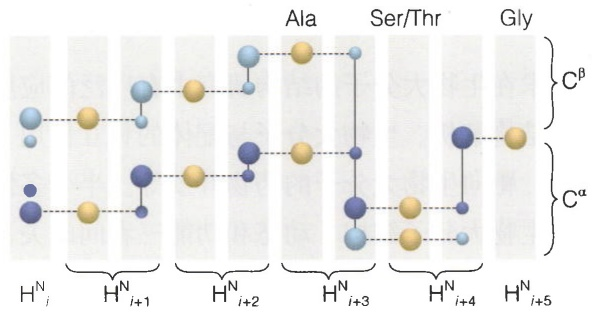

chemical

Diagram showing protein domain structures with Ala, Ser/Thr, and Gly labels and Cα/Cβ subunits

图 5-23 蛋白质核磁谱的主链归属

（A）蛋白质分子中的J耦合。（B）从HNCACB和HN(CO)CACB这两套三维谱里截取出的各个氨基酸残基主链NH峰所对应的 $C^{\alpha}/C^{\beta}$ 维度的竖条（strip）。对每个竖条，横向对应主链 $H^{N}$ 的化学位移，纵向对应 $C^{\alpha}/C^{\beta}$ 的化学位移，而垂直于纸面的维度是主链 $H^{N}$ 的化学位移。

包含深蓝色和浅蓝色谱峰的竖条来自 HNCACB 谱，较大的一对谱峰对应于当前残基的  $C^{\alpha}$ （深蓝色）和  $C^{\beta}$ （浅蓝色），较小的一对谱峰对应于前一个残基的  $C^{\alpha}$ （深蓝色）和  $C^{\beta}$ （浅蓝色）；包含黄色谱峰的竖条来自 HN(CO)CACB 谱，对应于前一个残基的  $C^{\alpha}$  和  $C^{\beta}$ 。水平虚线代表对相邻残基  $C^{\alpha}/C^{\beta}$  谱峰的串联追溯。

认 NOESY 谱中大量存在的  ${}^{1}H-{}^{1}H$  相关峰。

## 5.4.2 结构约束信息的获取和结构计算

解析核磁三维结构的基本原理是通过核磁共振实验获得生物大分子的结构约束，然后把这些结构约束作为分子动力学模拟的能量项，驱动着模拟朝向能满足结构约束的方向演化，最终使得生物大分子折叠为正确的三维构象。最主要的结构约束来自NOESY实验，而NOESY实验的原理是NOE效应。NOE效应指的是当两个原子核（通常是旋磁比最大的氢核）在空间中距离较近时，它们之间的偶极耦合作用导致一个核的极化状态会影响另一个核的极化状态。NOE效应的强度与两个核之间距离的六次方成反比。图5-24展示了溶菌酶的二维NOESY谱，其中每个共振峰都关联着两个氢核。当蛋白质分子中两个氢核距离在 $5\AA$ 之内时，就很有可能会在谱图的相应位置产生一个交叉峰，其峰高与核间距的六次方成反比。通过分析NOESY谱，我们可以获得大量的氢原子对之间的距离约束。

为了减少谱峰的重叠，我们通常采集两个三维NOESY谱:${}^{15}\mathrm{N}-\mathrm{NOESY}-\mathrm{HSQC}$ 和${}^{13}\mathrm{C}-\mathrm{NOESY}-\mathrm{HSQC}$ 。对于比较大的蛋白质，还可以采集四维NOESY谱。NOESY在用于结构计算前需要通过此前完成的主链和侧链归属来对NOESY的交叉峰进行指认，即辨识出每个谱峰是由哪两个氢原子核产生的。由于NOESY的相关峰数目经常能达到数以千计的规模，这一过程通常使用软件来自动完成，例如CYANA和ARIA。

如前所述，在解析核磁结构时需要采集一系列三维甚至四维的核磁谱，这是很耗时的过程，往往要连续采谱二周左右。近年来，随着非均匀采样（non-uniform sampling，NUS）技术的快速发展和逐渐普及，可以把采谱时间缩短为4\~5天。

主链二面角 $\varphi$ 和 $\psi$ 以及侧链二面角 $\chi_{1}$ 也是经常使用的结构约束，可以通过化学

---

5.4 核磁共振在结构研究中的应用

157

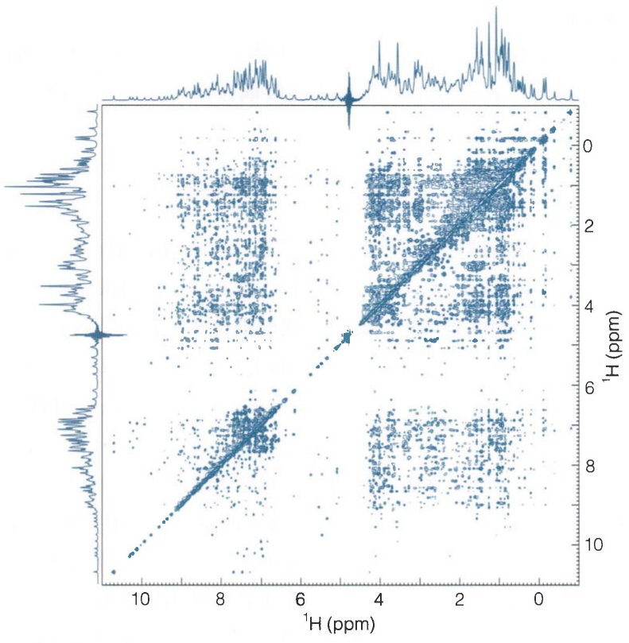

scatter

| 1H (ppm) (range) | 1H (ppm) (range) |
| --- | --- |
| 0~10 | 0~10 |

图 5-24 溶菌酶的二维NOESY谱（800 MHz，25℃）

位移计算获得，也可以通过测量三键 $J$ 耦合常数获得，例如从 ${}^{3}J(\mathrm{H}^{\mathrm{N}},\mathrm{H}^{\alpha})$ 可以得到$\varphi$ 角\*（通过前文提到的卡普拉斯方程），从 ${}^{3}J(\mathrm{H}^{\alpha},\mathrm{H}^{\beta})$ 可以得到 $\chi_{1}$ 角。

蛋白质的二级结构信息可以从主链二面角、二级结构单元产生的特定模式的NOE交叉峰，以及主链上 $\mathrm{H}^{\mathrm{N}}$ 形成的氢键推导出来。氢键的存在可以通过测量 $\mathrm{H}^{\mathrm{N}}$ 与水溶液的氢之间的交换速率获得。较慢的交换速率代表 $\mathrm{H}^{\mathrm{N}}$ 很可能参与了氢键的形成。此外，二级化学位移（secondary chemical shift，即某些对二级结构类型敏感的主链原子核例如 $^{13}\mathrm{C}^{\alpha}$ 、 $^{13}\mathrm{C}^{\beta}$ 、 ${}^{1}\mathrm{H}^{\alpha}$ 和 $^{13}\mathrm{C}'$ 的化学位移相对于无规卷曲构象化学位移的偏离值）也提供了一种判定二级结构的简便方法。

残余偶极耦合（residual dipolar coupling，RDC）实验可以为结构解析提供准确可靠的角度约束。在蛋白质和核酸的核磁结构解析中使用残余偶极耦合约束在近年来已经成为常规操作。残余偶极耦合能够提供生物大分子中各个化学键的空间取向信息，通常与NOE约束联合使用来解析结构，对于确定生物大分子多个结构域间的相对朝向尤其重要。顾名思义，残余偶极耦合来源于化学键连接的两个核之间的偶极耦合作用。偶极耦合的大小由下式决定:

$$
D = D _ {\mathrm{max}} \frac {3 \cos^ {2} \theta - 1}{2} 。 \tag {5-12}
$$

其中， $D_{\mathrm{max}} = \frac{\mu_0\hbar\gamma_1\gamma_\mathrm{S}}{4\pi^2r_\mathrm{IS}^3}$ ， $\mu_0$ 为真空磁导率， $\gamma_{1}$ 和 $\gamma_{\mathrm{S}}$ 为两个核的旋磁比， $r_\mathrm{IS}$ 为核间距； $\theta$

<small>\* 严格地说，直接得到的是二面角 $\theta$ ，即 $\mathrm{H}^{\mathrm{N}} - \mathrm{N} - \mathrm{C}^{\alpha} - \mathrm{H}^{\alpha}$ ；而主链二面角 $\varphi \approx \theta +60^{\circ}$ 。</small>

---

158

5 核磁共振

为连接两核的矢量与外加磁场的夹角。

核磁样品的缓冲液通常是各向同性的，生物大分子在溶液中的取向完全随机并且在不停地快速翻转。此时分子感受到的偶极耦合作用是式（5-12）在球面空间的积分:

$$
\langle D \rangle = D _ {\max} \int_ {0} ^ {\pi} \frac {3 \cos^ {2} \theta - 1}{2} \sin \theta \mathrm{d} \theta = 0 _ {\circ}
$$

通过计算容易看出，偶极耦合被平均化变成了零。为了测量偶极耦合，需要在核磁样品中加入排列介质（alignment medium），使得生物大分子在溶液中的取向不再是各向同性，从而获得了微弱的优势取向。此时，偶极耦合的平均值不再是零，残余的偶极耦合取决于优势取向下化学键与外加磁场 $B_{0}$ 的夹角 $\theta$ （图5-25A）。换句话说，通过测量化学键连接的两个自旋核之间的残余偶极耦合，我们可以获得该化学键的角度信息。

残余偶极耦合的实验值是通过测量两核之间的J耦合获得的。以RNA中C—H键的残余偶极耦合为例，首先在普通核磁缓冲液中测量 $^{13}$ C和 $^{1}$ H之间的谱峰分裂，裂分大小即为J耦合常数。然后在样品中加入排列介质，常用的排列介质有脂质双圆盘（lipid bicelles）、纤维状噬菌体（Pf1）、拉伸或压紧的聚丙烯酰胺凝胶、烷基聚乙二醇与醇形成的液晶等等，此时再次测量谱峰分裂，裂分大小为J耦合常数与残余偶极耦合之和（图5-25B、C）。

以上都是在核磁结构解析中使用的常规结构约束。这些结构约束需要在分子动力学模拟的力场中通过先升温后降温的模拟退火过程，来引导生物大分子三维结构朝着满足结构约束的方向演化，最终达到一个收敛的构象。在初始模型构建（initial model building）和结构精修（refinement）中涉及的常用软件有CYANA、CNS和Xplor-NIH。近年来Amber、CHARMM、GROMACS等专用的分子动力学软件包也越来越多地被用于结构精修中。这些软件包使用的力场更为准确完善，有助于获得更加合理的三维结构。

图5-25 残余偶极耦合实验的原理

（A）RNA的C—H键处于外磁场 $B_{0}$ 中。（B）普通核磁缓冲液中的RNA分子（左）和加入了纤维状噬菌体的缓冲液中的RNA分子（右）。纤维状噬菌体在磁场中产生了定向排列，从而对RNA分子的空间朝向起了一定的限制作用，使后者不再各向同性。（C）在各向同性缓冲液中测量的谱峰分裂（蓝色）和在含有排列介质的缓冲液中测量的谱峰分裂（橙色）。

## 5.4.3 用于结构解析的其它实验数据

除此之外，还有其它一些核磁实验数据可以提供结构约束。前文我们提到化学位

(A)

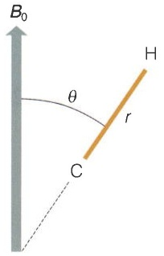

text_image

B₀
θ
r
H
C

(B)

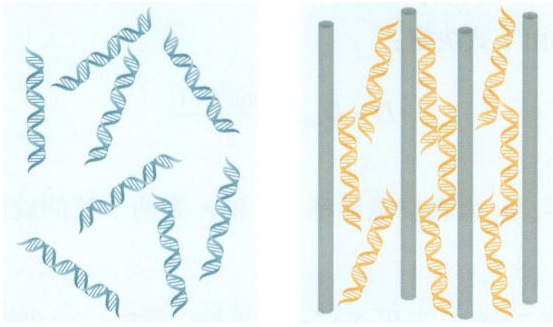

(C)

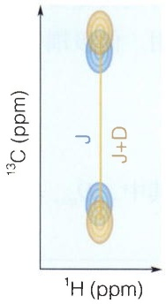

chemical

Molecular structure diagram showing 1H and 13C chemical shifts in ppm, with J and J+D labels indicating coupling or resonance sites

---

5.4 核磁共振在结构研究中的应用

159

移实际上蕴含了丰富的结构信息，因此可以借助化学位移预测方法为结构计算提供约束。通过与分子建模软件（例如Rosetta）的联用，已经可以做到仅仅依靠蛋白质化学位移数据或者再加上少量NOE和RDC数据，获得 $40\mathrm{kDa}$ 以内蛋白质的具有较高准确度的三维结构。顺磁弛豫增强（paramagnetic relaxation enhancement，PRE）和赝接触位移（pseudocontact shift，PCS）这两种方法可以获得比较长程的距离约束，也是解析核磁结构的有力工具。下面对它们作逐一介绍。

PRE 和 PCS 都需要在生物大分子上标记一个顺磁探针，探针中存在一个或多个未配对电子。前文中我们提到，NOE 效应与氢核间距离的六次方成反比，因此只能获得 5 Å 内的近程距离信息。PRE 效应也与电子-原子核距离成六次方反比关系，但由于电子的旋磁比是氢核的 658 倍，因此产生的偶极耦合作用要比 NOE 效应中的大了近 3 个数量级，所以能够检测 15～30 Å 的距离。PCS 效应与电子-原子核距离的三次方成反比，因此检测的距离更大，可达 40 Å 或者更大。

值得注意的是，对于比较动态的生物大分子或者无序蛋白，即使两个氢核接近到5 Å以内，由于其距离的动态性，也经常不会产生NOE交叉峰，因此这类生物大分子不适合测量NOE。对于这种情况，PRE实验是一个很好的选择。尤其在与分子动力学模拟联用的时候，PRE提供的远程距离约束可用于重构生物大分子的动态。

在生物大分子的PRE测量中，常用的顺磁探针包括氮氧自由基以及加载了顺磁性金属离子（$\mathrm{Cu^{2+}}$、$\mathrm{Mn^{2+}}$、$\mathrm{Gd^{3+}}$等）的金属螯合剂。图5-26A显示的是一种常用的氮氧自由基MTSL。这些顺磁基团会按照 $1 / r^6$ 的关系加速其周围原子核的弛豫，导致谱峰的展宽（图5-26B、C）。通常使用峰高的衰减来定量表示PRE效应的强度。有三种类型的PRE实验:①分子内PRE，测量同一分子上的顺磁基团在分子内引起的PRE效应；②分子间PRE，即一个分子上的顺磁基团在与其互作的另一分子上引起的PRE效应；③溶剂PRE，即溶剂中的小分子顺磁探针通过随机碰撞在大分子表面引起的PRE效应。

在生物大分子的PCS测量中，常用的顺磁探针是加载了各向异性稀土金属离子（例如 $\mathrm{Tb}^{3+}$ 、 $\mathrm{Dy}^{3+}$ 、 $\mathrm{Ho}^{3+}$ 、 $\mathrm{Er}^{3+}$ 、 $\mathrm{Tm}^{3+}$ 、 $\mathrm{Yb}^{3+}$ 等）的金属螯合剂。与PRE不同，PCS测量的是与逆磁金属离子的情况相比，加载了顺磁金属离子后产生的谱峰移动。其化学位移的差值与 $1 / r^3$ 成正比。图5-27解释了PCS测量的原理。

由于分子量对于核磁测量的限制，通常来说不超过 $30\mathrm{kDa}$ 的蛋白质或者核酸比较容易解析出核磁结构。即便是不以结构解析为目的的核磁研究，在分子量超过$50\mathrm{kDa}$ 后谱峰展宽和重叠现象越来越严重，阻碍了谱峰指认以及后续的结构和动态表征。目前主要有两种策略来克服这个问题，一个是样品氘代和TROSY技术的联用，另一个是 ${}^{19}\mathrm{F}$ 测量方法。

蛋白质样品的氘代可以通过在重水配制的培养基中表达蛋白质来实现。在氘代蛋白质置换到核磁缓冲液后，只有N、O和S上的 ${}^{2}\mathrm{H}$ 被置换为 ${}^{1}\mathrm{H}$，大大稀释了蛋白质氢核间的偶极耦合作用网络，从而减缓了 $R_{2}$ 弛豫速率。TROSY实验的原理是通过脉冲序列的巧妙设计，使 $R_{2}$ 的两个主要贡献因素（偶极耦合和化学位移各向异性，参

---

160

5 核磁共振

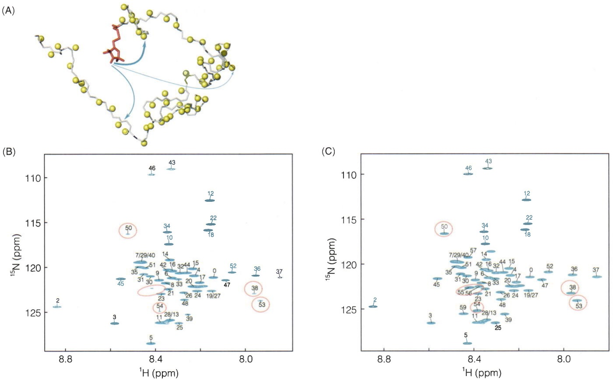

图 5-26 PRE 实验的原理

（A）在C端59号位氨基酸残基连接了MTSL顺磁探针（红色）的变性drkN SH3蛋白。黄色小球代表各个残基上主链氨基的氢原子。（B）

标记有MTSL的蛋白质的HSQC谱。（C）顺磁探针被还原后的蛋白质的HSQC谱。虚线红圈指示了由于PRE效应在顺磁标记附近出现的谱峰展宽效应。

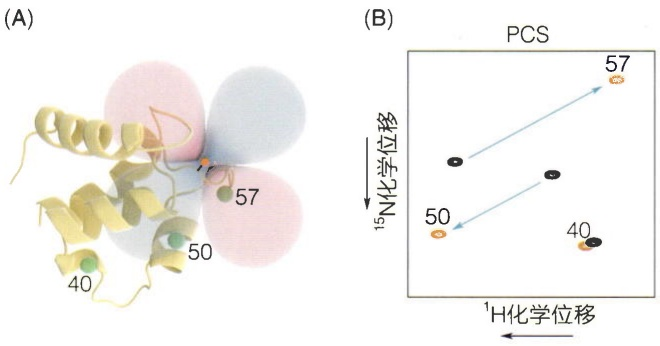

图 5-27 PCS 实验的原理

（A）标记有顺磁金属离子探针（橙色小圆点）的蛋白质分子。浅红色和浅蓝色阴影区域代表顺磁金属离子的PCS各向异性张量，浅红色区域中的蛋白质残基将产生负的化学位移改变，浅蓝色区域中的残基将产生正的化学位移改变。改变值与所测残基（绿色小球）到顺磁中心距离的三次方成反比。（B）NH-HSQC谱在蛋白质加载了顺磁金属离子（黑色谱峰）与加载了逆磁金属离子（橙色谱峰）这两种情况下的变化。

见25.1.3节）互相抵消，显著减小了 $R_{2}$，使谱峰更加尖锐。通过氘代和TROSY方法的联合使用，对很多超过 $100\mathrm{kDa}$ 的蛋白质也可以得到高质量的核磁谱。可测蛋白质分子量的上限还可以通过对甲基的观测来进一步提升，即采用氘代和Methyl-TROSY方法联用的策略。利用这种策略，甚至有些分子量在 $1000\mathrm{kDa}$ 左右的蛋白质也可以被成功测量。

$^{19}$ F 核磁共振实验近年来发展非常迅速，已成为核磁共振研究的前沿领域之一。 $^{19}$ F 用于核磁测量有多个优点: $^{19}$ F 的灵敏度仅次于  ${}^{1}$ H，可达到  ${}^{1}$ H 的 83.4%； $^{19}$ F 的化学位移范围分布很广，且对生物大分子的构象以及所处环境非常敏感；天然生物样品中没有  ${}^{19}$ F，因此仅在标记位点上产生核磁谱峰，这意味着无须进行费时费力的化学位移归属，大大简化了实验操作和谱

---

5.4 核磁共振在结构研究中的应用

161

图分析；最后，${}^{19}\mathrm{F}$ 通常仅需采集一维谱，对样品的需求量较少，可以应用在真核表达的蛋白质样品上，而且对分子量很大的样品也比较容易检出信号。

## 5.4.4 化学交换

在本小节的最后，我们介绍一种在核磁共振中很重要的现象:化学交换（chemical exchange）。核磁共振中的化学交换指的是由于分子发生化学反应或者构象来回切换，导致部分原子核所处的化学环境也在不断地交换。化学交换可以用下面的反应方程式表示:

$$
\mathrm{A} \xrightarrow [ k _ {- 1} ]{k _ {1}} \mathrm{B}, \tag {5-13}
$$

其中 $k_{1}$ 和 $k_{-1}$ 分别为正向反应和逆向反应的速率常数。我们把化学交换的速率记作 $k_{\mathrm{ex}}$ （以 $\mathrm{s}^{-1}$ 为单位），$k_{\mathrm{ex}} = k_{1} + k_{-1}$，原子核在两种状态下的化学位移之差记作 $\Delta \omega$ （以rad/s为单位）。根据 $k_{\mathrm{ex}}$ 与 $\Delta \omega$ 之间的相对大小，可以把化学交换分为慢交换（slow exchange；$k_{\mathrm{ex}} \ll \Delta \omega$）、中速交换（intermediate exchange；$k_{\mathrm{ex}} \sim \Delta \omega$）和快交换（fast exchange；$k_{\mathrm{ex}} \gg \Delta \omega$）。化学交换的速率直接影响到谱峰的强度和形状，如图5-28所示。

上图所示的化学交换对谱峰的影响可以用两态模型直观地解释。在式（5-13）中，原子核在A和B两个状态有不同的化学位移，即它们进动的频率不同，可以用“走”和“跑”两种状态代表（图5-29A）。假设样品有数量众多的原子核都从同一位置一起出发，在不同的交换速率下，将产生不同数量和形状的谱峰（图5-29B）。

在化学交换下核磁谱峰的数值模拟可以通过 Bloch-McConnell化学交换由两个甲基如图示绕着C—N键转动所导致，温度越高，转动越快。自上而下是温度逐渐升高时在一维氢谱的甲基区域观察到的谱峰。

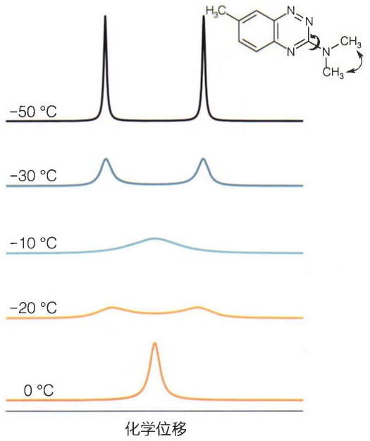

line

| Temperature \(({}^{\circ}C)\) | Peak Position (Relative Intensity) |
| --- | --- |
| -50 | High |
| -30 | Medium |
| -10 | Low |
| -20 | Low |
| 0 | High |

图5-28 Azapropazone衍生物的两个甲基在化学交换下的谱峰

(A)

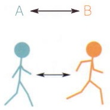

(B)

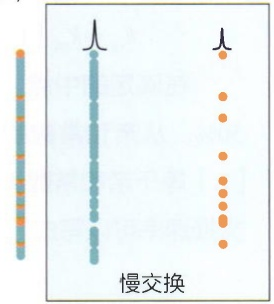

text_image

慢交换

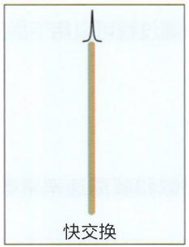

text_image

快交换

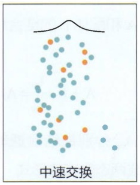

text_image

中速交换

图 5-29 两态模型对化学交换现象的解释

（A）原子核在化学交换下的两个状态可以用“走”（蓝色）和“跑”（橙色）代表。（B）慢交换的情形下，在核磁检测过程中两种状态不发生切换，最后产生两个尖锐的谱峰；快交换的情形下，两种状态的切换快到无法区分，每个原子核都以同样的平均速度移动，将产生一个尖锐的谱峰；中速交换的情形下，每个原子核在检测过程中随机发生多次“走”和“跑”的切换，导致谱峰明显展宽。

---

162

5 核磁共振

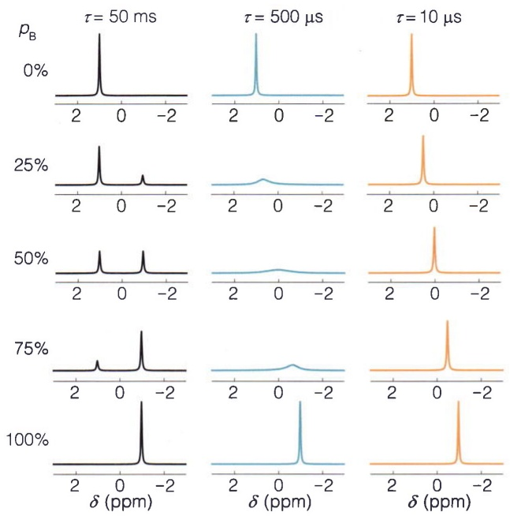

spectrogram

| \(\tau (\)ms) | Peak Position (ppm) |
| --- | --- |
| 50 | ~ -1.2, ~ -0.8, ~ -1.0 |
| 500 | ~ -1.2, ~ -0.8, ~ -1.0 |
| 10 | ~ -1.2, ~ -0.8, ~ -1.0 |
| 50 | ~ -1.2, ~ -0.8, ~ -1.0 |
| 75 | ~ -1.2, ~ -0.8, ~ -1.0 |
| 100 | ~ -1.2, ~ -0.8, ~ -1.0 |

图5-30 不同比例的两种状态在慢交换（左）、中速交换（中）和快交换（右）三种情形下产生的 $600\mathrm{MHz}$ 核磁仪的模拟谱峰

方程来完成。图5-30展示了A和B在不同比例下快交换、中速交换和慢交换产生的谱峰，其中 $p_{\mathrm{B}}$ 代表状态B的占比， $\tau = 1 / k_{\mathrm{ex}}$ 代表化学交换的特征时间。由此可见，在发生中速交换时，核磁谱峰会产生严重的展宽现象。

值得注意的是，测量生物大分子和配体结合的核磁滴定实验（类似图5-22，但配体浓度逐渐加大）也属于化学交换现象。在滴定过程中，生物大分子在自由态和结合态之间不断交换。两种状态的交换速率与结合常数有很大关系（知识窗5-9）。如果生物大分子和配体结合比较弱，那么生物大分子的自由态和结合态的切换通常属于快交换；如果结合比较强，那么切换将转变为中速交换；如果结合非常强，就会进入慢交换的范围。

在三种交换速率下，滴定实验中核磁谱峰的变化可以从图5-30每一列中自上而下清楚地看到。在慢交换下，自由态的谱峰逐渐降低，同时在一个新的位置上结合态的谱峰出现并逐渐增高，在整个过程中不发生谱峰的偏移。在快交换下，自由态谱峰连续过渡到结合态的

位置，在此过程中峰高变化不大。在中速交换下，谱峰从自由态移向结合态，同时谱峰很快地发生展宽，伴随着峰高的迅速降低。在结合的中点，谱峰甚至会展宽到检测不到，直至滴定朝着终点发展才逐渐恢复。

## 知识窗5-9

## 滴定实验中化学交换速率与亲和常数的关系

蛋白质 A 和配体 L 的结合和解离过程可以用下面的反应式表示:

$$
\mathrm{A} + \mathrm{L} \xrightarrow [ k _ {\mathrm{off}} ]{k _ {\mathrm{on}}} \mathrm{AL},
$$

其中， $k_{on}$  和  $k_{off}$  分别是结合速率常数和解离速率常数。如果将其写成两态反应的形式

$$
\mathrm{A} \xrightarrow [ k _ {\mathrm{off}} ]{k _ {\mathrm{on}} [ \mathrm{L} ]} \mathrm{AL},
$$

那么化学交换速率就是

$$
k _ {\mathrm{ex}} = k _ {\mathrm{on}} [ \mathrm{L} ] + k _ {\mathrm{off}} = k _ {\mathrm{off}} ([ \mathrm{L} ] / K _ {\mathrm{D}} + 1) 。
$$

在滴定的中点，自由态和结合态的生物大分子各占$50\%$ 。从亲和常数的定义出发，容易推出此时配体浓度[L]等于亲和常数 $K_{\mathrm{D}}$ 。因此，当滴定达到中点时，化学交换速率可以写成

$$
k _ {\mathrm{ex}} = 2 k _ {\mathrm{off}} = 2 k _ {\mathrm{on}} K _ {\mathrm{D}} \circ
$$

由此可见，此时的交换速率与解离速率  $k_{off}$  成正比，也大体上与亲和常数  $K_{D}$  成正比（结合速率  $k_{on}$  往往被生物大分子与配体间的扩散过程所限定，其值相对稳定）。

---

扩展阅读

163

## ※ 本章小结

核磁共振是生物大分子结构解析的常用方法，受限于分子量增大带来的谱峰展宽和谱峰重叠问题，一般用于解析 $30\mathrm{kDa}$ 以内的蛋白质、核酸以及它们的复合物。除了结构解析方面的应用，核磁共振波谱学还经常用于分析生物分子的动态行为，例如配体-受体的结合和解离、固有无序蛋白的结构特征以及生物大分子在多个构象之间的转换。随着TROSY脉冲序列的出现、同位素标记方法的进步以及 ${}^{19}\mathrm{F}$ NMR的兴起，核磁的构象动态测量已经可以拓展到分子量达数百kDa的生物大分子。

本章仅提供了核磁共振的入门知识，想要了解核磁脉冲序列的原理，或者如何运用核磁共振来洞察生物大分子的构象动态，请继续阅读第25章。在那里我们将介绍核磁共振的量子描述，并讲解研究生物大分子动态特性的常用核磁方法。

除了本书介绍的液态核磁共振技术，核磁方法的大家庭中还包括固态核磁共振和磁共振成像。固态核磁虽然在谱图质量上逊于液态核磁，但其谱峰不随分子量的增大而展宽，因而在膜蛋白、淀粉样蛋白纤维以及其它蛋白质聚集物的结构研究上有独到优势。磁共振成像与液态核磁共振的原理类似，但通过施加梯度场，获得了在三维空间对水峰信号成像的能力，在医疗检测上应用极广。感兴趣的读者请参考“扩展阅读”里的相关书籍和文献。

## ※ 思考题

1. 对于自旋量子数为 $1/2$ 的原子核，其磁矩分布在与磁场方向呈约 $54.7^{\circ}$ 的上下两个锥面上。如果是自旋量子数为 1 的原子核，其磁矩在空间中将如何分布？
2. 化学位移如果以赫兹（Hz）为单位，那么其值与磁感应强度成正比；而J耦合常数（单位是 $\mathrm{Hz}$ ）却与磁感应强度无关。请从化学位移和J耦合产生的原理给予解释。
3. 在生物大分子的一维氢谱中，通常把谱图中心设在水峰的位置，常温下约为 $4.77\mathrm{ppm}$；而蛋白质主链酰氨基的谱峰分布大致以 $8\mathrm{ppm}$ 为中心。请计算在 $800\mathrm{MHz}$ 核磁仪中，水峰与酰胺基中心区域相差多少赫兹。
4. 请简要概述核磁共振方法解析蛋白质结构的流程，并思考在什么场景下适合选择该方法表征或解析生物大分子的结构。

## ※ 扩展阅读

图书

张家海，夏佑林，龚庆国，等.核磁共振原理及其应用[M].合肥:中国科学技术大学出版社，2022.

Hore P J. Nuclear magnetic resonance[M]. Oxford: Oxford University Press, 1995.

Keeler J. Understanding NMR spectroscopy[M]. 2nd ed. Chichester: Wiley, 2010.

---

164

5 核磁共振

Levitt M H. Spin dynamics: basics of nuclear magnetic resonance[M]. 2nd ed. Chichester: Wiley, 2001.

Rule G S, Hitchens T K. Fundamentals of protein NMR spectroscopy[M]. Dordrecht: Springer, 2006.

Wüthrich K. NMR of proteins and nucleic acids[M]. New York: Wiley-Interscience, 1986.

## 综述

Varani G, Aboul-ela F, Allain F H-T. NMR investigation of RNA structure[J]. Prog Nucl Magn Reson Spectrosc, 1996, 29(1/2):51–127.
