# 11 生物大分子的力学

原始 PDF 第 345–372 页。

# 生物大分子的力学

力是在生物体不同层次（分子、细胞、组织、器官）都起着重要作用的物理量。各种生命过程，如物质输运、细胞分裂、细胞迁移等，都伴随着力并受其影响。生物体内，力可以通过拉伸、挤压、扭转、流动等不同方式体现，不同的生物大分子在各自生理环境中可以产生、感知或响应这些力的作用。一方面，细胞内存在多种马达分子，可以水解ATP并把其储存的化学能转化为机械能，从而产生力。如肌肉收缩是由分子马达肌球蛋白产生的力所介导的。另一方面，细胞内也存在形形色色的感受力的分子，这些分子可以在力的作用下改变其构象状态，从而行使其生物学功能。如机械门控离子通道，可以在外部压力或者膜张力的作用下转换到开放状态，打开通道使离子能够通过，传递信号或者调节细胞内外离子浓度的平衡。在本章的四个小节中，我们将讨论细胞中力的产生、力对生物大分子以及分子间相互作用的影响，以及感应力的力学受体。

11

---

322

11 生物大分子的力学

## 11.1 生物体中产生力的大分子及其生物学过程

细胞中存在多种分子马达，这些分子马达是负责细胞运动或者细胞中物质运输的蛋白质分子，生物个体以及体内各种组织、器官的宏观运动都是微观尺度上分子马达等蛋白质运动的体现。分子马达主要包括细胞骨架相关的分子马达、转动分子马达以及核酸相关的分子马达等，其主要作用是将化学能转化为机械能，通过分子的构象变化产生运动。不同分子马达可能通过不同的机制产生力，如肌球蛋白（myosin）、驱动蛋白（kinesin）和动力蛋白（dynein）等细胞骨架分子马达通过水解ATP释放能量而产生运动所需的驱动力。这些分子马达通过保守的结合位点结合ATP，在ATP水解过程中，结合位点附近发生构象变化并传递到负责运动的区域，从而在细胞骨架上行走。而跨膜的分子马达ATP酶（ATPase）在膜上的转动则是利用细胞膜或线粒体膜内外的电化学梯度。

除分子马达外，有些其它分子在聚合或者彼此结合时也会在细胞内产生力的作用。如肌动蛋白（actin）和微管蛋白（tubulin）聚合成微丝和微管的过程，会水解ATP或GTP并产生力引起细胞的迁移或爬行运动。

细胞骨架（主要包括微丝、微管、中间丝）以及细胞骨架分子马达是细胞各种生命活动最重要的驱动力来源之一，其结构及功能特性将在第14章中详述。本节将主要讨论细胞内其它类型的力产生分子:转动分子马达以及几种典型的核酸相关ATP酶。

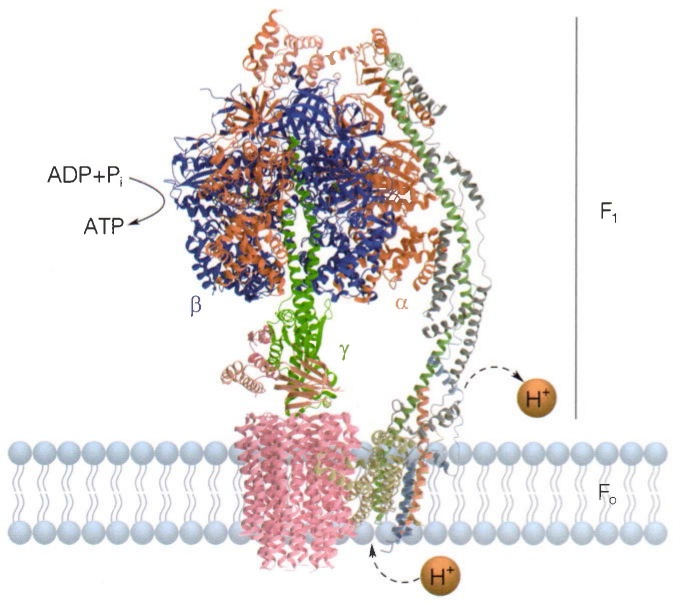

chemical

Molecular interaction diagram showing protein-ligand binding with ATP, ADP+Pi, H+, and F1/Fp components

图 11-1  $F_{0}/F_{1}$  ATP 合酶结构示意图

所显示的是由冷冻电镜方法解析的酵母菌 ATP 合酶单体结构（PDB 编号:6CP6）。不同颜色表示构成该 ATP 合酶的不同亚基，其中  $F_{1}$  部分的  $\alpha$ 、 $\beta$  和  $\gamma$  亚基作了标示。

## 11.1.1 转动分子马达

由细胞骨架分子马达产生的力是牵拉力，具有确定的方向（见第14章）。在细胞中，也存在产生旋转力的分子马达。旋转力将引起扭矩（知识窗11-1），在一些生物学过程中起着重要作用。

$\mathrm{F_o / F_1}$ ATP合酶就是一种转动分子马达，它位于细胞膜、线粒体内膜等膜上，利用电化学质子的梯度合成ATP。这一分子马达包含两个可逆的旋转马达 $\mathrm{F_o}$ 和$\mathrm{F_1}$，二者由中心轴连接在一起（图11-1）。 $\mathrm{F_1}$ 马达上的三个β亚基是直接参与ATP结合的主要位点，每个β亚基可以处于不同的催化状态:开放（空）、半开放（与ADP和 $\mathrm{P_i}$ 结合）和封闭（与ATP结合）。这三个β亚基在任何给定的时间点都处于这三种状态之一。 $\mathrm{F_1}$ 马达可以利用ATP的水解产生旋转扭矩，而$\mathrm{F_o}$ 马达利用质子梯度驱动的跨膜力产生相反方向的旋转扭矩。大肠杆菌 $\mathrm{F_o / F_1}$ ATP合酶的平均扭矩约为

---

11.1 生物体中产生力的大分子及其生物学过程

323

## 知识窗11-1

## 扭矩

扭矩（torque）是使物体围绕一个轴进行旋转运动的力所产生的效应的量度，它是一个矢量，能够使物体获得角加速度（即单位时间内转动角度的增加速度）。

如右图所示:

$$
\boldsymbol {M} = \boldsymbol {F} \times \boldsymbol {L}
$$

其中 M 为扭矩，F 为作用力，L 为力作用位点与旋转轴之间的距离矢量。扭矩的单位是 N·m。

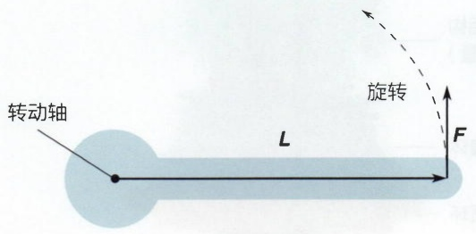

text_image

转动轴
旋转
L
F

$56\mathrm{pN}\cdot \mathrm{nm}$ 。当 $\mathrm{F_0}$ 马达占优势时，可以反向驱动 $\mathrm{F_1}$ 马达，从而促进ATP合成。而当$\mathrm{F_1}$ 马达占优势时，则反向驱动 $\mathrm{F_0}$ 马达，在膜两侧泵送质子从而建立电化学梯度。在每个完整的ATP水解或合成周期内，会有三个ATP分子被处理，每个ATP分子对应$\mathrm{F_1}$ 马达 $\gamma$ 亚基大约 $120^{\circ}$ 的旋转，因此每个周期 $\gamma$ 亚基大约旋转 $360^{\circ}$ 。研究表明，在高浓度ATP条件下， $\mathrm{F_1}$ 马达可以产生 $30~\mathrm{r / s}$ 的旋转速度。

细菌鞭毛是细菌的运动装置，赋予了细菌超强的游动能力，最快能够每秒游动自身身长100倍以上的距离。细菌鞭毛在细菌致病、环境生存以及生物被膜形成等过程中发挥了关键的作用，大约 $70\%$ 的细菌具有一根或者多根鞭毛。鞭毛由鞭毛马达、接头装置和鞭毛丝三部分组成，其中鞭毛马达是其最复杂的组成成分，由20多个蛋白质组成，是个巨大的蛋白质纳米机器，分子量可达 $10^{7}\mathrm{Da}$ 以上。细菌鞭毛马达可以进行双方向的旋转，包括逆时针方向和顺时针方向的旋转，旋转速度可达$200\sim 2000~\mathrm{r / s}$ 。与 $\mathrm{F_o / F_1}$ ATP合酶类似，鞭毛马达利用定子的质子泵MotAB，将化学能转化为机械能，然后高效传递扭矩给接头，进而传递给鞭毛丝，促使鞭毛丝像螺旋桨一样推动细菌向前游动。已解析的鞭毛马达结构显示（图11-2），鞭毛马达的胞质环（Cring）结合质子泵，将扭矩传输给内膜环（MS ring），并负责调节旋转方向的转变。内膜环与鞭毛马达的联动杆相互作用，通过共11个来自不同FliF亚基的肽段结构（L1、L2和L3）结合到联动杆表面，联动杆的FlgB和FliE的N端区域结合到内膜环的桶状结构区域，从而实现扭矩从内膜环传输到联动杆。鞭毛马达利用外膜-周质环的静电吸引和排斥作用以及氢键网络的特殊结构，保证高速转动的联动杆稳定性，并实现低能量损耗，使扭矩高效传输给鞭毛丝。当鞭毛马达逆时针旋转时，推动细菌向前游动，但胞质环结合磷酸化的信号分子CheY后，使得鞭毛马达从逆时针转变为顺时针旋转，改变细菌游动方向，从而实现转弯过程。

---

324

11 生物大分子的力学

(A)

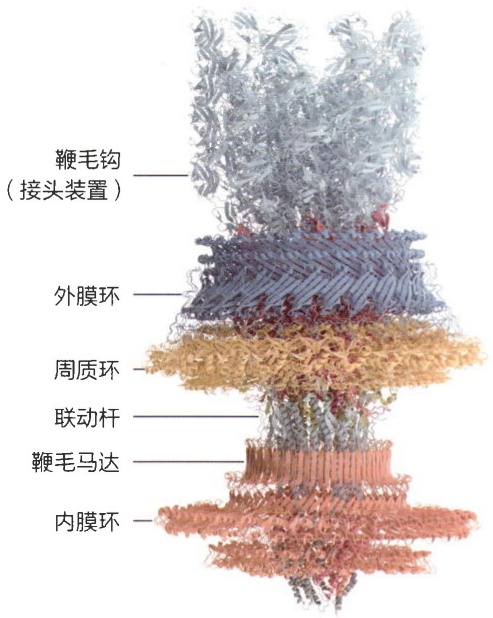

text_image

鞭毛钩
(接头装置)
外膜环
周质环
联动杆
鞭毛马达
内膜环

(B)

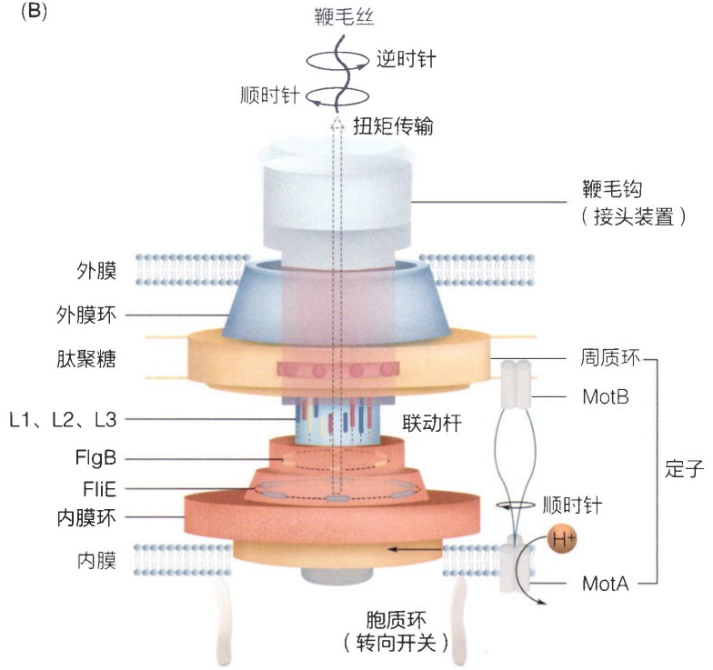

text_image

(B)
鞭毛丝
逆时针
顺时针
扭矩传输
鞭毛钩
(接头装置)
外膜
外膜环
肽聚糖
L1、L2、L3
FlgB
FliE
内膜环
内膜
联动杆
周质环
MotB
定子
顺时针
H+
MotA
胞质环
(转向开关)

图11-2 细菌鞭毛马达的结构与扭矩传输机制

（A）细菌鞭毛马达（不含胞质环）的冷冻电镜结构（PDB编号:7CG0）。（B）细菌鞭毛马达扭矩传输机制模式图。鞭毛马达定子部分的质子泵MotAB负责产生扭矩，MotAB能与胞质环结合，将扭矩沿水平方向传给内膜环。内膜环通过结合在联动杆上的L1、L2和L3肽段结构以及结合在内膜环上的联动杆FliE和FlgB亚基的N端区域，

将扭矩传给联动杆。联动杆随后通过与接头装置的紧密管状连接方式，将扭矩沿竖直方向传输给接头装置，进而传输给鞭毛丝，驱动鞭毛丝高速转动。L1、L2和L3肽段结构分别标记为蓝、红和黄色。结合在内膜环上的FliE和FlgB分别标记为虚线连接的环。（本图及相关文字由朱永群提供）

## 11.1.2 其它类型的 ATP 酶

除上述介绍的ATP合酶外，细胞内还含有形形色色的核苷酶。这些核苷酶通过将高能量的NTP水解成NDP和无机磷酸（$\mathrm{P_i}$），释放所储存的能量，这些能量可以被细胞用于执行各种需要能量的生物化学反应和生理活动，其中部分ATP酶可以将这些能量转化为机械能，帮助各种核酸或蛋白质完成其功能。

核酸是生命体的重要组成分子，在细胞的生命周期中，存在多种多样的核酸参与的过程，包括复制、转录、包装等。细胞中也存在多种分子马达来协助实现这些过程。

细胞内基因组DNA双链以双螺旋形式存在，在DNA转录、复制过程中需要先进行双链的解旋。解旋酶是负责解旋双链（包括DNA双链、RNA双链以及DNA-RNA杂合双链）的分子马达，其解旋运动是由水解ATP的能量所驱动的，ATP水解所释放的能量用于破坏氢键以及碱基堆积等作用从而分离核酸双链碱基配对，并用于维持解旋酶在核酸底物上的单向运动（图11-3）。自然界中，解旋酶可以被划分为6个

---

11.1 生物体中产生力的大分子及其生物学过程

325

超家族，其中超家族1（SF1）和超家族2（SF2）存在广泛并且大多数以单体形式行使功能；其它解旋酶家族则形成六聚体。大部分解旋酶的移动方向是 $5^{\prime} \rightarrow 3^{\prime}$，也存在少数 $3^{\prime} \rightarrow 5^{\prime}$ 方向移动的解旋酶。在解旋酶将双链DNA解旋成单链后，DNA聚合酶能够以单链为模板完成DNA的复制，RNA聚合酶能够以单链为模板转录生成RNA。DNA聚合酶和RNA聚合酶在DNA上的定向运动也是依靠水解ATP的能量来驱动的。

自然界也需要能够对双链DNA进行移位操作的分子机器。病毒DNA包装马达就具有这样的功能，这种分子马达可以把病毒基因组双链DNA包装到病毒颗粒中，从而协助完成病毒的复制周期。在这类分子马达中，噬菌体 $\varphi 29$ 的DNA包装马达被广泛研究。该分子马达属于ATP酶，形成浅蓝色显示的是SF1家族解旋酶Dda（PDB编号:3UPU），该解旋酶沿浅蓝色DNA链的 $5^{\prime}\rightarrow 3^{\prime}$ 方向进行解旋，黄色表示DNA互补链。

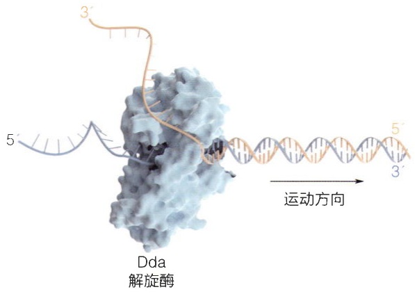

text_image

Dda
解旋酶
运动方向
5'
3'
5'

图11-3 解旋酶解旋双链DNA示意图

同源五聚体结构（图11-4A、B），在将DNA包装进入噬菌体衣壳的过程中，能够实现平均约 $40\mathrm{nm / s}$ 的包装速度。研究表明，病毒包装可以用一个尺蠖（inchworm）运动模型来描述（图11-4C）在每一次循环中，包装马达的5个亚基并不是等价的；每次循环中，包装马达会有一个随机选择的特殊亚基作为本次循环的控制和指挥者，该

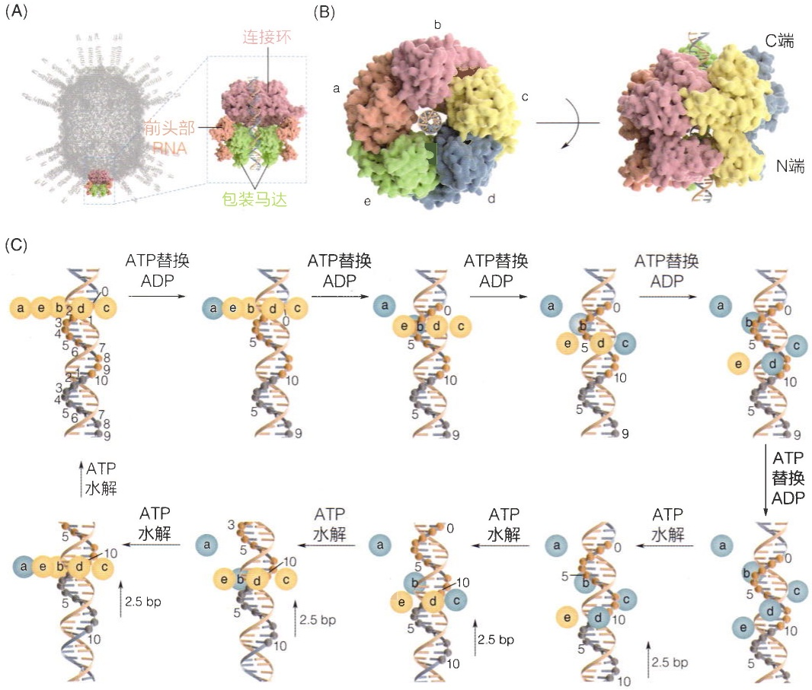

图11-4 噬菌体 $\varphi 29$ 的DNA包装马达工作模型

（A）噬菌体 $\varphi 29$ 衣壳及DNA包装复合物示意图（PDB编号:6QZ0，6QYM，7JQQ）。  
（B）包装马达的结构，包装马达为五聚体，分别用不同颜色显示（PDB编号:7JQQ）。(C) DNA包装的尺蠖运动模型。双链DNA分别用蓝色和橙色带状表示，橙色DNA链上分别标记了碱基顺序；由a、b、c、d、e标记的大球表示包装分子马达，黄色表示ADP结合状态，而蓝色表示ATP结合状态。

---

326

11 生物大分子的力学

亚基上结合的ATP水解并不会提供包装DNA的拉力，而另外4个亚基是机械元件，负责提供包装DNA的力。特殊亚基上ATP的水解引起另外4个亚基依次进行ATP水解，当衣壳内DNA填充较少时，每个ATP水解的能量能够实现 $2.5\mathrm{bp}$ （约 $0.85\mathrm{nm}$ ）的双链DNA被包装进入衣壳。因此，每个水解周期中，共 $10\mathrm{bp}$ 的DNA被包装进衣壳，与DNA双螺旋的周期长度 $10.4\mathrm{bp}$ 接近；而当衣壳内DNA填充较满时，负电性增强，排斥作用增大，需要更多的能量才能继续填充，此时，每个水解周期被包装进衣壳的DNA长度将减少。

噬菌体 $\varphi 29$ 的DNA包装马达属于ASCE（additional strand conserved E）家族蛋白，该类蛋白质在结构上与AAA ATP酶家族蛋白具有一定的相似性。AAA家族蛋白（ATPases associated with various activities）是一个广泛分布于所有生物域（细菌、古菌和真核生物）的蛋白质超家族。这些蛋白质共享一个保守的AAA结构域，该结构域包含 $200\sim 300$ 个氨基酸残基，负责ATP的结合和水解。AAA蛋白通过其ATP酶活性参与到多种基本的细胞过程中，如参与蛋白质质量控制，识别错误折叠蛋白，将其解聚并靶向至蛋白酶体进行降解或修复26S蛋白酶体的Rpt亚基和ClpXP复合物等，以及在囊泡形成、融合和分裂过程中分解SNARE复合物的NSF复合物等。

正如上面介绍的DNA包装马达，AAA蛋白通常以多聚体形式存在，形成环状结构，围绕其底物工作，利用ATP水解释放的能量产生机械运动。AAA家族蛋白的多聚体状态不是固定的，而是根据其执行的具体生物功能而改变。大多数AAA蛋白以六聚体形式发挥作用，也存在其它可能聚集状态，如噬菌体 $\varphi 29$ 的DNA包装马达的五聚体。

## 11.2 生物大分子的力学特性

分子马达或其它能够产生力的分子介导了生命体的各种宏观或微观运动行为。微观层次上，这些生命体内部产生的力以及其它各种外部施加的力影响着生命体内各种大分子和大分子间的相互作用。

蛋白质、核酸和多糖等生物大分子在本质上都属于高聚物，核酸链和蛋白质链都呈线性，多糖可以具有线性或分支状结构。在细胞行使正常功能的过程中，这些生物大分子承受着各种各样力的作用，因此它们的力学性质与行为对于理解生物体的结构、功能和生理过程至关重要。本节将探讨生物大分子的力学性质，包括弹性、塑性和断裂等，以及其在生物力学领域的应用。

由于力的基本属性，受力作用的生物大分子也会把力传递给与之相互作用的其它分子或分子复合物。在这一角度上，力可以作为一个信号在分子之间进行传导，这种力传导具有非常高的传递速度，远高于需要发生化学反应的信号转导过程。

力可以诱导分子发生构象变化，使其从一种状态转变为另一种状态。例如，力可以使蛋白质从折叠状态转变为部分折叠或完全展开的状态，或者使核酸的双螺旋结构

---

11.2 生物大分子的力学特性

327

变为单链结构。即使在不改变结构状态的情况下，力也对生物大分子的可能构象产生限制，从而影响该分子和溶液环境中其它分子的相互作用。力也可以作为一种信号，通过影响分子的构象和相互作用来调控细胞的信号转导。例如，力可以触发细胞黏着斑（focal adhesion）的形成，引发细胞内的信号通路。在整合素介导的力学转导通路中，力可以使整合素胞外结构域保持在配体的高亲和力状态，也可以使细胞黏附蛋白踝蛋白（talin）暴露出与黏着斑蛋白（vinculin）结合的位点。此外，由于力可以引起生物大分子发生构象变化，可以将本来包埋在结构内部的反应位点或者结合位点暴露出来，使相应的反应能够进行或者可以结合其它的生物大分子。Notch 分子也可以在受力时暴露酶切位点，从而被细胞表面的蛋白酶剪切。力也可以使血管性血友病因子（von Willebrand factor）暴露出被 ADAMTS13 酶切割的位点。在细胞内产生力的很多过程中，力随时间的变化速率大约在皮牛每秒（pN/s）量级。在这个力变化速率范围内，在很多情况下，力诱导的分子构象变化和相互作用变化对应的力范围大约在数皮牛（pN）到数十皮牛范围。在单个分子传力通道上，力传递的时间尺度在很多情况下，一般在秒到分钟范围。

生物大分子的力学性质与行为在多个领域中具有重要应用价值。首先，它们对于理解生物体的结构与功能提供了关键信息。通过研究生物大分子的弹性性质，可以揭示其在生物体内的作用和相互作用。其次，生物大分子的力学性质对于生物材料设计和仿生工程具有重要意义。通过了解生物大分子的弹性和断裂行为，可以设计出具有特定力学性能的生物材料，如生物支架、人工关节等。此外，生物大分子的力学行为还在药物设计、基因调控和蛋白质工程等领域中得到广泛应用。

## 11.2.1 线性高聚物分子的力学拉伸理论

不同的生物高聚物可以具有非常不同的分子结构，因此在热力学的影响下这些高聚物将具有非常不同的弯曲和卷曲趋势。考虑一条长度约为 $10\mu \mathrm{m}$ 的微管，如果抓住它的两端将其拉直，然后在室温下将其释放到溶液中，可以看到微管仍会维持线性的杆状结构。但如果对长度为 $10\mu \mathrm{m}$ 的双链DNA链进行同样的处理，则会看到DNA链将不会维持力作用下的杆状结构，而是将呈现复杂的结构，链上形成许多起伏。而如果对长度仅为 $10\mathrm{nm}$ 的双链DNA进行同样处理，则会看到杆状结构会得到维持。因此，对于较长的线性高聚物分子，需要用两个参量进行表述:轮廓长度（contour length）$L$ 和持续长度（persistence length）$\xi_{\mathrm{p}}$ 。其中轮廓长度是指线性分子链处于直线伸展状态时的长度，而持续长度是线性链在链长方向关联函数的量度，可以近似地认为是在自然状态下线性分子能够维持直线伸展状态的长度。在实际分析中，可以采用不同的近似模型来描述线性链并分析其在力作用下的性质，如自由连接链模型和蠕虫状链模型等，这两种模型也是分析生物大分子及其力学性质中最常采用的模型。在分析高聚物的力学行为时，模型的适当选择在很大程度上取决于该力学行为是由能量变化引起的还是由熵变化所引起的。

---

328

11 生物大分子的力学

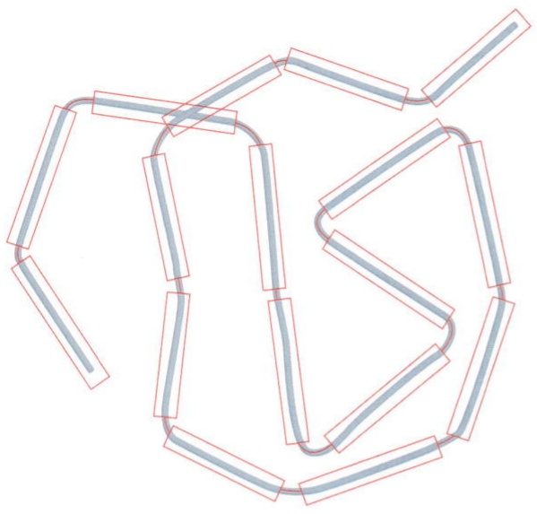

natural_image

Abstract geometric line pattern composed of interconnected rectangles and lines, no text or symbols present

图11-5 自由连接链模型

线性高分子（浅蓝色）在自由状态下呈现卷曲的构型。在自由连接链模型中，可以把高分子分割成多个长度为 $b$ 的片段（橙色），相邻片段之间可以自由转动。

## (1) 自由连接链模型

自由连接链模型（freely-jointed chain model）是一种基本且非常有用的模型，它以其简洁和直观的方式描述了聚合物链的主要特性。在自由连接链模型中，聚合物链被看作是由一系列等长的线段（也称为“键”）构成的链，这些线段或键在各自的连接点上可以自由旋转，不存在任何限制。因此，这种模型中的聚合物链可以在三维空间中自由地变化形状，形成各种各样的构象。

如图11-5所示，自由连接链模型的关键参数有两个，即键的数量（$N$）和每个键的长度（$b$），$b$ 也被称为库恩（Kuhn）长度。键的数量相当于聚合物链中的单体数量，每个键的长度则代表了相邻单体之间的平均距离。在自由连接链模型中，聚合物链的总长度（$L$）可以被看作是键的数量（$N$）和每个键的长度（$b$）的乘积，即 $L = N \times b$。自由连接链模型可以预测聚合物链的一些基本性质，如端到端距离和链的柔性。端到端距离 $X$ 指的是聚合物链两个端点之间的距离。

由于聚合物形态的无规则性，自由连接链模型中 $X$ 的值是随机的，其分布可以由高斯分布描述:

$$
\rho (X) = \left(\frac {3}{2 \pi N b ^ {2}}\right) ^ {\frac {3}{2}} \mathrm{e} ^ {- \frac {3 X ^ {2}}{2 N b ^ {2}}}, \tag {11-1}
$$

因此，在自由连接链模型中，自由状态下一个聚合物链端到端距离在 $X = 0$ 处概率最大，而方均距离 $\langle X^2\rangle = N\times b^2 = Lb$。

当一个自由连接链受到拉伸力 F 时，链的端到端距离 X 会增加，X 的平均值  $\langle X \rangle$  随力 F 的变化关系符合公式:

$$
\langle X \rangle = L \left(\coth \frac {F b}{k _ {\mathrm{B}} T} - \frac {k _ {\mathrm{B}} T}{F b}\right), \tag {11-2}
$$

其中， $k_{\mathrm{B}}$ 是玻尔兹曼常量， $T$ 是温度。因此，在小的拉伸力下，有

$$
F = \frac {3 k _ {\mathrm{B}} T}{L b} \left\langle X \right\rangle , \tag {11-3}
$$

即聚合物链的端点距离 $\langle X\rangle$ 与施加的力成线性关系，遵循胡克定律，聚合物链表现为弹簧的行为。而在非常大的拉伸力下，链端点距离 $\langle X\rangle$ 将趋近于链轮廓长度 $L$ ，此时聚合物链将接近完全拉直状态，难以被进一步延伸。自由连接链模型中，链的弹性行为主要由熵驱动，这是因为当链被拉伸时，其可能的构象数量（也就是熵）会减少，而链会倾向于回到具有更高熵的未拉伸状态。这种由熵驱动的弹性行为被称为熵弹性。

## (2) 持续长度

自由连接链模型可以被应用于理解和描述聚合物链的物理性质。然而，它也存在

---

11.2 生物大分子的力学特性

329

一定的局限性，主要体现在它忽略了聚合物链中的体积排斥效应以及键间的相互作用，而这些在实际情况中往往是不能被忽视的。

平衡状态下相同长度的双链DNA和微管呈现不同构型状态，表明主导两者状态的因素不同。相对于微管，双链DNA柔性更强，在弯曲过程中弹性势能增加较少，熵的影响起着主要作用。而对于微管，刚性更强，弯曲时弹性势能快速增加，能量的影响更为明显。而持续性长度就是一个描述高聚物在热力学条件下柔韧性质的指标。持续长度是一个在高聚物物理中广泛使用的概念，用来描述链状高聚物自由度的尺度。在核酸和蛋白质等生物大分子的研究中，持续长度是一个重要的参数。持续长度可以理解为链在空间中自由弯曲的尺度，对于柔性聚合物，持续长度很短，对于刚性聚合物，持续长度则很长。

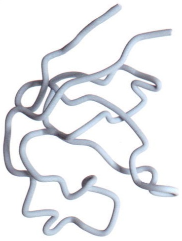

natural_image

Abstract 3D ribbon-like structure resembling a protein or molecular model (no text or symbols)

(A)

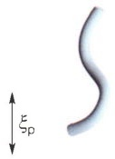

(B)

(C)

图11-6 持续长度是高聚物分子保持线性状态的最大长度（A）当线性分子的轮廓长度 $L$ 远超其持续长度 $\zeta_{\mathrm{p}}$ 时，将呈现卷曲的状态。（B）当 $L$ 与持续长度接近时，将接近线性状态。（C）当 $L$ 小于持续长度时，则将呈现较好的线性状态。

在数学上，持续长度 $\xi_{\mathrm{p}}$ 是指从高聚物链的任何一个点出发，沿链方向的切线不发生变化时的长度。因此，持续长度是高聚物链切线的关联长度。如图11-6所示，如果切线函数为 $t(x)$，则关联函数的形式为:

$$
G (\tau) = \langle t (0) t (\tau) \rangle = \mathrm{e} ^ {- \frac {\tau}{\xi_ {p}}} 。 \tag {11-4}
$$

而高聚物链两个端点间距离 $X$ 可以写成切线函数从一个端点沿高聚物链的积分，即

$$
X = \int_ {0} ^ {L} t (\tau) \mathrm{d} \tau_ {\circ} \tag {11-5}
$$

对于较长的高聚物链， $L\gg \xi_{\mathrm{p}}$ ，此时有

$$
\langle X ^ {2} \rangle = 2 L \xi_ {\mathrm{p}} \circ \tag {11-6}
$$

相比于自由连接链的情况，可以得到库恩长度 $b = 2\xi_{\mathrm{p}}$

持续长度受多种因素影响，包括环境条件（如温度、溶剂类型、离子强度等）、分子结构（如链长、链段刚性、侧链大小等）以及外部力等。例如，溶剂中的离子种类和浓度能显著影响DNA的持续长度，而外部力（如剪切力或拉伸力）可以改变高聚物链的构象，从而影响其持续长度。

持续长度的计算通常基于高聚物的构象统计，包括内部坐标模型、自由连接链模型等。持续长度是一个统计物理参数，它的计算通常需要大量的实验数据和理论模型。在许多情况下，持续长度可以通过光谱技术（如圆二色光谱）、小角散射技术（如小角X射线散射或小角中子散射）或者显微技术（如原子力显微镜）等获取的实验数据计算得出。

## (3) 蠕虫状链模型

蠕虫状链模型（worm-like chain model）是描述聚合物或高分子链特性的另一种理

---

330

11 生物大分子的力学

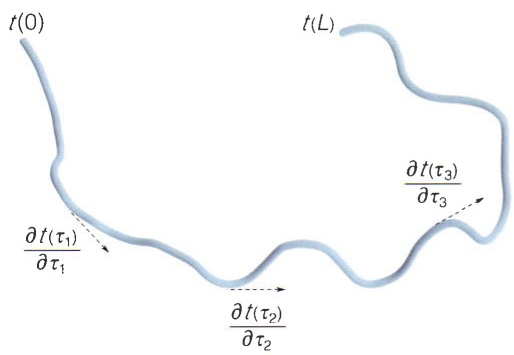

text_image

t(0)
∂t(τ₁)/∂τ₁
∂t(τ₂)/∂τ₂
∂t(τ₃)/∂τ₃
t(L)

图11-7 蠕虫状链模型

论模型，这种模型尤其适用于刚性或半刚性的高分子。在蠕虫状链模型中，聚合物被视为一条刚性或半刚性的“蠕虫”，在没有外力作用时，这条“蠕虫”可以在空间中随机弯曲，形成各种构象（图11-7）。持续长度是蠕虫状链模型的关键参数。

在力 $F$ 作用下，蠕虫状链模型端点距离 $X$ 可以表示成:

$$
\frac {F \xi_ {\mathrm{p}}}{k _ {\mathrm{B}} T} = \frac {\langle X \rangle}{L} + \frac {1}{4 \left(1 - \frac {\langle X \rangle}{L}\right) ^ {2}} - \frac {1}{4} 。 \tag {11-7}
$$

在较小的力时， $\langle X\rangle /L\ll 1$ ，力与拉伸长度的关系可简化为

$$
F = \left(\frac {3 k _ {\mathrm{B}} T}{2 L \xi_ {\mathrm{p}}}\right) \langle X \rangle , \tag {11-8}
$$

即与自由连接链模型一样也遵循胡克定律。

蠕虫状链模型广泛应用于生物物理学，尤其是DNA、RNA和蛋白质等生物大分子的研究中。然而，该模型的局限性在于它只能描述高分子的一维弯曲行为，并且假设高分子链内部的相互作用可以被忽略。对于某些特定的高分子，比如具有特殊链结构或者在高浓度溶液中的高分子，可能需要采用其它更复杂的模型。

## 11.2.2 核酸分子的力学特性

双链核酸（DNA 和 RNA）的柔性对其生物学功能有重要影响，而它们的柔性状况也受到受力方式（如拉伸或扭转）的影响。目前单分子力谱（参见 27.4 节）、分子动力学模拟（参见 8.5.5 节）或者二者的结合已经使我们对核酸分子的柔性有了较为深入的认识。

核酸分子力学拉伸研究的历史可以追溯到20世纪90年代，当时科学家们开始使用单分子力学技术研究DNA和RNA的力学性质。1992—1994年间，美国科学家史蒂文·史密斯（Steven B. Smith）等人使用水流、磁力以及光镊来拉伸和操作单条的DNA分子，这些工作开启了核酸分子力学拉伸研究的先河。

在这之后，研究者们使用光镊、磁镊和原子力显微镜等工具来研究DNA和RNA在拉伸力作用下的行为。他们发现DNA和RNA的拉伸曲线有多个特定的平台，这些平台对应于不同的核酸构象（如B型DNA、S型DNA和Z型DNA）。此外，科学家们还观察到DNA在一定的拉伸力下会发生过拉伸（overstretching）转变，这一现象引起了广泛的关注和研究。

在21世纪初，研究者们开始深入研究DNA的过拉伸转变。他们发现DNA的过拉伸转变可能涉及DNA的解旋和形成单链DNA。这些研究还导致确认了一种新型的力诱导的低熵稳定的双链结构——超螺旋DNA（S型DNA）。此外，他们还发现DNA的过拉伸转变可以被特定的离子（如 $\mathrm{K}^{+}$ ）和化学物质（如水合胍）调控，这些发现揭示了DNA过拉伸转变的复杂性和多样性。

---

11.2 生物大分子的力学特性

331

在最近的研究中，科学家们利用高精度的单分子力学技术和先进的计算模拟方法，对核酸的力学拉伸行为进行了更深入的研究。他们发现DNA和RNA的力学性质不仅受到拉伸力的影响，还受到环境条件（如温度和离子浓度）和核酸序列的影响。这些研究为理解核酸的生物功能，以及设计新的生物材料和药物，提供了重要的基础。

总的来说，核酸分子力学拉伸研究是一个快速发展的领域，这个领域的研究为我们理解生命的基本过程，如DNA的复制、转录和修复，提供了新的视角和工具。

## (1) 核酸（DNA 和 RNA）的力学性质

双链 DNA 是一个相对刚性的螺旋型高分子链，在其上施加作用力存在两种不同的模式:拉伸模式（stretching mode）和解链模式（unzipping mode）。拉伸模式是分别在两条链的 5' 端（或 3' 端）施加力的作用（图 11-8，左），双链之间所有配对碱基都会同时受到力的作用。解链模式是在 DNA 双螺旋的同一侧，即一条链的 5' 端和另一条链的 3' 端施加力的作用（图 11-8，右），仅有最邻近的少数几个配对碱基受到拉力。

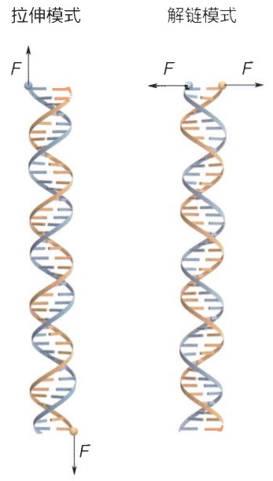

text_image

拉伸模式
解链模式

图11-8 双链DNA施加力的方式

双链DNA是一个非常稳定的分子，它能够抵抗大的力和扭矩。对于长的双链DNA，在拉伸模式下，当外力作用在双链DNA上时，DNA会被拉伸并延长。在比较小的拉伸力（小于 $1\mathrm{pN}$ ）下，DNA的延长量与施加的力近似线性（图11-9）。而当拉力继续增大时，则表现出明显的非线性行为，此时拉伸曲线可以用蠕虫状链模型比较好地进行拟合。给出双链DNA的持续长度 $\xi_{\mathrm{p}}\approx 50~\mathrm{nm}$，即在该长度也就是约150bp时双链DNA将呈伸直状态。只有双链DNA尺度远大于持续长度时，才会显示出柔性的行为，可以在空间中自由地弯曲和旋转。而当力进一步增加并超过 $60~\mathrm{pN}$ 时，在力曲线上会出现平台，DNA会突然显著延长，延伸长度甚至达到自由状态轮廓长度的

70%以上，这个现象被称为DNA的过拉伸（图11-9）。在过拉伸状态下，DNA的构象会发生显著变化，从B型DNA转变为S型DNA。如果力进一步增加，DNA的两条链可能会分离，导致DNA的解链。对于较短的双链DNA（长度小于其持续长度），拉伸模式可以引起DNA解旋，解旋所需的力依赖于DNA的长度。

双链 DNA 是一个右手螺旋结构。当施加与螺旋方向相同或者相反的扭转力时，DNA 可以形成超螺旋或者解旋。测定 DNA 解旋所需要的扭转力可以帮助理解解旋酶分子马达及其它 DNA 结合蛋白的工作机制。在扭转角度比较小时，双链 DNA 正向和负向扭转刚度系数都为  $410 \sim 450 pN \cdot nm^{2}$ 。正向扭转过程中，当扭矩达到约  $34 pN \cdot nm$  时会达到一个平台，继续增加扭转并不会增加扭矩，表明此时 DNA 发生了构象改变。当施加负向的扭转

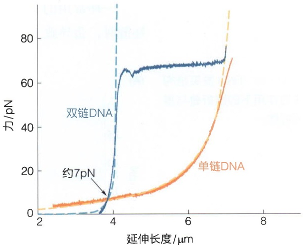

line

| 延伸长度 \((\mu m)\) | 双链DNA (pN) | 单链DNA (pN) |
| --- | --- | --- |
| 2 | ~0 | ~3 |
| 4 | ~10 | ~8 |
| 6 | ~68 | ~25 |
| 7 | ~70 | ~70 |

图11-9 DNA的拉伸曲线单链DNA和双链DNA在力作用下都会发生伸展，其延伸长度曲线可以用蠕虫状链模型较好拟合（虚线）。

---

332

11 生物大分子的力学

力时，则在扭矩约为 $-10\mathrm{pN}\cdot \mathrm{nm}$ 时达到平台，此时发生了双链DNA的解旋。

与拉伸模式不同，在解链模式下，施加力作用后 DNA 会直接发生解螺旋，此时解旋所需要的力依赖于附近的 DNA 序列，富含 G-C 配对的序列需要的力较大，约为 12 pN；而对于富含 A-T 配对的序列，最小仅需约 4.7 pN 的力即可实现解旋。

单链DNA相对于双链DNA要柔软许多，其持续长度比较小，约为 $0.75\mathrm{nm}$，表明其在空间中可以很容易地弯曲和旋转，收缩性更强。这些性质使单链DNA在受到较小力时，比双链DNA更难于延伸，需要更大的力才能达到与双链DNA相同的延长量。但由于在链上碱基数目相同时，单链DNA的轮廓长度更大，其力曲线增加比双链DNA要慢，二者的力曲线会在7pN左右时发生交叉（图11-9）。

RNA大多以单链形式存在，但比较容易形成发夹结构，某些RNA序列甚至可以形成稳定的三维结构并行使特殊的功能，如tRNA、核糖开关、核酶等。当拉伸RNA发夹结构时，能够看到在力作用下，初期分子长度发生伸展，此时力曲线可以由蠕虫状链模型很好地拟合。当力达到临界值（约 $15\mathrm{pN}$ ）时，分子长度快速增加，相应地，力会突然下降，表明RNA发夹结构发生了解折叠（图11-10A）。而继续拉伸时，力曲线又开始上升，并可以用蠕虫状链模型拟合，但轮廓长度增大，显示RNA处于解折叠态。在临界恒力作用下，也经常伴随着RNA发夹结构重新形成的现象，伴着力的突然增加和长度的快速减小。在同一拉伸实验中，RNA发夹解折叠及重新折叠现象可以发生多次（图11-10B）。

## （2）基于DNA的力探针（DNA-based tension sensor）

基于 DNA 拉伸时所施加的力破坏碱基配对的方式和特性，可以开发 DNA 力探针。这种 DNA 探针是将不同形式的 DNA 结构上连接相应的荧光基团，DNA 结构受力时所产生的形变会引起荧光信号的差异。根据不同的检测需求，存在不同的探针设计，如使用双链 DNA 的栓系张力系绳（tension gauge tether），以及使用 DNA 发夹结构的分子张力探针（molecular tension probe）。

一种常用的DNA探针是基于很短的双链DNA结构。当施加力到该DNA两条互补链时，会导致DNA失稳，当所施加的力足够大时，DNA的双链结构被破坏，两条

图 11-10 RNA 发夹结构在力作用下的解折叠与重新折叠

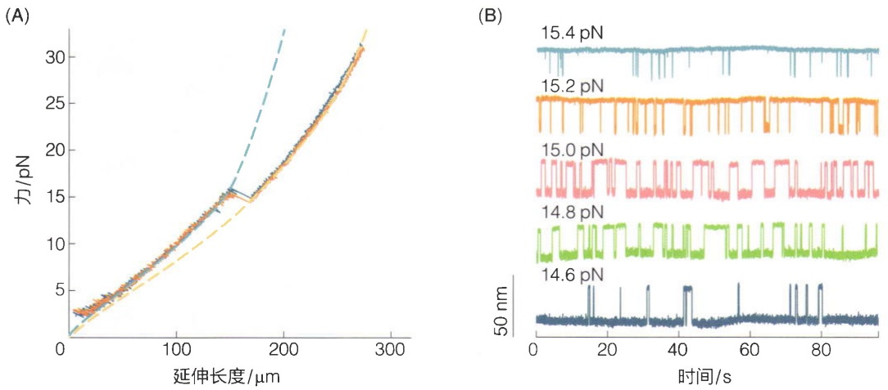

---

11.2 生物大分子的力学特性

333

链分离开。短双链 DNA 的寿命依赖于施加力的大小，以及施加力的位点。一个施力位点一般是在一条链的末端，而另外一个施力位点是在互补链的某个位置。DNA 的力学稳定性敏感依赖于互补链上的施力位点。两个施力位点在同一端时距离最近，力的施加方式是解链模式，力学稳定性最低。两个施力位点在不同端时距离最远，力的施加方式是两端拉伸模式，力学稳定性最高。因此可以根据这种特征设计具有不同断裂力的 DNA 张力系绳（图 11-11），同时也可以改变 DNA 双链上的 G/C 含量，进一步改变断裂力。这类探针本质上测量的是特定拉伸过程中的力传递时间尺度。在通常的力变化速率（pN/s）条件下，常用的这类探针传力时间通常在数秒到数十秒范围。断裂时对应的力通常在数 pN 到数十 pN 范围。

当细胞表面分子与张力系绳上连接的配体分子结合时，如果结合所产生的力小于所使用张力系绳的固有断裂力，则张力系绳维持双链DNA状态；而如果结合所产生的力大于所使用张力系绳的固有断裂力，则张力系绳的双链断裂。因此，对同一个体系（如整合素与配体的相互作用，以及Notch1与配体的相互作用），可以使用一系列具有不同断裂力的DNA张力系绳来检测结合时能够产生的力的幅度。

在实际应用中，DNA 张力系绳有两个可能的缺陷需要在数据分析中予以考虑。其一，不同断裂力的张力系绳的两个固定断点的距离不同，这使得待检测的受体配体对与底面之间的距离也会不同，如果受体配体对的结合力与距离有关，那么 DNA 张力系绳方法会存在问题，这种问题可以通过在低断裂力张力系绳的一端增加附加长度的方式解决。其二，尽管张力系绳的双链断裂后会分开，但存在重新结合的可能性，即分离的 DNA 链重新杂交成双螺旋并恢复成完整的张力系绳。

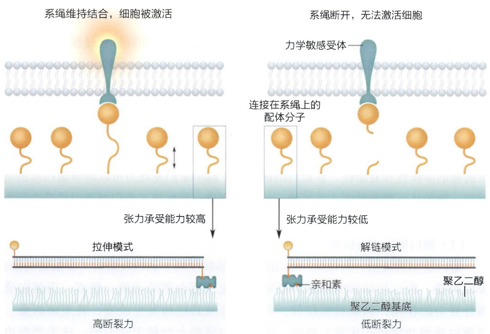

图 11-11 DNA 张力系绳在张力系绳两端施加作用力，当力小于张力系绳的固有断裂力时，张力系绳维持结合状态（左）；而当力增加到大于张力系绳的固有断裂力时，张力系绳的两条链会被力拉开从而断裂，使待测分子与表面之间的连接丧失（右）。

---

334

11 生物大分子的力学

图11-12 DNA张力探针示意图

没有力时，荧光基团与猝灭剂距离近，其荧光被猝灭；而当受力足够大时，发夹结构解聚，荧光基团与猝灭剂距离增加，可以观测到荧光的产生。

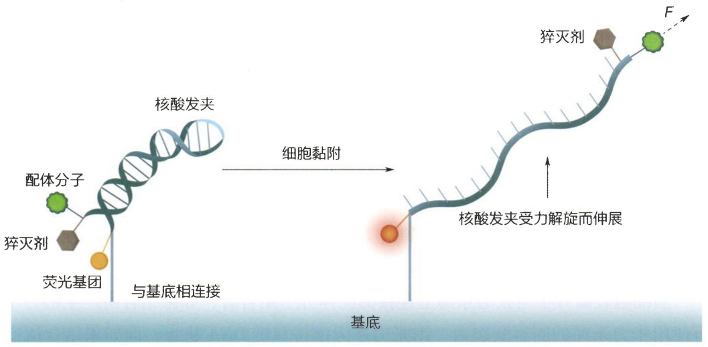

flowchart

DNA 张力探针由一个可以形成发夹结构的 DNA 链，以及其上螯合的荧光基团-猝灭剂对构成（图 11-12），DNA 链的两端分别连接到基底或者配体分子上。当没有外力施加时，DNA 维持其发夹结构；荧光基团与猝灭剂彼此接近，不会有荧光发出。而当配体分子与其受体分子结合并产生足够大的力时，发夹结构两端受到力的拉伸而解开，荧光基团与猝灭剂之间的距离增加，从而会有荧光发出来。

## 11.2.3 蛋白质分子的力学特性

蛋白质受力解折叠的研究在过去几十年中得到了显著的发展，特别是随着单分子操纵技术的出现和发展，科学家们得以直接观察和研究单个蛋白质分子在力作用下的行为。

在20世纪80年代，科学家们开始研究蛋白质的折叠和解折叠过程，但这些早期的研究主要依赖于传统的宏观实验，如圆二色光谱、荧光光谱和X射线晶体学等技术。到了20世纪90年代，随着光镊和原子力显微镜等单分子操纵技术的引入，科学家们得以直接操纵和测量单个蛋白质分子在力作用下的行为。

在21世纪初，科学家们开始广泛研究力诱导的蛋白质折叠和解折叠过程。他们发现，力不仅能引起蛋白质的解折叠，还能诱导蛋白质的折叠。这些研究揭示了蛋白质折叠的多样性和复杂性。在最近的研究中，科学家们发现力可以诱导蛋白质的结构转变，例如从 $\alpha$ 螺旋转变为 $\beta$ 折叠。这些研究进一步拓展了我们对蛋白质受力行为的理解。

## (1) 蛋白质受力解折叠

蛋白质结构复杂，可以从一级结构（氨基酸序列）到四级结构（多肽链的集合）层层折叠，而这种结构的形成和稳定性决定了蛋白质的功能。然而，当蛋白质受到外界力的作用，例如机械拉伸，可能会导致其结构发生改变，甚至解折叠，这对蛋白质的功能将产生重大影响。不同蛋白质的力学稳定性不同，这主要取决于

---

11.2 生物大分子的力学特性

335

它们的氨基酸序列和结构。例如，含有更多二硫键的蛋白质通常具有更高的力学稳定性。

当施加外力拉伸蛋白质两端时，蛋白质的端点距离会在力的作用下增大，延伸曲线也可以通过自由连接链或蠕虫状链模型拟合。而当外力增大到一定程度时，蛋白质会开始解折叠（图11-13）。如果该蛋白质结构域中没有二硫键，蛋白质可能会完全解折叠，变成一个线性的多肽链，其轮廓长度由该蛋白质的氨基酸数目决定。二硫键的存在会抑制完全解折叠，构成二硫键的两个半胱氨酸之间的序列受力的影响较弱；此时，如果用二硫苏糖醇（DTT）或二硫键异构酶等破坏二硫键，受力解折叠将会继续进行。

蛋白质在力作用下的解折叠行为不仅依赖于它们的氨基酸序列，而且受环境因素（例如溶剂条件和温度）的影响。当去除外力后，许多蛋白质可以重新自发地折叠回其初始结构，这显示了这些蛋白质受力解折叠过程的可逆性。

## (2) 受力解折叠后暴露相互作用位点

力可以对蛋白质的结构产生重大影响，导致蛋白质的一部分区域从折叠状态转变为暴露状态，从而暴露出原本隐藏在蛋白质内部的相互作用位点（图11-14）。这种机制在很多生物过程中都发挥着关键作用，特别是在细胞黏附和信号转导等过程中。

整合素（integrin）是一类细胞黏附蛋白，负责连接细胞与细胞外基质或其它细胞。在力的作用下，整合素可以从弯曲的低活性状态转变为伸展的高活性状态，暴露

(A)

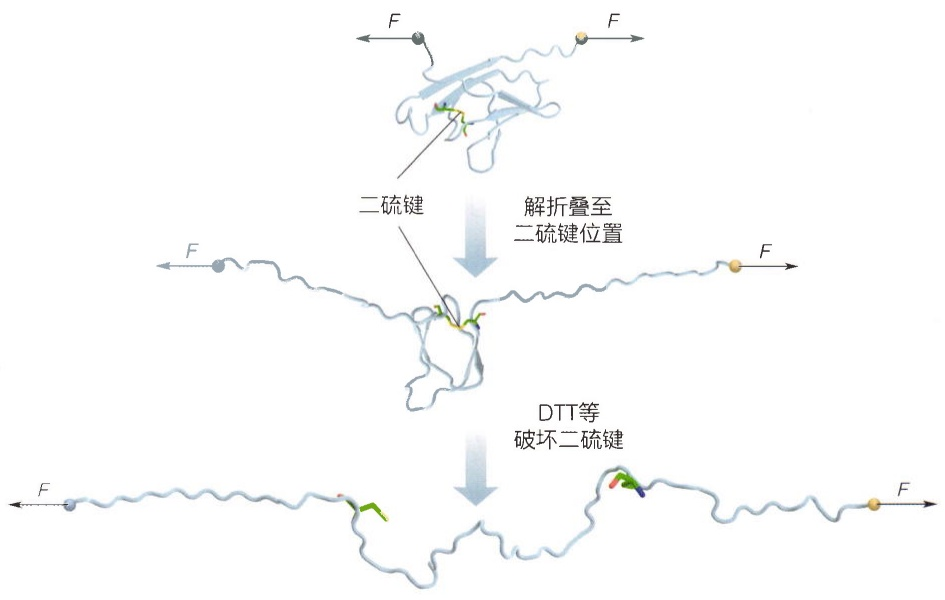

flowchart

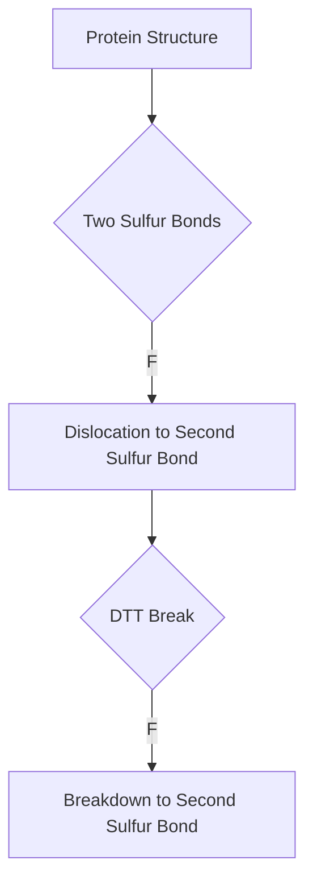

(B)

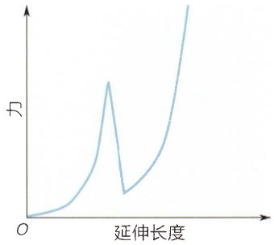

line

| 延伸长度 | 力 |
| --- | --- |
| 0 | 0 |
| ~mid-range | ~peak |
| ~mid-range | ~trough |
| ~high range | >max |

(C)

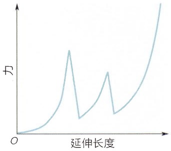

line

| 延伸长度 | 力 |
| --- | --- |
| ~0.2 | ~0.1 |
| ~0.4 | ~0.3 |
| ~0.6 | ~0.8 |
| ~0.7 | ~0.2 |
| ~0.9 | ~0.5 |
| ~1.1 | ~0.8 |
| ~1.2 | ~0.3 |
| ~1.4 | ~0.5 |
| ~1.6 | ~0.8 |
| ~1.8 | ~1.2 |

图11-13 蛋白质在外力作用下的解折叠

（A）蛋白质两端施加力（F）的作用，随着力的增大，蛋白质将开始解折叠；二硫键具有抵抗受力解折叠的作用，被破坏后才能继续解折叠过程。（B）不存在二硫键或者二硫键稳定存在时的拉伸曲线可能的

形式，单个锯齿峰对应着蛋白质的解折叠或部分解折叠。（C）如果系统中存在DTT等，二硫键被破坏时，将产生第二个锯齿峰。（B）和（C）中最后的力持续增加过程对应着多肽链的拉伸。

---

336

11 生物大分子的力学

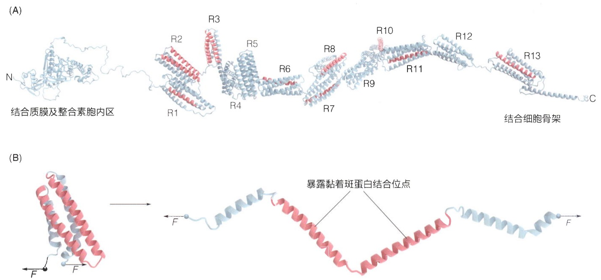

图11-14 踝蛋白受力后暴露下游蛋白质结合位点

（A）全长踝蛋白的结构模型，踝蛋白包括头部和杆状尾部区。其中杆状区包括13个螺旋束结构域（R1-R13），这些结构域中含有共11个黏着斑蛋白结合位点（红色显示），这些位点被包埋在结构域内部。踝蛋白头部可以结合质膜和整合素的胞内区。踝蛋白上也有多个细胞

骨架结合位点，其中包括C端骨架结合区。当头部和尾部分别结合整合素与细胞骨架后，踝蛋白上会产生力的作用。（B）以R3结构域为例，受到力（F）的作用后，螺旋束被解聚，使黏着斑蛋白结合位点暴露出来。

出与细胞外基质的结合位点。

踝蛋白（talin）和黏着斑蛋白（vinculin）是整合素介导的黏着斑的重要组成蛋白，在细胞黏附和力传导中起关键作用，二者之间的相互作用是细胞与细胞外基质进行力学交流的重要环节。在没有受力的情况下，踝蛋白的黏着斑蛋白结合位点通常被其自身的结构域隐藏，因此黏着斑蛋白不能与其结合。然而，当细胞黏附到细胞外基质，或者当细胞受到拉力时，踝蛋白会被拉伸，使得黏着斑蛋白结合位点暴露出来。这时，黏着斑蛋白就能够结合到踝蛋白的黏着斑蛋白结合位点上，形成踝蛋白-黏着斑蛋白复合物。踝蛋白-黏着斑蛋白复合物的形成有助于细胞黏着斑的稳定和力传导。在这个过程中，黏着斑蛋白不仅与踝蛋白结合，还与细胞骨架中的微丝结合，从而形成了一个从细胞外基质到细胞内部的力传导通路。这种力传导通路使得细胞能够感知和响应外界的力，对细胞迁移、形状改变和信号转导等多种生物过程都有重要作用。

## （3）受力解折叠后暴露酶切位点

有些蛋白质在受力作用下的解折叠行为可能会暴露出隐藏在蛋白质内部的酶切位点。这些位点在未受力作用时是隐藏的，因此受保护不会被酶切割。但是在受到力的作用下，这些位点可能会暴露出来，从而被酶识别和切割。这种现象在一些生物过程中发挥着重要作用。

---

11.3 生物大分子相互作用的力学调控

337

一些细胞黏附蛋白如纤连蛋白（fibronectin）和蛋白聚糖（proteoglycan）就有这种特性。这些蛋白质在正常条件下是稳定的，不会被降解酶（如蛋白酶）切割。但是，当它们承受力学拉伸时，其结构会发生变化，导致原本隐藏的酶切位点暴露出来，从而被降解酶切割。

血管性血友病因子（von Willebrand factor，vWF）是一种在血液凝固和止血过程中起重要作用的血浆蛋白。vWF的A2结构域包含一个在生理环境下能被金属蛋白酶ADAMTS13切割的位点。然而，这个酶切位点在静态条件下是隐藏在A2结构域内部的，无法与ADAMTS13接触。只有在vWF受到特定的剪切力（例如在血液流动中）时，A2结构域才会发生构象改变，使得酶切位点暴露出来，从而能被ADAMTS13切割。当vWF受到剪切力时，A2结构域中的一个特定的氨基酸会作为一个“力学开关”发挥作用，它在受力后会被拉伸，导致A2结构域的稳定结构破裂，进而使得酶切位点暴露出来。这种受力诱导的酶切机制在血液凝固和止血过程中是至关重要的。在血管受伤后，vWF会形成多聚体并附着在伤口处，吸引血小板来形成血栓。然而，过大的vWF多聚体可能导致血栓过大，进而引起血管阻塞。这时，剪切力诱导的vWF A2结构域酶切位点暴露就发挥了关键作用，ADAMTS13能切割这个位点，使得vWF多聚体得以裂解，从而防止过大血栓的形成。这种由力学诱导的酶切机制对于理解血液凝固和止血过程，以及相关疾病如血栓性疾病和血管性血友病（von Willebrand disease，vWD）具有重要意义。

Notch是一种跨膜受体蛋白，在多种生物过程中起关键作用，包括细胞命运决定、细胞增殖和细胞死亡等。Notch的信号转导依赖于它的裂解，这一过程由 $\gamma$ 分泌酶复合体催化。Notch受体的裂解过程被严格控制。在其外部区域，即N端，存在一个称为负性调控区（negative regulatory region）的结构域，该域包含两个子结构:线形重复（LIN12/Notch repeats）和异源二聚化结构域（heterodimerization domain）。在未受信号刺激的情况下，负性调控区通过稳定的结构保持Notch处于关闭状态，即隐藏了$\gamma$ 分泌酶的酶切位点。当Notch的配体（例如Delta或Jagged）与Notch结合时，会在Notch受体上产生拉力。这种拉力可以导致负性调控区结构域的构象改变，使得原本被负性调控区隐藏的酶切位点暴露出来，从而允许 $\gamma$ 分泌酶切割Notch受体。被切割的Notch胞内域随后被转运至细胞核内，启动Notch信号通路。

这种受力诱导的酶切机制对于许多生理过程具有重要影响，例如组织重塑和疾病发展。例如，在炎症和肿瘤微环境中，细胞和细胞外基质经常会遭受到压力或拉伸，这可能导致细胞黏附蛋白被酶切割，进一步影响细胞行为和组织功能。

## 11.3 生物大分子相互作用的力学调控

在生物体内，许多大分子间的相互作用，包括蛋白质-蛋白质、蛋白质-核酸、蛋白质-糖等，都可以被力调控。力可以直接影响这些大分子的结构，从而影响其相

---

338

11 生物大分子的力学

互作用。在一些蛋白质的相互作用中，力可以影响其结合和解离的动态平衡。例如，在肌肉收缩中，肌动蛋白和肌球蛋白会在力的作用下进行循环的结合和解离。

## 11.3.1 Bell模型与动态力谱理论

## (1) Bell 模型

Bell模型是一种描述相互作用分子在力作用下解离的动力学模型，由生物物理学家乔治·贝尔（George Bell）于1978年提出。这个模型基于一个简单但深远的观点:作用在两个互相结合的分子上的力可以降低二者解离的活化能，从而加速解离过程。

Bell 模型的基本公式如下:

$$
k = k _ {0} \mathrm{e} ^ {\frac {F \Delta x}{k _ {\mathrm{B}} T}}, \tag {11-9}
$$

其中，$k$ 是在力 $F$ 作用下的解离速率，$k_0$ 是无外部力作用时的解离速率，$\Delta x$ 是活化能垒的宽度，$T$ 是温度，$k_{\mathrm{B}}$ 是玻尔兹曼常量。这个公式描述了解离速率 $k$ 随着力 $F$ 的增加而呈指数级增加。

Bell模型提供了一种量化力对分子相互作用影响的方法，对于理解和研究蛋白质的机械性质和力学行为有重要意义。尽管这个模型是基于一些简化的假设，如忽略力对活化能垒形状的影响，但在许多实际情况下，它都能给出合理的预测。此外，这个模型还启发了许多后来的理论模型和实验研究，对生物物理学和力学生物学的发展产生了深远影响。

Dembo 模型，也被称为 Bell-Evans 或 Evans-Ritchie 模型，是一种描述分子间相互作用在外部力作用下的破裂行为的模型。在 Dembo 模型中，两个分子的解离被视为一个活化过程，解离的速率可以用阿伦尼乌斯方程（Arrhenius equation）来描述。外部力可以降低解离的活化能，从而加速解离过程。Dembo 模型的基本方程是:

$$
k = k _ {0} \mathrm{e} ^ {\frac {F \Delta x - \Delta G ^ {\ddagger}}{k _ {\mathrm{B}} T}}, \tag {11-10}
$$

其中，$k$ 是在力 $F$ 作用下的解离速率，$k_0$ 是无外部力作用时的解离速率，$\Delta G^{\ddagger}$ 是无外部力作用时的活化自由能，$\Delta x$ 是活化能垒的宽度，$T$ 是温度，$k_{\mathrm{B}}$ 是玻尔兹曼常量。这个公式描述了解离速率 $k$ 随着力 $F$ 的增加而呈指数级增加。

Dembo 模型是一个非常实用的工具，它可以用来解析实验数据，例如由原子力显微镜（AFM）或光镊等工具获得的力-扩展曲线。它还可以帮助我们理解力对分子间相互作用的影响，例如力如何影响抗体-抗原或配体-受体之间的结合。

## (2) Kramers 理论

Kramers 理论是关于化学反应速率的一个重要理论，特别是涉及在一个势能垒中的粒子热活化跃迁的过程。这一理论是由亨德里克·克拉默斯（Hendrik Kramers）在20世纪30年代提出的，它将古典力学与量子力学结合，用来描述在给定温度下的反应速率。它建立了反应速率、温度、势垒和环境阻尼之间的关系，并已经成为理论化学和实验化学中的基石。

考虑一个粒子在势能曲线上移动，其中有一个势垒阻止其自由移动。在某些情况

---

11.3 生物大分子相互作用的力学调控

339

下，即使粒子的能量低于势垒的高度，它仍然有可能穿越势垒。这种现象在古典力学中是不可能的，但在量子力学中是可能的，并被称为“隧道效应”。

然而，Kramers理论主要关注的是另一种机制:当粒子受到热激发时，它获得足够的能量来越过势垒。这一过程通常被称为“活化过程”。Kramers为反应速率提出了以下的近似公式:

$$
k = k _ {0} \mathrm{e} ^ {- \frac {\Delta E}{k _ {\mathrm{B}} T}}, \tag {11-11}
$$

其中，$k$ 是反应速率常数，$k_{\mathrm{B}}$ 是玻尔兹曼常量，$T$ 是温度，$\Delta E$ 是从反应物到过渡状态的势能差。因此，Kramers理论主要考虑了粒子在势垒中的热活化运动、粒子在势垒顶部的随机运动以及粒子从势垒顶部向下的跃迁，描述了反应速率如何依赖于温度、势垒高度以及周围环境的阻尼。这一公式与Bell模型在本质上是相同的。

## (3) 动态力谱理论

动态力谱学（dynamic force spectroscopy，DFS）是一种研究分子间相互作用在外部力作用下的破裂行为的方法。DFS不仅可以测量分子间的相互作用强度，还可以获取有关分子解离的动力学信息。DFS的基本思想是通过操控分子对，逐渐增加作用在其上的外部力，直到分子对破裂。通过测量分子对破裂所需的力，可以计算出分子间的相互作用能。通过改变外部力增加的速率，可以获取分子解离的动力学信息（图11-15）。

动态力谱学的理论基础主要由 Bell 模型和 Kramers 理论构成。Bell 模型描述了分子解离速率与外部力的关系。在 Bell 模型中，分子解离的活化能被视为一个固定的能垒，外部力可以降低这个能垒，从而加速分子的解离。而 Kramers 理论是 DFS 的一个重要扩展，用于描述外部力增加的速率对分子解离的影响。在 Kramers 理论中，分子解离的过程被视为一个过阻振子在势阱中的运动，外部力和温度会影响这个振子逃逸出势阱的速率。

DFS已经被广泛应用于研究各种分子间的相互作用，包括蛋白质-蛋白质、蛋白质-核酸、抗原-抗体等。通过DFS，科学家们可以直接测量这些相互作用的强度和特性，获取宝贵的信息以理解生命过程中的各种机制。

## 11.3.2 力对相互作用寿命的影响

Bell模型所描述的生物大分子相互作用力学依赖性也被称为滑移键（slip bond）。滑移键是一种分子间的相互作用，其特性是当施加的力增加时，分子间的结合寿命缩短。也就是说，施加更大的力会使得分子间的结合更易于解除。这种特性与另一种分子间的相互作用形式——逆锁键（catch bond）相反。在逆锁键中，施加的力增加反而会延长分子间的结合寿命（图11-16）。

滑移键是许多生物分子相互作用的基本特性，例如许多酶-底物相互作用和抗体-抗原相互作用就是滑移键。这种特性使得分子可以在完成其功能后，如催化反应或信号转导后，很容易地解除结合，从而进行下一轮的反应或信号转导。

---

340

11 生物大分子的力学

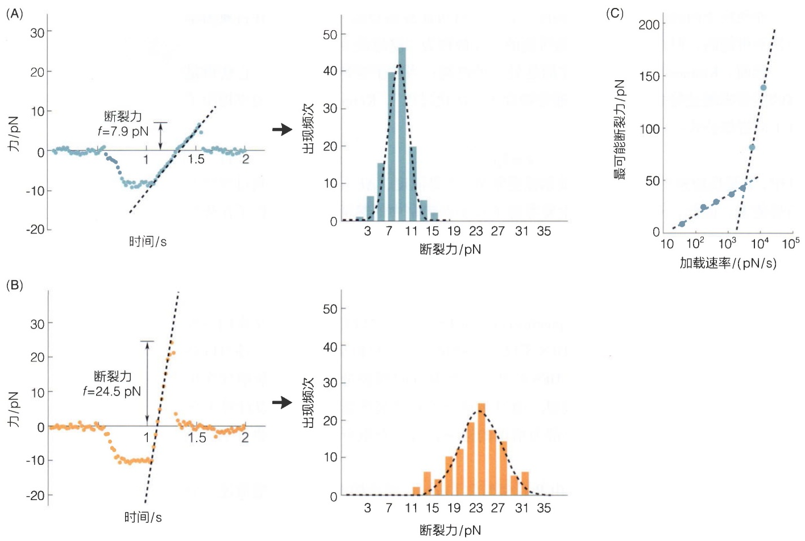

图11-15 动态力谱分析方法

动态力谱表示力加载速率与断裂力之间的关系，一般可以通过单分子力谱学技术测量。（A、B）通过单分子力学工具在相互作用分子间施加力的作用，在力足够大时分子键发生断裂。在同一加载速率下多次测量可以获得断裂力分布的柱状图（A、B右侧），经正态分布拟合（虚线）后获得该加载速率下的最可能的断裂力。加载速率小时，断裂力也较小（A）；加载速率大时，断裂力也相应增大（B）。（C）在多个加载速率下测量，会得到最可能断裂力随加载速率的变化关系。在一定区间内，最可能断裂力与加载速率成对数依赖关系，通过拟合可以获得相互作用参数。如果加载速率变化区间较大，可能会出现不同的线性变化行为。

而逆锁键是一种特殊类型的分子相互作用，它的特性是当施加的力增加时，分子间的结合寿命反而增加。逆锁键最初是在细菌黏附和血小板聚集这类生物过程中被观察到的，这些过程涉及分子间在力作用下的相互作用。例如，P选择素与PSGL-1的相互作用（一种白细胞与血小板之间的相互作用）就被发现表现出逆锁键特性。此外，一些细菌如大肠杆菌和粘连性链球菌表面的黏附蛋白也表现出逆锁键行为，这有助于它们在高剪切力的环境（如血流）中黏附到宿主细胞上。

目前已发现在多种分子相互作用中都存在逆锁键行为，如选择素与其糖蛋白配体、整合素与其配体，以及T细胞受体（T cell receptor，TCR）对抗原的识别等。逆锁键现象的机制还不完全清楚，可能涉及分子在力作用下的构象变化，使得结合态由一个低亲和力状态转变到一个高亲和力状态。研究这种特殊的力学行为对于理解许多生物过程，如细胞黏附、免疫应答以及病原体感染等有重要意义。

---

11.4 力敏感受体

341

(A)

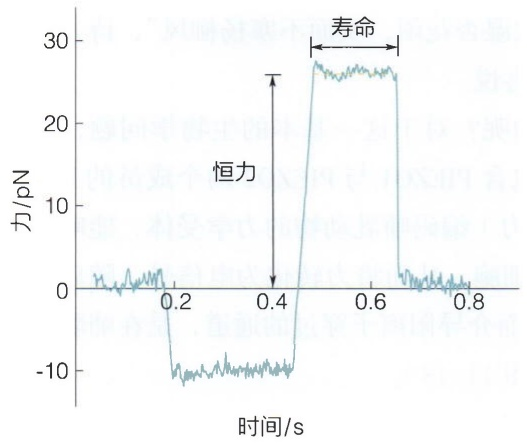

line

| Time (s) | Force (pN) |
| --- | --- |
| 0.0 | ~1 |
| 0.2 | ~-10 |
| 0.4 | ~-10 |
| 0.5 | ~27 |
| 0.6 | ~26 |
| 0.8 | ~1 |

(B)

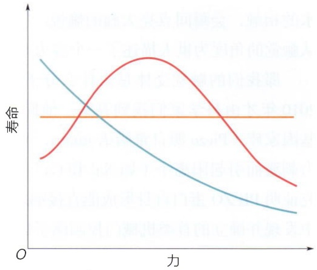

line

| 力 | 赤色线 (寿命) | 红色线 (寿命) | 蓝色线 (寿命) |
| --- | --- | --- | --- |
| 0 | ~高值 | ~低值 | ~高值 |
| 中间点 | ~中值 | ~峰值 | ~中值 |
| 高 | ~低值 | ~低值 | ~低值 |

图 11-16 不同分子间相互作用的寿命与所受外力之间的关系

（A）用单分子力谱工具测定分子间相互作用寿命，相互作用分子在恒力作用下发生断裂，断裂之前恒力作用时间即为本次测量中分子键的寿命。（B）在给定力时多次测量可获得该力下分子间寿命的平均值。在不同力下的测量将得到分子相互作用寿命随力的变化关系，这种关系可以呈现为如Bell模型描述的滑移键（蓝色）；随外力增大而寿命增长的逆锁键（红色的小力部分），一般来说，逆锁键行为在较大力作用下也会转变为滑移键（红色的大力部分）；也存在相互作用寿命不随外力变化的理想键模式（橙色）。

## 11.4 力敏感受体

响应力学刺激对生命活动的正常进行至关重要。在多种生命活动过程中，例如血液流动、心脏跳动，以及对触觉、机械痛觉、身体平衡（本体觉）和声波（听觉）的感知，力都是不可或缺的关键物理刺激信号。力敏感受体能感知力学刺激并转换成生物电化学信号，从而引发动作电位或启动下游信号通路，由此赋予生命感知和响应力的能力。

目前已知能参与感知力的蛋白质包括离子通道、G蛋白耦联受体（G protein-coupled receptor，GPCR）、细胞骨架蛋白、黏附分子。其中，机械门控离子通道通常存在于细胞质膜上，可以直接被力激活而打开，从而介导离子通透来行使其生理功能，譬如触觉、痛觉与听觉，因此是备受关注的一类力学受体。

当前有两种模型用于描述机械门控离子通道的机械门控机制。一类是脂膜张力门

控模型，即力直接作用在细胞质膜脂质上产生张力，机械门控离子通道的特殊结构域能感知脂膜的张力，从而使离子通道打开（图11-17，左）。另一类是拴绳拉力模型，这类离子通道能将特殊结构域或者辅助蛋白作为拴绳，并和细胞骨架或细胞外基质相连接（图11-17，右），这些力学感知结构受到力扰动后就能由拴绳传递力而打开离子通道。

## 11.4.1 触觉受体

触觉作为人类的五感之一，体现在日常生活诸多方面。例如，当我们与朋友久违握手，双手的触压可

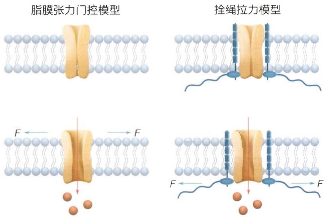

text_image

脂膜张力门控模型
拴绳拉力模型

图11-17 机械门控离子通道模型

---

342

11 生物大分子的力学

以增进彼此的信任。当我们赤脚漫步在沙滩上，清凉的海水时而漫过脚面，皮肤与海水的相触，会瞬间点亮大脑的愉悦。“沾衣欲湿杏花雨，吹面不寒杨柳风”，诗人正是从触觉的角度为世人描述了一个春天来了的喜悦。

那我们的触觉受体是由什么分子组成的呢？对于这一基本的生物学问题，直到2010年才由科学家们找到答案。他们发现包含PIEZO1与PIEZO2两个成员的PIEZO基因家族（Piezo源自希腊语 $\pi \varepsilon \sigma \eta$ ，意为压力）编码哺乳动物的力学受体，能响应外力刺激而引起阳离子（如 $\mathrm{Na^{+}}$ 和 $\mathrm{Ca^{2 + }}$ ）流入细胞，从而将力转化为电信号。随后的研究证明PIEZO蛋白自身形成能直接响应外力而介导阳离子穿过的通道，是在哺乳动物中发现并确立的首类机械门控阳离子通道（图11-18）。

PIEZO家族中的PIEZO2在躯体感觉神经元以及与触觉感知相关的默克细胞中表达，介导触觉、本体觉（自身躯体部位的感知）、触诱发痛（如触摸发炎伤口所致的疼痛）、内脏机械感觉（肺的收缩扩张、血压波动、膀胱充盈、胃肠道蠕动等）以及性愉悦感知。Piezo2基因的功能缺陷导致人体轻触觉、本体觉、内脏觉以及性愉悦感知异常，PIEZO2是哺乳动物躯体感觉神经元中的主要触觉受体。PIEZO2缺失的患者丧失病理性触诱发痛，因此PIEZO2可以作为新型镇痛药物的靶点。

PIEZO1 则在多种细胞组织中广泛表达，参与多种生理功能，如调控血管及淋巴管发育、心脏功能稳态维持、骨生成与重塑、红细胞体积调控乃至大脑的结构以及学习记忆。非常有趣的是，Piezo1 突变引起的功能改变可导致红细胞脱水变形，淋巴管水肿，严重者导致胚胎发育不良而流产。

阿尔迪姆·帕塔波蒂安（Ardem Patapoutian）因发现触觉受体 PIEZO2，与发现温度受体的戴维·朱利叶斯（David Julius）一起获得了2021年诺贝尔生理学或医学奖。

图11-18 力学受体PIEZO1与PIEZO2的鉴定发现、生理功能以及结构机制示意图

（A）无机械力刺激时，静息状态下，PIEZO呈弯曲状态，离子通道关闭（上）；存在外界机械力刺激时，PIEZO受力被展平，离子通道打开（下）。（B）PIEZO的基因筛选原理示意图。当沉默非机械力相关蛋白的基因时，对细胞施加机械力刺激，仍可记录到机械敏感电流（上）；当沉默PIEZO的基因时，细胞在机械力刺激下，机械敏感电流消失，表明PIEZO为机械敏感离子通道（下）。

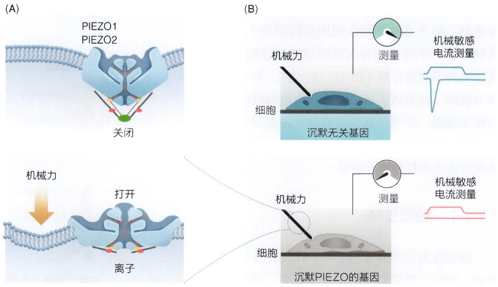

---

11.4 力敏感受体

343

PIEZO2是包含38次跨膜螺旋、2800多个氨基酸的大型膜蛋白（图11-19A），由3个单体、共114次跨膜螺旋组成三叶螺旋桨状结构，包含外周感受力的桨叶（blade）以及中央负责离子通透的孔道结构域（图11-19A、B），分子量约 $1\mathrm{MDa}$ 。螺旋桨中央顶部的帽子区（cap）以及包含横梁区（beam）的桨叶是决定PIEZO机械传导的关键结构域。PIEZO通道的一个标志性结构特征是其每个单体38次跨膜螺旋区形成一个向胞外侧高度扭曲的非细胞膜平面的跨膜区结构，三个桨叶围合成直径约 $24\mathrm{nm}$ 、深度约 $9\mathrm{nm}$ 的往细胞内侧凹陷的“纳米碗”状结构（图11-18，图11-19A、B）。

原子力显微镜探测和重组脂质体中受力状态下的 PIEZO1 的结构数据表明，PIEZO 通道在受力作用下从弯曲状变为平展状，伴随结构重排和曲率改变（图 11-19C）。PIEZO1- 膜系统在展平的过程中，将其存储在碗面的面积全部平铺，致使膜投影面积扩展约 $300 \mathrm{~nm}^{2}$ （图 11-19C）。基于所测量的 PIEZO1- 膜系统的线性弹性方程与弹性系数，可以计算出从弯曲状态到平展状态 $10 \mathrm{~nm}$ 形变需要施加约 $90 \mathrm{pN}$ 的力以及做 $570 \mathrm{pN} \cdot \mathrm{nm}$ 的功。基于 $W$ （功）$= \lambda$ （张力）$\times \Delta A$ （膜面积变化）这一公式，可求得半激活张力 $\lambda$ 为 $1.9 \mathrm{pN/nm}$ （实验测量值约 $1.4 \mathrm{pN/nm}$）。

感受曲率变化的桨叶末端，虽然有剧烈的形变，但通过 PIEZO 内侧的横梁区作为纳米杠杆传递装置和顶部帽子的旋转运动，使其转化为侧向门塞和跨膜门的适度打开（图 11-19D），保证了其同时具有高机械灵敏度和阳离子选择性，体现了杠杆原理这一基本力学原理。PIEZO 由此实现其非凡的机械力敏感性和对通透离子的选择性。

## 11.4.2 听觉受体

哺乳动物的听觉器官耳蜗（cochlea）中排列着数量从几千到上万的毛细胞。耳蜗毛细胞是听觉的感受器细胞，其主要细胞功能是将声波的机械振动转换为电信号，这一过程被称之为力-电转导（mechano-electrical transduction，MET）。每个毛细胞顶部生长着由三排高度错落的静纤毛（stereocilium）组成的毛束，相邻的高低静纤毛之间有顶链（tip link）相连，声音振动带来的力造成静纤毛摆动，经由顶链打开位于其底端的MET通道（图11-20）。

MET复合体这种由顶链驱动的通道门控模式，是机械门控离子通道拴绳拉力模型的经典范例。顶链由顶侧的CDH23和底侧的PCDH15组成，这两个钙黏蛋白各自形成顺式二聚体再以反式互相结合，而PCDH15的近膜端与MET通道结合，但是是以直接还是间接的方式结合目前还未知。另外，MET通道的胞质侧是否也存在类似的栓绳结构也尚未可知。

MET通道是一个精密的蛋白质复合体，已经鉴定到TMC1、TMC2、TMIE、TMHS/LHFPL5、CIB2等多个蛋白质可能参与MET通道的组装与调控（图11-20A）。然而，该通道完整的结构组成和精确的力学门控方式仍有待彻底揭示。TMC1（transmembrane channel-like 1）和TMC2作为重要的耳聋基因在2002年被鉴定，目前被认为最有

---

344

11 生物大分子的力学

(A)

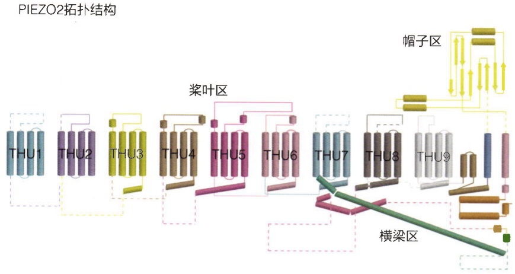

text_image

PIEZO2拓扑结构
THU1 THU2 THU3 THU4 THU5 THU6 THU7 THU8 THU9
桨叶区 帽子区
横梁区

PIEZO2单体三维结构

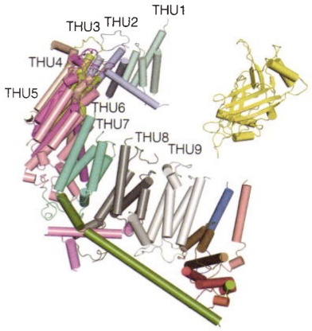

text_image

THU1
THU2
THU3
THU4
THU5
THU6
THU7
THU8
THU9

(B)

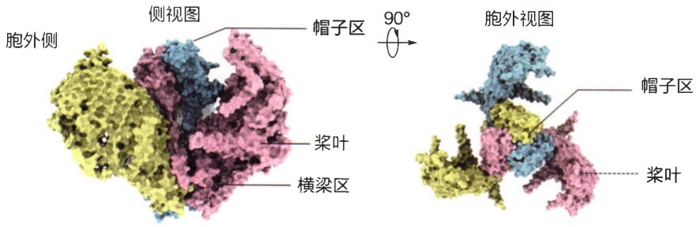

text_image

胞外侧
侧视图
帽子区
90°
胞外视图
帽子区
桨叶
横梁区
桨叶

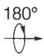

胞内视图

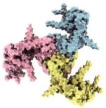

natural_image

Abstract 3D molecular structure visualization with pink, blue, and yellow regions (no text or labels)

(C)

PIEZO1-膜系统示意图

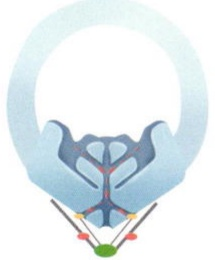

natural_image

Illustration of a stylized human head with abstract geometric elements and a circular frame (no text or symbols)

PIEZO1弯曲态

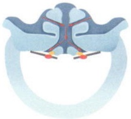

natural_image

Illustration of a stylized whale head with blue and white anatomical structures (no text or symbols)

PIEZO1平展态

侧视图

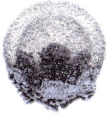

natural_image

Close-up of a textured, granular surface with no visible text or symbols

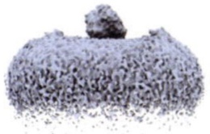

natural_image

Pile of granular material with a small irregular particle above (no text or symbols visible)

俯视图

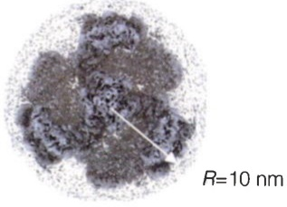

natural_image

Microscopic image showing a circular structure with a labeled radius of 10 nm (no text or symbols beyond the label)

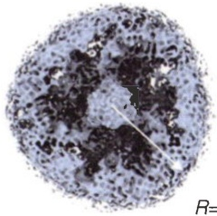

natural_image

Microscopic view of a circular cellular structure with dark granular background and a central white marker (no text or symbols)

(D)

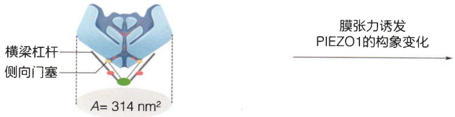

text_image

横梁杠杆
侧向门塞
A= 314 nm²
膜张力诱发
PIEZO1的构象变化

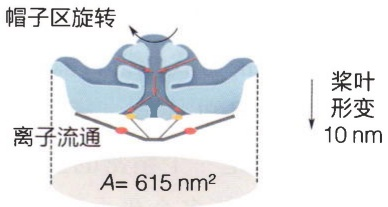

text_image

帽子区旋转
离子流通
A= 615 nm²
桨叶形变
10 nm

图11-19 PIEZO通道感知力的结构基础和动态变化模型

（A）PIEZO2单体的38次跨膜螺旋拓扑模型与三维结构（PDB编号:6KG7）。（B）PIEZO2三聚体三维结构（PDB编号:6KG7）。

（C）PIEZO在脂质体中的弯曲态与平展态结构。（D）膜张力诱发PIEZO1的构象变化及平面投影面积变化示意图。

---

11.4 力敏感受体

345

(A)

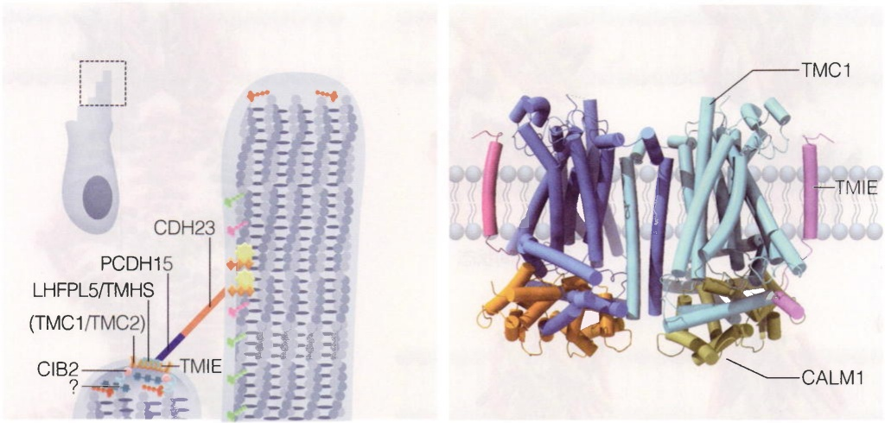

(B)

图11-20 听觉产生机制与听觉受体

（A）静纤毛尖端机械电传感通道结构模式图。（B）秀丽隐杆线虫TMC1-TMIE-CALM1复合体三维结构（PDB编号:7USW）。（A，改编自Liu Q L, et al. Cell Mol Life Sci, 2021, 78(21/22): 6823-6850）

可能是MET通道的孔道蛋白基因。迄今，已经解析了来自线虫的TMC1、TMIE和CAM1复合体的结构（图11-20B）:TMC1为760个氨基酸组成的10次跨膜蛋白，TMIE是一个含有153个氨基酸的两次跨膜蛋白，CIB2是一个含187个氨基酸、有3个结合钙离子的EF手结构（EF hand）的可溶蛋白。但TMC1的孔道区以带正电的氨基酸居多，不能解释MET通道为非选择性阳离子通道这一功能特性。另外，TMIE和TMC1结合区富集磷脂分子，说明磷脂信号分子参与调控MET通道。结构生物学实验发现PCDH15和LHFPL5形成复合体，PCDH15是一个 $290\mathrm{kDa}$ 的单次跨膜蛋白，LHFPL5是一个含214个氨基酸的4次跨膜蛋白，它们可能调控顶链的力学稳定性，但是两个复合体如何结合和行使功能还尚未可知。

## 11.4.3 其它类型的力学受体

细菌中的机械门控通道MscL和MscS是最早被鉴定到的机械门控离子通道家族（图11-21A、B），能够保护细菌避免因渗透压改变而导致膨胀破裂。研究发现，把纯化的MscL蛋白重组到脂双层中，能影响负压刺激而引起离子通透，揭示了MscL能直接感受膜张力的变化而开放，基于此，研究人员提出了该类通道感知外力的脂膜张力门控模型。

果蝇的瞬时受体电位（transient receptor potential，TRP）通道家族成员NOMPC参与介导果蝇触觉感知。该通道的胞质区存在4个含29个锚蛋白的锚蛋白重复结构域（ankyrin repeat domain）（图11-21C）。该结构形成螺旋束并与微管连接，以类似弹簧的方式将微管的力传递给孔道区。因此，NOMPC通道符合拴绳拉力模型。此外，线虫的退化蛋白（degenerin）或上皮钠通道（DEG/ENaC）家族成员MEC-4可以参与线虫的触觉感知，其力学感知需要依赖其它的细胞骨架成分。

双孔钾通道（two-pore domain potassium channel，K2P）是在哺乳动物中鉴定到的

---

346

11 生物大分子的力学

图11-21 多种类型力学受体的三维结构

（A）甲烷藻MscL关闭状态（4Y7K）与开放中间状态（4Y7J）结构。（B）大肠杆菌MscS关闭状态（2OAU）与开放中间状态（2VV5）结构。（C）黑腹果蝇NOMPC三维结构（5VKQ）。（D）人源K2P1钾通道三维结构（3UKM）。（E）拟南芥OSCA1.1三维结构（6JPF）。（F）人源TMEM63A三维结构（8EHW）。括号内字母和数字组合指PDB编号。

(A)

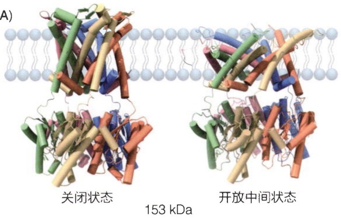

text_image

A)
关闭状态
153 kDa
开放中间状态

(C)

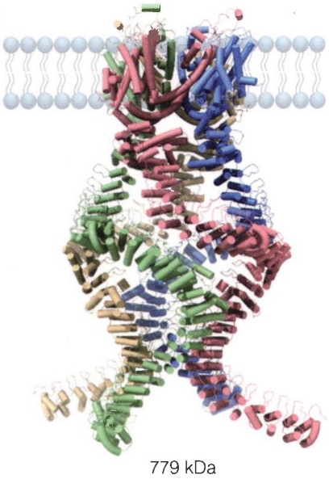

natural_image

3D molecular structure visualization with color-coded helices and binding site (no text or symbols)

(B)

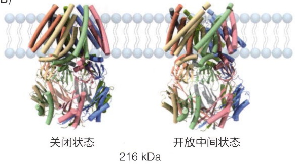

text_image

D)
关闭状态
216 kDa
开放中间状态

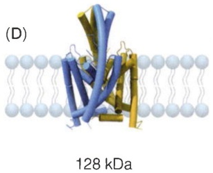

natural_image

3D molecular structure visualization with 128 kDa scale indicator, showing protein backbone and side chains (no text or symbols on diagram)

(E)

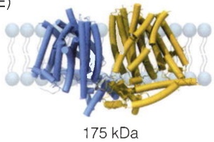

natural_image

Molecular structure visualization with blue and yellow chains, labeled 175 kDa (no text or symbols on the diagram itself)

(F)

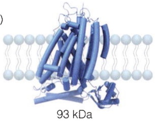

natural_image

3D molecular structure visualization with 93 kDa label, showing protein backbone and secondary structure elements (no text or symbols beyond label)

机械门控钾通道（图11-21D）。但不同于PIEZO通道，K2P的作用是介导钾离子流到胞外而使细胞膜超极化，抑制神经元兴奋。K2P的门控过程符合脂膜张力门控模型。

TMEM63/OSCA家族是新近鉴定发现的一类机械门控离子通道家族，能直接被脂膜张力的改变而激活，但其激活所需要的力要高于PIEZO1/2，属于高阈值机械门控离子通道。植物中表达的OSCA形成二聚体（图11-21E），每个亚基有离子通透孔区。而哺乳动物TMEM63被发现以单体形式存在（图11-21F），且需更大的力才能被激活。TMEM63/OSCA在生物体或细胞中的力学感知功能还有待深入研究。

## ※ 本章小结

从微小的原核生物到复杂的哺乳动物如人类，生命体系巧妙地运用丰富多样的分子马达作为能量转换的媒介，通过高效地水解ATP等储能分子或是依靠质子浓度梯度，实现化学能向机械能的转变。这一能量转换过程不仅支撑着细胞内的物质运输、肌肉收缩等基本活动，还参与构建从细胞分裂到器官运动的各种复杂动态过程。在这一系列精密的生命

---

扩展阅读

347

活动中，力的感知扮演着不可或缺的角色，而多种力敏感蛋白/受体作为传感器，能够捕捉到极微弱的皮牛级别的力变化。在无须额外能量输入的情况下，力敏感蛋白仅凭结构的变化便能实现信号的转换与传递，使得细胞能够精确地响应外界压力、剪切力以及扭转力等，保证了生物体对环境的精细感知和恰当响应，展现了生命体系对物理环境的高度适应性，体现出生命过程与物理原理的交汇之美！

## ※ 思考题

1. 细胞内各种分子马达产生的力大多在几皮牛到几十皮牛的范围，请思考其原因。
2. 在细胞内，有的蛋白质力学稳定性很高，需要几百皮牛的力才能解折叠；有些蛋白质力学稳定性较低，只需要几皮牛就能解折叠。力学稳定性和生物功能之间是否存在内在关联？
3. 力能够直接影响基因表达吗？
4. 力敏感受体感受力有多少种不同的方式？为什么不同受体会采用不同的机制感受力？
5. 是否还存在尚未被鉴定发现的力学受体？如何去鉴定发现？

## ※ 扩展阅读

图书

菲利普斯，康德夫，塞里奥特.细胞的物理生物学[M].涂展春，王伯林，译.北京:科学出版社，2012.

张凯.膜蛋白结构动力学[M].2版.北京:科学出版社，2024.

Doi M. Introduction to polymer physics[M]. Oxford: Clarendon Press, 1996.

Jacobs C R, Huang H, Kwon R Y. Introduction to cell mechanics and mechanobiology[M]. New York: Garland Science, 2013.

Park S, Chen Y. Mechanics of biological systems: introduction to mechanobiology and experimental techniques[M]. San Rafael: Morgan & Claypool Publishers, 2019.

综述

Evans E. Probing the relation between force—lifetime—and chemistry in single molecular bonds[J]. Annu Rev Biophys Biomol Struct, 2001, 30:105–128.

Guo Y Y, Yan J, Goult B T. Mechanotransduction through protein stretching[J]. Curr Opin Cell Biol, 2024, 87:102327.

Huang Y H, Chen T, Chen X D, et al. Decoding biomechanical cues based on DNA sensors[J]. Small, 2024, 20(21):e2310330.

Jin P, Jan L Y, Jan Y N. Mechanosensitive ion channels: structural features relevant to mechanotransduction mechanisms[J]. Annu Rev Neurosci, 2020, 43:207–229.

---

348

11 生物大分子的力学

- Liu B Y, Chen W, Zhu C. Molecular force spectroscopy on cells[J]. Annu Rev Phys Chem, 2015, 66:427–451.
- Murthy S E, Dubin A E, Patapoutian A. Piezos thrive under pressure: mechanically activated ion channels in health and disease[J]. Nat Rev Mol Cell Biol, 2017, 18(12):771–783.
- Wang Y N, Yan J, Goult B T. Force-dependent binding constants[J]. Biochemistry, 2019, 58(47):4696-4709.
- Xiao B. Mechanisms of mechanotransduction and physiological roles of PIEZO channels[J]. Nat Rev Mol Cell Biol, 2024, 25(11):886–903.
- Zhu C, Chen W, Lou J Z, et al. Mechanosensing through immunoreceptors[J]. Nat Immunol, 2019, 20(10):1269–1278.
- Bustamante C, Marko J F, Siggia E D, et al. Entropic elasticity of  $\lambda$ -phage DNA[J]. Science, 1994, 265(5178):1599–1600.
- Hu Y R, Li H Y, Zhang C, et al. DNA-based ForceChrono probes for deciphering single-molecule force dynamics in living cells[J]. Cell, 2024, 187(13):3445-3459.
- Jo M H, Meneses P, Yang O, et al. Determination of single-molecule loading rate during mechanotransduction in cell adhesion[J]. Science, 2024, 383(6689):1374–1379.
- Liu B Y, Chen W, Evavold B D, et al. Accumulation of dynamic catch bonds between TCR and agonist peptide-MHC triggers T cell signaling[J]. Cell, 2014, 157(2):357-368.
- Marshall B T, Long M, Piper J W, et al. Direct observation of catch bonds involving cell-adhesion molecules[J]. Nature, 2003, 423(6936):190–193.
- Smith S B, Cui Y, Bustamante C. Overstretching B-DNA: the elastic response of individual double-stranded and single-stranded DNA molecules[J]. Science, 1996, 271(5250):795-799.
- Smith S B, Finzi L, Bustamante C. Direct mechanical measurements of the elasticity of single DNA molecules by using magnetic beads[J]. Science, 1992, 258(5085):1122–1126.
- Yang X, Lin C, Chen X, et al. Structure deformation and curvature sensing of PIEZO1 in lipid membranes[J].Nature, 2022, 604(7905):377–383.
- Zhang X H, Chen H, Le S M, et al. Revealing the competition between peeled ssDNA, melting bubbles, and S-DNA during DNA overstretching by single-molecule calorimetry[J]. Proc Natl Acad Sci USA, 2013, 110(10):3865-3870.

## 研究论文
