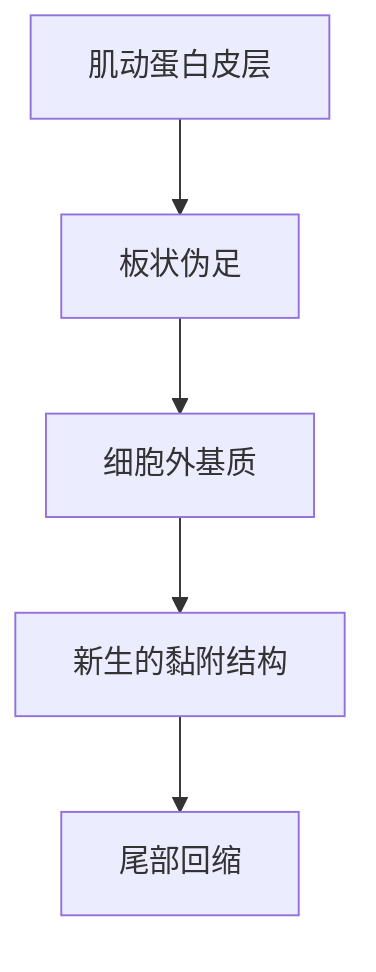
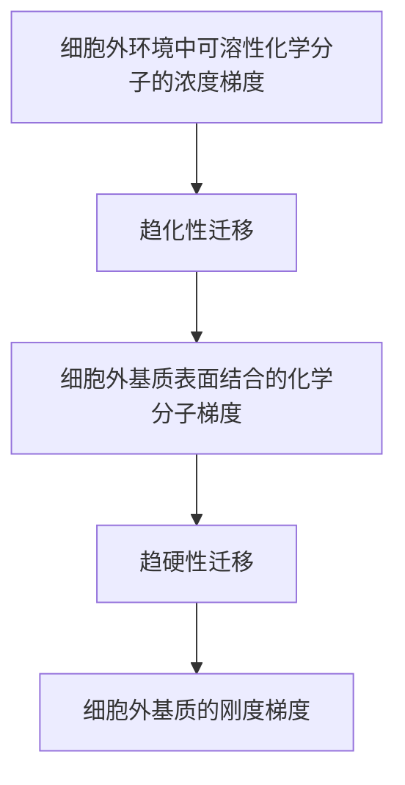

# 13 细胞迁移与组织形态发生

原始 PDF 第 417–429 页。

## 细胞迁移与组织形态发生

在发育、免疫应答和伤口愈合等重要的生理过程中，多种类型的细胞会进行迁移。细胞迁移也是疾病研究的关注重点，例如肿瘤转移就与肿瘤细胞的迁移密不可分。细胞迁移由物理或化学信号触发。细胞在接收这些信号后，细胞骨架（详见第14章）等产生响应，从而完成细胞的整体位移。细胞是构成复杂组织的基本单元，细胞迁移与变形是组织形态发生的微观机制。本章将分别介绍单细胞和群体细胞的迁移模式，并从力学角度分析细胞迁移和组织形态发生的调控机理。

## 13

---

394

13 细胞迁移与组织形态发生

## 13.1 单细胞迁移

单个细胞通过协调细胞骨架并与周围环境相互作用，获得驱动力并最终发生位移的过程叫作单细胞迁移。单细胞迁移的类型主要有以成纤维细胞为代表的间充质样迁移（mesenchymal migration）和以白细胞为代表的阿米巴样迁移（amoeboid migration）（图13-1）。前者在发育过程和肿瘤转移的上皮-间充质样转变中发挥作用，后者与免疫应答、伤口愈合等重要的生理病理过程密切相关。本章将分别介绍这两类迁移的过程和分子机制，并给出相应的物理模型。

图13-1 间充质样迁移和阿米巴样迁移

间充质样迁移具有细胞与外基质黏附较强、细胞迁移较慢、细胞表面与基底接触角较大等特点。而阿米巴样迁移具有细胞和基底黏附较弱、细胞迁移较快、细胞表面与基底接触角小等特点。某些肿瘤细胞在受限环境中会转变为阿米巴样迁移。

flowchart

图 13-2 间充质样细胞的迁移步骤分解

细胞向迁移前部伸出突起；在细胞前缘形成新的细胞-细胞外基质黏附结构；而在细胞后部的黏附结构发生解聚，细胞后部进而缩回，以实现整个细胞体往前缘方向的迁移。

## 13.1.1 间充质样迁移

多种类型的结缔组织细胞，如成纤维细胞、成骨细胞、成软骨细胞和脂肪前体细胞等，呈现间充质样细胞的形态，细胞较为铺展，与外基质形成较强的黏附。间充质样迁移包含多个步骤（图13-2）:首先细胞发生极化形成迁移前缘，前缘伸出富含微丝细胞骨架的突起（例如板状伪足和丝状伪足）；在细胞前缘处，新的细胞-细胞外基质黏附结构形成；而在细胞尾部的黏附结构发生解聚，使得细胞后部得以向前回缩，进而实现整个细胞体往前缘方向的位移。复杂的细胞信号转导影响细胞的极化，细胞的前缘和尾部分别经历不同的生化过程，细胞骨架、囊泡和一些细胞器的分布产生改变，参与调控细胞迁移的方向。

细胞板状伪足（lamellipodia）（图13-3A）是一种呈薄片状、平行于细胞底面的细胞突起，常见于迁移活跃的间充质样细胞。板状伪足内含有近似二维排列的微丝骨架网络，这一网络由Arp2/3复合物在细胞膜

---

13.1 单细胞迁移

395

text_image

A
B
C
细胞外基质

图13-3 板状伪足、丝状伪足和侵袭性伪足示意图

A. 板状伪足

text_image

分支状微丝

B. 丝状伪足

text_image

直链状微丝

C. 侵袭性伪足

natural_image

Illustration of a medical or biological structure with colored markers and a blue arrow, no visible text or symbols

基质金属蛋白酶

附近启动分支状微丝的成核与聚合而形成。研究者将板状伪足与细胞体分离后，发现脱离了细胞核和大部分细胞器的板状伪足可以自由爬行，这一现象体现出执行迁移的细胞组分具有高度的自组装特性。细胞丝状伪足（filopodium）（图13-3B）呈现手指样或丝状形态，也富含微丝骨架，但其形成可不依赖Arp2/3复合物和分支状微丝，而由直链状微丝形成。一些侵袭性癌细胞还能产生侵袭性伪足（invadopodium）（图13-3C），这也是一种富含微丝骨架的细胞突起结构，主要功能是通过分泌基质金属蛋白酶使细胞外基质局部降解，以利于细胞穿过基底膜等细胞外屏障。

间充质样细胞的前缘突起与细胞外基质之间可以形成黏着斑等黏附结构，这些黏附结构能够传递机械力和化学信号。整合素是介导细胞-外基质黏附结构形成的重要蛋白质，它们通过形成跨膜的异二聚体，介导细胞与细胞外基质之间的机械连接。细胞外基质中的配体与细胞膜上的整合素受体结合，改变整合素的构象并使其激活。激活的整合素暴露出踝蛋白（talin）等衔接蛋白的结合位点。踝蛋白等蛋白质结合整合素，并连接微丝骨架和肌球蛋白，实现从细胞外到细胞内的机械力传递。细胞-外基质连接具有高度的动态性，能响应外基质的刚度和密度，进行机械力转导，其机制可用分子离合器模型（molecular-clutch model）进行解释。在这一模型中，微丝的聚合推向细胞膜，并在细胞膜抵抗和肌球蛋白收缩的双重作用下形成朝向细胞内部的肌动蛋白回流，微丝-衔接蛋白-整合素-细胞外基质被看成是一种分子离合器，细胞-外基质连接处的机械力转导被类比为发动机不同轴之间的动态连接（图13-4）。当分子离合器的各组件产生接合时，传递到细胞外基质的力会抵抗肌球蛋白的收缩力，减缓肌动蛋白朝向细胞中心的回流，并促进肌动蛋白向细胞边缘聚合，支撑细胞突起。

## 13.1.2 阿米巴样迁移

阿米巴样迁移是一种快速的细胞运动模式，由富含肌动蛋白的伪足、静水压产生的胞泡（bleb）和高度收缩的尾足（uropod）驱动，其特征是对基底的黏附较弱，很

---

396

13 细胞迁移与组织形态发生

图13-4 分子离合器模型在分子离合器模型中，肌球蛋白收缩牵引肌动蛋白以速率 $\nu$ 移动。收缩力通过踝蛋白、整合素等分子传导到基底。基底硬度的不同以及分子结合/解离（$k_{\mathrm{on}} / k_{\mathrm{off}}$）的差异会导致细胞-外基质黏附呈现动态的断开/连接变化，类似于离合器的工作模式，因此得名。Fn，细胞外基质蛋白。

text_image

肌球蛋白II
肌动蛋白
踝蛋白
整合素
k_on/k_off
F_n
F_n
F_n
F_n
基底

少或没有细胞外基质降解。变形虫和淋巴细胞、白细胞、树突状细胞和部分癌细胞表现出阿米巴样迁移。

胞泡也是一种细胞膜的突起。皮质肌动蛋白收缩或破裂导致其与细胞膜短暂分离，形成突出于细胞体的鼓泡。然后细胞质从细胞体流向新形成的胞泡并使其膨胀。胞泡在扩张过程中不含肌动蛋白，其表面积的增加通过细胞膜从肌动蛋白皮质剥离和脂质对流共同实现。一旦扩张减慢，肌动蛋白皮质就会重建，并为胞泡的回缩过程提供动力（图13-5）。胞泡是细胞运动、分裂和凋亡过程中细胞形态学的共同特征。

通过对变形虫和淋巴细胞的形态学研究，提出了阿米巴样迁移的“溶胶-凝胶动力学”假说。在这种机制中，液化的细胞质通过物理肿胀等可能机制驱动细胞前部的伸出，而细胞质凝固和相关的收缩机制造成细胞后部的收缩。在这种类型的细胞运动中，牵引力可能由细胞进行阿米巴样迁移时的剧烈形变所介导。细胞形变造成其与三维环境中的纤维网络产生物理接触，从而可以为细胞运动提供支撑。

许多迁移细胞类型可以在间充质和阿米巴样迁移模式之间切换。体外实验结果表明，细胞内在因素（如黏附分子水平低和细胞收缩性高）和外在因素（如受限环境和不利于细胞黏附的底物）等都可以促进细胞从间充质样迁移转变为阿米巴样迁移。

图13-5 阿米巴样迁移中的胞泡动态示意图

text_image

迁移方向

---

13.2 群体细胞迁移

397

许多生物化学因素参与调控细胞迁移。例如，在伤口部位出现的表皮生长因子（epidermal growth factor，EGF）和血小板衍生生长因子（platelet derived growth factor，PDGF）等许多生长因子，能作为形态发生素或趋化因子显著提高单个成纤维细胞的迁移速度。细胞依据环境中某些化学物质的浓度方向而进行的定向迁移被称为趋化性迁移（图13-6，上），正趋化性指趋向较高化学物质浓度的运动，而负趋化性则相反。细胞在更高黏附性或更硬基底上通常施加更大的牵引力，因此基底黏附性或刚度的梯度会促使细胞产生极化。细胞向黏附性更强或刚度更高的区域进行的定向迁移分别称为趋触性迁移和趋硬性迁移（图13-6，中、下）。细胞迁移响应的生物物理信号并不仅限于基质刚度，外基质的形貌、黏弹性和应力松弛等均可对细胞的迁移产生影响。

flowchart

图 13-6 趋化性迁移、趋触性迁移和趋硬性迁移

## 13.2 群体细胞迁移

群体细胞迁移指的是多个细胞以整体性方式进行迁移，迁移的细胞间往往保持着密切的连接和相互作用。群体细胞迁移往往比单细胞迁移更为高效，在形态发生和伤口愈合等过程中发挥着关键作用，也与癌症转移有着密切关系。细胞间直接的物理相互作用以及细胞在群体层次上的行为特点都影响着细胞的群体迁移。基于延时成像和荧光显微镜的粒子成像测速等技术，能够得到群体细胞中速度场和应变张量的详细图谱。同时，活性物质理论的发展为理解细胞的集体运动提供了框架。“物理学应该用于阐明生物功能”的传统观点正在转变为“生物系统激发了新的物理理论，并允许我们对其进行测试”。“生物中的物理学”的概念现在与“物理中的生物学”的概念并行。

## 13.2.1 多细胞迁移的模式

尽管单细胞可能具有更高的瞬时速度，但它们的迁移定向性较差，会经常改变方向。而在群体细胞迁移中，一群细胞能以相近的速度朝向同一方向进行运动，且迁移的定向性较强，因此更为高效。对于群体细胞系统，细胞之间存在复杂的相互作用，包括细胞间黏附等力学作用、生化通信以及接触抑制等。这些细胞之间的相互作用会影响群体中细胞个体的动力学行为。

---

398

13 细胞迁移与组织形态发生

上皮细胞的一个特征是它们之间建立了稳定的细胞间黏附，而间充质细胞之间倾向于形成短暂和较弱的黏附。细胞-细胞连接由特定的跨膜蛋白质复合物介导，这些复合物又连接细胞内的骨架系统，从而实现细胞之间的力传递。细胞-细胞连接赋予群体细胞抵抗组织尺度拉伸的能力，而细胞骨架弹性可为群体细胞提供抵抗压缩的能力。在上皮细胞的运动中，细胞-细胞连接不仅维持了组织的整体性，也通过力传递调控相邻细胞的协同动态行为，还会在细胞相对滑动时导致彼此之间的摩擦。此外，细胞的收缩也对维持群体细胞迁移的协调性和高效性起着重要作用。再者，细胞运动还受到所处微环境（如基底刚度、电磁场、化学因子、几何约束和其它非运动细胞）的影响。这些因素使得群体细胞能够自发形成丰富多彩的动态迁移模式，如群体定向运动、旋涡运动和剪切流动等。

单个细胞的前缘突起等形态学特征在群体组织内的细胞中通常不明显（虽然有部分细胞产生延伸到邻近细胞下方的隐秘板状伪足）。因此，判断某一时刻群体细胞迁移的极性，通常通过测定其牵引力，而非依据其瞬时的形态学特征。在细胞力学中，牵引力通常被理解为细胞对其底层外基质施加的应力。细胞-基底牵引力是两个来源的总和:驱动细胞运动的主动牵引以及细胞和基底之间的被动摩擦。牵引力显微术等一系列新技术能够直接绘制细胞在迁移时对周围环境施加的力。

## 13.2.2 多细胞系统的拥堵转变

“无限大”的二维单层多细胞系统会自发产生旋涡运动模式，即介观尺度湍流。这种旋涡运动模式可以保持一定时间。随着细胞密度逐渐变大，细胞运动变得越来越慢，且相邻细胞之间的交换逐渐减少直至完全消失，致使细胞呈现“冻结”的状态。从介观尺度来看，整个单层多细胞系统从细胞密度低时的“流态”逐渐转变为最终高细胞密度时的“固态”。人们将这个过程称为多细胞系统的拥堵或者拥堵转变。牵引力显微术和细胞单层应力显微术可用于研究细胞的拥堵转变。研究表明，在某些情形下拥堵转变具有与传统意义上的相变一致的性质，因此在某种程度上可以将拥堵转变视为相变过程。从力学角度看，拥堵的发生往往伴随着屈服应力的出现，即系统变得具有一定抵抗剪切流动的能力，从而表现出类似固体的性质。细胞-细胞连接蛋白的更新造成细胞间黏附的重塑，这可以作为应力松弛的耗散源，调控组织的长期黏性响应。

拥堵的概念可拓展到伤口愈合过程中。伤口（自由空间）的出现可以降低细胞的拥堵程度，从而加快群体细胞运动。在伤口愈合初期，细胞运动较快，这被视为一个解拥堵过程；伤口愈合之后，组织恢复完整性，细胞逐渐再次变得拥堵，并逐步停止运动，这被视为一个拥堵过程。此外，细胞单层内的各细胞可以按照一定的规律排列，形成类似于晶体材料的拓扑缺陷。研究表明，细胞单层内的细胞取向和拓扑缺陷的演化与生物组织的生理状态密切相关。例如，在拓扑缺陷处细胞会发生从单层的挤出，这一过程可以降低拥堵程度，维持组织内稳态。

---

13.2 群体细胞迁移

399

## 13.2.3 多细胞迁移的模型

对多细胞迁移的研究可从亚细胞结构到细胞整体的多个尺度展开，常见的模型有细胞波茨模型、顶点模型、相场模型、活性网络模型、粒子模型和连续介质模型等。本节简要介绍二维多细胞迁移的几个常用模型及其适用场景。

## (1) 细胞波茨模型

细胞波茨模型（cellular Potts model，CPM）将单个细胞视为网格中的多个格子区域，通过格子区域的变化来模拟细胞迁移和形态的演变（图 13-7）。在这个模型中，每一个格子 $i = 1, \cdots, N$ 被赋予了状态 $\sigma_{i} = 1, \cdots, m$，并与其余 $m - 1$ 个细胞中的一个相互关联，该模型考虑了细胞之间或细胞与界面之间的张力，并结合细胞自身的极性来模拟群体细胞的运动模式。

最初这种可以自驱动的细胞波茨模型主要用于研究细胞单层中复杂流动的速度相关性，但后来它还被用于研究细胞单层中的流体-固体转变和玻璃态动力学、集体旋转、间隙闭合和组织延伸，例如发育过程中部分组织前部形成的指状不稳定突起。

## (2) 细胞顶点模型

细胞顶点模型能较好地反映细胞形态（尤其对于上皮组织）（图13-8），且相对简单，因而应用十分广泛。上皮细胞之间连接紧密，细胞呈现多边形。基于这种形貌特点，可以将单层上皮组织简化为二维多边形网络系统。在此多边形网络系统中，每个多边形代表一个细胞，且每3个细胞共享1个顶点，每两个相邻细胞共用一条边。对各顶点建立随机动力学方程，则可模拟上皮组织的演化。面积弹性能，源于细胞骨架系统的弹性；细胞收缩能，源于细胞微丝骨架系统的收缩；细胞之间的界面能，源于细胞皮质张力和细胞间黏附之间的竞争。若所研究系统只有一种细胞且忽略由细胞生长或生化因子引起的细胞性质改变，则可忽略细胞个体力学性质的差异性。

细胞所处环境多为液体环境，在迁移过程中受到周围流体的黏性阻力以及基底摩擦阻力作用，运动缓慢（速度 $v \approx 30 \mu \mathrm{m} / \mathrm{h}$），对应的细胞运动雷诺数很小（$Re = 10^{-5}$），因而多细胞系统可视为过阻尼系统，可忽略细胞运动的惯性效应。考虑各个顶点的力平衡，细胞各顶点位置 $r_i(t)$ 满足如下朗之万方程:

$$
\gamma \frac {\mathrm{d} \boldsymbol {r} _ {i}}{\mathrm{d} t} = - \frac {\partial U}{\partial \boldsymbol {r} _ {i}} + \boldsymbol {F} _ {i} ^ {(\mathrm{other})} 。 \tag {13-1}
$$

其中，$\gamma$ 为细胞与基底（外环境）之间的等效摩擦系数；$F_{i}^{(\text{other})}$ 为非保守力，包括细胞伪足的主动迁移力、细胞主动收缩力和随机力等。

除了细胞空间位置的改变，上皮组织的形貌演化还常常伴随着细胞重排，即细胞之间拓扑关系的改变，包括细胞嵌插、细胞

text_image

细胞 2
细胞 1

图 13-7 细胞波茨模型

两个不同细胞的网格通过不同颜色展示在图中。

---

400

13 细胞迁移与组织形态发生

图 13-8 顶点模型的拓扑变换

（A）T1变换，A、B细胞不断接近，破坏了C、D细胞之间的界面，重新建立了A、B之间的界面。（B）T2变换，左，A、B、C细胞包围面积到达阈值下的细胞，将其从多边形网格中去除，于是仅剩A、B、C三细胞之间的界面。右，当一个细胞的面积超过了阈值，便分裂为A、B两个不同细胞。

挤出和凋亡、细胞分裂等。为更准确地描述上皮形貌演化，在顶点模型中，各个顶点除需满足式（13-1）所示演化方程之外，还应允许细胞-细胞之间旧的黏附的破坏和新的黏附的形成。细胞重排可通过多边形网络系统的拓扑变换实现。细胞嵌插，即细胞-细胞邻居交换，又被称为T1变换（图13-8A）。当两个原本相互隔离的细胞A、B相互靠近至足够近的距离，它们可将阻挡在其间的邻居细胞C、D挤开，破坏原有的细胞-细胞界面ij，继续靠近直至黏附形成新的细胞-细胞界面 $i^{\prime}j^{\prime}$ 。

上皮组织的过度拥挤会导致细胞挤出和凋亡，称为T2变换。其过程如下:首先，细胞逐渐缩小；随后，细胞黏附断裂；最后，细胞与周围其

他细胞分离并从上皮组织中脱落。在顶点模型中，T2变换可按照如下准则和方法实现（图13-8B）:若某一细胞退化为三角形或四边形，且其面积小于某一阈值，则被从多边形网络中移除。此外，为研究上皮组织的生长过程，还需考虑细胞分裂。当细胞的面积超过某一阈值时，将分裂为两个子细胞A、B。一般而言，细胞分裂面的方向垂直于其长轴方向。

## (3) 相场模型

基于界面动力学的相场模型也能够在亚细胞精度上描述细胞迁移和形貌。然而与波茨模型不同的是，相场模型不依赖于网格，每个细胞 $i = 1, \dots, N$ 都由一个相场 $\Phi_{i}(r, t)$ 来描述，相场在细胞内为1，在细胞外为0（图13-9）。类似描述细胞形貌的方法还有轮廓函数等。一些模型还会使用额外的相场来描述细胞内的细胞核等结构。

细胞间相互作用被纳入了相场的自由能泛函中。

相场模型主要用于研究细胞间相互作用导致的细胞群体迁移。已有研究表明，当细胞极性与细胞形状的不对称性相耦合时，可变形细胞之间的碰撞导致了细胞-细胞

速度的对齐和集体运动。相场模型在上皮单层中再现了实验中所观察到的群体振荡现象。

## (4) 连续介质模型

群体细胞的连续介质模型不讨论单个细胞，而是在粗粒度水平上研究多细胞尺度的迁移和组织形貌。在该方法中，细胞群体由速度、极性和细胞密度等场描述。可以根据流体动力学原理，并遵守对称性和守恒定律写出场的通用动力学方程。

关键的建模步骤是建立将偏应力张量 $\sigma^s$ 和牵引力 $T$ 与速度、极性和密度场相关联的本构方程，从而在现象学上反映粗粒度水

text_image

相场中
Φ(x,y)
1
0
x
y

图13-9 相场模型一个细胞的相场示意。

---

13.3 组织形成的生物力学基础

401

平的细胞相互作用。

胚胎发育、组织再生和癌症转移等多种生理病理过程通常会出现不同细胞间的相互作用。针对此类现象，连续介质模型也被用于研究不同细胞单层之间的界面动力学。该理论可以捕捉界面形貌、拓扑缺陷动力学、界面流场特征等演化行为，发现拓扑缺陷是导致界面演化的重要因素，这一结果也得到了细胞单层界面互作实验的验证。

## 13.3 组织形成的生物力学基础

细胞迁移是多细胞复杂组织建立和维持的基础。从原肠胚形成过程中上皮的大规模迁移到运动神经系统发育过程中单个细胞的运动，形态发生可以看作是细胞迁移和变形的结果。一系列组织重排塑造了人体的不同部位和各种器官。为实现这种重塑，细胞机械力通过压缩、拉长或弯曲，转化为组织的形变。细胞和组织产生机械力的核心装置是细胞骨架和马达蛋白。它们可以稳定细胞-外基质和细胞-细胞黏附，也可以形成跨细胞尺度的收缩结构。细胞的形状和组织的拓扑结构也影响组织的形态发生。细胞的分裂和细胞层之间的相对运动等能改变细胞-细胞相互作用，影响组织拓扑结构和延展特性。迁移的细胞能感知并响应组织力学，诱导瞬时或长久性的组织改变，包括细胞外基质刚度增加、外基质形变和组织的拥堵转变等。

## 13.3.1 多细胞系统的细胞形状和取向

细胞迁移的动力源自细胞内化学能向机械能的转化，而迁移的方向受细胞极化的控制。当细胞发生极化时，细胞沿前进的方向伸出伪足，致使细胞变得细长而取向性明显增强。在群体细胞系统中，不同细胞的运动变形相互耦合，而形状和取向亦相互约束，需要满足一定的物理规律。

在多细胞系统中，细胞的取向受到周边细胞的相互约束和影响。在C2C12小鼠成肌细胞单层中观察到两种拓扑缺陷，即 $+1 / 2$ 缺陷和-1/2缺陷（图13-10）。大量实验表明，单层多细胞系统的拓扑缺陷通常只有这两种。

鉴于细胞单层在大尺度上呈现出类似液晶的结构图案，并考虑到细胞的主动收缩能力，单层多细胞系统也常被视为活性液晶系统。

## 13.3.2 群体细胞振荡

周期性振荡动力学行为在生命系统内广泛存在。从生物钟、体节发育和神经冲动，到细胞周期、免疫调控和信号转导，生物系统中各组分的周期性变化帮

natural_image

Microscopic image of cellular or particulate structures with blue and red markers, scale bar 300 μm (no text or symbols beyond scale indicator)

+1/2拓扑缺陷

-1/2拓扑缺陷

图13-10 +1/2和-1/2拓扑缺陷

---

402

13 细胞迁移与组织形态发生

助生命体维持稳定的节律、产生正确的发育结构、对外界信息做出精准而定量的响应。在这些过程中，往往会涉及多种振荡信号之间的相互作用。对于不同的系统和生物过程，振荡周期跨度很大，从几秒到几十个小时不等。这些动力学行为源于一些生物功能所要求的主动程序性调节，如昼夜节律，或者对环境的被动响应。生物振荡通常由霍普夫分岔引发，并且当系统演化至越过其分岔点时，系统将由平衡状态失去稳定性而进入一个极限环。因此，细胞振荡可看作生物系统的一种非平衡自组织机制。

细胞形状或者面积振荡存在于动物体轴分割、组织延伸、胚胎内陷和组织闭合等各种形貌发生过程中，且对演化调控和信息传递起着关键作用。例如，在果蝇胚胎发育过程中，中胚层内陷和背部闭合时细胞会发生群体振荡。

群体细胞振荡的发生涉及生物学、化学和力学机制在分子尺度、亚细胞尺度和超细胞尺度的耦合协调。大量实验研究表明，细胞振荡现象源于细胞内微丝骨架-肌球蛋白的主动收缩，且通常和其它细胞内的生化信号通路耦合。对振荡现象的观测推动了相关理论模型的建立，主要可归为两类:一类是基于力-化学耦合的模型，这类模型通过将细胞膜张力与肌动蛋白调控通路耦合来阐明单细胞或者多细胞振荡现象；另一类是棘轮模型，该模型将皮质微丝骨架-肌球蛋白或者超细胞微丝环视作一个利用收缩-松弛循环来驱动细胞或组织振荡的程序化装置。

## 13.3.3 管腔形成

柱状管腔结构存在于生物体内的许多器官中，在生理过程中发挥着至关重要的作用。例如动物体内的气管承担着气体输运的任务，血管负责血液的运输等。上皮组织的管腔化过程很大程度上依赖细胞的集体迁移。该过程往往发生在复杂的三维生理环境中，细胞面临高曲率曲面和空间限域的微观环境。管腔的内表面存在多种不同的几何形貌，如人的空肠内壁存在轴对称形貌，食道具有环向褶皱。这些形貌的形成不仅与生物体的基因调控相关，也与物理因素密不可分。生物软组织通常呈现非均匀的生长特征，并由此产生应力，进而影响软组织的形态。当应力足够大时，可导致结构失稳或形貌转变，例如产生裂纹等。生物系统内管腔组织的黏膜层发生病变时，可能导致黏膜层厚度的变化，进而导致表面失稳形貌发生变化，产生与正常组织不同的形貌。探讨黏膜层厚度变化对失稳形貌的影响，对软组织病变具有临床参考意义。

管腔模型构建如图13-11所示，图中的双层圆柱管腔结构，内层为较硬的膜，外层为软基底。该模型可以模拟血管、肠道等在不同环境下的生长与失稳。肠道的黏膜由内部的黏膜层、黏膜下层及外部的肌肉层组成，外部的肌肉层提供约束和力学支撑，故可以将其处理成固定约束。建立如图13-11所示的柱坐标系，初始构型 $x(R,\theta ,Z)$ 中的内径为 $A$ ，界面半径为 $B$ ，外径为 $C$ ；在生长后，分别变形到当前构型 $x(R,\theta ,Z)$ 中的 $a$ 、 $b$ 和 $c$ 。假设圆柱的长度 $L$ 在变形前后保持不变，从初始构型到当前构型的变形可用变形梯度张量 $F = \mathrm{dx} / \mathrm{d}X$ 描述。基于不同管腔软组织所处的体内环境，可以考虑两种类型的圆柱外表面边界条件，其一是外表面自由，其二是外表面固定。

---

13.3 组织形成的生物力学基础

403

text_image

y
R
θ
L
A
B
C
x
z
y
r
θ
a
b
L
x
z
c

图13-11 圆柱管腔结构示意图

血管通常由内膜、中膜、外膜三层结构组成，血管壁也具有黏弹性，与其它软组织一样具有蠕变、应力松弛等力学特性。动脉具有明显的屈服强度。研究者测量了动脉的应力-应变曲线，验证了动脉的非线性、各向异性，为相关模型构建及移植物的选择提供了参考（图13-12）。与动脉相比，静脉的应力-应变曲线相似，但弹性模量较小。近年来各种人造血管或脱细胞血管支架逐渐被用于血管移植，而正是这些移植材料的力学特性和生物相容性决定了其适用性。

对动脉粥样硬化患者的下肢动脉进行力学测试和组织学观察，发现在二维拉伸时，所有动脉的周向强度大于轴向强度，但与正常血管相比，患病动脉的周向顺应性增加而轴向顺应性减少，这种各向异性的下降可能由胶原排列方向改变、弹性蛋白降解、平滑肌细胞变性等因素造成，在血管疾病诊断和外科操作中应当结合患者病史考虑该力学性能的改变。

## 13.3.4 骨骼肌、肌腱和韧带的生物力学特性

器官水平的肌肉应力-应变曲线具有典型的软组织特性，具有黏弹性，是一种非线性、各向异性的软组织。肌肉的主动收缩功能依赖于其特殊的微观结构（详见生理学教材）。这种特殊的微观结构和各级结构之间的细胞外基质也是肌肉的被动力学特性产生的基础。

“触变性”形容肌肉受外力作用或主动收缩后力学特性发生改变的特性，不同于弹性和黏性。触变性是动作调节和肌肉控制的生理基础，是横纹肌的基本性质。横桥在每个肌节中联结肌动蛋白和肌球蛋白，在肌肉收缩中起重要作用。当肌肉放松后，横桥通常自动解离，但有约 $1\%$ 的横桥在解离后会自发形成新的联结，赋予肌肉新的力学特性。

胶原纤维约占肌腱干重的 $80\%$ ，是肌腱多层次精致结构的基础，其平行排列使组织具有刚度和弹性。与多数黏弹性材料一样，肌腱和韧带亦具有非线性、滞后的应力-应变曲线，同一维拉伸初期，应力-应变曲线低平，此时平滑肌和屈曲状态的胶原纤维受力，血管的刚度和弹性模量较小。当拉伸逐渐增大时，动脉的刚度和弹性模量随着胶原纤维承载数目的增加而增大，曲线呈过渡型。之后，胶原纤维主要承受载荷，刚度较大，弹性模量增加缓慢，故曲线接近直线，直至断裂点。

line

| Feature | Description |
| --- | --- |
| Y-axis | 应力 |
| X-axis | 应变 |
| Point 1 | 破坏强度（断裂点） |
| Point 2 | 屈服强度（过渡点） |

图13-12 动脉应力-应变曲线

---

404

13 细胞迁移与组织形态发生

line

| Feature | Description |
| --- | --- |
| Y-axis | 应力 |
| X-axis | 应变 |
| Key Points | 破坏强度, 屈服强度, 弹性极限, 线性形变区, 纤维伸展部分 |

图 13-13 肌腱轴向拉伸的应力 - 应变曲线

拉伸最初阶段，肌腱内卷曲的纤维逐渐被拉直。此后拉直的胶原纤维表现出弹性，该段应力-应变关系呈线性关系，斜率即为弹性模量。弹性范围外，肌腱纤维开始产生微观撕裂，应力在屈服阶段导致宏观的破坏愈发明显，并最终在受力达到强度极限时产生断裂。

时体现出各向异性、蠕变及应力松弛等特点。与肌肉不同，肌腱只有在肌肉收缩过程中才承受载荷而无法主动收缩，且肌腱承受的应力主要受肌肉收缩量和肌肉与肌腱体积比的影响。另外，肌腱可通过有无腱鞘划分为有鞘肌腱和无鞘肌腱，其中有鞘肌腱承受的摩擦力较大且表现出精确的力的方向性，可以完成各种精细动作。相比之下，韧带受力更加复杂，如脊柱韧带在受拉伸和压缩的同时还受扭转和剪切作用，而环状韧带作为腱鞘的一部分可改变力的传导方向。了解不同部位肌腱和韧带的特性和功能，有利于软组织损伤的诊断和对预后的判断（图13-13）。

软组织生物力学的研究和发展对骨科临床实践具有重要意义，研究的不断深入促进了新的有效治疗手段的开发，有利于假体和移植物的改进。建立更加可靠的软组织力学模型，开展更深层次的生物力学研究，将进一步推动临床应用。

## ※ 本章小结

本章探讨了细胞迁移的种类，并分别从单细胞迁移和群体细胞迁移的特征、驱动力和生理病理意义等方面展开了阐述。通过从亚细胞到群体细胞尺度的不同模型，可以刻画和模拟细胞迁移行为，从中提取重要的规律并预测实验现象。总的来说，细胞迁移依赖细胞骨架的自组装装置，协同调节细胞极性和细胞黏附，从而实现细胞的整体位移。其方向性的选择与细胞生化信号和力学信号的转导密切相关。细胞骨架是如何为细胞实现复杂的形态和力学功能提供支撑和动力的？我们将在下一章进行深入学习。

## ※ 思考题

1. 如何区分阿米巴样细胞迁移和间充质样细胞迁移？
2. 分别举出趋化性迁移、趋触性迁移和趋硬性迁移的两个例子。
3. 假设分别有软、硬两种基底，对应的弹性系数分别是 $0.01\mathrm{pN / nm}$ 和 $100\mathrm{pN / nm}$，未受到牵引力时肌动蛋白的移动速率 $v_{0} = 120~\mathrm{nm / s}$，当受到牵引力 $F$ 时，其移动速率 $v_{\mathrm{u}} = v_{0}\left(1 - \frac{F}{F_{\mathrm{stall}}}\right)$，其中 $F_{\mathrm{stall}} = 150\mathrm{pN}$。分子离合器连接肌动蛋白和基底，它的弹性系数是 $5\mathrm{pN / nm}$。不考虑分子离合器与肌动蛋白或基底的解离，绘制出基底形变量和肌动蛋白移动速率随时间变化的曲线，描述在不同基底硬度上曲线的特征，思考其生理含义。如果考虑分子离合器与肌动蛋白的解离，曲线会发生什么变化？
4. 通过将细胞铺种在超低黏附的 U 型底孔板，可以使得细胞聚集成为球形细胞团块。这种三维细胞培养技术可以更好地反映细胞面对的真实环境。尝试设计实验研究细胞

---

扩展阅读

405

球中的多细胞迁移行为，思考二维和三维的迁移行为有何不同。

## ※ 扩展阅读

## 综述

- Alert R, Trepat X. Physical models of collective cell migration[J]. Annu Rev Condens Matter Phys, 2020, 11:77–101.
- Lin S Z, Chen P C, Li B, et al. Advances in collective cell dynamics[J]. Sci Bull, 2020, 65:3100–3110.
- SenGupta S, Parent C A, Bear J E. The principles of directed cell migration[J]. Nat Rev Mol Cell Biol, 2021, 22(8):529–547.
- Trepat X, Chen Z Z, Jacobson K. Cell migration[J]. Compr Physiol, 2012, 2(4):2369-2392.
- Zhang D Q, Chen P C, Li Z Y, et al. Topological defect-mediated morphodynamics of active-active interfaces[J]. Proc Natl Acad Sci USA, 2022, 119(50):e2122494119.
