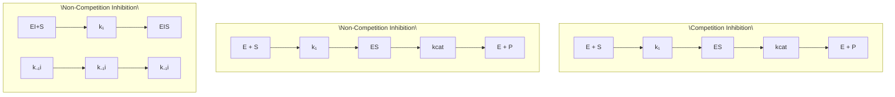
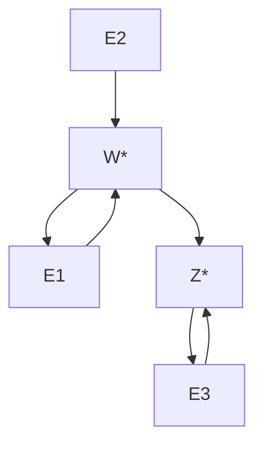
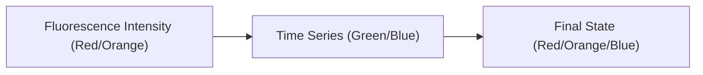

# 18 基本生物过程的数学模型

原始 PDF 第 517–534 页。

# 基本生物过程的数学模型

上一章介绍了定量模型在理解复杂生命现象中的必要性，本章将介绍描述基本生物过程，如酶促反应、基因表达的定量数学模型，它们是第19、20章中理解更复杂的生物网络的动力学和功能的基础。在对细胞中的基本生物过程进行数学建模时，我们的中心目标是建立一个描述所关心的生物量（变量）随时间演化的方程。根据它们变化的性质，模型通常可以分为确定性模型和随机模型。这是由于不同细胞组分的丰度差异巨大。例如，在一个典型的大肠杆菌细胞中，含量最多的代谢物谷氨酸有 $10^{8}$ 个，大多数其它代谢物的数量从几百到 $10^{7}$ 数量级。因而，确定性模型如常微分方程对于代谢反应是一个不错的描述。

相比之下，大肠杆菌细胞中生物大分子的拷贝数则要少得多:只有1个DNA拷贝；每种正在表达的基因的mRNA拷贝数平均不到10个；通常转录因子的拷贝数范围从1到1000不等，如调控乳糖操纵子的lac抑制子大约只有10个。由于生化反应始于不同反应物的碰撞，组分拷贝数非常低的生物过程本质上是随机的。许多细胞群体间的异质性可以归因于这种随机性，如基因表达的异质性。这种随机性在细胞信号传导、表型转换、多细胞发育，以及演化中也起着重要作用。这些系统最适合用随机过程来描述。

本章的前两节将介绍酶促反应和基因表达过程的确定性数学模型，即常微分方程，并探讨这些简单模型的稳态和瞬态性质。第三节介绍基因表达过程中的噪声和随机模型。

18

---

494

18 基本生物过程的数学模型

## 18.1 酶促反应动力学

细胞中几乎所有的代谢过程都需要酶的参与。通过酶的作用，生化反应速率可以加速5\~17个数量级。另一方面，酶对所催化的底物也具有很强的选择性。酶催化的基本原理可以用过渡态理论来描述，简单来讲，酶有助于降低反应所需的活化能，如图18-1所示。这种活化能的降低源于酶与其底物形成的许多弱的相互作用。本节介绍基本的酶促反应动力学的建模过程，并以磷酸化和去磷酸化环为例介绍其在研究信号转导过程中的应用。

## 18.1.1 米氏反应动力学

实验上很早就发现酶促反应中产物生成速率 $\nu$ 和底物浓度[S]（方括号是化学中表示浓度的符号）之间遵循一个简单的非线性关系。具体来讲，$1 / \nu$ 与 $1 / [S]$ 成正比，即双倒数（对易）关系。1913年，利奥诺·米夏埃利斯（Leonor Michaelis，1875—1949）和莫德·门滕（Maud Menten，1879—1960）提出了一个用于解释酶催化反应动力学的机制，现在被称为M-M动力学或米氏反应动力学。该模型的关键假设是酶E首先与底物S可逆结合形成复合物ES，然后在较慢的第二步中分解为产物P和游离酶E。这个机制可以用下面的方式简要表示:

$$
\mathrm{E+S} \underset {k _ {\mathrm{off}}} {\overset {k _ {\mathrm{on}}} {\rightleftharpoons}} \mathrm{ES} \xrightarrow {k _ {\mathrm{cat}}} \mathrm{P+E}.
$$

其反应速率 $v$ （或产物生成速率）可以用自由底物浓度[S]的一个简单函数来描述:

$$
v = \frac {\mathrm{d} [ \mathrm{P} ]}{\mathrm{d} t} = \frac {V _ {\max} [ \mathrm{S} ]}{K _ {\mathrm{m}} + [ \mathrm{S} ]} 。 \tag {18-1}
$$

其中， $V_{\mathrm{max}}$ 是反应可达到的最大速率，它取决于酶的活性和浓度； $K_{\mathrm{m}}$ 是表征酶和底物

之间相互作用的常数。下面，我们简要介绍如何从基本化学反应速率推导出式（18-1）。我们将考虑空间均匀的生化反应体系，在这种情况下反应方程依赖于原子守恒和质量作用定律。

19世纪中期，卡托·古尔德贝格（Cato Maximilian Guldberg，1836—1902）与彼得·沃格（Peter Waage，1833—1900）提出在一个充分混合的稀溶液中，基元反应的反应速率与反应物浓度的幂的乘积成正比，这便是质量作用定律（参见第2章）。这里浓度的幂是指基元反应方程式中的化学计量数（反应方程式中参与反应的物质前面的系数）。因此，根据质量作用定律，对于酶促反应的米氏模型，我们有

line

| 反应时刻 | S (自由能) | EP (自由能) |
| --- | --- | --- |
| E+S | ~0 | ~0 |
| ES | Peak | Negative Peak |
| EP | ~0 | Positive Peak |

图18-1 有酶催化和无酶催化的反应能量示意图

无酶催化情况下的自由能垒（橙线）远高于有酶催化的反应（蓝线）。酶首先与底物结合形成一个复合物ES，然后是稳定过渡态 $\mathrm{ES}^{\ddagger}$，最后释放产物。$\Delta$ 表示终态自由能与初态自由能的差值。

---

18.1 酶促反应动力学

495

$$
\frac {\mathrm{d[ES]}}{\mathrm{dt}} = k _ {\mathrm{on}} [ \mathrm{E} ] [ \mathrm{S} ] - k _ {\mathrm{off}} [ \mathrm{ES} ] - k _ {\mathrm{cat}} [ \mathrm{ES} ] _ {\circ}
$$

在反应达到平衡后，中间复合物浓度为

$$
\left[ \mathrm{ES} \right] = \frac {k _ {\mathrm{on}}}{k _ {\mathrm{cat}} + k _ {\mathrm{off}}} \left[ \mathrm{E} \right] \left[ \mathrm{S} \right] _ {\circ} \tag {18-2}
$$

如果考虑底物是足量的（[S]随时间的变化可忽略），由酶的质量守恒条件

$$
\left[ \mathrm{E} \right] + \left[ \mathrm{ES} \right] = \left[ \mathrm{E} \right] _ {\mathrm{tol}}
$$

和式（18-2），我们得到产物的生成速率为

$$
v = k _ {\mathrm{cat}} [ \mathrm{ES} ] = \frac {V _ {\mathrm{max}} [ \mathrm{S} ]}{K _ {\mathrm{m}} + [ \mathrm{S} ]},
$$

这正是式（18-1）。在上面的推导中，我们定义了最大反应速率为 $V_{\mathrm{max}} = k_{\mathrm{cat}}[\mathrm{E}]_{\mathrm{tot}}$，底物和酶的解离常数为 $K_{\mathrm{m}} = \frac{k_{\mathrm{cat}} + k_{\mathrm{off}}}{k_{\mathrm{on}}}$。

米氏动力学表明:当底物浓度 $[\mathrm{S}]\ll K_{\mathrm{m}}$ 时， $v\approx \frac{V_{\mathrm{max}}}{K_{\mathrm{m}}}$ [S]，即速率与底物浓度成正比，这是酶工作的线性区间；而当 $[\mathrm{S}]\gg K_{\mathrm{m}}$ 时， $v\approx V_{\mathrm{max}}$ ，在这个范围内反应速率恒定且与底物浓度无关，是酶工作的饱和区间（图18-2）。

米氏动力学是最简单的酶动力学之一，在这里我们只简要介绍一些米氏动力学的变种，即酶活性的调节和别构效应（allostery）。

## (1) 酶活性的调节

在细胞中，许多分子可以与酶相互作用并调节其活性。那些减慢催化反应的分子被称为酶抑制剂。酶活性的抑制是细胞中调控生化反应速率的主要方式之一。这种抑制又可以分为两个类别:竞争性抑制和非竞争性抑制（图18-3）。当底物和抑制剂结

line

| 底物浓度 [S] | 反应速率 |
| --- | --- |
| Km | 1/2 Vmax |
| Vmax | Vmax |

图18-2 米氏反应动力学中反应速率与底物浓度之间的关系当 $[S] \ll K_{\mathrm{m}}$ 时，反应速率 $v$ 正比于浓度，即线性区域；而当 $[S] \gg K_{\mathrm{m}}$ 时，反应速率基本恒定，即酶工作在饱和区域。

flowchart

图 18-3 酶活性的两类抑制调节

---

496

18 基本生物过程的数学模型

合在酶的同一位点时，称为竞争性抑制；当底物和抑制剂结合在酶的不同位点时，则称为非竞争性抑制。在竞争性抑制条件下，考虑酶和抑制剂之间的解离常数 $K_{\mathrm{i}} = \frac{k_{-1\mathrm{i}}}{k_{1\mathrm{i}}} = \frac{[\mathrm{E}][\mathrm{I}]}{[\mathrm{EI}]}$，类比上述米氏动力学的推导，可以得到产物生成速率:

$$
v = \frac {V _ {\mathrm{max}} [ \mathrm{S} ]}{\left(1 + \frac {[ \mathrm{I} ]}{K _ {\mathrm{i}}}\right) K _ {\mathrm{m}} + [ \mathrm{S} ]} 。 \tag {18-3}
$$

将上式和式（18-1）对比可以发现，竞争性抑制剂通过因子 $1 + \frac{[I]}{K_i}$ 有效地降低了底物和酶之间的亲和力。

而对于简单的非竞争性抑制的催化反应，底物和抑制剂与酶的结合能力互不影响，但同时与它们结合的酶（EIS）不能生成产物，可推导出产物的生成速率为

$$
v = \frac {1}{1 + \frac {[ \mathrm{I} ]}{K _ {\mathrm{i}}}} \cdot \frac {V _ {\max} [ \mathrm{S} ]}{K _ {\mathrm{m}} + [ \mathrm{S} ]} 。
$$

因此，非竞争性抑制剂通过因子 $1 + \frac{[I]}{K_i}$ 降低了酶的催化速率。

## (2) 多结合位点和别构效应

许多蛋白质或酶是由不同的亚基或单体组成的寡聚体，每个亚基或单体都带有一个结合或催化位点。一个位点与配体的结合往往会影响其它位点与配体的亲和力，这种效应称为别构效应。考虑一个具有两个相同结合位点的二聚体蛋白质，且第一个位点与配体的结合有助于第二个位点的结合。反应为

$$
\mathrm{E} + \mathrm{S} \xrightarrow [ k _ {1 -} ]{k _ {1 +}} \mathrm{ES}, \mathrm{ES} + \mathrm{S} \xrightarrow [ k _ {2 -} ]{k _ {2 +}} \mathrm{ES} _ {2},
$$

其中 E 是二聚体蛋白质，S 是底物。在完全协同作用的情况下，即第二个反应比第一个反应快得多，因此 ES 的浓度可以忽略不计。结果是 E 要么是处于完全非结合状态，要么处于与两个配体同时结合的状态，上述两个反应可简化为

$$
\mathrm{E} + 2 \mathrm{S} \underset {k _ {-}} {\overset {k _ {+}} {\rightleftharpoons}} \mathrm{ES} _ {2 \circ}
$$

由质量作用定律和平衡条件，我们得到被配体占据的结合位点的比例为

$$
r = \frac {\left[ \mathrm{ES} _ {2} \right]}{\left[ \mathrm{E} \right] _ {\mathrm{total}}} = \frac {\left[ \mathrm{S} \right] ^ {2}}{K _ {\mathrm{m}} ^ {2} + \left[ \mathrm{S} \right] ^ {2}},
$$

其中 $K_{\mathrm{m}} = \left(\frac{k_{-}}{k_{+}}\right)^{\frac{1}{2}}$ 是有效解离常数。通常，对于具有 $n$ 个亚基结合位点或的蛋白质，我们有

$$
r = \frac {\left[ \mathrm{S} \right] ^ {n}}{K _ {\mathrm{m}} ^ {n} + \left[ \mathrm{S} \right] ^ {n}} 。
$$

---

18.1 酶促反应动力学

497

这种反应速率随浓度[S]变化的形式被称为希尔函数，其中 $n$ 被称为希尔系数。当 $n$ 非常大时，该函数变成阶梯函数或开关。在20世纪初，阿奇博尔德·希尔（Archibald Hill，1886—1977）首先用上述函数来拟合血红蛋白与氧气结合/解离的实验数据，得到的希尔系数为2.7。我们现在知道每个血红蛋白有四个结合位点，这表明氧与血红蛋白之间的相互作用并不是完全的协同作用。这种不完全的协同作用，可以用莫诺-怀曼-尚热（MWC）模型描述（知识窗18-1）。

## 知识窗18-1

## 莫诺 - 怀曼 - 尚热（MWC）模型

雅克·莫诺（Jacque Monod，1910—1976）、杰弗里斯·怀曼（Jeffries Wyman，1901—1995）、让-皮埃尔·尚热（Jean-Pierre Changeux）在1965年提出了解释上述不完全协同作用的机制，该机制现在被称为MWC模型。MWC模型假设配体介导的不同特异性结合位点之间的间接相互作用是协同作用产生的原因，这是细胞中一类重要的蛋白质活性调控机制。该模型具体的假设如下:①酶具有 $n$ 个相同的亚基；②每个亚基可以处于两种状态R和T，它们与配体有着不同的解离常数 $K_{\mathrm{R}}$ 和$K_{\mathrm{T}}$ ；③在没有配体时，R和T之间的平衡常数（或异构常数）为 $L = \frac{[\mathrm{T}]_0}{[\mathrm{R}]_0}$ 。定义 $\alpha = \frac{[\mathrm{S}]}{K_{\mathrm{R}}}$ 和 $c = \frac{K_{\mathrm{R}}}{K_{\mathrm{T}}}$ 。在平衡状态下，处于R状态的亚基所占的比例为

$$
\overline {{R}} = \frac {(1 + \alpha) ^ {n}}{L (1 + c \alpha) ^ {n} + (1 + \alpha) ^ {n}}, \tag {18-4}
$$

$$
\bar {Y} = \frac {L c \alpha (1 + c \alpha) ^ {n - 1} + \alpha (1 + \alpha) ^ {n - 1}}{L (1 + c \alpha) ^ {n} + (1 + \alpha) ^ {n}} 。 \tag {18-5}
$$

注意到 $c = 1$ （活化和非活化状态下蛋白质与配体结合常数相同），且 $L$ 很小时，“饱和函数”[式（18-4)]退化为米氏反应的形式:

$$
Y = \frac {\alpha}{1 + \alpha} = \frac {[ \mathrm{S} ]}{[ \mathrm{S} ] + K _ {\mathrm{R}}};
$$

当 $c \ll 1$ 时，式（18-5）简化为

$$
\overline {{Y}} = \frac {\alpha (1 + \alpha) ^ {n - 1}}{L + (1 + \alpha) ^ {n}}.
$$

图18-4展示了不同 $L$ 、 $c$ 值下的 $\bar{Y}$ 与 $\alpha$ 的关系。可以看到， $L$ 越大，或者 $c$ 很小时，协同效应越明显。MWC模型已成为解释各种生物现象的有益概念框架，例如配体-受体结合、配体门控离子通道、趋化性、染色质结构和基因调控等。

实际结合配体的位点比例为

图 18-4 具有不同常数 L、c 的饱和函数理论曲线（希尔系数 n=4）

(A) L 可变，c = 0。

（B）c 可变，L = 1000。

---

498

18 基本生物过程的数学模型

flowchart

This diagram illustrates the biochemical reaction pathways involving ATP, ADP, and E* in two different experimental conditions, showing how various intermediates (E, K, E*, P) are converted into products.

图18-5 蛋白质的磷酸化和去磷酸化的反应方程

## 18.1.2 信号转导的建模

在细胞的信号转导过程中，酶蛋白的主要作用是使下游反应产生和传输信号。作为信号分子的酶通常有“活化”和“非活化”两种状态，酶处于活化状态的比例即代表了信号分子的活性。同时，磷酸化和去磷酸化是细胞中广泛存在的信号转导调控机制。一般来说，一个蛋白质的全部生化活性都会在磷酸化之后的状态 $\mathbf{E}^{*}$ 展现。

蛋白质的磷酸化和去磷酸化分别由激酶（kinase，

K）和磷酸酶（phosphatase，P）催化，该过程如图18-5所示，其中ATP、ADP、$\mathrm{P_i}$ 分别是腺苷三磷酸、腺苷二磷酸和磷酸。在细胞中，它们的浓度通常是恒定的。

根据质量作用定律，我们可以列出所有反应物浓度随时间演化的动力学方程。和前面的分析方法类似，我们假设中间体EK和 $\mathrm{E}^{*}\mathrm{P}$ 处于稳态，即其生成速率等于消耗速率，于是有:

$$
k _ {1 +} \left[ \mathrm{E} \right] \left[ \mathrm{K} \right] - (k _ {1 -} + k _ {2}) \left[ \mathrm{EK} \right] = 0,
$$

$$
k _ {3 +} \left[ \mathrm{E} ^ {*} \right] \left[ \mathrm{P} \right] - (k _ {3 -} + k _ {4}) \left[ \mathrm{E} ^ {*} \mathrm{P} \right] = 0 。 \tag {18-6}
$$

由此可以定义两个常数:

$$
K _ {\mathrm{mK}} = \frac {k _ {2} + k _ {1 -}}{k _ {1 +} [ \mathrm{E} ] _ {\mathrm{tot}}} = \frac {[ \mathrm{E} ] [ \mathrm{K} ]}{[ \mathrm{EK} ] [ \mathrm{E} ] _ {\mathrm{tot}}}, K _ {\mathrm{mP}} = \frac {k _ {4} + k _ {3 -}}{k _ {3 +} [ \mathrm{E} ] _ {\mathrm{tot}}} = \frac {[ \mathrm{E} ^ {*} ] [ \mathrm{P} ]}{[ \mathrm{E} ^ {*} \mathrm{P} ] [ \mathrm{E} ] _ {\mathrm{tot}}}\circ
$$

$K_{\mathrm{mK}}$ 和 $K_{\mathrm{mP}}$ 是归一化的激酶和磷酸酶与底物的解离常数，即米氏方程中的 $K_{\mathrm{m}}$ 除以 $[\mathrm{E}]_{\mathrm{tot}}$。

当上述反应体系达到稳态时，磷酸化的蛋白质 $\mathrm{E}^{*}$ 的浓度也保持不变，即

$$
k _ {2} \left[ \mathrm{EK} \right] - k _ {3 +} \left[ \mathrm{E} ^ {*} \right] \left[ \mathrm{P} \right] + k _ {3 -} \left[ \mathrm{E} ^ {*} \mathrm{P} \right] = 0 。 \tag {18-7}
$$

由式（18-6）和式（18-7）可以得到 $k_{2}[\mathrm{EK}] = k_{4}[\mathrm{E}^{*}\mathrm{P}]$，由此定义常数 $\theta$:

$$
\theta = \frac {k _ {2}}{k _ {4}} = \frac {[ \mathrm{E} ^ {*} \mathrm{P} ]}{[ \mathrm{EK} ]} 。 \tag {18-8}
$$

同时，体系中蛋白质E、激酶K和磷酸酶P的各种存在形式的总浓度守恒，因此有:

$$
\left[ \mathrm{E} \right] + \left[ \mathrm{EK} \right] + \left[ \mathrm{E} ^ {*} \mathrm{P} \right] + \left[ \mathrm{E} ^ {*} \right] = \left[ \mathrm{E} \right] _ {\mathrm{tot}}, \tag {18-9}
$$

$$
\left[ \mathrm{K} \right] + \left[ \mathrm{EK} \right] = \left[ \mathrm{K} \right] _ {\mathrm{tot}}, \tag {18-10}
$$

$$
\left[ \mathrm{P} \right] + \left[ \mathrm{E} ^ {*} \mathrm{P} \right] = \left[ \mathrm{P} \right] _ {\mathrm{tot}} 。 \tag {18-11}
$$

通常，人们关心的是在一定的激酶和磷酸酶浓度下，蛋白质E活化（磷酸化）状态和非活化（去磷酸化）状态所占的比例。令 $f = [E^{*}] / [E]_{\mathrm{tot}}$，$g = [E] / [E]_{\mathrm{tot}}$，结合式（18-10）、式（18-11）以及 $K_{\mathrm{mK}}$、$K_{\mathrm{mP}}$ 的定义，可得:

$$
\left[ \mathrm{EK} \right] = \left[ \mathrm{K} \right] _ {\mathrm{tot}} \frac {g}{g + K _ {\mathrm{mK}}}, \left[ \mathrm{E} ^ {*} \mathrm{P} \right] = \left[ \mathrm{P} \right] _ {\mathrm{tot}} \frac {f}{f + K _ {\mathrm{mP}}} 。
$$

---

18.1 酶促反应动力学

499

代入式（18-8）和式（18-9），分别可以得到:

$$
\theta = \frac {\left[ \mathrm{P} \right] _ {\mathrm{tol}} f (g + K _ {\mathrm{mK}})}{\left[ \mathrm{K} \right] _ {\mathrm{tol}} g (f + K _ {\mathrm{mP}})},
$$

$$
f + g + \frac {\left[ \mathrm{K} \right] _ {\mathrm{tot}}}{\left[ \mathrm{E} \right] _ {\mathrm{tot}}} \frac {g}{g + K _ {\mathrm{mK}}} + \frac {\left[ \mathrm{P} \right] _ {\mathrm{tot}}}{\left[ \mathrm{E} \right] _ {\mathrm{tot}}} \frac {f}{f + K _ {\mathrm{mP}}} = 1 。 \tag {18-12}
$$

由上述两个方程可以解出 $f$ 、 $g$ ，作为 $\theta$ 、 $K_{\mathrm{mK}}$ 、 $K_{\mathrm{mP}}$ 以及 $[\mathrm{P}]_{\mathrm{tot}} / [\mathrm{E}]_{\mathrm{tot}}$ 和 $[\mathrm{K}]_{\mathrm{tot}} / [\mathrm{E}]_{\mathrm{tot}}$ 的函数。当底物酶相对于激酶和磷酸酶过量时，即 $[\mathrm{K}]_{\mathrm{tot}} / [\mathrm{E}]_{\mathrm{tot}} \ll 1, [\mathrm{P}]_{\mathrm{tot}} / [\mathrm{E}]_{\mathrm{tot}} \ll 1,$ 式（18-12）简化为:

$$
f + g = 1 _ {\circ}
$$

从而，把 $g$ 用1-f替换，我们可以得到 $\mathrm{E}^*$ 和E的最大产生速率（米氏方程中的 $V_{\mathrm{max}}$ ）之比:

$$
\frac {v _ {1}}{v _ {2}} = \frac {k _ {2} [ \mathrm{K} ] _ {\mathrm{tot}}}{k _ {4} [ \mathrm{P} ] _ {\mathrm{tot}}} = \theta \frac {[ \mathrm{K} ] _ {\mathrm{tot}}}{[ \mathrm{P} ] _ {\mathrm{tot}}} = \frac {f (1 - f + K _ {\mathrm{mK}})}{(1 - f) (f + K _ {\mathrm{mP}})} 。 \tag {18-13}
$$

这正是著名的 Goldbeter-Koshland（G-K）函数。它反映的是输出（$\mathrm{E}^*$ 或 $\mathrm{E}$）对输入（$[\mathrm{K}]_{\mathrm{tot}} / [\mathrm{E}]_{\mathrm{tot}}$ 或 $\nu_{1} / \nu_{2}$）的灵敏度。如图 18-6 所示，当激酶 K 和磷酸酶 P 工作在饱和区间（零阶，即 $K_{\mathrm{mK}}$、$K_{\mathrm{mP}} \ll 1$）时，该系统的响应表现为开关行为（超敏性），即输入信号的少量变化会导致底物酶在活化和非活化状态下的迅速切换。

响应曲线的敏感性可以通过曲线在转变区域的陡峭程度反映。通常，敏感性系数可以定义为曲线到达饱和响应的 $90\%$ 和 $10\%$ 时底物浓度比值:

$$
R _ {\mathrm{S}} = \frac {\left[ \mathrm{S} \right] _ {0 . 9}}{\left[ \mathrm{S} \right] _ {0 . 1}} \circ
$$

$R_{\mathrm{S}}$ 越小，系统越敏感。对于G-K响应函数[式（18-13)]，这里的“底物”为 $v_{1} / v_{2}$ （图18-6A）。从而，敏感性系数为:

$$
R _ {\mathrm{S}} = \frac {8 1 \times (0 . 1 + K _ {\mathrm{mK}}) (0 . 1 + K _ {\mathrm{mP}})}{(0 . 9 + K _ {\mathrm{mP}}) (0 . 9 + K _ {\mathrm{mK}})} 。 \tag {18-14}
$$

当 $K_{\mathrm{mK}}$ 、 $K_{\mathrm{mP}} \gg 1$ 时（酶的线性区间），由式（18-14）可以得到 $R_{\mathrm{S}} \approx 81$ ，这与经典的米氏反应动力学底物产生速率曲线一致[请读者推导式（18-1）对应的敏感性系数]。而当 $K_{\mathrm{mK}}$ 、 $K_{\mathrm{mP}} \ll 1$ 时（酶的饱和区间）， $R_{\mathrm{S}}$ 趋于1，这意味着无穷大的敏感度，

图 18-6 磷酸化 - 去磷酸化的零阶超敏性

（A）稳态下 $E^{\cdot}$ 的占比（f）作为修饰速率比 $(v_{1} / v_{2})$ 的函数。（B）式（18-15）右边两项速率作为未修饰底物酶浓度[E]的函数。当去磷酸化速率$v_{2}$ 增加一小部分时，平稳状态下[E]（或 $[E^{*}]$ ）的巨大变化（橙色点对应的 $x$ 轴位置）。

---

500

18 基本生物过程的数学模型

或者对应的希尔系数 $n\to \infty$ 。

在上述推导过程中我们看到，可逆酶促反应（如蛋白质的磷酸化和去磷酸化）产生开关样超敏响应需要同时满足如下条件:①底物蛋白对催化酶是饱和的，即 $\left[\mathrm{K}\right]_{\mathrm{tot}} / \left[\mathrm{E}\right]_{\mathrm{tot}} \ll 1, \left[\mathrm{P}\right]_{\mathrm{tot}} / \left[\mathrm{E}\right]_{\mathrm{tot}} \ll 1$；② $K_{\mathrm{mK}}$、$K_{\mathrm{mP}} \ll 1$；③系统到达平稳状态。

事实上，如果有上述假设，我们可以用更简单的方式推导出G-K函数。直接用米氏动力学描述 $\mathrm{E}^{*}$ （或E）的产生速率:

$$
\frac {\mathrm{d} [ \mathrm{E} ^ {*} ]}{\mathrm{d} t} = \frac {k _ {2} [ \mathrm{K} ] _ {\mathrm{tot}} [ \mathrm{E} ]}{\widetilde {K} _ {\mathrm{mK}} + [ \mathrm{E} ]} - \frac {k _ {4} [ \mathrm{P} ] _ {\mathrm{tot}} [ \mathrm{E} ^ {*} ]}{[ \mathrm{E} ^ {*} ] + \widetilde {K} _ {\mathrm{mP}}} 。 \tag {18-15}
$$

这里 $\widetilde{K}_{mK}=K_{mk}\left[E\right]_{tot}$ 、 $\widetilde{K}_{mP}=K_{mp}\left[E\right]_{tot}$ 是相应的米氏常数。上述演化方程到达稳态时，可以很容易推导出式（18-13）。

(A)

flowchart

(B)

line

| 诱导分子相对浓度 | Z* / Ztot | W* / Wtot | E1S / Etot |
| --- | --- | --- | --- |
| 10^-3 | ~0.02 | ~0.01 | 0.0 |
| 10^-2 | ~0.98 | ~0.85 | ~0.05 |
| 10^-1 | ~1.0 | ~0.98 | ~0.45 |
| 1 | ~1.0 | ~1.0 | ~0.75 |
| 10 | ~1.0 | ~1.0 | ~0.95 |
| 10^2 | ~1.0 | ~1.0 | ~0.98 |

图 18-7 信号转导级联形成的超敏性

（A）具有两层级联的可逆酶促反应示意图。第一级活化状态的酶 $W'$ 催化第二级酶的激活反应。（B）在平稳状态下，第一级和第二级活化状态酶 $W'$、$Z'$ 所占的比例对输入的响应。这里输入是诱导分子 S，它激活酶 $E_1$，其动力学满足米氏方程的形式。（B，改编自 Goldbeter A, et al. Proc Natl Acad Sci USA, 1981, 78(11): 6840-6844）

如果将式（18-15）右边的第一项和第二项分别记录为速率 $v_{1}$ 和 $v_{2}$，则超敏性可以更直观地用图示的方式来理解。在零阶区域，$[P]_{\mathrm{tot}}$ （或者 $v_{2}$ ）的微小改变会引起稳态 $f$ 的巨大改变（图18-6B）。

在细胞的信号转导网络中，可逆的酶促反应往往与下游的可逆酶促反应耦合在一起，形成信号转导级联（cascade）。那么，这种级联是否可以进一步增强信号的敏感性呢？答案是肯定的。

以图18-7所示的两个循环级联为例:酶 $\mathbf{E}_1$ 可以被诱导分子S激活，其动力学遵从米氏方程形式。可以看到，第二级酶的活化状态 $\mathbf{Z}^*$ 所占的比例对诱导分子浓度（系统的输入）浓度的响应曲线比第一级酶 $\mathbf{W}^*$ 的响应更陡峭。

## 18.2 转录翻译过程的数学描述

细胞中的基因表达是被高度调控的过程，对这一过程进行定量的数学描述是理解许多生物功能的基础。我们知道，基因表达可分为两步，首先编码基因的DNA序列被RNA聚合酶复制成mRNA，这一过程称为转录。随后核糖体将mRNA翻译成蛋白质。本节将介绍最基本的转录翻译过程的数学描述，具体来说，我们将首先建立描述mRNA和蛋白质的浓度随时间演化的常微分方程。这一建模过程忽略了基因表达过程中的噪声，对基因表达噪声的描述将是本章最后一节的内容。

## 18.2.1 转录过程的数学描述

转录的速率是由位于基因前面的一段调控DNA序列决定的，该区域被称为启动

---

18.2 转录翻译过程的数学描述

501

子。RNA聚合酶与启动子区域的特定位点结合，该位点的碱基序列决定了RNA聚合酶与DNA的化学亲和力，从而决定了转录起始的快慢。另一方面，被称为转录因子的调控蛋白也可以结合到启动子区域的特定位点从而调控转录的速率。具体来讲，当转录因子结合到启动子后，它会影响RNA聚合酶结合到启动子的概率，从而影响转录的起始速率。转录因子可以分为两种，促进转录的称为激活子（activator），而抑制转录起始的称为抑制子（inhibitor）。下面我们分别考察有激活子和抑制子结合情况下RNA聚合酶结合到启动子区域的概率。

对于需要激活子的转录过程，当激活子X与DNA

特定位点 D 结合后形成复合体 XD（图 18-8），有如下守恒关系:

$$
\left[ \mathrm{D} \right] + \left[ \mathrm{XD} \right] = \left[ \mathrm{D} \right] _ {\mathrm{tot}} \circ \tag {18-16}
$$

这里 $[\mathrm{D}]_{\mathrm{tot}}$ 是总的DNA激活子结合位点的浓度。以大肠杆菌E.coli为例，细胞中的单个位点D对应的浓度为 $1\mathrm{nmol / L}$ 。复合物浓度[XD]浓度随时间的演化可用质量作用定律写出:

$$
\frac {\mathrm{d} [ \mathrm{XD} ]}{\mathrm{d} t} = k _ {\mathrm{on}} [ \mathrm{X} ] [ \mathrm{D} ] - k _ {\mathrm{off}} [ \mathrm{XD} ] _ {\circ} \tag {18-17}
$$

上述公式中的第一项表示激活子与DNA位点D的结合速率，第二项代表激活子从该位点脱落的速率。由式（18-16）和式（18-17），我们得到平衡状态下（也就是[XD]不再变化时），位点D被激活子占据的比例为

$$
\frac {[ \mathrm{XD} ]}{[ \mathrm{D} ] _ {\mathrm{tot}}} = \frac {[ \mathrm{X} ]}{[ \mathrm{X} ] + K _ {\mathrm{d}}},
$$

其中 $K_{\mathrm{d}} = k_{\mathrm{off}} / k_{\mathrm{on}}$ 是解离常数。如果RNA聚合酶的最大转录速率为 $\nu_{\mathrm{max}}$ ，则mRNA的产生速率可以描述为:

$$
v = v _ {\mathrm{max}} \frac {[ \mathrm{XD} ]}{[ \mathrm{D} ] _ {\mathrm{tot}}} = \frac {v _ {\mathrm{max}} [ \mathrm{X} ]}{[ \mathrm{X} ] + K _ {\mathrm{d}}} 。
$$

其形式正如上一节中酶促反应动力学中的米氏方程[式（18-1)]。

类似的，对于抑制子调控的转录过程，只有当启动子区域未被抑制子占据的情况下转录才能被激活（图18-9）。按照上述方法，推导出平衡状态下位点D未被占据的概率为

$$
\frac {[ \mathrm{D} ]}{[ \mathrm{D} ] _ {\mathrm{tot}}} = \frac {K _ {\mathrm{d}}}{[ \mathrm{X} ] + K _ {\mathrm{d}}},
$$

因而，mRNA 的产生速率为

图 18-8 激活子 X 调控基因 Y 的转录示意图

（A）当X未结合到DNA上的结合位点时，基因Y处于关闭状态。

（B）当X结合到DNA上的结合位点后，促进RNA聚合酶的结合，从而促进基因Y的转录。

图 18-9 抑制子 X 调控基因 Y 转录示意图

（A）当X未结合到DNA上的结合位点时，RNA聚合酶正常转录基因Y。（B）当X结合到DNA上的结合位点后，抑制RNA聚合酶的结合，从而关闭基因Y的转录。

---

502

18 基本生物过程的数学模型

$$
v = v _ {\max} \frac {[ \mathrm{D} ]}{[ \mathrm{D} ] _ {\mathrm{tot}}} = \frac {v _ {\max} K _ {\mathrm{d}}}{[ \mathrm{X} ] + K _ {\mathrm{d}}} 。
$$

更一般地，考虑到转录因子之间的协同作用，比如启动子区域存在多个转录因子的结合位点，转录速率随转录因子的浓度的关系可以近似地用希尔函数来描述。因此，激活子控制的转录速率为

$$
v = \frac {v _ {\max} [ \mathrm{X} ] ^ {n}}{K _ {\mathrm{d}} ^ {n} + [ \mathrm{X} ] ^ {n}}, \tag {18-18}
$$

而对于抑制子则为

$$
v = \frac {v _ {\mathrm{max}} K _ {\mathrm{d}} ^ {n}}{\mathrm{K} _ {\mathrm{d}} ^ {n} + [ \mathrm{X} ] ^ {n}}, \tag {18-19}
$$

其中的 $n$ 是希尔系数（图18-10）。实验发现，典型的希尔系数的范围在 $1\sim 4$ 之间。

接下来，我们讨论多个转录因子激活基因表达的情形。许多基因的表达都会受到多个转录因子的调控，即基因的启动子区域会有多个不同转录因子的结合位点。在这种情况下，输入-输出函数又会是怎样的呢？研究发现，取决于不同转录因子之间的相互作用本质，即不同的逻辑关系，输入-输出函数会呈现不同的形式。例如，被一个激活子X和抑制子Y共同调控的基因Z，其mRNA浓度随时间的演化可以描述为

$$
\frac {\mathrm{d} [ \mathrm{Z} ]}{\mathrm{d} t} = \alpha \cdot \frac {[ \mathrm{X} ] ^ {n _ {1}}}{K _ {1} ^ {n _ {1}} + [ \mathrm{X} ] ^ {n _ {1}}} \cdot \frac {K _ {2} ^ {n _ {2}}}{[ \mathrm{Y} ] ^ {n _ {2}} + \mathrm{K} _ {2} ^ {n _ {2}}} - \beta [ \mathrm{Z} ],
$$

其中， $n_1$ 和 $n_2$ 分别是X和Y的希尔系数， $\alpha$ 和 $\beta$ 分别是转录和降解的速率常数。这个表达式不过是把上一小节推导出的速率系数相乘，并考虑降解项而已。

上述转录因子调控下的希尔函数通常用于比较细节的数学模型。在很多情形下，我们可以用更加简化的逻辑输入函数来近似这种调控关系，从而使得对转录调控有更直观的理解。比如，对于激活子X调控的情形，可以认为当激活子浓度大于一个阈值 $K$ 后，基因以最大速率 $\alpha$ 表达，而低于该阈值时，基因处于关的状态。这个简化的“输入函数”可以表示为

$$
f (\mathrm{X}) = \alpha \Theta \left(\left[ \mathrm{X} \right] - K\right),
$$

其中 $\Theta$ 是Heaviside阶跃函数，即当因变量为正时函数值为1、否则为0的函数。（事

图18-10 转录速率与转录因子浓度关系的示意图（A）转录激活调控。转录速率与激活子浓度之间关系由希尔函数描述。（B）转录抑制调控。转录速率与抑制子浓度之间关系由希尔函数描述。

---

18.2 转录翻译过程的数学描述

503

实上，当希尔系数较大时，函数的曲线形状很接近阶跃函数，见图18-10。）类似地，对于抑制子，其输入函数可以简化为

$$
f (\mathrm{X}) = \alpha \Theta (K - [ \mathrm{X} ])
$$

对于多个转录因子调控的基因，其简化的输入函数大致上可以分为如下几种:逻辑“或”（OR，简单叠加）；逻辑“与”（AND，相乘）；混合模式。下面以两个转录因子同时调控一个基因表达为例来说明。考虑一个基因被两个激活子X和Y共同调控的情形，如果任何一个转录因子与启动子结合就足以起始转录，那么其输入函数表现为逻辑“或”:

$$
f (\mathrm{X}, \mathrm{Y}) = \alpha \Theta ([ \mathrm{X} ] - K _ {\mathrm{X}}) \mathrm{OR} \Theta ([ \mathrm{Y} ] - K _ {\mathrm{Y}}) 。
$$

其中 $K_{\mathrm{X}}$ 、 $K_{\mathrm{Y}}$ 分别为转录因子与DNA结合位点的解离常数。如果两个激活子同时结合后才能起始转录过程，那么该系统的输入函数表现为逻辑“与”:

$$
f (\mathrm{X}, \mathrm{Y}) = \alpha \Theta ([ \mathrm{X} ] - K _ {\mathrm{X}}) \mathrm{AND} \Theta ([ \mathrm{Y} ] - K _ {\mathrm{Y}}) 。
$$

当然，不是所有的基因的输入函数是明显的“与门”或者“或门”，有些基因的输入函数表现为“相加”的形式，即

$$
f (\mathrm{X}, \mathrm{Y}) = \alpha_ {\mathrm{X}} \Theta ([ \mathrm{X} ] - K _ {\mathrm{X}}) + \alpha_ {\mathrm{Y}} \Theta ([ \mathrm{Y} ] - K _ {\mathrm{Y}}) 。
$$

上述简化的布尔逻辑函数往往可以作为粗粒化的基因调控模型，例如第21章中细胞周期调控网络的研究。

## 18.2.2 蛋白质浓度的动态响应

在18.2.1节中，我们通过平稳态条件得到了转录速率与转录因子浓度之间的关系，即输入函数，本节将介绍基因表达动力学。以简单的转录激活调控为例，$\mathrm{X} \rightarrow \mathrm{Y}$，它表示转录因子X促进基因Y的表达。首先忽略转录过程的动力学，直接考虑蛋白质的动态（即翻译过程）。假定细胞产生Y蛋白质的速率为 $\alpha$（表示单位时间内的浓度变化），这一过程被另外两个过程所平衡——蛋白质的降解（速率为 $\beta_{\mathrm{deg}}$）和细胞生长所引起的稀释（速率为 $\beta_{\mathrm{dil}}$），其整体速率记为

$$
\beta = \beta_ {\mathrm{deg}} + \beta_ {\mathrm{dil}}, \tag {18-20}
$$

那么，蛋白质浓度变化速率即为两项的差值

$$
\frac {\mathrm{d} y}{\mathrm{d} t} = \alpha - \beta y _ {\circ} \tag {18-21}
$$

假设蛋白质起始浓度为 $y_{\mathrm{st}}$ ，则上述方程的解可显式地写出:

$$
y (t) = y _ {\mathrm{st}} \mathrm{e} ^ {- \beta t} + \frac {\alpha}{\beta} (1 - \mathrm{e} ^ {- \beta t}) 。 \tag {18-22}
$$

如果翻译停止，其浓度会如何变化？可以看到，此时式（18-21）只剩降解项，降解正比于当前的浓度。因而，蛋白质浓度表现为指数衰减。这个衰减的时间尺度通常定义为浓度下降到初始值一半所需时间，即 $t_{1/2} = \frac{\ln 2}{\beta}$ （图18-11A）。

---

504

18 基本生物过程的数学模型

图 18-11 简单转录激活情形下蛋白质浓度的动态响应

（A）当停止蛋白质的合成，细胞中蛋白质浓度指数衰减。（B）简单的基因表达随时间的关系，即式（18-22）。

而如果考虑翻译，为方便起见，令起始浓度为 $y_{\mathrm{st}} = 0$，则浓度变化如图18-11B所示。当 $t$ 很小时，$y$ 随时间的增加是近似线性的，斜率为 $\alpha$ 。当 $t$ 很大时，蛋白质的浓度趋向于稳态解 $\alpha / \beta$ （图18-11B）。同样地，系统的响应时间可以定义为 $y$ 的浓度增加到饱和状态浓度一半时所需的时间，因而有 $t_{1/2} = \frac{\ln 2}{\beta}$ 。由此可见，基因表达响应时间尺度反比于降解速率 $\beta$ 。

上述分析忽略了转录，即 mRNA 的动力学。那么这种简化是否合理？在细胞中，mRNA 的产生直接受转录因子的调控，而它也会被酶降解。其浓度随时间的变化也可以用微分方程的形式来描述，类似于式（18-21），即

$$
\frac {\mathrm{d} y _ {\mathrm{m}}}{\mathrm{d} t} = \alpha_ {\mathrm{m}} - \beta_ {\mathrm{m}} y _ {\mathrm{m}},
$$

而蛋白质的生产速率方程为

$$
\frac {\mathrm{d} y}{\mathrm{d} t} = v y _ {\mathrm{m}} - \beta y _ {\circ} \tag {18-23}
$$

通常，细胞中 mRNA 的降解速率要远远快于蛋白质的降解速率: $\beta_{m} \gg \beta$ 。因而，我们可以使用时间尺度分离这一技巧，即认为  $y_{m}$  处于“拟稳态”。从而得到  $y_{m} = \alpha_{m} / \beta_{m}$ ，代入式（18-23），我们得到了蛋白质生产的等效微分方程:

$$
\frac {\mathrm{d} y}{\mathrm{d} t} = \frac {v \alpha_ {\mathrm{m}}}{\beta_ {\mathrm{m}}} - \beta y _ {\circ}
$$

如果定义 $\alpha = v\alpha_{\mathrm{m}} / \beta_{\mathrm{m}}$ ，就能得到式（18-21）。由此可见，若转录过程明显比翻译过程快的话，式（18-21）是对蛋白质表达动力学的一个不错的近似（图18-12）。

## 18.3 单细胞中随机性的定量刻画

在上一节开始提到，确定性的转录模型忽略了生物体系中的噪声。实际上，当进入更加微观的尺度，比如单个细胞中的单个或数个分子，噪声的影响就会凸显出来。这是因为单个细胞内部的化学反应所处的时间尺度大约在毫秒到微秒之间，而空间尺

---

18.3 单细胞中随机性的定量刻画

505

度大约就在微米到纳米之间，在这样的时空尺度下，反应受到溶液中分子无规则热运动的显著影响，随机规律将发挥重要的作用。借助概率与统计的思想方法，可以定量地刻画这种随机规律，探索其背后的生物学机制。

历史上最早的随机定量生物物理学大概可以追溯到20世纪初，由阿尔伯特·爱因斯坦（Albert Einstein，1879—1955）推导出定量刻画布朗运动的数学规律，并被法国物理学家让·皮兰（Jean Baptiste Perrin，1870—1942）首次在实验上证实，最终确认了分子和原子的存在。到了21世纪，随着单分子和单细胞实验技术的突飞猛进，人们已经可以定量追踪到单个细胞内部精细的随机现象了，特别是荧光标记实验，可以高分辨率地记录下单个细胞内部一种或若干种分子的数目随时间的变化。在本节中，我们将看到科学家们如何把实验手段和定量模型结合起来，带来新的生物学发现。

line

| 时间 \((1/\beta m)\) | 蛋白质 (完整动力学) | 蛋白质 (简化动力学) | mRNA |
| --- | --- | --- | --- |
| 0 | 0 | 0 | 0 |
| 10 | ~6.5 | ~7.2 | ~1.0 |
| 20 | ~8.2 | ~8.8 | ~1.0 |
| 30 | ~9.2 | ~9.6 | ~1.0 |
| 40 | ~9.8 | ~9.9 | ~1.0 |
| 50 | ~10.1 | ~10.1 | ~1.0 |
| 60 | ~10.2 | ~10.2 | ~1.0 |

图18-12 蛋白质表达的动力学

蓝色曲线是考虑mRNA的动力学（灰线）后，蛋白质浓度随时间变化。橙色曲线是假设mRNA处于稳态后，求解方程式（18-21）所得。可以看到它与蓝线几乎重合。模拟所用的参数: $\alpha_{\mathrm{m}} = v = 1$ ，$\beta_{\mathrm{m}} = 1$ ， $\beta = 0.1$ 。

单细胞的表达调控是有随机性的。实验生物学家在2002年设计了两段一模一样的基因启动子序列，并通过质粒把它们分别整合在大肠杆菌环状DNA复制起点两侧等距的位置，但是其中一段启动子转录翻译出的是能发出绿色荧光的蛋白质，而另一段转录翻译出的则是能发出红色荧光的蛋白质（图18-13A）。如果单细胞内是没有随机性的，那么每个单细胞中两种蛋白质的表达量应当相等，它们发出同样强度的绿色

(A)

flowchart

(B)

line

| Time | Fluorescence Intensity (Green) | Fluorescence Intensity (Red) |
| --- | --- | --- |
| Start | ~100 | ~100 |
| Peak 1 | ~125 | ~120 |
| Trough 1 | ~80 | ~60 |
| Trough 2 | ~75 | ~50 |
| Peak 2 | ~130 | ~125 |
| End | ~110 | ~95 |

(C)

natural_image

Close-up of green and yellow rod-shaped objects with no visible text or symbols

flowchart

图18-13 实验验证单细胞中的随机性

（A）大肠杆菌染色体示意图。编码发红色和绿色荧光的蛋白的基因分别被整合在复制起点两侧等距的位置。图中Mb指的是100万个碱基对，以此作为基因组上的长度单位。（B）单细胞中转录是否存在随机性会带来不同观测结果。假设不存在随机性，则如上图所示，所有大肠杆菌都呈现黄色；相反地，若存在随机性，则如下图所示，大肠杆菌会呈现出绿和红之间的多种颜色。（C）实际观察到大肠杆菌呈现多种颜色，证实了单细胞中转录随机性的存在。（C，引自Elowitz M B, et al. Science, 2002, 297(5584): 1183-1186）

---

506

18 基本生物过程的数学模型

和红色荧光，因此整个细胞显现黄色荧光；而如果单细胞内随机性显著，则可以看到有些细胞是发出绿色荧光，有些是发出黄光，而有些则是发出红光（图18-13B）。最终在显微镜下，单细胞发出了五彩斑斓的光芒，证实了其随机性的存在（图18-13C）。

## 18.3.1 最简单的基因转录模型

生物学中的中心法则，即DNA会自我复制，也可以转录成mRNA，mRNA又可以翻译成蛋白质的过程。这是一个由多种分子参与的化学过程，其状态可以由这些分子的个数来描述。在最简单的中心法则模型里，DNA只有一个分子，细胞状态就由mRNA分子个数 $m$ 和蛋白质分子个数 $n$ 来描述。而由于随机性，无法用一个确定的 $m$ 和 $n$ 来描述，取而代之的是用单细胞处于状态（$m, n$）的概率来描述，而模型描述的正是这个概率随时间的演变规律。这样的模型被称为化学主方程模型，其中主方程就是细胞状态的概率随时间的演变方程，通常为常微分方程组。

$$
\mathrm{DNA} \xrightarrow {k} \mathrm{mRNA} \xrightarrow {\gamma} \dots
$$

$$
(m - 1) \xrightarrow [ m \gamma ]{k} (m) \xrightarrow [ (m + 1) \gamma ]{k} (m + 1)
$$

图18-14 单基因无反馈转录模型

上图为一种最简单的基因转录模型的反应图。DNA生成mRNA，而每个mRNA分子都会被降解。下图是相应的状态跃迁图，这里状态指的是系统中的mRNA分子数。

先来讲一个最简单的基因转录模型（图18-14）。那就是一个DNA分子会生成mRNA分子，而这个mRNA分子又会降解，且不考虑转录因子等造成的反馈等因素。可以假设这两步都可以用一阶化学反应来刻画（图18-14，上）。此时这个模型里面的变量只有一个，即mRNA的分子数，于是就可以建立该单细胞内此mRNA分子个数为 $m$ 的概率 $P(m)$ 随时间的变化方程（图18-14，下）。状态从 $m$ 状态只可能转移到 $m - 1$ 状态或者 $m + 1$ 状态:从 $m$ 状态跳转到 $m - 1$ 状态就意味着这 $m$ 个mRNA分子里有1个分子发生了降解，每一个分子的降解速率为 $\gamma$ ，那么 $m$ 个分子的降解速率就为 $m\gamma$ ，这其实是质量作用定律的随机版本；从 $m$ 状态跳转到

$m + 1$ 状态，是因为DNA发生了一次转录，产生了一个新的mRNA分子，其速率为 $k$ 与现在细胞里的mRNA分子数 $m$ 无关。同样地，能够跳转到 $m$ 状态的也只有 $m - 1$ 和$m + 1$ 这两种状态。因此可以写下这个模型的化学主方程:

$$
\frac {\mathrm{d} P (m)}{\mathrm{d} t} = k P (m - 1) - k P (m) + (m + 1) \gamma P (m + 1) - m \gamma P (m) 。 \tag {18-24}
$$

当时间足够长之后，状态 $m$ 的概率不再随着时间改变，可以计算得到单细胞内 mRNA 分子数目的分布为

$$
P (m) = \frac {\left(\frac {k}{\gamma}\right) ^ {m}}{m !} \mathrm{e} ^ {- \frac {k}{\gamma}},
$$

恰是参数为  $k/\gamma$  的泊松分布（知识窗 18-2）。

泊松分布最大的特点是均值等于方差，即法诺因子（Fano factor，均值除以方差）等于1。但是有趣的是，2010年科学家测到的大肠杆菌内mRNA数量分布的法诺因子明显大于1（图18-15A），意味着上述模型并不是非常符合真实的情况。这就要引出来下面一个有关转录爆发现象的故事。

---

18.3 单细胞中随机性的定量刻画

507

## 知识窗18-2

## 最简单基因转录模型中单细胞内 mRNA 分子数目的分布

在最简单基因转录模型(图 18-14)中，单细胞内mRNA 分子数的概率随时间的变化规律被式（18-24）刻画。因此当时间足够长之后，状态 m 的概率不再随着时间改变，也就意味着该方程右端等于 0，即

$$
k P (m) - (m + 1) \gamma P (m + 1) = k P (m - 1) - m \gamma P (m) 。
$$

需要注意到，这个等式对于  $m=1,2,3,\cdots$  都成立。特别地，对于 m=0 的情况，因为 mRNA 的数量只可能从 0 跳转到 1，或从 1 跳转到 0，不会出现 m=-1 的状态，所以这个等式最终化为

$$
\begin{array}{l} k P (m) - (m + 1) \gamma P (m + 1) = k P (m - 1) - m \gamma P (m) \\ = \dots = k P (0) - \gamma P (1) = 0, \\ \end{array}
$$

因此有

$$
k P (m) = (m + 1) \gamma P (m + 1) 。
$$

据此递推可以得到

$$
P (m) = \frac {\left(\frac {k}{\gamma}\right) ^ {m}}{m !} P (0),
$$

最后  $P(0)$  可由所有  $P(m)$  求和必须等于 1 来求得。

图 18-15 两状态无反馈转录模型和转录爆发机制

（A）大肠杆菌中137个高表达基因对应mRNA数量的法诺因子的分布，即每一个基因都可以计算其对应的单细胞mRNA数量分布的法诺因子值。（B）两状态基因开关模型的化学反应图，基因可以处于ON和OFF两个状态，当处于ON状态时可以转录出mRNA，且每个mRNA分子可以降解。（C）两状态基因开关随机模型的状态跃迁图，这里的状态可以用基因的状态和mRNA分子数来共同刻画。（D）拓扑异构酶和旋转酶结合情况对转录的影响示意图。拓扑异构酶能够消除DNA负超螺旋。旋转酶结合DNA时，正超螺旋也得以释放，转录激活；旋转酶不结合时，正超螺旋无法消除，转录停止。（A，数据自Taniguchi Y, et al. Science, 2010, 329(5991): 533-538; D，改编自Levens D, et al. Cell, 2014, 158(2): 241-242）

---

508

18 基本生物过程的数学模型

## 18.3.2 转录爆发现象与定量模型

2005年，世界上首次观测到了单个细胞中的单个mRNA分子的生成和降解现象，并且发现了一种名为转录爆发的现象。转录爆发，顾名思义，说的是DNA似乎存在着某种神奇的机制，它会使得即使在完全不存在抑制蛋白结合的情况下，DNA也会时不时地偷懒不工作，即停止转录，过一段时间后再重新开启。而这种DNA自身具有多种不同的转录状态的现象并未包括在前面所述的最简单的模型里。

早在20世纪90年代，就有学者提出了具有两个不同的DNA转录状态的随机模型，即俗称的二态模型（图18-15B、C）。

从数学上来看，这个模型可以用其状态概率 $p_{\mathrm{on}}(m;t)$ 和 $p_{\mathrm{off}}(m;t)$ 来刻画，它们分别表示 $t$ 时刻细胞内恰好有 $m$ 个 mRNA 分子且 DNA 正好处于 ON 或者 OFF 状态的概率，其随时间的演化方程，即化学主方程为:

$$
\begin{array}{l} \frac {\mathrm{d} p _ {\mathrm{on}} (m ; t)}{\mathrm{d} t} = k _ {1} p _ {\mathrm{on}} (m - 1; \mathrm{t}) + d _ {1} (m + 1) p _ {\mathrm{on}} (m + 1; \mathrm{t}) + a p _ {\mathrm{off}} (m; t) \\ - (k _ {1} + d _ {1} m + \beta) p _ {\mathrm{on}} (m; t), \\ \frac {\mathrm{d} p _ {\mathrm{off}} (m ; t)}{\mathrm{d} t} = d _ {1} (m + 1) p _ {\mathrm{off}} (m + 1; t) + \beta p _ {\mathrm{on}} (m; t) - (d _ {1} m + \alpha) p _ {\mathrm{off}} (m; t) _ {\circ} \\ \end{array}
$$

令上面两式右端等于零，可以算出平稳状态下 mRNA 数量的均值和方差，特别是法诺因子的表达式 $F = 1 + \frac{\alpha \beta k_1}{\beta (\alpha + \beta)(\alpha + \beta + d_1)}$，显然是大于 1 的。

因此，二态模型可以很好地解释实验里观测到的法诺因子大于1的现象。但是具体到转录爆发这件事情上，在没有抑制蛋白结合的前提下，DNA产生ON和OFF这两个状态的分子机制又是什么呢？这里的模型没有考虑转录因子等形成的反馈等机制，这是因为转录爆发现象，本来就是在几乎排除了所有调控蛋白的实验情况下看到的，这也是为什么这个现象背后的机制很长时间没有得到揭示的原因。

在2011年左右，人们发现即使是在细菌中，DNA分子也不是自由的，它们会被一段一段地锚定在一些大的蛋白质分子上。早在20世纪80年代，人们就发现在DNA转录的过程中，处于RNA聚合酶前方的DNA链将聚集正超螺旋（positive supercoil），通俗来讲DNA双螺旋结构原本是每10.5个碱基对转一圈（360°）的，而现在被转得越来越紧，每转一圈的碱基对数目越来越少，DNA形变越来越厉害了；与此相对应的，处于RNA聚合酶后方的DNA链将产生负超螺旋（negative supercoil），即完成一圈的碱基对数目越来越多。这两种DNA形变由于DNA被锚定在一些大分子上而无法相互抵消，从而影响对应基因转录的能力。因此细胞内需要有两种酶，拓扑异构酶IA（topoisomerase IA）专门负责在RNA聚合酶的后方释放负超螺旋，而旋转酶（gyrase）则专门负责在RNA聚合酶的前方释放正超螺旋。研究表明，拓扑异构酶的活性是很高的，然而旋转酶的活性是不高的，而且旋转酶在活细胞内的分子数也并不十分多，

---

本章小结

509

## 知识窗18-3

## 转录爆发模型中的零膨胀泊松分布及其应用

在二态模型（图18-15B、C）中，如果不同基因状态间的转换速率，即 $\alpha$ 和 $\beta$ ，远小于 $k_{1}$ 和 $d_{1}$ ，则先可以简单认为基因不同状态间是断开的。于是，当基因处于ON态的时候，就等同于图18-14里的最简单模型，因此mRNA分子数的平稳分布为参数 $\frac{k_1}{d_1}$ 的泊松分布；而当基因处于OFF态时，由于只能降解不能生成，所以最后mRNA分子数就只能都在0。最后，因为两个基因状态间的转换速率 $\alpha$ 和 $\beta$ 并不依赖于mRNA的分子数，所以基因处于ON态的概率为 $\frac{\alpha}{\alpha + \beta}$ ，处于OFF态的概率为$\frac{\beta}{\alpha + \beta}$ 。把以上这些分析结合到一起，就可以得到该二态模型中mRNA分子数的分布可以近似为

$$
P (m) = \frac {\alpha}{\alpha + \beta} \frac {\left(\frac {k _ {1}}{d _ {1}}\right) ^ {m}}{m !} \mathrm{e} ^ {- \frac {k _ {1}}{d _ {1}}}, \quad m > 0 \text {时};
$$

$$
P (0) = \frac {\alpha}{\alpha + \beta}   \mathrm{e} ^ {- \frac {k _ {1}}{d _ {1}}} + \frac {\beta}{\alpha + \beta}, \quad m = 0 \text {时。}
$$

这就叫零膨胀的泊松分布。

在活细胞里，平稳分布是可以测量到的，且符合零膨胀泊松分布成立的条件，因此就可以通过数据拟合而得到 $\frac{k_{1}}{d_{1}}$ 和 $\frac{\alpha}{\beta}$ 。另一方面，实验里 $\alpha$ 是可以通过增加旋转酶的浓度或者改变旋转酶结合位点的结合强度等方式来调节的。于是就可以利用实验和数学模型的结合来验证转录爆发的机制是不是由于旋转酶与DNA的结合和解离造成的，即控制 $\alpha$，看是否和实验数据拟合得到的 $\frac{\alpha}{\beta}$ 的趋势相一致。

平均到每一段被铆定的 DNA 片段只有大约一个旋转酶分子。

有鉴于此，2014年，把高通量的体外单分子荧光技术和两状态模型相结合，人们最终发现，细菌里的转录爆发机制，来源于旋转酶分子与DNA分子的不断随机结合与解离，从而导致该DNA片段的超螺旋情况发生改变。当旋转酶结合DNA时，DNA前方的正超螺旋释放，相应基因得以被转录；当旋转酶与DNA解离时，无法释放的正超螺旋带来的DNA形变将阻碍转录的进行（图18-15D；知识窗18-3）。这是二态模型能够解释法诺因子大于1这一现象的生物学基础。

## ※ 本章小结

在本章我们看到，生命活动中的基础过程——酶促反应、基因表达，都可以用简单的数学语言进行定量的描述。从酶与底物的结合，到蛋白质的修饰，再到基因的转录与mRNA的翻译，我们将生物大分子之间的相互作用抽象为一个个基本的结合-解离过程的组合，用一组组常微分方程准确地刻画它们稳态和瞬态的性质。当然，常微分方程并不适用于所有的生物过程:当我们考虑的体系较小、分子数较少时，系统的随机性较大，此时就需要加入对概率的考虑。利用化学主方程等工具，我们既可以看到生命过程的“平均

---

510

18 基本生物过程的数学模型

结果”，也能考察噪声会为系统带来怎样的波动。

这些基于质量作用定律的数学模型，既向我们展示了中心法则背后的数学关系，也为我们提供了推断微观生物过程的有力武器。无论是希尔方程中的希尔系数，还是 mRNA 数量分布的法诺因子，都体现着实验手段与定量数据结合的重要意义。在下一章中，我们将以这些简单的数学模型作为基石，分析更为复杂的生物网络，进一步体会定量描述为生命科学研究所注入的强大活力。

## ※ 思考题

1. 试估算一个典型的大肠杆菌细胞中总的蛋白质数量。（提示:大肠杆菌中蛋白质的体积密度为 $0.2\mathrm{g / mL}$，典型的蛋白质长度为300个氨基酸，而平均每个氨基酸的分子量为 $100\mathrm{Da}$。）
2. 试推导竞争性抑制情形下酶促反应速率公式（18-3）。
3. 如果在模型图18-14中加入mRNA生成蛋白质的过程，以及蛋白质的降解过程，在没有任何反馈机制的情况下，请计算出单细胞中蛋白质分子数目的均值和方差，以及单细胞中mRNA数目和蛋白质分子数目的相关系数。

## ※ 扩展阅读

## 图书

Alon U. An introduction to systems biology: design principles of biological circuits[M]. 2nd ed. Boca Raton: CRC Press, 2019.

Segel I H. Enzyme kinetics: behavior and analysis of rapid equilibrium and steady state enzyme systems[M]. New York: Wiley, 1975.

## 研究论文

Chong S S, Chen C Y, Ge H, et al. Mechanism of transcriptional bursting in bacteria[J]. Cell, 2014, 158(2):314–326.

Elowitz M B, Levine A J, Siggia E D, et al. Stochastic gene expression in a single cell[J]. Science, 2002, 297(5584):1183–1186.

Goldbeter A, Koshland D E Jr. An amplified sensitivity arising from covalent modification in biological systems[J]. Proc Natl Acad Sci USA, 1981, 78(11):6840-6844.

Monod J, Changeux J P, Jacob F. Allosteric proteins and cellular control systems[J]. J Mol Biol, 1963, 6(4):306–329.

Monod J, Wyman J, Changeux J P. On the nature of allosteric transitions: a plausible model[J]. J Mol Biol, 1965, 12(1):88–118.

Taniguchi Y, Choi P J, Li G W, et al. Quantifying E. coli proteome and transcriptome with single-molecule sensitivity in single cells[J]. Science, 2010, 329(5991):533-538.
