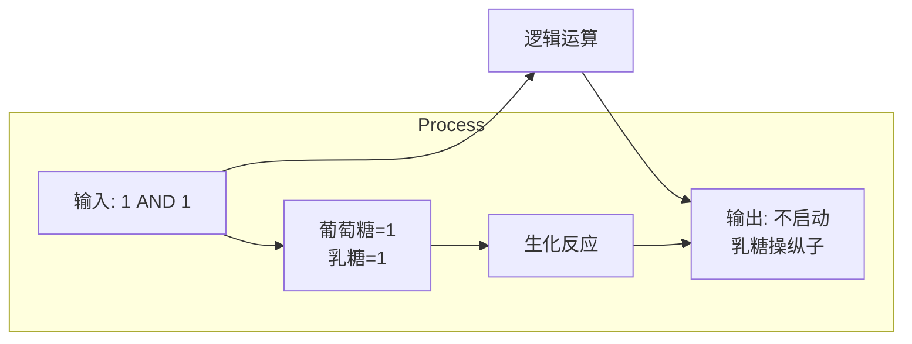
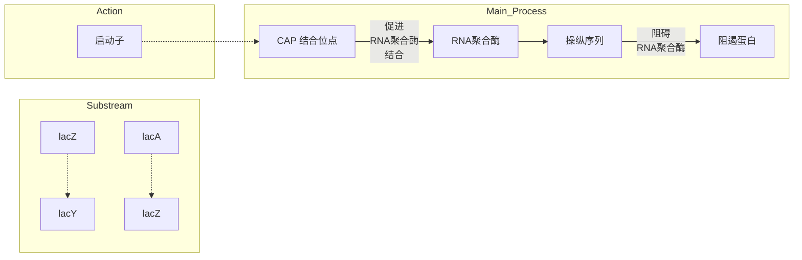
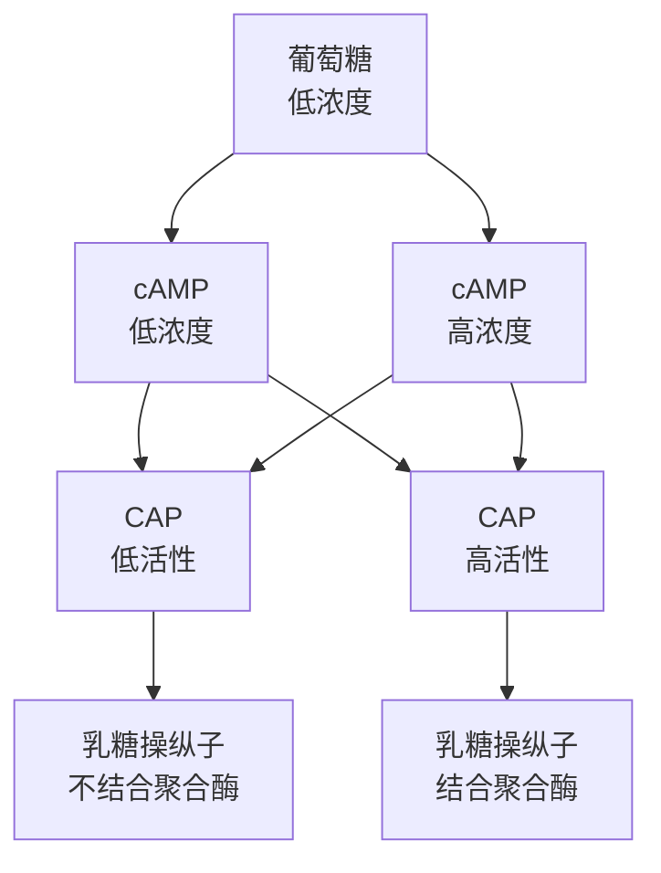
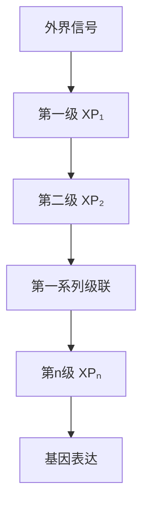
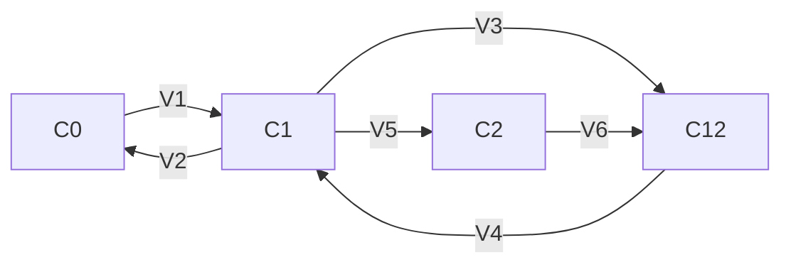
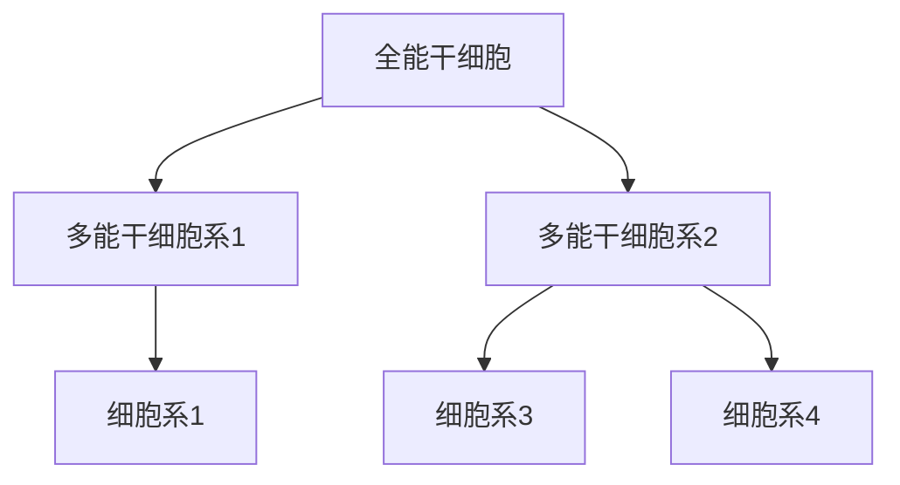
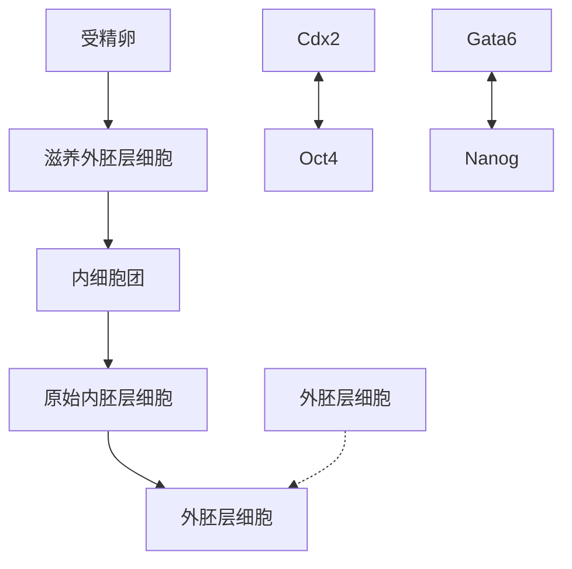
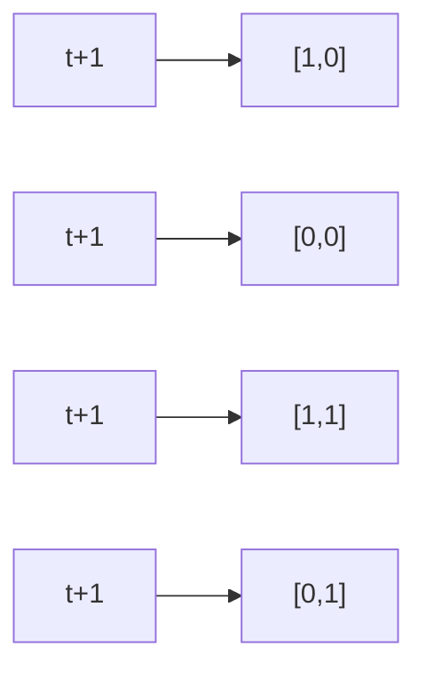
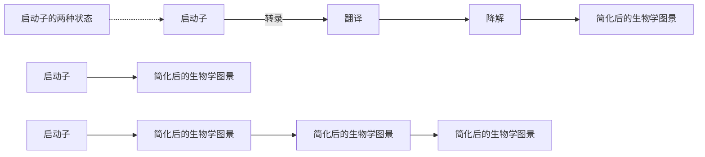

# 19 生物网络的动力学模型

原始 PDF 第 535–568 页。

## 生物网络的动力学模型

当我们深入探索生物系统的奥秘时，生物网络的动力学模型成为解读复杂生命互动的关键工具。生物体内的各种分子、基因、蛋白质以及它们之间错综复杂的关系形成了一张庞大的网络，维系着生命的正常运转。

从代谢反应到基因调控，这些相互关联的元素在空间和时间上交织着，创造出生物网络的复杂拓扑结构。

在本章中，我们将探讨生物网络的动力学模型的基础，包括网络的基本知识和矩阵表征、前馈和反馈网络的定义、生物网络的拓扑结构与其功能之间的密切关联。通过对生物网络的动力学探索，我们将展示数学模型如何帮助我们更全面直观地理解生物系统的运作原理。

19

---

512

19 生物网络的动力学模型

## 19.1 网络的基本知识和矩阵表征

生物的复杂性很大程度上源于无处不在的相互关联。例如，在三羧酸循环中，乙酰辅酶A与草酰乙酸结合，由柠檬酸合酶催化生成柠檬酸，当柠檬酸合酶被抑制时，会导致柠檬酸的产率降低，底物的浓度升高；又如，转录因子p53蛋白的入核或出核直接影响其下游靶基因如Bax、p21等的表达水平，进而调控细胞周期和凋亡；再如，肠道中乳酸菌通过分泌乳酸抑制大肠杆菌等竞争者的生长，同时也影响宿主的肠道环境。

这些关联在生物系统中相互交织，形成了一张张密集复杂的大网，维持着生命系统的正常运行，也为研究者们带来挑战。

生物网络是对这些关联性的建模。在基于图论的抽象中，网络由节点（node）和边（edge）构成。其中，节点可以是系统中任何参与了关联的实体，例如基因、蛋白质、细胞和物种；边则连接起相互关联着的节点。研究中常见的生物网络中，边所代表的关联性可以有多种类别，例如:

① 直接物理交互:蛋白质-蛋白质相互作用网络（protein-protein interaction network）是生物网络的典型代表，其中无向的边连接着彼此接触的蛋白质（图19-1A）。

② 相关性:从繁杂数据中计算相关性是寻找因果性的前置步骤，网络可以用来刻画这类并不反映直接相互作用的关联。例如，基因间表达的相关性体现为共表达网络（co-expression network），微生物在群落中的体现为共现性网络（co-occurrence network）。这些网络中，无向的边连接了丰度变化显著偶联着的基因或微生物（图19-1B）。

③ 流入和流出:代谢网络（metabolic network）中，代谢产物可以用节点表示，而边从底物出发指向产物，代表了相关的化学反应（图 19-1C）。

④ 调控:在代谢网络中，酶指向代表了其催化的反应的边；在基因调控网络（gene regulatory network）中，边从转录因子指向下游靶基因，代表激活或抑制的转录调控（图19-1D）。

邻接矩阵（adjacency matrix）是网络最直观的数学表征之一。对于一个由 $N$ 个节

图19-1 生物网络的不同例子第一行表征生物实体，第二行表示相应的网络简化。


---

19.2 基因调控

513


点构成的网络，其邻接矩阵 $M$ 的大小为 $N \times N$ 。其中，第 $i$ 行第 $j$ 列的元素 $M_{ij}$ 可以用来表示第 $i$ 个节点指向第 $j$ 个节点的边，其值可以用来表示相互作用的种类和权重。

上文关联类别1（直接物理交互）和类别2（相关性）的网络中，节点 $i$ 和节点 $j$ 之间的关联并不具有方向性。表征这类无向网络的邻接矩阵是对称的（图19-2A、B）。而表征上文关联类别3（流入和流出）和类别4（调控）的网络中，具有方向性的箭头从节点 $i$ 指向节点 $j$ ，带来非对称的邻接矩阵（图19-2C）。

生物网络的拓扑（topology）与其功能紧密相连。拓扑是节点和边在网络中的排列方式，是网络最基本的属性。

对于生物网络，一些最常用的拓扑性质和概念包括:

（1）度（degree）是连接到一个节点的边的数量。有向网络中，节点的度有两个值:出度（outdegree）表示从节点出发的边的数量，入度（indegree）表示进入节点的边的数量。基因调控网络中，诸如p53之类的“主控调节因子”（master regulator）往往具有很高的出度。
（2）路径（path）是指通过边连接的一系列节点。例如图19-2C中，就存在一条从A指向E的，经过了节点B、C、D的路径。

## 19.2 基因调控

生物体对环境的合理响应是生命的典型特征之一。对于单细胞生物而言，精准而合理的适时响应尤为重要，因为它们需要根据外界信号来调节自身基因表达及行为功能，以确保生存、促进生长。这种信号影响细胞中基因表达的过程，我们称之为基因调控。

在基因调控中，细胞可被看作一个“输入-计算-输出”的计算机。输入信号可

图19-2 生物网络的矩阵表征

（A）一个不考虑作用强度的蛋白质-蛋白质相互作用网络可以用一个二进制对称矩阵表示。其中， $M_{ij}=M_{ji}$ ，其值1和0分别表示蛋白质i和j之间作用的存在和不存在。（B）一个侧重于丰度偶联的微生物共现性网络可以用一个有权重的对称矩阵表示。其中 $M_{ij}=M_{ji}$ ，其值表征了微生物i和j丰度的相关系数。相关系数低于阈值的边已被移除。（C）一个不考虑调控强度的基因调控网络可以用一个非对称的矩阵表示。其中， $M_{ij}$ 的1、-1、0分别代表了基因i对基因j的激活、抑制、不存在相互作用。

---

514

19 生物网络的动力学模型


<details>
<summary>flowchart</summary>


</details>

图19-3 以计算机类比细胞的基因调控

以来自环境中的化学物质、温度、光照等因素。在细胞接收到这些信号后，它会通过一系列复杂的生物化学作用进行“计算”，最终“输出”为特定基因的活化或抑制，从而影响细胞的行为和功能（图19-3）。

## 19.2.1 布尔逻辑简介

布尔逻辑是现代计算科学的基石。当谈到布尔逻辑时，我们在讨论一种逻辑系统，它只有两个基本值（也叫作布尔值）——真（TRUE）和假（FALSE），可以被简单地记为1和0。这种简单

的二进制状态可以用来描述各种情况和关系，类似于生物体中常见的ON（开启）和OFF（关闭）状态。事实上，生命系统中二态系统的普遍性（参见14.2.3节），也是生物体系可以和计算机类比的重要原因。

布尔逻辑形成了一组基本的逻辑运算规则，用于组合和操作这些TRUE和FALSE的值，从而产生多样的逻辑结果。

以下是布尔逻辑的基本运算规则:

① “与”运算（AND）:如果两个条件都为真，则结果为真；否则为假。在生物体中，可以将这种与运算类比为:两个分子必须同时处于激活状态，才能触发特定的生理响应。
② “或”运算（OR）:如果至少一个条件为真，则结果为真；否则为假。这可以类比为生物体中作用于同一靶点的多个转录因子中的任何一个处于激活状态，都足以启动靶点基因的转录。
③ “非”运算（NOT）:若输入为真，结果为假；若输入为假，则结果为真。在生物体中，这可以理解为某个抑制子的状态由激活变为失活，才能启动其下游基因的转录。

这些基本的规则可以通过逻辑门（logic gate）——与门（AND gate）、或门（OR gate）、非门（NOT gate）来实现。逻辑门将一个或多个输入值转换为一个输出值，从而执行特定的逻辑运算。在生物体内，分子的状态转变和相互作用可以类比为逻辑门的操作，这些操作使复杂的基因调控和生物反应得以实现。

布尔逻辑的运作可以通过真值表来清晰地表示。真值表列出了不同输入组合下的逻辑运算结果，它有助于我们理解布尔逻辑在不同条件下的行为。在生物体内可以类比为不同的分子状态（如活跃和不活跃）作为输入，通过生物化学作用进行逻辑运算，最终影响细胞的功能和行为（也就是输出）。

以与门为例，假设我们有两个输入，称为A和B，它们可以是真（TRUE，1）或假（FALSE，0）。下面是与门的真值表:

---

19.2 基因调控

515

| 输入A | 输入B | 输出 |
| --- | --- | --- |
| 1 | 1 | 1 |
| 1 | 0 | 0 |
| 0 | 1 | 0 |
| 0 | 0 | 0 |

通过使用布尔逻辑描述生物体内分子状态的变化，我们可以更好地理解细胞如何对环境信号作出合理的响应。生物体内的“计算”为细胞在不断变化的环境中做出准确的决策提供了基础。

## 19.2.2 乳糖操纵子简介

大肠杆菌中对乳糖的响应就是一个“细胞根据环境信号计算基因表达的输出”的典型例子。乳糖操纵子的调控是第一个被清楚理解的基因调控机制，它的发现者弗朗索瓦·雅各布（François Jacob，1920—2013）和雅克·莫诺（Jacques Lucien Monod，1910—1976）于1965年被授予诺贝尔生理学或医学奖。这也是基因调控领域的首个诺贝尔奖。

对碳源的有效利用是大肠杆菌等肠杆菌科细菌的重要特征，帮助其在诸多不同的环境中生存。为了利用环境碳源中常见的乳糖（lactose），大肠杆菌基因组中三个与

乳糖分解、转运和代谢相关的基因共用一个启动子并共同表达，它们与相关的调控序列一起构成乳糖操纵子（lac operon）（图19-4）。然而，尽管能够利用乳糖，但大肠杆菌更喜欢用葡萄糖作为碳源，因为葡萄糖代谢比乳糖代谢所需要的步骤和能量更少。为了优化细胞内有限资源的分配，乳糖操纵子仅在环境中缺乏葡萄糖但存在乳糖时才会被激活。如果继续将细胞类比于一个小小的计算机，这个过程中，它是如何进行以葡萄糖和乳糖的浓度为输入信号，以乳糖操纵子的活性为输出结果，用胞内的化学反应网络进行合理“计算”的呢？


<details>
<summary>flowchart</summary>


</details>

图 19-4 乳糖操纵子的图示

其中，启动子为转录所必需的RNA聚合酶提供结合位点，而乳糖阻遏蛋白在操纵序列上的结合则会阻碍RNA聚合酶的结合。

## 19.2.3 乳糖阻遏蛋白介导的负性调控

让我们进入这个基因调控领域首个诺贝尔奖成果的具体细节。首先，乳糖阻遏蛋白由lacI基因转录，它不属于乳糖操纵子的一部分，因而可以独立于乳糖操纵子而被单独持续地表达。当环境中不存在乳糖时，乳糖阻遏蛋白紧紧地结合在乳糖操纵子的启动子区域下方的操纵序列（operator）上，阻止RNA聚合酶与乳糖操纵子的启动子

---

516

19 生物网络的动力学模型


图 19-5 乳糖阻遏蛋白介导的负性调控（A、B）和这个过程的逻辑描述（C）

黑色箭头代表激活，逻辑运算中为“等同”。红色圆头线代表抑制，逻辑运算中为“非门”。

结合，从而抑制整个操纵子的转录（图19-5A）。当环境中存在乳糖时，一部分乳糖进入细胞并被转化为异乳糖（allolactose）。异乳糖和阻遏蛋白结合，改变其构象使之不再能结合DNA，从而停止了其对乳糖操纵子的抑制（图19-5B）。由此，以阻遏蛋白的构象变化为媒介，细胞实现了乳糖操纵子基因表达活性随外界乳糖浓度的变化。

这个过程如何用布尔逻辑来简洁地描述呢？在最简单的模型中，我们可以把胞外乳糖的浓度（[lac]）用布尔值（1和0）表示， $[\mathrm{lac}] = 1$ 对应高浓度状态， $[\mathrm{lac}] = 0$ 对应低浓度状态。胞外乳糖浓度直接影响细胞内异乳糖的布尔值: $[\mathrm{allo}] = [\mathrm{lac}]$ 。这是一个最简单的布尔函数: $[\mathrm{lac}] = 1$ ，则 $[\mathrm{allo}] = 1$ ； $[\mathrm{lac}] = 0$ ，则 $[\mathrm{allo}] = 0$ 。

而阻遏蛋白的活性（活性的布尔值记为 [R]）则是对异乳糖浓度的非门计算: $[R]=NOT([allo])$ 。这意味着， $[allo]=1$ ，则  $[R]=0; [allo]=0$ ，则  $[R]=1$ 。

再接下来，在环境中葡萄糖浓度不高时，乳糖操纵子的启动子活性（[lacP]）又是对阻遏蛋白活性的非门: $[\mathrm{lacP}] = \mathrm{NOT}([R])$ 。依次代入刚才得到的[R]和[allo]、[allo]、[lac]之间的关系，我们可以得到乳糖操纵子启动子活性作为胞外乳糖浓度的逻辑函数:

$$
\left[ \mathrm{lacP} \right] = \mathrm{NOT} (\mathrm{NOT} ([ \mathrm{lac} ]))
$$

根据布尔逻辑，两个非门会在叠加后消失，让这个函数的输入直接等于输出，即

$$
\left[ \mathrm{lacP} \right] = \left[ \mathrm{lac} \right]
$$

这形象地表示了为什么阻遏蛋白是一个转录抑制子（对基因转录有负性调控作用），而乳糖对乳糖操纵子起激活作用——两个非门相互抵消。生物调控网络中，这个规律也是普遍的:两个串联的抑制等同于激活。

## 19.2.4 分解代谢物基因激活蛋白介导的正向调控

然而，大肠杆菌还需要进行另一个计算:环境中是否存在葡萄糖？如前所述，葡

---

19.2 基因调控

517


图19-6 CAP介导的正向调控和这个过程的逻辑描述

萄糖是大肠杆菌所偏爱的碳源，当它与其它糖类同在环境中时，细胞会优先表达和葡萄糖转运代谢有关的基因，而暂不启动对包括乳糖在内的其它碳源的利用程序。

这一对于葡萄糖浓度的计算由分解代谢物基因激活蛋白（catabolite gene activator protein，CAP）介导。CAP 是一个常量表达的转录调控蛋白质，当其与 DNA 结合时，能协助 RNA 聚合酶与启动子的结合。CAP 调控了包括了乳糖操纵子在内的上百个和能量代谢相关的基因簇，但它仅在与小分子环腺苷酸（cyclic adenosine monophosphate, cAMP）结合时才具有 DNA 结合活性。小分子 cAMP 则是细胞对饥饿的响应信号，随葡萄糖浓度的降低而升高。于是，仅有当葡萄糖浓度足够低时，升高的 cAMP 才会激活大量的 CAP 结合乳糖操纵子前端的调控序列，协助其转录（图 19-6A、B）。

这个过程用布尔逻辑描述，就是:cAMP 的浓度 [cAMP] 是细胞外葡萄糖浓度 [glu] 的非门，即 [cAMP] = NOT ([glu])；从这里开始，逻辑计算就都是直接赋值的“等同”了，也就是 CAP 活性 [CAP] = [cAMP]，乳糖操纵子启动子活性 [lacP] = [CAP]（在乳糖充分的情况下）。

代入上述结果，我们可以得到乳糖操纵子启动子活性关于胞外葡萄糖浓度的逻辑函数（图19-6C，在存在乳糖的情况下）:

$$
[ \mathrm{lacP} ] = \mathrm{NOT} ([ \mathrm{glu} ])
$$

这是对葡萄糖浓度的取“非”，也体现了生物调控网络中的另一个普遍规律:一条路径上若存在单数个抑制箭头，则该路径起抑制效果。

## 19.2.5 大肠杆菌乳糖代谢的组合逻辑

综合之前两个小节的内容，我们已经知道了阻遏蛋白介导的乳糖浓度对乳糖操纵子的激活的逻辑 $[\mathrm{lacP}] = \mathrm{NOT}([R])$ （在缺乏葡萄糖的情况下），和通过CAP介导的葡萄糖对乳糖操纵子的抑制 $[\mathrm{lacP}] = [\mathrm{CAP}]$ （在存在乳糖的情况下）。而细胞的糖代

黑色箭头代表激活，逻辑运算中为“等同”。红色圆头线代表抑制，逻辑运算中为“非门”。

---

518

19 生物网络的动力学模型

谢策略既然受到葡萄糖和乳糖的共同影响，那么，在将乳糖和葡萄糖都作为输入时，乳糖操纵子的活性应该是一个什么样的布尔函数？

19.2.1节中已介绍过，由两个输入A和B得到的输出C，有两种逻辑:与（AND）和或（OR）。这两个逻辑的主要区分在于 $\mathrm{A} = 1$ 、 $\mathrm{B} = 0$ （或 $\mathrm{A} = 0$ 、 $\mathrm{B} = 1$ ）时的输出:对与门， $\mathrm{C} = \mathrm{A}$ AND B，输出为0；对或门， $\mathrm{C} = \mathrm{A}$ OR B，输出为1。

对应到以“阻遏蛋白不结合”（NOT（[R]））和“CAP激活”（[CAP]）为输入的乳糖操纵子，决定组合逻辑的关键就是:当阻遏蛋白结合（[R]=1）且CAP也激活结合时（[CAP]=1），时，[lacP]究竟是1还是0？

如果是1，则组合逻辑为“或”:

$$
\left[ \mathrm{lacP} \right] = \left[ \mathrm{CAP} \right] \mathrm{OR} (\mathrm{NOT} (\left[ \mathrm{R} \right])) = (\mathrm{NOT} (\left[ \mathrm{glu} \right])) \mathrm{OR} \left[ \mathrm{lac} \right]
$$

这意味着，“没有葡萄糖”和“存在乳糖”，这两个条件只需满足其一，则乳糖操纵子开始可以启动。如果环境中同时存在乳糖和葡萄糖，则乳糖操纵子会被表达；如果环境中没有葡萄糖也没有乳糖，乳糖操纵子也会被表达。这种情况不符合前人实验的观察——即使没有阻遏蛋白的抑制，RNA聚合酶仅是较弱地结合乳糖操纵子的启动区，难以将操纵子彻底激活。为了使糖类代谢效率最高，大肠杆菌仅在“没有葡萄糖”并且“存在乳糖”这两个条件同时满足的情况下，才启动乳糖操纵子的转录。

由此可知，野生型大肠杆菌乳糖操纵子在整合信号时采用的是“与”的组合逻辑:

$$
\left[ \mathrm{lacP} \right] = \left[ \mathrm{CAP} \right] \text {AND} (\mathrm{NOT} (\left[ \mathrm{R} \right])) = (\mathrm{NOT} (\left[ \mathrm{glu} \right])) \mathrm{AND} \left[ \mathrm{lac} \right]
$$

如图19-7所示，“与”的逻辑保证了，细胞仅在“葡萄糖浓度低”并且“乳糖浓度高”时启动乳糖代谢的途径。

逻辑计算可以用真值表来表示，这个系统输入—计算—输出的真值表如下表所示:

| 葡萄糖 | 乳糖 | CAP | 阻遏蛋白 | 转录活性 |
| --- | --- | --- | --- | --- |
| 1 | 0 | 0 | 1 | 无活性 |
| 1 | 1 | 0 | 0 | 低活性 |
| 0 | 0 | 1 | 1 | 无活性 |
| 0 | 1 | 1 | 0 | 高活性 |


<details>
<summary>flowchart</summary>

```mermaid
graph TD
  subgraph Input
  A["Input"] --> B["[lac]"]
  C["[glu]"] --> D["[cAMP] = NOT["glu"]"]
  end

  subgraph Calculation
  E["Calculation"] --> F["[R] = NOT["allo"]" ]
  G["Calculation"] --> H["[CAP] = [cAMP]"]
  end

  subgraph Output
  I["Output"] --> J["[lacP] = [CAP] AND (NOT["R"]) = (NOT["glu"]) AND["lac"]"]
  end
```
</details>

图19-7 大肠杆菌乳糖操纵子的布尔计算逻辑

绿色箭头代表激活，逻辑运算中为“等同”。红色圆头线代表抑制，逻辑运算中为“非门”。

然而，所有的模型都是对实际的近似。布尔模型仅是生物调控网络的最简化形式，它将物质浓度或蛋白质活性二进制化（表达为布尔值0和1），有助于我们直观地理解细胞的“运算逻辑”。我们如果希望对这个系统进行更细致的定量和预测，则需要进入连续动力学甚至随机动力学的领域。

---

19.2 基因调控

519

## 19.2.6 连续方程下的乳糖操纵子活性

不同复杂程度的数学模型可以用来研究不同的生物学问题。布尔代数模型适用于高度简化的模型，只考虑蛋白质的活化和未活化（1和0态），以及简单的相互作用关系。而当我们需要考虑更复杂的情况时，例如时间和表达的连续性，则往往使用常微分方程一类的连续动力学模型，它可以描述单位时间内生物分子浓度的变化。连续动力学模型以 $t$ 时刻生物分子等的浓度为变量，描述它们随时间变化的动力学性质，所以需要更多的动力学参数来描述生物分子的合成、相互结合以及降解等关系。进一步地，如果还要考虑细胞内转录翻译mRNA和蛋白质的随机涨落，则需要采用随机动力学描述，并考虑反应体系的体积。此外，对于细胞内的代谢调控过程，由于反应产物过多，构建连续动力学模型过于复杂，人们则发展了流平衡分析方法，本书在20.3节做了介绍（图19-8）。

在一个简化的连续动力学模型中，乳糖操纵子的启动子活性可以被量化为单位时间内生成的mRNA拷贝数（用 $g_{\mathrm{lac}}$ 来代表），而它受到细胞内cAMP浓度（[cAMP]）以及异乳糖浓度（[allo]）的正影响。

由18.2节“转录过程的数学描述”已知，希尔函数可以直观地用于刻画基因转录的激活[式（18-18)]和抑制[式（18-19)]。那么，对于我们已知比较接近与门组合调控的乳糖操纵子中，单位时间生成的mRNA拷贝数可以写为cAMP和异乳糖相关


<details>
<summary>flowchart</summary>

```mermaid
graph LR
  subgraph LowLevel ["低"]
  A["单基因"] --> B["小型基因调控网络 (A)"]
  B --> C["中型基因调控网络 (B)"]
  C --> D["大型基因调控网络"]
  end

  subgraph HighLevel ["高"]
    E["计算机建模 (More细节)"]
    F["离散动力学 (Fewer细节)"]
    G["系统动力学 (Powerful Power)"]
  end

  subgraph Details ["数据来源与处理"]
    H["随机分子模拟 (Randomization Simulation)"]
    I["微分方程 (Decimation/Processing)"]
    J["&quot;d[RNA"]/dt = αkh / d["protein"]/dt = β[RNA(t)]"]
    K["输入 (Input)"]
    L["输出 (Output)"]
    M["伪时动力学 (False Time)"]
  end

  subgraph Details ["信息来源与处理"]
    N["时间 (Time)"]
    O["时间 (Time)"]
    P["网络状态的相空间 (Network State of Interaction)"]
    Q["功能模块 (Functional Module)"]
  end

  %% Connections between stages
  A --> B
  B --> C
  C --> D
  D --> E
  E --> F
  F --> G
  G --> H
  H --> I
  I --> J
  J --> K
  K --> L
  L --> M
  M --> N
  N --> O
  O --> P
  P --> Q
```
</details>

图 19-8 适应不同系统尺度和复杂性的不同建模方法

从单基因和小规模的基因回路，到中至大型的基因网络，系统复杂度逐步提升（第一行）；考虑到算力的有限性，建模的细节程度则需要逐渐降低（第二行），所关注的生物学信息也有不同的侧重（第三行）。随机分子模拟和连续动力学模型需要较多的动力学参数，用于精确描述系统的变化；而布尔网络模型简化了相互作用关系，方便得到包括吸引子性质和功能模块在内的全局性质。

---

520

19 生物网络的动力学模型

的希尔方程的各自相乘（希尔系数为1）:

$$
g _ {\mathrm{lac}} \left(\left[ \mathrm{cAMP} \right], \left[ \mathrm{allo} \right]\right) = V \cdot \frac {\left[ \mathrm{cAMP} \right]}{K _ {\mathrm{c}} + \left[ \mathrm{cAMP} \right]} \cdot \frac {\left[ \mathrm{allo} \right]}{K _ {\mathrm{a}} + \left[ \mathrm{allo} \right]} 。 \tag {19-1}
$$

乘法可以比较好地近似布尔逻辑中的与门，因为相乘的两项只要有一项接近于0，乘积就比较接近于0。

而当采取“mRNA有恒定降解速率 $d$ ”的简单假设后，相关mRNA（例如LacZ的mRNA）的数量[lac]随时间变化的速率由如下常微分方程描述:

$$
\frac {\mathrm{d} [ \mathrm{lac} ]}{\mathrm{dt}} = g _ {\mathrm{lac}} ([ \mathrm{cAMP} ], [ \mathrm{allo} ]) - d \cdot [ \mathrm{lac} ] _ {\circ} \tag {19-2}
$$

当系统接近于稳态（即 mRNA 的量不随时间变动，生成与降解达到平衡）时，$\frac{\mathrm{d}[\mathrm{lac}]^{*}}{\mathrm{d}t} = 0$，由此可得出乳糖操纵子在稳态时的 mRNA 量:

$$
\begin{array}{l} \left[ \mathrm{lac} \right] ^ {*} = g _ {\mathrm{lac}} \left(\left[ \mathrm{cAMP} \right], \left[ \mathrm{allo} \right]\right) / d \\ = \frac {V}{d} \cdot \frac {[ \mathrm{cAMP} ]}{K _ {\mathrm{c}} + [ \mathrm{cAMP} ]} \cdot \frac {[ \mathrm{allo} ]}{K _ {\mathrm{a}} + [ \mathrm{allo} ]} \tag {19-3} \\ \end{array}
$$

这个方程的未知参数有4个: $V$ 、 $d$ 、 $K_{\mathrm{c}}$ 和 $K_{\mathrm{a}}$ 。对于大部分生物实验而言，真正有意义的测量是“变化”——cAMP和异乳糖的浓度是比较易于被测量或控制的，我们关心当它们的浓度增加或降低了某个倍数时，乳糖操纵子启动子的表达量会怎样的变化。

如果仅关心变化的倍数并认为上述方程能够合理地描述乳糖操纵子的活性，那么，式（19-3）中只有两个参数是重要的: $K_{\mathrm{c}}$ 和 $K_{\mathrm{a}}$ 。理想情况下，只需要在3个不同的cAMP和异乳糖浓度下测量乳糖操纵子的表达，就可以得到 $K_{\mathrm{c}}$ 和 $K_{\mathrm{a}}$ 的数值（实际操


<details>
<summary>heatmap</summary>

| 指标 | 数值 |
| --- | --- |
| 异乳糖浓度 (K_a) | ~K_a |
| cAMP浓度 (K_c) | ~K_c |
</details>

图19-9 乳糖操纵子活性的假想实验和预测

假想的用于确定 $K_{\mathrm{c}}$ 和 $K_{\mathrm{a}}$ 的实验测量和根据模型预测乳糖操纵子活性与cAMP浓度和异乳糖浓度之间的关系。

作中，由于噪声和误差的存在，需要多次且在不同浓度梯度下测量）。而在确定了 $K_{\mathrm{c}}$ 和 $K_{\mathrm{a}}$ 之后，就可以根据上述方程推断，在任何cAMP和异乳糖浓度下乳糖操纵子的活性（图19-9）。这体现了数学模型在生物系统中应用的常见步骤:①根据生物知识建立简单模型；②通过“有限次”的测量确定模型参数；③根据这个模型，对理论上任意的输入预测输出。

需要注意的是，数学模型是复杂生物体系的简单抽象，只能在一定程度上逼近实际测量。例如，希尔方程的简单相乘是对与门的近似，而与门又是对乳糖操纵子工作方式的简单概括。2003年，乌里·阿隆（Uri Alon）研究组详细地测量了大肠杆菌乳糖操纵子在约一百种不同cAMP和异乳糖模拟物异丙基硫代-β-D-半乳糖苷

---

19.3 信号转导和前馈

521

（isopropylthio-β-D-galactoside，IPTG）组合下的输入函数。他们发现，乳糖操纵子整合cAMP和IPTG输入信号的方式虽然确实接近于与门逻辑，但比与门更加复杂。更有趣的是，他们通过对转录的数学模型的分析，提出只用少许几个突变，就可以让这个系统的运算逻辑更接近于纯粹的与门，或者转换为或门。这个模型预测在他们随后的实验中被证实。

总而言之，在多年的研究后，乳糖操纵子模型成为了生物领域中研究者们理解得最透彻的定量模型之一。通过研究乳糖操纵子等基因调控系统，科学家们逐渐揭示了基因调控的复杂性和多样性。这些研究不仅增进了我们对生命中“计算”和“优化”的理解，也为应用生物技术和医学研究提供了重要的基础。

也许有读者已经注意到，图19-9和式（19-1）、式（19-2）、式（19-3）中的输入并非外界乳糖浓度，而是细胞内的异乳糖浓度——这就引出了乳糖操纵子研究中曾经的一个“维持效应谜题”，相关内容会在19.4节中的正反馈部分进行详解。

## 19.3 信号转导和前馈

正如19.2节所阐述的那样，如果我们将细胞比作微小的计算机，那么它就需要实时地对各种输入信号作出响应，从而调整其行为和输出。举例来说，这些输入信号可以是来自环境的葡萄糖和乳糖的浓度，进而调节大肠杆菌糖类代谢基因簇的表达；或者是生长信号，影响哺乳动物细胞周期的推进；又或者是细胞因子，引导免疫细胞的

分化或凋亡过程。在这些复杂的过程中，细胞外微环境的变化最终引发细胞内部状态的改变。这一过程中，外部信号是如何传递到基因，最终影响细胞内部状态变化的呢？

## 19.3.1 信号转导:状态转变的传递

信号转导（signal transduction）是半个多世纪以来一直深深吸引着分子生物学研究者的焦点。无论是原核生物还是真核细胞，无论涉及哪一具体通路，信号转导的本质在数学模型的描述上都呈现相似之处——它通过“一个状态的转变导致下一个状态的变化”，从而构建起信息传递的链条。

我们仍以第18章中乳糖操纵子的信息传递为例，展示细胞如何通过一系列环环相扣的状态转变，从外界变化引发内部的级联响应和调整（图19-10）。信号分子cAMP的状态是由其浓度所标识的，当外界环境中葡萄糖浓度下降时，cAMP的浓度从“低浓度状态”转变至“高浓度状态”。转录调控蛋白CAP有两种状态:不能结合DNA的非活化状态和能结合DNA的活化状态。高浓度的每一行概括一个生物分子的两个状态，以不同颜色的椭圆表示。黑色虚线箭头代表分子在两个状态之间的变化。红色箭头代表了对状态转变的促进作用。


<details>
<summary>flowchart</summary>


</details>

图19-10 用“状态变化”来表征的CAP信号转导通路

---

522

19 生物网络的动力学模型

cAMP促使CAP从前者转变为后者。乳糖操纵子同样有两种状态:未结合状态和结合RNA聚合酶的状态。CAP的活化状态促进乳糖操纵子与RNA聚合酶结合，最终引发了细胞代谢行为的变化。这一过程生动地演示了信号转导的两个核心原则:

① 需要有特定生物分子（代称X）出现某种状态（浓度、构象、活性等）的转变（例如，$\mathrm{X1}\rightarrow \mathrm{X2}$）。

② 其中的一个状态（例如 X2）能够诱发另一个分子（代称 Y）的状态转变，直至通路最后的表型输出。

## 19.3.2 状态改变的数学表示: 以磷酸化 - 去磷酸化为例

让我们深入考量第一个核心原则:特定生物分子出现状态改变。蛋白质是生物体内最重要的大分子之一，担任着中心法则中“细胞各种任务的执行者”的关键角色。而蛋白质又可以在各种化学修饰下呈现出“激活”和“失活”等多种状态。在真核动物细胞中，信号转导通路通常以蛋白质的磷酸化-去磷酸化反应环（phosphorylation-dephosphorylation cycle）来呈现这个核心原则中的“状态变化”。

蛋白质的磷酸化是通过将磷酸基团连接到蛋白质的特定氨基酸残基上实现的。这个磷酸化过程可以改变蛋白质的构象、活性、互作对象及其在细胞内的定位。

回顾18.1.2节的内容，考虑一个蛋白质X，它在未被磷酸化时可能处于一种“关闭”状态，无法参与特定的生物学过程。当细胞受到外界信号刺激时，某个特定的蛋白激酶（kinase）可能会被激活，这个激酶能够将磷酸基团添加到蛋白质X的某个氨基酸上。这个磷酸化事件可能会导致蛋白质X的构象发生变化，使其从“关闭”状态转变为“开启”状态，从而允许其参与特定的细胞信号传递或代谢途径。然而，磷酸化状态并不是永久的。在某些情况下，另一类酶——磷酸酶（phosphatase）会催化蛋白质X上的磷酸基团去除，恢复蛋白质的原始状态。

总之，蛋白质X可以在两种状态之间转变，各自由蛋白激酶和磷酸酶催化。一般而言，蛋白质磷酸化/去磷酸酸化的速率（以秒和分为时间单位）快于蛋白质生成和降解的速率（以分和小时为时间单位）。所以，我们可以近似地认为，在蛋白质磷酸化/去磷酸酸化的过程中，蛋白质X的总浓度 $x_{\mathrm{tot}}$ 不变，只是处于不同状态的比例发生改变。那么，对于这样一个磷酸化-去磷酸化的环路，若将处于活性状态的蛋白激酶和磷酸酶的总浓度[K]、[P]作为环路的输入，它们将如何影响蛋白质在去磷酸化状态和磷酸化状态下的比例变化？

设蛋白质在磷酸化状态下的浓度为 $x_{\mathrm{pho}}$ ，去磷酸化状态下的浓度则为 $x_{\mathrm{des}}$ 。根据式（18-15），酶促反应的速率可由米氏方程近似，所以，对于如图19-11所示的系统，蛋白质从去磷酸化状态转换为磷酸化状态的速率为

$$
v _ {1} = V _ {1} \cdot [ \mathrm{K} ] \cdot \frac {x _ {\mathrm{des}}}{x _ {\mathrm{des}} + K _ {1}},
$$

而从磷酸化状态转换为去磷酸化状态的速率为

---

19.3 信号转导和前馈

523


图19-11 稳态下，磷酸化的蛋白质浓度（ $x_{\mathrm{pho}}$ ）作为蛋白激酶浓度[K]和磷酸酶浓度[P]的函数

$$
v _ {2} = V _ {2} \cdot [ \mathrm{P} ] \cdot \frac {x _ {\mathrm{pho}}}{x _ {\mathrm{pho}} + K _ {2}} \circ
$$

由于 $x_{\mathrm{pho}} + x_{\mathrm{des}} = x_{\mathrm{tol}}$ ，故而该系统随时间的变化可仅由 $x_{\mathrm{pho}}$ 的常微分方程刻画:

$$
\frac {\mathrm{d} x _ {\mathrm{pho}}}{\mathrm{d} t} = v _ {1} - v _ {2} = V _ {1} \cdot [ \mathrm{K} ] \cdot \frac {x _ {\mathrm{tot}} - x _ {\mathrm{pho}}}{x _ {\mathrm{tot}} - x _ {\mathrm{pho}} + K _ {1}} - V _ {2} \cdot [ \mathrm{P} ] \cdot \frac {x _ {\mathrm{pho}}}{x _ {\mathrm{pho}} + K _ {2}} \tag {19-4}
$$

根据第18章中的Goldbeter-Koshland函数，式（19-4）的稳态（即令该速率等于0）有唯一的解析解。将[K]和[P]作为输入，稳态的 $x_{\mathrm{pho}}$ 作为输出，其函数如图19-11所示。

如果蛋白质X的磷酸化状态本身也具有激酶或磷酸酶的酶活性，能够影响另一个蛋白质Y的磷酸化状态， $x_{\mathrm{pho}}$ 则成为另一个磷酸化-去磷酸化反应环的输入[K]或[P]，变化将由此传递。

## 19.3.3 多个偶联的状态变化构成信号转导通路

如19.3.1节中所总结的，信号转导的第二个原则是一个改变诱发另一个改变。生长因子信号通路就是一个典型例子，它通过一系列依次催化的激酶来传递信息。

多细胞生物中细胞的增殖受到生长因子的严格调控。表皮生长因子（EGF）在细胞膜外与其受体结合会诱发受体的构象变化，受体会二聚化并作为激酶，将磷酸基团附着到彼此的胞内尾部，促进活化。活化的受体触发了一系列事件，最终激活了激酶Raf。活化的Raf磷酸化并激活MEK，而MEK则磷酸化并激活ERK。ERK磷酸化并激活各种目标分子，包括转录因子c-Myc，从而促进细胞的生长和分裂。总体而言，作为生长因子受体激活的下游，Raf、MEK和ERK构成了一个三层级的激酶信号转导通路，称为有丝分裂原激活蛋白激酶（MAPK）级联。由于它们在促进细胞分裂方面起着核心作用，编码生长因子受体、Raf和c-Myc的基因都是原癌基因，当它们出现突变或异常激活时，可能引发不受控制的细胞生长从而促使癌细胞的形成。

很多信号转导通路都有和EGF通路相似的特征，包括但不限于PI3K/Akt通路、

---

524

19 生物网络的动力学模型


<details>
<summary>flowchart</summary>


</details>

图 19-12 信号转导通路的简单抽象

NF- $\kappa$ B通路，通过一系列主要由蛋白激酶的磷酸化/去磷酸化主导的相互偶联的变化，将上一级的状态变化环路的“输出”作为下一级的状态变化环路的“输入”，最终将外界信号传递给细胞核内的基因表达。

可以用图19-12所示的模型抽象出多级信号转导通路的一个简单构架。其中，每一级 $i$ 都有一种分子 $\mathrm{X}_i$ 在两种构象 $\mathrm{XD}_i$ 和 $\mathrm{XP}_i$ 之间变化，而其中 $\mathrm{XP}_i$ 具有催化下一级 $i + 1$ 的状态转化的能力。

这样的通路的普遍性动力学模型为

$$
\frac {\mathrm{d} \left[ \mathrm{XP} _ {i} \right]}{\mathrm{d} t} = V _ {i 1} \frac {1 - \left[ \mathrm{XP} _ {i} \right]}{K _ {i 1} + 1 - \left[ \mathrm{XP} _ {i} \right]} - V _ {i 2} \frac {\left[ \mathrm{XP} _ {i} \right]}{K _ {i 2} + \left[ \mathrm{XP} _ {i} \right]},
$$

其中  $V_{i1}=\left\{\begin{aligned}k_{1}S & (i=1) \\ k_{i}\left[\mathrm{XP}_{i-1}\right] & (i=2,\cdots,n)\end{aligned}\right.$ ， $V_{i2}$  暂设定为常数。

$\mathrm{XD}_i$ 和 $\mathrm{XP}_i$ 常常是蛋白激酶的非活化和活化状态，但并不仅限于此，任何由生物分子状态转换所介导的信号通路都可由此方程的变

体来表征。

## 19.3.4 信号转导的复杂性

在信号转导领域，研究者们对系统的动态和稳态都有浓厚兴趣。

动态:从系统的起始时刻 $t = 0$ 开始，一旦输入信号 $S$ 发生从无到有的变化后，整个信号转导通路中每一级的状态（以 $[\mathrm{XP}_i(t)]$ 表征）会如何变化？例如，随着时间的推移，$[\mathrm{XP}_i(t)]$ 的曲线形状是否呈现单调的变化？高值的出现或消失有多迅速？

稳态:在给定信号强度 $S$ 作为一个恒定输入的情况下，若假设每一级的状态都稳定于动态平衡（即 $\mathrm{d}\left[\mathrm{XP}_i(t)\right] / \mathrm{d}t = 0$），那么稳态值 $\mathrm{XP}_i^*$ 是输入信号强度 $S$ 的怎样的一个函数？

## (1) 随层级增加的信号敏感性

在图19-12所显示的简单信号通路的模型中，稳态是比较容易被计算的——由于每一级的磷酸化/去磷酸化的稳态都有解析解，所以，我们可以一步步将图19-12中的输出代入下一级的输入，得到在系统近似为平衡状态时，$\mathrm{XP}_i^*$ 作为输入信号强度的函数（图19-12）。对于一层的系统，我们得到一个 $\mathrm{XP}_1^*$ 随着输入信号强度 $S$ 变化的S形响应曲线（图19-13）。

有趣的是，当层级数 $i$ 增加，$\mathrm{XP}_i^*$ 随输入信号强度 $S$ 的变化曲线变得越来越“陡峭”——在这个陡峭的函数的边缘，输入信号强度的微小变化将被放大为输出的稳态 $\mathrm{XP}_i^*$ 值的巨大变化，也就是说，信号通路的“敏感性”随着 $i$ 增加了。事实上，研究者们通过数学计算指出，当 $i = 4$ 时，整个级联通路的放大效应（响应函数的斜率）可以增加至原本（$i = 1$）的1010倍。

这个随着信号通路层数增加的“超敏性”，是生物中非线性效应的典型体现，也

---

19.3 信号转导和前馈

525

体现了数学模型带来的洞察力。它允许细胞将微小的刺激放大产生更大的响应，从而增强信号的效力，也为“为何信号转导通路往往是多层的构造”提供了一个解释。

然而，如图19-12所示的通路只是对信号转导通路的简化抽象模型，它是单线、无反馈的。而实际上，信号转导通路常常更为复杂，涵盖了不同信号和通路的交叉，以及同一通路内的反馈机制。而且，在这些信号转导的过程中，稳态之外，动态性质也显得十分重要。在接下来的部分，我们会简单讲述一下这些复杂度对信号转导的可能影响。

## (2) 信号转导中的组合逻辑计算

信号转导通路的复杂性之一来源于“多个信号的输入”。细胞中不同的信号通路会交汇，共同作用于

同一生物分子。当不同通路相互作用时，细胞常常需要执行“逻辑运算”，以得到对多种信息源的最佳响应。例如，对于19.1节中的乳糖操纵子，由cAMP介导的对葡萄糖浓度的感知，和由异乳糖介导的对乳糖浓度的感知，在乳糖操纵子的启动子区域交汇，形成类似于与门逻辑的运算，确保细胞对碳源变化的有效响应。

蛋白质的磷酸化可以发生于多个位点，同一位点的磷酸化也可以由多种激酶来催化进行——这方便了信号的整合。前文所述的MAPK级联只是一个对通路的高度简化。实际通路中，激酶往往需要被“双磷酸化”才具有活性，例如，MEK需要对MAPK的两个位点进行磷酸化以激活MAPK。

若要用数学方程对信号于同一分子C上的汇聚进行建模，那我们需要对具体机制进行具体分析。如果一个蛋白质需要两个磷酸位点的修饰才能被激活，那么给这两个位点进行修饰的通路就在此被整合为与门；而如果两个通路都可以修饰同一个位点以激活蛋白质，那么它们就被整合为或门。简单的布尔代数就可以粗略地描述这种情况（见19.2.1节）。

更复杂地，若不同的修饰位点之间也存在关联，例如有“2号位点只有在1号位点被磷酸化后才能被修饰”，或“1号位点的磷酸化阻止2号位点被修饰”之类的影响，那么系统的运算逻辑将会更复杂。或者，当我们需要用连续模型来更细节地描述这个系统的输出随输入的动态变化时，惯常的步骤是（图19-14）:


<details>
<summary>line</summary>

| 输入信号强度 S | n=1 | n=2 | n=3 | n=4 | n=5 | n=6 | n=7 | n=8 |
| --- | --- | --- | --- | --- | --- | --- | --- | --- |
| 0 | ~0.03 | ~0.03 | ~0.03 | ~0.03 | ~0.03 | ~0.03 | ~0.03 | ~0.03 |
| 0.2 | ~0.25 | ~0.35 | ~0.45 | ~0.55 | ~0.65 | ~0.72 | ~0.75 | ~0.76 |
| 0.4 | ~0.55 | ~0.65 | ~0.72 | ~0.75 | ~0.77 | ~0.77 | ~0.77 | ~0.77 |
| 0.6 | ~0.72 | ~0.75 | ~0.77 | ~0.77 | ~0.77 | ~0.77 | ~0.77 | ~0.77 |
| 0.8 | ~0.82 | ~0.80 | ~0.78 | ~0.78 | ~0.78 | ~0.78 | ~0.78 | ~0.78 |
| 1 | ~0.85 | ~0.81 | ~0.78 | ~0.78 | ~0.78 | ~0.78 | ~0.78 | ~0.78 |
</details>

图19-13 信号通路中，各层级 $n$ 的稳态浓度作为输入信号强度的函数

① 抽象出 “C 的多个状态”，并且绘制出表征这些状态之间转变的反应箭头。例如，若 “2 号位点只有在 1 号位点被磷酸化后才能被磷酸化或去磷酸化”，那么  $C_{0}$  这个状态就不能指向  $C_{2}$  这个状态，而  $C_{2}$  也不能指向  $C_{0}$ 。
② 确定不同的“输入信号”如何影响状态之间的转变，例如，作为信号的激酶A促进位点1的磷酸化，使 $C_{0}$ 向 $C_{1}$ 转变，以及 $C_{2}$ 向 $C_{12}$ 转变；而激酶B促进位点2的磷酸化，促进 $C_{1}$ 向 $C_{12}$ 转变。

---

526

19 生物网络的动力学模型

图19-14 对同一生物分子在多种状态下转换的建模的基本流程


<details>
<summary>flowchart</summary>


</details>

$$
\begin{array}{l} v _ {1} = V _ {1} \frac {[ \mathrm{A} ] [ \mathrm{C} _ {0} ]}{K _ {1} + [ \mathrm{C} _ {0} ]} \quad \frac {\mathrm{d} [ \mathrm{C} _ {0} ]}{\mathrm{d} t} = - v _ {1} + v _ {2} \tag {B} \\ v _ {6} = V _ {6} \frac {[ \mathrm{A} ] [ \mathrm{C} _ {2} ]}{K _ {6} + [ \mathrm{C} _ {2} ]} \quad \frac {\mathrm{d} [ \mathrm{C} _ {1} ]}{\mathrm{d} t} = v _ {1} - v _ {2} + v _ {3} - v _ {4} \\ V _ {4} = V _ {4} \frac {[ \mathrm{B} ] [ \mathrm{C} _ {1} ]}{K _ {4} + [ \mathrm{C} _ {1} ]} \quad \frac {\mathrm{d} [ \mathrm{C} _ {2} ]}{\mathrm{d} t} = V _ {5} - V _ {6} \\ v _ {2} = k _ {2} \left[ \mathrm{C} _ {1} \right] \\ v _ {3} = k _ {3} \left[ \mathrm{C} _ {1 2} \right] \\ v _ {5} = k _ {5} \left[ \mathsf {C} _ {1 2} \right] \\ \end{array}
$$

③ 根据反应机制（例如，是酶促反应或基元反应），写出每一个反应箭头的速率。
④ 根据③中反应的速率，为每个状态的浓度写出常微分方程。

不同的组合逻辑使得细胞在复杂的环境中能够灵活地做出多种响应，增强了其适应性和功能多样性。很重要的一点是，多个信号在某个生物蛋白质上的汇聚，允许了通路中的前馈（feedforward），这是生物网络中一个重要的调控机制。

## (3) 前馈

在工程学的控制论中，前馈和反馈是两种最基本的控制策略。事实上，前馈这个概念最早于20世纪中叶在对神经线路的研究中被提出，这也是生物学对人类工程学的贡献之一。

如图19-15A所示，前馈的网络表示非常简单——当从X到Y的调控关系通过多条路径传递时，这就被称为X对Y的前馈。EGF与受体结合的信号不仅激活了MAPK通路，还激活了PI3K信号转导通路，这两条通路最终都促进了细胞周期 $\mathrm{G}_{1}$ 到S的进展（图19-15B）。另一个例子是在细胞应对DNA损伤中起核心作用的p53通路。该通路激活后，抑癌转录因子p53一方面促进介导细胞周期停滞的Slug蛋白的表达，而Slug抑制了凋亡蛋白Puma；另一方面，p53直接调高Puma的表达（图19-15C）。前馈环路在信号转导中非常常见。事实上，在研究深入的模式生物如大肠杆菌和酵母等的感知-转录网络中，前馈出现的频次都远高于随机网络。前馈环路在生物系统中的普适性也许会引起读者的好奇——为什么一个输入信号需要分裂成两条路径后再汇聚？难道


图19-15 前馈的网络表示（A）和相关的生物学例子（B、C）

（B）中的例子是一致性前馈，而（C）是不一致性前馈。

这不是比单一路径的信息转导更消耗细胞中有限的能量和蛋白质吗？特别是类似p53通路中对Puma的两条调控路径，一条激活一条抑制，这种彼此拮抗的效果是否会让细胞做无用功呢？

在演化的制约下，生物极少做“无用之功”。就如工程学中前馈是两种最基本的控制策略之一，信号转导中的前馈亦有其多种多样的生物学功能。前馈起作用的关键在于“时序”。前文中，我们主要关注于信号转导通路中输入-输出的稳态，即在固定的输入信号强度下，经过足够长的时间后，系统达到平衡时

---

19.3 信号转导和前馈

527

的输出状态。然而，信号转导的过程中，系统随时间的动态变化同样重要。例如，当环境中葡萄糖浓度开始由高转低时，微生物糖代谢相关的表达是立即变化，还是稍后待微环境的变化方向确定后再作响应？由低转高时呢？同样地，当环境渗透压发生变化时，微生物是持续地响应渗透压，还是在响应一段时间后相关基因回归原值不再响应？

实现这些复杂生物学功能的关键，在于信号在前馈的两条路径上的传播所需的时间不同。图19-15B是一致性前馈（coherent feedforward）的例子:两条路径的调控“方向”是相同的，或是都激活，或是都抑制。在合适的组合逻辑下，这样的一致性前馈可以作为一种对变化方向敏感的延迟元件:在一个输入信号的变化方向上（例如，从高到低时）对刺激快速响应，并在相反的信号输入方向（从低到高）上对刺激延迟响应。

一致性前馈的这个功能并不难理解，可以用布尔代数简单地描述（图19-16）。这个高度简化的网络中，信号自节点1输入、节点3输出，并由前馈分出两条通路。较长的通路经由节点2指向节点3，而较短的通路直接由节点1指向节点3。图19-16A中，这个简单的动力学系统每个时刻 $t$ 的状态由其上一刻 $t - 1$ 的状态决定，并遵循如下的方程:

$$
x _ {2} (t) = x _ {1} (t - 1),
$$

$$
x _ {3} (t) = x _ {1} (t - 1) \text {AND} x _ {2} (t - 1) 。
$$

在 $t = 1$ 的时刻，输入信号 $x_{1}$ 从0变为1。这导致了下一时刻 $t = 2$ 时，$x_{2}$ 被上调为1。然而，由于输出信号 $x_{3}$ 的两条输入路径采用了与门逻辑，所以在 $t = 2$ 时，尽管 $x_{3}$ 已经受到了 $x_{1}$ 的激活，但由于 $x_{1}(1) = 1$ 和 $x_{2}(1) = 0$ ，在与门下得到 $x_{3}(2) = 0$ 因此输出仍然保持在“未上调”的状态。直到 $t = 3$ 时，$x_{3}(3)$ 满足激活条件，其值才从0变为1。

有趣的是，当输入信号 $x_{1}$ 的值从1下调为0时（$t = 4$），同样由于与门逻辑的作用，输出信号 $x_{3}(5)$ 在下一时刻立即从1关闭至0。因此，这个系统能够实现“对输入的增加延迟响应，对输入的减少立即响应”的不对称延迟功能。对于一些激活后代价高昂的代谢通路而言，通过延迟进行“确认”是更经济和节省资源的方式，而在信号消失时立即关闭通路，也能够避免物质和能量的浪费。

而如果仅将图19-16A中的组合逻辑从“与”改为“或”，这个简单前馈环路的不

(A)


<details>
<summary>heatmap</summary>

| | 1 | 2 | 3 | 4 | 5 |
| --- | --- | --- | --- | --- | --- |
| 1 | 0 | 0 | 0 | 1 | 0 |
| 2 | 1 | 0 | 0 | 2 | 1 |
| 3 | 1 | 1 | 0 | 3 | 1 |
| 4 | 0 | 1 | 1 | 4 | 0 |
| 5 | 0 | 0 | 0 | 5 | 0 |
</details>

(B)


<details>
<summary>heatmap</summary>

| 时间 | \(X_{1}\) | \(X_{2}\) | \(X_{3}\) |
| --- | --- | --- | --- |
| 0 | 0 | 0 | 0 |
| 1 | 1 | 0 | 0 |
| 2 | 1 | 1 | 1 |
| 3 | 0 | 1 | 1 |
| 4 | 0 | 0 | 1 |
| 5 | 0 | 0 | 0 |
</details>

图 19-16 布尔代数所描述的一致性前馈对信号变化的响应时序

图中，输入信号为1号节点，输出信号为3号节点，信号变化的时刻和方向由深蓝底色和箭头标示。（A）与门逻辑。（B）或门逻辑。

---

528

19

生物网络的动力学模型

对称性立刻调整了:在输入信号上调时，系统立即响应；而在输入信号下调时，系统则延迟响应（图19-16B）。对于一些若不及时应对就可能导致细胞死亡的胁迫响应通路来说，这样的前馈则设置更加明智。

另一种前馈环路是不一致性前馈（incoherent feedforward），以图19-15C为例。这种回路中，两条路径的调控方向相反，一条激活一条抑制。不一致性前馈使得系统能够根据不同的输入信号产生不同的响应。

图19-15C中的p53通路就是一个典型的“细胞需要做出不同选择”的例子。细胞DNA受到损伤时，通常会通过激活DNA修复基因来促进DNA修复，从而保持基因组的稳定性；然而，当DNA损伤严重到无法修复时，p53通路会转而激活细胞凋亡相关基因，引导细胞走向程序性死亡。在这种情况下，如果p53激活Slug的路径所需时间较短，而激活Puma的路径所需时间较长，那么只要DNA损伤持续的时间短于激活Puma所需的时间，细胞就会启动Slug主导的细胞周期暂停和DNA修复的“促进存活”基因程序，并同时抑制细胞凋亡。但是，一旦损伤持续的时间足够长以至于激活Puma，细胞凋亡就会启动。

读者可以思考:如果按照图19-16所示为p53信号转导通路建立布尔动力学模型，是否能呈现出这种“根据信号持续时间长短做出不同命运决定”的效果？如果可以，那么两条路径的长度和组合逻辑需要如何设置？

前馈在信号转导中可能的作用远比图19-15和图19-16中所显示的更加复杂:不同数量和长度的调控路径、不同的组合逻辑、不同的作用方式，都可以引向丰富多样


<details>
<summary>flowchart</summary>


</details>

$M_{ij}$ : 节点i对节点j的作用 (1: 激活; -1: 抑制; 0: 不存在)

$P_{ij}$ :节点 $i$ 到节点 $j$ 的路线，例: $P_{ij}(k) = M_{ik} \cdot M_{kj}$

反馈: 正向  $P_{ij}=1$ ; 负向  $P_{ij}=-1$

图 19-17 反馈的基本构架和不同路径长度的反馈网络

激活和抑制反映在每个图像下的邻接矩阵中，即矩阵元素 $M_{ij} = 1$ 代表激活，-1代表抑制，0代表无作用。$P_{ij}$ 代表了从节点 $i$ 到节点 $j$ 的一条路径。若一条指向自身的路径 $P_{ii}$ 其上所有边对应的元素相乘为1，则此路径为正反馈回路；若相乘为-1，则此路径为负反馈回路。

的生物学功能。例如，仅涉及三节点的前馈就有8种拓扑，各自可以在相应参数下完成包括但不限于信号过滤、时间动态监测、信号幅度变化检测等功能。数学模型在前馈的功能和机制研究方面起着关键的作用，帮助我们更好地理解生物系统中信号转导的原理和调控机制。

## 19.4 正反馈

反馈是工程学控制论中的另一种基本策略——调控边从一个节点发出，经过或长或短的路径，最后再回到这个节点。图19-17显示了反馈的基本构架，以及具有路径长度为1、2、3的反馈的例子。正反馈和负反馈是反馈的两种基本类型，有明确的定义:如果回到节点的路径上的抑制边的数量总和为偶数，则整体效果为激活，回路为正反馈；如果回路的抑制边的数量总和为奇数，则整体效果为抑制，回路为负反

---

19.4 正反馈

529

馈。通过对邻接矩阵的分析，我们可以清晰简易地判断某个网络中是否存在正反馈或负反馈。

## 19.4.1 一维正反馈的动力学模型

当涉及任何数学或物理模型时，系统的“维度”都是至关重要的概念。在物理学中，我们通常将时间和三维空间合并为四维时空来描述事件和物体的演化。类似的，在生物物理的模型中，我们也经常使用“n维”来描述某个动力学模型。这里的“n维”并不是系统的时空属性，而是反映了模型简化的程度。当模型中涉及 $n$ 个变量时，我们称其为 $n$ 维模型。尽管真实的生物系统异常复杂，但为了更直观地理解生物学问题，我们常需要将注意力集中在特定的生物学参数和反馈机制上，并且尽可能地简化模型。

基因表达谱决定了细胞的性状，转录调控是生物中最基本的调控之一。若某个转录因子能够结合上自身基因的启动子，从而调控自身表达，这种转录自激活就构成了一个最直接的自反馈。例如，蓝藻在缺氮时会将一部分细胞会转变为负责固氮的异形胞，转录因子HetR在该过程中发挥着重要作用。在低氮条件下，HetR被激活，由单体转为二聚体。二聚体的HetR激活一系列促进异形胞形成的基因，且其结合位点包括自身的启动区域，产生出更多的HetR。HetR只是一个自正反馈的典型例子，类似的自正反馈在生物网络中较为常见（图19-18）。例如，一些酶在磷酸化后被活化，而后作为磷酸激酶催化自身的磷酸化，即自磷酸化（autophosphorylation）；又例如，微生物中负责合成和分泌群体感应分子的基因簇也被它所产生的群体感应分子所激活，而这些常见的介导正反馈的群体感应分子就被称为自感应物质（autoinducer）。

然而，即使对于“转录因子激活自身表达”这一最简单的正反馈回路，实际系统中的变量也不止一个:启动子有结合和不结合转录因子的状态；转录出的mRNA在真核生物中需要出核，mRNA需要被翻译以制造蛋白质；蛋白质可能需要被修饰激活，多聚，入核行使功能，被泛素化酶修饰降解……然而，数学模型不可能也不需要详尽地描述所有生物学过程，而是需要用最简单的方程去近似这个过程的关键:当节点发


图 19-18 自正反馈的例子

（A）蓝藻异形胞中HetR的转录形成的正反馈。其中，转录因子HetR由白色椭圆表示。HetR蛋白在二聚后具有转录活性，能激活自身的表达，使得蓝藻细胞由营养细胞（小圆）转换为异形胞（大圆）。  
（B）蛋白质作为自身磷酸化的激酶。其中，磷酸激酶X（橙圆）只有

在其特定位点被磷酸化（以蓝色小圆表征）后才具有酶活性，而它自身可以对该位点进行磷酸化。（C）群感分子促进其合成基因簇的激活。其中，细胞以圆角矩形代表。细胞中蛋白LuxI（蓝色椭圆）导致小分子AHL（橙色六边形）的产生。AHL被分泌至胞外，并可被微生物吸收。进入细胞的AHL激活LuxI的转录。

---

530

19 生物网络的动力学模型

图19-19 转录自正反馈的“更接近真实系统”的示意图和简化后用于建立一维模型的示意图


<details>
<summary>flowchart</summary>


</details>

出一个代表“激活”的箭头指向自身时，系统会产生什么有趣的行为？

在合理的简化下，我们仅用一个变量 $x$ 来描述这个动力学系统（图19-19）。变量 $x$ 可以表征mRNA的浓度，也可以代表能行使转录调控功能的蛋白质的浓度。我们假设，$x$ 以二聚的形态进行转录调控。根据第18章的内容，$x$ 的产生速率（production rate）$x_{\mathrm{pro}}$，可以用系数为2的希尔方程来表示:

$$
x _ {\mathrm{pro}} = V \cdot \frac {x ^ {2}}{x ^ {2} + K ^ {2}} \circ \tag {19-5}
$$

同时，一个能达到稳定的系统也需要降解。最简单的假设下，单位时间内降解的转录因子的量 $x_{\mathrm{deg}}$ 也是 $x$ 的函数，正比于其现有浓度（$d$ 是代表降解速度的参数）:

$$
x _ {\mathrm{deg}} = d \cdot x _ {\circ} \tag {19-6}
$$

式（19-5）代表的转录翻译是这个系统的“流入”，式（19-6）代表的降解是这个系统的“流出”，在这两个流的作用下，描述系统动力学行为的常微分方程如下:

$$
\frac {\mathrm{d} x}{\mathrm{d} t} = x _ {\mathrm{pro}} - x _ {\mathrm{deg}} = V \cdot \frac {x ^ {2}}{x ^ {2} + K ^ {2}} - d x _ {\circ} \tag {19-7}
$$

接下来，我们要对这个最简单的正反馈系统进行分析，以此逐步正式引入非线性分析中的一些在定量生物学中常见的概念。

## (1) 双稳态: 不动点、稳定性、吸引域

面对一个动力学系统，人们首先希望了解的性质是:这个系统是否能达到某个或某些稳定状态？这些状态是什么样的？

概念 1:不动点

若一个动力学模型 $\frac{\mathrm{dx}}{\mathrm{dt}} = f(x)$ 存在某个状态 $x^{*}$，该状态下系统状态不再变动，则该点为系统的不动点（fixed point）。

对于式（19-7）中的一维系统，设 $\frac{\mathrm{dx}^*}{\mathrm{dt}}$ 为0后，可直接解出它有三个解，从小到

---

19.4 正反馈

531

大排列为

$$
x ^ {*} = \left[ \begin{array}{c} 0 \\ \frac {1}{2} \left(\frac {V}{d} - \sqrt {\left(\frac {V}{d}\right) ^ {2} - 4 K ^ {2}}\right) \\ \frac {1}{2} \left(\frac {V}{d} + \sqrt {\left(\frac {V}{d}\right) ^ {2} - 4 K ^ {2}}\right) \end{array} \right] _ {\circ} \tag {19-8}
$$

这三个解都是稳定的吗？我们不妨使用图形的方法来打一打草稿——相比数学公式，图形更能让人迅速获得直觉上的理解。譬如，要让式（19-7）等于零，$x$ 的生成需要等于降解。在图形上，这就是以 $x$ 为变量的希尔函数 $x_{\mathrm{pro}}$ 和线性函数 $x_{\mathrm{deg}}$ 相交的地方。如图19-20所示，当 $\frac{V}{d}$ 不是太小时，这两条线可以在三个地方相交，代表了式（19-8）中的三个不动点，我们把这三个交点标记为 $a, b, c$。

然而，“不动”是指系统完全处于 $x^{*}$ 时不动，就如刚好置于山顶或山谷的小球。若有风吹推了小球稍许，系统是动还是不动？

概念 2:稳定性

若一个动力学系统的状态处于不动点 $x^{*}$，当我们对其加以微小的扰动 $\Delta x$ 时（即 $x^{*}$ 变为 $x^{*} + \Delta x$）:若扰动 $\Delta x$ 随时间流逝变得越来越小，则该不动点为稳定不动点，就如山谷的小球在被踢一脚后仍会晃动着回到原处；若扰动随时间放大，则该不动点为不稳定不动点，就如山顶的小球在轻轻一推下就滚下山坡（图19-20）。$\frac{\mathrm{d}x}{\mathrm{d}t} = V$。

数学上应该如何推断扰动 $\Delta x$ 是会被放大还是缩小呢？由于 $x^{*}$ 是常数，所以 $\frac{\mathrm{d}(\Delta x)}{\mathrm{d}t} = \frac{\mathrm{d}(x^{*} + \Delta x)}{\mathrm{d}t} = f(x^{*} + \Delta x)$ 。而由于 $\Delta x$ 很小，我们可以对 $f(x^{*} + \Delta x)$ 做一阶泰勒展开，由不动点的定义 $f(x^{*}) = 0$ 得到

$$
\frac {\mathrm{d} (\Delta x)}{\mathrm{d} t} = f (x ^ {*}) + f ^ {\prime} (x ^ {*}) \Delta x = f ^ {\prime} (x ^ {*}) \Delta x,
$$

解得

$$
\Delta x (t) = \Delta x (0) \mathrm{e} ^ {f ^ {\prime} (x ^ {*}) t}.
$$

所以， $f(x)$ 于点 $x^{*}$ 处的一阶导数的正负决定了扰动 $\Delta x$ 是随时间放大还是缩小:若 $f^{\prime}(x^{*})$ 大于0，则扰动在 $x^{*}$ 附近指数放大， $x^{*}$ 为不稳定不动点；若 $f^{\prime}(x^{*})$ 小于0，则扰动指数衰减， $x^{*}$ 为稳定不动点。

式（19-7）所代表的动力学系统中，

$$
f ^ {\prime} (x) = \frac {2 V x}{K ^ {2} + x ^ {2}} - d - \frac {2 V x ^ {3}}{\left(K ^ {2} + x ^ {2}\right) ^ {2}}, \tag {19-9}
$$

将式（19-8）中的三个解代入式（19-9），得到这三个不动点处

$$
\frac {\mathrm{d} x}{\mathrm{d} t} = V \cdot \frac {x ^ {n}}{K ^ {n} + x ^ {n}} - d \cdot x   \text {生成} \quad \text {降解}
$$


<details>
<summary>line</summary>

| X | Y (Line) | Y (Curve) |
| --- | --- | --- |
| 0 | 0 | 0 |
| ~0.45 | ~0.35 | ~0.35 |
| ~1.25 | ~0.98 | ~0.98 |
</details>

图 19-20 式（19-7）不动点及其稳定性的图形解释

圈出的黄线和蓝线的三个交点标示了式（19-8）中的三个解（V/d>2K时）。

---

532

19 生物网络的动力学模型

的导数为:

$$
f ^ {\prime} (x ^ {*}) = d \left[ \begin{array}{c} - 1 \\ \sqrt {1 - 4 K ^ {2} \left(\frac {d}{V}\right) ^ {2}} \\ - \sqrt {1 - 4 K ^ {2} \left(\frac {d}{V}\right) ^ {2}} \end{array} \right] 。
$$

第一个解， $x^{*} = 0$ ，导数值为-1，总是稳定。若后两个解在生物学可行的情况下（即 $V / d > 2K$），则:第二个解的导数值总是大于0，说明此为不稳定不动点；第三个解的导数值总是小于0，说明此为稳定不动点。

这个稳定性也可以用图形的方法来简单理解。图19-20中，当系统处于不动点 $a$ 和 $b$ 之间的区域1时，代表降解的蓝线在代表生成的红线之上，降解高于生成，$x$ 的值有减小的趋势，而0是 $x$ 的最小值，故而任何在区域1中的状态都流向不动点 $a$ （黑色箭头），而不动点 $a$ 是稳定不动点。红蓝两条线的交汇意味着它们上下关系的反向。在不动点 $b$ 和 $c$ 之间的区域2，降解低于生成，根据式（19-7），这个区域里 $x$ 的值有增加的趋势。类似的，最外侧的区域3里 $x$ 的值将减小。由此来看，不动点 $b$ 周围的状态，值低于点 $b$ 的会向点 $a$ 流动，值高于点 $b$ 的会向点 $c$ 流动。所以，这是个“山峰”上的点，它是不稳定的。类似地，点 $c$ 周围的状态都会流向它，这是一个“山谷”的稳定不动点。

稳定不动点属于吸引子的一种。图19-20中，点 $a$ 和点 $c$ 都是吸引子。在动力系统中，吸引子是指系统在经过一段时间后趋向的稳定状态。除了稳定不动点，吸引子还可以是周期轨道、奇异吸引子和混沌吸引子等。

## 概念3:吸引域

吸引域是指在动力系统中，最终会收敛到某个吸引子的所有状态的集合。简单来说，吸引域描述了系统在哪些初始条件下，会趋向于特定的稳定态或吸引子。图19-20中，区域1是稳定不动点 $a$ 的吸引域，区域2和3是稳定不动点 $c$ 的吸引域。

## 概念4:双稳态

双稳态是生物体系中常见的一种有趣的非线性行为。上述转录自激活模型是双稳态的一个最简单的模型。顾名思义，它代表着系统存在两个可能的稳定状态（图19-21A），而任意一个细胞可以稳定地待在其中的任何一个状态上。双稳态具有初值依赖性——细胞待在哪个稳态取决于它初始时的状态。不稳定不动点 $b$ 起到了分隔不同初始状态的作用（图19-21B）。这个模型中，基因表达值低于 $b$ 的初始状态将最终演进到点 $a$ 去，而高于点 $b$ 的状态将演进到点 $c$ 去（图19-21C）。

由此，双稳态让细胞在基因 $x$ 的表达量上，呈现出一种“全或无”（all-or-none）的两极分化的状态——或高（点 $c$ ）或低（点 $a$ ），没有中间状态。在真实的充满噪声的生物体系中，这往往表现为基因表达谱的双峰分布（bimodal distribution）（图19-21D）。双稳态具有多种可能的生物学功能。在分化发育中，双稳态的“全或无”为细

---

19.4 正反馈

533


图 19-21 双稳态的相关展示

（A）双稳态的直观图像。蓝色地形图描绘了某个系统的“能量”高低。山峰上的3是不稳定的状态，它分隔了两个稳定的状态1和2。例如，1和2可以代表两种稳定的不同细胞分化状态，而状态3不会在实验中被观测到。（B）方程式（19-7）中，蛋白质生成（黄线）和降解（蓝线）如何随浓度 $x$ 变化的曲线。曲线的交点（a、b、c）

是方程的三个不动点。横轴下方的方向箭头指示了该动力学系统处在不同浓度值 $x$ 时的变化趋势，由此可以分析出:$b$ 为不稳定不动点，$a$ 和 $c$ 为稳定不动点。（C）从不同初始值 $x(0)$ 开始时，系统的动力学演化趋势。可以看出，略高于不动点 $b$ 的初始值将演化至稳态 $c$ ，而略低的初始值则演化至稳态 $a$ 。（D）对方程式（19-7）的系统中加入随机噪声后，基因表达的双峰分布。

代找电子书资源，新书可代做扫描制作加微信 asxiao90

胞提供了命运选择（fate decision）的基础；在菌群应对环境上，双峰分布带来的“猜拳策略”（bet-hedging）使整个群体更有生存优势。此外，在神经系统中，双稳态可以用于存储和传递信息，促使神经元以离散的方式工作。总之，双稳态的存在为生物体系提供了一种多功能性的机制，使其能够适应不同的生态和生理需求。事实上，当多个正反馈叠加，系统往往还会出现大于二的多个稳态。

## (2) 分岔

若方程的参数变化，导致了系统中吸引子的数量和性质发生变化，即为分岔（bifurcation）。

对于前述的蓝藻固氮异形胞中HetR自激活的例子而言，降低的外界氮浓度对HetR的激活可以对应于方程中的参数 $V$ 的增加:越多的HetR二聚化，HetR的转录活性越强。如图19-22所示，$V$ 很小时，解 $b$ 和 $c$ 在生物学上不可行，系统有且仅有一个处于低态时的稳定不动点 $a$ 。随着 $K$ 的逐渐减小，生成和降解的曲线开始出现在不动点 $b$ 和 $c$ 处相交，系统产生了三个不动点。这就是一个典型的“鞍节点分岔”——一个新的、稳定的、让细胞能高表达HetR的状态 $c$ 伴随着不稳定状态 $b$ 出

---

534

19 生物网络的动力学模型

图19-22 正反馈下的分岔行为

（A）系统的稳定不动点（黄点）和不稳定不动点（蓝点）的位置随参数 $V$ 变化的分岔图，$V$ 增加（氮浓度降低）时，系统从单一低态稳定点 $a$ 变为双稳态，出现高态稳定点 $c$ 和不稳定点 $b$。（B-D）显示不同 $V$ 值下HetR的生成/降解速率的曲线。


现了；它和HetR的低表达状态分庭抗礼，形成双稳态。类似地，若细胞已处于稳定点 $c$ ，当环境中氮浓度逐渐增加（对应 $V$ 值降低），稳定点 $c$ 和不稳定点 $b$ 碰撞消失，分岔使得细胞中HetR浓度从高态掉落到低态。这种跃变是分岔的一个典型特征:在参数 $K$ 仅出现微小的数值变化时，整个系统的“地形图”出现了定性的巨大变化。由此，正反馈可以起到对输入信号的放大作用。这种“量变引发质变”的效应，是非线性动力学的典型特征。

## 19.4.2 二维正反馈

上文所述的以一维模型表征的转录自激活只是正反馈中最简单的一类。真实的生物系统往往更加复杂，而各种不同类型的正反馈在其中发挥着多种重要功能。

## (1) 乳糖操纵子中的“维持效应”

早在20世纪50年代，乳糖操纵子中的维持效应（maintenance effect）就引起了研究者们的注意。实验发现，不仅仅大肠杆菌对乳糖的响应呈现出“全或无”的迥异状态，这两个状态还能具有维持自身的能力:高浓度的诱导物能够强烈启动乳糖操纵子的表达，而低浓度的诱导物则不足以启动表达。然而，有趣的是，当细胞被置于中等浓度的诱导物培养液中时，其表达状态会受到其历史状态的影响:如果细胞中的乳糖操纵子之前已被诱导至高表达状态，那么在中等浓度诱导物的培养基中，它将继续保持高表达。相反，如果细胞之前从未被诱导过，那么在中等浓度诱导物的培养基中，乳糖操纵子将保持关闭状态。

维持效应让学术界困惑了近十年，直到研究者们意识到这是一个典型的“正反馈

---

19.4 正反馈

535


<details>
<summary>flowchart</summary>

```mermaid
graph TD
  Input["输入"] -->|lac 乳糖| Calc["计算"]
  Calc -->|[allo] = [lac]| Output["输出"]
  Calc -->|[R] = NOT["allo"]| Output
  Output -->|[lacP] = NOT["R"]| Output
  Output -->|[lacY] = [lacP]| Enolase["通透酶"]
```
</details>

图 19-23 乳糖操纵子中维持效应所涉及的正反馈回路（A）和相应的非线性动力学模型中的双稳态解释（B）

在（B）中，初始状态为低浓度诱导的细胞在被转移到含中等浓度诱


<details>
<summary>scatter</summary>

| 胞外乳糖浓度 | 乳糖操纵子活性 (Blue) | 乳糖操纵子活性 (Pink) |
| --- | --- | --- |
| ~0.7 | ~0.85 | ~0.68 |
| ~0.8 | ~1.05 | ~0.52 |
| ~0.9 | ~1.15 | — |
| ~1.0 | ~1.25 | — |
| ~1.1 | ~1.3 | — |
</details>


未经诱导的细胞

导剂的培养液时保持为低乳糖操纵子活性（黑色箭头指示），而初始状态为高浓度诱导的细胞在被转移到同样中等浓度诱导剂的培养液中后，保持其高乳糖操纵子活性。

导致双稳态”的现象。如前所述，细菌细胞通过异乳糖的浓度来感知周围环境中乳糖的浓度，细胞内的异乳糖越多，乳糖操纵子的表达越高。而乳糖操纵子的转录产物之一lacY合成了将乳糖转运入细胞的通透酶（lactose permease）（图19-23A）。通透酶越多，细胞内乳糖浓度越高。这个相互促进的回路构成一个典型的正反馈，而它导致的双稳态为细胞赋予历史依赖性——在双稳态存在的参数区域，乳糖操纵子的表达是高还是低取决于它们在初始状态时落在哪个稳定点的吸引域。双稳提供了细胞对环境响应的“稳定性”。当外界信号变化不太大（例如，诱导物浓度从高变中）时，细胞依然保持原有表达状态能避免不必要的代谢调整，优化能量利用的效率。

乳糖操纵子中的维持效应不仅引发了科学家们的极大兴趣，而且为我们理解生物系统中的正反馈机制提供了一个典型的案例研究。

## (2) 细胞命运决定中的互抑制网络

历史依赖性对于多细胞生物尤为重要。在分化发育的过程中，从神经细胞到皮肤细胞和免疫细胞等，上百种迥异的细胞状态有序产生，构成复杂精致的机体，而这些细胞几乎都具有相同的基因组。只有当细胞具有对谱系分化的历史的记忆时，才能在共同的微环境中形成和保持各不相同的基因表达谱。

如经典的沃丁顿景观（Waddington landscape）所生动描绘的那样，从胚胎发育的早期阶段开始，具有多能性的干细胞沿不同的谱系路径一次次分化，最终到达了终末命运（图19-24A）。这一过程中，谱系路径的每次“分岔”，往往意味着干细胞需要在两种不同的谱系中做出“命运决定”（fate decision），选择其一作为分化方向，关闭或激活相应的特定谱系基因。

---

536

19 生物网络的动力学模型

图19-24 细胞命运决定中的互抑制网络

（A）沃丁顿景观对细胞分化的抽象描绘。（B）合子细胞分化为滋养层和内细胞团，后者再分化为原始内胚层和上皮细胞团，这两个过程中起主导作用的两个互抑制自激活的基因调控回路。（C）对互抑制网络的抽象。（D）（C）中的互抑制网络的在布尔逻辑模型中的动力学过程。箭头指向每个状态下一时刻的状态。

(A)


<details>
<summary>flowchart</summary>


</details>

(B)


<details>
<summary>flowchart</summary>


</details>

(C)


<details>
<summary>flowchart</summary>


</details>

(D)


<details>
<summary>flowchart</summary>


</details>

互抑制（mutual inhibition）拓扑主导着现已知的大部分细胞命运决定过程（图19-24B）——为保证细胞能在不同的命运中做出清晰的决定，两类谱系基因相互抑制对方的活性。事实上，每种谱系的命运方向可能都不止于一个关键基因，而相互抑制也不一定是直接的转录调控；然而，为了建模的简化，我们总是把这种“两类谱系基因相互拮抗”的过程，抽象为谱系基因X和谱系基因Y的直接相互抑制，构成路径长度为2的正反馈（图19-24C）。

这个正反馈的功能依然可以用布尔模型近似地理解。若设置谱系基因X和谱系基因Y各自启动不同的细胞命运，则系统的状态可以用这两类基因的开和闭来刻画:$[X, Y]$。由于命运决定是一个非此即彼的过程，X和Y互相抑制对方，故而系统的动力学方程在布尔函数下可以近似为［上横线代表“非（NOT）”计算］:

$$
\left\{ \begin{array}{l} X (t + 1) = \overline {{Y (t)}} \\ Y (t + 1) = \overline {{X (t)}} \end{array} \right. \circ
$$

这个高度简化的方程中，状态空间中仅有4个可能的状态（图19-23D）。其中，X高Y低的“X分化状态”（刻画为[1，0]）和X低Y高的“Y分化状态”（刻画为[0，1]）各自都相对稳定，在时间从 $t$ 迭代到 $t + 1$ 后依然维持当前状态——分化状态保持稳定，这是正反馈的一个重要功能。

然而，两个类似于“干细胞”的状态（[0, 0]和[1, 1]）在布尔模型下就较为令人费解:它们总是在下一个时刻切换为对方（图19-24D）形成对谱系没有偏向的两个状态之间的循环。模型本身是对真实系统的高度抽象，当最简化的布尔网络出现

---

19.4 正反馈

537

令人费解的结果时，我们或需要切换到稍微更“细致”一些的模型上去。

如19.2.6节所述，连续的常微分方程模型能够更加细致地刻画基因调控网络。将抽象的互抑制网络用前文所述的希尔方程进行建模（图19-24C），并以谱系基因X和Y的浓度 $[x,y]$ 来表征系统状态，我们得到

$$
\left\{ \begin{array}{l} \frac {\mathrm{d} x}{\mathrm{d} t} = V \cdot \frac {K _ {1} ^ {n}}{K _ {1} ^ {n} + y ^ {n}} - d x \\ \frac {\mathrm{d} y}{\mathrm{d} t} = V \cdot \frac {K _ {2} ^ {n}}{K _ {2} ^ {n} + x ^ {n}} - d y \end{array} \right. \tag {19-10}
$$

对式（19-10）中的两个等式计算其零解曲线，它们都呈现为 $x$ 对 $y$ 或 $y$ 对 $x$ 的希尔形状的单调减函数（图19-25A）。于合适的参数下，两条零解曲线在 $[x, y]$ 状态空间中相交于三点（图19-25B，点 $a$、$b$ 和 $c$）。根据上述方程，在 $\frac{\mathrm{dx}}{\mathrm{dt}} = 0$ 所限定的零解曲线的左方，$\frac{\mathrm{dx}}{\mathrm{dt}} > 0$，任何状态的 $x$ 都有增加的趋势；而在曲线右方，任何状态的 $x$ 都倾向于减少。同样地，在 $\frac{\mathrm{dy}}{\mathrm{dt}} = 0$ 所限定的零解曲线的上方和下方，$y$ 分别倾向于减少和增加。将这些状态变化趋势的箭头画于状态空间中，我们可以直观地推出，$a$ 和 $c$ 是稳定不动点，$b$ 是不稳定不动点。一条穿过点 $b$ 的曲线分割了 $a$ 和 $c$ 的吸引域。不考虑噪声的情况下，起始于 $a$ 的吸引域中的状态最终将演化到代表了X谱系分化状态的 $a$ 点去，而其它状态则演化至代表了Y谱系分化状态的 $c$ 点去。稳定不动点和吸引域的概念与细胞分化中的细胞命运和命运承诺（fate commitment）十分契合，使得非线性动力学成为研究多细胞系统分化发育的有力手段。

而模型在参数变化时发生的分岔，也微妙地和干细胞向谱系X或Y的分化联系

(A)


微分方程:

零解曲线:

$$
\begin{array}{l} \frac {\mathrm{d} x}{\mathrm{d} t} = V \cdot \frac {K _ {1} ^ {n}}{K _ {1} ^ {n} + y ^ {n}} - d \cdot x \\ \frac {\mathrm{d} y}{\mathrm{d} t} = V \cdot \frac {K _ {2} ^ {n}}{K _ {2} ^ {n} + x ^ {n}} - d \cdot y \end{array}
$$

$$
\begin{array}{l} 1. \quad x = \frac {v}{d} \cdot \frac {K _ {1} ^ {n}}{K _ {1} ^ {n} + y ^ {n}} = N C _ {x} y \\ 2. \quad y = \frac {1}{d} \cdot \frac {K _ {2} ^ {n}}{K _ {2} ^ {n} + x ^ {n}} = N C _ {y} x \end{array}
$$

(B)


<details>
<summary>text_image</summary>

状态空间
a
b
c
</details>

(C)


<details>
<summary>scatter</summary>

| V | Series | X (range) |
| --- | --- | --- |
| 0.5 | Red (dotted) | 0.1~1.0 |
| 0.5 | Green (dotted) | 0.35~0.5 |
| 1.0 | Red (dotted) | 0.1~1.0 |
| 1.0 | Green (dotted) | 0.1~0.5 |
| 0.5 | Orange (solid) | 0.1~1.2 |
| 1.0 | Orange (solid) | 0.1~1.2 |
| 0.5 | Blue (solid) | 0.1~0.5 |
| 1.0 | Blue (solid) | 0.1~0.1 |
</details>

图19-25 互抑制网络的常微分方程建模和分析

（A）互抑制网络的常微分方程建模，以及相应的零解曲线公式。（B）状态空间中两条零解曲线的三个交点（曲线颜色与A图中对应），以及交点附近 $x$ 和 $y$ 的变化趋势。（C）随最大合成速率 $V$ 而变化的 $x$ 稳态值的分岔图。不同 $V$ 下不同的零解曲线由小图标示。

---

538

19 生物网络的动力学模型

了起来。若有一个上游信号同时促进了谱系X和Y的转录，例如，TGF-β信号通路可以通过增加特定染色质区域可及性的方式促进细胞分化，那么，细胞将从没有谱系倾向性的干细胞状态过渡到X或Y的分化状态。在模型中，这样的分化信号可以对应于参数 $V$ 的增加。在图19-25中，我们看到，当 $V$ 较小时（$V = 0.5$），两条零解曲线仅相交于一点，意味着系统有且仅有一个稳定不动点，而这个点的 $x$ 和 $y$ 表达量类似，可以代表一个稳定的干细胞状态。随着 $V$ 逐渐增加，系统经由被称为叉形分岔（pitchfork bifurcation）的分岔产生出三个不动点，其中两个稳定不动点各自都展示出 $x$ 和 $y$ 此消彼长的不对称性。这意味着，在分化信号超过某个阈值后，系统由干细胞状态转为X或Y谱系分化状态，而具体跳转至哪个谱系要看噪声将细胞驱入哪个命运的吸引域。由此，非线性动力学中的“分岔”又和细胞命运决定联系了起来。

实际的生物体系总是更加复杂。例如，在以上的模型中，为了简化，模型中的参数是X和Y完全对称的，而这在充满噪声的生物系统中不太可能成立。事实上，当X和Y相关的参数不再完全对称，叉形分岔将转为鞍节点分岔，干细胞状态将展示出对某个谱系的倾向性（图19-26A）。又例如，在谱系基因X和Y的互抑制之外，细胞命运决定中常见的拓扑往往还引入了X和Y的自激活，形成“互抑制-自激活”（cross-inhibition and self-activation，CIS）拓扑。这种叠加的正反馈拓扑中，若参数合

图 19-26 细胞命运决定网络中复杂情况的例子（A）参数不对称时，图 19-25 中的叉形分岔转为鞍节点分岔。图中， $K_{1} > K_{2}$  时，细胞更倾向于 X 谱系。（B）互抑制-自激活的网络中，干细胞态可以和两个分化态共存，且重塑分化态之间的平衡可以将分化细胞重编程为干细胞。（C）层级嵌套的互抑制网络可以用来模拟细胞的级联分化。


---

19.5 负反馈

539

适，两个分化状态之外还可以存在一个代表了干细胞的吸引子（图19-26B）。三个稳定不动点同时存在于状态空间，此时，同时增加或者减少谱系基因X和Y的表达，重塑X和Y之间的平衡，可以将分化状态重编程为干细胞状态。此外，从胚胎干细胞到终末分化，细胞往往需要经历一系列选择，而这些级联反应般的多个细胞命运决定过程是否由具有层级结构的正反馈网络主导，依然是领域中尚在探索的话题（图19-26C）。细胞分化过程中的复杂性，激励理论和实验领域的研究者不断深入研究并探索这些复杂的网络，以更好地理解生物系统的精密调控机制。

## 19.5 负反馈

负反馈调控是指存在奇数条抑制边的反馈回路，它在系统的稳态维持和动态振荡中扮演了重要角色。

## 19.5.1 一维负反馈

将19.4.1节中的转录激活改为转录抑制（图19-27A），我们得到一个极简单的负反馈网络——转录因子抑制自身的表达，形成自负反馈。研究人员在对大肠杆菌全基因组表达量进行测量时发现，自身具有负反馈调控的基因的拷贝数显著高于自身具有正反馈调控的基因。

这个系统的方程也只是将希尔方程的单调性进行调换:

$$
\frac {\mathrm{d} x}{\mathrm{d} t} = V \cdot \frac {K ^ {2}}{x ^ {2} + K ^ {2}} - d \cdot x _ {\circ} \tag {19-11}
$$

图19-27 转录自负反馈的模型

（A）“更接近真实系统”的示意图（上）和简化后用于建立一维模型的示意图（下）。  
（B）系统的常微分方程模型。  
（C）方程式（19-11）不动点及其稳定性的图形解释，圈出的红线和蓝线的一个交点标示了方程式（19-11）中的唯一解。

(A)


<details>
<summary>flowchart</summary>


</details>

(B)

$$
\frac {\mathrm{d} x}{\mathrm{d} t} = V \cdot \frac {K ^ {n}}{K ^ {n} + x ^ {n}} - d \cdot x \text {生成} \quad \text {降解}
$$


<details>
<summary>text_image</summary>

(C)
生成
降解
生成 > 降解
x*
生成 < 降解
</details>

---

540

19 生物网络的动力学模型

再次使用直观的图形方法（图19-27C），可以看出，这个系统有且只有一个稳定不动点。

自负反馈的一个最典型功能就是增强系统的稳定性。在许多生物和工程系统中，需要保持某些重要参数或变量在一定范围内维持恒定，以确保正常的生物功能或系统性能。例如，在生物学中，维持关键基因的表达水平或哺乳动物的体温都是至关重要的。这时，自负反馈机制就发挥了关键作用。关于自负反馈如何维持稳定性和加速系统响应，第20章中会作详细叙述。

## 19.5.2 三维负反馈中的振荡行为

负反馈并不是简单地起到稳定作用。在系统的动态上，较长的负反馈回路往往会引入振荡等非稳定行为。

事实上，如果把自负反馈在布尔模型中进行建模，那么，负反馈本质上是系统对自己当前状态的“取反”:

$$
X (t + 1) = \overline {{X (t)}} _ {\circ}
$$

这样一个简单的布尔方程，会让 $X$ 在0和1之间不断跳转，形成1—0—1—0—…的周期循环。这个周期振荡一定程度上是布尔模型不连续性的副作用，因为在回路长度为1的自负反馈的连续模型有且仅有一个稳定不动点。然而，我们可以直观地想象，若负反馈回路较长，系统对自身的“取反”将延迟一段时期之后才会发挥作用，那么，在这个作用发挥之前，系统将会持续朝着某个方向变化，直到负反馈的作用将它拽回来向反方向运行。若这个“延迟-反向”的作用一直循环下去，就可能形成振荡（图19-28A）。

振荡现象在生物学中广泛出现，例如细胞周期、生物钟节律、脊椎动物发育中的振荡波乃至生态系统中种群数量对自身调制的虫口模型等。它们在生命系统中发挥着

各自的作用。这些振荡行为往往需要更复杂的数学模型来描述，但核心原理仍然是负反馈（更复杂的情况见知识窗19-1）。

## (1) p53-Mdm2 系统的振荡

p53-Mdm2系统在DNA损伤响应中的动态行为是一个负反馈功用的典型例子。p53是一种重要的抑癌转录因子，也被称为“基因守卫者”。当细胞受到DNA损伤或其它压力时，p53的活性会上调，促使细胞进行细胞周期暂停、DNA修复、凋亡等一系列措施应对DNA损伤。所以，正常情况下细胞中p53是不能具有高活性的。p53的负调控因子Mdm2蛋白通过泛素化修饰促进p53的分解，从而维持p53的低水平。当DNA受损时，


图19-28 具有时间延迟的负反馈回路可以导致振荡（A）一个具有时间延迟的负反馈的简单抽象。（B）数学模型中的p53-Mdm2回路的行为随DNA损伤增加所发生的分岔:蓝线表示稳定的不动点或极限环（振荡），黄线表示不稳定的不动点。

---

19.5 负反馈

541

## 知识窗19-1

## 正负反馈的耦合

真实的生物系统错综复杂。当正负反馈以特定的方式耦合在一起时，即使是二维的系统也可以激发出振荡。例如，正反馈放大信号，推动系统向双稳态中的一个演化，直到超过某个临界点后，负反馈环路被触发，从而抑制该组分的活性，驱使系统向双稳态中的另一个发展，直到达到另一个临界点，周而复始。这种正负反馈耦合出的振荡具有振幅稳定、频率可调的特点，在许多生物现象中起着重要作用，例如细胞周期调控等。我们将在第20章中着重介绍正负反馈耦合在细胞周期调控中的作用。

一系列蛋白激酶的信号转导对p53进行修饰，使其降解率下降，在细胞中开始累积。然而，增加的p53促使了Mdm2的转录，而Mdm2在蛋白质形成后则促进p53的降解，使其浓度下降。这个负反馈中，p53对Mdm2蛋白的促进作用需经由转录和翻译才能起效，相对于泛素化修饰降解更慢，故而满足了振荡中的“具有时间延迟”的要求。

研究者们确实发现，在一定的DNA损伤下，p53浓度出现周期性的波动，而p53-Mdm2负反馈回路可能在这个振荡中起核心作用。若对这个简单的负反馈系统进行常微分方程的建模，一个有趣的发现是:数学上可以证明，若跟前面两个自正/负反馈一样简化p53对Mdm2的转录过程为一步的希尔方程，则这个二维的负反馈系统不可能出现振荡。只有将Mdm2的mRNA也作为一个变量时，这个三维的负反馈系统才具有足够的时间延迟来产生振荡行为。

随着DNA损伤强度的增加，p53-Mdm2的三维模型也会发生分岔:在低损伤情况下，p53的激活程度较低，系统稳定于p53较低的唯一不动点；随着损伤增加，p53被大量激活，和Mdm2构成的负反馈开始起作用，系统经由霍普夫分岔（Hopf bifurcation）产生稳定极限环，进入振荡状态；损伤强度高时，Mdm2难以抑制p53，p53维持为一个较高的稳态（图19-28B）。

## 概念 5:极限环

在非线性动力学中，极限环是一个特殊且重要的概念。顾名思义，它是状态空间中的一个“环”。它独特之处在于，这个环带有孤立性质，也就是说，它周围任何的轨迹都无法形成完全的闭合环。如果周围的轨迹随着时间的推移越来越接近这个环，那么我们就说这个极限环是“稳定的”，是一种吸引子；反过来，如果周围轨迹越来越远离这个环，那么这个极限环就被认为是“不稳定的”。稳定的极限环为系统带来周期性的振荡，这一点对于理解许多自然和人工系统的动态行为非常重要。

研究者们推测，p53的振荡，以及它在振荡态与稳态之间的转换，可能在细胞的DNA损伤响应中发挥重要功能。动态的响应可能能帮助p53有选择性地激活下游靶基因，根据DNA损伤的情况在“促进细胞生存”和“诱发细胞凋亡”中做出合理的选

---

542

19 生物网络的动力学模型

图 19-29 合成生物学中振荡的例子

(A) 抑制振荡子的调控回路。

（B）实验观察到的振荡现象。


择。有趣的是，参与细胞增殖、分化、存活和凋亡的NF- $\kappa \mathrm{B}$ 通路也会在一定的输入信号范围内产生振荡行为，让人好奇这种多功能的信号通路中，振荡是否是一个普适性的信号响应策略。

## (2) 合成生物学中的抑制振荡子

另一个负反馈导致振荡的有趣例子来源于合成生物学。一些合成生物学领域的研究者们致力于以构造人工网络的方式理解生命系统的运行方式，而他们在2000年所构造的抑制振荡子（repressilator）就是这种理念的典型代表。抑制振荡子由三个转录抑制子组成，每个基因抑制下一个基因，并被前一个基因抑制，相互连接成一个路径长为3的负反馈回路。研究者将其转入大肠杆菌中并加以诱导后，可以观察到GFP报告基因的周期振荡（图19-29）。这个纯人工构造的基因回路展示了生物体振荡的核心:具有延迟效应的负反馈。

## ※ 本章小结

生物中各层级中的关联构成错综庞杂的无数网络。当网络以具有因果性的变化作为箭头时，对网络的动力学的探究成为理解生物复杂性的基石。例如，网络中一个节点的变化如何导致另一个节点的相应变化？系统的状态是否会最终稳定于某个或几个动态平衡点？当变化的级联最终反馈于自身或交汇于其它级联时系统会出现什么有趣行为？在信号转导网络、基因调控网络、生态互作网络中，这些对动力学的分析都能带来生物现象的深入见解。囿于生物网络的复杂性，本章我们先从动力学网络的基本构成单元讲起——级联，一致性和不一致性前馈，以及正负反馈。在从乳糖操纵子到细胞命运决定的不同生物学过程中，这些基本构成单元都发挥着它们独特的功用。接下来，我们会进入更复杂的生物网络进行探索。

## ※ 思考题

1. 读者可以思考，如果按照图19-16所示为p53信号转导通路建立布尔动力学模型，是否能呈现出这种“根据信号持续时间长短做出不同命运决定”的效果？如果可以，

---

扩展阅读

543

那么两条路径的长度和组合逻辑需要如何设置？

2. 探索互抑制-自激活网络在布尔逻辑模型下的动力学。请模拟如下图的基于布尔逻辑的互抑制网络的轨迹。模型的逻辑为: $A(t+1)=A$  AND(NOT B)； $B(t+1)=B$  OR(NOTA)。要求:尝试系统所有4个初始状态，每个状态更迭至少3个时刻，并将系统轨迹和可能的细胞命运决定过程进行对应。


3. 磷酸激酶系统中也可以形成自正反馈。对于图18-5中的系统，若K就是E的磷酸化形态 $E^{\cdot}$，那么，系统是否会在特定参数条件下形成双稳态？这样的双稳态对于信号转导的可能生物学意义是什么？

## ※ 扩展阅读

## 图书

欧阳颀. 非线性科学与斑图动力学导论 [M]. 北京: 北京大学出版社, 2010.

Alon U. An introduction to systems biology: design principles of biological circuits[M]. 2nd ed. Boca Raton: CRC Press, 2019.

## 研究论文

- Bar-Or R L, Maya R, Segel L A, et al. Generation of oscillations by the p53-Mdm2 feedback loop: a theoretical and experimental study[J]. Proc Natl Acad Sci USA, 2000, 97(21):11250-11255.
- Bornholdt S. Less is more in modeling large genetic networks[J]. Science, 2005, 310(5747): 449–451.
- Chock P B, Stadtman E R. Superiority of interconvertible enzyme cascades in metabolic regulation: analysis of multicyclic systems[J]. Proc Natl Acad Sci USA, 1977, 74(7):2761–2765.
- Elowitz M B, Leibler S. A synthetic oscillatory network of transcriptional regulators[J]. Nature, 2000, 403(6767): 335–338.
- Li G W, Burkhardt D, Gross C, et al. Quantifying absolute protein synthesis rates reveals principles underlying allocation of cellular resources[J]. Cell, 2014, 157(3): 624–635.
- Mangan S, Alon U. Structure and function of the feed-forward loop network motif[J]. Proc Natl Acad Sci USA, 2003, 100(21):11980-11985.
- Milo R, Shen-Orr S, Itzkovitz S, et al. Network motifs: simple building blocks of complex networks[J]. Science, 2002, 298(5594):824–827.

---

544

19 生物网络的动力学模型

- Novick A, Weiner M. Enzyme induction as an all-or-none phenomenon[J]. Proc Natl Acad Sci USA, 1957, 43(7):553-566.
- Tsai T Y, Choi Y S, Ma W, et al. Robust, tunable biological oscillations from interlinked positive and negative feedback loops[J]. Science, 2008, 321(5885):126-129.
