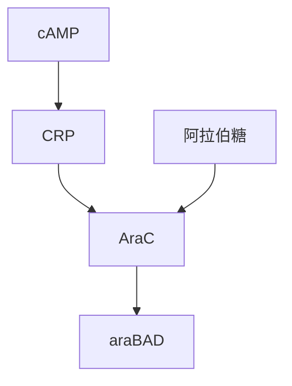
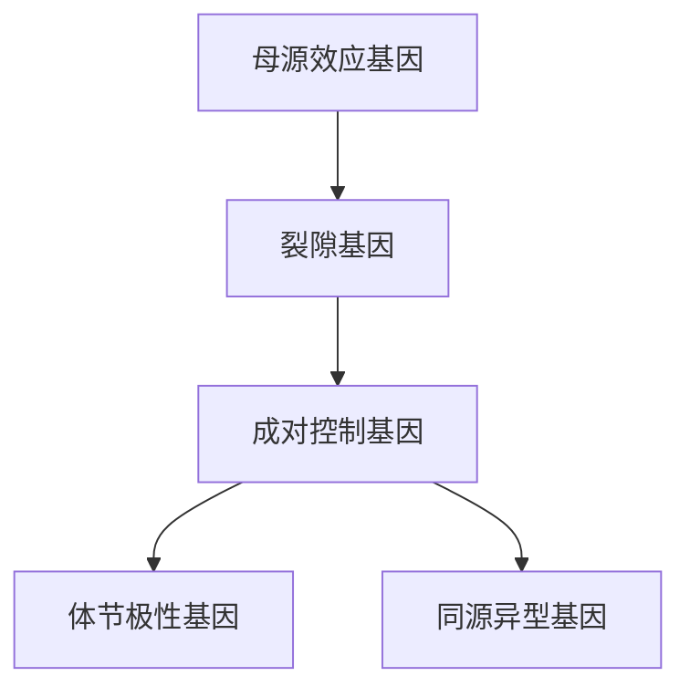
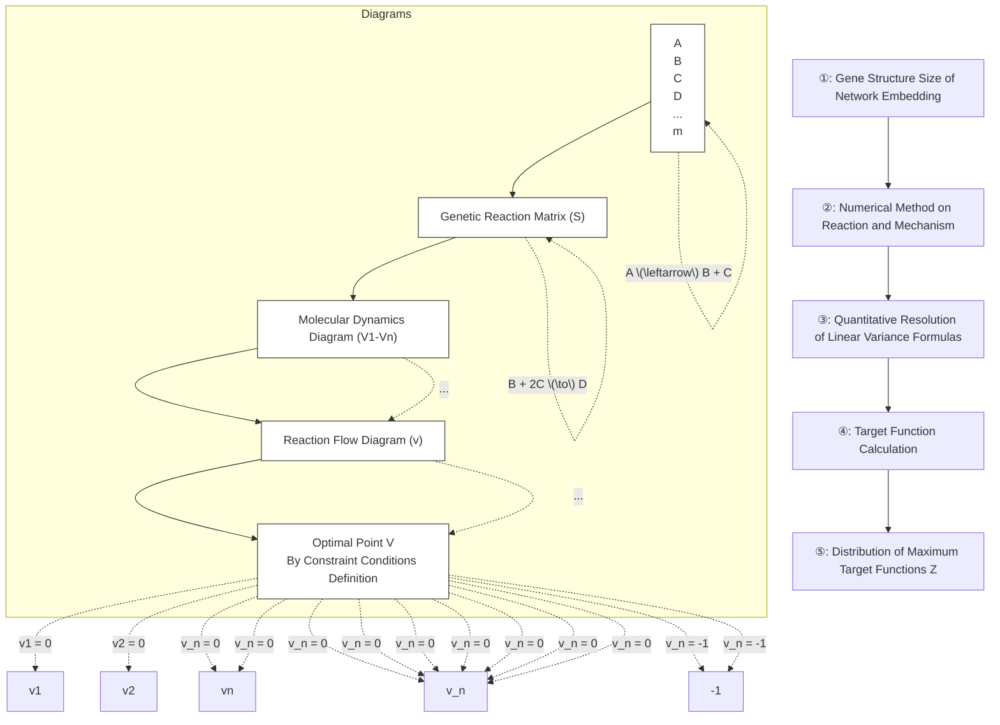

# 20 复杂生物网络

原始 PDF 第 569–586 页。

# 复杂生物网络

在生物系统中，从分子、细胞、个体到种群之间，存在着复杂的相互作用，这些相互作用跨越了不同的时间和空间尺度。本章将重点讨论生物分子之间的相互作用网络，例如基因调控网络、信号转导网络以及代谢网络等。在深入研究这些生物网络的动力学模型时，我们将特别关注那些更为庞大且复杂的网络体系。

本章将带领读者深入探索生物网络的复杂层次。我们将以大肠杆菌的基因调控网络、非洲爪蟾细胞周期调控网络、果蝇胚胎发育早期基因调控网络，以及代谢网络为例，介绍研究这些复杂相互作用网络的分析方法以及如何对复杂网络进行简化建模。对这些生物网络的深入探讨将帮助读者理解，网络的拓扑结构如何影响其动力学行为和生物学功能，并帮助读者更全面地理解生物系统如何精密运作，深入洞察其中的动态过程。

## 20

---

546

20 复杂生物网络

## 20.1 复杂生物网络的特征

生物的复杂性很大程度上源于无处不在的相互关联。第19章中，我们以高度简化的例子介绍了网络拓扑的基本概念，以及简单的拓扑性质如何影响网络的功能。然而，在真实的生物系统中，网络往往是高度复杂的，体现出如下几类特征:

① 非线性相互作用:复杂生物网络中的节点之间往往存在非线性相互作用，网络中的变化和调控是通过复杂的非线性关系产生的。这使得网络在响应外部刺激或内部变化时表现出更为丰富和多样的动态行为。

② 自组织性:复杂生物网络表现出自组织性，即系统倾向于形成自我调整的结构和模式。这种自组织性可以在多个层次上观察到，从分子水平的蛋白质相互作用到细胞间的信号传导网络，再到组织和器官水平的协调调节，以及生态和演化中的物种相互作用。自组织性使得生物网络具有适应环境变化的能力，并维持稳定的功能状态。

③ 异质性:迥异于随机网络，生物网络中的节点和连接通常表现出显著的差异性，这些例子包括小世界网络、无标度网络、层级网络等。异质性是演化的结果，它赋予了网络更大的灵活性和稳健性，使其能够应对复杂多变的生物环境。

④ 动态:复杂生物网络往往处于非平衡状态，通过动态的调节和调整来维持稳定性。远离平衡态体现在生物网络的各个层次上，从分子和细胞水平的代谢网络到整个生物体内的生理调控，使得生物网络能够迅速响应外部变化，实现功能的动态平衡。

⑤ 多尺度性:复杂生物网络在空间和时间上呈现出多尺度性。不同尺度上的相互作用和调控相互交织，形成了层次分明的结构。例如，分子水平的相互作用与细胞水平的信号传导、组织水平的结构与整个生物体的生理过程之间存在复杂的多尺度相互关系。

## 20.2 基因调控网络

细胞中的基因表达是一个被高度调控的过程，这种调控发生在中心法则的各个阶段，从转录到翻译，再到翻译后修饰。细胞生活在一个复杂的环境中，它们感知各种外部信号，比如温度、渗透压、营养物质和生物信号分子。细胞通过高度复杂的程序对此类外部信息作出响应，从而相应地控制基因表达。这种调控是通过DNA、mRNA、蛋白质和其它分子之间的网络来实现的，被称为基因调控网络（gene regulatory network，GRN）。最重要的转录调控因子被称为转录因子（transcription factor，TF），它们通过结合到DNA的特定序列（通常位于基因上游的调控序列）来改变RNA聚合酶（RNA polymerase，RNAP）对启动子区域的占有率，进而调节转录起始速率。

在第18章中，我们了解了单个基因在转录因子调控下表达量与转录因子浓度之间的关系，即输入函数。一般而言，转录因子本身的表达可以被其它转录因子调控。因此，细胞内众多转录因子之间形成一个复杂的调控网络，其中包含各种反馈。尽管

---

20.2 基因调控网络

547

如此，对此类网络进行数学建模时，基本模块仍然是第18章中的输入函数，其具体形式取决于不同转录因子之间相互作用的“逻辑规则”。

在基因调控网络中，转因子之间的相互作用会导致复杂的动力学行为，包括产生振荡、双稳态和其它非线性行为。基于第18章中的基本转录过程的微分方程数学模型，我们可以对更为复杂的基因调控网络进行建模，并分析其稳态行为、对信号的动态响应等性质，从而理解复杂的生物过程和功能背后的机理。本节将简要介绍被广为研究的大肠杆菌的基因调控网络、细胞周期调控网络和果蝇胚胎发育早期的基因调控网络的特点。

## 20.2.1 大肠杆菌的基因调控网络

在第18章中，我们对简单的基因调控网络的特征及其动力学有了初步的认识。本节将以大肠杆菌 $E.$ Coli为例，来探讨复杂的基因调控网络的性质。该基因调控网络包含了大肠杆菌基因组中约 $20\%$ 的基因。我们的目标是用第19章中的“模体”（motif）概念来解构该网络，从而理解整个网络的组织原则。

如何寻找网络的模体呢？按照定义，我们可以比较真实生物网络和随机化网络的区别。那些在真实网络中出现的概率显著高于随机化网络的结构即为模体。这里的基本假设是，在真实网络中更为频繁出现的结构一定是在演化过程中被保留下来的，否则基因的随机突变会使得这些结构消失。想一想为什么会这样呢？我们可以做一个简单的估算来说明。在 $10\mathrm{mL}$ 的液体培养基中放入一个大肠杆菌，在不到一天的时间里细菌会生长到饱和状态。此时，这一试管中的细菌数目将达到 $10^{10}$ 个，这个过程中基因组复制的次数为 $10^{10}$，而基因复制过程中的错误率为 $10^{-9}$ 每碱基每代。因此，在细菌数目达到饱和后的试管中，对于每个碱基位点，平均有10个细菌在该位点上有突变。由此可见，在没有演化选择压力的情况下，随机基因突变可以很快地改变基因调控网络。

下面我们简要介绍几类在大肠杆菌中发现的网络模体及其特性。

## (1) 自调控模体

在大肠杆菌的基因调控网络中，自调控模体，包括自抑制（negative autoregulation, NAR）和自激活（positive autoregulation, PAR）模体，相比随机网络出现得更加频繁。

## （2）自抑制模体加快系统的时间响应

自抑制作为一种网络模体，它有什么样的功能呢？为回答这一问题，我们将比较它与简单调控情形下的基因表达的响应时间尺度（图20-1）。对于简单调控（simple regulation）情形，在第18章中，我们已经知道它的响应时间尺度为 $t_{\mathrm{s},1/2} = \ln 2 / \beta_{\mathrm{s}}$，这里 $\beta_{\mathrm{s}}$ 是简单调控中的蛋白质降解速率。而对于自抑制情形，基因X的蛋白质产物会结合到基因的启动子区域，从而阻碍转录的进行，因而X蛋白质浓度随时间演化的常微分方程为

---

548

20 复杂生物网络

$$
\frac {\mathrm{d} x}{\mathrm{d} t} = f (x) - \beta_ {\mathrm{NAR}} x _ {\circ}
$$

其中 $f(x)$ 表示蛋白质产生的速率，它是蛋白质浓度的单调递减函数，一个比较好的近似是第18章中介绍的希尔函数:

$$
f (x) = \frac {\alpha_ {\mathrm{NAR}} K ^ {n}}{K ^ {n} + x ^ {n}} \circ
$$

在这种情况下，当 $x$ 远低于解离常数 $K$ 时，蛋白质产生速率为最大速率 $\alpha_{\mathrm{NAR}}$ ，而当X处于高浓度时，$f(x)$ 近似为0。

为直观分析自抑制的时间尺度，我们可以将 $f(x)$ 近似为一个阶跃函数$f(x)\sim \Theta (K - x) = \left\{ \begin{array}{ll}\alpha_{\mathrm{NAR}} & (x < K)\\ 0 & (x > K) \end{array} \right.$ （当 $n$ 比较大时这是一个比较好的近似）。当$\beta_{\mathrm{NAR}} <   \frac{\alpha_{\mathrm{NAR}}}{K}$ 时，平稳状态下基因表达的浓度近似为 $x_{\mathrm{st}} = K$ 。因而，当 $x < K$ 且 $x\ll \frac{\alpha_{\mathrm{NAR}}}{\beta_{\mathrm{NAR}}}$ 时，降解速率可被忽略，即 $x$ 以恒定的速率 $\alpha_{\mathrm{NAR}}$ 增加。当X的浓度到达 $K$ 左右时，生成速率变为0。系统响应时间可以定义为 $x$ 到达稳态浓度的一半所需要的时间，如图20-1所示， $t_{\mathrm{NAR},1 / 2} = \frac{K}{2\alpha_{\mathrm{NAR}}}$ 。为了公平比较，我们要让简单调控和自抑制两种情况下的蛋白质降解速率相同，稳态蛋白质浓度相同，这就要求 $\alpha_{\mathrm{s}} / \beta_{\mathrm{s}} = K$ ，且 $\alpha_{\mathrm{NAR}} > \alpha_{\mathrm{s}}$ 即自抑制调控需要使用很强的启动子。至此，我们得到了自抑制和简单调控情形下基因表达的响应时间尺度之比为

$$
\frac {t _ {\mathrm{NAR,1/2}}}{t _ {\mathrm{s,1/2}}} = \frac {K}{2 \alpha_ {\mathrm{NAR}}} \cdot \frac {\beta_ {\mathrm{s}}}{\ln 2} = \frac {1}{2 \ln 2} \cdot \frac {\alpha_ {\mathrm{s}}}{\alpha_ {\mathrm{NAR}}} 。
$$

从图20-1B可以直观地看出，自抑制情形的响应时间尺度远快于简单调控。

当然，上述分析是对 $f(x)$ 做了过度简化后得到的结果，对于一般的函数形式是否成立呢？事实上，我们可以用图解法直观地得出相同的结论。如图20-1C所示，稳态浓度由蛋白质生成速率和降解速率的交点决定。对于简单调控，生成速率是恒定的（水平线），而对于自调控情形是一个单调递减函数。由于要求两者的稳态蛋白质浓度相同，这就要求 $f(x)$ 曲线从高于 $\alpha_{s}$ 的地方开始，经过稳态浓度 $x_{\mathrm{st}}$，下降到 $\alpha_{s}$ 的下方。如果考虑X的初始浓度为0，则在到达稳态之前，蛋白质的净增加速率可表示为

（A）基因转录的简单调控和自抑制示意图。（B）自抑制调控的基因表达响应时间快于简单调控。假定自抑制情形下的蛋白质生成速率可近似为阶跃函数。（C）图解法理解自抑制调控的响应时间快于简单调控情形。

图20-1 自抑制调控的基因表达时间响应性质


---

20.2 基因调控网络

549

生成速率曲线和降解速率曲线之间的距离。可以看到，自抑制情形下这一距离总是大于简单调控，由此可见，对于一般的 $f(x)$ 形式，自抑制的响应总是比简单调控要快。直观上，由于负反馈“损有余、补不足”的特性，在X较低时能给予其更高的生成速率，促进其迅速升至稳态值。

## （3）自激活模体具有“降速”作用

自激活是一种正反馈，它可以产生双稳态（第19章）。利用上述图解法，也可以证明自激活情形的响应时间慢于简单调控。这一功能可能听起来有些违反直觉，因为正反馈可以使系统的输入-输出曲线更加陡峭，这似乎应该使得系统反应更快。究其原因，在于正反馈并不总是让 $x$ 增加，只是让 $x$ 的增长速率正比于自身。所以，在 $x$ 较低时，$x$ 的增加率相较于没有正反馈时更慢，使得系统在上升至稳态的过程中消耗更长的时间。

总结起来，正反馈由存在偶数条抑制边或者偶数条激活边的反馈回路构成，它可以起到的生物学功能包括但不限于:①使系统的输入-输出的稳态响应更陡峭；②形成多稳态，赋予系统“历史记忆”；③减缓系统的动力学响应速度。

## (4) 自抑制和自激活对噪声的敏感性不同

除了加快系统的响应速度之外，自抑制还有另外一个重要的功能，即它可以压制系统的噪声，使得基因表达水平在细胞中的涨落比简单调控要小。例如，当蛋白质的降解速率常数 $\beta$ 发生波动时，自抑制情形下稳态的蛋白质浓度的变化明显要比简单调控要小，这可以通过图20-2所示的图解法直观地得到。类似地，可以得到自激活情形的噪声大于简单调控。

## (5) 前馈网络模体

有了上述对简单自调控分析的基础，现在介绍转录调控中更加复杂的网络模体，以三个节点的子网络为例来说明。大肠杆菌转录网络中出现得最多的三节点网络模体是前馈环（feedforward loop，FFL），它由转录因子X调控Y，X和Y同时调控转录因子Z。前馈环中X到Z的调控有两条平行的通路:直接的和间接的。根据从X到Z的

各个分支的总调控符号（抑制或激活），所有8种可能的前馈环可以根据调控关系进一步分为两类:“一致性”（coherent）和“不一致性”（incoherent）前馈环（图20-3）。例如，X正向调控Y和Z，而Y正向调控Z，那么该网络是“一致的”。而如果Y对Z负向调节，那么网络就是“不一致的”。在大肠杆菌的转录网络中，绝大多数前馈环是第一类一致的（C1-FFL）或第一类非一致的（I1-FFL）（图20-3蓝色背景所示的两类网络）。

为了理解前馈环的功能，我们需要理解X和Y如何共同调控Z。结合第19章所学，可以将从X和Y到Z常见的“输入函数”划分为两种:一（A）简单调控情形下蛋白质浓度的涨落。（B）自抑制情形下蛋白质浓度的涨落。蓝线对应于蛋白质降解速率的波动。


图 20-2 蛋白质降解速率常数波动时造成的稳态蛋白质浓度的变化

---

550

20 复杂生物网络


<details>
<summary>flowchart</summary>

This image displays two hierarchical classification diagrams (one with '一致性前馈' and one with '不一致性前馈') showing the relationships between four categories (X, Y, Z) in each.
</details>

图20-3 所有8种可能的前馈环网络结构其中第一类一致性前馈和第一类不一致性前馈环在基因表达调控网络中出现频率很高。

种是与门，在该门中，需要X和Y同时激活Z；另一种是或门，在该门中，X和Y中的任一者足以激活Z。以与门情形为例，由于Y对X的响应需要一段时间，Y的表达量积累到一定程度之后才能激活Z，因而短暂的输入信号不足以激活Z的表达。因此，C1-FFL具有延时响应信号、滤除瞬态信号或噪声和仅对持续信号做出响应的特性。大肠杆菌的阿拉伯糖利用系统就采用这样的结构，使得大肠杆菌仅仅对环境中阿拉伯糖出现一定时间后才做出反应（知识窗20-1）。

而在I1-FFL中，X直接激活Z，但还通过激活抑制子Y抑制Z。因此，当信号触发X的激活时，它会迅速促进Z的表达，但从长远来看，随着Y的积累足够高，它反过来抑制了Z的表达，导致Z的响应表现为“脉冲”状动态。I1-FFL的另一个特点是，它的响应速度比仅通过直接激活Z的情况要快。在大肠杆菌中，半

乳糖利用系统具有I1-FFL的结构。葡萄糖是大肠杆菌更偏爱的碳源，当环境中存在葡萄糖时，大肠杆菌细胞中利用半乳糖的基因处于较低的表达水平。而当环境缺乏葡萄糖且同时存在半乳糖时，被I1-FFL结构调控的半乳糖利用基因可以迅速提高表达量，从而使细胞更快地利用半乳糖。

## (6) 单输入调控元件

在大肠杆菌的基因调控网络中负责感知环境并对环境做出响应的基因，往往形成被称为单输入调控模块（single input motif，SIM）的模体。它由一组被单个转录因子控制的操纵子组成（图20-4A）。SIM可以协调大量基因的时间表达程序，即哪些基因


图20-4 SIM和DOR网络模体及其在大肠杆菌基因调控网络中的例子

（A）SIM调控的示意图。（B）精氨酸生物合成基因的调控具有SIM结构。（C）DOR调控结构示意图。（D）细胞进入稳定期被RpoS调控的多个操纵子具有DOR结构。（D，改编自Shen-Orr SS, et al. Nat Genet, 2002, 31(1):64-68）

先表达，哪些基因后表达。这样，一个基因越早被需要，它的启动子就越早被激活。这种程序可以防止蛋白质在不被需要的时候产生。大肠杆菌中许多代谢通路的基因调控网络具有 SIM 结构，例如，精氨酸生物合成途径中，其编码精氨酸生物合成基因的五个操纵子均由转录因子 ArgR 控制（图 20-4B）。

## (7) 致密交叠调控子

另一类网络模体被称为“致密交叠调控子”（dense overlapping regulon，DOR），它由一组输入转录因子调控另外一组输出基因，且每个转录因子调控多个输出基因。我们可以将DOR看作一个组合决定元件:一组输出逻辑门整合多个输入信号，从而决定每个输出基因的表达。在大肠杆菌的基因调控网络中存在几个大的DOR结构，每个控制数十个到数百个基因的表达（图20-4C）。

---

20.2 基因调控网络

551

DOR中的基因通常具有相似的功能，例如压力响应、营养代谢和细胞主要组分的生物合成等（图20-4D）。可以说，DOR形成了大肠杆菌基因调控网络的主干。

至此，我们介绍了大肠杆菌基因调控网络中的四种主要的模体:自调控、前馈回路、单输入调控元件和致密交叠调控子。有了这些基本的调控模体，我们就可以对整个基因调控网络的全局结构和功能有更好的认识。例如，通过对大肠杆菌基因调控网络进行简化建模，可明显看出，与感觉调控相关的基因以多个DOR的形式组织起来。不同的前馈环、自调控和SIM模体镶嵌其中。

本节中介绍的转录调控模体涵盖了转录网络中大部分已知的相互作用。这些网络模体可以组合起来执行各种功能，比如在发育过程中生成顺序表达程序，形成多稳态

## 知识窗20-1

## 大肠杆菌的阿拉伯糖利用系统

大肠杆菌可以在不同的碳源环境下生长，但其最偏爱的碳源是葡萄糖。例如，当环境中缺乏葡萄糖同时存在阿拉伯糖的情况下，大肠杆菌的阿拉伯糖利用系统才会被启动，环境中的阿拉伯糖会被转运细胞内并被代谢掉。那么，大肠杆菌是如何决定开启阿拉伯糖利用系统的呢？实验发现，这一抉择是由第一类一致性前馈（C1-FFL）网络实现的。大肠杆菌利用两类转录因子来感知环境中营养的变化，当环境中的葡萄糖缺乏时，细胞内cAMP浓度会增高，从而激活CRP。而环境中的阿拉伯糖是被 AraC 探测的。编码代谢阿拉伯糖的基因只有在 CRP 和 AraC 同时高表达时才会被激活（图 20-5）。实验上，如果在存在阿拉伯糖的情形下，在培养基中突然增高 cAMP 的浓度，利用阿拉伯糖的基因大约延时 20 min 后才表达。而当环境中 cAMP 的浓度突然由高浓度切换到低浓度时，系统的响应是瞬时的。作为对比，简单调控，即没有 C1-FFL 的系统，如乳糖操纵子，应对相同的“开”或“关”输入时不会出现延时。

(A)


<details>
<summary>flowchart</summary>


</details>

(B)


<details>
<summary>line</summary>

| 时间/min | araBAD (相对表达量) | lacZYA (相对表达量) |
| --- | --- | --- |
| ~8 | ~0.01 | ~0.02 |
| ~9 | ~0.00 | ~0.04 |
| ~10 | ~0.00 | ~0.06 |
| ~11 | ~0.01 | ~0.08 |
| ~12 | ~0.02 | ~0.10 |
| ~13 | ~0.03 | ~0.12 |
| ~14 | ~0.04 | ~0.15 |
| ~15 | ~0.04 | ~0.17 |
| ~16 | ~0.04 | ~0.19 |
| ~17 | ~0.04 | ~0.21 |
| ~18 | ~0.03 | ~0.23 |
| ~19 | ~0.04 | ~0.25 |
| ~20 | ~0.05 | ~0.27 |
| ~21 | ~0.06 | ~0.29 |
| ~22 | ~0.07 | ~0.31 |
| ~23 | ~0.08 | ~0.33 |
| ~24 | ~0.10 | ~0.35 |
| ~25 | ~0.12 | ~0.37 |
| ~26 | ~0.14 | ~0.39 |
| ~27 | ~0.16 | ~0.41 |
| ~28 | ~0.18 | ~0.43 |
| ~29 | ~0.20 | ~0.45 |
| ~30 | ~0.22 | ~0.47 |
| ~31 | — | ~0.50 |
| ~32 | — | — |
| ~33 | — | — |
| ~34 | — | — |
| ~35 | — | — |
| ~36 | — | — |
| ~37 | — | — |
| ~38 | — | — |
| ~39 | — | — |
| ~40 | — | — |
| ~41 | — | — |
| ~42 | — | — |
| ~43 | — | — |
| ~44 | — | — |
| ~45 | — | — |
| ~46 | — | — |
| ~47 | — | — |
| ~48 | — | — |
| ~49 | — | — |
| ~50 | — | — |
| ~51 | — | — |
| ~52 | — | — |
| ~53 | — | — |
| ~54 | — | — |
| ~55 | — | — |
| ~56 | — | — |
| ~57 | — | — |
| ~58 | — | — |
| ~59 | — | — |
| ~60 | — | — |
| ~61 | — | — |
| ~62 | — | — |
| ~63 | — | — |
| ~64 | — | — |
| ~65 | — | — |
| ~66 | — | — |
| ~67 | — | — |
| ~68 | — | — |
| ~69 | — | — |
| ~70 | — | — |
| ~71 | — | — |
| ~72 | — | — |
| ~73 | — | — |
| ~74 | — | — |
| ~75 | — | — |
| ~76 | — | — |
| ~77 | — | — |
| ~78 | — | — |
| ~79 | — | — |
| ~80 | — | — |
| ~81 | — | — |
| ~82 | — | — |
| ~83 | — | — |
| ~84 | — | — |
| ~85 | — | — |
| ~86 | — | — |
| ~87 | — | — |
| ~88 | — | — |
| ~89 | — | — |
| ~90 | — | — |
| ~91 | — | — |
| ~92 | — | — |
| ~93 | — | — |
| ~94 | — | — |
| ~95 | — | — |
| ~96 | — | — |
| ~97 | — | — |
| ~98 | — | — |
| ~99 | — | — |
| ~100 | — | — |

注：图中箭头指向“简单调控”区域，表示在约第28分钟时， araBAD 的表达量增长较快；箭头指向“前馈环”区域，表示在约第35分钟后， araBAD 的表达量增长较慢。
</details>


<details>
<summary>line</summary>

| 时间/min | araBAD (相对表达量) | lacZYA (相对表达量) |
| --- | --- | --- |
| 5 | 1.0 | 1.0 |
| 10 | ~0.92 | ~0.94 |
| 15 | ~0.86 | ~0.87 |
| 20 | ~0.78 | ~0.80 |
| 25 | ~0.68 | ~0.70 |
| 30 | ~0.58 | ~0.60 |
| 35 | ~0.48 | ~0.50 |
| 40 | ~0.40 | ~0.38 |
| 43 | ~0.38 | ~0.30 |
</details>

图20-5 大肠杆菌阿拉伯糖利用系统的转录调控

（A）大肠杆菌阿拉伯糖利用系统的转录调控示意图。（B）前馈环具有延时响应特性。相比于简单调控，前馈环对于输入信号的“开”

延时响应，而对于“关”信号，会做出瞬时的响应。（B，数据自Mangan S, et al. J Mol Biol, 2003, 334(2): 197-204）

---

552

20 复杂生物网络

基因表达和振荡行为。接下来的两个小节将分别介绍调节细胞周期和发育过程的基因调控网络。

## 20.2.2 细胞周期调控网络

细胞周期这一基本的生命过程由一系列顺序发生的事件组成，通过这些事件，细胞生长并分裂成两个子细胞，这是一种在真核生物中高度保守的重要生物过程。细胞周期包含四个阶段: $G_{1}$ 期（细胞在生长并决定分裂）、S期（细胞完成DNA复制）、 $G_{2}$ 期（S期和M期之间的间隔）和M期（有丝分裂发生，此阶段染色体分离，细胞分裂成两个子细胞）。这个过程高度有序且受严密调控。尽管在细胞周期过程中涉及数百到数千个基因，但其核心网络在真核生物中高度保守。在过去的几十年中，对酵母、非洲爪蟾、果蝇和人类细胞的细胞周期调控的研究揭示了这一过程中反复出现的调控模式:负反馈回路、正反馈回路和互补调节。

尽管典型的细胞周期事件以一种有序的方式组织——新生细胞必须在DNA合成之前生长到足够大，DNA合成、中期纺锤体的组装必须在有丝分裂完成之前完成；但是有些细胞周期有所不同，一个显著的例外是非洲爪蟾的胚胎细胞周期。在早期胚胎中，细胞周期每 $25\mathrm{min}$ 发生一次，无论DNA复制和有丝分裂是否完成。因此，它表现得像一个自主的生化振荡器。由于它相对简单，它为研究细胞周期的设计原则提供了一个绝佳的例子。

非洲爪蟾胚胎细胞周期的核心调控环路由以细胞周期蛋白激酶CDK1和负责促进分裂的后期促进复合物（anaphase promoting complex，APC）为中心的蛋白质组成（图20-6A）。CDK1的激活将细胞推向有丝分裂，而APC的激活则将促进细胞退出有丝分裂（图20-6B）。细胞周期的这一核心调控模式可以进一步简化为正反馈与负反馈环路相结合。在19.5节中我们知道，虽然简单的负反馈环路可以产生振荡，但它并


图20-6 非洲爪蟾胚胎细胞周期调控网络

（A）简化的周期调控网络示意图。周期蛋白-CDK1是主要的调节因子，APC-Cdc20是E3连接酶，它泛素化有丝分裂素并将其定向降解。Wee1是一种蛋白激酶，能够使周期蛋白-CDK1失活。（B）在

非洲爪蟾胚胎中，周期蛋白-CDK1的激活将细胞推向有丝分裂，而APC的激活使细胞从有丝分裂中退出。（B，改编自Ferrell J E Jr, et al. Cell, 2011, 144(6): 874-885）

---

20.2 基因调控网络

553

不稳健。额外的正反馈环路不仅产生双稳态，使细胞周期转换类似开关，还引入了时间延迟，并有助于破坏整个系统的稳态，从而促进振荡的产生。

将 CDK 和 APC 的活性形式表示为 CDK1 $^{*}$  和 APC $^{*}$ ，它们的浓度随时间的演化可以由以下常微分方程组描述:

$$
\left\{ \begin{array}{l} \frac {\mathrm{d} [ \mathrm{CDK1} ^ {*} ]}{\mathrm{dt}} = \alpha_ {1} - \beta_ {1} [ \mathrm{CDK1} ^ {*} ] \frac {[ \mathrm{APC} ^ {*} ] ^ {n _ {1}}}{K _ {1} ^ {n _ {1}} + [ \mathrm{APC} ^ {*} ] ^ {n _ {1}}} + \alpha_ {3} (1 - [ \mathrm{CDK1} ^ {*} ]) \frac {[ \mathrm{CDK1} ^ {*} ] ^ {n _ {3}}}{K _ {3} ^ {n _ {3}} + [ \mathrm{CDK1} ^ {*} ] ^ {n _ {3}}}, \\ \frac {\mathrm{d} [ \mathrm{APC} ^ {*} ]}{\mathrm{dt}} = \alpha_ {2} (1 - [ \mathrm{APC} ^ {*} ]) \frac {[ \mathrm{CDK1} ^ {*} ] ^ {n _ {2}}}{K _ {2} ^ {n _ {2}} + [ \mathrm{CDK1} ^ {*} ] ^ {n _ {2}}} - \beta_ {2} [ \mathrm{APC} ^ {*} ]. \end{array} \right. \tag {20-1a}
$$

这里，假设CDK1被恒定速率的周期蛋白合成激活[式（20-1a）的第一项]，并将APC使CDK1失活的多个过程简化为希尔函数的形式[式（20-1a）的第二项]。式（20-1a）的第三项代表正反馈环路（自激活），虽然实际上APC的正反馈是通过Cdc25和Wee1介导的（图20-6A），这里进行了简化。我们还引入了对APC的线性降解。同时，不同形式的CDK1和APC的总量分别已被归一化为1。

应用相平面分析法，我们首先可以检查 $\mathrm{APC}^*$ 的平稳态水平如何取决于 $\mathrm{CDK1}^*$，这

可以通过将式（20-1b）的右边设置为0来确定。这个零斜率线是单调的，呈S形（图20-7B中的蓝线），因此APC\*和CDK1\*之间存在一对一的映射关系。然而，决定平稳态 $\mathrm{CDK1^{*}}$ 如何随APC\*变化的 $\mathrm{CDK1^{*}}$ 的零斜线（图20-7B中的橙线）存在一个区域，其中单一的$\mathrm{APC^{*}}$ 浓度可以对应三个不同的 $\mathrm{CDK1^{*}}$ 浓度（图20-7B中的蓝色阴影区域）。线性稳定性分析表明， $\mathrm{CDK1^{*}}$ 的左、右平稳态是稳定的，而中间的平稳态是不稳定的。两个零斜线相交点的线性稳定性分析显示它是不稳定的，进一步分析（知识窗20-2）表明，在这个不稳定的平衡点周围必然存在一个极限环（图20-7B中的灰线）。上述分析揭示了所选择的参数使CDK1/APC系统中的正反馈环路能够充当一个具有滞后的、双稳态的切换开关。切换开关与负反馈环路的耦合产生了持续的振荡。 $\mathrm{CDK1^{*}}$ 活性起初缓慢增加，然后跃升到高水平。紧随其后的是 $\mathrm{APC^{*}}$ 的迅速上升，这驱使$\mathrm{CDK1^{*}}$ 迅速下降。一旦 $\mathrm{CDK1^{*}}$ 降到一定水平以关闭$\mathrm{APC^{*}}$ ，系统开始缓慢地升向下一个峰值（图20-7C）。

目前，我们已经对过于简化的细胞周期网络进行了建模，添加更多的反馈环路，模型将变得更加真


图20-7 CDK1-APC调控的正反馈与负反馈环路（A）模型示意图，箭头表示激活，带钝端的线表示抑制。（B）模型的相平面和零斜线。橙线和蓝线是CDK1和APC的零斜线，它们的交点是不稳定的不动点。灰线是极限环。（C）系统随时间变化的特性，显示了持续的振荡。（C，改编自Ferrell J E Jr, et al. Cell, 2011, 144(6):874-885）

---

554

20 复杂生物网络

## 知识窗20-2

## 相平面上极限环的存在性

我们怎么才能知道一个动力系统是否存在稳定的极限环呢？这是一个极其困难的问题，但是对于二维系统这一类情况，包括上文中简化的非洲爪蟾胚胎的细胞周期调控网络，实际上是可以判断的，这便是庞加莱-本迪克松（Poincaré-Bendixson）定理的内容。简单来讲，如果在相平面内一个连通、有界的区域（不妨记为R）内没有不动点，并且R内的点代表的系统状态随时间变化将永远留在 R 内，则 R 中一定存在一个稳定极限环；满足条件的区域 R 典型的形状是环状的，其外边界上点都向内移动，而内边界上点都向外移动（比如，围绕一个不稳定的不动点）。定理的证明需要用到一些高阶的数学知识，在此不多作介绍，感兴趣的读者不妨参考相关的非线性动力学教材。

实，因而可以刻画细胞周期动力学的更多细节。但这会以模型的复杂度为代价:网络组件越多，解释模型的行为就越困难。在许多真核细胞中，细胞周期由CDK1/APC驱动，其行为更加具有序列性，而不是自主振荡，我们将在第21章中用芽殖酵母的细胞周期网络模型来说明。尽管如此，这里提出的简单的非洲爪蟾胚胎细胞周期模型为理解更复杂细胞周期环路的设计提供了借鉴。

周期性振荡普遍存在于生物体系中，它在细胞周期的调控，昼夜节律的日常维持，以及心脏跳动等各种生物功能中都发挥着重要作用。这些生物振荡不仅确保了生命活动的有序进行，也是维系生物体内环境平衡和功能协调的基础。

## 20.2.3 果蝇胚胎发育早期的基因调控网络

多细胞生物个体从受精卵开始，经过一系列的细胞分裂和分化过程，最终形成了具有特定结构的三维体系。在此过程中，每一个细胞如何根据所处的位置来选择特定的命运？研究发现，发育过程的一个普遍的原则是胚胎中的细胞在一系列步骤中逐步分化。首先，胚胎的大范围区域差异被建立起来，在这些区域内，特定基因的表达及其相互作用产生了更多的较小发育区域，每个区域有其独特的发育基因表达组合。通常，发育基因被按照严格的时间序列激活，它们形成了一个具有层级的基因调控网络，其中一组基因对下一组基因的激活至关重要，从而促使下一阶段的发育发生。果蝇早期胚胎发育过程清晰地展示了上述原则。这里，我们以果蝇的裂隙基因（gap gene）调控网络为例来说明，它在早期胚胎前后轴方向形态建成的过程中起重要作用。

果蝇的受精卵呈长椭球状，在精子和卵细胞核融合后，会发生快速的细胞核分裂，但核周围不形成细胞膜，从而使胚胎形成具有多个细胞核的合胞体。

在果蝇胚胎的合胞体阶段，首先发生的是一系列快速的核分裂。这些核分裂不伴

---

20.3 代谢网络

555

随着细胞膜的形成，因此所有的细胞核都位于共享的胞浆中。这种快速的核分裂过程称为核分裂期（mitotic cycle）。这种结构允许果蝇胚胎在很短的时间内通过连续的核分裂来快速增加细胞核数量。直到第9次分裂后，细胞核开始移动到胚胎的边缘，形成合胞原胚（blastoderm）。这是一个关键的过程，因为它标志着细胞核开始在胚胎表面形成一个单层的排列。

在第13次核分裂后，细胞核的数量达到6000个左右，并且均匀覆盖在胚胎表面。此时，虽然细胞核已经定位到了胚胎的外围，但细胞膜尚未形成。这种结构的特点是允许基因表达产物（如蛋白质和RNA）在胚胎中自由扩散，从而可以迅速影响整个胚胎。这种快速而广泛的信号传播对于胚胎早期发育过程的调控至关重要。

在后续的发育过程中，细胞膜最终会形成，细胞核将被包含在单独的细胞中，标志着果蝇胚胎从合胞体阶段转变为细胞化阶段。这个过程导致细胞的进一步分化和胚胎的形态发生明显变化。

胚胎发育过程中的一个核心问题是，单个细胞如何正确地选择自己的命运从而使得整个胚胎形成最终的身体规划？果蝇的前后轴方向的形态形成，即哪部分细胞最终会变成头部、胸部、腹部和尾部等，是由一系列基因表达程序逐步决定的，使得每一个细胞选取特定的命运。处于这一过程中的核心地位的是一组裂隙基因，它们在前后轴方向特定的范围内表达，提供了细胞分化所需要的“位置信息”，其下游的基因读取这些信息并将胚胎前后轴方向进一步标记为更小的区域，从而最终决定不同部位细胞的命运（知识窗20-3）。代找电子书资源，新书可代做扫描制作加微信asxiao90

## 20.3 代谢网络

上一节介绍的基因调控网络主要涉及DNA、RNA和蛋白质之间的相互作用。实际上，除了中心法则支配的基因表达调控过程，生物体中还有包括各种糖、脂质等在内的成百上千种代谢物在时刻不停地发生着复杂的化学反应。代谢物之间能够通过一系列的化学反应构成的代谢通路相互转化，就像一个个“站点”被道路连接起来，例如糖酵解通路、三羧酸循环等（图20-10）。在站点与站点之间的运输过程中，酶会帮助反应的发生（具体单步反应参阅18.1节），中间产物会被传递到下一个站点，直到形成最终产物或与其它代谢通路连接。不同的通路彼此连接、交错，就形成了代谢网络（metabolic network）。它就像生物体内一个庞大的交通系统，包括了代谢活动中的各种生化反应、通路及其调控关系。代谢网络有两个重要功能:一是将从外界摄取的物质（比如食物）转变成身体所需的构建材料和能量，二是参与物质的分解过程。这个网络非常复杂，涉及数百种生化反应和数千种代谢物之间的相互转化，其结构和调控机制对于维持生物体的生理功能至关重要。近年来，科学家们对代谢网络非常感兴趣，他们结合实验和计算模拟，对代谢网络进行建模和分析，揭示其结构和功能之间的关系。这有助于我们理解代谢疾病的发生原因，并为开发新的药物靶点和应用于

---

556

20 复杂生物网络

## 知识窗20-3

## 果蝇胚胎发育

果蝇的胚胎发育极其迅速，其体轴的前后轴极性在精子进入卵子之前就已经由母源细胞质中的转录因子确定（图20-8）。前后体轴由产生于母源营养细胞中并运输到卵母细胞中的mRNA确定，其蛋白质产物被称为母源形态生成素（morphogen）。最主要的有决定胚胎前部的bicoid(bcd)和后部的nanos mRNA。其中，bicoid mRNA被锚定在头部，其表达的产物即Bicoid蛋白通过扩散形成前后方向的浓度梯度。相应的，nanos mRNA翻译产生的Nanos蛋白建立了从后部到前部的浓度梯度（图20-9A）。除此之外，另外两类重要的由母源提供的mRNA是hunchback(hb)和caudal(cad)，它们对体轴前后方向的形态建成也是至关重要的。这样，胚胎前部的Bicoid蛋白作为转录因子激活hunchback基因而抑制caudal基因；胚胎后部的Nanos蛋白激活caudal基因而抑制 hunchback 基因。这些母源基因表达产物所形成的胚胎前后方向的浓度梯度是整个胚胎发育过程中基因调控网络的输入。

随后，合子基因开始表达。第一类被表达的这类合子基因被称为裂隙基因，因为它们的突变体会在分节模式中造成缺口。这些基因在特定的大范围区域内部重叠地表达。裂隙基因编码转录因子，它们的不同组合调节成对控制（pair-rule）基因的转录，而成对控制基因的表达将胚胎分割成更小的周期性的单位。不同成对控制基因的转录导致了与前后轴垂直的7个纵向条带的条纹状图案。成对控制基因编码的转录因子激活体节极性（segment-polarity）基因，这些基因的蛋白质产物将胚胎分割成14个节段的单位。与此同时，裂隙基因、成对控制基因和体节极性基因的蛋白质产物


<details>
<summary>flowchart</summary>


</details>

图 20-8 果蝇胚胎前后轴的形态建成该模式是由母源效应基因建立的，这些基因形成形态发生素梯度和区域。这些蛋白质是激活裂隙基因的转录因子，裂隙基因在胚胎的大段区域表达，它们调控成对控制基因的表达。成对控制基因的表达成条带状。然后，体节极性基因将胚胎沿前后轴划分为大小适中的单元。这些基因的共同作用定义了确定每个节段的同源域基因的空间领域。通过这种方式，周期性从非周期性中产生，每个节段都被赋予独特的身份。

---

20.3 代谢网络

557

相互作用，调控同源异型基因（homeotic gene），从而决定了每个节段的发育命运，比如果蝇的胸部、腹部等。

决定果蝇躯干部分的裂隙基因有四个，它们分别是hunchback(hb)，kruppel(kr)，knirps(kni)，giant(gt)。它们在胚胎进入第14次核分裂后的表达模式如图20-9C所示。那么这种空间表达模式是如何形成的呢？在胚胎的前部，高浓度的bicoid蛋白激活hb的表达，而hb会激活或抑制其它裂隙基因kr、kni和gt，同时，裂隙基因之间又形成复杂的调控关系。尽管确切的调控网络尚不清楚，但多年的实验和建模研究表明，裂隙基因之间的核心调控关系大致可以用图20-9B表示。例如，$hb$ 对 $kr$ 的调控依赖于 $hb$ 蛋白浓度，当 $hb$ 蛋白浓度高于某一阈值时，它将激活 $kr$ ，而其浓度过高时又会抑制 $kr$ 的表达。作为一个粗略的近似，裂隙基因之间的相互作用可以拆分为三个开关样的模块:$hb$ 和 $kni$ 的互相抑制，$kr$ 和 $gt$ 之间的互相抑制，以及 $hb$ 对 $kr$ 产物浓度依赖的调控。值得注意的是，裂隙基因的这种空间表达模式提供了决定前后轴方向细胞命运的“位置信息”，即每个细胞可以根据所表达的裂隙基因水平的组合而推断出所处的前后位置，从而决定合适的细胞命运。


图 20-9 裂隙基因表达的调控

（A）受精卵中的母源效应基因沿胚胎前后轴方向的表达模式。（B）简化后的裂隙基因调控网络，这里也显示了在胚胎端部表达的裂隙基因 $tll$ 对 $kni$ 和 $gt$ 的抑制。（C）实验测得的躯干部分四种裂隙基因在胚

胎进入第 14 次核分裂后 40 分钟左右的相对表达量。阴影区是多个胚胎测量的标准误差。（B，改编自 Papatsenko D, et al. PLOS ONE, 2011, 6(7): e21145；C，改编自 Petkova M D, et al. Cell, 2019, 176(4): 844-855）

生物工程提供了契机。

在前面的章节中，我们应用米氏反应动力学、希尔函数等工具对单个或几个酶促反应进行建模，以底物和酶的浓度为变量写出微分方程，研究其动态和稳态性质。然而对于数百个反应、上千种代谢物组成的复杂代谢网络（图20-10A），如果仍然采取这种建模方法，我们就不得不求解巨大的微分方程组，难度可想而知。因此，我们引入一种新的方法，它可以从更宏观的角度对整个代谢网络进行建模。

流平衡分析（flux balance analysis）是一种用于研究代谢网络的定量分析方法，就像我们用交通流分析来研究城市交通一样。它基于代谢网络的结构和物质转化的规律，通过建立数学模型来预测稳态下代谢通路中物质的流动和代谢产物的生成速率。流平衡分析本质上是一个线性规划问题。该问题的目标往往是最大化或最小化某个或某些代谢产物的产量，如最大化生物量（biomass）积累、最小化营养物质消

---

558

20 复杂生物网络

图20-10 代谢网络（A）代谢网络总览。（B）核心碳源代谢通路示例。（A，引自KEGG网站；B，改编自Wang X, et al. Nat Commun, 2019, 10: 1279）


耗等。同时，体系还要满足一定的约束条件，如代谢网络中的质量守恒和能量守恒，某些化学反应的速率存在上下限等。在稳态下，物质在代谢网络中的流动要保持平衡，即各代谢物的含量和代谢通路中的反应速率需要保持稳定。通过设定代谢通路中的约束条件和需要优化的目标产物，我们可以找出在特定条件下代谢通路中物质

---

20.3 代谢网络

559

流动的最佳方案。

具体来说，流平衡分析可以分为几个步骤（图20-11）:首先，根据想要研究的问题，明确体系中有哪些生化反应及每个反应的化学计量系数，构建一个代谢网络（图20-11①）。其次，用数学的方式描述这个代谢网络，即写出这个代谢网络对应的化学计量矩阵（stoichiometric matrix）S和代谢流向量v。化学计量矩阵的每一行代表一种物质，每一列代表一个化学反应，矩阵中的每个值即为该行对应的物质在该列对应的反应式中的化学计量系数，其中反应物为负，生成物为正。例如，第二个化学反应为 $B + 2C \rightarrow D$，那么矩阵第二列中，第一个数为-1，第二个数为-2，对应反应物B和C；第三个数为1，对应生成物D；其余位置均为0。除了真实发生的化学反应，细胞对代谢物的摄取和排出也可以被等效为化学反应，比如细胞从外部环境中摄取葡萄糖，就可以用反应式 $\varnothing \rightarrow$ 葡萄糖来表示。代谢流向量v是一个列向量，每个分量表示一个反应的速率，定义为单位时间内反应物浓度减少量或生成物增加量除以该物质


<details>
<summary>flowchart</summary>


</details>

图20-11 流平衡分析方法的研究流程

其中① - ⑤是研究流程的各个步骤。（改编自 Orth J D, et al. Nat Biotech, 2010, 28(3): 245-248）

---

560

20 复杂生物网络

的化学计量系数。这样表示代谢网络的妙处在于，化学计量矩阵 $S$ 和代谢流向量 $\nu$ 相乘可以得到一个维度等于反应物数量的列向量，其每个分量代表一种物质的浓度随时间的变化率（图20-11②）。然后，根据流平衡的原理，稳态下反应速率和各物质浓度保持不变，即

$$
\boldsymbol {S} \boldsymbol {v} = 0 _ {\circ} \tag {20-2}
$$

根据式（20-2）得出反应流动满足的线性方程组（图20-11③）；接着，定义一个想要优化的目标函数（图20-11④），比如某种产物的产量，或者细胞的生长速率。最后，在一定的约束条件下利用线性规划的方法求解目标函数的最大值和此时自变量（v）满足的条件，得到最优化问题的解（图20-11⑤）。

在上述五个步骤中，式（20-2）是流平衡原理的核心，其本质在于物质守恒。对于细胞内的每一种代谢物，其稳态浓度恒定，使得整个生命系统处于一种动态平衡状态。由于图20-11所示的方程式未包含流入系统的代谢流，为了更清晰地阐释流平衡分析的方法，图20-12展示了一个具体案例。其中，与外界交换物质的代谢流都被计入代谢流向量 $\nu$ ，同时只有细胞内的代谢物质需要满足流平衡（即物质守恒）。通过对目标函数进行优化计算，我们即可得到代谢流分布的最优解。

流平衡分析方法在定量生物学研究中具有广泛的应用，就像交通流分析可以帮助规划城市道路一样。它可以预测不同条件下代谢产物的生成速率、代谢通路的流量分布，从而预测细胞的生长速率、代谢物的积累和消耗，以及能量产生的效率等，还可以帮助确定关键酶的调控策略。此外，流平衡分析还可以应用于优化代谢工程和生物工业生产过程，从而增加特定产物的产量或提高底物的利用效率。尽管流平衡分析在预测代谢网络整体行为方面存在一些局限性，比如无法考虑动态变化和更复杂的调控机制，但它仍然是研究代谢网络的重要工具，为系统性的代谢研究提供了全局的视角和预测能力。

图20-12 流平衡分析方法的一个具体案例

(改编自Raman K, et al. Brief Bioinform, 2009, 10(4): 435-449)


<details>
<summary>flowchart</summary>

```mermaid
graph LR
  subgraph Top_Process
  A["b1 \to A \to B \to C"] --> B["代谢网络重构"]
  B --> C["v1: A + D \to E + B\nv2: B \to C\nb1, b2, ..., b5: 系统与外界交换\n物质的反应"]
  C --> D["化学计量矩阵"]
  D --> E["流平衡方程"]
  end

  subgraph Bottom_Process
  F["4.857 \to A \to B \to C"] --> G["该目标函数\n流平衡分布的最优解"]
  G --> H["&quot;优化目标: 最大化B的产能(b2)\n线性优化:\(max(c \cdot v)\)使得 Sv=0\nc=[0 0 0 1 0 00"]^T"]
  H --> I["待优化目标函数"]
  I --> J["代谢流的其它限制条件"]
  end
```
</details>

---

扩展阅读

561

## ※ 本章小结

本章主要讨论了生物网络中的复杂性，尤其是大肠杆菌的基因调控网络、细胞周期调控网络，以及多细胞生物的发育过程中的基因调控网络。我们依次领略了生物网络的基本特性，如非线性相互作用、自组织性、异质性、动态性和多尺度性，这些特性共同构成了生物网络的复杂性。

我们重点讨论了基因调控网络的动力学特性，如自抑制和自激活模体的功能，前馈环的类型与功能，以及单输入调控模块和致密交叠调控子的重要性。特别是通过对大肠杆菌和其它模型生物的研究，展示了基因调控网络在生物体适应环境和发展过程中的关键作用。

我们之后还介绍了细胞周期调控网络，特别是非洲爪蟾胚胎细胞周期的调控机制，强调了正反馈和负反馈环路在细胞周期调控中的重要性。此外，发育过程中的基因调控网络部分详述了多细胞生物从受精卵到成体的复杂分化过程中基因表达的调控机制，而果蝇胚胎发育的模型研究为理解这些调控机制提供了重要的视角。

本章最后还简要介绍了代谢网络的概念，包括通过流平衡分析方法来研究和预测生物体中各种化学反应的动态平衡和代谢产物的生成速率，相关内容我们将在第21章再次进行讨论。

## ※ 思考题

1. 在比较自抑制调控和简单调控的响应时间时，我们将希尔函数近似为一个阶跃函数。试推导不做这一近似时，输入函数由系数为 $n$ 的希尔函数描述的自抑制调控的响应时间。讨论上述近似成立的条件。[提示:做变量替换 $u = [X]^{n + 1}$，解出 $u$ 的方程。]
2. 根据图20-1的图解法说明自激活模体响应时间慢于简单调控。
3. 在指数生长期，细菌群的质量和代谢物含量均呈指数增长。这种情况为什么适用于流平衡分析？

## ※ 扩展阅读

## 图书

- Alon U. An introduction to systems biology: design principles of biological circuits[M]. 2nd ed. Boca Raton: CRC Press, 2019.
- Barresi M, Gilbert S. Developmental biology[M]. New York: Oxford University Press, 2020.
- Strogatz S H. Nonlinear dynamics and chaos: with applications to physics, biology, chemistry, and engineering[M]. 2nd ed. Boca Raton: CRC Press, 2018.

---

562

20 复杂生物网络

## 综述

Ferrell J E Jr, Tsai T Y-C, Yang Q. Modeling the cell cycle: why do certain circuits oscillate?[J]. Cell, 2011, 144(6):874-885.

Orth J D, Thiele I, Palsson B ∅. What is flux balance analysis?[J]. Nat Biotechnol, 2010, 28(3):245–248.

## 研究论文

Shen-Orr S S, Milo R, Mangan S, et al. Network motifs in the transcriptional regulation network of Escherichia coli [J]. Nat Genet, 2002, 31(1):64–68.
