# 21 生命系统特征的定量理解

原始 PDF 第 587–622 页。

## 生命系统特征的定量理解

在前面的章节中，我们从单个酶促反应的动力学出发，对生命活动的基本过程建立定量模型，从中体会定量生物学的思维方式。以此为基础，我们逐步引入了形式更加复杂多样的模型，从而能够定量地描述更加丰富的生物学过程，直至复杂生物网络的调控。而随着研究对象越发复杂和庞大，一些微观尺度和还原论视角下不存在的新问题就会涌现出来。在本章中，我们将从更加宏观的层次上介绍生命系统所具有的一般性特征及其背后的原理，包括非平衡状态、稳健性、优化原理和自组织。这些特征保证了作为一个整体的生命系统能够稳定、有序、高效地完成极为复杂精妙的各项生命活动。我们将结合具体的例子，学习如何利用定量模型刻画和研究这些特征，从而深化对生命系统的理解。

## 21

---

564

21 生命系统特征的定量理解

## 21.1 远离平衡态的生命系统

物理学家薛定谔在他的名著《生命是什么？》中就指出，生命体和非生命体的一个本质区别就在于是否和周边环境在不断地交换着物质和能量，远离平衡态以克服自身熵的增大，并尽可能地保持在有序的状态。早在20世纪初，就开始有物理化学家在具体的远离平衡态系统中研究动力学和热力学，其中就包括简单的化学反应系统。而到了20世纪40年代，以普里戈金为代表的物理化学家们提出了“非平衡稳态”的概念（也称为非平衡定态），并给出了非平衡态热力学的一般框架。但是，非平衡态和平衡态的热力学理论是很不一样的，一直都无法脱离具体的动力学过程来进行定量刻画。这并不一定是一种缺陷或者遗憾，非平衡态现象理当如此的复杂，否则这个世界也太无趣了。

单个细胞是最简单的生命系统，但其内部也已经足够复杂，因此我们再次进行大幅度的简化，来寻找最简单的化学反应体系，这可以看作生命系统的一个最原始的雏形。而且时至今日，对于化学反应以及化学反应系统的非平衡态热力学，至少在稀溶液的情况下，理解得已经比较清晰。

所以在本节中，我们就基于最简单的单分子和双分子反应的质量作用定律和平衡态热力学里的一些基本概念，来研究非平衡态化学反应系统的基本动力学和热力学性质，主要是考虑非平衡稳态。

## 21.1.1 化学反应非平衡稳态热力学基础

非平衡稳态只有在含有环形结构的化学反应系统里才能体现出来，因此先来考虑一个最简单的环形三组分化学反应系统:

$$
\mathrm{A} \xrightarrow [ k _ {- 1} ]{k _ {1}} \mathrm{B}, \mathrm{B} \xrightarrow [ k _ {- 2} ]{k _ {2}} \mathrm{C}, \mathrm{C} \xrightarrow [ k _ {- 3} ]{k _ {3}} \mathrm{A}
$$

在2.3节中，我们已经知道:对于每个物质A、B和C，都可以分别定义出它们的化学势，也就是单位浓度的自由能；而且在稀溶液的情况下，这个化学势 $\mu$ 又可以分解成两项，一项叫作内在化学势，是由分子结构、温度、压强、溶剂性质等决定的，与该物质的浓度是无关的，被记为 $\mu^0$ ，另一项是浓度的对数乘以 $k_{\mathrm{B}}T$ ，其中 $k_{\mathrm{B}}$ 是玻尔兹曼常量， $T$ 是温度。

这里我们只考虑浓度变化而导致的非平衡态，不考虑比如温度、压强等的不均匀性等原因导致的非平衡系统。因此可以认为，在浓度变化时，$\mu^0$ 是不会变的，而每个物质的单位浓度自由能，也就是化学势，依然可以用平衡态热力学里的表达式来刻画。

具体来说，我们定义A、B和C的化学势为 $\mu_{\mathrm{A}} = \mu_{\mathrm{A}}^{0} + k_{\mathrm{B}}T\log c_{\mathrm{A}}$ 、 $\mu_{\mathrm{B}} = \mu_{\mathrm{B}}^{0} + k_{\mathrm{B}}T\log$ $c_{\mathrm{B}}$ 和 $\mu_{\mathrm{C}} = \mu_{\mathrm{C}}^{0} + k_{\mathrm{B}}T\log c_{\mathrm{C}}$ ，其中 $c_{\mathrm{A}}$ 、 $c_{\mathrm{B}}$ 、 $c_{\mathrm{C}}$ 分别是化学物质A、B和C的浓度。在2.3节，我们已经知道了内在化学势和化学平衡常数之间的对数关系，而在这个具体的例

---

21.1 远离平衡态的生命系统

565

子里，化学平衡常数就等于正向和逆向一阶化学反应常数之比，因此可以得到

$$
\frac {k _ {1}}{k _ {- 1}} = \exp \left(\frac {\mu_ {\mathrm{A}} ^ {0} - \mu_ {\mathrm{B}} ^ {0}}{k _ {\mathrm{B}} T}\right), \frac {k _ {2}}{k _ {- 2}} = \exp \left(\frac {\mu_ {\mathrm{B}} ^ {0} - \mu_ {\mathrm{C}} ^ {0}}{k _ {\mathrm{B}} T}\right), \frac {k _ {3}}{k _ {- 3}} = \exp \left(\frac {\mu_ {\mathrm{C}} ^ {0} - \mu_ {\mathrm{A}} ^ {0}}{k _ {\mathrm{B}} T}\right) 。
$$

把上面三个式子左右两边分别连乘，就有

$$
\frac {k _ {1} k _ {2} k _ {3}}{k _ {- 1} k _ {- 2} k _ {- 3}} = 1 \text {。} \tag {21-1}
$$

这正是化学里细致平衡原理的表现形式之一，它刻画了无其它物质参与的环形单分子化学反应系统的各个化学反应常数之间所必须满足的约束。而非平衡态，特别是非平衡稳态，就是要打破这个约束。

但是这已经是物理化学定律了，还怎么打破呢？其实是打引号的“打破”，并不是要违反这条定律，而只是说在不符合该定律的前提条件时，这个约束条件是可以被违背的，而且这样的一种违背也是可以被定量刻画的。

生命体中最常见的破坏该约束的情形就是正逆两个方向的六个单分子一阶反应里有两个是拟一阶化学反应，也就是说本质上这些反应中有两个是双原子的二阶化学反应，比如生命体中常见的磷酸化和去磷酸化过程，就是物质A、B和C组成的环形结构耦合上ATP的水解过程。对该过程的定量刻画有助于我们理解生命体内部的能量转化，如图21-1所示。

以图21-1B的化学反应系统为例，其中 $k_{1}^{0}$ 和 $k_{-3}^{0}$ 是对应的二阶双分子化学反应的反应常数，因为前者是T加上A合成B，后者是D加上A合成C。于是当把它和最简单的环形三组分化学反应系统相比较时就会发现，当物质D和T的浓度固定不变时，只要定义拟一阶化学反应常数 $k_{1} = k_{1}^{0}c_{\mathrm{T}}$ 和 $k_{-3} = k_{-3}^{0}c_{\mathrm{D}}$ ，则二者在数学模型上就变得完全一样，唯一的不同是此时这些一阶和拟一阶化学反应常数不必再遵守细致平衡原理式（21-1）。

使用和最简单环形三组分化学反应系统几乎一样的推导，可以得到整个环形结构总的化学势差，就等于物质D与物质T的化学势差（知识窗21-1），即

$$
\Delta \mu = \mu_ {\mathrm{D}} - \mu_ {\mathrm{T}} = \Delta \mu^ {0} + k _ {\mathrm{B}} T \ln \frac {c _ {\mathrm{D}}}{c _ {\mathrm{T}}} 。
$$

这个公式其实说的是一个很浅显的结论，那就是环形结构每顺时针转一圈，其效果无非就是把一个T分子转化成了D分子而已。

再次利用内在化学势与化学反应常数的关系，可以进一步得到

$$
\begin{array}{l} \Delta \mu = - k _ {\mathrm{B}} T \ln \frac {k _ {1} ^ {0} k _ {2} k _ {3}}{k _ {- 1} k _ {- 2} k _ {- 3} ^ {0}} + k _ {\mathrm{B}} T \ln \frac {c _ {\mathrm{D}}}{c _ {\mathrm{T}}} \\ = - k _ {\mathrm{B}} T \ln \frac {k _ {1} k _ {2} k _ {3}}{k _ {- 1} k _ {- 2} k _ {- 3}} 。 \\ \end{array}
$$

这个公式表明细致平衡原理[式（21-1）]正好对应于环形结构总的化学势差为零。这也是平


图21-1 环形结构化学反应系统与外部物质转化过程相耦合物质A、B和C组成的环形结构化学反应系统，与物质T和D之间的转化过程相耦合，耦合的方式有两种。

---

566

21 生命系统特征的定量理解

## 知识窗21-1

## 图 21-1B 的环形自由能变化分析

对于顺时针的三个化学反应，其反应物与生成物的化学势差分别为

$$
\Delta \mu_ {\mathrm{l}} = \mu_ {\mathrm{B}} - \mu_ {\mathrm{A}} - \mu_ {\mathrm{T}} = \Delta \mu_ {\mathrm{l}} ^ {0} + k _ {\mathrm{B}} T \ln \frac {c _ {\mathrm{B}}}{c _ {\mathrm{A}} c _ {\mathrm{T}}},
$$

$$
\Delta \mu_ {2} = \mu_ {\mathrm{C}} - \mu_ {\mathrm{B}} = \Delta \mu_ {2} ^ {0} + k _ {\mathrm{B}} T \ln \frac {c _ {\mathrm{C}}}{c _ {\mathrm{B}}},
$$

$$
\Delta \mu_ {3} = \mu_ {\mathrm{A}} + \mu_ {\mathrm{D}} - \mu_ {\mathrm{C}} = \Delta \mu_ {3} ^ {0} + k _ {\mathrm{B}} T \ln \frac {c _ {\mathrm{A}} c _ {\mathrm{D}}}{c _ {\mathrm{C}}}
$$

左右两边分别相加，从而整个环形结构的化学势差为

$$
\Delta \mu = \Delta \mu_ {1} + \Delta \mu_ {2} + \Delta \mu_ {3} = \mu_ {\mathrm{D}} - \mu_ {\mathrm{T}} = \Delta \mu^ {0} + k _ {\mathrm{B}} T \ln \frac {c _ {\mathrm{D}}}{c _ {\mathrm{T}}}.
$$

再次利用 2.3 节中内在化学势与化学平衡常数的关系，我

们知道

$$
\Delta \mu_ {1} ^ {0} = - k _ {\mathrm{B}} T \ln \frac {k _ {1} ^ {0}}{k _ {- 1}}, \Delta \mu_ {2} ^ {0} = - k _ {\mathrm{B}} T \ln \frac {k _ {2}}{k _ {- 2}},
$$

$$
\Delta \mu_ {3} ^ {0} = - k _ {\mathrm{B}} T \ln \frac {k _ {3}}{k _ {- 3} ^ {0}},
$$

因此把它们都加起来就可以得到

$$
\Delta \mu^ {0} = \Delta \mu_ {1} ^ {0} + \Delta \mu_ {2} ^ {0} + \Delta \mu_ {3} ^ {0} = - k _ {\mathrm{B}} T \ln \frac {k _ {1} ^ {0} k _ {2} k _ {3}}{k _ {- 1} k _ {- 2} k _ {- 3} ^ {0}}.
$$

因此

$$
\Delta \mu = - k _ {\mathrm{B}} T \ln \frac {k _ {1} ^ {0} k _ {2} k _ {3}}{k _ {- 1} k _ {- 2} k _ {- 3} ^ {0}} + k _ {\mathrm{B}} T \ln \frac {c _ {\mathrm{D}}}{c _ {\mathrm{T}}} = k _ {\mathrm{B}} T \ln \frac {k _ {1} k _ {2} k _ {3}}{k _ {- 1} k _ {- 2} k _ {- 3}},
$$

其中 $k_{1} = k_{1}^{0}c_{\mathrm{T}}$ 、 $k_{-3} = k_{-3}^{0}c_{\mathrm{D}}$ 是拟一阶化学反应常数。

衡态的一个特征，即系统里不存在能量差。

另一方面，从动力学的角度，我们可以基于质量作用定律，给出该系统中物质A、B和C浓度随时间变化的常微分方程组，同时假设T和D的浓度保持不变——这恰恰是维系该系统的稳态偏离平衡态的原因所在。

列出的常微分方程组为

$$
\left\{ \begin{array}{l l} \frac {\mathrm{d} c _ {\mathrm{A}}}{\mathrm{d} t} = k _ {- 1} c _ {\mathrm{B}} + k _ {3} c _ {\mathrm{C}} - (k _ {1} + k _ {- 3}) c _ {\mathrm{A}}, & \text {(21-2a)} \\ \frac {\mathrm{d} c _ {\mathrm{B}}}{\mathrm{d} t} = k _ {1} c _ {\mathrm{A}} + k _ {- 2} c _ {\mathrm{C}} - (k _ {- 1} + k _ {2}) c _ {\mathrm{B}}, & \text {(21-2b)} \\ \frac {\mathrm{d} c _ {\mathrm{C}}}{\mathrm{d} t} = k _ {2} c _ {\mathrm{B}} + k _ {- 3} c _ {\mathrm{A}} - (k _ {- 2} + k _ {3}) c _ {\mathrm{C}} 。 & \text {(21-2c)} \end{array} \right.
$$

令右端为零，可以计算出稳态时物质 A、B 和 C 的浓度  $c_{A}^{ss}$ 、 $c_{B}^{ss}$  和  $c_{C}^{ss}$ （知识窗 21-2）。

我们其实关心的是单位时间内有多少A转成B，B转化成C，C转化成A，这就是这个环形结构的环流量，也是单位时间内物质T转化成物质D的量，为

$$
J ^ {\mathrm{ss}} = \frac {k _ {1} k _ {2} k _ {3} - k _ {- 1} k _ {- 2} k _ {- 3}}{k _ {2} k _ {3} + k _ {3} k _ {- 1} + k _ {- 1} k _ {- 2} + k _ {3} k _ {1} + k _ {1} k _ {- 2} + k _ {- 2} k _ {- 3} + k _ {1} k _ {2} + k _ {2} k _ {- 3} + k _ {- 3} k _ {- 1}} c _ {\mathrm{tol}}
$$

这里 $c_{\mathrm{tot}}$ 是物质A、B和C的浓度和，不随时间改变。

因此细致平衡条件式（21-1）也等价于这个流量为零。这是平衡态的另一个特

---

21.1 远离平衡态的生命系统

567

## 知识窗21-2

## 稳态物质浓度和环流量

令常微分方程组式（21-2）右端为零，可以计算出稳态时物质A、B和C的浓度如下:

$$
c _ {\mathrm{A}} ^ {\mathrm{ss}} = \frac {k _ {2} k _ {3} + k _ {3} k _ {- 1} + k _ {- 1} k _ {- 2}}{k _ {2} k _ {3} + k _ {3} k _ {- 1} + k _ {- 1} k _ {- 2} + k _ {3} k _ {1} + k _ {1} k _ {- 2} + k _ {- 2} k _ {- 3} + k _ {1} k _ {2} + k _ {2} k _ {- 3} + k _ {- 3} k _ {- 1}} c _ {\mathrm{tot}},
$$

$$
c _ {\mathrm{B}} ^ {\mathrm{ss}} = \frac {k _ {3} k _ {1} + k _ {1} k _ {- 2} + k _ {- 2} k _ {- 3}}{k _ {2} k _ {3} + k _ {3} k _ {- 1} + k _ {- 1} k _ {- 2} + k _ {3} k _ {1} + k _ {1} k _ {- 2} + k _ {- 2} k _ {- 3} + k _ {1} k _ {2} + k _ {2} k _ {- 3} + k _ {- 3} k _ {- 1}} c _ {\mathrm{tot}},
$$

$$
c _ {\mathrm{C}} ^ {\mathrm{ss}} = \frac {k _ {1} k _ {2} + k _ {2} k _ {- 3} + k _ {- 3} k _ {- 1}}{k _ {2} k _ {3} + k _ {3} k _ {- 1} + k _ {- 1} k _ {- 2} + k _ {3} k _ {1} + k _ {1} k _ {- 2} + k _ {- 2} k _ {- 3} + k _ {1} k _ {2} + k _ {2} k _ {- 3} + k _ {- 3} k _ {- 1}} c _ {\mathrm{tot}}
$$

单位时间内物质 T 转化成物质 D 的量为

$$
\begin{array}{l} J ^ {\mathrm{ss}} = c _ {\mathrm{A}} ^ {\mathrm{ss}} k _ {1} - c _ {\mathrm{B}} ^ {\mathrm{ss}} k _ {- 1} = c _ {\mathrm{B}} ^ {\mathrm{ss}} k _ {2} - c _ {\mathrm{C}} ^ {\mathrm{ss}} k _ {- 2} = c _ {\mathrm{C}} ^ {\mathrm{ss}} k _ {3} - c _ {\mathrm{A}} ^ {\mathrm{ss}} k _ {- 3} \\ = \frac {k _ {1} k _ {2} k _ {3} - k _ {- 1} k _ {- 2} k _ {- 3}}{k _ {2} k _ {3} + k _ {3} k _ {- 1} + k _ {- 1} k _ {- 2} + k _ {3} k _ {1} + k _ {1} k _ {- 2} + k _ {- 2} k _ {- 3} + k _ {1} k _ {2} + k _ {2} k _ {- 3} + k _ {- 3} k _ {- 1}} c _ {\mathrm{tot}} \\ \end{array}
$$

征，即系统里不存在定向的宏观流动。

对于违背细致平衡条件式（21-1）的系统，如果把总的化学势差乘以稳态的流量，即 $\Delta \mu \cdot J^{\mathrm{ss}}$ ，我们可以发现这个量总是负的，而它的相反数恰恰就是单位时间内一共损失了多少能量。这是因为该环形结构每顺时针转一圈就损失了 $-\Delta \mu$ 这么多的能量，而 $J^{\mathrm{ss}}$ 恰恰表示的就是单位时间内转了多少圈。$-\Delta \mu \cdot J^{\mathrm{ss}}$ 在非平衡态热力学里被称为稳态熵产生，即薛定谔指出的内部自发熵增，这是非平衡稳态理论里的核心物理量，它的非负性体现的正是热力学第二定律。

## 21.1.2 动力学校对

在20世纪70年代，人们发现，生命体内部的物质合成过程，比如转录翻译，准确度都非常高。以蛋白质分子在核糖体上的合成过程来说，识别转运核糖核酸（tRNA）的错误率可以低至 $10^{-4}$，也就是识别正确的可能性是识别错误的可能性的一万倍。如果我们简单地使用平衡态统计物理的知识，根据在2.1节学过的玻尔兹曼分布，正确的和错误的tRNA分子的内在化学势差就必须等于 $\ln 10^{4}$ 乘以 $k_{\mathrm{B}}T$，可以算出是 $3.776 \times 10^{-20} \mathrm{~J}$，则 $1 \mathrm{~mol}$ 正确的和错误的tRNA分子的内在化学势差就应该等于 $22.656 \mathrm{~kJ}$。但这和实验上在平衡态条件下测量得到的 $1 \mathrm{~mol}$ 正确的和错误的tRNA分子的内在化学势差相去甚远，几乎相差一倍，这也就意味着平衡态时正确的和错误的tRNA之比（即平衡常数）也就只能在 $10^{2}$ 上下。这又是怎么回事呢？

后来人们意识到，生命体远离平衡态，其环形结构总的自由能差很可能就是这种

---

568

21 生命系统特征的定量理解

高效率的来源，这种机制被称为动力学校对，是由约翰·霍普菲尔德（John Hopfield）和雅克·尼尼奥（Jacques Ninio）在1974年分别独立提出的。动力学校对在不同生命过程中的表现形式略有不同，这里就借用上一节介绍的环形结构化学反应系统的非平衡定态基础知识，以酶与两种不同配体的结合为例，来定量地加以介绍。

生命体中的蛋白质（酶）和配体的结合过程，很多都不是一个简单的可逆双分子化学反应，为了实现某些生物功能，或者就是为了本节所说的高特异性，即拉大与正确的或错误的配体结合的比例，都会和比如ATP水解这样的反应相耦合，使得系统得以远离平衡态，并且通过比如磷酸化等机制来激活复合体的功能。

在配体 L 的浓度以及物质 T 和物质 D 浓度固定的情况下，图 21-2 就是上一小节介绍的环形模型，其中 R 就是 A，RL 就是 B，而 RL$^{*}$ 就是 C，这里简单假设提供能量的 T 和 D 之间的反应是只和 RL 与 RL$^{*}$ 之间的反应相耦合的，即 T + RL $\longleftrightarrow$ D + RL$^{*}$。这一假设非本质，并不影响本节的所有结论。

除了正确的配体L，我们进一步假设还有一个和L结构类似的错误配体 $\mathrm{L}'$ ，最典型的例子就是在翻译过程中的不同tRNA，其结构上差异很小，但是核糖体依照模板链却能非常精准高速地完成翻译过程，而这也正是动力学校对这一机制着重要解释的现象。

对于L和 $\mathrm{L}^{\prime}$ 共存的系统，且我们假设L和 $\mathrm{L}^{\prime}$ 的结构如此相似，它们所参与的化学反应也是相同的，于是一个环的化学反应系统就被扩增为了两个环（图21-3），其中 $k_{1}, k_{-3}, k_{1}^{\prime}$ 和 $k_{-3}^{\prime}$ 是拟一阶化学反应常数。这里我们假设L和 $\mathrm{L}^{\prime}$ 的浓度相同，这样比较二者的结合比例才合理。

根据上一节最后所得到的热力学关系，由于L和 $\mathrm{L}^{\prime}$ 的环形反应都是被同样的T和D之间的反应所驱动的，因此我们知道

$$
\Delta \mu_ {\mathrm{T} \rightarrow \mathrm{D}} = \mu_ {\mathrm{D}} - \mu_ {\mathrm{T}} = - k _ {\mathrm{B}} T \ln \frac {k _ {1} k _ {2} k _ {3}}{k _ {- 1} k _ {- 2} k _ {- 3}} = - k _ {\mathrm{B}} T \ln \frac {k _ {1} ^ {\prime} k _ {2} ^ {\prime} k _ {3} ^ {\prime}}{k _ {- 1} ^ {\prime} k _ {- 2} ^ {\prime} k _ {- 3} ^ {\prime}} 。 \tag {21-3}
$$


<details>
<summary>flowchart</summary>

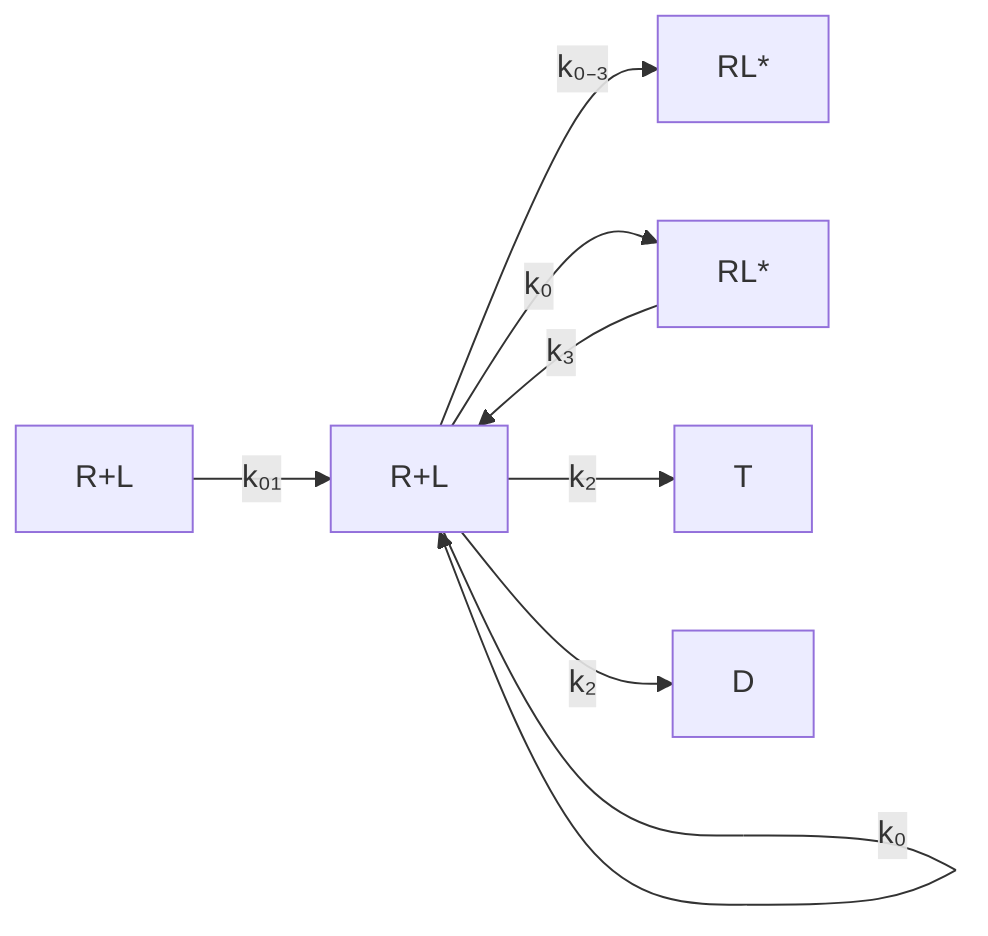
</details>

图21-2 蛋白质配体的结合过程，与外部物质的转化相耦合


<details>
<summary>flowchart</summary>

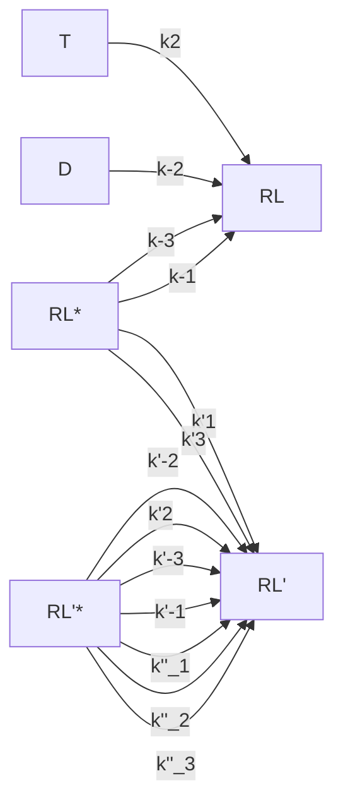
</details>

图21-3 蛋白质R和两种不同的配体结合的环形化学反应模型

---

21.1 远离平衡态的生命系统

569

如果该化学反应系统处于热力学平衡态，那么每个化学反应都处于平衡态，即没有定向的物质净流动，所以根据化学反应平衡的性质，在R与 $\mathrm{RL}^*$ 、R与 $\mathrm{RL}^*$ 之间可以有

$$
k _ {- 3} [ \mathrm{R} ] = k _ {3} [ \mathrm{RL} ^ {*} ], k _ {- 3} ^ {\prime} [ \mathrm{R} ] = k _ {3} ^ {\prime} [ \mathrm{RL} ^ {\prime *} ] 。
$$

此时我们最关心的错误的配体和酶结合状态的浓度 $\left[\mathrm{RL}^*\right]$ 与正确的配体和酶结合状态的浓度 $\left[\mathrm{RL}^*\right]$ 之间的比例，即错误率定义为

$$
f = \frac {\left[ \mathrm{RL} ^ {\prime *} \right]}{\left[ \mathrm{RL} ^ {*} \right]} \circ
$$

根据前文计算，热力学平衡状态下

$$
\frac {\left[ \mathrm{RL} ^ {*} \right]}{\left[ \mathrm{RL} ^ {*} \right]} = \frac {k _ {- 3} ^ {\prime} k _ {3}}{k _ {3} ^ {\prime} k _ {- 3}} \circ
$$

注意到这个量和物质T以及D的浓度无关，是酶与两个配体之间的平衡常数之比，把这个量 $\frac{k_{-3}^{\prime}k_3}{k_3^{\prime}k_{-3}}$ 定义为 $\theta$ ，它小于1因为我们假设配体L和R有更高的亲和性。以本小节一开始说的核糖体上的翻译过程为例，$\theta$ 就近似等于百分之一。下面就来探讨在非平衡稳态的时候，错误率 $f$ 有没有可能做到比 $\theta$ 要小得多。

为了简单起见，我们假设涉及配体L和 $\mathrm{L}'$ 的所有化学反应常数中，除了 $k_{3}$ 和 $k_{3}^{\prime}$，$k_{-1}$ 和 $k_{-1}^{\prime}$ 不相等之外，其它对应的化学反应常数都相等，即 $k_{1} = k_{1}^{\prime}$，$k_{2} = k_{2}^{\prime}$，$k_{-2} = k_{-2}^{\prime}$，$k_{-3} = k_{-3}^{\prime}$。在这样的假设下，可以得到错误率 $f$ 的表达式如下（知识窗21-3）:

$$
f = \frac {k _ {1} k _ {2} + k _ {2} k _ {- 3} + \frac {k _ {- 1} k _ {- 3}}{\theta}}{k _ {2} k _ {- 3} + \frac {k _ {- 1} k _ {- 3}}{\theta} + \frac {k _ {1} k _ {2}}{\gamma}} \cdot \frac {k _ {2} k _ {- 3} + k _ {- 1} k _ {- 3} + \frac {k _ {1} k _ {2}}{\gamma}}{k _ {1} k _ {2} + k _ {2} k _ {- 3} + k _ {- 1} k _ {- 3}} 。
$$

计算可得，在 $\theta$ 和 $\gamma$ 保持不变的情况下，$f$ 的最小值可以无限接

近 $\frac{\left(\sqrt{\theta} + \frac{1}{\sqrt{\gamma}}\right)^2}{\left(\frac{1}{\sqrt{\theta}} + \frac{1}{\sqrt{\gamma}}\right)^2}$ （知识窗21-4；图21-4）。而当 $\gamma$ 很大的时候，

该最小值接近 $\theta$ 的平方，如果 $\theta$ 为百分之一，则 $\theta$ 的平方则为万分之一，错误率大大减小。

所以通过定量的方法，结合非平衡定态的基本规律，我们发现能量真的可以使得酶和配体的结合变得更加准确，这就是动力学校对机制的精髓所在。


<details>
<summary>line</summary>

| \(\gamma\) | \(\theta = 0.01\) | \(\theta = 0.1\) | \(\theta = 0.5\) | \(\theta = 0.8\) |
|---|---|---|---|---|
| 0 | ~0.03 | ~0.38 | ~0.75 | ~0.95 |
| 1000 | ~0.01 | ~0.02 | ~0.26 | ~0.64 |
</details>

图21-4 错误率在给定 $\theta$ 和 $\gamma$ 下的最小值

---

570

21 生命系统特征的定量理解

## 知识窗21-3

## 非平衡稳态下错误率的表达式

在本节的假设下，由式（21-3），我们又令 $\frac{k_{1}k_{2}k_{3}}{k_{-1}k_{-2}k_{-3}}=\frac{k_{1}^{\prime}k_{2}^{\prime}k_{3}^{\prime}}{k_{-1}^{\prime}k_{-2}^{\prime}k_{-3}^{\prime}}=\gamma$ ，于是有

$$
\theta = \frac {k _ {- 3} ^ {\prime} k _ {3}}{k _ {3} ^ {\prime} k _ {- 3}} = \frac {k _ {3}}{k _ {3} ^ {\prime}} = \frac {k _ {- 1}}{k _ {- 1} ^ {\prime}} 。
$$

在任何一个非平衡态，即  $\gamma$  不等于 1，我们可以仿照知识窗 21-2 的方法列出各物质浓度随时间变化的微分方程组，计算出各物质的稳态浓度，进而得到

$$
f = \frac {\left[ \mathrm{RL} ^ {\prime *} \right]}{\left[ \mathrm{RL} ^ {*} \right]} = \frac {k _ {1} ^ {\prime} k _ {2} ^ {\prime} + k _ {2} ^ {\prime} k _ {- 3} ^ {\prime} + k _ {- 1} ^ {\prime} k _ {- 3} ^ {\prime}}{k _ {2} ^ {\prime} k _ {3} ^ {\prime} + k _ {- 1} ^ {\prime} k _ {3} ^ {\prime} + k _ {- 1} ^ {\prime} k _ {- 2} ^ {\prime}} \cdot \frac {k _ {2} k _ {3} + k _ {- 1} k _ {3} + k _ {- 1} k _ {- 2}}{k _ {1} k _ {2} + k _ {2} k _ {- 3} + k _ {- 1} k _ {- 3}},
$$

进一步通过计算可以得到

$$
f = \theta \frac {k _ {1} k _ {2} + k _ {2} k _ {- 3} + \frac {k _ {- 1}}{\theta} k _ {- 3}}{k _ {2} k _ {3} + k _ {- 1} \frac {k _ {3}}{\theta} + k _ {- 1} k _ {- 2}} \cdot \frac {k _ {2} k _ {3} + k _ {- 1} k _ {3} + k _ {- 1} k _ {- 2}}{k _ {1} k _ {2} + k _ {2} k _ {- 3} + k _ {- 1} k _ {- 3}},
$$

再把 $k_{3} = \frac{\gamma k_{-1}k_{-2}k_{-3}}{k_1k_2}$ 代入，最终得到

$$
f = \theta \frac {k _ {1} k _ {2} + k _ {2} k _ {- 3} + \frac {k _ {- 1} k _ {- 3}}{\theta}}{k _ {2} k _ {- 3} + \frac {k _ {- 1} k _ {- 3}}{\theta} + \frac {k _ {1} k _ {2}}{\gamma}} \cdot \frac {k _ {2} k _ {- 3} + k _ {- 1} k _ {- 3} + \frac {k _ {1} k _ {2}}{\gamma}}{k _ {1} k _ {2} + k _ {2} k _ {- 3} + k _ {- 2} k _ {- 3}}
$$

## 21.2 稳健性

为了适应周围的环境，生命系统在演化过程中需要不断优化其自身的代谢调控网络、信号转导通路和基因调控网络等控制系统。在计算机和移动通信设备的电子线路设计过程中，人类工程师先画出设计图，然后逐步实现电路功能的优化。不同于电子线路中的预先设计，生物系统中控制系统的优化，是通过对原有原件和网络不断修补的“修补匠”（进化）来完成的。那么生命系统有什么基本的设计原理吗？

在以下几个小节中，我们通过一些具体例子来讨论生物系统的稳定性、稳健性（robustness）以及生物网络拓扑与其功能的关系。

---

21.2 稳健性

571

## 知识窗21-4

## 错误率最小值推导

令 $a = k_{1}k_{2}$ ， $b = k_{2}k_{-3}$ ， $c = k_{-1}k_{-3}$ ，则

$$
f = \theta \frac {a + b + \frac {c}{\theta}}{b + \frac {c}{\theta} + \frac {a}{\gamma}} \cdot \frac {b + c + \frac {a}{\gamma}}{a + b + c} = \theta \frac {a b \left(1 + \frac {1}{\gamma}\right) + a c \left(1 + \frac {1}{\gamma \theta}\right) + b c \left(1 + \frac {1}{\theta}\right) + \frac {a ^ {2}}{\gamma} + b ^ {2} + \frac {c ^ {2}}{\theta}}{a b \left(1 + \frac {1}{\gamma}\right) + a c \left(\frac {1}{\theta} + \frac {1}{\gamma}\right) + b c \left(1 + \frac {1}{\theta}\right) + \frac {a ^ {2}}{\gamma} + b ^ {2} + \frac {c ^ {2}}{\theta}}
$$

$$
= \theta \left(1 - \frac {a c \left(\frac {1}{\theta} - 1\right) \left(1 - \frac {1}{\gamma}\right)}{a b \left(1 + \frac {1}{\gamma}\right) + a c \left(\frac {1}{\theta} + \frac {1}{\gamma}\right) + b c \left(1 + \frac {1}{\theta}\right) + \frac {a ^ {2}}{\gamma} + b ^ {2} + \frac {c ^ {2}}{\theta}}\right) 。
$$

不妨假设 $\gamma > 1$，要使得 $f$ 最小，则在固定 $a$ 和 $c$ 的时候，$b$ 要尽可能小，则可以令 $b = 0$，于是

$$
f = \theta - (1 - \theta) \left(1 - \frac {1}{\gamma}\right) \frac {a c}{a c \left(\frac {1}{\theta} + \frac {1}{\gamma}\right) + \frac {a ^ {2}}{\gamma} + \frac {c ^ {2}}{\theta}} 。
$$

我们知道 $\frac{a^2}{\gamma} +\frac{c^2}{\theta}\geqslant 2ac / \sqrt{\gamma\theta}$ ，于是

$$
\frac {a c}{a c \left(\frac {1}{\theta} + \frac {1}{\gamma}\right) + \frac {a ^ {2}}{\gamma} + \frac {c ^ {2}}{\theta}} \leqslant \frac {1}{\frac {1}{\theta} + \frac {1}{\gamma} + \frac {2}{\sqrt {\gamma \theta}}} = \frac {1}{\left(\frac {1}{\sqrt {\theta}} + \frac {1}{\sqrt {\gamma}}\right) ^ {2}},
$$

所以

$$
f \geqslant \theta - (1 - \theta) \left(1 - \frac {1}{\gamma}\right) \frac {1}{\left(\frac {1}{\sqrt {\theta}} + \frac {1}{\sqrt {\gamma}}\right) ^ {2}} = \frac {\left(\sqrt {\theta} + \frac {1}{\sqrt {\gamma}}\right) ^ {2}}{\left(\frac {1}{\sqrt {\theta}} + \frac {1}{\sqrt {\gamma}}\right) ^ {2}}.
$$

## 21.2.1 信号转导过程的稳健性

细胞使用复杂的网络来传递和处理信息，执行诸如信号转导、细胞周期调控等一系列生物功能。细胞内的生化网络是高度相连的，对某一个反应速率的扰动或者信号分子浓度的改变可能会影响诸多其它细胞过程。这自然引出了一个问题:生化反应网络是如何保持其功能的稳定性的？一种可能的方式是精确地设定网络的参数和各组分

---

572

21 生命系统特征的定量理解

分子的浓度。另一种可能性是，生化反应网络的功能实现对其参数相对不敏感，这一性质被称为稳健性。研究发现，稳健性是生物网络的一个重要特征。本节我们首先以大肠杆菌的趋化性网络的适应性为例来介绍信号转导网络的稳健性。

细菌的趋化性（chemotaxis）是细菌感知化学环境并朝向引诱物运动、远离排斥物的现象。这是生物学中研究得最深入的信号转导系统之一。大肠杆菌的运动类似于随机行走，平滑游动有时会被短暂的翻滚（tumbling）所打断，从而改变方向。细菌的趋化性是通过调节翻滚频率实现的。当细菌顺着引诱物梯度运动时，会遇到随时间增加的引诱物浓度。作为反应，它们翻滚的频率会降低，因此倾向于继续顺梯度移动。

这个过程由如图21-5所示的信号转导通路控制。简单来讲，环境中的趋化分子浓度信息由分布在细胞膜上的趋化受体传导到细胞内。趋化受体通过适配蛋白CheW与组氨酸激酶CheA形成复合物。引诱剂（趋散剂）与受体的结合会抑制（增强）CheA的自磷酸化活性。激活的组氨酸激酶CheA通过自磷酸化获得磷酸基团，随后将其转移给反应调节蛋白CheY或去甲基化酶CheB。磷酸化的CheY能够与鞭毛马达结合，增加马达的顺时针转动和细胞翻滚的概率。因此，系统的输出可以由处于活化状态的趋化受体浓度来近似描述。

与其它感觉系统类似，大肠杆菌趋化性也表现出适应性（adaptation），即在平稳状态下，细菌的翻滚频率对空间均一的趋化分子浓度不敏感。实验发现，当趋化物天冬酸浓度突然增加时，大肠杆菌细胞的翻滚频率首先降低，然后逐渐恢复，最终回到刺激前的水平。适应后的翻滚频率在一定范围的浓度下保持不变。适应性使得细菌能对更大范围内的化学浓度梯度保持敏感。在上述信号转导通路中，适应性是由趋化


<details>
<summary>flowchart</summary>

```mermaid
graph TD
  Input["输入"] -->|"P\nChenB"| Output["输出"]
  
  subgraph Pathway1
  A["CheA"] -->|"CheW"| B["CheW"]
  B -->|"CheW"| C["CheW"]
  C -->|"CheA"| D["CheA"]
  D -->|"CheY"| E["CheY"]
  E -->|"CheZ"| F["CheZ"]
  end
  
  subgraph Pathway2
    G["CheR"] -.->|"P"| H["CheB"]
    I["CheB"] -.->|"P"| J["CheY"]
    K["CheZ"] -.->|"P"| L["CheY"]
    M["CheZ"] -.->|"P"| N["CheY"]
    O["CheZ"] -.->|"P"| P
  P -->|"P"| Q["P"]
  Q -->|"P"| R["P"]
  R -->|"P"| S["P"]
  S -->|"P"| T["P"]
  T -->|"P"| U["P"]
  U -->|"P"| V["P"]
  V -->|"P"| W["P"]
  W -->|"P"| X["P"]
  X -->|"P"| Y["P"]
  Y -->|"P"| Z["P"]
  Z -->|"P"| AA["P"]
  AA -->|"P"| AB["P"]
  AB -->|"P"| AC["P"]
  AC -->|"P"| AD["P"]
  AD -->|"P"| AE["P"]
  AE -->|"P"| AF["P"]
  AF -->|"P"| AG["P"]
  AG -->|"P"| AH["P"]
  AH -->|"P"| AI["P"]
  AI -->|"P"| AJ["P"]
  AJ -->|"P"| AK["P"]
  AK -->|"P"| AL["P"]
  AL -->|"P"| AM["P"]
  AM -->|"P"| AN["P"]
  AN -->|"P"| AO["P"]
  AO -->|"P"| AP["P"]
  AP -->|"P"| AQ["P"]
  AQ -->|"P"| AR["P"]
  AR -->|"P"| AS["P"]
  AS -->|"P"| AT["P"]
  AT -->|"P"| AU["P"]
  AU -->|"P"| AV["P"]
  AV -->|"P"| AW["P"]
  AW -->|"P"| AX["P"]
  AX -->|"P"| AZ["P"]
  AZ -->|"P"| BA["P"]
  BA -->|"P"| BB["P"]
  BB -->|"P"| BC["P"]
  BC -->|"P"| BD["P"]
  BD -->|"P"| BE["P"]
  BE -->|"P"| BF["P"]
  BF -->|"P"| BG["P"]
  BG -->|"P"| BH["P"]
  BH --> "A\nB\nC\nD\nE\nF\nG\nH\nI\nJ\nK\nL\nM\nN\nO\nP\nQ\nR\nS\nT\nU\nV\nW\nX\nY\nZ\nAB\nAC\nAD' & AE\nAE' & AE' & AE' & AE' & AE' & AE' & AE' & AE' & AE' & AE' & AE' & AE' & AE' & AE' & AE' & AE' & AE' & AE' & AE' & AE' & AE' & AE' & AE' & AE' & AE' & AE' & AE' & AE' & AE' & AE' & AE' & AE' & AE' & AE' & AE'
```
</details>

图 21-5 大肠杆菌趋化信号转导系统

（A）在该信号网络中，跨膜的趋化受体蛋白与适配蛋白CheW以及激酶CheA形成复合物。该复合物可以自磷酸化，以及磷酸化CheY和CheB。磷酸化后的CheY会调节细菌的翻转频率。同时，CheZ使CheY去磷酸化。趋化的适应性是由受体复合物的甲基化和去甲基化


<details>
<summary>flowchart</summary>

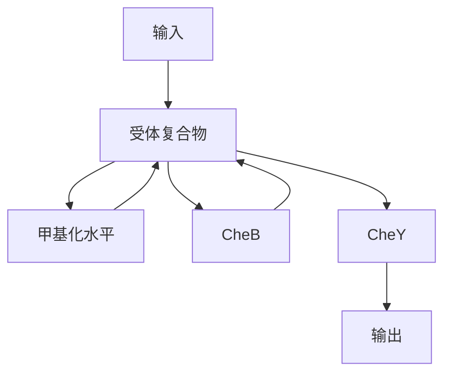
</details>

水平调控的，分别由 CheR 和磷酸化后的 CheB 催化。因此，受体复合物与 CheB 之间形成了一个负反馈。（B）简化后的信号转导网络可以看作一个具有缓冲节点的负反馈回路，其中缓冲节点为趋化受体复合物的甲基化水平。（A，改编自 Alon U, et al. Nature, 1999, 397(6715): 168-171）

---

21.2 稳健性

573

受体的甲基化和去甲基化过程调控的，它们分别由CheR和磷酸化的CheB（CheB-P）催化。CheA对CheB的磷酸化增强了后者的去甲基化活性。

实验发现，不同的细菌个体均能表现出趋化的精确适应性，考虑到上述信号转导系统中各个组分可能存在较大的细胞间差异，一个很有意思的问题是:这样的生化网络是如何实现如此精确的适应性的？为了回答这个问题，我们可以对该系统进行定量建模。整个系统可以由三个变量描述:信号分子浓度 $l$ ，受体复合物的甲基化水平 $m$ 以及受体活性 $a$ （一般来说，未甲基化和甲基化的受体都有一定的概率具有催化活性，这个概率对于甲基化的受体更高）。在早期的模型中，实现精确的适应性需要特定的模型参数组合和信号分子的浓度。后来，研究者提出了一种不依赖于微调动力学参数和各种酶浓度以解释精确适应性的模型，其中引入了两个关键假设:

① 甲基化酶 CheR 以最大催化速度饱和运作；
② 去甲基化酶 CheB 仅对具有活性的趋化受体复合物起作用。

通过这两个简单假设，该模型就可以实现精确适应性，即使网络中各种关键组分的浓度（如CheR和CheB）发生数量级的变化。

为了直观地理解该模型中的精确适应性，我们可以考察趋化受体的甲基水平的变化速率:

$$
\frac {\mathrm{d} m}{\mathrm{d} t} \approx V _ {\max} ^ {\mathrm{R}} - \frac {V _ {\max} ^ {\mathrm{B}} \langle a \rangle}{K _ {\mathrm{b}} + \langle a \rangle} 。 \tag {21-4}
$$

其中 $V_{\mathrm{max}}^{\mathrm{R}}$ 、 $V_{\mathrm{max}}^{\mathrm{B}}$ 是CheR和CheB的最大催化速率， $K_{\mathrm{b}}$ 是米氏常数， $\langle a\rangle$ 是趋化受体的平均活性。当该系统适应后，它会达到一个平稳状态，即 $\frac{\mathrm{dm}}{\mathrm{dt}} = 0$ 。从式（21-4）可以得到适应后的趋化受体活性为:

$$
\langle a \rangle = \frac {K _ {\mathrm{b}} V _ {\max} ^ {\mathrm{R}}}{V _ {\max} ^ {\mathrm{B}} - K _ {\max} ^ {\mathrm{R}}} 。
$$

显然，它不依赖于环境中趋化分子的浓度。因此，大肠杆菌的化学趋向性网络的精确适应性不需要网络参数的精确调节和各组分分子浓度的精确调控。随后的实验研究发现，即便改变大肠杆菌趋化性关键基因（如cheR、cheB和cheZ）的表达水平，大肠杆菌依然表现出精确的适应性，甚至在这些关键蛋白的表达水平变化了一个数量级后，适应的精确性仍然很高。

大肠杆菌趋化的精确适应性机制，是一种类似于工程中广泛使用的积分控制机制。积分反馈控制确保系统的输出能够稳健地跟踪所期望的值，而不受噪声或系统参数变化的影响。对应到趋化信号转导系统上，式（21-4）的右边可以看作系统的“误差”，其积分值也就是受体复合物的甲基化水平 $m$ 被反馈到系统中，这是因为受体复合物的活性是其甲基化水平的函数。因而，趋化适应性网络可以简化为具有缓冲节点的负反馈回路（图21-5B）。总的来讲，细胞的生化网络具有稳健性这一基本概念的形成肇始于对细菌趋化性的深入研究。

---

574

21 生命系统特征的定量理解

## 21.2.2 细胞周期过程的稳定性

对于不同的环境和信号，基因调控网络通过不同蛋白质的状态的不断变化产生反应，即通过动力学过程完成生物学功能。细胞生存在一个较强的环境噪声下，蛋白质网络的动力学稳定性将直接影响细胞的生物学功能和生理学稳定性。本节将简要介绍酵母细胞周期调控网络的动力学性质的研究，说明该动力学过程独特的稳定性（stability）和稳健性（robustness）。

在真核细胞的细胞周期（cell cycle）调控研究中，芽殖酵母（budding yeast）是重要的单细胞模式生物。环境信号和检查点信号，以及细胞周期蛋白（cyclin）和周期蛋白依赖性激酶（cyclin-dependent kinase，CDK）的表达和活性调控了细胞周期过程。细胞周期过程起始于激发 $\mathrm{G}_{1}$ 态，通过DNA复制期（S期）、$\mathrm{G}_{2}$ 期和有丝分裂期（M期），最后回到静息 $\mathrm{G}_{1}$ 态。分子生物学家经过几十年努力，逐步理解了芽殖酵母细胞周期过程和相应的分子调控机制。芽殖酵母细胞周期的基本调控过程见知识窗21-5，相应的简化调控网络见图21-6。自1996年开始，芽殖酵母的基因组和蛋白质相互作用的数据积累迅速增加，为全面系统地研究蛋白质网络的性质提供了可能。

那如何研究酵母细胞周期网络的动力学性质，尤其是全局的动力学性质呢？

## 知识窗21-5

## 芽殖酵母细胞周期的基本调控过程

调控网络中的蛋白质可分为以下三大类:第一类为Cyclin/Cdc28复合物，Cdc28是芽殖酵母细胞的CDK，包括Cln3/Cdc28复合物（简写为Cln3）、Cln1/Cdc28与Cln2/Cdc28复合物（简写为Cln1,2）、Clb5/Cdc28与Clb6/Cdc28复合物（简写为Clb5,6），Clb1/Cdc28与Clb2/Cdc28复合物（简写为Clb1,2）；第二类为转录因子，包括MBF、SBF、Mcm1/SFF和Swi5；第三类为Cyclin/Cdc28复合物的抑制蛋白与降解蛋白，包括Sic1、Cdh1、Cdc20/APC。

芽殖酵母细胞周期的基本调控过程如下（图21-6）:在营养丰富的条件下，当双倍体或单倍体的芽殖酵母细胞长得足够大时，Cln3/Cdc28复合物将被活化，促使细胞进入“激发的” $\mathrm{G}_{1}$ 态，即激发 $\mathrm{G}_{1}$ 态，这时细胞的Sic1浓度较高，Cdh1处于活化状态。活化的Cln3/Cdc28复合物将活化转录因子MBF和SBF，活化的MBF和SBF与DNA结合后，转录相应的mRNA，然后翻译形成Cln1、Cln2、Clb5和Clb6蛋白，上述蛋白质抑制了Sic1和Cdh1的作用，并控制着 $\mathrm{G}_{1}$ 后期基因的表达。在S期，细胞复制自己的DNA。通过 $\mathrm{G}_{2}$ 期，Clb1和Clb2活化，细胞进入M期。有丝分裂使得复制的DNA等量地分配到细胞的两极，然后一个细胞分裂产生两个子细胞，在这个过程中，Cdc20/APC和Swi5被活化，导致Sic1浓度升高，Cdh1活化，并对Cyclin/Cdc28复合物产生抑制作用。最后，细胞又回到细胞周期的静息 $\mathrm{G}_{1}$ 态，即 $\mathrm{G}_{1}$ 基态，等待下一次分裂信号。总的来说，细胞周期过程起始于激发$\mathrm{G}_{1}$ 态（该状态Cln3/Cdc28复合物处于活化状态），通过一系列细胞周期过程，最后回到Cln3/Cdc28复合物未活化的静息 $\mathrm{G}_{1}$ 态。

---

21.2 稳健性

575

我们选择简单的离散布尔动力学模型。定义在 t 时刻第 i 个蛋白质的状态为  $S_{i}(t)$ ，存在两种状态——0 与 1，分别表示该蛋白质处于活化与未活化状态。在  $t+1$  时刻， $S_{i}(t+1)$  是由 t 时刻的与其有相互作用的蛋白质的状态按照以下规则决定的:

$$
S _ {i} (t + 1) = \left\{ \begin{array}{l l} 1, & \sum_ {j} a _ {i j} S _ {j} (t) > 0; \\ 0, & \sum_ {j} a _ {i j} S _ {j} (t) <   0; \\ S _ {i} (t), & \sum_ {j} a _ {i j} S _ {j} (t) = 0. \end{array} \right.
$$

其中， $a_{ij}$ 是第 $j$ 类蛋白质对第 $i$ 类蛋白质的作用系数，$a_{ij}$ 取值为1与-1，分别表示正相互作用（绿线）和负相互作用（红线）。自降解作用（黄线）具有时间延迟的性质:一个具有自降解作用的蛋白质，若在 $t$ 时刻被活化 $(S_{i}(t) = 1)$，而且在 $t + 1$ 到 $t + t_{\mathrm{d}}$ 时间内一直没有其它的正负输入，那么它将在 $t + t_{\mathrm{d}}$ 时刻降解 $(S_{i}(t + t_{\mathrm{d}}) = 0)$ 。在模型中 $t_{\mathrm{d}} = 1$ ，为简化的选择；也可以选择负相互作用为负无穷，即很强的负作用。尽


<details>
<summary>flowchart</summary>

```mermaid
graph TD
  A["细胞大小"] --> B["Cln3"]
  B --> C["MBF"]
  C --> D["C1b5,6"]
  D --> E["Mcm1/SFF"]
  E --> F["Swi5"]
  F --> G["Cdc20 & Cdc14"]
  G --> H["Cdh1"]
  H --> I["Sic1"]
  I --> J["Cln1,2"]
  J --> K["SBF"]
  K --> L["Sib1"]
  L --> M["Clb1,2"]
  M --> N["Ccln1,2"]
  N --> O["Sib1"]
  O --> P["Sib2"]
  P --> Q["Sib3"]
  Q --> R["Sib4"]
  R --> S["Sib5"]
  S --> T["Sib6"]
  T --> U["Sib7"]
  U --> V["Sib8"]
  V --> W["Sib9"]
  W --> X["Sib10"]
  X --> Y["Sib11"]
  Y --> Z["Sib12"]
  Z --> AA["Sib13"]
  AA --> AB["Sib14"]
  AB --> AC["Sib15"]
  AC --> AD["Sib16"]
  AD --> AE["Sib17"]
  AE --> AF["Sib18"]
  AF --> AG["Sib19"]
  AG --> AH["Sib20"]
  AH --> AI["Sib21"]
  AI --> AJ["Sib22"]
  AJ --> AK["Sib23"]
  AK --> AL["Sib24"]
  AL --> AM["Sib25"]
  AM --> AN["Sib26"]
  AN --> AO["Sib27"]
  AO --> AP["Sib28"]
  AP --> AQ["Sib29"]
  AQ --> AR["Sib30"]
  AR --> AS["Sib31"]
  AS --> AT["Sib32"]
  AT --> AU["Sib33"]
  AU --> AV["Sib34"]
  AV --> AW["Sib35"]
  AW --> AX["Sib36"]
  AX --> AY["Sib37"]
  AY --> AZ["Sib38"]
  AZ --> BA["Sib39"]
  BA --> BC["Sib40"]
  BC --> BD["Sib41"]
  BD --> BE["Sib42"]
  BE --> BF["Sib43"]
  BF --> BG["Sib44"]
  BG --> BH["Sib45"]
  BH --> BI["Sib46"]
  BI --> BK["Sib47"]
  BK --> BL["Sib48"]
  BL --> BM["Sib49"]
  BM --> BN["Sib50"]
  BN --> BO["Sib51"]
  BO --> BP["Sib52"]
  BP --> BR["Sib53"]
  BR --> CA["Sib54"]
  CA --> CD["Sib55"]
  CD --> CE["Sib56"]
  CE --> CF["Sib57"]
  CF --> CG["Sib58"]
  CG --> CH["Sib59"]
  CH --> CI["Sib60"]
```
</details>

图 21-6 芽殖酵母细胞周期的简化调控网络

“细胞大小”信号为细胞周期过程的触发信号。图中绿线表示激活的正作用，红线表示抑制或者降解的负作用，黄线表示蛋白质的自降解作用。

管我们选择 $a_{ij}$ 与 $t_\mathrm{d}$ 不同的值，但下面的主要结论不会因此而改变。模型中的时间步长是逻辑步长，而非实际意义上的时间，因此利用这种方法得到的研究结果只是逻辑意义上的动力学。

图21-6中的酵母细胞周期简化调控网络，不考虑“细胞大小”信号，是11个节点的蛋白质相互作用网络。首先，遍历所有可能的 $2^{11}(= 2048)$ 个初始态，研究它们所有可能的动力学吸引状态，也就是所有的动力学吸引子。可以发现它们最后演化到7个稳定的状态，而其中1764个初始态（约 $86\%$ ）都演化到静息 $\mathrm{G}_{1}$ 态（Sic1和Cdh1的状态为1，其余蛋白质的状态为0），即细胞周期的生物学稳定态。这说明芽殖酵母细胞周期的静息 $\mathrm{G}_{1}$ 态是一个全局吸引状态，而且是唯一的全局吸引子。静息 $\mathrm{G}_{1}$ 态作为唯一的全局吸引子具有明显优势:保证了细胞状态的稳定性，在正常条件下，细胞将停留在静息 $\mathrm{G}_{1}$ 态，等待下一轮分裂信号。

其次，研究“细胞大小”信号启动的细胞周期过程。当芽殖酵母细胞长到足够大时，“细胞大小”信号启动，系统由静息 $G_{1}$ 态转变为激发 $G_{1}$ 态， $G_{1}$ 期细胞周期因子Cln3被激活。这样，系统从激发 $G_{1}$ 态（Cln3、Sic1和Cdh1的状态为1，其余蛋白质的状态为0）经过13个逻辑步长，演化到并稳定在静息 $G_{1}$ 态，并不再改变状态（表21-1）。蛋白质状态的时间演化过程与芽殖酵母的S期、 $G_{2}$ 期和M期的实验观察相符合。这条从激发 $G_{1}$ 态到静息 $G_{1}$ 态的动力学路径正是细胞周期路径。

为了进一步研究上述细胞周期路径的动力学性质，在图21-7中，我们给出了最终演化到静息 $\mathrm{G}_{1}$ 态的1764个初始态的所有演化路径。其中每个点代表一个状态，状态之间的箭头表示从一个态到另一个态的演化路径，细胞周期路径用蓝箭头线表示，

---

576

21 生命系统特征的定量理解

表 21-1 利用布尔动力学模型模拟芽殖酵母细胞周期的演化过程

| 时刻 | Cln3 | MBF | SBF | Cln1,2 | Cdh1 | Swi5 | Cdc14 | Clb5,6 | Sic1 | Clb1,2 | Mcm1/SFF | 细胞周期阶段 |
| --- | --- | --- | --- | --- | --- | --- | --- | --- | --- | --- | --- | --- |
| 1 | 1 | 0 | 0 | 0 | 1 | 0 | 0 | 0 | 1 | 0 | 0 | 激发G1态 |
| 2 | 0 | 1 | 1 | 0 | 1 | 0 | 0 | 0 | 1 | 0 | 0 | G1 |
| 3 | 0 | 1 | 1 | 1 | 1 | 0 | 0 | 0 | 1 | 0 | 0 | G1 |
| 4 | 0 | 1 | 1 | 1 | 0 | 0 | 0 | 0 | 0 | 0 | 0 | G1 |
| 5 | 0 | 1 | 1 | 1 | 0 | 0 | 0 | 1 | 0 | 0 | 0 | S |
| 6 | 0 | 1 | 1 | 1 | 0 | 0 | 0 | 1 | 0 | 1 | 1 | G2 |
| 7 | 0 | 0 | 0 | 1 | 0 | 0 | 1 | 1 | 0 | 1 | 1 | M |
| 8 | 0 | 0 | 0 | 0 | 0 | 1 | 1 | 0 | 0 | 1 | 1 | M |
| 9 | 0 | 0 | 0 | 0 | 0 | 1 | 1 | 0 | 1 | 1 | 1 | M |
| 10 | 0 | 0 | 0 | 0 | 0 | 1 | 1 | 0 | 1 | 0 | 1 | M |
| 11 | 0 | 0 | 0 | 0 | 1 | 1 | 1 | 0 | 1 | 0 | 0 | M |
| 12 | 0 | 0 | 0 | 0 | 1 | 1 | 0 | 0 | 1 | 0 | 0 | G1 |
| 13 | 0 | 0 | 0 | 0 | 1 | 0 | 0 | 0 | 1 | 0 | 0 | 静息G1态 |

点的大小和每条线的宽度正比于 $\ln (2 + m)$，$m$ 为蛋白质初态经过该点（边）的数目。不同的初始状态逐步演化、汇聚，并被吸引到细胞周期路径的不同状态，然后沿着细胞周期路径逐步演化到最终的稳定态——静息 $G_{1}$ 态。所以，静息 $G_{1}$ 态是一个

全局性的稳定点和吸引子，而且从激发 $\mathrm{G}_{1}$ 态到静息$\mathrm{G}_{1}$ 态的细胞周期演化路径是一个全局性的稳定的动力学路径。

接下来讨论的问题是:类似的全局吸引子和吸引路径的动力学性质是否是“特殊的”？或者说，是否任意的网络结构都具有类似的性质？实际上，在相同的布尔模型演化规则下，对于具有相同节点数目和连接数目的随机网络，会出现更多的吸引子，但是出现类似细胞周期静息 $G_{1}$ 态的全局吸引子的概率很小，出现类似细胞周期过程的全局吸引路径的概率更小。因此，细胞周期网络的特殊结构保证了系统的全局动力学稳定性。由此推断，通过长期的演化，芽殖酵母细胞周期调控网络保证了其动力学性质具有以上双重稳定性。在裂殖酵母和蛙卵细胞的细胞周期网络中也存在类似的动力学性质。

以上分析所用的是布尔动力学分析方法，该方法


<details>
<summary>flowchart</summary>

```mermaid
graph TD
  A["Node 1"] --> B["Node 2"]
  B --> C["Node 3"]
  C --> D["Node 4"]
  D --> E["Node 5"]
  E --> F["Node 6"]
  F --> G["Node 7"]
  G --> H["Node 8"]
  H --> I["Node 9"]
  I --> J["Node 10"]
  J --> K["Node 11"]
  K --> L["Node 12"]
  L --> M["Node 13"]
  M --> N["Node 14"]
  N --> O["Node 15"]
  O --> P["Node 16"]
  P --> Q["Node 17"]
  Q --> R["Node 18"]
  R --> S["Node 19"]
  S --> T["Node 20"]
  T --> U["Node 21"]
  U --> V["Node 22"]
  V --> W["Node 23"]
  W --> X["Node 24"]
  X --> Y["Node 25"]
  Y --> Z["Node 26"]
  Z --> AA["Node 27"]
  AA --> AB["Node 28"]
  AB --> AC["Node 29"]
  AC --> AD["Node 30"]
```
</details>

图21-7 芽殖酵母细胞周期网络中不同状态的演化路径图中展示了从1764个不同初始态（绿点）演化到静息 $G_{1}$ 态（蓝点）的动力学路径集合。蓝箭头线表示从激发 $G_{1}$ 态到静息 $G_{1}$ 态的细胞周期演化路径。

---

21.2 稳健性

577

的优点是相互作用关系简单，可以给出系统不同状态的全局动力学性质。但是，它无法给出生物系统在真实时间中蛋白质的具体浓度和随时间演化的动力学性质。为了研究酵母细胞周期的真实动力学过程，可以建立微分方程模型。微分方程模型能够反映酵母细胞周期过程更丰富的动力学行为，以及基因突变对动力学的影响；并能够进一步分析细胞周期过程保持动力学稳定性的原因，以及成为全局性吸引路径的动力学机理，尤其是图21-6A中细胞周期中DNA复制检查点和纺锤体检查点的作用。类似地，对哺乳动物细胞周期过程，也可以建立相应的动力学模型。读者如果有兴趣更深入了解细胞周期调控的动力学机理，可以参考本章扩展阅读材料。

## 21.2.3 果蝇体节发育的稳健性

尽管自然环境中卵或胚胎的大小总存在涨落，发育过程却总能使组织、器官和身体结构保持正确的比例。果蝇体节发育作为从分子调控的角度研究宏观发育的经典体系，许多研究者对其中可能存在的稳健性也有所讨论。

果蝇作为节肢动物中最经典的模式生物，对其体节发育模式的研究也是最透彻的。果蝇的体节由一系列层级表达的基因决定（图21-8）。从母源效应基因编码的形态发生因子，到裂隙基因（gap gene），再到成对规则基因（pair-rule gene），再到体节极性基因（segment polarity gene），每一级所受到的最主要的调控几乎只来自前一级。这最终形成了近似等间距的表达条带，标记了未来体节位置。与此几乎同时，裂隙基因、成对规则基因和体节极性基因决定了Hox基因的表达，后者则最终决定每个体节接下来的分化方向。

如果我们只看母源形态生成素、裂隙基因、成对规则基因、体节极性基因这一条线，便是一个典型的“解码级联”，即前一层级的基因在空间维度上形成的表达图案，作为下一层级的输入。

研究者们通过构建基于微分方程的动力学模型，发现体节极性基因构成的调控系

统是一个稳健的“发育模块”。首先，成对规则基因中的每一个最终都能在胚胎中后部形成包含7个条带的表达图案，而体节极性基因接受这样的输入，最终形成14个表达条带。不同基因所形成的条带并不完全重叠，宽度也不一定相等，但它们共同形成14个周期，对应着14个体节。其中，两个关键的基因engrailed(en)和wingless(wg)分别在相邻的两列细胞中稳定表达，它们之间便是原体节（parasegment）的边界（图21-9）。

分割极性系统可以抽象为如图21-10所示的调控网络。这个相互作用网络是结合当时的生物学事实（实线）和推测（虚线）给出的一个最简模型，其中大量的中间节点已经被简化了。

在这个相互作用网络中，每个细胞内:en 激活 hh 但抑制 cid，cid 激活 wg 和 ptc 的转录，wg 自激活，而 ptc 能帮助 CID 蛋白切


<details>
<summary>flowchart</summary>

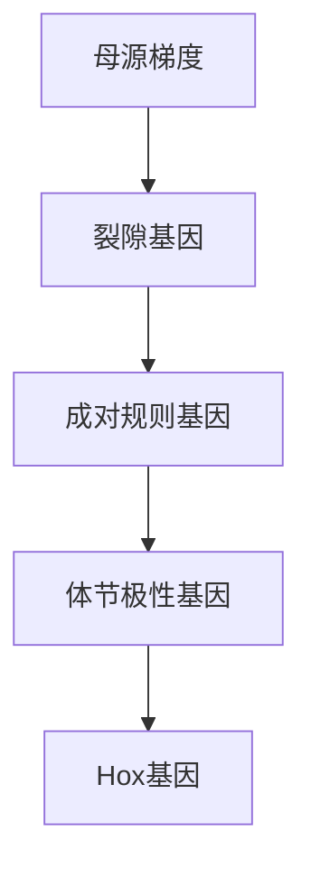
</details>

图21-8 果蝇胚胎的发育调控示意图

---

578

21 生命系统特征的定量理解

图21-9 果蝇的体节极性基因表达示意图（改编自von Dassow G, et al. Nature, 2000, 406(6792): 188-192）


<details>
<summary>text_image</summary>

(A)
en
wg
ptc
cid
CID
CN
hh
PH
前后
</details>


<details>
<summary>bar</summary>

| Category | Value |
| --- | --- |
| en (1) | ~0.5 |
| en (2) | ~0.5 |
| en (3) | ~0.5 |
</details>


<details>
<summary>bar</summary>

| Category | Value |
| --- | --- |
| en | 1 |
| en | 2 |
| en | 3 |
| en | 4 |
| en | 3 |
| en | 1 |
| en | 3 |
| en | 4 |
| en | 3 |
| en | 1 |
| en | 3 |
| en | 4 |
| en | 3 |
| wg | 1 |
| wg | 2 |
| wg | 1 |
| wg | 1 |
| wg | 2 |
| wg | 1 |
| wg | 1 |
| wg | 2 |
| wg | 1 |
| cid | 0 |
| cid | 0 |
| cid | 0 |
| cid | 0 |
| cid | 0 |
| cid | 0 |
| cid | 0 |
| cid | 0 |
| cid | 0 |
| cid | 0 |
| cid | 0 |
| cid | 0 |
| cid | 0 |
| cid | 0 |
| cid | 0 |
| cid | 0 |
| cid | 0 |
| cid (end) | 0 |
| cid (end) | 0 |
| cid (end) | 0 |
| cid (end) | 0 |
| cid (end) | 0 |
| cid (end) | 0 |
| cid (end) | 0 |
| cid (end) | 0 |
| cid (end) | 0 |
| cid (end) | 0 |
| cid (end) | 0 |
| cid (end) (final) | 0 |
| cid (end) (final) | 0 |
| cid (end) (final) | 0 |
| cid (end) (final) | 0 |
| cid (end) (final) | 0 |
| cid (end) (final) | 0 |
| cid (end) (final) | 0 |
| cid (end) (final) | 0 |
| cid (end) (final) | 1 |
| cid (end) (final) | 1 |
| cid (end) (final) | 1 |
| cid (end) (final) | 1 |
| cid (end) (final) | 1 |
| cid (end) (final) | 1 |
| cid (end) (final) | 1 |
| cid (end) (final) | 1 |
| cid (end) (final) | 1 |
| cid(end) (final) | 1 |
| cid(end) (final) | 1 |
| cid(end) (final) | 1 |
| cid(end) (final) | 1 |
| cid(end) (final) | 1 |
| cid(end) (final) | 1 |
| cid(end) (final) | 1 |
| cid(end) (final) | 1 |
| cid(end) (end) | 1 |
| cid(end) (end) | 1 |
| cid(end) (end) | 1 |
| cid(end) (end) | 1 |
| cid(end) (end) | 1 |
| cid(end) (end) | 1 |
| cid(end) (end) | 1 |
| cid(end) (end) | 1 |
| cid(end) (end) | 2 |
| cid(end) (end) | 2 |
| cid(end) (end) | 2 |
| cid(end) (end) | 2 |
| cid(end) (end) | 2 |
| cid(end) (end) | 2 |
| cid(end) (end) | 2 |
| cid(end) (end) | 2 |
| cid(end) (end) | 2 |
| cid (end) (end) | 2 |
| cid (end) (end) | 2 |
| cid (end) (end) | 2 |
| cid (end) (end) | 2 |
| cid (end) (end) | 2 |
| cid (end) (end) | 2 |
| cid (end) (end) | 2 |
| cid (end) (end) | 2 |
| cid (end) (final) | — |
| pid(end) | — |
</details>

割，切割后的产物CN反过来又抑制wg、ptc、hh和en的翻译。而作为细胞间相互作用的机制，被分泌的WG蛋白会激活相邻细胞的en，而HH又会与相邻细胞的PTC结合形成没有活性的复合体PH。

我们可以将这样的转录、翻译、蛋白质-蛋白质相互作用网络写成一个包含48个参数的常微分方程模型，并在一维空间格点上运行这一模型（每个格点代表一个细胞）。如果模型从只有en和wg有条带状表达的初始状态（图21-9B，或更有挑战性的情况图21-9C）出发，演化到一个en和wg有相邻的稳定表达边界的状态（en和wg如图21-9A所示），即如果en和wg在成对规则基因的激活下有了如图21-9B、C

的初始表达，希望分割极性网络能一直“记住”这个空间位置作为体节边界。

那么这个系统对参数变化的稳健性如何？由于参数自由度非常大，研究者们使用随机采样的方法搜索了模型的参数，总共采样240000套参数，运行模型，筛选出满足要求的参数组。这也是早期系统生物学模型常见的参数搜索方法。结果发现搜索的成功率很高:对于“简单任务”即初始化为图21-9B，然后记住这个图案，成功率有约1/200；而对于“困难任务”即初始化为图21-9C，要求模型能先将wg和en的表达锐化成图21-9B的样子再保持，成功率也能达到约1/5000。


<details>
<summary>flowchart</summary>

This flowchart illustrates a genetic construct with multiple elements (EN, WG, PTC, CN, hh) and their interactions, mapped against cellular and cell boundary regions.
</details>

图21-10 分割极性系统的可能的调控网络（改编自vonDassowG,et al.Nature,2000,406(6792):188-192）

---

21.3 优化原理

579

进一步地，通过对稳健性的分析得出如下两个发现:

① 这些参数的分布范围特别宽，在搜索到的约2000个样本中，每个参数都跨越了好几个数量级。这被他们视为这个调控网络结构的“参数稳健性”的第一个体现。而对于多数搜到的参数组，单独改变其中的每一个参数，模型都能在很宽（10～100倍）的变化范围内保持其锁定en和wg的功能。这被视为参数稳健性的第二个体现。
② “困难任务”也有相当大的“命中率”，即从图21-9C那样的低对比度初始状态也能演化出满足要求的终态，表明这个调控网络对初始状态（在这里反映了成对规则基因提供的暂态输入）的细节并不敏感，也就是对输入的稳健性。

对于这两种稳健性，即参数稳健性和对输入的稳健性，或许可以从两个角度讨论其可能的生物学意义。首先，对动力学参数（也就是小突变）的稳健性，也许是分割极性网络在演化上十分保守的一个解释:不同物种间的动力学参数肯定会有差别，但因为网络的动力学稳健性，分割极性模块能一直保持相同的功能。其次，对输入的稳健性，则可能是为了应对实际胚胎中成对规则表达图案的噪声。

## 21.3 优化原理

## 21.3.1 网络功能与网络拓扑的关系

生物系统以超乎寻常的精度、可靠性和稳健性完成着各种各样复杂的功能。为了能够在不断变化的环境中生存，它们不断地进化。人们推测在如此繁杂的生物世界里一定暗藏着一些可以适用于多种组织水平的普适性的规律。事实上，越来越多的证据也表明可以将不同生物系统，不同层次网络结构统一起来的设计规律的确存在。例如，生物系统中有一些会反复出现的具有特定功能的小网络，比如可以控制时序表达，执行可靠的细胞决定，以及执行稳健并可调谐的生物振荡。这些研究结果暗示了一个有趣的假设:尽管生物网络表面上非常复杂，但对于特定的功能，也许仅存在有限个可以稳健执行该功能的网络结构，而其中某些拓扑结构可能因为存在较少的参数约束而更有优势。尽管在不同的生物系统中，由于生化细节和演化历史不同，具体的生物功能的执行过程细节可能非常不同，但真正实现该功能的核心网络结构则可能完全相同。但是，如何发现这些普适的设计规律，并了解其如何在不同的生物系统中执行特定的功能以及它在不同生物系统的差异性是系统生物学面临的一个巨大挑战。

为了揭示生物网络普适的设计原理，我们对拓扑与功能的关系以及拓扑结构与参数的关系进行研究。这里我们不关心在任何自然的或者合成的生物体系中一个给定功能的执行过程的细节。相反，我们会关心更广泛、更有趣的问题——功能和网络结构是如何一一对应的。一类常用的方法是穷举的粗粒化模型。根据合适的粗粒化计算方

---

580

21 生命系统特征的定量理解

法，我们可以系统地去确定能够实现特定生物学功能的核心拓扑结构。粗粒化计算方法的重要部分是用少量数目的“节点”（代表基因或者蛋白质）和“边”（代表相互调控关系）去构建一个结构空间，这种方法不仅能够加速计算，还能用于去理解一个具有层次性的复杂系统。

这种方法的核心是选择合适的粗粒化近似，抓住生物网络中不同节点间的核心相互作用但不纠缠具体的机理细节，从而抓住问题本质的同时使穷举工作控制在可计算的范围。可以采用米氏方程或带希尔函数的非线性常微分方程来对很多生物化学反应建模。举个例子来说，为了给受B蛋白调控的A蛋白的量随时间变化的过程进行建模（其中A蛋白的启动子表达受到B蛋白的激活调控），我们可以用带希尔函数的微分方程描述A蛋白的浓度变化:

$$
\frac {\mathrm{d} A}{\mathrm{d} t} = \frac {\alpha B ^ {n}}{B ^ {n} + K ^ {n}} - \beta A
$$

其中，参数 $\alpha$ 代表A的最大生成速率，参数 $\beta$ 代表A的降解速率。我们没有对B蛋白与启动子结合的过程、转录翻译的过程进行细致的描述，而是将这些中间步骤和其中的所有参数简化成了一个整体。这种做法是合理的，因为我们的目标是找到能稳健执行目标功能的核心拓扑，该拓扑对于各元部件和相互作用的具体实现细节应是不敏感的。

即使只有很少的几个节点，其可能形成网络的数目已经非常大。因此，我们面临的另一个挑战是设计合适的算法来穷举系统或有效地对各种可能形成的拓扑进行参数空间采样。这样来选取符合目标功能并能稳健执行网络拓扑。对于参数空间过大的情况，全局穷举已经不合适，可以采用以下几种策略进行处理:

第一种方法是，可以穷举一个子空间，例如固定一个调控关系的子集，穷举余下部分的参量。这种方法在已经知道网络部分信息时是十分适用的，例如我们已知部分网络数据的自然网络，或者在设计合成网络时仅有一部分网络需要设计、优化。

第二种方法是，可以对参数空间进行随机采样。在这一策略下，那些能实现特定功能的稳健拓扑网络并不孤立，而是周围聚集着一群具有相似功能的网络，它们之间的拓扑距离相当近。这种现象意味着，尽管这些网络在结构上各不相同，它们却能实现同样的生物学功能，并展现出相似的性能特征，例如稳健性。因此，在进行随机采样时，这些稳健的网络拓扑由于其聚集性，我们有较高的概率能够探索到它们，这大大提高了寻找有效网络拓扑的效率。这一方法的关键在于，它允许在广阔而复杂的参数空间中，有效率地识别出那些能够稳定执行特定功能的网络结构，即使这些结构在演化和设计上可能存在着微妙的差异。

第三种方法是，借鉴了自然界中的自然选择原理，通过采用进化算法来高效搜索和优化网络拓扑。在这个方法中，网络拓扑的设计和优化过程仿佛是一个演化过程，其中最适合实现特定功能的网络结构会被“选择”出来，而不够适应的则被淘汰。这一过程开始于一个初始种群，这个种群由多种随机生成的网络拓扑构成，每个网络拓扑都尝试着解决同一个生物学问题或实现特定的功能。

---

21.3 优化原理

581

随着进化算法的运行，通过模拟自然选择、遗传变异和基因重组等生物演化机制，网络拓扑会逐代演化。具体来说，算法会根据每个网络拓扑执行预定功能的效率和稳健性等性能指标进行评分，选择表现最佳的网络进行复制和变异，以生成新一代网络拓扑。变异可能包括改变网络中的节点连接方式或调整调控关系的强度，而基因重组则允许两个优秀的网络拓扑“交换”它们的一部分结构特征，创造出可能表现更好的后代。

我们根据网络实现目标功能的稳健性情况对每一个被穷举或参数采样的拓扑结构利用Q值（在给定的随机参数套数下，能够实现特定功能的参数数目）予以打分。拓扑网络稳健性的Q值分数代表该拓扑网络参数空间中能完成目标功能的百分数，如果Q值高，意味着参数扰动时，该拓扑网络相比低Q值拓扑网络有更大概率能够执行目标功能。

以适应性功能的生物网络为例，研究学者对酶促反应的三节点生物网络进行了穷举并进行了Q值打分，从而找到可以执行完美适应的核心拓扑网络（图21-11）。在所有可能的三节点网络中，我们要求输入节点和输出节点中至少有一条直接或间接的作用连线，由于连接边的数量以及调控关系的不同，三节点网络总共可以形成16038个不同的拓扑结构（图21-11B、C）。假设所有调控都是酶促反应，且使用米氏方程来建模。对于每个网络拓扑，抽样10000套参数，分析拓扑对输入变化的敏感性和其适应性的精度。拓扑的Q值定义为该拓扑在这两方面表现都很好的抽样参数集数量。

通过大规模计算，我们识别了可以执行完美适应的两个核心拓扑（图21-11E）:有缓冲节点的负反馈环（a negative feedback loop with a buffering node，NFBLB）和有比例调控节点的不一致性前馈环（an incoherent feedforward loop with a proportioner node，IFFLP）。两个拓扑中都存在关键控制节点（NFBLB的缓冲节点和IFFLP的比例节点），其调控需满足一定的参数需求。同时，得分高的核心拓扑的变异的共同特征可以通过在同一类稳健拓扑内部的聚类来发现，例如正的自调控和额外的负反馈环。进一步，我们可以从数学上分析其方程组的雅可比矩阵（Jacobian matrix），给出两个核心网络拓扑实现适应性的理论基础。综合模拟计算与理论分析的结果，最终获得了具适应功能的三结点酶催化反应网络的“元素周期表”。

同样的思想和方法也可以用来研究其它功能的网络拓扑，例如细胞的极化网络、生物的振荡网络。另外，在真实的细胞环境中一个复杂性的来源是涨落和噪声。当生物网络的输入信号本身包含噪声时，我们可以将该方法拓展来寻找“适应-抗噪”双功能网络的设计原理。

## 21.3.2 模块化

模块化是生物网络的典型特征之一。其中，最为人所熟知的例子便是蛋白质-蛋白质相互作用网络（protein-protein interaction network，PPIN）——一种以蛋白质间物理相互作用为基础的生物网络。这种网络通过实验数据或计算预测构建而成，以节点

---

582

21 生命系统特征的定量理解

图21-11 寻找适应性功能的网络拓扑空间

（A）定义适应性的输入-输出曲线。（B）三个节点之间可能的有向连接。（C）三节点网络拓扑的示例。（D）给定网络拓扑的建模分析过程的示意图。（E）有缓冲节点的负反馈环和有比例调控节点的不一致性前馈环。（引自Ma W, et al. Cell, 2009, 138(4): 760-773）

(A)


<details>
<summary>line</summary>

| Time Phase | Input Current (I1, I2) | Output Current (O1, O2) |
| --- | --- | --- |
| Initial State | Low | Low |
| Peak/Decline | High | Rising to Peak |
| Decay to End | High | Low |
| Final State | High | Low |
</details>

灵敏度= $\left|\frac{(O_{\mathrm{峰}}-O_{1})/O_{1}}{(I_{2}-I_{1})/I_{1}}\right|$

精确度= $\left|\frac{(O_{2}-O_{1})/O_{1}}{(I_{2}-I_{1})/I_{1}}\right|$

(B)


<details>
<summary>flowchart</summary>

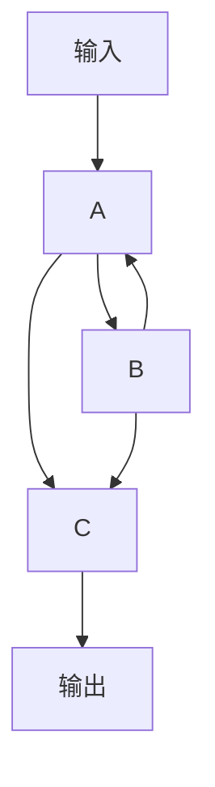
</details>

(C)


(D)


<details>
<summary>flowchart</summary>

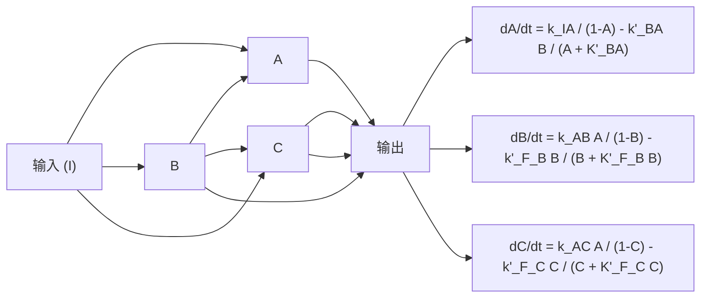
</details>


<details>
<summary>flowchart</summary>

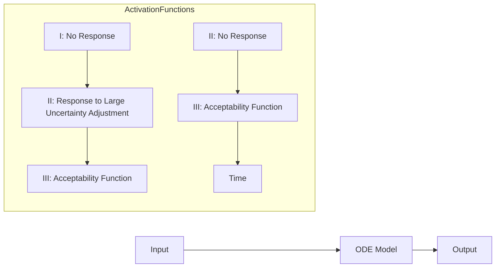
</details>

(E)


<details>
<summary>flowchart</summary>

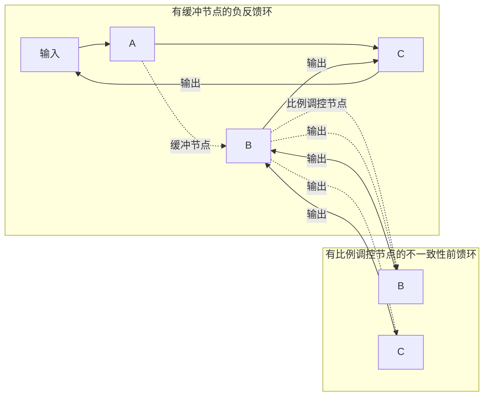
</details>

表示蛋白质，边表示它们之间的相互作用。在这样的网络中，研究者们往往可以观察到许多明显的聚团结构，例如和DNA修复相关的蛋白质，以及和转运分泌相关的蛋白质。这些蛋白质在蛋白质-蛋白质相互作用网络上形成了内部链接紧密的集群，就如同一个个功能明确的小“社区”（图21-12）。

那么，这些聚团行为应该如何量化呢？聚类系数（clustering coefficient）和模块度

---

21.3 优化原理

583


<details>
<summary>text_image</summary>

线粒体
过氧化物酶体
核糖体和翻译
代谢和氨基酸
生物合成
分泌和
囊泡运输
蛋白质折叠
和糖基化
细胞壁生物合成
细胞极化
和形态形成
RNA加工
染色质和转录
核-质传输
核迁移与
蛋白质降解
有丝分裂
和染色体分离
DNA复制和修复
</details>

图21-12 从Cytoscape上复制得到的PPI网络（引自Costanzo M, et al. Science, 2010, 327(5964): 425-431）

(modularity）都是可用的衡量指标。聚类系数定义在节点上，指这个节点的邻居节点之间实际存在的连接数与可能存在的连接数之比，表示该节点附近的聚集程度。模块度定义在已经划分好“模块”后的网络上，反映了模块内部的连接边数与整个网络的连接边数之比。如果一个网络的模块度值较高，则该网络具有较强的模块化特性。

在这些衡量指标的帮助下，研究者们在很多其它类型的生物网络中也发现了较强的模块化特性。例如，在基因调控网络中，共同表达的基因模块往往共同参与某一生物过程（图21-13A）；在微生物基因组中，相关代谢途径的基因也往往聚类成一个基因簇（图21-13B）；在蛋白质结构中，不同的结构域也往往被视为功能独立、可被反复使用和组合的模块（图21-13C）。

为什么生物网络呈现出如此强的模块性？从直观的角度来看，模块化具有许多优势。首先，模块化可以提高系统的稳定性和稳健性，因为每个模块都可以独立工作，即使某个模块出现问题，也不会影响到整个系统的运行。其次，模块化可以提高系统的可扩展性和适应性，因为新的模块可以被添加到系统中，以应对新的环境或任务。这些优势在人类的工程学中得到了广泛的应用，例如在电路设计、软件开发等领域，模块化的思想都起着关键的作用。

然而，尽管模块化的优势在工程学上已经被广泛认识，但是生物中模块化的成因

(A)


<details>
<summary>text_image</summary>

A类基因
B类基因
C类基因
</details>

(B)


<details>
<summary>natural_image</summary>

Abstract network diagram with interconnected nodes and shaded regions (no text or symbols)
</details>

(C)


<details>
<summary>natural_image</summary>

Abstract diagram with curved lines and shaded regions, no text or symbols present
</details>

图21-13 模块化的典型例子

---

584

21 生命系统特征的定量理解

和演化优势仍然是当前研究的重要课题。一些研究认为，模块化提高了生命系统的稳健性:由于每个模块和外界较少的链接，偶然出现的“错误”将被限制在模块内而非传播至整个系统。而另一些研究认为，模块化可能是生物系统在长期演化过程中对环境变化的适应结果:面对变化的环境，生物的优化目标时常发生变化，例如微生物在资源有限的环境中定植，优化目标会由初期营养丰富时的高速生长切换为后期营养匮乏时的耐受和竞争。迥异的目标需要启动不同的行为和功能，而将这些不同的基因按功能组织成团簇，有助于系统在不同目标之间有效切换。由此，模块化可以提高系统的适应性和进化速率。还有一些研究则认为，模块化并非有特定的适应优势，而是生物系统在自组织过程中的自然产物。这是因为生物的演化很大程度上是由“复制-分化”驱动的，而无论是蛋白质还是基因的复制，都会让原有的相互作用也随之原样复制一份，让模块化自然地产生。无论如何，对模块化的深入理解都将有助于我们更好地理解生物系统的稳健性和可进化性。

## 21.3.3 细菌的优化生长

细菌在培养液中的生长可以分为四个时期:开始时的延迟期（lag phase）、指数增长期（exponential phase）、稳定期（stationary phase）和衰亡期（death phase）。在指数增长期中，细菌快速增殖并呈几何级数增长。研究表明，由于长时间的自然选择作用，细菌在多数常见碳源培养基中会表现出最优生长（optimal growth）的模式，细菌

调整其生理和代谢过程，以最高效地利用可用资源，实现最快的增殖速度。


<details>
<summary>surface_3d</summary>

| 氧气摄入速率 / \([mmol \cdot g^{-1}(干重) \cdot h^{-1}]\) | 葡萄糖摄入速率 / \([mmol \cdot g^{-1}(干重) \cdot h^{-1}]\) | 生长速率 / \(h^{-1}\) |
| --- | --- | --- |
| 0~16 | 0~16 | 0~2.0 |
</details>

图21-14 大肠杆菌进化实验与流平衡分析最优化生长结果的比对

图中橙色线为最优生长的解集（最优生长线）；演化开始时刻，细胞处于浅蓝色点位置，演化结束时，细胞处于浅灰色点位置，均处在最优生长线附近。（数据自 Ibarra R U, et al. Nature, 2002, 420(6912): 186-189）

伯恩哈德·帕尔森（Bernhard Palsson）研究小组通过结合实验研究和20.3节介绍的流平衡分析方法，发现大肠杆菌在葡萄糖培养液中接近最优生长状态（图21-14）。类似的情况也在其它单细胞微生物（例如芽殖酵母等）以及不同碳源的情况下得到了证实。同时，代谢产物的生成速率也与最优生长状态的预期相符。然而，仅仅依靠流平衡分析，对于给定的细菌菌株和培养液中的碳源浓度，无法推断出碳源和氧气的吸收速率。它只能确定一个最优生长的范围（就像图21-14中的最优生长线一样）。只有通过实验测得所有摄入流量之后，才能够确定最优生长的确切状态（对应一个最优生长点）。

在 2005 年，乌里·阿隆（Uri Alon）研究团队取得的发现进一步推动了细菌优化生长领域的研究。他们进行了一项进化实验，使用甘油和不同浓度的乳糖来培养大肠杆菌（图 21-15A）。他们发现，一方面，大肠杆菌细胞内表达 LacZ 蛋白（一种消化乳糖的酶）时，会对细胞

---

21.3 优化原理

585


图21-15 大肠杆菌在恒定甘油、不同乳糖浓度培养基中生长的演化实验

生长产生负担（cost）；而另一方面，由于培养液中存在乳糖，细胞表达LacZ蛋白可以让它们利用乳糖，在能源利用的角度上会带来好处（benefit）。阿隆研究团队发现，LacZ蛋白的表达量在负担与好处之间存在权衡（trade-off），存在一个最佳的表达量（最优解），可以让大肠杆菌的生长速率最大化（图21-15B）。他们在数百代细胞周期的长期实验中验证了细菌倾向于优化生长的趋势（图21-15C），同时揭示了蛋白质表达对细胞生长的显著影响。然而，在这项研究中，蛋白质表达对于细胞生长的影响依然处于唯象描述的阶段，LacZ蛋白的负担与好处均采用了实验数据拟合的唯象函数。

2010年，华泰立（Terry Hwa）研究团队用数学模型和实验解释了细菌在单一碳源中如何实现最优生长的过程。他们发现，细菌通过调控蛋白资源分配来实现最优化生长（图21-16A、B）。实际上，早在1958年，莫塞洛·舍希特（Moselio Schaechter）等科学家的研究已经揭示，改变营养条件时，细胞内各种大分子的含量、细胞质量与生长速率之间存在定量关系。华泰立团队的研究对舍希特等科学家的工作进行了扩展

（A）演化实验过程中，培养基内添加了IPTG诱导物消除lacI基因的抑制作用。（B）不同乳糖浓度中预测的LacZ最优表达量。（C）演化实验结果与最优化生长的理论预测相符。（A-C，数据自Dekel E, et al. Nature, 2005, 436(7050): 588-592）


<details>
<summary>flowchart</summary>

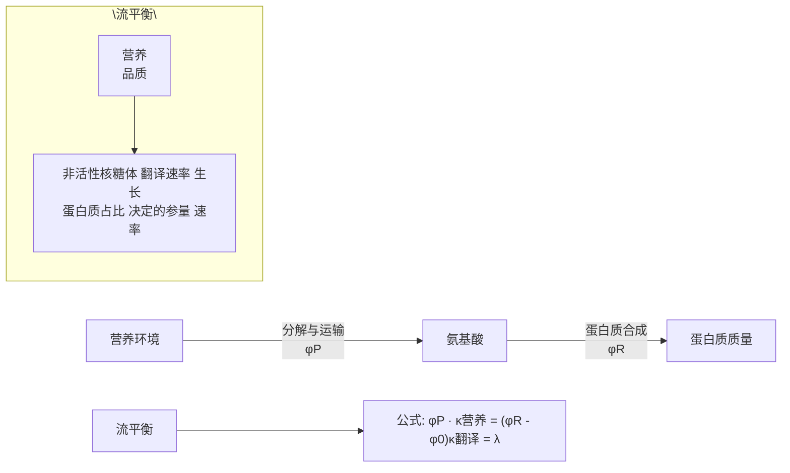
</details>


<details>
<summary>pie</summary>

| Category | Value |
| --- | --- |
| \(\phi Q\) | ~35% |
| \(\phi P\) | ~25% |
| \(\phi R\) | ~15% |
</details>


<details>
<summary>scatter</summary>

| 生长速率 \(\lambda/h^{-1}\) | RNA与蛋白质的比率 | 核糖体蛋白质的占比 |
| --- | --- | --- |
| ~0.4 | ~0.18 | ~0.13 |
| ~0.6 | ~0.23 | ~0.17 |
| ~0.7 | ~0.23 | ~0.17 |
| ~1.0 | ~0.29 | ~0.21 |
| ~1.3 | ~0.41 | ~0.29 |
| ~1.5 | ~0.47 | ~0.33 |
| ~1.7 | ~0.47 | ~0.33 |
</details>


<details>
<summary>scatter</summary>

| 生长速率 \(\lambda/h^{-1}\) | RNA与蛋白质的比率 (Orange) | RNA与蛋白质的比率 (Blue) | RNA与蛋白质的比率 (Pink) | RNA与蛋白质的比率 (Red) |
| --- | --- | --- | --- | --- |
| ~0.15 | 0.8 | — | — | — |
| ~0.2 | 0.78 | 0.65 | 0.65 | 0.65 |
| ~0.3 | 0.72 | 0.55 | 0.48 | 0.42 |
| ~0.4 | 0.63 | 0.48 | 0.42 | 0.38 |
| ~0.5 | — | 0.42 | 0.35 | 0.32 |
| ~0.6 | — | 0.38 | 0.32 | 0.25 |
| ~0.7 | — | 0.35 | 0.28 | — |
| ~0.9 | 0.6 | 0.32 | — | — |
| ~1.1 | 0.52 | 0.28 | — | — |
| ~1.3 | 0.43 | — | — | — |
| ~1.6 | 0.48 | — | — | — |
</details>

图21-16 大肠杆菌优化蛋白质资源分配实现最优生长

(A) P类蛋白质负责将营养物质运入细胞内的氨基酸库，核糖体利用这些氨基酸制造蛋白质，系统遵守流平衡限制。(B) 细菌的蛋白质组分分为Q、R和P三类蛋白质，满足蛋白质分配的限制。(C、D) 蛋白质资源分配的实验结果与最优化生长的理论预测相符。(A、B，改编自Scott M, et al. Mol Syst Biol, 2014, 10(8): 747; C、D，数据自Scott M, et al. Science, 2010, 330(6007): 1099-1102)

---

586

21 生命系统特征的定量理解

和深化。他们发现，在改变培养基中碳源营养条件时，细胞内 RNA 的含量与蛋白质总量的比率与细胞的生长速率呈正相关的线性关系（图 21-16C）；而通过抑制翻译改变生长速率时，RNA 的含量与蛋白质总量的比率与细胞生长速率呈负相关的线性关系（图 21-16D）。上述实验现象可以用一个优化蛋白质资源分配的理论模型定量解释，而细胞所处的状态刚好符合最优生长点的特征（知识窗 21-6），说明细菌通过优化蛋白质分配以实现最优生长。

## 知识窗 21-6

## 细胞生长中的标度率

华泰立团队将细菌内的蛋白质分成三类（图21-16B）:R类蛋白质与核糖体相关，Q类蛋白质的含量不受生长速率影响，其它的蛋白质被归为P类蛋白质，主要包含代谢网络中的各种催化酶。每类蛋白质在蛋白质组中的占比分别用 $\phi_{\mathrm{R}}$ 、 $\phi_{\mathrm{Q}}$ 、 $\phi_{\mathrm{P}}$ 表示。在指数增长期，对于平衡生长（balanced growth）的细胞群，三类蛋白质的占比即为核糖体合成三类蛋白质的分配比例，细胞群的生长速率由活性核糖体蛋白质的比例和翻译速率参数决定:

$$
\lambda = (\phi_ {\mathrm{R}} - \phi_ {0}) \cdot \kappa_ {\mathrm{翻译}}, \tag {21-5}
$$

其中，$\phi_0$ 表示非活性核糖体蛋白的比例，$\kappa_{\text{翻译}}$ 是一个由翻译速率决定的参数。大肠杆菌内蛋白质的制造过程可以简化为两个步骤（图21-16A）:① P类蛋白质将营养物质运进细胞，转换为氨基酸；② 核糖体利用这些氨基酸制造蛋白质。在该模型中，运输碳源底物的酶记作 $\mathrm{E}_{\mathrm{A}}$，其蛋白质比例用 $\phi_{\mathrm{A}}$ 表示；碳源底物的营养品质（nutrient quality）记作 $\kappa_{\mathrm{A}}$（即图21-16A中的 $\kappa_{\text{营养}}$）。P类蛋白质此时只包括 $E_{\mathrm{A}}$，所以 $\phi_{\mathrm{P}} = \alpha \cdot \phi_{\mathrm{A}}$，其中 $\alpha$ 是一个比例系数。在这种情况下，细菌的生长将满足以下条件:

$$
\left\{ \begin{array}{l l} {\phi_ {\mathrm{R}} + \phi_ {\mathrm{P}} \leqslant \phi_ {\mathrm{max}},} \\ {(\phi_ {\mathrm{R}} - \phi_ {0}) \cdot \kappa_ {\mathrm{翻译}} \leqslant \phi_ {\mathrm{A}} \cdot \kappa_ {\mathrm{A}},} \end{array} \right. \tag {21-6}
$$

上述公式中 $\phi_{\mathrm{max}} = 1 - \phi_{\mathrm{Q}}$ 表示P类蛋白质与R类蛋白质所能分配到的最大蛋白质比例。第一个表达式表示蛋白质资源分配的限制，即蛋白质的分配必须满足 $\phi_{\mathrm{max}}$ 的限制；第二个表达式是流平衡条件的限制。

通过将式（21-6）中的限制条件绘制在以 $\phi_{\mathrm{P}}$ 、 $\phi_{\mathrm{R}}$ 为 $x$ 、 $y$ 坐标轴的二维平面上，我们得到了图21-17中蓝色标识的可行域。结合式（21-5），可以明显地观察到，如果细胞通过优化蛋白资源分配来实现最优化生长，其蛋白分配比例应处于图21-17中的 $X_{\mathrm{A}}$ 点（橙色点）。现在需要确定细胞是否处于最优生长点，这取决于细胞生长是否满足 $X_{\mathrm{A}}$ 点的特征。实验上，RNA的主要成分为rRNA（核糖体RNA），其数量由核糖体的数目所决定，因此R类蛋白质的含量可以通过细胞内RNA的含量来反映。并且可以通过变更营养条件来改变营养品质 $\kappa_{\mathrm{A}}$


<details>
<summary>area</summary>

| Variable | Value |
| --- | --- |
| Point X_A | \((\phi R - \phi 0) \cdot \kappa\)翻译 = \(\phi A\) \(\cdot\) \(\kappa A\) |
| Y-axis intercept | \(\phi R\) |
| Y-axis maximum | \(\phi max\) |
| X-axis intercept | \(\phi P\) |
| X-axis minimum | \(\phi 0\) |
</details>

图 21-17 细胞在可行域中的最优生长图中橙色点标示最优生长点。

---

21.3 优化原理

587

又可以通过添加翻译抑制剂来改变蛋白质翻译速率（改变 $\kappa_{\text{翻译}}$）。为了测试这一点，可以简单地改变 $\kappa_{\mathrm{A}}$ 和 $\kappa_{\text{翻译}}$ 并通过观察 $\phi_{\mathrm{R}}$ （以RNA/蛋白质反映）与生长速率 $\lambda$ 之间的相互关系来检验模型。对于最优生长点，当 $\kappa_{\mathrm{A}}$ 变化时，$\phi_{\mathrm{R}}$ 与 $\lambda$ 之间满足斜率为正数的线性关系:

$$
\phi_ {\mathrm{R}} = \phi_ {0} + \lambda / \kappa_ {\text {翻译}},
$$

而当  $\kappa_{翻译}$  变化时， $\phi_{R}$  与  $\lambda$  之间满足斜率为负数的线性关系:

$$
\phi_ {\mathrm{R}} = \phi_ {\mathrm{max}} - \lambda \cdot \alpha / \kappa_ {\mathrm{A} \circ}
$$

从图 21-16C、D 中可以看到，实验结果与最优生长点  $X_{A}$ （图 21-17）的性质相符。

## 21.3.4 生物网络中的信息

无论是在专业研究还是日常生活中，“信息”都是一个频繁出现的词汇。例如，我们可能会赞叹:“你这次文献汇报信息含量很高啊！”或者找工作时会思考:“信息技术的发展前景如何？”再比如，在我们之前关于发育的讨论中，我们曾提过这样的问题:“单个受精卵中的基因信息是如何转换成成体中万亿细胞的身份信息的？”实际上，生物信息学几乎是定量科学在生物领域中发展得最为成熟的一门学科，它在大数据时代为生命科学研究提供了从组学降维到基因注释和人工智能分析等各个方面的计算支持。那么，信息在这些不同场景中的应用，是否有着共通之处？信息的定义究竟是什么？更进一步地说，我们能否量化某个事物所包含的信息是多是少？

上世纪中叶，信息论的创始人克劳德·香农（Claude Elwood Shannon，1916—2001）提出了对“信息”的度量——不确定度的减少。为了量化信息，香农首先以信息熵（information entropy）对随机事件 $X$ 的不确定度进行度量。当 $X$ 有多种不同的“结果”，且第 $i$ 种结果发生的可能性为 $p_i(x)$ 时，类比于热力学中表征了“混乱程度”的吉布斯熵，关于 $X$ 的信息熵 $H(X)$ 被定义为:

$$
H (X) = - \sum_ {i} p _ {i} (x) \cdot \log p _ {i} (x) 。
$$

当 $\log$ 以2为底时，信息的单位是比特（bit）——也是我们电脑中文件大小的基本单位。香农信息熵是现代电子和通信的重要概念。

$X$ 的不确定度越大，$H(X)$ 越高。例如，某个蛋白质 $X$ 的表达量在多次实验中有低有高，若其在 $50\%$ 的实验中高表达，$50\%$ 的实验中低表达，那 $p_{\text{高}} = 0.5$，$p_{\text{低}} = 0.5$，$H(X) = -(0.5 \times \log_2 0.5 + 0.5 \times \log_2 0.5) = 1(\text{bit})$，它的不确定度是二态系统中的最大值——对于每次测量，我们完全不确定更可能观察到 $X$ 的高表达态还是低表达态。如果 $X$ 大部分情况下处于低态，例如 $p_{\text{高}} = 0.9$，$p_{\text{低}} = 0.1$，则我们可以“合理推断”每次测量更有可能获得 $X$ 的高态，而此时 $H(X) = -(0.1 \times \log_2 0.1 + 0.9 \times \log_2 0.9) = 0.47(\text{bit})$，表征着更低的不确定度。

假如我们进一步发现，这些实验的培养条件不同，而在某些特定的培养条件下 $X$ 的不确定度降低，那么，这个培养条件包含了 $X$ 表达量的一部分“信息”。举例而言，

---

588

21 生命系统特征的定量理解

假如培养基的葡萄糖浓度有高有低，$60\%$ 为高浓度培养条件，而该条件下 $X$ 有 $90\%$ 的概率处于高态，则该条件下 $X$ 的信息熵为 $H(X \mid \text{高葡萄糖})$。而在其余 $40\%$ 的低葡萄糖浓度条件下 $X$ 有 $30\%$ 的概率处于高态，则该条件下 $X$ 的信息熵为 $0.88 \mathrm{~bit}$。于是，综合而言，在了解到葡萄糖浓度这一“条件”后，$X$ 的平均不确定度降低至 $H(X \mid \text{葡萄糖浓度}) = 0.6 \times 0.47 + 0.4 \times 0.88 = 0.63 (\mathrm{bit})$，较之前不知葡萄糖浓度时的不确定度（1 bit）更低。由此，我们可以自然地认为葡萄糖浓度中携带着有关 $X$ 的“信息”。这将自然地引向互信息（mutual information）的数学定义:当对事件 $Y$ 的了解使得我们对 $X$ 的不确定度降低，那么 $X$ 和 $Y$ 之间的互信息 $I(X, Y)$ 就是 $X$ 的信息熵在知晓了 $Y$ 的情况下的减少幅度:

$$
I (X, Y) = H (X) - H (X \mid Y) 。
$$

在上述实验例子中，蛋白质 $X$ 和葡萄糖浓度的互信息就是 $1 - 0.63 = 0.37$ (bit)。值得注意的是，互信息没有方向性，$H(X) - H(X \mid Y) = H(Y) - H(Y \mid X)$。

香农信息理论的定义使其特别适合于分析那些充满各种相互交织噪声的生命系统。在互信息中，“互”字暗示了信息并非独立存在，它代表着两个变量之间的交互关系。在生物信息学应用中，互信息通常用于探测皮尔森相关系数或线性拟合无法检测到的关联信号，例如非单调的调控关系。利用互信息从基因表达谱中推断基因调控关系已经成为基因调控网络推断的重要技术手段之一。此外，序列和功能之间的互信息在基因组分析中被广泛应用，我们所熟知的序列标识图（sequence logo）就是基于互信息生成的。更广泛地说，信息与熵常作为需要优化的目标函数在各种机器学习模型中使用，并通过信息的压缩和传输来理解机器学习中的“涌现性”机制。

从更深层次来看，许多研究人员将生物系统中常见的信号转导视为一个信息传输问题（图21-18）。细胞内外环境充满了噪声，而它们需要根据不断变化的外部环境做出“有效”的反应。那么，如何衡量细胞响应的“有效性”呢？借鉴通信领域信道问题的思路，互信息为细胞响应提供了一个定量指标:如果将外部信号的强度记录为$Y$ ，细胞内关键响应蛋白活性为 $X$ ，那么， $X$ 和 $Y$ 之间的互信息就可以描述这条信号转导通道的“效率”，并用于定量细胞能区分的不同强度信号的数量。有了这样一个定量指标，研究人员就可以开始探索信号通道的“设计规则”。例如，什么网络拓扑

图21-18 细胞中的信号转导网络和通信领域的信道传输问题的类比


<details>
<summary>flowchart</summary>

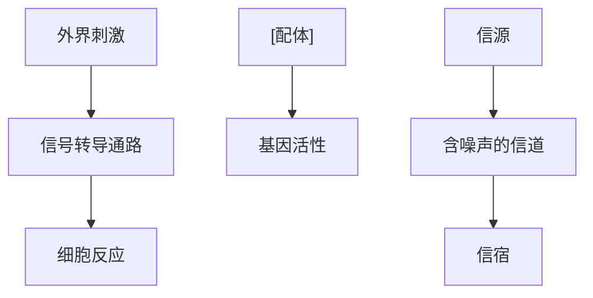
</details>

---

21.4 自组织

589

结构可以最大化信息的传输？正常细胞和病理细胞在信息转导特性上是否存在差异？而在合成生物学中又如何设计“最优化信息传递”的通道？

例如，研究者们通过实验测量了在不同浓度的肿瘤坏死因子（TNF）信号刺激下，NF-κB通道的活性响应分布，从而计算了TNF通道的信息传递能力；进一步地，他们通过计算模拟测试了不同拓扑结构的转导通道对信息传递能力的影响，发现生物中实际的网络结构即使可以高效地传递信息，也仍然受到受体数量的限制。那么，除了“最大化生长速率”和“优化代谢效率”，生命系统是否将“优化信息传递效率”作为一种选择压力？又是什么因素制约着信号转导通道中信息传递量的上限？这些问题仍需要更多的测量和理论研究来解答。

除了经典的信号转导通路之外，胚胎发育也是信息论的用武之地。如前所述，基因相同的细胞通过分裂和分化形成空间上具有高度规律性的复杂体系，这种过程中的“可复制的复杂性”可以用位置信息（positional information）来衡量。在19世纪60年


<details>
<summary>line</summary>

| 范围 | 形态生成素浓度 |
| --- | --- |
| 0~距离1 | 高 |
| 0~距离2 | 中 |
| 0~距离3 | 低 |
</details>

图21-19 发育中的“法国国旗”模型

代，以果蝇胚胎发育为模型，位置信息被定义为细胞的空间位置与基因表达谱之间的互信息，由此带来了著名的“法国国旗模型”（图21-19）:发育相关的基因调控网络根据形态生成素Bicoid的浓度显示出不同的表达谱，从而将母体的Bicoid浓度梯度中的位置信息“翻译”为胚胎自身基因表达的空间信息。后续的研究者通过对位置信息进行详尽的实验测量和理论分析，揭示了果蝇胚胎模式在形成的早期阶段，从Bicoid浓度到下游基因表达的信息传递效率接近于物理极限。

有研究者认为，生命系统运行在一个“近乎最优”的边缘状态，而胚胎如何实现这种近乎最优的信息传递又是一个值得探索的问题。更进一步地，对于脊椎动物胚胎中自发的体节形成、秀丽线虫中不依赖于母源形态生成素的细胞命运级联，以及复杂系统中普遍存在的复杂度涌现，这些过程中的“信息”从何而来，又为何看似以某种神奇的方式自发“增长”？未来的研究中，信息论的定量框架或许能为理解复杂性的起源提供帮助。

## 21.4 自组织

## 21.4.1 图灵斑图

自组织斑图广泛存在于自然界的各个空间尺度，如晶体生长、贝壳条纹、动物皮肤、种群活动、干旱地区植被分布都是典型的空间斑图现象（图21-20）。不同于空间均匀分布，稳定的空间斑图自发形成并表现为物质浓度的区域性差异，更重要的是

---

590

21 生命系统特征的定量理解

图21-20 自然界中的图灵斑图

（A）铋原子在金属基板上生长时形成的条纹。（B）豹纹皮毛的斑纹。（C）稀疏草原林地上的植被分布。

(A)


<details>
<summary>natural_image</summary>

Abstract pattern of orange wavy lines on a light blue background (no text or symbols)
</details>

(B)


<details>
<summary>natural_image</summary>

Abstract pattern of orange irregular shapes on a blue background (no text or symbols)
</details>

(C)


<details>
<summary>natural_image</summary>

Abstract pattern with orange and blue shapes on a white background (no text or symbols)
</details>

其在大尺度集体结构中呈现有序性。

图灵斑图（Turing pattern）的名字来源于英国数学家兼计算机科学先驱艾伦·图灵（Alan Turing，1912—1954）。他在1952年发表的一篇论文中首次描述了这一现，并提出了一种数学模型来解释生物体系中观察到的图案形成。他创造性地引入反应-扩散数学模型以及图灵失稳机制来描述斑图动力学。

反应 - 扩散模型在 2.3.2 节曾经介绍过, 其一般形式可写作

$$
\frac {\partial \boldsymbol {u}}{\partial t} = \boldsymbol {D} \Delta \boldsymbol {u} + f (\boldsymbol {u}),
$$

右端两项分别代表扩散项和反应项。其中， $\boldsymbol{u}=(u_{1},u_{2},\cdots,u_{n})$  为 n 种参与反应的物质浓度；扩散矩阵 D 当不出现交叉扩散时为对角矩阵  $\boldsymbol{D}=\mathrm{diag}(D_{1},D_{2},\cdots,D_{n})$ ，其对角元  $D_{i}$  代表第 i 种物质扩散速率； $\boldsymbol{f}=(f_{1},f_{2},\cdots,f_{n})$  为反应项； $\Delta$  为拉普拉斯算子，在二维平面中  $\Delta u_{i}=\frac{\partial^{2}u_{i}}{\partial x^{2}}+\frac{\partial^{2}u_{i}}{\partial y^{2}},i=1,2,\cdots,n$ 。

图灵失稳机制是指系统某个空间均匀的驻点解在无扩散时稳定，在加入扩散效应后失去稳定性，此时对失稳的均匀态施加空间的不均匀扰动得到的稳定斑图称为图灵斑图。通常要产生图灵失稳，体系参与反应的物质数 $n$ 至少为2，此外物质的反应和扩散也有严格的约束。以 $n = 2$ 为例，通过局部线性稳定性分析，我们可以发现图灵失稳需要高度非线性的反应以及两种物质扩散速率差异。

一般地，假设有如下二元反应:

$$
\left\{ \begin{array}{l} \frac {\partial u}{\partial t} = d _ {\mathrm{u}} \Delta u + f (u, v; \alpha) \\ \frac {\partial v}{\partial t} = d _ {\mathrm{v}} \Delta v + g (u, v; \alpha) \end{array} \right.
$$

其中 u、v 代表两种反应物质浓度， $d_{u}$ 、 $d_{v}$  分别为扩散系数，二元反应函数 f、g 对于基元反应可以由 u、v 的多项式给出，对复杂反应也常有其它形式，其中  $\alpha = (\alpha_{1}, \cdots, \alpha_{r})$  为反应项系数。简要讨论如下:

① 当系统无扩散时（即 $d_{\mathrm{u}} = d_{\mathrm{v}} = 0$），系统存在一个平衡解 $(u, v) = (u_0, v_0)$，若雅可比矩阵 $J = \begin{bmatrix} f_{\mathrm{u}} & f_{\mathrm{v}} \\ g_{\mathrm{u}} & g_{\mathrm{v}} \end{bmatrix}$ 的两个特征值实部均为负，则该平衡解 $(u_0, v_0)$ 是稳定的。

---

21.4 自组织

591

② 当系统引入扩散 $(d_{\mathrm{u}} \neq d_{\mathrm{v}})$ 时，系统存在的空间均匀解 $(u_0, v_0)$ 变得不稳定，在扰动下会形成空间上的非均匀解，即空间斑图。

对于给定的边界条件，我们可以推导发生图灵失稳时参数 $d_{\mathrm{u}}$ 、 $d_{\mathrm{v}}$ 、 $\alpha$ 满足的条件。假设模型的区域为二维正方形区域 $X = (0,L)\times (0,L)$ ，边界条件取为齐次Neumann边界条件，即 $\frac{\partial\pmb{u}}{\partial\pmb{n}} = \frac{\partial\pmb{v}}{\partial\pmb{n}} = 0$ （ $\pmb{n}$ 为边界的法向量），令（ $u_0,v_0$ ）发生微小偏离至$(u_0 + \delta u,v_0 + \delta v)$ ，其中

$$
(\delta u, \delta v) = \Bigg (A \cos \frac {m \pi x}{L} \cos \frac {n \pi y}{L}, B \cos \frac {m \pi x}{L} \cos \frac {n \pi y}{L} \Bigg),
$$

$m, n \in N$ 且 $m, n$ 不都为0。代入方程右端得到线性化后的方程:

$$
\frac {\partial}{\partial t} \left[ \begin{array}{c} u \\ v \end{array} \right] = \tilde {J} _ {m, n} \left[ \begin{array}{c} \delta u \\ \delta v \end{array} \right] = \left[ \begin{array}{c c} - d _ {\mathrm{u}} \pi^ {2} (m ^ {2} + n ^ {2}) / L ^ {2} + f _ {\mathrm{u}} & f _ {\mathrm{v}} \\ g _ {\mathrm{u}} & - d _ {\mathrm{v}} \pi^ {2} (m ^ {2} + n ^ {2}) / L ^ {2} + g _ {\mathrm{v}} \end{array} \right] \left[ \begin{array}{c} \delta u \\ \delta v \end{array} \right].
$$

其中 $f_{\mathrm{u}} = \frac{\partial f}{\partial u} (u_0,v_0),f_{\mathrm{v}},g_{\mathrm{u}},g_{\mathrm{v}}$ 同理定义。模式（$m,n$）发生图灵失稳时，新的雅可比矩阵 $\tilde{J}_{m,n} = J - \frac{\pi^2(m^2 + n^2)}{L^2}\left[ \begin{array}{cc}d_{\mathrm{u}} & 0\\ 0 & d_{\mathrm{v}} \end{array} \right]$ 应存在实部非负的特征值。系统可被观测到的图灵斑图是指可能的图灵失稳模式扰动后偏离原均匀态，得到渐近稳定的解。另外，图灵斑图也可以是随时间周期振荡而非渐近稳定的，这种情况也被称为时空斑图（spatial-temporal pattern）。

可以看出，图灵失稳要求 $d_{\mathrm{u}} \neq d_{\mathrm{v}}$ ，因为若 $d_{\mathrm{u}} = d_{\mathrm{v}}$ ，则 $\pmb{J}$ 的两个特征值比 $\tilde{\pmb{J}}_{m,n}$ 对应的特征值要大 $\frac{\pi^2(m^2 + n^2)}{L^2} d_{\mathrm{u}}$ ，无法做到①②讨论中对 $\pmb{J}$ 和 $\tilde{\pmb{J}}_{m,n}$ 特征值的要求。事实上对于二元反应，一般来说一者远大于另一者，不妨记 $d_{\mathrm{u}} \ll d_{\mathrm{v}}$ 。

在生物数学建模中，扩散能力弱的物质 $u$ 常作为体系的激活子（activator），扩散能力较强的物质 $\nu$ 作为抑制子（inhibitor）（图21-21）。我们常常用短程激活，长程抑制来定性理解反应扩散体系图灵斑图的产生机制:当激活子产生后，其生成的抑制子传播速度快于自己，于是在较远处由于扩散效应，抑制子浓度高于激活子，故而有效抑制激活子产生及传播，形成空间斑图。

由①②讨论可知，是否出现图灵失稳和失稳采用的模式都依赖于参数及区域尺寸。事实上，对几乎所有的模型，图灵失稳模式对于参数非常敏感，在具体模型中差异也很大。图灵失稳模式很大程度上决定了系统从不稳定均匀态扰动后渐进解的性质，通常来说，区域尺寸对于失稳模式的影响易于刻画。在上述模型中，对于同样的参数， $(m,n)$  对雅可比矩阵的影响仅依赖于  $\pi^{2}(m^{2}+n^{2})/L^{2}$ 。方形区域的尺寸 L 越大，可以使系统产生图灵失稳（使  $\tilde{J}_{m,n}$  存在实部非负的特征值）的  $(m,n)$  越多。当 L 较小时若能发生图灵失稳，系统只能形成  $(m,n)=(0,1)$  或  $(1,0)$  的“条带形扰动”；当 L 较大时，更可能形成 m、n 均非零的点状斑图。例如一些猫科动物的尾巴图案单一，甚至为规则的条带状，而身体却可以有复杂多样的斑点。


图21-21 图灵系统的示意图

---

592

21 生命系统特征的定量理解

另外，自组织的斑图形成的模型并不局限于反应扩散模型。例如，在由浓度梯度或温度梯度引发的斑图形成中，除了扩散和非线性的反应，常常含有一阶导数的对流项，其存在也会非常大地影响斑图的性质。除此之外，有些体系会存在高阶导数来描述相互作用（如非菲克长程扩散），同时结合更强的非线性甚至使得单一物质可以自发产生斑图，如Swift-Hohenberg模型。然而，上述通过均匀态失稳的斑图产生机制普遍贯穿于各种模型，而局部线性化和分岔理论始终是研究斑图基本且重要的理论方法。

## 21.4.2 胚胎发育的理论模型

多细胞生物的诞生被称为演化史中的最重大事件之一，而它的存在依赖于胚胎发育——这是从单个受精卵，由大量的细胞分裂和分化最终塑造出成熟个体的一个“展开”。这个复杂过程中，第19章中所述的细胞命运决定固然至关重要——上百种不同的细胞类型，如上皮细胞、神经细胞、免疫细胞，都需从受精卵开始的一棵大树上逐步分化而来。然而，胚胎发育的奥秘远不止于此。不同类型的细胞必须在恰当的时间和地点出现，维持自身的正确发育路径，甚至还需为其它细胞的命运决定提供信号源，以确保机体最终能组织成结构有序、细胞类型丰富且高度可复制的多细胞形态。在这个被称为“模式形成”的精密过程中，哪怕一丝误差，也可能引发发育异常，甚至导致胚胎死亡。

面对这个精妙的过程，研究者们提出了无数的问题:细胞如何“知道”自己在什么时间、什么地点？如何判断自己应该分化为何种“身份”，以及是否该进行下一轮的细胞分裂？如果某些分化事件依赖于特定细胞的信号，那这些信号细胞又是如何获取自身所需的分化信号的呢？如果将这种“鸡生蛋，蛋生鸡”的问题反推回去，单个受精卵中的基因信息又是如何包含了最后成体中万亿细胞的“身份信息”的？科学家们尽管已经通过各种实验技术揭示了许多关于胚胎发育的分子生物学知识，但仍然未能了解这个过程的全貌。从上个世纪早期至今，这些问题不断激励着定量科学研究者进行相关领域的探索。

从“多种细胞命运如何组织成有序的机体”这个问题出发，不同的模式生物为研究者们提供了不同的视角，其中一个主要的模式生物仍然是21.2.3节中提到的果蝇。果蝇的早期胚胎发育是形态发生素指导（morphogen-directed）的模式形成的典型代表:首先，果蝇中形态发生素Bicoid的浓度梯度定义了胚胎的前后轴线，然后同源异形盒基因（homeobox gene，Hox）根据Bicoid的不同浓度在不同的体节中被激活，负责调控详细的身体结构规划（body-plan）。这个过程中，转录因子Bicoid浓度差异的形成对于胚胎“知道”何处为头尾最为关键。Bicoid浓度梯度形成的分子机理已大体清楚:母源的bicoid mRNA仅定位于受精卵的最前极，而它翻译出的蛋白质向周围扩散并在此过程中被降解，形成前高后低的蛋白质浓度梯度。这个看似简单的梯度形成方式让生物物理学家们着迷，他们对于这个问题的研究带来了多个关于浓度梯度的经

---

21.4 自组织

593

典数学模型。这些数学模型大多集中于Bicoid蛋白“合成—扩散—降解”过程，其动力学可以被简化为以下的方程形态:

$$
\frac {\partial C (x , t)}{\partial t} = D \frac {\partial^ {2} C (x , t)}{\partial x ^ {2}} - \alpha C (x, t) + j (x, t) _ {\circ}
$$

其中， $C$ 是形态发生素的蛋白质浓度， $x$ 代表胚胎中沿轴线从前向后的位置， $t$ 代表时间， $D$ 为扩散系数， $\alpha$ 为降解速率，而 $j(x,t)$ 可以代表包括但不限于噪声在内的对浓度梯度的其它干扰因素。可以证明，在将mRNA简化为位于头部的一个强度为 $Q$ 的点源并假设没有其它干扰因素时，稳态（每个位置的浓度变化速率 $\frac{\partial C(x,t)}{\partial t} = 0$ ）时，浓度从头至尾呈指数下降:

$$
C (x) = \frac {Q}{a \lambda} \mathrm{e} ^ {- \frac {x}{\lambda}} \circ
$$

其中，$\lambda$ 为 $\sqrt{D / \alpha}$，被定义为长度常数，它决定了浓度梯度变化的幅度。

在实验中，研究者们确实观察到了Bicoid浓度梯度沿着前后轴呈指数下降。然而，数学模型的价值不仅仅体现在能够复现某些实验结果，更重要的是，它可以指出哪些实验结果与模型存在偏差。这种基于定量的对比能够揭示我们在构建数学模型的生物学假设中可能存在的漏洞，从而引导我们进一步深入探索。例如，研究者们发现，当将真实系统中Bicoid蛋白的扩散和降解系数带入相关方程时，得到的浓度梯度长度明显小于实际果蝇胚胎的平均长度。另外，一个明显的偏差在于浓度梯度的“成比例缩放”问题:实际中，不同果蝇胚胎的长度有所差异，但无论胚胎大小如何，它们的最终发育形态都是相似的，大一些的果蝇胚胎不会比小一些的有更多的翅膀和腿。一般来说，不同大小的果蝇胚胎经过成比例缩放后，基因表达的模式几乎可以完全重合，这说明浓度梯度的尺度需要与胚胎的大小进行等比例缩放。然而，上述简单模型中，长度常数 $\lambda$ 仅与扩散系数 $D$ 和降解速率 $\alpha$ 相关。这就引出了一个问题:是降解速率 $\alpha$ 会根据胚胎尺寸变化，还是说胚胎需要依赖更多的调控机制来确保其“可缩放性”？浓度梯度问题看似简单，但关系于多细胞系统生成的初始非对称性，并在实验和理论上尚有不少未解之谜。正因如此，这个话题都一直备受关注，充满了研究者们对于解开生命奥秘的热情与执着。

胚胎发育的另一个模式生物则是秀丽隐杆线虫。与依赖形态发生素提供全局前后轴信息的果蝇胚胎不同，在秀丽线虫的发育中，尚未发现存在全局的可扩散信号。

有趣的是，秀丽线虫的发育过程仍然保持着高度的程序化，每个细胞的分裂顺序和命运决定的方向都被事先设定好。首先，受精卵会经历一连串的非对称细胞分裂，并由母体因子的非对称分配以及细胞极性的建立推动产生具有不同命运的子细胞。在随后的发育过程中，细胞间的信号传递开始发挥关键作用，指导每个细胞选择其预定的“命运”。这些复杂而精确的分裂和分化过程由多种因素共同调控，包括细胞谱系、细胞极性、细胞间接触的局部信号，以及胚胎的力学性质。由于全局可扩散信号的缺失，线虫的胚胎发育无法用类似果蝇的“反应-扩散”模型来描述。更多地，它可以

---

594

21 生命系统特征的定量理解

被类比于一个规则复杂并能自我增长的元胞自动机（知识窗21-7），通过一系列局域的信号级联来生成高度可重复的全局秩序。

研究者们尝试使用各种数学模型，从微观和宏观两个层面来理解线虫胚胎发育的精准程序。在微观层面，数学模型主要关注细胞内部的分子网络以及细胞间的信号传递机制的描述和剖析。例如，秀丽线虫的子宫颈细胞发育是一种典型的“信号级联下的细胞命运决定”过程。大量的模型研究致力于解读和预测这个系统如何仅通过一个外部信号输入，就能自发地产生出具有高度空间排布规律的三种不同细胞命运。相对应的，在宏观层面，研究者们试图采用连续介质理论和力学模型来描绘胚胎形态的变化以及细胞迁移的模式。鉴于细胞间信号在线虫发育中的核心作用，这类模型对于理解线虫胚胎自我组织的信号级联具有重要的意义。近年来，随着高通量和高分辨率测量手段的不断进步，线虫胚胎发育的数学模型显现出了巨大的潜力和广阔的发展空间。

相较于果蝇和线虫，脊椎动物的胚胎发育更为复杂，并展现出显著的稳定性和可

## 知识窗21-7

## 元胞自动机

元胞自动机（cellular automaton，CA）是一种离散的动态系统模型，由数学家约翰·冯·诺伊曼（John von Neumann，1903—1957）在20世纪40年代提出。它的基本思想是将空间离散化成一系列的“元胞”，每个元胞可以处于有限状态集合中的某一个状态。元胞的状态根据一定的局部规则随时间演化，这个规则通常只依赖于元胞及其邻近元胞的当前状态。

一个著名的元胞自动机例子是约翰·康威（John Horton Conway，1937—2020）的“生命游戏”（Game of Life），这个游戏由无限大的二维正方形元胞网格组成，元胞（称为“细胞”）可以处于“存活”或“死亡”两种状态。细胞的状态根据周围存活细胞的数量进行更新，遵循三个简单规则（图21-22）:

① 如果一个死亡的细胞有且只有 3 个存活的邻居，它在下一个时间步变为存活（即“繁殖”）。
② 如果一个存活的细胞有 2 或 3 个存活的邻居，它在下一个时间步仍然存活（即“稳定”）。
③ 在其它情况下，存活的细胞将死亡（即“过度

拥挤”或“孤独”），死亡的细胞将保持死亡状态。

元胞自动机因其在模拟复杂系统方面的潜力而受到广泛关注，它们能够展现出从简单规则中涌现出的复杂性，对于理解自然界和社会现象中的自组织行为具有重要意义。


<details>
<summary>text_image</summary>

t=0
t=1
繁殖, n=3
稳态, n=2,3
孤独, n<2
过度繁殖, n>3
</details>

图21-22 “生命游戏”的演化规则

---

21.4 自组织

595

塑性。在早期发育阶段，一旦某些细胞受损或移除，其余细胞能够调整自身的发育路径以补偿缺失部分。这种稳定性和可塑性通常涉及到细胞间的长时程相互作用和信号回路。例如，在四肢发育过程中，21.4.1节中所介绍的图灵模型为手指图案（digit patterning）的形成提供了一种解释。与骨发育紧密相关的Bmp、Sox9和Wnt蛋白构建了一个“长时程抑制-短时程激活”的反馈回路，从而形成空间上具有稳定波长的图灵斑图，进而决定手指的位置。

此外，脊椎动物早期发育中的体节形成也引起了计算领域专家的广泛关注。体节形成是一个有节奏且顺序的过程:伴随着体轴的伸展，每对连续的双侧体节以固定时间间隔从前体节中胚层的前端出现，通过这种时空上多次重复的形态发生过程来协调组织模式形成和生长。体节发生的节律性提示了“振荡”在此过程中可能发挥重要作用。在上个世纪70年代，研究者们提出了“时钟和波前机制（Clock and Wavefront mechanism）”并得到了实验证据的支持。在这个机制中，单个细胞中的振荡器通过胞间信号整合成从前向后传递的波前，当波前穿过前体节中胚层时被“冻结”，振荡器的时间周期便转换为空间中的固定周期（参见13.3.2节）。无论是图灵机制，还是时钟和波前机制，这些由反应-扩散、细胞信号和力学等因素综合诱发的自下而上的自我组织过程，都带来了不依赖于外界干预或既定程序的稳健性和可塑性，为我们理解复杂生物的形态发生提供了重要线索，促进着一代代数理模型的产生和更迭。

## 21.4.3 集群行为

多位诺贝尔奖得主都与生物系统中的复杂行为结下不解之缘。乔治·帕里西（Giorgio Parisi）因在复杂系统理论方面的开创性贡献而荣获2021年诺贝尔物理学奖，尤其是“揭示了原子到行星尺度物理系统中无序和波动的相互作用”。而在这之外，帕里西还深入探讨了鸟群的集体运动。在他的科普读物《随椋鸟飞行——复杂系统的奇境》中，他描绘着一幅壮观的景象和其背后的原理:成千上万只椋鸟在天空中形成一个巨大的群体，不断变换形状却保持整体有序。特别是在面临捕食者袭击时，鸟群展现出灵活的飞散、转向和聚拢，仿佛整个群体是一个具有智慧的“超级生命体”。这种优雅的集群行为究竟源于何处？是否存在某个高明的指挥者能实时感知远处天敌的动态，掌控整个群体的行为？事实上，在鸟群、鱼群的游动，细菌的聚散，甚至胚胎发育的过程中，这种“无总指挥”却协调有序的集群运动屡见不鲜。

这种有趣的涌现性难以用“还原论”来解释。还原论要求通过不断分解系统的基本单元，理解这些单元内因果关系来掌握整个系统的性质。然而，在集群运动中，个体遵循相同的简单规则，甚至“短视”地不知道自己在整体中的位置。在鸟群中，每只椋鸟仅受到附近几个“邻居”的影响。在群体层面上，却涌现出富有韵律的复杂运动。这种无法从基本单元因果作用推导的系统层面涌现性，是复杂生物系统的典型特征之一。事实上，1977年诺贝尔物理学奖得主、复杂性理论奠基人菲利普·安德森（Philip Warren Anderson，1923—2020）在他1972年的挑战性文章“More Is Different”

---

596

21 生命系统特征的定量理解

中阐释了这一观点，认为系统组件的增加不仅仅是数量上的变化，更是质的变化，而物理学面临的主要概念问题是理解微观规律与宏观行为之间在不同系统中的关系。

根据对鸟群的观察，每只鸟基本上遵循以下三条简单的运动规则:

① 避撞规则:避免与附近的同伴相撞。
② 速度匹配规则:试图与附近同伴匹配速度。
③ 居中规则:试图保持与附近同伴的距离。

在计算机模拟中，这些个体层面的局部规则足以产生出复杂的全局运动，复现真实鸟群或鱼群中“动而不散”的美妙韵律。尤为引人注目的是，模拟能够复现群体对变化的集体响应。例如，当整个鸟群面对游隼的袭击时，椋鸟们会迅速聚拢，改变运动方向，使得捕食者无功而返。这种灵活有序的全局协调性与集群运动中的“临界性”密切相关。

系统是否达到临界状态可通过“关联”进行定量分析。当整个鸟群以平均速度 $v$ 运动时，个体的运动速度会在方向或大小上与平均速度产生偏离。对于鸟群中距离为 $r$ 的两只鸟 $i$ 和 $j$ ，它们速度向量的内积 $C_{ij}(r)$ 反映了这一对鸟之间关系的强弱。对于所有距离约为 $r$ 的鸟做平均，即得到随距离变化的关联函数 $C(r)$ 。一般而言，$C(r)$ 随着距离增加而减弱。将 $C(r)$ 降为0时 $r$ 的取值 $\xi$ 定义为“关联长度”（图21-23）。如果鸟群未达到临界状态，不同大小的鸟群关联长度更像是一个常数，每只鸟的飞行只与距离小于一定值的邻居“彼此影响”。然而，若鸟群达到“临界”，则关联长度开始与鸟群尺寸成正比，即鸟群越大，每只鸟的影响范围越广。对于无限大的系统，关联长度甚至可能趋向于无穷。由于此时关联函数形状不随尺度变换改变，长程关联也被称为无标度的关联（scale-free correlation）。

这种长程关联对鸟群的适应性至关重要——尽管每只鸟只受到附近几个近邻的影响，但是如果群体中的任意一只鸟的速度由于障碍物或捕食者发生变化，这种变化都能够迅速传播到整个群体，为鸟群提供足够的灵活性。对于一个鸟群而言，过于有序的行为难以适应突发危险，而过于松散的行为则无法让它们作为一个群体防御天敌。在这种情况下，最理想的状态应该是一种“随机应变且统一行动”的状态。这种状态

位于“有序”与“无序”之间，类似于气液连续相变的临界点，此时，群体既能保持整体性，又能确保个体所作的调整在整个群体中得以灵活传递，实现了一种自下而上的“集体智能”。

除此之外，长程关联还有更为深远的意义:它是复杂系统趋于临界状态（criticality）的指标，为微观到宏观的涌现性搭建起了桥梁。在自组织临界性的奠基性工作——Bak-Tang-Wiesenfeld（BTW）沙堆模型中，研究者通过模拟二维方格上的简单局部规则，即每个颗粒根据现有坡度向相邻的四个邻居传播多余颗粒，发现系统能够在无须微调或外部控制的情况下自我组织到临界状态。在系统达到


<details>
<summary>line</summary>

| 距离 r | 相关系数 |
| --- | --- |
| 0 | 1 |
| ~midpoint | 0 |
| ~endpoint | -1 |
</details>

图21-23 关联函数随距离的变化示意图

---

思考题

597

临界点时，长程关联显现，微小的扰动可以引发大规模的影响，导致沙堆于各种尺度上出现“崩塌”。这种在简单的局域规则下，自发组织向临界态所带来的“免费的秩序”，也许是生命得以出现和维持的关键。有研究者认为，生命似乎倾向于选择这个既能够保持秩序又能够适应变化的边缘状态，使自身能够以更灵活、适应性强的方式响应环境压力和变化，呈现出能让自然选择发挥作用的不断适应的特性。

## ※ 本章小结

本章首先介绍了生命系统具有的非平衡态特征，着重介绍非平衡稳态热力学和动力学的基本理论，并以转录、翻译等过程中的动力学校对机制为例，展示了这一特征对于生命活动精确进行的重要意义。第二节以大肠杆菌的趋化性、芽殖酵母的细胞周期调控和果蝇的体节发育为例，介绍了生命系统的稳健性，即对初始状态和参数不敏感的特性。第三节介绍生物网络的拓扑与功能间关系、模块化特性和优化原理，以及理解生命系统的信息论观点。最后讨论生命系统宏观尺度上涌现出的自组织特性及其数学基础，图灵斑图的形成、胚胎发育和生物群体的集群效应是这一特性的典型表现。

生命系统的建模是一项极其复杂而精细的工程，本章只是对该领域的重要问题和理论作了十分简要的探讨，希望能够引起读者的兴趣和思考。生命系统在宏观层面表现出的稳定性和高效性背后蕴含着深刻的数学和物理学原理，其中还有许多未解之谜等待着读者深入挖掘探索，这也是定量模型以及定量生物学研究的意义所在。

## ※ 思考题

1. 如果没有把物质 D 和物质 T 的浓度固定住，而是也让它们随着相关化学反应动力学演化的话，那么最后系统是会到达平衡态还是非平衡稳态？最后的状态能否违背细致平衡条件式（21-1）？
2. 在21.1.2节描述情形下，请说明，当 $\gamma = 1$ 的时候，错误率 $f$ 会恒等于 $\theta$。
3. 编码 CheY、CheZ、CheR 和 CheB 的基因位于同一个操作子下，因而它们的蛋白质产物由同一条长的 mRNA 翻译表达。解释相比于由各自的 mRNA 编码，这种结构为什么能减小它们蛋白质数的相对波动。
4. 1941年，微生物学家雅克·莫诺发现，当给大肠杆菌提供两种碳源时出现两类生长现象:对于某些碳源组合（例如麦芽糖和苹果酸），细菌会同时利用两种碳源；而对于另一些碳源组合（例如葡萄糖和乳糖），细菌会先消耗其中一种（葡萄糖），再利用另一种碳源（乳糖）。请结合细菌优化生长解释上述细菌挑食现象。

---

598

21 生命系统特征的定量理解

## ※ 扩展阅读

## 图书

Hill T L. Free energy transduction and biochemical cycle kinetics[M]. New York: Springer, 1989.

Murray J D. Mathematical biology: II: Spatial models and biomedical applications[M]. 3rd ed. New York: Springer, 2003.

## 综述

Ferrell J E, Tsai T Y-C, Yang Q. Modeling the cell cycle: why do certain circuits oscillate?[J]. Cell, 2011, 144(6):874-885.

Lander A D. How cells know where they are[J]. Science, 2013, 339(6122):923-927.

Qian H. Phosphorylation energy hypothesis: open chemical systems and their biological functions[J]. Annu Rev Phys Chem, 2007, 58:113–142.

Tu Y H. Quantitative modeling of bacterial chemotaxis: signal amplification and accurate adaptation[J]. Annu Rev Biophys, 2013, 42:337–359.

## 研究论文

- Bak P, Tang C, Wiesenfeld K. Self-organized criticality: an explanation of the 1/f noise[J]. Phys Rev Lett, 1987, 59(4):381–384.
- Barkai N, Leibler S. Robustness in simple biochemical networks[J]. Nature, 1997, 387(6636):913–917.
- Li F T, Long T, Lu Y, et al. The yeast cell-cycle network is robustly designed[J]. Proc Natl Acad Sci USA, 2004, 101(14):4781-4786.
- Ma W Z, Trusina A, El-Samad H, et al. Defining network topologies that can achieve biochemical adaptation[J]. Cell, 2009, 138(4):760-773.
- Reynolds C W. Flocks, herds and schools: a distributed behavioral model[J]. Comput Graph, 1987, 21(4):25-34.
- Siteur K, Liu Q X, Rottschäfer V, et al. Phase-separation physics underlies new theory for the resilience of patchy ecosystems[J]. Proc Natl Acad Sci USA, 2023, 120(2):e2202683120.
