# 22 光散射技术

原始 PDF 第 625–646 页。

## 光散射技术

光与物质的相互作用是众多物理、化学和生物学效应的核心，也构成了光谱学、显微成像技术、激光以及各种光电设备和产品的基础。在理想体系中，光和物质的相互作用主要包含光的散射和吸收；而在非理想体系中，还可能产生非线性相互作用。因此，现代光谱学技术对所检测的样品通常都具有一定的限制，以满足理想或近理想体系的要求，从而能够利用理论模型分析光与物质的相互作用所反映出的物质结构和分子动力学相关信息。光学现象既可以把光作为真空中以光速传播的平面波采用经典电磁学理论解释，也可以把光作为量子化的光子采用量子电动力学理论来进行解释。在现代光谱学中，无论是考虑光的波动性还是粒子性，都会给出类似的理论模型和计算公式。为了便于理解，本章对大多数利用光和物质宏观效应的光谱学技术采用经典电磁学理论解释其基本原理，而涉及微观粒子量子行为和量子计算的相关计算则采用量子力学理论进行解释。

根据样品分子的粒径选择不同波长的电磁波或微观粒子作为激发源，可以从不同侧面反映所测样品中分子的大小、结构、形状和分子运动等信息，由此发展出了采用不同激发源的众多散射技术，在化学和生物学中都被广泛应用。本章将主要介绍常见光散射技术的基本原理及其在生物学中的应用。

## 22

---

602

22 光散射技术

## 22.1 光的散射

光波在介质中传播时，大部分会沿入射光的方向透射穿过样品。与介质中的粒子相互作用的光中，除了一部分被吸收，还有一部分的传播方向被改变而发生散射。反射、折射和衍射等都是散射引起的，都可以用散射理论来解释。由于光与空气、水等粒子相互作用的普遍性，散射现象在生活中普遍存在。1871年，英国科学家瑞利勋爵（Third Baron Rayleigh，本名John William Strutt，1842—1919）在研究天空与夕阳的色彩时，在入射光波长远大于粒子直径的理想气体或液体系统中建立了瑞利散射定律，因此这种情况下的散射被称为瑞利散射（Rayleigh scattering）。1908年，德国科学家古斯塔夫·米（Gustav Mie，1868—1957）等进一步通过求解麦克斯韦方程组，提出了不限制系统中颗粒大小的米氏散射理论，现在也将大颗粒的散射现象称为米氏散射（Mie scattering）。1928年，印度科学家钱德拉塞卡拉·拉曼（Chandrasekhara Venkata Raman，1888—1970）在研究多种液体等对光的散射时，进一步发现散射光中除了瑞利散射光以外，还存在小部分散射光的频率与入射光不同，这种散射光与入射光频率不同的散射现象被称为拉曼散射（Raman scattering）。由于检测方便，瑞利散射在许多光谱技术中被广泛利用。最近几十年，随着激光技术的发展，拉曼散射在光谱技术和显微成像领域都得到了迅速的发展。

按照经典电磁学理论，光波进入介质后，将激起介质中的电子做受迫振动，从而发散出相干次波，次波相干叠加的结果取决于光的波长（$\lambda$）、粒径（$d$）和样品的状态。一般可以分为以下四种情形:

① 当 $\lambda \gg d$ （一般指高一个数量级），且介质是由刚性粒子组成的完美晶体点阵时，对于非入射光方向的空间中任何一点，总可以从规则排列的晶体点阵中找到成对粒子的散射光互相抵消。因此除了入射光方向以外，其它方向观察不到散射光。
② 当 $\lambda \approx d$ （一般指同一个数量级），且介质是由刚性粒子组成的完美晶体点阵时，将可能产生非常复杂的三维干涉图形即衍射图形。衍射图形可以提供有关晶格和组成晶格的分子的信息。
③ 当 $\lambda \gg d$ ，且介质是非刚性、非晶体的分子点阵（如气体、液体、玻璃等）时，在所有角度上都可以观察到散射。这时，散射光的强度和空间分布与分子浓度和粒子大小有关，对散射光的分析可以得到有关分子大小的信息。
④ 当 $\lambda < d$ ，且介质是非刚性、非晶体的分子点阵时，在非入射光的某些角度，次波相互抵消。由于分子运动，随着偏离入射光的角度增大，散射光强度会迅速降低，因此只能在一个小的角度内观测到散射。散射光强度随角度的分布可以提供散射粒子的大小和形状的信息。

类似于经典力学的碰撞概念，可以按散射光的频率是否与入射光频率相同，将光的散射分为弹性散射（elastic scattering）和非弹性散射（inelastic scattering）两大类。弹性散射是指光与粒子碰撞的过程中，光子的能量不发生改变，即散射光的波长与入射光相同。弹性散射主要包括光波长远大于粒径的理想体系中的瑞利散射和大颗粒体

---

22.1 光的散射

603

系中的米氏散射。非弹性散射是指散射前后光子的能量发生了改变，即散射光的波长大于或小于入射光的波长。非弹性散射主要包括拉曼散射、布里渊散射（Brillouin scattering）、康普顿散射（Compton scattering）等。在生物物理实验中，主要应用的是瑞利散射和拉曼散射。在生物大分子聚集或相分离过程的研究中，也可应用米氏散射。

## 22.1.1 从光的波动性分析弹性散射的发生

按照经典电磁学理论，电磁波的交变电场可以用下式表示:

$$
E = E _ {0} \mathrm{cos} \omega_ {0} t = E _ {0} \mathrm{cos} 2 \pi \nu_ {0} t, \tag {22-1}
$$

其中， $E$ 是任意时刻 $t$ 的电场强度， $E_0$ 为交变电场的振幅， $\omega_0$ 为角频率， $\nu_{0}$ 为频率。考虑符合以下条件的理想系统或简化系统:①当电磁波波长远大于粒子直径时，可以不考虑粒子的大小和形状，而只考虑粒子的质量；②稀薄气体或稀溶液体系，粒子随机均匀分布，各向同性，不考虑粒子之间的相互作用和光与粒子的非线性现象，粒子的散射是独立的和可线性叠加的；③样品对入射光无特异性吸收。在此理想体系中，当电磁波作用于粒子时，粒子中的电子偏离原本的平衡位置，使得粒子的电荷分布在交变电场的作用下发生变形。粒子正电荷和负电荷的中心相对移动或发生分离，从而产生诱导偶极矩（induced dipole moment），记作 $\mu$ （图22-1），

$$
\mu = \alpha E = \alpha E _ {0} \mathrm{cos} \omega_ {0} t, \tag {22-2}
$$

其中，$\alpha$ 反映了样品中的粒子在电场作用下电荷分布发生改变的难易程度，即衡量单位电场强度诱导产生的偶极矩的大小，被称为分子极化率（polarizability）。在不考虑粒子大小与形状的理想系统中，$\alpha$ 与分子的质量 $M$ 成正比。

根据瑞利散射理论，有

$$
E _ {\mathrm{s}} = 4 \pi^ {2} v _ {0} ^ {2} \alpha E / c ^ {2} r, \tag {22-3}
$$

$$
I _ {\mathrm{s}} / I _ {0} = E _ {\mathrm{s}} ^ {2} / E _ {0} ^ {2} = 1 6 \pi^ {4} \alpha^ {2} / \lambda_ {0} ^ {4} r ^ {2}, \tag {22-4}
$$

其中， $E_{\mathrm{s}}$ 是任意时刻 $t$ 的散射光电场强度， $I_{\mathrm{s}}$ 和 $I_0$ 分别是散射光和入射光的光强度，$\lambda_0$ 为入射光波长， $c$ 为真空中光波传播的速度， $r$ 为观测点与样品之间的距离。式

（22-4）指出，瑞利散射与入射光波长的四次方成反比，因此对于常见的不同颜色的光散射能力差别巨大。当介质中颗粒的大小与入射光波长相当甚至大于入射光波长时，瑞利散射理论将不再适用。米氏散射区光散射能力对光波长的依赖性很小，各种波长的可见光的散射能力差别不大。

电磁波是横波，瑞利散射光强度的角度分布和偏振特性可以采用图22-2所示进行简单计算。自然光沿 $x$ 轴的方向入射到介质中的粒子e上，使其做受迫振动。入射的自然光可分解为沿 $y$ 方向和 $z$ 方向的两个分量，两个分量的振幅相同，即 $A_{y} = A_{z} = A_{0}$ 。位于 $xy$ 平面内的观察点P点，散射光方向

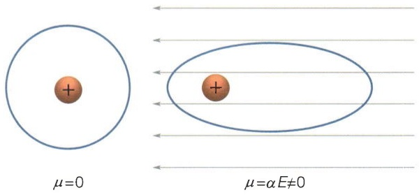

<details>
<summary>text_image</summary>

μ=0
μ=αE≠0
</details>

图22-1 分子极化率与诱导偶极矩

当电磁波作用于粒子时，粒子中的电子偏离原本的平衡位置，使得粒子的电荷分布在交变电场的作用下发生变形，从而产生与分子极化率 $\alpha$ 成正比的诱导偶极矩 $\mu$ 。

---

604

22 光散射技术

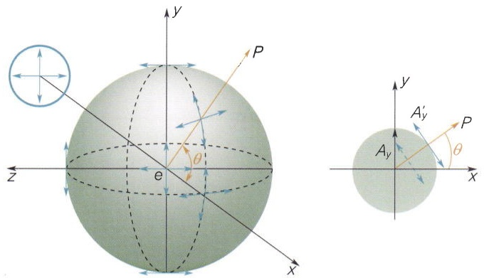

<details>
<summary>text_image</summary>

y
P
θ
e
z
x
y
A'_y
P
A_y
θ
</details>

图22-2 瑞利散射光强度的角度分布和偏振特性分析

自然光沿 $x$ 轴的方向入射到介质中的粒子 $\mathbf{e}$ 上，使其作受迫振动。入射的自然光可分解为沿 $y$ 方向和 $z$ 方向的两个分量，两个分量的振幅相同。位于 $xy$ 平面内的观察点P点，散射光方向与入射光方向成 $\theta$ 角。由于观察点散射光的两个振动分量的大小与方向有关，所以观察点散射光的散射光强度和偏振态随散射方向不同而异。沿着入射光方向或逆着入射光方向的 $x$ 轴上进行观察，散射光为自然光且光强具有极大值；在垂直入射光方向的 $y$ 轴和 $z$ 轴上，散射光为线偏振光且光强具有极小值；而其余方向上的散射光均为部分偏振光。

与入射光方向成 $\theta$ 角。在P点的两个光振动分量的振幅分别为 $A_{z}^{\prime} = A_{z} = A_{0}$ 和 $A_{y}^{\prime} = A_{y}\cos \theta = A_{0}\cos \theta$ ，则散射光强度 $I_{\mathrm{s}}(\theta)$ 为

$$
I _ {\mathrm{s}} (\theta) = I _ {y} ^ {\prime} + I _ {z} ^ {\prime} = I _ {z} ^ {\prime} (1 + \cos^ {2} \theta), \tag {22-5}
$$

其中， $I_{z}^{\prime}$  和  $I_{y}^{\prime}$  分别为 z 轴和 y 轴方向的散射光强度。由于观察点散射光的两个振动分量的大小与方向有关，所以虽然入射光是各个方向振幅均等的自然光，观察点散射光的散射光强度和偏振态随散射方向不同而异。由式（22-5）容易得知，沿着入射光方向或逆着入射光方向的 x 轴上进行观察，散射光为自然光且光强具有极大值；在垂直入射光方向的 y 轴和 z 轴上，散射光为线偏振光且光强具有极小值；而其余方向上的散射光均为部分偏振光。虽然垂直于入射光方向的 y 轴的散射光强度最小，但可以最大程度避免入射光和透射光的干扰。因此，在实际的光谱学测量中，散射光观测点常常设置在垂直于入射光方向的 y 轴。

当考虑观察点角度时，综合式（22-4）和式（22-5）的结果，可以得到一个独立的粒子的散射光为

$$
\frac {I _ {\mathrm{s}} (\theta)}{I _ {0}} = \frac {8 \pi^ {4} \alpha^ {2}}{\lambda_ {0} ^ {4} r ^ {2}} \cdot (1 + \cos^ {2} \theta) 。 \tag {22-6}
$$

如果在符合理想系统条件的样品中有 $N$ 个粒子，则样品总的散射为

$$
\frac {I _ {\mathrm{s}} (\theta)}{I _ {0}} = N \cdot \frac {8 \pi^ {4} \alpha^ {2}}{\lambda_ {0} ^ {4} r ^ {2}} \cdot (1 + \cos^ {2} \theta) 。 \tag {22-7}
$$

对式（22-7）进行变换后，得到瑞利比值（Rayleigh ratio） $R_{\theta}$ :

$$
R _ {\theta} = \frac {I _ {\mathrm{s}} (\theta)}{I _ {0}} \cdot \frac {r ^ {2}}{V (1 + \cos^ {2} \theta)} = \frac {8 \pi^ {4} \alpha^ {2} N ^ {\prime}}{\lambda_ {0} ^ {4}}, \tag {22-8}
$$

其中 $N^{\prime} = N / V = CN_{\mathrm{A}} / M_{\circ}$

其中， $V$ 为样品体积， $C$ 为粒子浓度， $M$ 为粒子分子量， $N_{\mathrm{A}}$ 为阿伏伽德罗常量，而$R_{\theta}$ 反映了瑞利散射光的相对强度值。在光谱学仪器测量时，观测点位置和入射光波长一般都是固定值，若 $\alpha$ 与分子量 $M$ 成正比，则式（22-8）可简化为

$$
R _ {\theta} = K M C, \tag {22-9}
$$

其中， $K$ 为综合了式（22-8）中各项常量或固定值所给定的常数。对于符合瑞利散射条件的样品，瑞利散射与样品的分子量和浓度成正比，可以用来准确测定样品分子量。

式（22-9）是散射理论应用于散射技术中最重要和最实用的公式，除了直接应用瑞利散射的光谱技术，近理想体系的许多散射技术的理论基础大都来源于式（22-9）的变形和修正。

---

22.1 光的散射

605

## 22.1.2 从光的波动性分析非弹性散射的发生

瑞利散射理论中，分子极化率 $\alpha$ 为常数。然而，分子振动会引起 $\alpha$ 的改变。简化起见，考虑最简单的双原子系统，类似于经典力学中的弹簧连接的两个球，如果分子以固有频率 $\omega_{j}$ 振动，对 $\alpha$ 进行傅里叶级数展开（Fourier expansion）时忽略高频项，则 $\alpha$ 也以 $\omega_{j}$ 为频率周期性变化:

$$
\alpha = \alpha_ {0} + \alpha_ {j} \cos \omega_ {j} t, \tag {22-10}
$$

则诱导偶极矩也产生周期性变化

$$
\begin{array}{l} \mu = \alpha E = \left[ \alpha_ {0} + \alpha_ {j} \cos \omega_ {j} t \right] E _ {0} \cos \omega_ {0} t = \alpha_ {0} E _ {0} \cos \omega_ {0} t + \alpha_ {j} E _ {0} \cos \omega_ {0} t \cos \omega_ {j} t \\ = \alpha_ {0} E _ {0} \mathrm{cos} \omega_ {0} t + \frac {1}{2} \left[ \alpha_ {f} E _ {0} \mathrm{cos} (\omega_ {0} + \omega_ {j}) t + \alpha_ {f} E _ {0} \mathrm{cos} (\omega_ {0} - \omega_ {j}) t \right] _ {\circ} \tag {22-11} \\ \end{array}
$$

上述公式中，第一项对应于分子散射的频率与入射光频率相同的情形，即瑞利散射；第二项反映的是分子极化率随分子振动而改变时，分子的散射频率与入射光频率不同，这就是拉曼散射。由此可见，对于大多数的生物和化学样品，瑞利散射和拉曼散射是同时发生的（图22-3）。经典电磁学理论只能定性给出现象，但需要注意的是，式（22-11）并不能用来定量衡量瑞利散射和拉曼散射发生的概率，也就是不能用来定量处理三个频率散射光的理论光强度。一般而言，对于理想体系，瑞利散射光的强度大约是入射光的千分之一到十万分之一，而拉曼散射光的强度又比瑞利散射光低大约三到四个数量级。

拉曼散射中，散射光与入射光频率的差值即分子的振动频率，因此拉曼散射可以检测样品的振动能级信息。按照检测出的信息，光谱学中常常也把拉曼散射和红外吸收光谱等归为振动光谱。式（22-11）中，散射波长大于入射光波长的一项 $(\omega_0 - \omega_j)$ 被称为斯托克斯散射或斯托克斯线（Stokes line），而散射波长小于入射光波长的一项 $(\omega_0 + \omega_j)$ 被称为反斯托克斯散射或反斯托克斯线（anti-Stokes line）。式（22-11）不能反映斯托克斯散射和反斯托克斯散射发生的概率，反斯托克斯散射的概率通常要远小于斯托克斯散射（大约低三个数量级，见22.1.3节）。

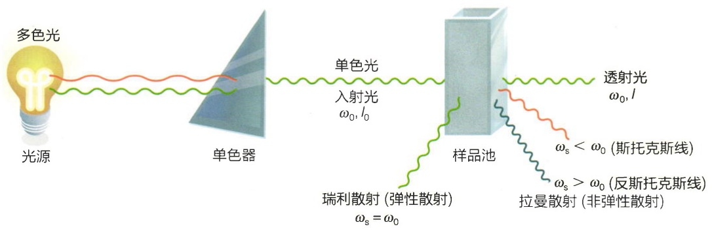

<details>
<summary>text_image</summary>

多色光
光源
单色器
单色光
入射光
ω₀, l₀
样品池
透射光
ω₀, l
ωₛ < ω₀ (斯托克斯线)
ωₛ > ω₀ (反斯托克斯线)
瑞利散射 (弹性散射)
ωₛ = ω₀
拉曼散射 (非弹性散射)
</details>

图22-3 散射的发生一般而言，对于理想体系，瑞利散射光的强度大约是入射光的千分之一到十万分之一，而拉曼散射光的强度又比瑞利散射光低大约三到四个数量级。在拉曼散射中，反斯托克斯散射的概率通常比斯托克斯散射的概率低约三个数量级。

---

606

22 光散射技术

## 22.1.3 从光的粒子性分析散射的发生

20世纪20年代初，量子力学已经对光与电子的相互作用进行了很好的理论描述（可以参考电动力学等相关物理专业教材）。此处我们不进行定量的量子力学计算，而只利用能级对光子和样品分子之间的相互作用进行定性分析。在样品的平衡状态，样品分子处于电子能级和振动能级的基态。一般来说，入射光子的能量远大于振动能级跃迁所需要的能量，但又不足以将分子激发到电子能级激发态（激发到激发态的散射现象被称为共振光散射）。在此情形下，样品分子吸收光子后在极短时间内到达一种并非真实存在的准激发状态，称为虚能态（virtual energy state）。样品分子在虚能态时是不稳定的或亚稳定的（metastable），它将迅速回到稳定的电子能级基态（图22-4）。因此光散射可以被简单看作是瞬时吸收后释放光子的过程，当入射光为可见光时，这个瞬时的时间尺度小于 $10^{-16}\mathrm{s}$，通常小于光吸收的时间尺度。

如果样品分子回到电子能级基态中的振动能级基态，则光子的能量未发生改变，这时发生的是瑞利散射。如果样品分子回到电子能级基态中的较高振动能级即某些振动激发态，则散射光子能量小于入射光子的能量，其波长大于入射光。这时散射光谱的瑞利散射谱线较低频率侧将出现一根拉曼散射光的谱线，即斯托克斯线。如果样品分子在与入射光子作用前的瞬间不是处于电子能级基态的最低振动能级，而是处于电子能级基态中的某个振动能级激发态，则入射光光子作用使之跃迁到虚能态后，该分子退激回到电子能级基态的振动能级基态，这样散射光能量将大于入射光子能量，其谱线位于瑞利谱线的高频侧，即反斯托克斯线。斯托克斯线和反斯托克斯线位于瑞利谱线两侧，二者与瑞利线的频率间距相等。根据玻尔兹曼定律，在室温的平衡状态下，分子绝大多数都处于振动能级基态，所以斯托克斯线的强度远远强于反斯托克斯

线，利用量子化学理论可以对简单分子在不同振动能级的分布进行计算，从而估算斯托克斯线和反斯托克斯线的相对强度。绝大多数商品化的拉曼光谱仪和成像仪检测的都是斯托克斯线。随着激光技术的发展，检测反斯托克斯线的技术也在不断发展之中。

## 22.1.4 非理想溶液体系的弹性散射

大多数生物和化学样品都会偏离22.1.1节中所描述的理想系统。此时，利用式（22-9）进行定量计算会出现明显的偏离。为了保证光谱技术测试的准确度和可靠性，一种策略是严格限制所测试样品的状态（如样品浓度、缓冲液、温湿度、样品杯材质等）；另一种策略是在考虑非理想条件的影响下，对式（22-9）进行适当的修正，以扩大样品测试范围或获得更多样品分子吸收光子后在极短时间内到达虚能态。处于不稳定的虚能态的样品分子将迅速回到稳定的电子能级基态，若散射光子能量未发生改变，此时发生的是瑞利散射；若样品分子回到电子能级基态中的不同振动能级，则散射光子能量与入射光子能量不同，此时发生的是拉曼散射。

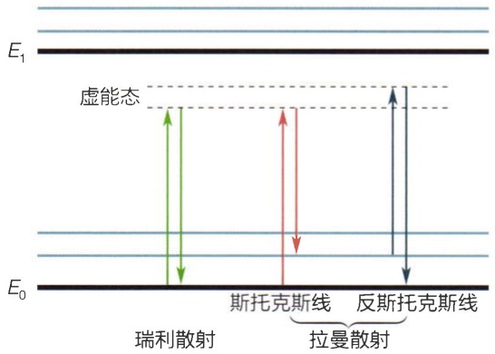

<details>
<summary>text_image</summary>

E₁
虚能态
斯托克斯线
拉曼散射
反斯托克斯线
E₀
瑞利散射
</details>

图22-4 散射现象的能级图

---

22.1 光的散射

607

的样品相关参数。在样品测试中经常需要考虑的非理想条件包括:粒子之间的相互作用、粒子的不均一性或样品中含有不同分子量的分子、粒子的尺度偏离了理想系统而不得不考虑其大小或形状等（图22-5）。

## (1) 分子之间的相互作用

对于生物和化学测试中常见的溶液样品，样品分子、缓冲液中含有的各种分子以及水分子之间都存在着相互作用。对式（22-9）进行变换后，对浓度 $C$ 进行幂级数（power series）展开。由于稀薄气体或稀溶液中，粒子对之间（二体）相互作用的贡献是主要的，因此忽略高阶项后得到

$$
K C / R _ {\theta} = 1 / M + 2 B C + \dots , \tag {22-12}
$$

其中，B 是第二维里系数（second virial coefficient），可以为正数也可以为负数（知识窗 22-1）。在稀溶液中，B 可以反映溶质与溶剂之间相互作用的性质。

(A)

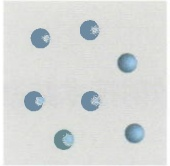

(B)

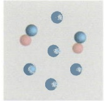

(C)

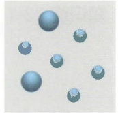

(D)

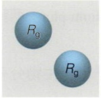

(E)

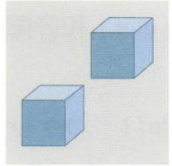

图22-5 在散射技术中对式（22-9）进行修正的常见非理想条件

（A）理想体系。（B）粒子之间存在相互作用。（C）粒子尺度的不均一性。（D）粒子尺度偏离理想体系但可以简化为理想球体，此时仅需要考虑其大小（ $R_{g}$ ）的影响。（E）粒子尺度偏离理想体系不能简化为理想球体，此时需要考虑其大小和形状的影响。

## (2) 多分子系统

如果一个样品溶液中含有 $i$ 种不同分子量（$M_i$）的生物分子，各自的浓度为 $C_i$，若对所有的分子常数 $K$ 值相同，则

$$
R _ {\theta} = R _ {\theta i} = \sum K M _ {i} C _ {i} = K M _ {\mathrm{app}} C, \tag {22-13}
$$

其中， $M_{\mathrm{app}}$ 为表观分子量。

## (3) 分子的大小

大多数生物样品的分子量很大，分子直径超出了瑞利散射的限制条件，但又没有大到需要考虑分子的具体形状时，可以将样品分子都简化为具有回转半径（radius of gyration） $R_{g}$ 的球形分子。我们可以在式（22-9）中引入一个反映 $R_{g}$ 的形状因子（particle form factor） $P(\theta)$ 来对式（22-9）进行修正:

$$
R _ {\theta} = K M C P (\theta) \cong K M C (1 - q ^ {2} R _ {\mathrm{g}} ^ {2} / 3), \tag {22-14}
$$

其中 $q$ 被称为散射矢量或散射因子，其单位是长度的倒数，习惯上常以 $\mathring{\mathrm{A}}^{-1}$ 或 $\mathrm{nm}^{-1}$ 为单位。散射矢量的定义是入射到样品上的波矢量 $\pmb{k}$ 与在角度为 $\theta$ 所检测的散射波矢量$\pmb{k}^{\prime}$ 之差，即 $q = k - k^{\prime}$ 。对于弹性散射， $|\pmb {k}| = |\pmb {k}^{\prime}| = 2\pi /\lambda$ ，则容易得到

$$
q = 4 \pi \sin (\theta / 2) / \lambda_ {\circ} \tag {22-15}
$$

## （4）分子的形状或结构

当 $\lambda < d$ 时，分子的形状和内部结构将对散射光的空间分布产生重要的影响。由式（22-14）可知，当散射角 $\theta$ 或 $q$ 为0时，散射光强度具有极大值。对于大颗粒分子的米氏散射，散射光强度远大于瑞利散射光强度。因此当 $\lambda < d$ 时，随着 $\theta$ 变大，散射光强度将急剧衰减，只有在一个很小的角度（$5^{\circ} \sim 7^{\circ}$）范围内才能观察到散射光，这种情形下的散射技术被称为小角散射。由于小角散射中，$I_{\mathrm{s}}(\theta)$ 随散射角的变化蕴含了样品分子的形状和结构信息，因此我们可以引入一个结构因子（structure

---

608

22 光散射技术

## 知识窗22-1

## 散射技术数据处理的两种常用作图法

在静态光散射和小角散射等技术的数据处理中，有吉尼尔图（Guinier plot）和齐姆图（Zimm plot）两种常用的作图法。

当 $x$ 很小时， $\ln (1 - x)\approx -x$ 。对于常见生物分子的$q^{2}R_{\mathrm{g}}^{2} / 3$ 值一般远小于1，由此有

$$
\ln P (\theta) \cong - q ^ {2} R _ {\mathrm{g}} ^ {2} / 3 。 \tag {22-16}
$$

$P(\theta)$ 与 $I_{\mathrm{s}}(\theta)$ 成正比，因此以 $\ln I_{\mathrm{s}}(\theta)$ 对 $q^2$ 作图可得到吉尼尔图，由拟合直线的斜率可以获得 $R_{\mathrm{g}}$ （图22-6）。

当 x 很小时， $1/(1-x)\approx1+x$ ，将式（22-14）变换后可得

$$
\begin{array}{l} K C / R _ {\theta} = 1 / \left[ M (1 - q ^ {2} R _ {\mathrm{g}} ^ {2} / 3) \right] \\ \approx (1 / M) (1 + q ^ {2} R _ {\mathrm{g}} ^ {2} / 3) 。 \tag {22-17} \\ \end{array}
$$

在以浓度 $C$ 和散射角 $\theta$ 为变量，测得一系列 $KC / R_{\theta}$ 值以后，以 $KC / R_{\theta}$ 对 $q^{2} + k^{\prime}C$ 作图可得到齐姆图，其中$k^{\prime}$ 为用于分散曲线的无量纲常数（图22-6）。将 $C$ 外推到0，所获得拟合直线的斜率为 $R_{\mathrm{g}}^{2} / 3M$ ；将 $\theta$ 外推到0，所获得拟合直线的斜率为 $2B$ [见式（22-12）]；将 $C$ 和$\theta$ 同时外推到0后，所获得拟合直线在 $y$ 轴上的截距即$1 / M$ 。因此，由齐姆作图法可以同时获得 $M$ 、 $R_{\mathrm{g}}$ 和 $B$ 等重要信息。

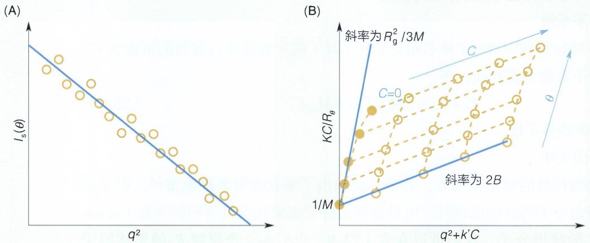

图 22-6 吉尼尔图（A）和齐姆图（B）示意图

factor） $S(\theta)$ 对式（22-14）进行修正:

$$
R _ {\theta} = K M C P (\theta) S (\theta) 。 \tag {22-18}
$$

小角散射技术通过对所获得的散射强度随 $\theta$ 变化的曲线进行拟合，可以反推出样品分子的可能结构特征（详见22.5节）。

---

22.2 静态光散射

609

## 22.2 静态光散射

## 22.2.1 静态光散射的基本原理

当光进入样品以后，弹性散射和非弹性散射都会发生。由于散射光中最主要的分量是弹性散射光，只检测入射光波长的散射光强度也为测试带来了方便，因此在实践中利用瑞利散射原理发展的仪器应用最早也最为广泛。直接应用瑞利散射理论的技术被称为静态光散射（static light scattering，SLS）或经典光散射（classical light scattering）。现代静态光散射仪器通常采用激光作为光源，可以在多个角度进行测量，因此也被称为多角度激光光散射（multi-angle laser light scattering，MALLS 或 MALS）。

根据式（22-14）可知，在 $\theta$ 或 $R_{\mathrm{g}}$ 很小时，$P(\theta) \approx 1$，此时可以将系统看作是理想系统，从而可以根据式（22-9）得到体系中分子的准确分子量。对于利用静态光散射获得分子量的理论误差值，假设 $\lambda = 500 \mathrm{~nm}$，$R_{\mathrm{G}} = 15 \mathrm{~nm}$（相当于约 $40 \mathrm{~nm}$ 大小的球状蛋白质，此时 $\lambda / d > 10$），$\theta = 90^{\circ}$，可以计算得到 $P(\theta) \approx 1 - 0.05 = 0.95$，因此实验所得分子量与理论分子量偏离度约为 $5\%$。对于生物物理研究中常见的蛋白质，通过静态光散射来测定分子量或判断寡聚体大小具有很好的准确度，大多数情况下误差小于 $3\%$。除了测定分子量，还可以通过多个角度和（或）多个浓度的测量，利用吉尼尔图或齐姆图等方法，获得样品分子的回转半径 $R_{\mathrm{g}}$ 和第二维里系数 $B$ 等参量。

在推导式（22-9）时，只考虑了分子极化率 $\alpha$ 与分子量的关系，而忽略了折射率变化的影响。根据克劳修斯-莫索提方程（Clausius-Mossotti equation），有

$$
\alpha = M (\mathrm{d} n / \mathrm{d} c) / (2 \pi N _ {\mathrm{A}}), \tag {22-19}
$$

其中，折射率增量（refractive index increment） $dn/dc$ 是折射率随浓度变化的物理量。因此在实际应用中，可以将式（22-9）变换为

$$
M = \left[ K _ {\mathrm{LS}} c M (\mathrm{d} n / \mathrm{d} c) ^ {2} \right] / \left[ K _ {\mathrm{RI}} c (\mathrm{d} n / \mathrm{d} c) \right] = K \cdot \mathrm{LS/RI}, \tag {22-20}
$$

其中，LS是瑞利散射光的强度；折射率RI正比于浓度，可以通过紫外吸收（参见21.2节）等方法测定。

由式（22-13）可知，静态光散射技术并不能区分样品中不同大小的分子，而是通过所有分子加和后的散射情况推算出表观分子量。为了能够获得某个单独成分的分子量，可以在静态光散射检测之前对溶液样品中可能含有不同分子量、寡聚态或形状的分子进行分离。静态光散射通常与分子筛联用，也可以与离子交换柱、反相色谱柱等其它分离技术联用。

## 22.2.2 静态光散射测定的主要参量和样品要求

静态光散射技术所能获得的基本参量包括溶液中分子的分子量 $M$ 、回转半径 $R_{\mathrm{g}}$ 、第二维里系数 $B$ 以及折射率增量 $\mathrm{dn / dc}$ 等。由于这些参量反映了分子最基本的生物物理性质，从这些参量出发还可以进一步推测样品分子的构象状态、寡聚态、亚基组

---

610

22 光散射技术

成、生物大分子相互作用等重要信息，因此静态光散射技术在生物、化学、材料科学、食品和医药等领域都有着广泛应用。

常用的18角度静态光散射仪所能测定的分子量范围一般为 $200\sim 10^{9}\mathrm{Da}$，所能测定的 $R_{\mathrm{g}}$ 范围一般为 $10\sim 500\mathrm{nm}$，但实际范围可能会受到分子筛类型、样品分子的形状等因素影响。在实际应用中，还需要考虑以下样品要求和测试中的注意事项:

① 样品在激发光波长处没有特异性吸收，不产生荧光和磷光等光发射现象。可以通过改变激发光波长来避免光吸收或发射现象。
② 分子筛柱子工作正常，柱材不会脱落。值得注意的是，分子筛的分离范围决定了分子筛-静态光散射联用时的分子量检测范围。
③ 由于分子筛的稀释效应，需要选择合适的样品浓度（一般在 $\mathrm{mg / mL}$ 量级）以获得好的信噪比。
④ 样品是纯净的近理想体系，所有的散射技术都对样品中的大颗粒极为敏感。虽然分子筛上通常会安装滤膜，但样品含有杂质可能会影响分子筛柱子的正常工作和长期使用。在上样之前，需要离心去除大颗粒物质和沉淀，并使用 $0.22\mu \mathrm{m}$ 或 $0.1\mu \mathrm{m}$ 滤膜对流动相和样品进行过滤以去除可能的杂质。

## 22.2.3 静态光散射在生物学中的应用

静态光散射技术是为数不多的能测定分子回转半径 $R_{\mathrm{g}}$ 和第二维里系数 $B$ 的技术，测定方法可参考图22-6。在实践中，最常见的是利用静态光散射获得样品分子的分

子量，并由此推测每个组分的状态。

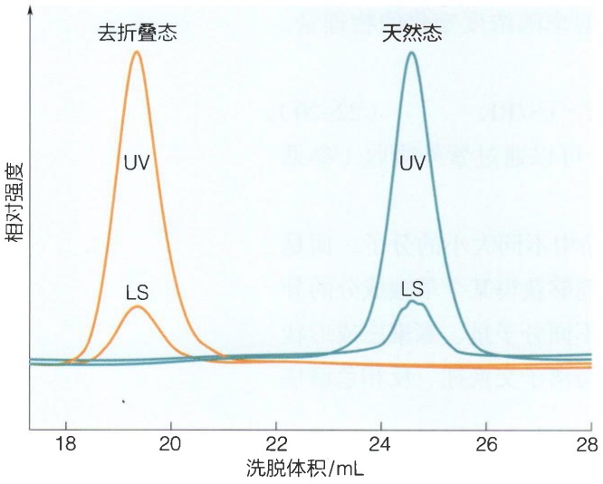

<details>
<summary>line</summary>

| 洗脱体积 (mL) | 去折叠态::UV | 去折叠态::LS | 天然态::UV | 天然态::LS |
| --- | --- | --- | --- | --- |
| 18 | ~0.05 | ~0.02 | ~0.02 | ~0.01 |
| 19 | ~0.95 | ~0.35 | ~0.02 | ~0.01 |
| 20 | ~0.45 | ~0.15 | ~0.02 | ~0.01 |
| 22 | ~0.02 | ~0.02 | ~0.02 | ~0.01 |
| 24 | ~0.02 | ~0.02 | ~0.65 | ~0.25 |
| 25 | ~0.02 | ~0.02 | ~0.95 | ~0.35 |
| 26 | ~0.02 | ~0.02 | ~0.45 | ~0.15 |
| 28 | ~0.02 | ~0.02 | ~0.02 | ~0.02 |
</details>

图 22-7 静态光散射测定不同构象状态的绝对分子量

分子筛的出峰位置与分子构象和形状有关，而静态光散射测定的是绝对分子量。图中处于天然态和去折叠态的蛋白质，由于分子形状不同，其分子筛出峰位置具有较大差异，但LS/RI的比值相同，表明具有相同的分子量。（数据自Wen J, et al. Anal Biochem, 1996, 240(2): 155-166）

能够获得表观分子量的生物物理技术很多，如超速离心法、各种电泳技术、分子筛以及质谱等，但这些技术所获得的表观分子量通常不是溶液中分子天然状态下的分子量，而是基于一系列假设的前提，通过标准蛋白质的标定曲线推算而来，通常会受到分子的大小、形状和（或）结构的影响。如与静态光散射联用的分子筛也常常被单独用于表观分子量计算，但需要同时满足以下假设的前提:①所测样品与标准样品具有相同的分子形状，比如均为球状蛋白；②所测样品与标准样品具有相同的密度；③样品与柱材的相互作用可以忽略；④样品的分离只与流体力学半径 $R_{h}$ 线性相关。实际上，很多生物或化学分子是无法同时满足以上几个假设的。比如蛋白质的天然态和变性态的形状、结构和 $R_{h}$ 都差别巨大，虽然是同一种蛋白质，其分子筛出峰位置会有极大差别，此时无法通过标定曲线来得到正确的分子量（图22-7）。

---

22.3 动态光散射

611

与其它技术相比，通过式（22-20）所获得的分子量与分子构象和形状无关，因此静态光散射所测定的分子量也被称为绝对分子量（absolute molar mass）。静态光散射在非球状分子的分子量准确测定上显示出了独有的优势，如天然无序蛋白质、具有线性糖基化或脂类分子修饰的蛋白质、表面活性剂所溶解的膜蛋白、线性或具有分支结构的高聚物等。一般来说，每一种类型的分离柱都具有分子量上限，而大多数分子筛的分子量上限都远小于静态光散射的上限。

在生物医药领域，分子筛-静态光散射联用的检测对象包括蛋白质、核酸、纳米颗粒、高聚物、小的病毒和病毒样颗粒等，可以用于分析溶液中样品分子的组分、纯度和稳定性、寡聚态分布和动态平衡、生物分子相互作用、复合物各亚基的化学计量比、蛋白质翻译后修饰状态和修饰蛋白质的均一度、高聚物的均一度和分子量分布等。

## 22.3 动态光散射

## 22.3.1 动态光散射的基本原理

动态光散射（dynamic light scattering，DLS），也被称为光子相关光谱（photon correlation spectroscopy）或准弹性光散射（quasi-elastic light scattering，QELS）。静态光散射测量的是不同角度下的散射光强度，而动态光散射测量的是一个小的视窗中散射光强度随时间的涨落变化（图22-8）。当时间为0时的动态光散射就是静态光散射，因此“动态”反映的是一个时间函数。动态光散射中，散射光强度随时间的涨落，来源于样品中粒子的布朗运动所造成的溶液局部粒子浓度的涨落，以及运动粒子的多普勒效应（Doppler effect）。因此在一个毫秒量级的时间内，光束与布朗运动的粒子相互作用，散射光强度随时间衰减的函数与粒子的扩散系数有关。相同的条件下，

粒子越小，其布朗运动越快，这就造成观察视窗内散射光强度随时间的涨落，从而可以通过散射光的时间依赖曲线反推出粒子的扩散系数。

溶液中粒子的扩散系数与其形状、质量以及其与溶液中其它分子的相互作用有关。虽然溶液中的粒子具有特定的形状，其在溶液中的运动都可以等同于一个假想球体的运动（知识窗22-2），而这个假想球体的半径就被称为流体力学半径（hydrodynamic radius， $R_{\mathrm{h}}$ ）或斯托克斯半径（Stokes radius）。 $R_{\mathrm{h}}$ 与平动扩散系数（translational diffusion coefficient） $D_{\mathrm{T}}$ 之间的关系由斯托克斯-爱因斯坦方程（Stokes-Einstein equation）描述:

$$
R _ {\mathrm{h}} = k _ {\mathrm{B}} T / 6 \pi \eta D _ {\mathrm{T}}, \tag {22-21}
$$

其中， $k_{\mathrm{B}}$ 是玻尔兹曼常量， $T$ 是热力学温度， $\eta$ 是溶液的黏度。流

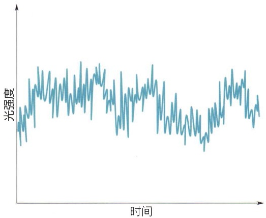

<details>
<summary>line</summary>

| 时间 | 光强度 |
| --- | --- |
| 1 | ~0.4 |
| 2 | ~0.6 |
| 3 | ~0.5 |
| 4 | ~0.7 |
| 5 | ~0.8 |
| 6 | ~0.9 |
| 7 | ~0.7 |
| 8 | ~0.8 |
| 9 | ~0.9 |
| 10 | ~0.8 |
| 11 | ~0.9 |
| 12 | ~0.8 |
| 13 | ~0.9 |
| 14 | ~0.8 |
| 15 | ~0.9 |
| 16 | ~0.8 |
| 17 | ~0.9 |
| 18 | ~0.8 |
| 19 | ~0.9 |
| 20 | ~0.8 |
| 21 | ~0.9 |
| 22 | ~0.8 |
| 23 | ~0.9 |
| 24 | ~0.8 |
| 25 | ~0.9 |
| 26 | ~0.8 |
| 27 | ~0.9 |
| 28 | ~0.8 |
| 29 | ~0.9 |
| 30 | ~0.8 |
| 31 | ~0.9 |
| 32 | ~0.8 |
| 33 | ~0.9 |
| 34 | ~0.8 |
| 35 | ~0.9 |
| 36 | ~0.8 |
| 37 | ~0.9 |
| 38 | ~0.8 |
| 39 | ~0.9 |
| 40 | ~0.8 |
| 41 | ~0.9 |
| 42 | ~0.8 |
| 43 | ~0.9 |
| 44 | ~0.8 |
| 45 | ~0.9 |
| 46 | ~0.8 |
| 47 | ~0.9 |
| 48 | ~0.8 |
| 49 | ~0.9 |
| 50 | ~0.8 |
| 51 | ~0.9 |
| 52 | ~0.8 |
| 53 | ~0.9 |
| 54 | ~0.8 |
| 55 | ~0.9 |
| 56 | ~0.8 |
| 57 | ~0.9 |
| 58 | ~0.8 |
| 59 | ~0.9 |
| 60 | ~0.8 |
| 61 | ~0.9 |
| 62 | ~0.8 |
| 63 | ~0.9 |
| 64 | ~0.8 |
| 65 | ~0.9 |
| 66 | ~0.8 |
| 67 | ~0.9 |
| 68 | ~0.8 |
| 69 | ~0.9 |
| 70 | ~0.8 |
| 71 | ~0.9 |
| 72 | ~0.8 |
| 73 | ~0.9 |
| 74 | ~0.8 |
| 75 | ~0.9 |
| 76 | ~0.8 |
| 77 | ~0.9 |
| 78 | ~0.8 |
| 79 | ~0.9 |
| 80 | ~0.8 |
| 81 | ~0.9 |
| 82 | ~0.8 |
| 83 | ~0.9 |
| 84 | ~0.8 |
| 85 | ~0.9 |
| 86 | ~0.8 |
| 87 | ~0.9 |
| 88 | ~0.8 |
| 89 | ~0.9 |
| 90 | ~0.8 |
| 91 | ~0.9 |
| 92 | ~0.8 |
| 93 | ~0.9 |
| 94 | ~0.8 |
| 95 | ~0.9 |
| 96 | ~0.8 |
| 97 | ~0.9 |
| 98 | ~0.8 |
| 99 | ~0.9 |
| 100 | ~0.7 |
</details>

图22-8 粒子的布朗运动导致光散射强度随时间的涨落

---

612

22 光散射技术

## 知识窗22-2

## 回转半径 $R_{\mathrm{g}}$ 与流体力学半径 $R_{\mathrm{h}}$

分子量和形状特征是反映生物分子生物物理性质的两个基本参量，也是生物物理技术中最常见的两个参量。静态光散射等技术可以测定样品分子的回转半径 $R_{\mathrm{g}}$ ，而动态光散射等技术可以获得样品分子的流体力学半径 $R_{\mathrm{h}}$ 。$R_{\mathrm{g}}$ 和 $R_{\mathrm{h}}$ 都与分子量和分子形状有关，也都反映了溶液中分子的运动情况。对同一个样品分子而言，$R_{\mathrm{g}}$ 和 $R_{\mathrm{h}}$ 一般是不一样的，也是对分子运动不同行为进行考量的物理量。$R_{\mathrm{g}}$ 与分子在溶液中的转动有关，而 $R_{\mathrm{h}}$ 与分子的平动相关。因此在近理想体系中，$R_{\mathrm{g}}$ 不影响光散射，而 $R_{\mathrm{h}}$ 会通过溶液中分子浓度的涨落和多普勒位移影响光散射（图22-9）。值得注意的是，虽然 $R_{\mathrm{g}}$ 和 $R_{\mathrm{h}}$ 都与分子量或分子体积有关，但对于大多数生物分子，无法由  $R_{g}$  和  $R_{h}$  计算出绝对分子量，而是通过标定曲线获得表观分子量。

在水溶液中，生物分子并非干燥的球体，生物分子表面的亲水基团会水化结合大量水分子，而分子内部或一些柔性区域也可能有结合的水分子，生物分子在水溶液中的运动其实是水化分子的运动，因此通过实验所获得的 $R_{\mathrm{g}}$ 和 $R_{\mathrm{h}}$ 通常都大于对非水化分子进行理论计算所获得的理论值。如果缓冲液中所含有的某些小分子，与生物分子的相互作用与水分子强度不同或具有不同的基团选择性，则可能会影响第二维里系数。

(A)

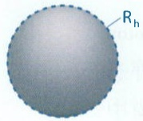

(B)

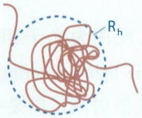

(D)

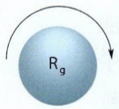

(E)

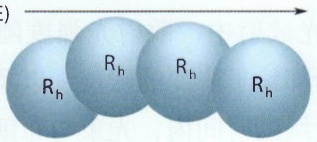

<details>
<summary>chemical</summary>

Diagram showing four identical spheres labeled R_h arranged in a linear arrangement with an arrow indicating direction
</details>

(C)

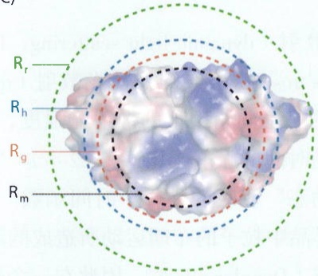

<details>
<summary>text_image</summary>

Rr
Rh
Rg
Rm
</details>

图22-9 回转半径 $R_{\mathrm{g}}$ 与流体力学半径 $R_{\mathrm{h}}$

（A）理想球体的  $R_{h}$  与其半径相同。（B）无规则形状物体在溶液中的运动情况可等同于一个假想球体的运动。（C）水溶性蛋白（γD- 晶状体蛋白，PDB 编号:1HK0）的回转半径  $R_{g}$  、流体力

学半径  $R_{h}$  、分子质量半径（mass radius， $R_{m}$ ）和分子半径  $R_{r}$  之间关系的示意图。（D）分子转动与  $R_{g}$  有关。（E）分子平动与  $R_{h}$  有关。

体力学半径反映了粒子在溶液中的扩散行为，可以通过动态光散射、荧光相关光谱（参见27.3.3节）、分子筛、分析型超速离心等技术测定。

动态光散射直接测量的是散射光强度随时间的变化 $I_{\mathrm{s}}(t)$，可以通过自相关函数获得 $D_{\mathrm{T}}$。对于近理想体系的生物分子溶液，生物分子可以简化为一个刚性的单分散小球，在平动或者转动时形状没有变化。这时只需要考虑每个球体的质心运动，其自相关函数是一个单指数衰减函数:

---

22.3 动态光散射

613

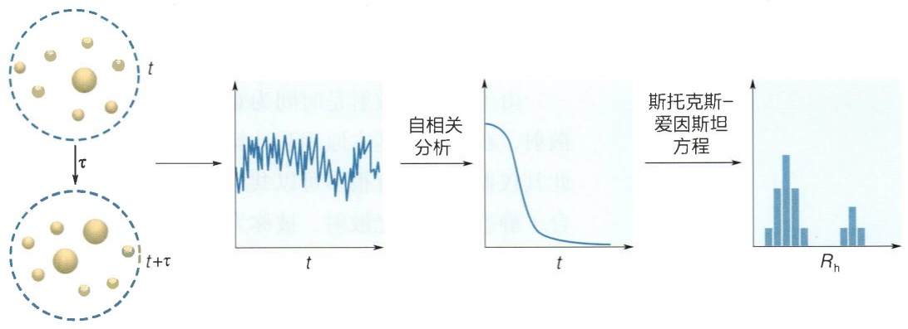

<details>
<summary>flowchart</summary>

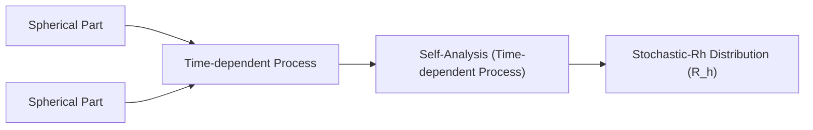
</details>

图22-10 动态光散射数据分析示意图

通过自相关函数和斯托克斯-爱因斯坦方程对动态光散射随时间的涨落曲线进行分析，获得样品分子的扩散系数和多分散性。

$$
G (\tau) = \lim _ {T \to \infty} \big [ \frac {1}{T} \int_ {0} ^ {T} I _ {\mathrm{s}} (t) I _ {\mathrm{s}} (t + \tau) \mathrm{d} t \big ], \tag {22-22}
$$

$$
g (\tau) = \frac {G (\tau)}{G (0)} = \mathrm{e} ^ {- \Gamma \tau}, \Gamma = q ^ {2} D _ {\mathrm{T}}, \tag {22-23}
$$

其中，$q$ 为22.1.4节提到的散射矢量，即 $q = \frac{4\pi\sin\frac{\theta}{2}}{\lambda}$ 。时间依赖的光散射强度实验数据由式（22-22）和式（22-23）计算或拟合得到 $D_{\mathrm{T}}$ ，再通过式（22-21）就可以计算得到 $R_{\mathrm{h}}$ （图22-10）。样品的多分散性可以表示为拉普拉斯变换（Laplace transform）:

$$
g _ {1} (\tau) = \int_ {0} ^ {\infty} G (\Gamma) \mathrm{e} ^ {- \Gamma \tau} \mathrm{d} \Gamma , \tag {22-24}
$$

其中， $G(\Gamma)$ 为特定分子相应的概率分布函数。根据以上公式对实验数据进行拟合获得 $\Gamma$ ，就可以得到粒径分布。式（22-24）可以很好地描述大多数生物分子的稀溶液。对于特殊形状（如杆状等）的大分子或分子聚合物以及偏离理想溶液的系统，其自相关函数的表达与上述公式会有所区别，可参考相关的文献。

## 22.3.2 动态光散射测定的主要参量和样品要求

动态光散射直接测定的物理量是样品分子的扩散系数 $D_{\mathrm{T}}$ 。根据 $D_{\mathrm{T}}$ 可以计算得到的流体力学半径 $R_{\mathrm{h}}$ 和具有不同 $R_{\mathrm{h}}$ 粒子的粒径分布。此外，根据自相关函数与单分散小球之间的偏离程度，还可以获得分子的多分散性。动态光散射的最终结果一般用直方图表示，横坐标为 $R_{\mathrm{h}}$ ，纵坐标为相对散射强度，可以直观显示样品的粒径分布和每个 $R_{\mathrm{h}}$ 的多分散性。虽然由 $R_{\mathrm{h}}$ 和标定曲线可以估算每个 $R_{\mathrm{h}}$ 的表观分子量，但 $R_{\mathrm{h}}$ 和分子量之间并没有确定的定量关系。当粒子的形状偏离球体时，该估算会有较大误差。同时需要注意的是，动态光散射的纵坐标给出的是每个 $R_{\mathrm{h}}$ 的相对散射强度，并不是每个组分的相对含量（图22-11）。由于散射光强度与分子量成正比[式（22-9)]，因

---

614

22 光散射技术

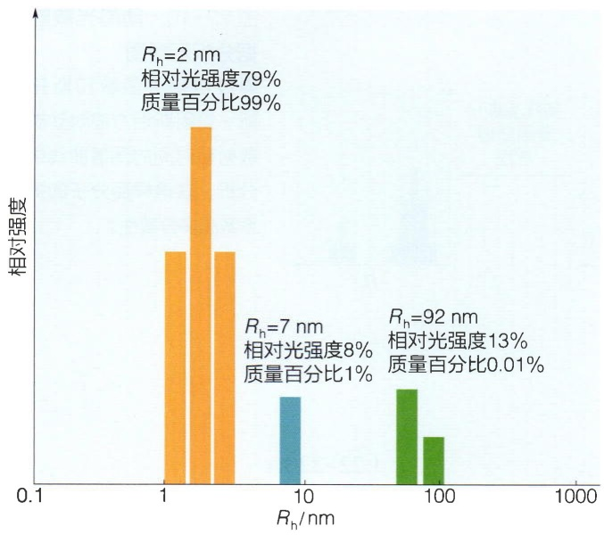

<details>
<summary>bar</summary>

| Rh (nm) | Relative Intensity |
| --- | --- |
| 2 | 79% |
| 7 | 8% |
| 92 | 13% |
</details>

图22-11 动态光散射研究样品粒径分布、均一度和多分散性

此不同 $R_{\mathrm{h}}$ 粒子的散射能力会具有很大差异，动态光散射纵坐标的相对强度不能简单等同于组分的相对含量。

由于静态光散射是时间为0或时间平均的动态光散射，在光散射基本原理和计算公式上是统一的，因此其仪器模块也有很多可以共用。现代光谱仪通常组合了静态和动态光散射，被称为动静态光散射仪。常见的动态光散射仪所能测定的 $R_{h}$ 范围一般为0.5 nm到1\~2.5  $\mu$ m。 $R_{h}$ 小于0.5 nm的粒子散射过于微弱，而 $R_{h}$ 大于2.5  $\mu$ m的粒子容易发生沉降。除此之外，动态光散射样品准备中需要考虑的事项包括:

① 样品在激发波长处没有特异性吸收，不产生荧光和磷光等光发射现象。
② 动态光散射所获得  $R_{h}$  的分辨率下限一般为 2 倍  $R_{h}$ 。由于多分散性的存在，分辨率也可能在 3\~5

倍 $R_{\mathrm{h}}$ 。因此动态光散射不适合分辨分子量接近的粒子，简单计算可知动态光散射能够分辨的分子量下限为 $4\sim 8$ 倍。

③ 合适的样品浓度（一般在 mg/mL 量级）以获得好的信噪比。
④ 样品是纯净的近理想体系。在上样之前，需要对样品所使用的缓冲液进行过滤，对样品离心以去除杂质和容易沉淀的大颗粒物质。
⑤ 动态光散射对温度和溶液黏度敏感 [式（22-20）]，测量时需要保持恒温。

由于检测方便、快捷和无损，检测范围涵盖了纳米到微米尺度，动态光散射被广泛应用于生物学研究，以及纳米科学和医药的质量控制等领域。动态光散射的研究对象包括各种生物大分子、囊泡和外泌体、脂质体、纳米颗粒、高聚物等。在生物学研究中，动态光散射常常被用来检测样品的纯度和均一性、粒径分布、生物分子相互作用、结构生物学研究的样品初筛等。通过观测粒径分布随变性剂或热、压力等的变化，还可以研究蛋白质的稳定性、蛋白质聚集、相变等过程。

## 22.4 拉曼光谱

## 22.4.1 拉曼散射的基本原理

拉曼散射的发生已经在22.1.2节和22.1.3节介绍过。拉曼光谱和红外吸收光谱都可以用于检测分子振动能级相关的信息，因此拉曼光谱和红外吸收光谱（参见24.4节）也被统称为振动光谱。红外吸收光谱是直接测量分子振动能级共振吸收能量的技术，而拉曼光谱是通过拉曼散射中散射光频率与入射光频率之间的差异间接探测分子振动能级信息的技术。由于散射光谱和吸收光谱物理本质不同，使得拉曼光谱和红外

---

22.4 拉曼光谱

615

吸收光谱各有所长、互为补充。

## (1) 振动能级

按照现代量子物理学理论，分子的运动包括了平动、转动、振动和电子运动等，其对应的能量都是量子化的，量子化的能量状态被称为能级。分子的总能量即不同形式运动的能量总和。不同运动形式能级之间的能量差具有显著差异。一般情况下，电子能级之间的能量差最大，振动和转动次之，而平动的能量近乎是连续的。

分子的振动来源于化学键所连接的原子在其平衡位置做简谐振动。简化起见，一个化学键连接的双原子系统可以看作是经典力学中的弹簧连接的a和b两个球体。假设化学键的键力常数为 $k$ ，两个原子的质量分别为 $M_{\mathrm{a}}$ 和 $M_{\mathrm{b}}$ ，其折合质量为 $1 / \mu = 1 / M_{\mathrm{a}} + 1 / M_{\mathrm{b}}$ 。根据牛顿力学容易得知该伸缩振动系统的固有振动频率 $\omega$ 为

$$
\omega = \sqrt {k / \mu}, \tag {22-25}
$$

因此，分子的振动频率直接取决于分子的化学组成和化学结构。分子结构不同，振动能级的分布也不同。不同的化学基团一般都具有自己的特征振动频率，振动光谱也就能反映分子的化学组成和结构信息。同位素替代虽然不改变化学键的性质，但折合质量不同也会使得振动频率有着较大改变。

## (2) 振动模式

双原子系统只有伸缩振动一种振动模式。多原子系统有多种振动模式（图22-12）。多原子分子的运动可以分解为多个简正振动的线性叠加。简正振动（fundamental vibration）又称简正模式，是无阻尼系统的一种自由振动方式，也是最简单、最基本的振动模式，其频率称为简正频率。多原子分子最基本的振动形式是伸缩（stretching）振动和弯曲（bending）振动。伸缩振动过程中，分子之间的距离沿着两分子之间化学键的方向不停地变化，而弯曲振动的特点是键角的变化。伸缩振动包括对称伸缩（symmetric stretching）振动和反对称伸缩（asymmetric stretching）振动，弯曲振动包括面内摇摆（in-plane rocking）、面内剪切（in-plane scissoring）、面外摇摆（out-of-plane

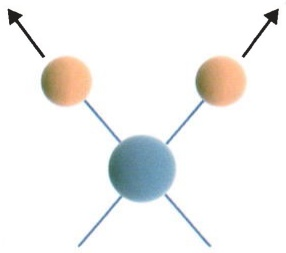

<details>
<summary>natural_image</summary>

Simple diagram with three orange spheres and a central blue sphere connected by lines, no text or symbols present
</details>

对称伸缩振动

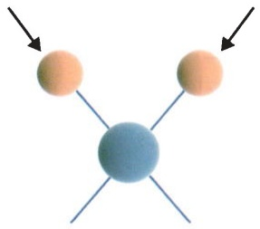

<details>
<summary>natural_image</summary>

Simple diagram showing two orange spheres connected by a central blue sphere with three white lines, each with an arrow pointing outward (no text or symbols)
</details>

反对称伸缩振动

图22-12 多原子分子的振动模式

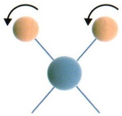

<details>
<summary>natural_image</summary>

Simple diagram showing two orange spheres connected by lines to a central blue sphere, with arrows indicating rotation or flow (no text or symbols)
</details>

面内摇摆

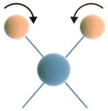

<details>
<summary>natural_image</summary>

Simple diagram showing two spheres connected by lines with directional arrows, no text or symbols present
</details>

面内剪切振动

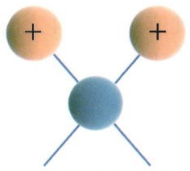

<details>
<summary>chemical</summary>

Simple molecular structure diagram showing two positively charged atoms bonded to a central blue atom with three surrounding lines
</details>

面外摇摆

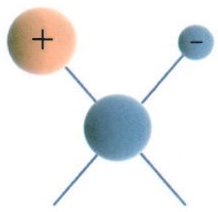

<details>
<summary>chemical</summary>

Simple molecular structure diagram showing a central atom bonded to two positively and negatively charges
</details>

面外扭曲

---

616

22 光散射技术

wagging）和面外扭曲（out-of-plane twisting）振动。对于同一个基团来说，伸缩振动的频率一般高于弯曲振动，而反对称伸缩振动的频率高于对称振动的频率。

一个由 $n$ 个原子组成的非线性分子有 $3n - 6$ 种简正振动，而线性分子为 $3n - 5$ 。因此，水分子具有3种振动模式，而二氧化碳分子具有4种振动模式。对于大多数生物分子和复杂的化学分子，实验观察到的简正振动数量往往小于理论数量。这是由于:①有些简正频率超出了测试范围；②有些简正振动的信号太微弱而很难被观察到；③一些简正振动的频率相近而重合在一起；④有些简正振动不改变分子极化率，因而没有拉曼散射活性。

## （3）拉曼散射的选择定则（selection rule）

如果分子的振动引起分子极化率的改变，则分子具有拉曼活性。对于简单的对称分子（如二氧化碳分子），对称伸缩振动会改变分子极化率而具有拉曼活性，而反对称伸缩振动和弯曲振动不改变分子极化率从而没有拉曼活性。对于不对称分子（如水分子）的各种振动模式都具有拉曼活性。

## 22.4.2 拉曼光谱测定的主要参量和样品要求

拉曼光谱能获得的主要参量包括谱峰位置、强度和退偏振比（depolarization ratio）。由于反斯托克斯散射强度太低，普通的拉曼光谱仪一般只检测斯托克斯散射。

拉曼光谱的峰位反映了振动频率的信息，是入射光和散射光波数的差值。频率的国际标准单位是赫兹（$\mathrm{Hz}$），但由于习惯和方便，在振动光谱中，横坐标一般用波长 $\lambda$ 的倒数 $1 / \lambda$ 即波数（$v'$ 或 $\bar{v}$）来表示，单位一般是 $\mathrm{cm}^{-1}$。拉曼光谱峰位的位置与激发光或散射光的频率无关，只与振动能级有关。拉曼光谱的指认与红外吸收光谱类似，将在24.4节详细阐述。

拉曼光谱是一种散射光谱，因此峰的强度也由散射理论给出的一致[式（22-4）和式（22-14)]，即拉曼峰的强度与入射光波长的四次方成反比，与分子极化率变化的平方成正比，与浓度成正比。拉曼峰强度与浓度之间的线性关系，使得拉曼光谱中不同化学基团的拉曼峰之间可以进行定量比较。

退偏振比是反映基团各向异性程度的一个拉曼参量。如果入射光是平面偏振光，则退偏振比 $\rho$ 由以下公式定义:

$$
\rho = I _ {\mathrm{s} \perp} / I _ {\mathrm{s//}} = 3 \alpha_ {\mathrm{a}} ^ {2} / (4 5 \alpha_ {\mathrm{i}} + 4 \alpha_ {\mathrm{a}} ^ {2}), \tag {22-26}
$$

其中，$\alpha_{\mathrm{i}}$ 和 $\alpha_{\mathrm{a}}$ 分别是分子极化率的各向同性和各向异性部分，$I_{\mathrm{s}\perp}$ 和 $I_{\mathrm{s//}}$ 分别是垂直和平行于入射光方向上偏振的散射光强度。退偏振比的大小取决于分子极化性质的变化和分子键的对称性，其值在 $0\sim 3 / 4$ 之间。对于高度对称的分子（如 $\mathrm{CH_4}$ 和 $\mathrm{SF}_6$），分子极化率各向同性，其对称振动模式的退偏振比为0。退偏振比可以提供有关分子对称性的信息，从而有助于拉曼光谱的指认。

由于非弹性散射光强度很弱，现代拉曼光谱仪一般采用激光作为光源，其波长范围通常涵盖从紫外到近红外的波段。为了避免入射光的影响，拉曼散射一般在垂直于

---

22.4 拉曼光谱

617

入射光的方向上进行测量；而为了尽量消除弹性散射光对信号的干扰，需要分辨能力强大的色散系统。随着激光技术和信号检测技术的不断发展，拉曼光谱仪也越来越多样化，表面增强拉曼散射、共振拉曼散射（知识窗22-3）、相干反斯托克斯拉曼散射、共聚焦显微拉曼散射、单分子拉曼散射等技术都在快速发展。这也使得拉曼散射技术对样品的要求越来越低。拉曼散射检测时需要注意的事项有:

## 知识窗22-3

## 共振光散射技术

大多数光散射研究中，激发光波长一般远离吸收带，也被称为非共振光散射。当激发光波长位于或接近分子的吸收带时，电子吸收电磁波的频率与散射频率相同而发生共振。在吸收带中，分子因特异性产生光吸收而产生很大的电子电荷移动或分子变形，振动引起的分子极化率变换会急剧增大。散射的强度与分子极化率的平方成正比，因而此时会发生强烈的散射现象，这种现象被称为共振光散射（resonance light scattering），包括共振瑞利散射和共振拉曼散射。与非共振时的散射类似，共振光散射的光强度与浓度成正比，对粒子大小很敏感。当带有生色团的小分子化合物结合到生物大分子上时，共振光散射强度会因为分子大小的急剧变化而显著增强，因此共振光散射还被发展为灵敏检测小分子-蛋白质相互作用的手段。

一般情况下，共振光散射的光强度会比非共振光散射高两到三个数量级，而某些条件下，这种增强可达到十几个数量级。因此，共振光散射就提供了一种高灵敏度和高选择性探测生色团振动能级相关信息的手段（图22-13）。由于很多生物分子都含有能发生共振光散射的基团，如血红素、类胡萝卜素、黄素、视紫红质、各种含铜与铁的化合物、叶绿素等，因此共振光散射技术常常被用于含有这些生色团分子的光谱分析和显微成像。除了天然生色团以外，快速发展的人工生色团作为标记物扩大了共振光散射的应用范围。

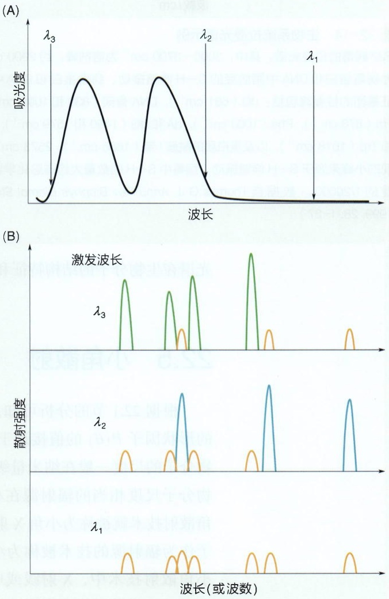

图22-13 共振光散射技术进行选择性共振激发示意图（A）假设某分子含有两个吸收带， $\lambda_{2}$ 和 $\lambda_{3}$ 分别位于两个吸收带中，而 $\lambda_{1}$ 处不存在选择性吸收峰。（B）当激发光波长为 $\lambda_{1}$ 时，所获得的谱图为常规的散射光谱。当激发光波长为 $\lambda_{2}$ 或 $\lambda_{3}$ 时，可以对特定生色团进行选择性共振激发。

---

618

22 光散射技术

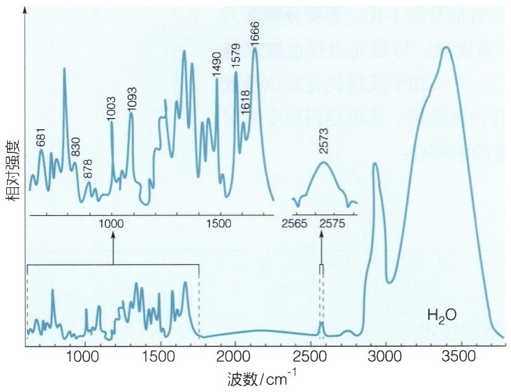

<details>
<summary>spectrogram</summary>

| Wavenumber \((cm^{-1})\) | Relative Intensity |
| --- | --- |
| 681 | ~0.4 |
| 830 | ~0.6 |
| 878 | ~0.3 |
| 1003 | ~0.5 |
| 1093 | ~0.6 |
| 1490 | ~0.7 |
| 1579 | ~0.7 |
| 1618 | ~0.5 |
| 1666 | ~0.8 |
| 2573 | ~0.3 |
</details>

图22-14 生物系统拉曼光谱示例

P22 病毒的拉曼光谱。其中，3000～3700 cm $^{-1}$  为溶剂峰，约 2900 cm $^{-1}$  为病毒蛋白和 DNA 中脂肪烃的 C—H 伸缩振动。病毒蛋白和 DNA 中特征基团的拉曼峰包括:dG（681 cm $^{-1}$ ），DNA 骨架（830 和 1093 cm $^{-1}$ ），Trp（878 cm $^{-1}$ ），Phe（1003 cm $^{-1}$ ），dA 和 dG（1490 和 1579 cm $^{-1}$ ），Tyr 和 Trp（1618 cm $^{-1}$ ），以及蛋白质的酰胺 I 带（1666 cm $^{-1}$ ）。2573 cm $^{-1}$  出现的小峰来源于 S—H 伸缩振动，病毒中 S—H 的数量大约占总化学键数量的 1/20000。（数据自 Thomas G J. Annu Rev Biophys Biomol Struct, 1999, 28: 1–27）

① 拉曼散射的强度与激发波长的四次方成反比，但拉曼光谱峰的分布和相对强度并不依赖于激发光波长，因此可以根据样品情况选择激发波长。选择时，需要样品对激发光的透光率高，避免样品对激发光具有特异性吸收。
② 根据式（22-14）可知，水分子的散射能力很弱，因此拉曼光谱和拉曼成像都适合于生物样品检测。这时选择的激发光波长需要避免对生物样品的结构产生破坏或对实验动植物产生影响。由于不同波长的光穿透能力不一样，因此选择合适波长的激发光可以检测生物样品不同层或不同厚度的信息。此外，选择不同的激发光波长也会影响显微成像的空间分辨率。

拉曼光谱的样品要求较低，检测范围涵盖了各种液体、固体、病毒颗粒、动植物细胞和活体生物，拉曼光谱可以看作是特定生物或化学分子的“指纹”图谱，因此在生物、医药、化学、材料、环境、食品等领域都有着广泛应用。在化学和药学领域，拉曼光谱是指认分子结构的基本技术。在生物学研究中，除了拉曼成像以外，拉曼

光谱在生物分子的结构特征和生物物理性质研究中也是常用的工具（图22-14）。

## 22.5 小角散射

根据22.1节的分析可知，如果采用紫外-可见光作为辐射源，大多数生物分子的形状因子 $P(\theta)$ 的值接近于1，因此无法获得生物分子的形状和结构相关信息。生物分子的尺度一般在纳米量级，若想通过散射技术获得结构信息，需要采用波长与生物分子尺度相当的辐射源在小的角度范围内进行检测。使用X射线作为辐射源的小角散射技术就被称为小角X射线散射（small angel X-ray scattering，SAXS），而使用中子作为辐射源的技术被称为小角中子散射（small angel neutron scattering，SANS）。在小角散射技术中，X射线或中子与物质相互作用的程度通常用散射长度（scattering length）$b$ 或散射长度密度（scattering length density）$\rho$ 来表示。散射振幅与 $b$ 成正比，因此 $b$ 反映了每一种同位素小角散射的基本能力，其量纲为长度单位，大小在 $10^{-12}\mathrm{cm}$ 量级，值可正可负。散射长度密度 $\rho$ 是单位体积物质的散射长度，是体积 $V$ 内所有原子散射贡献的加和，即

$$
\rho = \frac {1}{V} \sum_ {i} b _ {i} \tag {22-27}
$$

---

22.5 小角散射

619

虽然可见光、X射线和中子作为辐射源跟样品有不同的相互作用，但是有着相同的式（22-18）来描述散射强度。在小角散射中，可以对公式（22-18）略作变形以引入 $\rho$ 和 $q$ 的影响:

$$
I (q) = n \Delta \rho^ {2} V ^ {2} P (\theta) S (\theta), \tag {22-28}
$$

其中，n 是体系中粒子的数量密度， $\Delta\rho=\rho_{溶质}-\rho_{溶剂}$ 。

SAXS和SANS两种小角技术虽然都可以反映样品的结构信息，但存在以下两方面的差异（图22-15）:① SAXS被核外电子散射，而一般情况下SANS的散射体是原子核；② SAXS和SANS具有不同的原子序数依赖性。与可见光与核外电子的相互作用类似，X射线被核外电子散射的能力 $\rho$ 与原子序数（原子量）成正比，因此原子序数最小的氢原子以及其同位素氘原子的X射线散射都很小，而生物分子中常见的碳原子、氮原子和氧原子的X射线散射能力并无太大差别。与X射线散射不同的是，中子散射的强度和相位与原子序数并无明显关系。如氢原子中子散射的 $b$ 为 $-3.741\times 10^{-13}\mathrm{cm}$ 而氘原子中子散射的 $b$ 为 $6.671\times 10^{-13}\mathrm{cm}$ 。也就是说，氢原子的中子散射与其它原子存在 $180^{\circ}$ 的相位差，因此为绝对值较小的负值；而氘原子的中子散射为较强的正值。此外，蛋白质、核酸、脂质、糖类等生物分子具有独特的元素组成，这也使得不同类型生物分子的 $\rho$ 也显著不同。因此在中子散射研究中可以利用这些特性，通过调整水溶液中 $\mathrm{H}_2\mathrm{O}$ 和 $\mathrm{D}_2\mathrm{O}$ 的比例来获得不同的衬度，或通过对生物分子中的氢原子进行氘代，以对生物分子复合物中不同的生物分子进行选择性观测（图22-15）。

当溶剂中含有比例为 $a$ 的重水时， $\rho_{\text{溶剂}}$ 可以通过下式进行计算:

$$
\rho_ {\mathrm{溶剂}} = (1 - a) \rho_ {\mathrm {H_2O}} + a \rho_ {\mathrm {D_2O}} \circ \tag {22-29}
$$

如果利用中子散射研究一个蛋白质-核酸复合物，可以调节水溶液中 $\mathrm{H}_2\mathrm{O}$ 和 $\mathrm{D}_2\mathrm{O}$

(A)

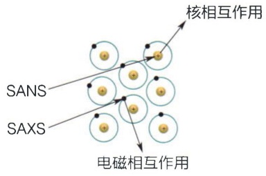

<details>
<summary>flowchart</summary>

```mermaid
graph LR
  A["SANS"] --> B["Electromagnetic Interactions"]
  C["SAXS"] --> D["Nuclear Interactions"]
  E["Nuclear Interactions"] --> F["Nuclear Interactions"]
  G["Nuclear Interactions"] --> H["Nuclear Interactions"]
  I["Nuclear Interactions"] --> J["Nuclear Interactions"]
  K["Nuclear Interactions"] --> L["Nuclear Interactions"]
  M["Nuclear Interactions"] --> N["Nuclear Interactions"]
  O["Nuclear Interactions"] --> P["Nuclear Interactions"]
  Q["Nuclear Interactions"] --> R["Nuclear Interactions"]
  S["Nuclear Interactions"] --> T["Nuclear Interactions"]
  U["Nuclear Interactions"] --> V["Nuclear Interactions"]
  W["Nuclear Interactions"] --> X["Nuclear Interactions"]
  Y["Nuclear Interactions"] --> Z["Nuclear Interactions"]
  AA["Nuclear Interactions"] --> AB["Nuclear Interactions"]
  AC["Nuclear Interactions"] --> AD["Nuclear Interactions"]
  AE["Nuclear Interactions"] --> AF["Nuclear Interactions"]
  AG["Nuclear Interactions"] --> AH["Nuclear Interactions"]
  AI["Nuclear Interactions"] --> AJ["Nuclear Interactions"]
  AK["Nuclear Interactions"] --> AL["Nuclear Interactions"]
  AM["Nuclear Interactions"] --> AN["Nuclear Interactions"]
  AO["Nuclear Interactions"] --> AP["Nuclear Interactions"]
  AQ["Nuclear Interactions"] --> AR["Nuclear Interactions"]
  AS["Nuclear Interactions"] --> AT["Nuclear Interactions"]
  AU["Nuclear Interactions"] --> AV["Nuclear Interactions"]
  AW["Nuclear Interactions"] --> AX["Nuclear Interactions"]
  A --> B
  A --> C
  A --> D
  A --> E
  A --> F
  A --> G
  A --> H
  A --> I
  A --> J
  A --> K
  A --> L
  A --> M
  A --> N
  A --> O
  A --> P
  A --> Q
  A --> R
  A --> S
  A --> T
  A --> U
  A --> V
  A --> W
  A --> X
  A --> Y
  A --> Z
  AA -.-> AB
  AB -.-> AC
  AC -.-> AD
  AD -.-> AE
  AE -.-> AF
  AF -.-> AG
  AG -.-> AH
  AH -.-> AI
  AI -.-> AJ
  AJ -.-> AK
  AK -.-> AL
  AL -.-> AM
  AM -.-> AN
  AN -.-> AO
  AO -.-> AP
  AP -.-> AQ
  AQ -.-> AR
  AR -.-> AS
  AS -.-> AT
  AT -.-> AU
  AU -.-> AV
  AV -.-> AW
  AW -.-> AX
  AX -.-> AZ
  AZ -.-> BA
  BA -.-> BC
  BC -.-> BD
  BD -.-> BE
  BE -.-> BF
  BF -.-> BG
  BG -.-> BH
  BH -.-> BI
  BI -.-> BJ
  BJ -.-> BK
  BK -.-> BL
  BL -.-> BM
  BM -.-> BN
  BN -.-> BO
  BO -.-> BP
  BP -.-> BR
  BR -.-> BU
  BU -.-> BV
  BV -.-> BW
  BW -.-> BX
  BX -.-> BY
  BY -.-> BU
  BU -.-> BV
  BV -.-> BW
  BW -.-> BX
  BX -.-> BYB
  BYB -.-> BUB
  BUB -.-> BVB
  BVB -.-> BWB
  BWB -.-> BXB
  BXB -.-> BUBb
  BUbB b)
  BUbBB["BUbB b"] --> BUbBb b)
  BUbBbB["BUbBb b"] --> BUbBbB
  BUbBbB --> BUbBbB
  BUbBbB --> BUbBbB
  BUbBbB --> BUbBbB
  BUbBbB --> BUbBbB
  BUbBbB --> BUbBbB
  BUbBbB --> BUbBbB
  BUbBbB --> BUbBbB
  BUbBbB --> BUbbBbB["BUbbBb b"]
  BUbbBbB --> BUbbBbB
  BUbbBbB --> BUbbBbB
  BUbbBbB --> BUbbBbB
  BUbbBbB --> BUbbBbB
  BUbbBbB --> BUbbBbB
  BUbbBbB --> BUbbBbB
  BUbbBbB --> BUbbBbB
  BUbbBbB --> BUbbBb c)
  BUbbBbB --> BUbbBbC["BUbbBb c"]
  BUbbBbB --> BUbbBbC
  BUbbBbB --> BUbbBbC
  BUbbBbB --> BUbbBbC
  BUbbBbB --> BUbbBbC
  BUbbBbB --> BUbbBbC
  BUbbBbB --> BUbbBbC
  BUbbBbB --> BUbbBbC
  BUbbBbB --> BUabbBc c)
  BUbbBbB --> BUbbBbC
  BUbbBbB --> BUbbBbC
  BUbbBbB --> BUbbBbC
  BUbbBbB --> BUbbBbC
  BUbbBbB --> BUbbBbC
  BUbbBbB --> BUbbBbC
  BUbbBbB --> BUbbBbC
  BUbbBb b / SUSSSs / SANSs / SAXSs / N/A / N/A / N/A / N/A / N/A / N/A / N/A / N/A / N/A / N/A / N/A / N/A / N/A / N/A / N/A / N/A / N/A / N/A / N/A / N/A / N/A / N/A / N/A / N/A / N/A / N/A / N/A / N/A / N/A / N/A / N/A / N/A / N/A / N/A |
    N/A --- SANSs --- SANSs --- SANSs --- SANSs --- SANSs --- SANSs --- SANSs --- SANSs --- SANSs --- SANSs --- SANSs --- SANSs --- SANSs --- SANSs --- SANSs --- SANSs --- SANSs --- SANSs --- SANSs --- SANSs --- SANSs --- SANSs --- SANSs --- SANSs --- SANSs --- SANS s
```
</details>

(B)

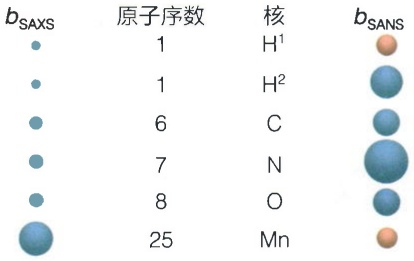

<details>
<summary>text_image</summary>

bSAXS
原子序数
核
H¹
bSANS
1
1
H²
6
C
7
N
8
O
25
Mn
</details>

(C)

| 分子 | $\rho_{x射线}$$/10^{-4} nm^{-2}$ | $\rho_{中子}$$/10^{-4} nm^{-2}$ |
| --- | --- | --- |
| $H_2O$ | 9.3 | -0.55 |
| $D_2O$ | 9.3 | 6.36 |
| 蛋白质 | 12.4 | 3.11 |
| 氘代蛋白质 | 12.4 | 8.54 |
| 核酸 | 16.0 | 4.44 |
| 脂质 | 8.2 | -0.01 |
| 糖类 | 14.1 | 4.27 |

(D)

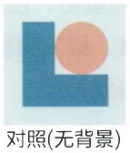

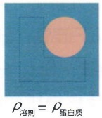

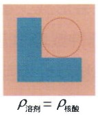

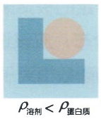

图22-15 SAXS与SANS的区别

(A) SAXS 与 SANS 具有不同的物质相互作用。(B) SAXS 与 SANS 具有不同的原子序数依赖性。圆的大小为散射长度 b 大小的示意图，反映了散射能力；蓝色和红色的圆分别代表值为正或负。(C) 水溶液和生物大分子的散射长度密度  $\rho$ 。(D) SANS 研究中，可以通过调节溶剂中的氢氘比例来进行选择性观测。示意图中显示的是利用 SANS 观察一个蛋白质-DNA 复合物，其中蓝色的 L 形状分子为蛋白质，红色的圆形分子为 DNA。

---

620

22 光散射技术

的比例以获得不同的 $\rho_{\text{溶剂}}$ 。当 $\rho_{\text{溶剂}} = \rho_{\text{蛋白质}}$ 时，扣除背景之后的中子散射只来源于复合物中的核酸组分；同理 $\rho_{\text{溶剂}} = \rho_{\text{核酸}}$ 时，可以选择性观测复合物中的蛋白质组分。

小角散射的散射强度表达公式与22.1节中所介绍的散射理论基本公式完全一致，因此利用小角散射同样可以获得分子量 $M$ 、回转半径 $R_{\mathrm{g}}$ 、第二维里系数 $B$ 等参量。由于小角散射的辐射源波长与常见的生物大分子或复合物的尺度相近，因此还可以根据式（22-28）来获得分子的形状信息。与X射线晶体衍射、核磁共振或冷冻电镜等高分辨率结构生物学技术不同的是，利用SAXS或SANS只能通过对实验获得的 $I(q)$ 曲线进行拟合，以获得低分辨率的分子形状或结构信息（可参见本章扩展阅读中的文献）。在实践中，通常通过小角散射、核磁共振、生物信息学预测以及高分辨率结构生物学等多种技术的联用，以获得生物分子在溶液中更全面的结构信息和结构动力学行为。

## ※ 本章小结

本章重点介绍了各种光散射技术的基本原理、所能获得的主要参量和信息及其在生物学中的应用。从原理上来说，不同光散射技术的物理本质是一致的。不同技术通过适当的模型简化，从不同侧面反映了所测量样品中分子的大小、结构、形状和分子运动等信息。因此，每一种技术都有一定的样品局限性和测试要求，以保证相应数理模型的可用性。如对于静态光散射，若所测样品是超大的生物分子复合物，此时需要考虑分子大小和形状对测量结果的可能影响；对于动态光散射，实践中常常被用于测量生物分子的分子量，但需要注意的是分子量标准曲线是基于所测分子是球蛋白且水化程度相近的假设。需要特别指出的是，近年来拉曼散射和小角散射技术都获得了快速发展。各种增强拉曼技术极大推动了拉曼散射在细胞和生物活体等更复杂生物系统中的应用，而小角散射技术在复杂生物系统的高分辨率结构解析中也发挥着越来越重要的作用。限于篇幅，本章并没有给出太多的应用实例，读者可以在文献中进一步理解光散射技术在生物系统中的应用场景。

## ※ 思考题

1. 从理论上进行分析，散射技术是否能够获得原子分辨率的结构信息？
2. 静态光散射、动态光散射、拉曼散射和小角散射，这些技术中哪些可以获得生物大分子的以下信息:分子量、第二维里系数 $B$ 、回转半径 $R_{\mathrm{g}}$ 、流体力学半径 $R_{\mathrm{h}}$ 、多分散性、是否存在一SH、分子形状？
3. 牛胰核糖核酸酶A含有124个氨基酸残基，分子量约为 $13.7\mathrm{kDa}$，含有四对二硫键，在一定的极端条件下会形成少量的二聚体。如果想要研究样品中牛胰核糖核酸酶A的寡聚态分布，应该选用哪种或哪些散射技术？如果想要研究牛胰核糖核酸酶A与磷酸缓冲液中的磷酸根离子的非特异性相互作用，应该选用哪种或哪些散射技术？如果想获得牛胰核糖核酸酶A在不同温度下的结构转变曲线，应该选用哪种或哪些散射技术？

---

扩展阅读

621

4. 谷胱甘肽（glutathione，GSH）是由谷氨酸、半胱氨酸和甘氨酸结合，含有巯基的三肽，具有还原型（G-SH）和氧化型（G-S-S-G）两种形式。某同学拟采用动态光散射和小角散射研究还原型和氧化型谷胱甘肽的转变过程，是否合适？
5. 某同学拟采用拉曼散射测定红细胞中血红素与氧气和二氧化碳结合的情况，是否合适？

## ※ 扩展阅读

## 图书

Svergun D I, Koch M H J, Timmins P A, et al. Small angle X-ray and neutron scattering from solutions of biological macromolecules[M]. Oxford: Oxford University Press, 2013.

## 综述

Bloomfield V A. Quasi-elastic light scattering applications in biochemistry and biology[J]. Annu Rev Biophys Bioeng, 1981, 10:421–450.

Carey P R. Resonance Raman spectroscopy in biochemistry and biology[J]. Q Rev Biophys, 1978, 11(3):309–370.

Han X X, Rodriguez R S, Haynes C L, et al. Surface-enhanced Raman spectroscopy[J]. Nat Rev Methods Primers, 2021, 1:87.

Jeffries C M, Ilavsky J, Martel A, et al. Small-angle X-ray and neutron scattering[J]. Nat Rev Methods Primers, 2021, 1:70.

Pecora R. Quasi-elastic light scattering from macromolecules[J]. Annu Rev Biophys Bioeng, 1972, 1:257–276.

Petry R, Schmitt M, Popp J. Raman spectroscopy—a prospective tool in the life sciences[J]. Chemphyschem, 2003, 4(1):14–30.

Slotboom D J, Duurkens R H, Olieman K, et al. Static light scattering to characterize membrane proteins in detergent solution[J]. Methods, 2008, 46(2):73–82.

Stetefeld J, Mckenna S A, Patel T R. Dynamic light scattering: a practical guide and applications in biomedical sciences[J]. Biophys Rev, 2016, 8(4):409–427.

Thomas G J Jr. Raman spectroscopy of protein and nucleic acid assemblies[J]. Annu Rev Biophys Biomol Struct, 1999, 28:1–27.

Wen J, Arakawa T, Philo J S. Size-exclusion chromatography with on-line light-scattering, absorbance, and refractive index detectors for studying proteins and their interactions[J]. Anal Biochem, 1996, 240(2):155-166.

Yu N T. Raman spectroscopy: a conformational probe in biochemistry[J]. CRC Crit Rev Biochem, 1977, 4(3):229–280.

---

622

22 光散射技术

## 研究论文

- Jeffries C M, Graewert M A, Blanchet C E, et al. Preparing monodisperse macromolecular samples for successful biological small-angle X-ray and neutron-scattering experiments[J]. Nat Protoc, 2016, 11(11):2122–2153.
- Kendrick B S, Kerwin B A, Chang B S, et al. Online size-exclusion high-performance liquid chromatography light scattering and differential refractometry methods to determine degree of polymer conjugation to proteins and protein-protein or protein-ligand association states[J]. Anal Biochem, 2001, 299(2):136–146.
- Skou S, Gillilan R E, Ando N. Synchrotron-based small-angle X-ray scattering of proteins in solution[J]. Nat Protoc, 2014, 9(7):1727–1739.
