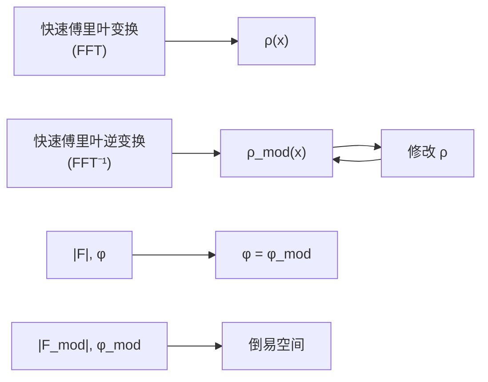
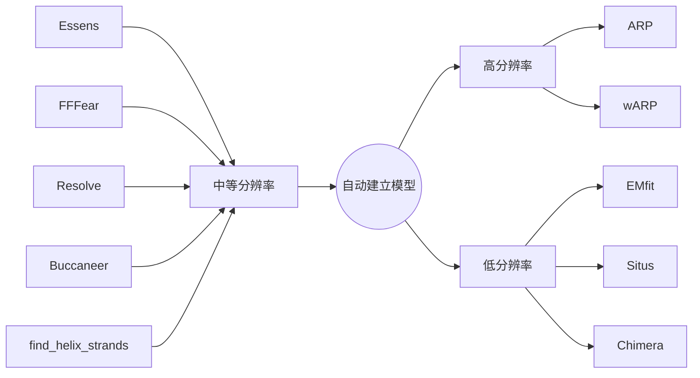

# 23 晶体衍射技术

原始 PDF 第 647–687 页。

## 晶体衍射技术

在本书第4章“晶体学导论”中，我们以历史为线索，回顾了X射线晶体结构测定发展历程中做出关键贡献的科学家及其成果，这有助于读者对X射线晶体衍射及其在蛋白质结构测定中的应用有一个全景式的初步认识。随着技术的成熟，蛋白质晶体结构测定已经趋向于程式化和自动化，尤其是针对衍射能力强的单晶。然而，这并不意味着基础理论知识不再重要。相反，缺乏相关理论知识常导致晶体结构测定实践中的困难甚至错误。本章将以较短的篇幅简要介绍蛋白质晶体学理论及其技术。首先阐述晶体点阵理论、晶体结构对称性和X射线衍射的原理，然后以蛋白质晶体结构测定实验步骤为主线，介绍蛋白质晶体生长、衍射数据采集与处理、相位求解与优化、模型构建与修正以及模型质量评估等关键理论知识。希望通过本章的学习，读者能够熟悉蛋白质晶体结构解析的基本流程，为未来的实际操作打下理论基础。

## 23

---

624

23 晶体衍射技术

## 23.1 晶体的点阵结构和晶胞

晶体是原子、离子或分子在空间中按一定周期重复排列所形成的具有规则外形的固体。与非晶体相比，晶体具有独特宏观特征，例如晶体内部不同部分物理性质相同（均匀性），不同方向上物理性质不同（各向异性），在合适条件下晶体生长过程中能自发形成封闭的凸多面体外形（自限性），同种晶体两个对应晶面的夹角相同（晶面角守恒），晶体外形和内部结构具有对称性，以及能够对X射线产生衍射效应等。这些独特宏观性质本质上是由晶体微观结构的周期性和对称性特征所决定的，例如，晶体内部原子周期性排列形成的纳米尺度光栅能够对X射线产生衍射效应。

## 23.1.1 点阵与结构基元

为更好描述晶体结构的周期性，我们引入点阵（lattice）和结构基元（motif）两个概念。首先定义晶体结构中周期重复性出现的最基本部分为结构基元，它具有相同的化学组成、相同的化学结构、相同的空间取向和相同的周围环境。将结构基元用一个几何点来代替，假设结构基元在空间中无限重复，则无限个阵点形成了点阵，每个阵点都具有相同的周围环境。点阵是晶体结构周期性的抽象，在点阵中的每个阵点上安放结构基元就得到了晶体结构（图23-1）。换言之，晶体结构是点阵和结构基元的组合。按连接任意两个阵点的矢量移动点阵，得到的新点阵和原来点阵完全重复，即点阵和所对应的晶体结构具有平移对称性，它是所有晶体具有的最基本微观结构特征。代找电子书资源，新书可代做扫描制作加微信asxiao90

## 23.1.2 晶胞

利用不同方向的平行直线族，我们可以将三维点阵中所有阵点连接起来形成网格，此网格中的重复单元为一个平行六面体格子（晶格），晶格和其所包含的结构内容称为晶胞（unit cell）（图23-2）。晶胞的大小和形状由从晶格一个顶点出发的3个基本平移矢量 $a$ 、 $b$ 、 $c$ 决定，可以由6个标量参数表示，分别为三个矢量的长度 $a$ 、 $b$ 、 $c$ 以及它们两两之间的夹角 $\alpha$ 、 $\beta$ 、 $\gamma$ （图23-2）。晶胞中每个原子的空间位置可以用分数坐标来表示，即用原子沿 $a$ 、 $b$ 、 $c$ 三个方向投影的分数坐标表示其在晶胞中的

图23-1 晶体结构可表示为点阵和结构基元的组合

图示晶体结构中，结构基元由两个原子组成。将每个结构基元用一个在其固定位置（例如一个原子中心）的黄色几何点代替，该晶体结构则抽象为具有周期性的点阵与结构基元的组合。

text_image

Diagram illustrating a physical process with two parallel paths: one showing particle arrangement and another showing a lattice of points with labeled axes a and b.

---

23.2 对称操作

625

位置（图23-2）。晶胞有规则地沿着 $a$ 、 $b$ 、 $c$ 三个方向堆积形成晶体，晶体结构可以用晶胞表示。因此研究晶体结构要解决两个问题:一是晶胞的大小形状，即晶胞六参数；二是晶胞所含内容物，即晶胞所包含的每个原子的空间位置。在晶体对X射线的衍射过程中，晶胞大小和形状决定衍射线的方向，晶胞内容物决定衍射线的强度和相位。X射线晶体衍射技术直接收集衍射线的方向和强度数据，通过数学方法或实验技术间接获得相位信息，最终计算出晶胞大小形状和内容物，完成晶体结构测定过程。

图 23-2 晶格和晶胞示意图

左图点阵中的晶格由 $a$、$b$、$c$、$\alpha$、$\beta$、$\gamma$ 所定义，晶格及所包含的结构内容组成晶胞。右图为氯化铯晶体中的立方晶胞，晶格为一简单立方体，所含结构内容为一个铯离子和一个氯离子，其在晶胞中的分数坐标分别为（1/2，1/2，1/2）和（0，0，0）。

## 23.2 对称操作

在晶体学范围内，对称是指物体经过旋转（rotation）、反映（reflection）、反演（inversion）、平移（translation）等操作后保持不变的性质。晶体学中的对称操作是旋转、反映、反演或平移，或者是它们的组合，又可以分为点对称操作（被操作物体至少有一点不发生位移的操作）和空间对称操作（被操作物体所有点发生位移的操作）。

## 23.2.1 点对称操作

点对称操作包括旋转、反映、反演、旋转反演和旋转反映，所对应的对称操作元素为旋转轴、反映面、反演中心、旋转反演轴和旋转反映轴。旋转反演轴和旋转反映轴有一一对应的关系，因此晶体学中只选用旋转反演对称和旋转反演轴。

## (1) 旋转轴

物体围绕轴逆时针旋转一个角度（$360^{\circ} / n$）后与自身重合，则具有 $n$ 次旋转对称性，该轴称为 $n$ 次旋转轴（图23-3）。由于点阵平移对称性的制约，晶体学中只存在1、2、3、4和6次旋转对称轴，旋转角度分别为 $360^{\circ}$ 、$180^{\circ}$ 、$120^{\circ}$ 、$90^{\circ}$ 和 $60^{\circ}$ 。1次 $360^{\circ}$ 旋转表示不动，又称为恒等操作，所以任何物体都具有一次旋转对称，仅有一次旋转对称的物体实际上没有任何对称性。旋转轴国际符号为1、2、3、4和6（图23-3）。

## (2) 反映面

物体中存在一个平面，使其分开的两部分互为镜像的关系，则具有反映对称性，该平面称为反映面、每个示意图包括点对称操作国际符号、操作所联系起来的等效点以及等效点的平面投影图。

text_image

1
2
3
4
6
1
2=m
3
4
6

图23-3 晶体学中的点对称操作

---

626

23 晶体衍射技术

text_image

2
2₁
3
3₁
3₂
4
4₁
4₂
4₃
6
6₁
6₂
6₃
6₄
6₅

图23-4 2、3、4、6旋转轴及所对应的11种螺旋轴

镜面或对称面，其国际符号为 m（图 23-3）。

## (3) 反演中心

从物体上任何点向反演中心引直线，总可以在延长线上等距离处遇到另一个等同的点，则具有反演对称性或中心对称性。该点称为反演中心或对称中心，其国际符号为 $\overline{1}$ （图23-3）。

## (4) 旋转反演轴

物体绕一固定轴逆时针旋转 $360^{\circ} / n$ ，再依据轴上一固定点进行反演操作后保持不变，则具有旋转反演对称性，该轴称为旋转反演轴或旋转反轴。与旋转轴类似，晶体学中旋转反演轴只能是1、2、3、4和6次旋转反演轴，国际符号分别为 $\overline{1}$ 、 $\overline{2}$ 、 $\overline{3}$ 、 $\overline{4}$ 和 $\overline{6}$ （图23-3），其中 $\overline{1}$ 与反演中心等效， $\overline{2}$ 与反映面等效， $\overline{3}$ 可表示为3次旋转轴与反演中心的组合， $\overline{6}$ 可表示为3次旋转轴与垂直于该轴的反映面的组合，而 $\overline{4}$ 为一独立的点对称操作。

## 23.2.2 空间对称操作

空间对称操作是指考虑了平移的对称操作。除了单纯平移操作，还包括平移和旋转轴或镜面组合产生的两类新对称操作——

螺旋旋转和滑移反映，对应的对称操作元素分别为螺旋轴和滑移面。

## (1) 螺旋轴

旋转和平移组合形成螺旋旋转，它表示绕轴逆时针旋转  $360^{\circ}/n$ ，并沿着轴的方向平移  $(T/n) \cdot m$ ，T 是该方向的周期，n 为轴次， $m = 1, 2, \cdots, n - 1$ 。螺旋轴的国际符号为  $n_{m}$ ，包括  $2_{1}, 3_{1}, 3_{2}, 4_{1}, 4_{2}, 4_{3}, 6_{1}, 6_{2}, 6_{3}, 6_{4}$  和  $6_{5}$ （图 23-4）。

## (2) 滑移面

反映和平移组成形成滑移反映，它表示经过滑移面先进行反映操作，然后沿着平行于该面的轴向或对角线方向进行平移。

## 23.2.3 对称操作等效点系和矩阵表达形式

空间中一个点 $(x, y, z)$ 经由某个对称操作后，会产生其它一系列空间坐标不同的点，但这些点是经由对称操作联系起来的，称为等效点（equivalent point），这些点共同组成了一套等效点系（equivalent point system）。在晶体结构中，如果有一个原子在 $(x, y, z)$ 坐标点，那么该对称操作联系起来的等效点系中其它点位置也必定存在该原子。例如沿 $b$ 轴方向二次旋转轴2联系的等效点系坐标为 $(x, y, z)$ 和 $(-x, y, -z)$，而沿 $b$ 轴方向的二次螺旋轴 $2_{1}$ 联系的等效点系坐标为 $(x, y, z)$ 和 $(-x, y + 1/2, -z)$。等效点坐标变换也能够以矩阵的形式表示，相比于代数表达形式，矩阵表示更加有利于计算。等效点坐标变换的矩阵操作 $W$ 包含一个 $3 \times 3$ 旋转矩阵 $R$

---

23.3 晶系、点群与空间群

627

和一个平移向量 $T$ ，表示为 $W(R, T)$ 。对一个连接 $(x, y, z)$ 和原点的矢量 $r$ 进行 $W$ 操作得到一个连接等效点与原点的新矢量 $r' = Rr + T$ 。

例如沿 b 轴方向二次旋转轴 2 变化的矩阵操作为:

$$
\boldsymbol {r} ^ {\prime} = \left[ \begin{array}{c c c} - 1 & 0 & 0 \\ 0 & 1 & 0 \\ 0 & 0 & - 1 \end{array} \right] \left[ \begin{array}{c} x \\ y \\ z \end{array} \right] + \left[ \begin{array}{c} 0 \\ 0 \\ 0 \end{array} \right] = \left[ \begin{array}{c} - x \\ y \\ - z \end{array} \right], \tag {23-1}
$$

此时  $R = \begin{bmatrix} -1 & 0 & 0 \\ 0 & 1 & 0 \\ 0 & 0 & -1 \end{bmatrix}, T = \begin{bmatrix} 0 \\ 0 \\ 0 \end{bmatrix}.$  (23-2)

而沿 $b$ 轴方向二次螺旋轴 $2_{1}$ 变化的矩阵操作为:

$$
\boldsymbol {r} ^ {\prime} = \left[ \begin{array}{c c c} - 1 & 0 & 0 \\ 0 & 1 & 0 \\ 0 & 0 & - 1 \end{array} \right] \left[ \begin{array}{c} x \\ y \\ z \end{array} \right] + \left[ \begin{array}{c} 0 \\ \frac {1}{2} \\ 0 \end{array} \right] = \left[ \begin{array}{c} - x \\ y + \frac {1}{2} \\ - z \end{array} \right], \tag {23-3}
$$

此时  $R = \begin{bmatrix} -1 & 0 & 0 \\ 0 & 1 & 0 \\ 0 & 0 & -1 \end{bmatrix}, T = \begin{bmatrix} 0 \\ \frac{1}{2} \\ 0 \end{bmatrix}.$  (23-4)

## 23.3 晶系、点群与空间群

晶系、点群到空间群均为按照对称性对晶体的分类方法，也反映了对晶体对称性从宏观到微观的认识过程。晶系的划分只是考虑晶体宏观上呈现的特征对称性，点群分类则在宏观对称性上考虑所有可能的点对称操作组合。晶系和点群反映的宏观对称性都能在晶体外部多面体上得到体现。平移操作是否出现是晶体宏观对称性和微观对称性的分水岭，将我们对晶体结构的对称性认识带入到微观，晶体结构根据具有的全部对称性细分为230种空间群。

## 23.3.1 晶系与布拉维格子

根据晶体结构所呈现的特征（最小）对称性，可以将所有晶体分为7组，称为7个晶系（表23-1）。例如第2组单斜晶系的特征对称元素为1个2次对称轴（包含旋转轴和螺旋轴）或对称面（包含镜面和滑移面），第4组四方晶系至少需要存在1个4次对称轴，第7组立方晶系的特征对称元素为立方晶胞体对角线方向的4个3次对称轴。一个晶系的特征对称元素对该晶系晶胞形状有了要求，根据晶胞形状的特征，7个晶系分别命名为三斜、单斜、正交、三方、四方、六方和立方晶系。例如，特征4次旋转轴或4次旋转反演轴要求四方晶系晶胞形状必然为四方，即晶胞6参数中 $a = b$ ， $\alpha = \beta = \gamma = 90^{\circ}$ 。

---

628

23 晶体衍射技术

表 23-1 晶系、特征对称元素、布拉维格子、点群及生物大分子晶体中空间群

| 晶系 | 特征对称元素 | 晶胞参数 | 点群 | 布拉维格子类型 | 生物大分子晶体中出现的空间群 |
| --- | --- | --- | --- | --- | --- |
| 三斜晶系 | 无 | a≠b≠c,α≠β≠γ≠90° | 1, 1 | P | P1 |
| 单斜晶系 | 1个2次对称轴或对称面 | a≠b≠c,α=γ=90°,β≠90° | 2, m, 2/m | P, C | P2, P21, C2 |
| 正交晶系 | 3个互相垂直的2次对称轴或两个互相垂直的对称面 | a≠b≠c,α=β=γ=90° | 222, mm2, mmm | P, I, C, F | P222, P2221, P21212, P212121, I222, I212121 C2221, C222, F222 |
| 四方晶系 | 1个4次对称轴 | a=b≠c,α=β=γ=90° | 4, 4, 4/m, 422, 4mm, 42m, 4/m mm | P, I | P4, P41, P42, P43, I4, I41, P422, P4212, P4122, P41212, P4222, P4212, P4322, P43212, I422, I4122, |
| 三方晶系 | 1个3次对称轴 | a=b≠c,α=β=90°,γ=120°;或a=b=c,α=β=γ≠90° | 3, 3, 32, 3m, 3m | P, R | P3, P31, P32, R3, P312, P321, P3112, P3121, P3212, P3221, R32 |
| 六方晶系 | 1个6次对称轴 | a=b≠c,α=β=90°,γ=120° | 6, 6, 6/m, 622, 6mm, 6m2, 6/m mm | P | P6, P61, P65, P62, P64, P63, P622, P6122, P6522, P6222, P6422, P6322 |
| 立方晶系 | 4个立方体对角线方向上的3次对称轴 | a=b=c,α=β=γ=90° | 23, m3, 432, 43m, m3m | P, I, F | P23, P213, I23, I213, F23, P432, P4232, P4332, P4132, I432, I4132, F432, F4132 |

注:点群中黑体标出的为11个劳厄群。

natural_image

Six 3D geometric diagrams showing cube arrangements with blue lines and yellow dots, no text or symbols present

图23-5 初基晶胞及带心晶胞

上图从左至右依次为初基晶胞（P）、单面心晶胞（C）、体心晶胞（I）以及全面心晶胞（F）。下图显示立方全面心晶胞（左）也可简化为黄色连线所示的菱面体初基晶胞（右），但特征对称性由立方对称降低为三方对称。

如果只是为了反映晶体结构的周期性特征，我们可以取体积最小的晶胞，其对应的晶格只在顶角上有阵点，一个晶胞中含有的阵点数目为1（每个顶角的阵点为8个相邻格子共享），称为初基晶胞（图23-5）。理论分析表明，有些晶系的晶胞可以在体心、单面心或全面心处存在阵点，此时晶胞含有的阵点数目大于1，称为非初基晶胞（图23-5）。例如七个晶系中共有14种不同的初基晶胞和非初基晶胞，对应14种不同的空间格子，也称为14种布拉维格子（表23-1）。布拉维格子的表示符号中，P代表初基格子，C代表单面心（即C面带心），I和F代表体心和全面心格子，R代

---

23.3 晶系、点群与空间群

629

表三方晶系中的R心六方格子。选择非初基晶胞是为了体现最高的特征对称性，例如面心立方晶胞的特征对称元素为沿体对角线方向的4个3次对称轴，如果我们取初基晶胞，则是一个菱面体，特征对称降低为只是一个沿菱面体长轴的3次对称轴（图23-5）。

## 23.3.2 点群

晶体的宏观对称性是指晶体在点对称操作（旋转、反演、反映和旋转反演）作用下保持不变的性质，反映晶体外部凸多面体和宏观物理性质的对称。理论证明，前面所述所有晶体学点对称操作通过一共同点的组合，又不产生上述操作以外的其它对称操作，共有32种组合，称为晶体学32种点群，决定了晶体的32种宏观对称类型。32个点群各有自己的特征对称元素，决定了它们所属的晶系（表23-1）。

32个点群国际符号分别由1个、2个或3个点对称元素国际符号组成，并根据晶胞 $a$ 、 $b$ 、 $c$ 3个单位矢量来定义国际符号中3个位置代表的方向。例如第3号点群2属于单斜晶系，表示沿着 $b$ 方向有2次旋转轴；第5号点群 $\frac{2}{\mathrm{m}}$ 同样属于单斜晶系，相比点群2，增加了垂直于2次旋转轴的镜面。第8号正交晶系点群222表示存在沿 $a$ 、 $b$ 、 $c$ 方向的3个交于一点且两两垂直的2次旋转轴。32个点群中有11个点群具有中心对称性质，即它们包含反演中心对称元素，又称为11个劳厄群（表23-1）。在不考虑反常散射情况下，11个劳厄群反映了晶体衍射空间的对称性，此部分内容将在23.5.4节中作进一步说明。

## 23.3.3 空间群

由于晶体尺寸远大于内部排列原子的间距，晶体结构微观上可以被认为无限大，因此晶体结构微观对称性除了包括点对称操作外，还可以包括平移、螺旋旋转和滑移反映3种空间对称的操作。所有点对称和空间对称操作的组合组成230种对称操作群，称为230种空间群。值得注意的是，生物大分子是手性分子，仅存在一种对映异构体，生物大分子晶体的空间群不能包括引起手性分子异构体发生转换的对称操作，包括镜面、对称中心、旋转反演、滑移反映，因此生物大分子晶体中可能出现的空间群数量比较少，总共只有65种（表23-1）。

空间群国际符号中，第一个大写英文字母表示晶胞格子类型，分别为初基P格子、底心C格子、体心I格子、面心F格子或R心六方格子，后面三个符号和点群符号类似，表示晶体中三个方向上的对称性。例如第3号空间群P121（简写形式为P2）表示晶体结构中晶胞为初基格子，沿 $b$ 轴方向存在2次旋转轴，等效点系坐标为 $(x,y,z)$ 和 $(-x,y, - z)$ 。第4号空间群 $\mathrm{P12_11}$ （简写形式为 $\mathrm{P2_1}$ ）的晶体结构也具有初基晶胞，但其沿 $b$ 轴方向为 $2_{1}$ 螺旋轴，等效点系坐标为 $(x,y,z)$ 和 $(-x,$

---

630

23 晶体衍射技术

flowchart

图 23-6 不对称单位、晶胞和晶体结构示意图

不对称单位包含的结构内容为两个原子，晶胞包含由一个2次旋转轴联系起来的两个不对称单位，晶胞在三维空间周期排列形成晶体结构。

$y + 1 / 2, -z)$ 。第5号空间群C121（简写形式为C2）表示晶体结构中沿 $\pmb{b}$ 轴方向为2次旋转轴，但其晶胞带有C面心，其等效点系坐标为 $(x,y,z)$ 、 $(-x,y,$ $-z)$ 、 $(1 / 2 + x,1 / 2 + y,z)$ 、 $(1 / 2 - x,1 / 2 + y, - z)$ 。因此，P2、 $\mathrm{P2}_1$ 和C2代表了3种不同晶体结构的对称性，但这3种晶体具有相同的点群2代表的宏观对称性，均属于单斜晶系。

晶胞是晶体结构周期性排列的基本重复单位，空间群所表示的结构对称性又可以将晶胞分成等效的若干部分，该部分中所含内容物的结构相同，称为不对称单位。从不对称单位出发，利用空间群的全部对称操作，可以准确地充满整个晶胞，晶胞周期性排布进

而显示整个晶体结构（图23-6）。因此，一个晶胞不对称单位包含描述晶体结构所需要的全部信息。例如前述空间群和P2和 $\mathrm{P2}_{1}$ 的晶体结构中，一个不对称单位的体积为晶胞体积的二分之一，而C2空间群晶体结构中，一个不对称单位的体积为晶胞体积的四分之一。对每个空间群所含内容的详细描述，包括标号、所属晶系和点群、对称元素分布、等效点系坐标、不对称单位划分等，均在《国际晶体学表A卷》中列出。

## 23.4 晶体的衍射方向

当入射X射线照射晶体时，在X射线电场作用下受迫振动的电子成为新的辐射波源，向空间各个方向辐射出与入射波同频率的球形散射波（相干散射）。在一个原子系统中，核外所有电子的散射波都可以近似地看作是由原子中心发出。因此，晶体中的原子都可以被看成点波源，原子的周期排列使这些点波源产生的相干散射波之间有固定的位相关系，必然在某些方向上始终互相叠加，在另一些方向上始终互相抵消，从而出现衍射。所以，晶体对X射线的衍射，实质上是大量原子散射波互相干涉的结果。每种晶体对X射线的衍射花样包括两部分内容，第一部分为衍射线的空间分布规律（每条衍射线的方向），第二部分为每条衍射线的强度。衍射线的方向由晶胞的大小、形状以及晶体的方位决定，而衍射线的强度则取决于原子种类以及它们在晶胞中的位置。本节我们将讲述劳厄方程和布拉格方程两个基本方程，以及倒易点阵和反射球两个重要工具，从而帮助理解晶体的衍射方向。

## 23.4.1 劳厄方程

劳厄方程（Laue equation）处理衍射方向的基础是将晶体三维点阵分解为格子基本矢量 $a$ 、 $b$ 、 $c$ 方向的三个一维点阵，不考虑阵点所代表的结构基元内容，将阵点视

---

23.4 晶体的衍射方向

631

为点散射中心。首先考虑一个方向直线点阵上周期排布阵点对 X 射线散射波相干加强的条件，然后将其扩展到三维情况，得到劳厄方程组。

首先考虑和 $a$ 矢量平行的一条直线点阵，其一维周期长度为 $a$ ，入射和衍射X射线与此直线点阵夹角分别为 $\alpha_0$ 和 $\alpha$ ，则通过两个相邻阵点的入射和衍射线光程差 $AN - BM$ 为 $a(\cos \alpha -\cos \alpha_0)$ （图23-7）。只有在光程差为波长整数倍，即满足公式 $a(\cos \alpha -\cos \alpha_0) = H\lambda$ 情况下，两条衍射线才能够同相叠加，其中 $H$ 为衍射指数。显然，与这一直线点阵成 $\alpha$ 衍射角的衍射线，并不只是在一个方向上，以直线点阵为轴线且夹角为 $\alpha$ 的衍射圆锥上任何一条直线都满足方程$a(\cos \alpha -\cos \alpha_0) = H\lambda$ （图23-7）。当 $\alpha_0$ 为 $90^{\circ}$ 时，衍射指数 $H$ 为0的圆锥成为垂直于直线点阵的平面，而

图 23-7 劳厄方程

（A）一维直线点阵列的衍射。（B）入射角为 $90^{\circ}$ 时，沿一维直线点阵列对称分布的衍射圆锥。（C）三个方向直线点阵的衍射圆锥交于 $S$ 方向，该方向代表三维晶体的衍射方向。

衍射指数 $H$ 相反的圆锥则沿直线点阵对称排布。扩展到 $\pmb{b}$ 和 $c$ 方向，我们可得到类似的两个方程:$b(\cos \beta - \cos \beta_0) = K\lambda$ 和 $c(\cos \gamma - \cos \gamma_0) = L\lambda$。因此，空间点阵发生衍射的方向需要同时满足以上三个方程，这三个方程组称为劳厄方程组。其中，$a$、$b$、$c$ 为空间点阵沿三个轴方向的周期长度，$\alpha_0$、$\beta_0$ 和 $\gamma_0$ 为入射线与三个轴的夹角，$\alpha$、$\beta$ 和 $\gamma$ 为衍射线与三个轴的夹角，$H$、$K$、$L$ 为任意整数，$HKL$ 三联体称为衍射线的衍射指数，其代表的三维点阵衍射方向为三个直线方向点阵衍射圆锥的交线方向（图23-7）。如果用 $S_0$ 和 $S$ 来代表入射和衍射方向的基本矢量，劳厄方程组可改写成矢量表达形式:$a \cdot (S - S_0) = H\lambda$；$b \cdot (S - S_0) = K\lambda$；$c \cdot (S - S_0) = L\lambda$。

## 23.4.2 布拉格方程

布拉格方程（Bragg equation）处理衍射方向的基础是在晶体三维点阵中划分出不同取向的点阵平面族，每一个点阵平面族由互相平行、间距相等的无数个点阵平面组成。类似镜面对可见光的反射，假设点阵平面能够对入射X射线产生反射，则同一族中不同点阵平面产生的反射X射线只有在满足布拉格方程的基础上能够相干加强，所以晶体衍射可以看成是点阵平面族对X射线的选择性反射。

为了描述点阵平面族，首先取一个平面在格子 $a$ 、 $b$ 、 $c$ 上的截距，再取它们的倒数，最后化为互质的三个整数，用（hkl）表示，称为点阵平面族的面指数或密勒指数（图23-8）。当入射X射线与点阵面族的夹角为 $\theta$ 时，间距为 $d_{hkl}$ 的相邻两个点阵平面的反射X射线的光程差为 $2d_{hkl}\sin \theta$ （图23-8），只有当光程差为波长的整数倍时，即 $2d_{hkl}\sin \theta = n\lambda$ ，反射X射线相干加强。这就是产生可观测X射线的反射（衍射）条件，该方程称为布拉格方程，其中 $2\theta$ 角称为衍射角， $n$ 称为衍射级数。当波长一定，对应 $n$ 为1、2、3……时，点阵平面族（hkl）对X射线可产生第1级、第

---

632

23 晶体衍射技术

图 23-8 点阵面密勒指数与布拉格方程

上图示意三个点阵平面族及其密勒指数（010）、（110）和（120）。下图示意入射X射线与点阵面族的夹角为 $\theta$ 、间距为 $d_{hkl}$ 的相邻两个点阵平面的反射X射线的光程差为 $2d_{hkl}\sin\theta$ 。

text_image

d_{010}
b
a
010

text_image

d₁₁₀
110
λ
d
2θ
θ

text_image

d_{120}
120

2级、第3级等衍射，对应衍射角为 $\theta 1$ 、 $\theta 2$ 、 $\theta 3\dots\cdots$ 。例如，点阵平面族（110）产生的第1级衍射指数为110，第二级衍射指数为220，第三极衍射指数为330，以此类推。我们也可以将布拉格方程简写成 $2d_{HKL}\sin \theta = \lambda$ ，其中， $d_{HKL} = d_{hkl} / n$ ，HKL为衍射指数，衍射指数 $H$ 、 $K$ 、 $L$ 不需为互质的整数。此简写的含义为将（hkl）面族的高级衍射 $H = nh$ 、 $K = nk$ 、 $L = nl$ （ $n$ 为2、3、4等大于1的整数）看成是一组新面族的1级衍射，此面族与（hkl）面族平行，但其面间距为（hkl）面族面间距的 $1 / n$ 。

## 23.4.3 倒易点阵

我们已了解点阵是反映晶体结构周期性的一个重要概念，晶体结构可以描述为点阵和结构基元的组合。从晶体结构点阵出发，我们可以定义另一种点阵，称为倒易点阵（reciprocal lattice）。倒易点阵简洁系统地表示出晶体正空间点阵中的所有点阵平面族，因而使用倒易点阵解释晶体衍射方向非常简单明了，是理解晶体衍射的重要概念和数学工具。

text_image

a* = \frac{b \times c}{V}
b* = \frac{c \times a}{V}
c* = \frac{a \times b}{V}

图23-9 正空间点阵基本矢量（ $a, b, c$ ）与对应倒易空间点阵基本矢量（ $a', b', c'$ ）

对于以 $a$ 、 $b$ 、 $c$ 为基本矢量定义的正空间点阵，我们定义如下三个矢量 $a^{*} = b \times c / V$ ， $b^{*} = c \times a / V$ ， $c^{*} = a \times b / V$ 其中 $V = a \cdot (b \times c)$ （图23-9）。以 $a^{*}$ 、 $b^{*}$ 、 $c^{*}$ 为基本矢量形成的新点阵即为以 $a$ 、 $b$ 、 $c$ 为基本矢量的正空间点阵的倒易点阵。 $a$ 、 $b$ 、 $c$ 三个基本矢量形成正空间点阵中的格子， $a^{*}$ 、 $b^{*}$ 、 $c^{*}$ 三个倒易基本矢量形成倒易点阵中的格子，这两种格子的体积之间也存在倒易关系，即 $V \cdot V^{*} = 1$ 。正空间点阵中，连接坐标为 $mnp$ （$m$ 、 $n$ 、 $p$ 均为整数）的阵点与正空间原点的矢量为 $ma + nb + pc$ 。倒易点阵中，连接坐标为 $HKL$ （$H$ 、 $K$ 、 $L$ 均为整数）的倒易阵点与倒易点阵原点的倒易矢量为 $H = Ha^{*} + Kb^{*} + Lc^{*}$ 。倒易矢量 $H$ 具有

---

23.5 晶体的衍射强度

633

两个重要特征:一是 $H$ 的方向与正空间中的（HKL）点阵平面族垂直，二是 $H$ 的长度为正空间（HKL）点阵平面族中面间距的倒数。

## 23.4.4 反射球

利用反射球和倒易点阵，我们可以用一幅简明的几何图形来表达布拉格方程。反射球（reflex sphere）为一半径为 $1 / \lambda$ 的球体，晶体位于反射球的球心 $C$ ，$CO$ 为入射X射线方向，$CP$ 为衍射线方向，入射X射线穿出反射球的点 $O$ 为倒易点阵的原点（图23-10）。由简单几何可知，$OP$ 的长度为 $2\sin \theta /\lambda$ ，其方向垂直于反射面。如果要满足布拉格方程，$2\sin \theta /\lambda$ 应该等于 $1 / d$ 。那么此时 $OP$ 恰好满足前面所述倒易矢量的两个重要性质，即其与正空间点阵面族垂直且长度为该面族面间距的倒数。因此，我们也可以说当坐标为（$H, K, L$）的倒易阵点与反射球面相交时，反射球球心与该倒易阵点的连线方向即为衍射指数为 $H, K, L$ 的衍反射球球心为 C 点，半径为  $1/\lambda$ 。CO 为入射 X 射线方向，OP 为倒易矢量  $H = Ha^{*} + Kb^{*} + Lc^{*}$ ，当倒易阵点 P 与反射球相交时， $\triangle COP$  表示的几何关系满足布拉格方程，CP 表示指数为 HKL 的衍射方向。

text_image

S/λ
P
1/λ C S₀/λ O
OP=(S-S₀)/λ=H

图 23-10 倒易点阵与反射球

射方向（图23-10）。注意在反射球中，晶体所在位置 $C$ 点和倒易点阵原点 $O$ 并不重合，它是为了处理衍射方向的需要，不必追求其意义。

当晶体处于静止状态时，位于反射球面上倒易阵点所代表的正空间点阵面族和入射X射线的方位和波长恰好满足布拉格方程，即会发生指数为 $H$ 、 $K$ 、 $L$ 的衍射。而此时位于反射球内和球外的倒易阵点代表的正空间点阵面族则不满足布拉格方程，不会产生衍射。但如果我们绕一个轴转动晶体，以倒易空间原点为球心， $2 / \lambda$ 为半径球体范围内的倒易阵点都有机会通过反射球面，即这些倒易阵点代表的正空间点阵面族都有机会对入射X射线产生衍射（图23-10）。因此转动晶体是收集晶体完整衍射点的一个重要方法，同时对波长为 $\lambda$ 的入射X射线来说，能够和反射球面相交的倒易矢量的长度最长为 $2 / \lambda$ ，也即能够产生衍射的正空间点阵面族的面间距最小为 $\lambda /2$ ，也称为最大分辨率。该结论也可以通过布拉格方程直接推导出来，即 $\sin \theta = \lambda /2d\leqslant 1$ ，也即$d\geqslant \lambda /2$ 。

## 23.5 晶体的衍射强度

上一节我们讨论了入射X射线穿过晶体发生衍射的条件和方向，在劳厄方程、布拉格方程、反射球中，我们看到衍射方向与入射X射线波长、入射X射线和晶体方位关系、晶体点阵格子形状和大小（点阵平面间距）等几何因素相关。本节我们要讨

---

634

23 晶体衍射技术

论的衍射线强度则与晶胞内容，即晶胞中原子种类及其位置相关。电子是散射X射线的最基本单元，因此本节讨论从电子的散射开始，再逐步扩展到原子的散射、晶胞的散射、整个晶体衍射线的强度。

## 23.5.1 一个电子的散射

假设原点 $O$ 点处有一电子，被强度为 $I_0$ 的入射X射线照射发生受迫振动产生散射，$P$ 点离电子距离为 $R$，$P$ 点处的散射X射线强度由汤姆孙公式（Thomson formula）确定为 $I_0\left(\frac{e^2}{mc^2}\right)^2 \frac{1}{R^2} \frac{1 + \cos^2 2\theta}{2}$，其中 $I_0$ 为入射X射线强度，$e$ 为电子电荷，$m$ 为电子质量，$c$ 为光速，$2\theta$ 为散射方向与入射方向的夹角。汤姆孙公式有两个重要结论:①一束非偏振的入射X射线经过电子产生的球形散射波，其散射强度在不同方向上有差异，沿入射X射线方向的散射强度（$2\theta$ 为 $0^\circ$ 或 $180^\circ$）比垂直原入射方向（$2\theta$ 为 $90^\circ$ 或 $270^\circ$）大一倍。汤姆孙公式中反映散射强度与散射角度关系的因子 $\frac{1 + \cos^2 2\theta}{2}$ 称为偏振因子。②当入射X射线照射一个原子时，原子核外所有电子都会发生受迫振动，原子核也会发生受迫振动。但原子核的质量远远大于电子（质子质量是电子质量的1836倍），汤姆孙公式表明散射强度与散射粒子质量平方成反比。因此，原子对X射线的散射主要由电子所产生。

## 23.5.2 一个原子的散射与原子散射因子

前面讨论晶体衍射方向时，我们利用了一个近似，即在一个原子系统中，核外所有电子的散射波都可以近似地看作是由原子中心发出。此时，原子中的 $Z$ 个电子都集中在原子中心，各电子散射波之间没有位相差，原子散射波的振幅是位于原子中心一个电子散射波振幅的 $Z$ 倍，原子散射波强度是一个电子散射波强度的 $Z^2$ 倍。但由于原子尺度和X射线波长在同一数量级，同时实际原子核外电子分处于不同轨道，因此不同电子的散射波之间存在位相差，使实际原子散射波振幅降低，不是一个电子散射波振幅的$Z$ 倍，而是小于 $Z$ 的一个数，称为原子散射因子 $f$ (atomic scattering factor)，其物理意义为一个原子的散射振幅和一个电子的散射振幅的比值。某元素的原子序数 $Z$ 是固定的，但该元素原子的 $f$ 随着 $\sin \theta /\lambda$ 的增大而减小，当 $\theta$ 为 $0^{\circ}$ 时， $f$ 取得最大值 $Z$ 。

在以上的讨论中，我们假设原子核外的电子密度为球形对称，电子在整个原子空间中自由运动，因此电子的散射如同自由电子。但实际情况是，电子受到原子核的束缚，束缚电子的散射能力和自由电子有区别，散射位相也有差别，这种效应称为反常散射。当考虑反常散射效应时，原子散射因子的表达式为 $f = f_0 + f' + \mathrm{i}f''$，$f_0$ 为正常原子散射因子，是一个实数，$f'$ 和 $f''$ 为与波长相关的反常散射因子，使 $f_0$ 在实部和虚部都有一个修正，虚部 $f''$ 和实部 $f_0 + f'$ 的位相差为 $90^\circ$ 。在生物大分子晶体结构测定

---

23.5 晶体的衍射强度

635

中，原子反常散射效应被用来解析衍射线相位，具体内容请参见23.9.1节中的共振和反常散射方法。

## 23.5.3 一个晶胞的散射与结构因子

原子散射因子反映一个原子中所有电子散射波的合成，我们现在讨论一个晶胞中所有原子散射波的合成。晶胞中有 n 个原子，其对入射 X 射线散射波的振幅（原子散射因子）分别为  $f_{1}, f_{2}, \cdots, f_{n}$ ，和通过原点散射波的相位差分别为  $\alpha_{1}, \alpha_{2}, \cdots, \alpha_{n}$ ，则晶胞中 n 个原子互相叠加形成的散射波，用指数形式表达  $F = \sum_{j=1}^{n} f_{j} e^{i\alpha_{j}}$ 。如果晶体结构中第 j 个原子在晶胞中的位置用分数坐标  $(x_{j}, y_{j}, z_{j})$  表示，则原点至该原子的矢量表示为  $r_{j} = x_{j} a + y_{j} b + z_{j} c$ 。该原子的散射波与通过原点散射波的光程差表示为  $\boldsymbol{r}_{j} \cdot (\boldsymbol{S} - \boldsymbol{S}_{0})$ ，则相位差  $\alpha_{j}$  为  $2\pi r_{j} \cdot (\boldsymbol{S} - \boldsymbol{S}_{0}) / \lambda$ 。指数为 H、K、L 的衍射发生时，由劳厄方程可知  $(\boldsymbol{S} - \boldsymbol{S}_{0}) / \lambda$  为倒易矢量  $H = Ha^{*} + Kb^{*} + Lc^{*}$ ，则位相差  $\alpha_{j}$  可用矢量形式表达为  $2\pi H^{T} \cdot r_{j}$ ， $H^{T}$  为倒易空间  $1 \times 3$  行矢量， $r_{j}$  为正空间  $3 \times 1$  列矢量， $2\pi H^{T} \cdot r_{j}$  可简写为  $2\pi H r$  或  $2\pi (Hx_{j} + Ky_{j} + Lz_{j})$ 。此时晶胞中所有原子散射波的叠加和  $F = \sum_{j=1}^{n} f_{j} e^{i\alpha_{j}}$  又可表示为  $F_{H} = \sum_{j=1}^{n} f_{j} e^{i2\pi H r_{j}}$  或者  $F_{H} = \sum_{j=1}^{n} f_{j} e^{i2\pi (Hx_{j} + Ky_{j} + Lz_{j})}$ 。 $F_{H}$  称为衍射 HKL 的结构因子，其模量  $|F_{H}|$  称为结构振幅，其物理意义为一个晶胞中所有原子散射波的振幅与一个电子散射波振幅的比值。

上面讨论结构因子时，晶胞中的原子是分立的，每个原子的散射能力用原子散射因子表示。如果晶胞中原子分布用连续的电子密度函数 $\rho$ 表示，结构因子的表达形式又可改写为 $F_{H} = \int \rho (\boldsymbol {r})\mathrm{e}^{2\pi \mathrm{i}\boldsymbol{H}\boldsymbol{r}}\mathrm{d}\boldsymbol {r}$，该式表示衍射HKL的结构因子是晶胞中电子密度函数的傅里叶变换。根据傅里叶变换的性质，电子密度函数就可以表示为结构因子的逆傅里叶变换，$\rho (\boldsymbol {r}) = \frac{1}{V}\int F_H\mathrm{e}^{-2\pi \mathrm{i}H\boldsymbol {r}}\mathrm{d}\boldsymbol {H}$，或以加和的形式表示为 $\rho (\boldsymbol {r}) = \frac{1}{V}\sum_{H}F_{H}\mathrm{e}^{-2\pi \mathrm{i}H\boldsymbol {r}}$。如果将 $F_{H}$ 表示为 $\left|F_H\right|\mathrm{e}^{\mathrm{i}\alpha}$，则电子密度函数可表示为 $\rho (\boldsymbol {r}) = \frac{1}{V}\sum_{H}\left|F_{H}\right|\mathrm{e}^{\mathrm{i}(-2\pi Hr + a)}$，其中结构因子振幅 $\left|F_H\right|$ 可以从实验测量得到的衍射线强度 $I_{H}$ 经过计算得到，但是结构因子的相位信息不能被测量得到，因此生物大分子结构解析过程中的相位问题需要通过重原子同晶置换、反常散射、分子置换法等方法解决，关于这些方法的详细介绍请见23.9节。

## 23.5.4 衍射空间对称性

我们已详细叙述了晶体结构（正空间）的对称性，即由32个点群所代表的晶体

---

636

23 晶体衍射技术

宏观对称性，以及由230个空间群所代表的包括微观对称元素的晶体结构所有对称性。那么，这些正空间对称性如何决定衍射空间（倒易空间）的对称性？

衍射线强度 $I_{H}$ 可以通过实验方法在衍射角 $2\theta$ 处测量得到，其数值正比于结构因子振幅 $\left|F_H\right|$ 的平方，即 $I_{H} \propto \left|F_{H}\right|^2$ 。在没有反常散射发生的情况下，指标为 $H$ 、$K$ 、$L$ 和 $-H$ 、$-K$ 、$-L$ 的结构因子振幅相同，相位角相反，但指标为 $H$ 、$K$ 、$L$ 和 $-H$ 、$-K$ 、$-L$ 的衍射线强度相等，衍射空间存在中心对称性。

正空间中的对称变换可以用矩阵操作 $W(R, T)$ 表示，其中 $R$ 为 $3 \times 3$ 旋转矩阵，$T$ 为平移向量，对一个矢量 $r$ 的矩阵操作 $W$ 得到一个新的矢量 $r' = Rr + T$。如果此操作作用于结构因子 $F_H$，即

$$
\begin{array}{l} F _ {H} = \sum_ {j = 1} ^ {n} f _ {j} \mathrm{e} ^ {\mathrm{i} 2 \pi H \cdot (W r _ {j})} = \sum_ {j = 1} ^ {n} f _ {j} \mathrm{e} ^ {\mathrm{i} 2 \pi H \cdot (R r _ {j} + T)} = \sum_ {j = 1} ^ {n} f _ {j} \mathrm{e} ^ {\mathrm{i} 2 \pi H \cdot (R r _ {j})} \mathrm{e} ^ {\mathrm{i} 2 \pi H T} \\ = \sum_ {j = 1} ^ {n} f _ {j} \mathrm{e} ^ {\mathrm{i} 2 \pi (\boldsymbol {H R}) \boldsymbol {r} _ {j}} \mathrm{e} ^ {\mathrm{i} 2 \pi \boldsymbol {H T}}, \\ \end{array}
$$

即 $F_{H} = F_{HR}\mathrm{e}^{\mathrm{i}2\pi HT}$，又可改写为 $F_{HR} = F_H\mathrm{e}^{-\mathrm{i}2\pi HT}$。由此可知，$W(R, T)$ 作用于结构因子 $F_{H}$ 得到新的结构因子 $F_{HR}$，振幅相同，而 $\alpha_{HR} = \alpha_H - 2\pi HT$。由以上推导，我们可知:①由对称操作所联系起来的结构因子振幅相同，即对称操作所联系的衍射点强度相同；②如果对称操作中包含平移操作，此平移操作不影响结构因子的振幅，但使对称操作联系的结构因子相位之间存在确定的关系 $\alpha_{HR} = \alpha_H - 2\pi HT$。

由以上讨论，我们可知衍射空间强度的对称性决定于晶体结构的点群对称性，在不考虑反常散射的情况下，衍射空间强度分布还存在着额外的对称中心，因此衍射空间的对称性可以用11个劳厄群表示（32个点群中含有对称中心的点群数目为11个）。例如空间群为P222和 $\mathrm{P2_12_12_1}$ 的晶体结构在正空间对称性不同，但它们在衍射空间具有相同的对称性 $\frac{2}{\mathrm{m}}\frac{2}{\mathrm{m}}\frac{2}{\mathrm{m}}$ ，又可简写为 $\mathrm{mmm}$ 。

如果晶体结构中存在非初基平移操作，衍射空间中的一些衍射点强度将有规律地为零，称之为衍射空间的系统消光。这些非初基平移操作包括带心格子（体心、全面心和单面心）、螺旋轴以及滑移面中存在的非初基平移。下面我们以空间群 $\mathrm{P2}_{1}$ 为例说明系统消光规律，空间群 $\mathrm{P2}_{1}$ 中的等效点为 $(x, y, z)$ 和 $(-x, y + 1/2, -z)$。$(x, y, z)$ 位置上原子散射波的相位角为 $2\pi (Hx + Ky + Lz)$，$(-x, y + 1/2, -z)$ 位置上相同原子散射波的相位角为 $2\pi [-Hx + K(y + 1/2) - Lz]$，两个散射波之间的相位差为 $(4Hx - K + 4Lz)\pi$。考虑到 $x$ 和 $z$ 为原子在晶胞中任意分数坐标，因此只有在 $H = 0$、$L = 0$ 和 $K$ 为奇数时，相位差 $(4Hx - K + 4Lz)\pi$ 确切为 $\pi$，两个散射波将相互抵消，因此空间群 $\mathrm{P2}_{1}$ 晶体衍射空间 0K0 轴上，当 $K$ 为奇数时的 0K0 衍射点强度为零，产生系统消光现象。表 23-2 列出了生物大分子晶体中非初基平移操作引起的衍射消光规律。

---

23.6 晶体生长的基本原理

637

表 23-2 生物大分子晶体衍射点消光规律

| 对称元素 | 衍射点消光规律 |
| --- | --- |
| 沿a、b或c方向21螺旋轴 | H00、0K0或00L:奇数 |
| 沿c方向42和63螺旋轴 | 00L:奇数 |
| 沿c方向31、32、62和64螺旋轴 | 00L:不为3的倍数 |
| 沿a或c方向41和43螺旋轴 | H00或00L:不为4的倍数 |
| 沿c方向61和65螺旋轴 | 00L:不为6的倍数 |
| C单面心晶胞 | H+K:奇数 |
| I体心晶胞 | H+K+L:奇数 |
| F全面心晶胞 | H、K、L:奇偶性不同 |

## 23.6 晶体生长的基本原理

蛋白质晶体生长是通过创造过饱和溶液环境，使蛋白质分子有序排列形成三维周期性晶体的过程。其基本原理基于热力学驱动和动力学控制:当溶液浓度超过溶解度（过饱和）时，系统趋向降低自由能，促使溶质分子析出；而缓慢接近相变边界（如通过蒸汽扩散、透析或温度调节）可控制成核速率与晶体质量。关键因素包括蛋白质纯度（高于 $95\%$ ）、溶液条件（ $\mathrm{pH}$ 、离子强度、沉淀剂）以及界面能（通过添加剂调节），最终实现分子间特异性相互作用（如氢键、疏水作用）主导的周期性堆叠，形成具有X射线衍射能力的单晶。该过程本质是平衡分子间作用力与溶剂化效应，使蛋白质从无序沉淀转向高度有序的晶态。

## 23.6.1 优质晶体的重要性

为了提高信噪比，在利用电磁波探测分子空间排列时，需要将分子周期性地排列，形成三维光栅（见图4-6）。通过这种方式，实际上我们得到了所有分子的平均成像［见式（4-2)]。平均成像的细节和最终分辨率主要取决于两个因素:分子本身的均一性和分子排布的精确性。只有当这两个条件都得到满足时，我们才能观察到分子平均成像的细节，并获得较高的分辨率（图23-11）。

## 23.6.2 提升分子均一性的方法

针对蛋白质分子的均一性，可以采用分子生物学方法进行优化。首先，通过改变编码蛋白质的基因序列，可以调整其结构和表达水平，从而提高均一性。例如，引入点突变、使用优化的启动子和信使RNA序列可以增强蛋白质的稳定性和表达效率。

---

638

23 晶体衍射技术

图23-11 晶体中分子的周期排列（A）和衍射的分辨率（B）

(A)

text_image

结晶
蛋白质质量(均一性, 稳定性)

(B)

chemical

Molecular structure and 3D structural visualization of a compound with labeled bond lengths (0.65 Å, 1.2 Å, 2 Å, 3.6 Å)

其次，利用分子生物学技术去除分子中的柔性片段，并添加适当的折叠辅助剂，有助于正确折叠蛋白质，防止其聚集和非特异性相互作用。这些辅助剂包括小分子化合物、融合伴侣蛋白和融合标签等。最后，蛋白质在形成复合物时通常更加稳定和均一，通过与其它蛋白质或辅助因子相互作用，可以提高目标蛋白质的均一性。这可以通过共表达、共沉淀或交联等方法实现。根据具体的研究需求，选择适合的方法或多种方法的组合可以有效地改善蛋白质分子的均一性（图23-12）。

(A)

natural_image

Abstract 3D rendering of intertwined filament-like structures against a black background (no text or symbols)

(B)

text_image

(B)
蛋白质
配体

(C)

chemical

Molecular structure transformation diagram showing protein conformational changes

图23-12 提高蛋白质分子均一性的策略

（A）柔性区截短:蛋白质分子中柔性较大的区域可能导致构象异质性，通过截除柔性区域可增强分子刚性，提高均一性。（B）配体或抗体稳定:在蛋白质分子中引入小分子配体或结合抗体，可锁定其构象，减少动态波动，从而促进结晶。（C）复合物稳定:通过与互作蛋白或核酸分子形成复合物，可稳定目标蛋白的特定构象，降低构象多样性，提高结晶成功率。这些策略通过减少结构动态性、增强分子刚性或固定特定构象，优化蛋白质的均一性，从而改善晶体生长条件。

## 23.6.3 晶体生长的方法与策略

一旦蛋白质分子自身达到了足够的均一性，接下来的步骤就是将分子按周期排列，以形成晶体，这一过程也称为晶体生长（crystal growth）。晶体生长是指物质从溶液、气相或固相中有序排列形成晶体的过程（图23-13）。晶体生长的基本过程包括成核、晶胞生长和晶体成长。在成核阶段，溶液中的溶质聚集形成微小的晶核。接着，晶核周围的溶质逐渐结晶生长，形成晶胞。最后，晶胞之间的结晶生长将晶体扩大到适当的尺寸。

晶体生长受到多种因素的影响，主要包括温度、$\mathrm{pH}$ 、浓度和溶剂条件。此外，添加剂、离子浓度、搅拌条件以及晶体生长容器的选择等其它因素也会对晶体生长产生影响。因此，结晶空间可以被视为一个高维度的搜索空间，其中各维度可以连续地、大量地被采样。然而，对于每一个蛋白质样品，系统性地探索所有的条件是不切实际的。因此，我们采用了一种类

---

23.6 晶体生长的基本原理

639

似于最优化搜索算法的方法。首先，将整个空间划分为一定数量的粗粒度网格。在这些网格点上，我们寻找可能的结晶条件，一旦在这些网格点上发现晶体，我们就在该条件附近进行进一步的优化。最终，我们可以得到高质量的晶体（图23-14）。生物大分子结晶数据库（BMCD）收录了所有已知的蛋白质结晶条件。对这些条件进行总结和分析，以离散采样结晶空间，可以得到常用的商业化结晶试剂盒。

在蛋白质结晶领域，最常用的两种方法是悬滴法和坐滴法（图23-15），这两种方法都属于蒸汽扩散技术。这两种方法都需要一个含有纯化的蛋白质、缓冲液和沉淀剂的液滴，以及一个含有相似缓冲液和沉淀剂但浓度更高的大体积缓冲液，以达到平衡。在最初阶段，蛋白质溶液的液滴中沉淀剂的浓度不足以诱发结晶，但随着水分从液滴蒸发并转移到大体积缓冲液中，沉淀剂的浓度逐渐增加到适合结晶的水平。由于该体系处于平衡状态，这些最适宜的条件将持续保持直至结晶过程完成。悬滴法和坐滴法的主要区别在于液滴的设置方式。在悬图中展示了蛋白质结晶过程中关键的热力学参数关系。在给定温度下的基本溶解度相图中，随着沉淀剂浓度的增加，溶液中可达到的最大蛋白质浓度会降低，反之亦然。在溶解线和分解线之间形成亚稳态区域，表示溶液处于超饱和状态，这种情况下，溶液最终会经历动力学成核事件，达到平衡状态并分离成含有蛋白质的相（如沉淀物或晶体）和饱和蛋白质溶液。

text_image

稳态
亚稳态
非稳态
仅异质成核
自发均匀成核
自发分解
水分子
沉淀剂
蛋白质浓度
沉淀剂浓度

图23-13 蛋白质结晶相图

滴法中，液滴被悬置在封闭容器的盖子下，而在坐滴法中，液滴被置于容器的底部。无论是哪种方法，都需要精细地控制实验条件，逐步在液滴中增加沉淀剂的浓度，以触发蛋白质的结晶。

text_image

(A)
聚乙二醇浓度
pH
添加剂浓度
随机抽样
足迹筛选
网格筛选
4倍过采样
稀疏筛选

图23-14 搜寻结晶空间的方法

蛋白质结晶条件的筛选过程在数学上可类比于多维参数空间中的最优化问题，其核心目标是寻找使晶体成核与生长达到最佳平衡的极小值点（即最优结晶条件）。具体搜索策略通常分为两个阶段:①粗筛阶段（全局搜索）。采用网格点扫描法（如稀疏矩阵筛选），在广阔的结晶条件空间（包括沉淀剂种类、pH、温度、离子强度等变量）中建立低分辨率采样点。②精修阶段（局部搜索）。在粗筛确定的候选条件附近，通过梯度搜索（如增减沉淀剂浓度、微调 $\mathrm{pH}$ 或添加添加剂）逐步逼近最优条件。（A）蛋白质结晶条件的优化涉及多个变量（如沉淀剂浓度、$\mathrm{pH}$ 、温度、离子强度、添加剂等），这些参数构成一个高维条件空间，而最优结晶条件对应于该空间中的一个或若干“可行域”。（B）数学上多维参数空间中的最优化问题。

text_image

(B)
Xmin
求解
Xmax
目标函数形状
局部最小值
全局最小值

---

640

23 晶体衍射技术

text_image

悬滴法

text_image

坐滴法

text_image

油下微批量法

text_image

微量透析

text_image

自由界面扩散

图23-15 常见结晶技术的示意图

悬滴蒸发扩散是小规模手动设置中常用的方法，而坐滴蒸发扩散则更适用于机器设置。无须额外密封要求和易于微型化使得自动化的油下微批处理筛选更受青睐，尽管收集晶体较为困难。在微批量孔中使用硅油可以部分交换溶剂蒸气（由虚线箭头表示）。微量透析难以微型化，但可用于培养非常大的晶体。微型自由界面扩散筛选芯片越来越受欢迎，但自动化和收集问题仍然有待解决。以上每种方法都以不同的路径穿越结晶相图空间，而相同的化学筛选条件可能会产生差异很大的结果。

## 23.6.4 晶体尺寸对衍射的影响

在晶体学中，晶体的概念可以被描述为原子或分子排列的单胞密度和周期性平移晶格的卷积公式［见式（4-1）]。当晶格是无限大时，周期性的晶格可以简化为狄拉克δ函数。但是，如果晶格的尺寸是有限的，那么可以将其理解为无限晶格与描述晶体形状的三维阶梯函数的数学乘积（图23-16）。根据傅里叶卷积定理（见知识窗4-5），周期性的δ函数应该与描述晶体的三维阶梯函数的傅里叶变换进行卷积运算。以一维情况下沿着b方向为例，假设晶格在b方向上有N个晶胞，晶体阶梯函数 $f(x)$ 可以

$$
f (x) = \left\{ \begin{array}{l l} 1 & ^ {- N b / 2 <   x <   N b / 2} \\ 0 & \text {其它} \end{array} \right. \longleftrightarrow \hat {F} [ f (x) ] = \frac {\sin \pi N S b}{\pi S}
$$

line

| b* | \(sin\pi b*b*Nb/(\pi b*b)\) |
| --- | --- |
| -4 | ~0.1 |
| -3 | ~0.1 |
| -2 | ~0.1 |
| -1 | ~0.1 |
| 0 | ~5.6 |
| 1 | ~0.1 |
| 2 | ~0.1 |
| 3 | ~0.1 |
| 4 | ~0.1 |

图23-16 晶体尺寸对衍射峰展宽的影响

在 $X$ 射线晶体学中，有限尺寸的晶体可以视为理想无限晶体与一个方波函数（矩形函数）的乘积，该方波函数定义了晶体的实际边界。根据卷积理论，这一空间域的乘积对应于倒易空间中的卷积操作，即晶体的结构因子 $F(S)$ 会与方波函数的傅里叶变换发生卷积。假设这个方波函数沿着晶体的 $b$ 方向，大小为 $N$ 个晶胞，那么它的傅里叶变化就是 sinc 函数: $\frac{\sin\pi Sb}{\pi Sb}$ 。不同晶体尺寸的影响是:当 N=1（单个晶胞）

时，$\mathrm{sinc}$ 函数极宽，衍射峰严重展宽（接近连续分布），难以分辨布拉格峰；当 $N = 5$ （5个晶胞）时，$\mathrm{sinc}$ 函数主峰变窄，衍射峰可部分分辨；当 $N \gg 1$ （宏观晶体）时，$\mathrm{sinc}$ 函数趋近于 $\delta$ 函数，衍射峰尖锐，符合理想晶体模型。

---

23.6 晶体生长的基本原理

641

定义为:当 $-Nb / 2 < x < Nb / 2$ 时，$f(x) = 1$；其它情况下，$f(x) = 0$（图23-16）。函数 $f(x)$ 的傅里叶变换为 $\hat{F}[f(x)] = \frac{\sin\pi NSb}{\pi S}$，我们可以通过 $N = 1$ 和 $N = 5$ 的例子来解释。当 $S = 0$ 时，$\hat{F}[f(x)]$ 取得最大值，两侧有数个次级峰。随着晶胞数量 $N$ 的增加，次级峰逐渐靠近最大值。当 $N$ 趋向无穷大时，阶梯函数的傅里叶变换将趋近于狄拉克 $\delta$ 函数，此时所有的衍射强度都集中在布拉格峰上（参见4.6.2节）。然而，如果晶胞数量 $N$ 较小，则阶梯函数会与布拉格峰进行卷积，衍射强度会在阶梯函数的倒易空间方向上展宽。因此，晶体的尺寸会影响衍射的分辨率。通常情况下，较大的晶体会产生更高的分辨率，因为它们具有更强的衍射信号。而较小的晶体可能会导致较弱的衍射信号或更宽的峰，从而降低分辨率。

## 23.6.5 制备重原子衍生物

在蛋白质晶体学中，为了解决相位问题，需要引入适当的重原子。制备重原子衍生物晶体的常用方法包括:①直接法，通过浸渍（soaking）或共结晶（co-crystallization）将重原子引入蛋白质晶体中。所使用的重原子化合物可以是含有重原子（如溴、碘或汞）的小分子配体，也可以是能够与蛋白质特定位点共价结合的化学试剂。②替代法，在蛋白质晶体中替换部分天然原子（通常是硫或碳原子），以添加重原子。替代通常采用高电子密度的化合物（如硒代甲硫氨酸）或人工合成的非天然氨基酸（如稳定异硒酰胺）来实现。③预衍生法，通过在蛋白质晶体形成之前，将蛋白质样品与重原子化合物进行反应，生成带有重原子标记的蛋白质，然后使用这些带有重原子标记的蛋白质进行结晶实验。经常使用的重原子试剂如表23-3所示。

表 23-3 制备重原子衍生物常用的化合物

<table><tr><td>可供选择的重原子种类</td><td>常用试剂</td><td>适用范围</td></tr><tr><td rowspan="2">单一金属离子</td><td> $K_{2}PtCl_{4}$ 、 $KAu(CN)_{2}$ 、 $K_{2}HgI_{4}$ 、 $UO_{2}(C_{2}H_{3}O_{2})_{2}$ 、 $HgCl_{2}$ 、对氯汞苯甲酸磺酸盐(PCMBS)、 $K_{3}UO_{2}F_{5}$ </td><td>可溶性蛋白</td></tr><tr><td> $MeHgOAc$ 、EMTS、PCMB、 $K_{2}PtCl_{4}$ 、 $K_{2}Pt(NO_{2})_{4}$ 、orange Pt、TMLA、 $KAu(CN)_{2}$ 、 $OsCl_{3}$ 、 $Na_{3}IrCl_{6}$ 、 $YbCl_{3}$ 、 $Ta_{6}B_{12}$ </td><td>膜蛋白</td></tr><tr><td>内在金属元素或通过替代具有相似价态的重金属</td><td></td><td>用锶代替钙</td></tr><tr><td>硒代</td><td></td><td>硒代甲硫氨酸</td></tr><tr><td>多金属簇化合物</td><td></td><td> $Ta_{6}Br_{12}$ 、Au11、W12</td></tr><tr><td>惰性气体</td><td></td><td>高压压入氙和氪</td></tr><tr><td>卤化物、三碘化物、固体碘、硒代尿素衍生物</td><td></td><td>NaCl、KCl</td></tr></table>

---

642

23 晶体衍射技术

## 23.7 数据采集

蛋白质晶体X射线衍射数据收集是通过高能X射线与有序排列的蛋白质分子相互作用，获取其三维结构信息的关键实验步骤。该过程首先需要筛选形态完整、尺寸适宜的优质晶体，经冷冻保护处理后，在液氮低温条件下进行衍射实验。使用同步辐射光源或实验室X射线发生器产生高强度X射线束，配合高灵敏度面积探测器记录衍射花样。通过精细调控晶体旋转角度（0.1\~1(°)/帧）、曝光时间（0.1\~1s/帧）和探测器距离（150\~400mm）等参数，系统采集晶体在不同方位的衍射数据。理想的数据集应具备高分辨率（通常1.5\~3.0Å）、高完整性（大于95%）和良好的信噪比 $(I/\sigma(I)>2)$ 。对于特殊需求如相位确定，还需采集多/单波长反常散射（MAD/SAD）数据。整个数据收集过程需平衡辐射损伤与数据质量，必要时采用多晶体数据合并策略以获得完整结构信息。获得的高质量衍射数据将为后续的结构解析和精修奠定基础。

## 23.7.1 晶体的冷冻保护

晶体长时间暴露在X射线下会导致辐射损伤，降低衍射分辨率。为了最小化辐射损伤，常采用样品冷却、在低温下进行数据采集的方法。在冷冻保护过程中，向蛋白质晶体中加入冷冻保护剂溶液，以防止晶态冰的生成，并减少冰晶对晶体结构的破坏。冷冻保护剂可以起到屏障的作用，取代蛋白质周围的水分子，减少形成冰晶。常用的冷冻保护剂有甘油、乙二醇、蔗糖和聚乙二醇（PEG）。这些冷冻保护剂具有降低溶液冰冻点的特性，可以保护晶体不受冰晶的影响。选择冷冻保护剂应考虑蛋白质晶体的大小、性质以及结构分析方法的具体要求（表23-4）。冷冻保护过程通常涉及

表 23-4 探索可能的冷冻保护缓冲剂的选择策略

| 母液的关键成分 | 推荐的冷冻保护剂/方案 |
| --- | --- |
| 所有成分 | 添加15%~25%的甘油(在约三分之二的情况下有效);通过油(例如石蜡、Paratone-N或NVH)拖拽 |
| PEG(分子量小于4000) | 增加聚乙二醇(PEG),添加小分子量的PEG |
| PEG(分子量大于4000) | 添加低分子量的聚乙二醇(注意:高分子量的聚乙二醇具有较差的冷冻保护性能,并且非常黏稠) |
| crystal screens solution I (14) | Garman &amp; Mitchell (J Appl Crystallogr, 1996, 29: 584-587)给出的所需的甘油浓度 |
| crystal screen solutions I and II (14) | McFerrin &amp; Snell (J Appl Crystallogr, 2002, 35: 538-545)给出的所需的PEG400、乙二醇、甘油和1,2-丙二醇浓度 |
| 2-甲基-2,4-戊二醇(MPD) | 增加MPD浓度 |
| 盐(注意:低盐浓度需要比高盐浓度更高的冷冻保护剂浓度) | 添加MPD和/或乙二醇、甘油、混合糖(如15%海藻糖+15%蔗糖);增加浓度/添加盐(例如8mol/L的甲酸钠或丙二酸盐);用有机溶剂替换盐 |
| 当上述方法都无效时 | 测试20%L-(+)-2,3-丁二醇 |

---

23.7 数据采集

643

逐渐增加冷冻保护剂在晶体溶液中的浓度。通常通过逐步添加或将晶体浸泡在逐渐增加浓度的冷冻保护剂溶液中来实现。这种逐渐的过程有助于避免渗透性休克，并减小对晶体晶格的损害。一旦得到足够的冷冻保护，蛋白质晶体会被迅速冷冻，投入液氮或其它低温介质中，通常在 $-150^{\circ}\mathrm{C}$ 以下。快速冷冻的过程会快速凝固溶液，同时保持晶体的结构，防止晶态冰的生成。正确的冷冻保护对于成功进行蛋白质晶体学实验至关重要，可以确保在冷冻、运输和储存过程中保持晶体的结构完整性。

## 23.7.2 晶体的初步检测

将含有晶体的冷冻环安装到衍射仪测角器头或样品支架上（图23-17），以 $90^{\circ}$ 间隔收集两张衍射图像，确认以下内容:①样品是否为单晶？②衍射的最高分辨率是多少？③是否存在冰环？④相邻衍射点是否有重叠？⑤晶体的镶嵌度是否足够小？

## 23.7.3 单色旋转方法

在使用单波长入射光的情况下，对于任何特定的晶体取向，只有少数的倒易晶格点可以处于衍射位置（见图4-18），而其中大部分不会位于厄瓦耳球的表面上。最终的衍射点数量取决于倒易晶格的密度，也就是取决于晶胞的尺寸。具有较小晶胞尺寸且倒易晶格稀疏的小分子晶体可能在某些取向下不会产生任何衍射点。生物大分子晶体的晶胞尺寸远大于所使用的辐射波长，因此在任何晶体取向中都会有多个倒易晶格点（衍射）位于厄瓦耳球的表面上。

当晶体在X射线暴光期间不旋转或仅旋转很小角度，如所谓的“静止”或“准静止”照片，衍射图案将由一组同心椭圆排列的斑点组成，这些椭圆起源于倒易晶格中的一族平行平面。然而，如果晶体旋转，平面的起始和结束取向形成两个相交的椭圆，其中所有的衍射都记录在它们之间的月牙内（图23-18）。同一椭圆内的所有衍射均来自同一倒易晶格层，并代表与一个公共轴平行的实空间晶格平面。由于衍射按照平行平面家族进行排列，探测器上会有一族同心椭圆。如果倒易晶格平面与X射线束垂直或与探测器平面平行，椭圆将更加明显。晶体的生物大分子晶胞尺寸会产生更明显的椭圆，而在小结构的衍射图案中，椭圆则不可辨认。

text_image

探测器
光学对中
测角头
液氮喷头
X射线发生器

图23-17 使用衍射仪评估晶体的品质

text_image

Δφ

图23-18 蛋白质晶体X射线衍射数据收集的旋转法示意图晶体旋转时，来自倒易晶格中相同平面的衍射会形成一个由两个椭圆限定的弯月形，这两个椭圆对应于旋转的起始和结束位置。

---

644

23 晶体衍射技术

## 23.7.4 设置数据收集参数

数据收集是结构分析过程的最后一个实验环节。采集高质量的衍射数据可以减少后续计算的额外负担，因此在收集数据时需要仔细设置一些参数，如回摆角度的大小、旋转起始位置、总的旋转范围、晶体到探测器的距离等。

## (1) 设置回摆角度

在细切片方法（fine-slicing）中，旋转方法的几何形状没有实际限制。对于宽切片，需要考虑一些因素来选择每个单次曝光的旋转范围。原则上，它应该足够小，以避免相邻月牙的重叠（图23-19）。最大允许的旋转范围为

$$
\Delta \varphi = \frac {1 8 0 d}{\pi a} - \eta , \tag {23-5}
$$

其中，因子 $180 / \pi$ 将弧度转换为角度，$\eta$ 是晶体的镶嵌度和束线发散度的综合效应，$d$ 是数据的最高分辨率，$a$ 是沿X射线方向的单胞的长度。

图 23-19 一系列月牙是由倒易晶格中平行平面族产生的

相邻月牙之间的间隙取决于平面之间的距离或者与平面垂直方向的单位晶胞尺寸。如果旋转范围很小（A），月牙很窄，间隙很宽。随着旋转范围的增加（B），月牙变宽，间隙变小。如果进一步增加旋转范围（C），月牙开始重叠，并且两个相邻月牙的衍射轮廓也可能重叠。

## (2) 旋转起始位置

同心椭圆的衍射代表倒易晶格的主方向（图23-20）。数据采集从同心椭圆开始，仅需进行最小旋转角度范围的收集，即可确保所有唯一的衍射点至少被测量一次，从而满足所需的最小完整数据收集条件。

## (3) 整体旋转范围

选择适合晶体对称性的整体旋转范围是影响数据完整性最重要的因素。原则上，收集 $180^{\circ}$ 甚至 $360^{\circ}$ （对于低对称性的反常信号）的数据总能确保最大的完整性。这也将导致等价强度的多次测量，从而获得更准确的数据。然而，一些晶体即使被冷冻，可能也无法抵抗第三代或第四代同步辐射源的强辐射。通过分析晶体对称性与旋转方法的几何关系，可以确定当所有唯一衍射至少测量一次时所需的最小完整数据收集条件，尽快达到高完整性需要遵循最佳策略。

表23-5列出了不同类别晶体在各种典型方向上所需的旋转范围。假设探测器位于中心位置（即 $2\theta$ 角为0），考虑到选择最佳旋转范围的重要性，从测试的第一组衍射照片（23.7.2节）确定晶体的方向和对称性，然后决定从哪里开始以及覆盖多大的

---

23.7 数据采集

645

text_image

(-16 2·9)
(-15 2·9)
(-15 2·10)
-a*
c*

图23-20 旋转的起始方向

旋转范围是非常有利的。大多数常用积分软件提供了策略工具，可以快速有效地进行这样的估计。

表 23-5 不同晶体类型所需的旋转范围 ( $\theta$ )

| 点群 | 母体数据 /(°) | 反常散射数据 /(°) |
| --- | --- | --- |
| 1 | 180 (any) | 180 + 2θmax (any) |
| 2 | 180 (b); 90 (ac) | 180 (b); 180 + 2θmax (ac) |
| 222 | 90 (ab 或 ac 或 bc) | 90 (ab 或 ac 或 bc) |
| 4 | 90 (c 或 ab) | 90 (c); 90 + θmax (ac) |
| 422 | 45 (c); 90 (ab) | 45 (c); 90 (ab) |
| 3 | 60 (c); 90 (ab) | 60 + 2θmax (c); 90 + θmax (ab) |
| 32 | 30 (c); 90 (ab) | 30 + θmax (c); 90 (ab) |
| 6 | 60 (c); 90 (ab) | 60 (c); 90 + θmax (ab) |
| 622 | 30 (c); 90 (ab) | 30 (c); 90 (ab) |
| 23 | 约 60 | 约 70 |
| 432 | 约 35 | 约 45 |

注:主轴方向用括号表示；any代表晶体的任意起始位置；ac、bc分别代表ac、bc平面中的任意矢量。

## （4）晶体与探测器之间的距离

晶体与探测器之间的距离越远，记录的衍射图案中的信噪比就越好，这是因为背景区域随着距离的平方增加而增加，而衍射峰的剖面幅度变化较小。因此，距离应根据衍射的最大分辨率进行调整。建议在 $90^{\circ}$ 角的两个图像上进行检查（23.7.2节），因为某些晶体显示在一个方向上的衍射更远，显示出各向异性。一个关键且困难的决策是判断有意义的强度延伸多远，而初始图像应通过最大对比度进行仔细的目视检查。建议应留有一些安全余量，即将距离设置得比这种检查结果稍微近一些。在某些情况下，还必须考虑其它因素。如果晶胞尺寸非常大，将探测器距离设置为最大衍射分辨率会导致衍射峰显著重叠，那么最好为了完整获取数据而牺牲分辨率，并将距离设置

---

646

23 晶体衍射技术

为衍射峰分离的位置。如果探测器设置允许，可以使用 $2\theta$ 臂或简单的垂直位移将其从中心位置移动，通过这样的偏移，可以收集到更高的衍射角和更高分辨率的数据。然而，可能需要更大的总旋转角度才能获得完整的数据，这仅适用于当重叠是由于长轴与探测器平面重合造成时。如果是由弯月的重叠引起的，则增加距离和探测器偏移将无济于事。

## 23.8 数据处理

数据处理是指从X射线探测器记录的原始图像中提取衍射强度估计值（及其标准误差）的过程。数据处理的起始点是一系列的衍射图像，每个图像由一个二维平面探测器记录，在固定旋转轴上以较小角度旋转晶体（通常每张图像旋转 $0.2^{\circ} \sim 1.0^{\circ}$）。处理的结果是一个数据集，其中包含了图像上记录的所有衍射的密勒指标（$h, k, l$），其强度估计 $I(h, k, l)$ 和标准偏差 $\sigma(I)$。

## 23.8.1 峰搜索

natural_image

Circular pattern of red dots arranged in concentric rings on a light background, with no visible text or symbols.

图23-21 在衍射照片上进行峰搜索

text_image

旋转轴
z
y
x
胶片旋转 = χ-90

图23-22 HKL2000软件中的实验室坐标系

在衍射图像中，斑点的位置是倒易晶格的畸变投影。峰搜索会得到一组 $\{X, Y, i\}$ 三元组，其中 $i$ 表示发现位置为 $\{X, Y\}$ 的峰的图像编号（图23-21）。对于在宽切片模式下采集的数据，衍射发生的角度事先是未知的，但可以通过图像摆动范围的中间值来近似估算。

然后，以厄瓦耳球的球心为原点，建立实验室坐标系（图23-22）。假设晶体到探测器的距离为 $D$ ，在垂直于X射线束的平面探测器上记录位于 $\{X,Y\}$ 位置的衍射点时，其对应的倒易空间坐标为

$$
\left\{ \begin{array}{l} x = \frac {X}{\lambda (X ^ {2} + Y ^ {2} + D ^ {2}) ^ {\frac {1}{2}}} \\ y = \frac {Y}{\lambda (X ^ {2} + Y ^ {2} + D ^ {2}) ^ {\frac {1}{2}}} \\ z = \frac {D}{\lambda (X ^ {2} + Y ^ {2} + D ^ {2}) ^ {\frac {1}{2}}} \end{array} \right. \tag {23-6}
$$

## 23.8.2 自动指标化

指标化是用来确定晶胞参数、可能的劳厄对称性和

---

23.8 数据处理

647

图 23-23 傅里叶自动指标化法

（A）厄瓦耳球示意图。晶体位于厄瓦耳球中心（O）处，X射线入射光束沿x轴方向传播，倒易点阵原点（Q）位于X射线束穿出厄瓦耳球的位置。实验坐标系由正交轴系x、y、z定义，其中晶体旋转轴与z轴平行。 $x_{d}$ 和 $y_{d}$ 定义了探测器坐标系。（B）一维快速傅里叶变换指

标化分析示意图。此方法特别适用于大分子复合物晶体的快速指标化，通过一维分析即可确定主要晶轴参数，为后续三维数据收集提供关键取向信息。（C）Niggli约化晶胞求解方法。通过约化变换将任意原始晶胞转换为标准化的唯一形式。

晶体取向的方法（需要强度信息才能准确找到对称性），通常包括快速傅里叶变换（FFT）和差向量法。差向量法是通过分析计算的倒易点之间的矢量差来推导出倒易晶胞的组合方向矩阵（即包含倒易晶格尺寸和晶体相对于实验室坐标系的取向），目前在广泛使用的程序套件XDS中使用。快速傅里叶变换法直接产生实空间晶胞参数，其基础是倒易晶格是实空间晶格的傅里叶变换，这种直接、可靠的自动指标化使得数据处理变得容易获得，成为许多生物大分子晶体学家首选的程序（图23-23）。自动指标化对探测器几何描述的准确性要求很高。自动指标化将晶格的原点移动到最近的布拉格晶格点。确定了一个晶格之后，必须找到Niggli约化晶胞（Niggli reduced cell）。在图23-23所示的二维示例中，黑色单元对应于约化晶胞，而橙色或蓝色晶胞则由自动指标化得到。代找电子书资源，新书可代做扫描制作加微信asxiao90

## 23.8.3 晶格对称性

自动指标化只能获取 Niggli 约化晶胞，这实际上属于单斜晶系，没有任何对称性。要获取高对称晶胞，需要测试《国际晶体学表》（A 卷）中的 44 个矩阵，以找到可能的最高对称性（图 23-24）。

## 23.8.4 衍射几何参数调整

积分步骤的准确性取决于衍射峰位置的精确度。自动指标化仅提供晶体的大致取向，如果探测器参数的初始值不确定，那么此步骤的结果将不准确。可以采用非线性最小二乘拟合过程来改进预测。通过最小化三个类型函数（图23-25）之和的方程来

---

648

23 晶体衍射技术

text_image

三斜
单斜
正交
四方
三方
六方
立方
P: 简单
C: 底心
I: 体心
F: 面心
a≠b≠c
α≠β≠γ≠90°
a≠b≠c
α=γ=90°
β≠90°
Autoindexing preformed for unit cell between 1.6 to 43 Angstroms
✓ primitive cubic 44.26% 24.26 5.29 7.04 89.90 90.02 90.01
✓ I centred cubic 62.60% 25.26 8.80 24.83 97.33 20.24 102.86
✓ F centred cubic 61.33% 8.80 49.31 8.81 100.27 108.17 87.18
✓ primitive rhombohedral 15.06% 25.26 24.83 24.26 12.30 18.18 20.20
✓ primitive hexagonal 15.29% 7.04 5.29 24.26 90.01 89.98 90.10
✓ primitive tetragonal 6.78% 7.04 5.29 24.26 89.98 89.98 89.90
✓ I centred tetragonal 8.00% 7.04 5.29 49.31 98.18 98.20 89.90
✓ primitive orthorhombic 0.04% 5.29 7.04 24.26 89.88 89.01 90.10
✓ C centred orthorhombic 2.57% 5.29 49.80 7.04 89.99 89.90 96.21
✓ I centred orthorhombic 4.27% 5.29 7.04 49.31 98.20 83.84 90.10
✓ F centred orthorhombic 8.06% 8.80 8.81 49.31 92.83 100.27 73.83
✓ primitive monoclinic 0.01% 5.29 24.26 7.04 89.02 90.10 89.99
✓ C centred monoclinic 2.56% 5.29 49.80 7.04 90.01 96.21
♦ primitive triclinic 0.00% 5.29 7.04 24.26 89.98 89.99 89.90
If you would like to change the crystal lattice: select desired brassi lattice,
press Apply button and close window, otherwise just close window.
Apply    Apply & Close

图 23-24 确定高对称性

在完成衍射花样指标化后，最终需要解决的是晶体对称性问题。基于已获得的约化基矢，可以寻找与其度量性质相符的最高可能布拉维系对称性。根据《国际晶体学表》的44种晶格特征，系统检验各要素的对称性关系，在预设的容差范围内判定晶格所属的布拉维类型。

---

23.8 数据处理

649

优化探测器和晶体参数。

## 23.8.5 衍射点强度的总和与轮廓拟合方法

确定积分强度有两种截然不同的方法:总和积分和轮廓拟合（图23-26）。总和积分只需要将斑点区域内的所有像素值相加，然后减去估计的背景贡献值。轮廓拟合则假设已知实际斑点形状或轮廓（在二维或三维中），并通过寻找比例因子来推导强度，该比例因子将已知（或标准）轮廓应用于观察到的斑点轮廓时给出最佳拟合。在实践中，轮廓拟合需要两个单独的步骤:确定标准轮廓和评估轮廓拟合强度。轮廓拟合可以减小与低强度相关的随机误差，但对于非常高的强度则没有改进。轮廓拟合在估计饱和衍射和处理未完全分辨的衍射斑点方面提供了额外的优势。

## 23.8.6 数据还原

在一组X射线衍射图像上进行衍射点积分，得到一份衍射强度的列表之后，通常会对数据进行一系列操作，这一系列操作被称为“数据还原”。这些过程包括

确定点群和可能的空间群，将所有数据放在一个共同的尺度上，确定是否拒绝收集的数据的某些部分或削减分辨率，并从强度中估计结构振幅 $|F|$ 。数据的内部一致性统计还提供了数据集整体质量的良好指标。数据还原试图纠正由于数据收集期间实验条件的变化对测量强度的影响，例如入射光强度的变化、晶体被照射的体积、主要或次要束的吸收以及平均辐射损伤。一般通过尝试使对称相关或重复测量的衍射强度相等来完成，即尽可能使数据内部自洽一致:

$$
\Psi = \sum_ {h} \sum_ {l} w _ {h l} (I _ {h l} - g _ {h l} \left<   I _ {h} \right> ^ {2} + \text {parameter\_restraint\_terms}, \tag {23-7}
$$

其中， $\langle I_{h}\rangle$ 是 $I_{h}$ 衍射点的l次测量结果的平均。

## 23.8.7 数据品质评估

一旦将所有强度归一化，并获得每个强度的误差估计，我们可以评估数据的内在一致性和信噪比。我们可以根据图像编号（相当于时间或晶体旋转）以及分辨率对数据进行分析，以检测辐射损伤强弱或不一致的数据区域，并确定最高分辨率的截断点。需要注意的是，对称相关的观察可能受到相同系统误差的影响，导致内在一致性

text_image

Refinement Information
Space Group: P4
Resolution: 50.00 - 1.46
Positional: 1098 X-χ2: 0.78 Y-χ2: 0.71 (0)
Partially: 1270 χ2: 1.16 (84)
X Beam: 150.055 Y Beam: 148.844
a: 79.06 b: 79.06 c: 38.06
α: 90.00 β: 90.00 γ: 90.00
Crystal Rotation X: 148.382 8.811 0.004
Crystal Rotation Y: 1.722 -0.882 0.003
Crystal Rotation H: 2.488 0.002 0.008
Detector Rotation X: 0.818 -0.008 0.008
Detector Rotation Y: 0.813 -0.003 0.009
Detector Rotation Z:
Cresfire X: 8.223 0.822 0.834
Cresfire Y: 8.228 -0.882 0.833
Cresfire ZY: -0.895 -0.901 0.849
Distances: 75.139 0.826 0.816
Possitivity:
Y Scale: 8.9998 8.00025 8.8924
Bmm: 0.00033 -0.00033 8.8917
χ²x = Σ(hkl (x预测-x实验)²)/σ²x²
χ²y = Σ(hkl (y预测-y实验)²)/σ²y²
χ²p = Σ(hkl (Pφp₂-P₀)²)/σ²p₀²

图23-25 晶体和探测器参数的优化

violin

| 区域 | 统计方式 |
| --- | --- |
| 背景 | 背景估计 |
| 背景 | 背景 |
| 背景 | 背景估计 |
| 积分强度 | 积分强度 |

图 23-26 衍射点强度的积分

---

650

23 晶体衍射技术

测量往往低估真实误差。传统上，我们通过 $R$ 因子来评估内在一致性。通过冗余度加权的 $R_{\mathrm{meas}}(R_{\mathrm{r.i.m.}})$ 相对于 $R_{\mathrm{merge}}$ 有所改进，因为它对数据的冗余度不敏感，而 $R_{\mathrm{merge}}$ 则随着冗余度的增加而增加，即使平均强度在改善。$R_{\mathrm{p.i.m.}}$ 提供了合并多个观测后的数据质量估计。另一种用于分析内在一致性的替代方法是将观测结果随机分成两部分，然后计算两部分之间的线性相关系数 $CC\frac{1}{2}$。

$$
R _ {\mathrm{merge}} = \sum_ {h} \sum_ {i} \mid I _ {h i} - \langle I _ {h} \rangle \mid / \sum_ {h} \sum_ {i} \langle I _ {h} \rangle ,
$$

$$
R _ {\mathrm{meas}} = R _ {\mathrm{r.i.m.}} = \sum_ {h} \sum_ {i} \left[ \left(\frac {n _ {h}}{n _ {h} - 1}\right) ^ {\frac {1}{2}} | I _ {h i} - \langle I _ {h} \rangle | \right] / \sum_ {h} \sum_ {i} \langle I _ {h} \rangle , \tag {23-8}
$$

$$
R _ {\mathrm{p.i.m.}} = \sum_ {h} \sum_ {i} \left[ \left(\frac {1}{n _ {h} - 1}\right) ^ {\frac {1}{2}} | I _ {h i} - \langle I _ {h} \rangle | \right] / \sum_ {h} \sum_ {i} \langle I _ {h} \rangle_ {\circ}
$$

## 23.8.8 结构因子强度的分布及孪晶检测

## (1) 威尔逊分布

威尔逊分布（Wilson distribution）是一种概率分布，用于描述结构因子的情况。假设我们已知晶胞中的原子类型（即散射因子 $f$），并假设每个原子可位于晶胞中的任意位置，其对结构因子的贡献相位可以取任意值。威尔逊分布在数据调整和确定整体热运动方面非常有用。

① 非中心对称晶体 晶体的结构因子计算公式可表示为

$$
F = \sum_ {j = 1} ^ {N} f _ {j} \mathrm{e} ^ {2 \pi \mathrm{i} h r _ {j}} = \sum_ {j = 1} ^ {N} f _ {j} \cos 2 \pi h r _ {j} + \mathrm{i} \sum_ {j = 1} ^ {N} f _ {j} \sin 2 \pi h r _ {j} = A + \mathrm{i} B _ {\circ} \tag {23-9}
$$

结构因子的实部和虚部分别记为 $A$ 和 $B$ ，它们分别是多个随机变量的求和。根据中心极限定理，$A$ 和 $B$ 各自服从正态分布。为了表征这两个正态分布，我们分别计算 $A$ 和 $B$ 的均值以及方差:

$$
\langle A \rangle = \sum_ {j = 1} ^ {N} \left\langle f _ {j} \cos 2 \pi h r _ {j} \right\rangle = 0, \tag {23-10}
$$

$$
\langle B \rangle = \sum_ {j = 1} ^ {N} \left\langle f _ {j} \sin 2 \pi h r _ {j} \right\rangle = 0, \tag {23-11}
$$

$$
\sum_ {A} = \left\langle A ^ {2} \right\rangle - \left\langle A \right\rangle^ {2} = \sum_ {j = 1} ^ {N} \left\langle (f _ {j} \cos 2 \pi h r _ {j}) ^ {2} \right\rangle = \frac {1}{2} \sum_ {j = 1} ^ {N} f _ {j} ^ {2}, \tag {23-12}
$$

$$
\sum_ {B} = \left\langle B ^ {2} \right\rangle - \left\langle B \right\rangle^ {2} = \sum_ {j = 1} ^ {N} \left\langle \left(f _ {j} \sin 2 \pi h r _ {j}\right) ^ {2} \right\rangle = \frac {1}{2} \sum_ {j = 1} ^ {N} f _ {j} ^ {2} 。 \tag {23-13}
$$

根据均值和方差，我们可以推导出 $A$ 和 $B$ 的概率分布:

$$
P (A) = N _ {A} \exp \left(- A ^ {2} \Big / \sum_ {j = 1} ^ {N} f _ {j} ^ {2}\right),
$$

---

23.8 数据处理

651

$$
P (B) = N _ {B} \exp (- B ^ {2} / \sum_ {j = 1} ^ {N} f _ {j} ^ {2}) 。 \tag {23-14}
$$

假设 $A$ 和 $B$ 是相互独立的，$(A, B)$ 的联合概率可以表示为 $P(A)$ 和 $P(B)$ 的乘积:

$$
P (A, B) = P (A) P (B) = \exp \left(- \frac {A ^ {2} + B ^ {2}}{\sum_ {j = 1} ^ {N} f _ {j} ^ {2}}\right) = \exp (- | F | ^ {2} / \sum_ {j = 1} ^ {N} f _ {j} ^ {2}) 。 \tag {23-15}
$$

强度和结构因子振幅的概率密度函数:

$$
P (\mid F \mid^ {2}) = \exp (- \mid F \mid^ {2} / \sum_ {j = 1} ^ {N} f _ {j} ^ {2}),
$$

$$
P (\left| F \right|) = (2 / \sum_ {j = 1} ^ {N} f _ {j} ^ {2}) \left| F \right| \exp (- \left| F \right| ^ {2} / \sum_ {j = 1} ^ {N} f _ {j} ^ {2}) 。 \tag {23-16}
$$

归一化结构因子定义为 $E = \frac{F}{\sqrt{\sum_{j=1}^{N}f_j^2}}$ ，则概率简化为

$$
P (E ^ {2}) = \exp (- E ^ {2}),
$$

$$
P (E) = 2 E \exp (- E ^ {2}) 。
$$

② 中心对称晶体 同样的方法可以推导出中心对称晶体的归一化结构因子的概率密度函数如下:

$$
P (E) = \sqrt {\frac {2}{\pi}} \exp \left(- \frac {E ^ {2}}{2}\right) 。 \tag {23-17}
$$

根据非中心对称密度函数和中心对称密度函数，我们可以计算得到一个统计量（表23-6），用于区分非中心和中心对称晶体。

表 23-6 非中心对称和中心对称晶体中归一化结构因子的统计量

| 统计量 | 非中心对称 | 中心对称 |
| --- | --- | --- |
| $\langle E \rangle$ | $\sqrt{\pi}/2 \approx 0.886$ | $\sqrt{2/\pi} \approx 0.798$ |
| $\langle E^{2} \rangle$ | 1 | 1 |
| $\langle \|E^{2}-1\| \rangle$ | $2/e \approx 0.736$ | $\sqrt{8/e\pi} \approx 0.968$ |
| 威尔逊比率 $M = \frac{\langle E \rangle^{2}}{\langle E^{2} \rangle}$ | $\pi/4 \approx 0.785$ | $2/\pi \approx 0.637$ |

## (2) 李晶现象

在晶体学领域，孪晶并不罕见，尽管长期以来一直被认为是确定结构时最严重的潜在障碍之一。随着面探测器的使用，孪晶的检测和孪生晶体衍射照片的处理得到了极大的改进。计算机软件的发展也使以前难以处理的孪晶问题现在可以获得与非孪晶样品相当的结果。因此，从孪晶晶体中确定结构变得越来越常见。

① 定义 当晶体结构的空间群所隐含的对称性低于晶胞（或超晶胞）的实际对称性时，就可能会出现孪晶现象。用堆砌砖块来类比:砖块的整体形状或轮廓是

---

652

23 晶体衍射技术

(A)

(B)

text_image

正面
正面
正面
正面
正面
正面
正面
正面
正面
正面
正面
正面
正面
正面
正面
正面
正面
正面
正面
正面
正面
正面
正面
正面
正面
正面
正面
正面
正面
正面
正面
正面
正面
正面
正面
正面
正面
正面
正面
正面
正面
正面
正面
正面
正面
正面
正面
正面
正面
正面
正面

(C)

text_image

正面
里卫
正面
里卫
正面
里卫
正面
里卫

图23-27 一个关于孪晶的简单模型

（A）一块砖；砖的顶部有一个凹陷处，凹陷处的两侧刻有“正面”字样。（B）一堆砖，所有的砖都通过平移与彼此相关。这类似于构成单个晶体的晶胞之间的关系。（C）这里有些砖被倒置放置。砖仍然可以拼接在一起，因为当我们将砖翻转时，使用了砖的轮廓或整体形状的对称元素。这类似于孪晶中晶胞之间的关系。在（B）和（C）中，这些图形旨在表示整个晶体。

mmm，但如果我们考虑一侧的“凹陷”以及上面刻有“正面”的字样，点群对称性仅为2（这堆砖的“空间群”将是P2）（图23-27A）。堆砌砖块一般的方式是所有砖块的放置方向相同，如图23-27B所示，注意到砖块是通过与页面垂直的二重轴或简单平移相互关联的，这两种操作都是空间群的元素。然而，也可以将一些砖块倒置放置（图23-27C）。砖块的整体形状以及边缘之间的 $90^{\circ}$ 角度，使这种方式成为可能，而不会影响砖块的堆叠。在将某些砖块倒置时，我们使用了 $\mathrm{mmm}$ 点群而不是 $2 / \mathrm{m}$ 点群的对称操作中的二重轴。图23-27B类似于单晶体，图23-27C就类似于孪晶了。在图23-27C中，存在两个区域变体:同一区域内的砖块（对应于晶胞）通过平移相互关联；不同区域的砖块通过平移加上在砖块的轮廓或整体形状

的点对称性中发生的旋转相互关联。这个额外的对称操作在晶体学中对应于孪生定律。在替代方向上的砖块比例对应于孪晶缩放因子，在这个例子中为0.5。

每个孪晶区域都会产生自己的衍射图案；在衍射仪上测量到的是所有这些图案的叠加，其强度根据区域因子进行加权。来自不同区域的衍射图案的相对方向与区域的相对方向相同，因此如果它们通过绕 $a$ 轴旋转 $180^{\circ}$ 相互关联，那么它们的衍射图案也是如此。图23-28展示了 $\beta = 90^{\circ}$ 的单斜晶体结构的孪晶情况。孪晶在晶体学中是一个问题，因为它导致了非对称关系的衍射之间的叠加或重叠。在对孪晶晶体进行结

(A)

text_image

(A)
l₁
h
l

(B)

text_image

(B)

(C)

text_image

J₁
J₂
α = 0.5

(D)

text_image

J₁
J₂
α= 0.2

图23-28 垂直于 $a$ 轴的二重旋转对P21/c空间群的单斜晶体（ $\beta = 90^{\circ}$ ）的衍射图案产生孪晶效应

这里只展示了h0l区域显示出的特殊现象。（A）来自单一晶体的h0l区域的衍射图案，可能代表了孪晶的一种情形。（B）与（A）相似，但经过绕 $a^{*}$ 轴（或 $h$ 轴）的旋转，这与单胞的 $a$ 轴对齐，呈现出孪晶的另一个区域的衍射图案。（C）将（A）和（B）叠加在一起，模拟了具有区域比例因子为0.5的孪晶，即两个区域以相等的比例存在。（D）模拟了具有区域比例因子为0.2的孪晶，其中晶体由 $80\%$ 的一个区域A和 $20\%$ 的另一个区域B组成。每个图案的 $\mid E^2 -1\mid$ 值分别为:（A）和（B）为1.015，（C）为0.674，（D）为0.743。对于中心晶体结构，理想（非孪晶） $\mid E^2 -1\mid$ 值为0.97，这表示衍射图案具有强衍射和弱衍射的存在；而在非中心分布中，强度更均匀分布，理想值为0.74。

---

23.8 数据处理

653

构分析时，准确地确定哪些衍射对特定强度测量有贡献非常重要，这就是孪晶规则的作用。

孪晶晶体测量得到的强度是根据两个孪晶区域的体积比例进行合并的:

$$
J _ {1} = \alpha I _ {1} + (1 - \alpha) I _ {2}, \tag {23-18}
$$

$$
J _ {2} = (1 - \alpha) I _ {1} + \alpha I _ {2} 。 \tag {23-19}
$$

其中， $I_{1}$ 和 $I_{2}$ 代表与孪晶操作相关联的一对衍射点的测量强度； $J_{1}$ 和 $J_{2}$ 表示这些衍射点的真实强度，即来自非孪晶晶体的衍射； $\alpha$ 是孪晶比例，即较小孪晶成分的体积分数。

② 孪晶的识别 在小分子和生物大分子晶体学领域，已经提出并实践了多种基于强度分布的测试方法，包括 $N(Z)$ 测试、$H$ 测试、$L$ 测试等（表23-7）。

表 23-7 关于非孪晶和孪晶晶体的各种统计公式

<table><tr><td>强度分布</td><td colspan="4">统计公式</td></tr><tr><td>累加强度分布</td><td></td><td></td><td></td><td></td></tr><tr><td>非中心对称衍射</td><td></td><td></td><td></td><td></td></tr><tr><td>非孪晶</td><td colspan="4"> $_1N(z) = 1 - \exp(-z)$ </td></tr><tr><td>50% 李晶</td><td colspan="4"> $_1N(z, 0.5) = 1-(1+2z) \exp(-z)$ </td></tr><tr><td>α 李晶</td><td colspan="4"> $_1N(z, \alpha) = \{ \alpha [ \exp(-z/\alpha)-1 ] - (1-\alpha) \exp[-z/(1-\alpha)] - 1 \} / (1-2\alpha)$ </td></tr><tr><td>中心对称衍射</td><td></td><td></td><td></td><td></td></tr><tr><td>非孪晶</td><td colspan="4"> $_{-1}N(z) = erf\left( \frac{z}{2} \right)^{\frac{1}{2}}$ </td></tr><tr><td>50% 李晶</td><td colspan="4"> $_{-1}N(z, 0.5) = 1 - \exp(-z)$ </td></tr><tr><td>累加 S(H) 分布</td><td></td><td></td><td></td><td></td></tr><tr><td>非中心对称衍射</td><td colspan="4"> $S(H) = H/(1-2\alpha)$ </td></tr><tr><td>中心对称衍射</td><td colspan="4"> $S(H) = \arccos \frac{H}{(2\alpha-1)/\pi}$ </td></tr><tr><td>I 和 H 的分布矩</td><td> $\langle I^2 \rangle / \langle I \rangle^2$ </td><td> $\langle F \rangle^2 / \langle I \rangle$ (威尔逊比率)</td><td> $\langle H \rangle$ </td><td> $\langle H^2 \rangle$ </td></tr><tr><td>非中心对称衍射</td><td></td><td></td><td> $\frac{1}{2} - \alpha$ </td><td> $\frac{(1-2\alpha)^2}{3}$ </td></tr><tr><td>非孪晶</td><td>2.0</td><td>0.785 (=π/4)</td><td>0.5</td><td>0.333</td></tr><tr><td>50% 李晶</td><td>1.5</td><td>0.885</td><td>0.0</td><td>0.0</td></tr><tr><td>中心对称衍射</td><td></td><td></td><td> $\frac{2(1-2\alpha)}{\pi}$ </td><td> $\frac{(1-2\alpha)^2}{3}$ </td></tr><tr><td>非孪晶</td><td>3.0</td><td>0.637 (=2/π)</td><td>0.637</td><td>0.5</td></tr><tr><td>50% 李晶</td><td>2.0</td><td>0.785</td><td>0.0</td><td>0.0</td></tr></table>

---

654

23 晶体衍射技术

续表

| L的分布矩和N($\|L\|$)的累加分布 | $\langle \|L\| \rangle$ | $\langle L^2 \rangle$ | N(L) | N($\|L\|$) |
| --- | --- | --- | --- | --- |
| 非中心对称 |  |  |  |  |
| 非孪晶 | 1/2 | 1/3 | $(L+1)/2$ | $\|L\|$ |
| 孪晶 | 3/8 | 1/5 | $\frac{(L+1)^2(2-L)}{4}$ | $\frac{\|L\|(3-L^2)}{2}$ |
| 中心对称非孪晶 | 2/π | 1/2 | $\frac{\arccos(-L)}{\pi}$ | $\frac{2}{\pi} \arcsin L$ |

## 23.9 解决蛋白质晶体学中相位问题的方法

在蛋白质晶体学中，相位问题（phase problem）是结构解析的核心挑战。由于X射线衍射实验仅能记录衍射点的振幅（强度开方），而丢失了相位信息（即结构因子的复数角度），因此需要借助特定方法恢复相位，才能通过傅里叶逆变换计算电子密度图。以下是主要求解策略的分类与原理。

## 23.9.1 实验相位解决方法

## (1) 同晶置换法

最早用于解决蛋白质晶体衍射相位的方法是多对同晶置换法（multiple isomorphous replacement，MIR）。佩鲁茨及其合作者证明了向血红蛋白晶体中引入的汞原子可以用于确定相位，这称为单对同晶置换法（single isomorphous replacement，SIR）。在单对同晶置换法中，来自单个重原子衍生物的相位信息是不确定的，通常每个衍射点提供两种选择。然而，通过引入第二个特异衍生物可以解决这种不确定

性，正如贝弗特（Johannes Bijvoet）对马钱子碱的分析所提出的，并由哈克（David Harker）进行了代数和图形化的详细说明。哈克的相位图解释了来自单一同晶衍生物的不确定性（图23-29），以及如何通过引入第二个衍生物来解决这个问题（图23-30）。布洛（David Blow）和罗斯曼（Michael Rossmann）提出，来自单个重原子衍生物的反常散射信号也可用于解决相位的不确定性。他们首次提到了具有反常散射的多对同晶置换法（multiple isomorphous replacement with anomalous scattering，MIRAS）用于还原血红蛋白的结构，并首次使用了具有反常散射的单对同晶置换（single

text_image

单对同晶置换
FPH = Fp + FH
α
FPH
Fp
FH
α1
|FP|
-FH
α2
|FPH|

图23-29 展示单对同晶置换法原理的哈克图通过引入第二个重原子 $F_{\mathrm{PH2}}$ ，相位问题得以解决。

---

23.9 解决蛋白质晶体学中相位问题的方法

655

isomorphous replacement with anomalous scattering, SIRAS）用于红铁蛋白的结构解析。

理论上，单个衍生物的同晶置换差异为

$$
\left| F _ {\mathrm{PH}} \right| ^ {2} - \left| F _ {\mathrm{P}} \right| ^ {2} = \left| F _ {\mathrm{H}} \right| ^ {2} + 2 \left| F _ {\mathrm{P}} \right| \left| F _ {\mathrm{H}} \right| \cos \left(\varphi_ {\mathrm{P}} - \varphi_ {\mathrm{H}}\right) 。
$$

$(|F_{\mathrm{PH}}| - |F_{\mathrm{P}}|)^2$ 的帕特森图近似等于 $|F_{\mathrm{H}}|^2$ 的帕特森图，利用它就可以解析出重原子的位置。但单个重原子衍生物的相位信息是不确定的。

尽管在解析 $6\AA$ 肌红蛋白结构时，衍射点数量较少，但通过哈克图解法对每一个衍射点进行手动求解，取得了很好的成功，其中使用了五个重原子衍生物。然而，这种方法费力且充满困难。1959年，布洛和克里克提出了不闭合误差（图23-31）和“最佳傅里叶”作为概率加权的方法，使得相位求解可以程序化，加快了相位求解和结构解析的速度。布洛-克里克的不闭合误差被定义为

$$
\varepsilon (\varphi) = \left| F _ {\mathrm{PH}} \right| - \left| F _ {\mathrm{P}} (\varphi) + F _ {\mathrm{H}} \right|,
$$

相位概率分布呈现为

$$
P (\varphi) = N \exp \left[ - \frac {\varepsilon^ {2} (\varphi)}{2 E ^ {2}} \right],
$$

这里， $E^2 = \langle \varepsilon^2 (\varphi_{\mathrm{c}})\rangle$ 表示的是不闭合误差的方差。

## （2）共振和反常散射方法

反常散射是由X射线能量与基态核心轨道和未占据外层轨道之间的跃迁能量之间的共振引起的，这是一种量子现象。在吸收边附近，由于反常散射的存在，散射因子会发生修正，表达式如下:

$$
f = f ^ {0} (S) + f ^ {\prime} (\lambda) + \mathrm{i} f ^ {\prime \prime} (\lambda) 。 \tag {23-21}
$$

其中， $f'$  和  $f''$  分别代表了反常散射因子的实部和虚部修正量。

由于核心电子轨道靠近原子核附近，而外层电子相对扩散，所以正常的散射 $f^{0}(S)$ 会随着衍射矢量幅度的增加而平滑地减小。正常的散射 $f^{0}(S)$ 取决于散射角度，而不直接取决于波长。相比之下， $f'$ 在散射角度上几乎没有变化，但在靠近吸收边共振时，它对波长非常敏感。

通过光电吸收而被排出的电子与吸收成比例，并且在此过程中会发射出荧光光子（见图4-22）。这为测量 $f''$ 谱提供了一种方法。反过来，可以通过Kramers-Kronig

text_image

多对同晶置换
|F_{PH2}|
|F_P|
-F_H2
-F_H
|F_{PH}|
α_1
α_2

图23-30 展示多对同晶置换法原理的哈克图

图23-31 在单对同晶置换法实验中单个衍射的相位概率

$F_{重心}$  代表了分布的重心。
m=0.23 意味着  $76^{\circ}$  的相位误差，因为  $\cos76^{\circ}=0.23$ 。

---

656

23 晶体衍射技术

line

| X射线的能量 (keV) | f'' (e) | f' (e) |
| --- | --- | --- |
| ~12.63 | ~8 | ~-12 |
| ~12.64 | ~5 | ~-8 |
| ~12.9 | ~5 | ~-3 |

图23-32 $f^{\prime}$ 和 $f''$ 随波长的变化

变换从 $f''$ 值确定 $f'$ 谱（图 23-32）。

多波长反常散射（multi-wavelength anomalous dispersion, MAD）是利用蛋白质中的重元素（如硒、汞等）在吸收边附近产生的反常散射效应来解决结构相位问题的方法。MAD 方法的基本原理如下:

① 选择多个波长 在实验中选择多个不同波长的X射线，通常涵盖蛋白质中重元素的吸收边附近。
② 收集散射数据 在每个波长下，收集蛋白质晶体的X射线衍射数据。
③ 解析蛋白质结构 通过比较不同波长下的衍射数据，计算出蛋白质结构因子的差异部分，从而得到重元素的位置和分布信息。
④ 相位计算 使用差异部分的数据，结合重元素的位置信息，计算蛋白质结构的相位（图 23-33）。

MAD 方法克服了传统同晶置换法中相位问题的困难，

利用不同波长下的衍射数据确定蛋白质结构的相位信息。该方法广泛应用于生物大分子的结构研究。为了充分利用MAD技术，通常需要合适的蛋白质晶体和实验条件，并借助专业软件和技术进行数据处理和结构计算。

单波长反常散射（single-wavelength anomalous dispersion，SAD）是一种利用单一波长的X射线衍射数据，通过反常散射效应解析蛋白质晶体结构相位的方法。

text_image

ΔF⁺
F⁺
+F″ₐ
Fₐ
+F″ₐ'
-F″ₐ'
F⁻ₜ
φₐ
Fₙ
φₜ

图23-33 单波长反常散射相位求解的哈克图

## 23.9.2 分子置换法

分子置换法（molecular replacement method）是一种解析蛋白质结构的计算方法，它利用已知的分子结构模型来解决相关分子的未知晶体结构（见图4-23）。分子置换法通过提供新结构的相位的初始估计来解决晶体学相位问题，这些相位是从先前已知结构中获得的，而不是利用实验方法（如同晶置换法或者反常散射法）解决。随着已知结构数据库（PDB）的扩大，分子置换法的使用自然变得更加普遍。特别是蛋白质结构预测方法的突破，AlphaFold预测模型的精度已经可以满足大部分蛋白质结构相位的解析了。分子置换法目前已经用于解决高达 $70\%$ 的生物大分子结构。其基本原理是:如果要研究的结构未知的蛋白质分子与另一个结构已知的蛋白质分子类似，并且已经收集了未知结构的一组衍射强度数据，只要尝试在未知晶体中已知模型的所有可能的取向（orientation）与位置

---

23.10 密度修正

657

（position），并找到预测的衍射与观察的衍射最匹配的位置。此时，未知晶体的相位就可以从模型计算的相位中“借用”，并使用这些借用的相位和实验观察到的振幅计算一个初始的电子密度图。最后用常规的晶体学修正技术加以修正，最终获得精确的分子结构。

分子置换法的关键是确定分子在晶胞中的取向与位置。帕特森函数包含了分子在晶胞中的取向和位置信息。分子内矢量集合与分子取向紧密相关，分子间矢量集合与分子位置紧密相关。可以通过计算晶体的帕特森函数和模型晶胞的帕特森函数（模型晶胞构建:含一个结构已知的搜索分子）来解决分子取向问题；相对晶体帕特森函数旋转模型帕特森函数，观察两个帕特森函数符合情况，当搜索分子与目标分子取向一致时，帕特森函数符合最好，从两个帕特森函数符合最好的旋转角度，可推出分子在晶胞中的取向。两个帕特森函数的匹配度可以用乘积函数或者相关系数表征，也可以在倒易空间计算帕特森乘积函数，其表示为

$$
R F (R) = \int_ {r _ {\mathrm{min}}} ^ {r _ {\mathrm{max}}} P _ {\mathrm{observed}} (u) P _ {\mathrm{model}} (R, u) \mathrm{d} u _ {\circ}
$$

观测晶体的帕特森函数 $P_{\mathrm{observed}}(u)$ 和旋转后的模型帕特森函数 $P_{\mathrm{model}}(R,u)$ 乘积在半径 $r_{\mathrm{max}}$ 内进行积分，并排除掉原点附近的影响。在任意旋转 $R$ 下，如果晶体帕特森函数和旋转后的模型帕特森函数中的峰值重合，点 $u$ 的贡献才会很大。这个函数可以在帕特森空间中进行评估，可以在任何体积上进行，不一定必须是球形，也可以通过倒易空间中的傅里叶变换来评估。倒易空间版本可以通过巧妙的因式分解实现快速计算，即“快速旋转函数”，但仅适用于球形体积。

解决分子位置问题可以构造一个与晶体的几何和对称性等同的模型晶体，让取向已知的搜索分子在此模型中平移，计算搜索分子处于不同位置时模型的帕特森函数，并与晶体的帕特森函数相比较，两者符合最好时，给出分子位置信息。晶胞平移 $t$ 的帕特森平移函数定义为观测和模型帕特森函数的乘积，并对整个晶胞进行积分:

$$
T 2 (t) = \int_ {V} \left[ P _ {\mathrm{observed}} (u) - \sum_ {j = 1} ^ {N _ {\mathrm{sym}}} P _ {j j} (u) \right] \left[ P _ {\mathrm{model}} (u, t) - \sum_ {j = 1} ^ {N _ {\mathrm{sym}}} P _ {j j} (u) \right] \mathrm{d} u,
$$

其中， $P_{\mathrm{observed}}(u)$ 是在点 $u$ 处的晶体帕特森函数， $P_{\mathrm{model}}(u,t)$ 是通过搜索向量 $t$ 移动的模型帕特森函数， $P_{jj}(u)$ 是计算的自向量， $N_{\mathrm{sym}}$ 是对称操作数量。相对于旋转函数，平移函数是一个需要考虑所有的对称操作的三维搜索函数，既可以在帕特森空间计算，也可以通过快速傅里叶变换高效地在倒易空间中进行。

## 23.10 密度修正

密度修正是蛋白质晶体学中用于优化电子密度图的关键计算技术，旨在通过引入先验知识和物理约束，修正初始相位误差，提高电子密度的可解释性，从而辅助蛋白

---

658

23 晶体衍射技术

质模型的构建与优化。

## 23.10.1 相位概率分布

## (1) Sim 概率分布

为了评估相位求解的准确性，西姆（G.A.Sim）于1960年推导出Sim概率公式。假设部分结构已知且部分 $F_{\mathrm{c}}$ 是正确的，所有误差都源自 $F_{\mathrm{c}}$ 和 $F_{\mathrm{o}}$ 的不闭合误差（图23-34）。

根据余弦定理

$$
\left| \Delta F \right| ^ {2} = \left| F _ {\mathrm{o}} \right| ^ {2} + \left| F _ {\mathrm{c}} \right| ^ {2} - 2 \left| F _ {\mathrm{o}} \right| \left| F _ {\mathrm{c}} \right| \cos \Delta \alpha , \tag {23-22}
$$

不闭合误差符合正态分布，因此相位误差的概率分布可表示为:

$$
P (\Delta \alpha) = \exp \left(- \frac {\left| \Delta F \right| ^ {2}}{\sigma_ {\Delta} ^ {2}}\right) = N \exp (X \cos \Delta \alpha), \tag {23-23}
$$

其中，N 是概率密度的归一化因子， $X=\frac{2\left|F_{o}\right|\left|F_{c}\right|}{\sigma_{\Delta}^{2}}$ 。

接着，分别计算 $\sin \Delta \alpha$ 和 $\cos \Delta \alpha$ 的平均值:

$$
\langle \sin \Delta \alpha \rangle = \int_ {- \pi} ^ {\pi} \sin \Delta \alpha \frac {\exp (X \cos \Delta \alpha)}{2 \pi I _ {0} (X)} \mathrm{d} (\Delta \alpha) = 0, \tag {23-24}
$$

$$
\langle \cos \Delta \alpha \rangle = \int_ {- \pi} ^ {\pi} \cos \Delta \alpha \frac {\exp (X \cos \Delta \alpha)}{2 \pi I _ {0} (X)} \mathrm{d} (\Delta \alpha) = \frac {I _ {1} (X)}{I _ {0} (X)} 。 \tag {23-25}
$$

品质因子可以通过以下方式计算:

$$
m = \sqrt {\left\langle \sin \Delta \alpha \right\rangle^ {2} + \left\langle \cos \Delta \alpha \right\rangle^ {2}} = \left\langle \cos \Delta \alpha \right\rangle = \frac {I _ {1} (X)}{I _ {0} (X)}, \tag {23-26}
$$

其中 $I_{1}$ 和 $I_0$ 分别代表贝塞尔函数的一阶和零阶形式。

## (2) Luzzati 分布

然而，在结构解析的早期阶段，一些结构几乎不可能是完全没有误差的。卢扎蒂（Par Luzzati）认为每个原子的坐标都存在 $\Delta x_{j}$ 的误差（图23-35），因此，在 $F_{\mathrm{c}}$ 上引入

text_image

F₀
ΔF
Fc
Δα

图23-34 Sim概率模型

text_image

df₁
fⱼexp(2πih·xⱼ)
fⱼexp[2πih·(xⱼ+Δxⱼ)]
dⱼ=∫p(Δxⱼ)exp(2πih·Δxⱼ)d(Δxⱼ)

图23-35 Luzzati的原子坐标误差分析

---

23.10 密度修正

659

一个 D 参数，它会减小  $F_{c}$  的幅值，但不改变相位方向。

## (3) Srinivasan 分布和  $\sigma_{A}$

斯里尼瓦桑（K. Srinivasan）考虑到了Luzzati的坐标误差对结果的影响，重新推导了Sim概率分布（图23-36）:

$$
P (\Delta \alpha) = \exp \left(- \frac {\left| F _ {\mathrm{o}} - D F _ {\mathrm{c}} \right| ^ {2}}{\sigma_ {\Delta} ^ {2}}\right) 。 \tag {23-27}
$$

简化整个公式，引入归一化结构因子:

text_image

DFc
F
Fc

图23-36 考虑Luzzati坐标误差后的概率模型

$$
E _ {\mathrm{o}} = \frac {F _ {\mathrm{o}}}{\sqrt {\varepsilon \sum_ {j = 1} ^ {N} f _ {j} ^ {2}}}, \tag {23-28}
$$

$$
E _ {\mathrm{c}} = \frac {F _ {\mathrm{c}}}{\sqrt {\varepsilon \sum_ {j = 1} ^ {P} f _ {j} ^ {2}}} \circ \tag {23-29}
$$

概率分布被简化为

$$
P (\Delta \alpha) = \exp \left(- \frac {\left| E _ {\mathrm{o}} - \sigma_ {\mathrm{A}} E _ {\mathrm{c}} \right| ^ {2}}{1 - \sigma_ {\mathrm{A}} ^ {2}}\right), \tag {23-30}
$$

其中 $\sigma_{\mathrm{A}} = D\sqrt{\frac{\sum_P}{\sum_N}}$。

## （4）引入傅里叶变化的权重因子

鉴于在Sim概率中，品质因子 $m$ 可以有效地表示相位误差，因此在进行电子密度的傅里叶计算时，将品质因子作为权重因子可以改善最终的电子密度图。

$$
\rho^ {(r)} = \sum_ {h} F (h) \mathrm{e} ^ {\mathrm{i} \phi_ {c}} \mathrm{e} ^ {- 2 \pi \mathrm{i} h \cdot r} \tag {23-31}
$$

$$
\rho^ {\prime (r)} = \sum_ {h} m F (h) \mathrm{e} ^ {\mathrm{i} \phi_ {c}} \mathrm{e} ^ {- 2 \pi \mathrm{i} h \cdot r} \tag {23-32}
$$

## 23.10.2 修正电子密度

密度修正是X射线晶体学中的一项技术，旨在改善从晶体学数据中获取的电子密度图的质量，以便更好地解释和构建生物大分子结构模型。其基本思想是利用晶体中电子密度分布的统计信息和假设来调整和优化初始的电子密度图，因为初始电子密度图通常存在噪声和不完整性（图23-37）。密度修正方法多种多样（图23-38），其中一种常用的方法是溶剂平滑法，该方法假设围绕生物大分子的溶剂区域的电子密度是均匀的。通过估计并从电子密度图中减去溶剂区域的贡献，可以增强与生物大分子

flowchart

图23-37 电子密度修正的流程图

---

660

23 晶体衍射技术

line

| \(4sin^{2}\theta/\lambda^{2}\) | MIR | SF | HM | NCS | HM/SF/NCS |
| --- | --- | --- | --- | --- | --- |
| 0.01 | ~0.25 | ~0.34 | ~0.37 | ~0.28 | ~0.42 |
| 0.03 | ~0.32 | ~0.41 | ~0.41 | ~0.35 | ~0.46 |
| 0.05 | ~0.29 | ~0.35 | ~0.40 | ~0.29 | ~0.45 |
| 0.07 | ~0.21 | ~0.29 | ~0.32 | ~0.20 | ~0.49 |
| 0.09 | ~0.06 | ~0.18 | ~0.28 | ~0.05 | ~0.50 |
| 0.11 | ~0.05 | ~0.11 | ~0.19 | ~0.05 | ~0.41 |
| 0.13 | ~0.06 | ~0.10 | ~0.19 | 0.00 | ~0.37 |
| 0.15 | ~0.06 | ~0.04 | ~0.14 | 0.00 | ~0.34 |
| 0.17 | 0.00 | -0.02 | ~0.14 | 0.01 | ~0.33 |
| 0.19 | 0.00 | -0.01 | ~0.15 | 0.02 | ~0.29 |
| 0.21 | 0.00 | 0.01 | ~0.13 | -0.01 | ~0.24 |
| 0.23 | 0.00 | -0.06 | ~0.08 | 0.00 | ~0.19 |

图23-38 各种技术对电子密度的修正效果

MIR，多对同晶置换法；SF，溶剂平滑；HM，直方图匹配；NCS，非晶体学对称。

本身相对应的电子密度。其它密度修正技术包括直方图匹配、非晶体学对称平均、多晶平均和最大似然方法。这些方法的目标是提高信噪比、减少模型偏差，并提高电子密度的准确性。密度修正通常与模型构建和精修过程迭代结合使用。修正后的电子密度图用于指导手动或自动模型构建，将生物大分子的原子坐标放置到电子密度中，然后对模型进行精修，并反复进行此过程直至收敛。

电子密度修正技术同时有助于克服SIR和SAD方法中衍射点相位的奇异性，特别是在辐射损伤的影响下，SAD方法结合密度修正逐渐取代了MAD方法。

## 23.11 蛋白质结构的建模、精修和验证

随着计算机技术的不断发展，模型的建立、结构的精修调整以及评估算法都已经转化为计算机程序。用户现在只需下载CCP4或者PHENIX程序包，通过简单的图形界面即可完成相关计算。由于这一领域已经高度自动化，因此本章只作简略的介绍，具体的算法细节不再详述，可以参考本章“扩展阅读”列表中的综述文章。

## 23.11.1 搭建原子模型

X射线晶体学仅用于检测晶体中原子周围的电子分布状态。模型的搭建需要根据电子密度确定原子核的位置以及相应的元素。模型的搭建可分为手动搭建和自动搭建两种方式。手动搭建通常在O或者Coot程序中进行，首先将电子密度图简化为山脊线的表示，然后识别出单个完整的分子，并逐步添加 $\mathrm{C}_{\alpha}$ 原子、主链骨架、侧链等。自动搭建通常采用模板匹配算法，根据电子密度图的分辨率不同，采用不同的算法（图23-39）。

## 23.11.2 结构精修

蛋白质结构精修（protein structure refinement）是对已解析的初步蛋白质结构进行进一步优化和改进的过程。其目标在于通过调整原子位置和结构参数，以使蛋白质结构更加准确、合理，并符合实验数据（图23-40）。

将实验观测数据（如X射线衍射数据）作为约束条件，引导精修过程，通过调整原子位置和键长、键角等几何参数，以更好地符合实验数据。在精修中，常常需要

---

23.11 蛋白质结构的建模、精修和验证

661

flowchart

图23-39 自动搭建模型的程序选择

强加额外的约束条件，并修复由于初始模型不准确导致的错误或缺失的共价连接。通过蛋白质结构精修，可以提高结构的准确性和可信度，并为进一步的功能研究、药物设计和结构生物学研究提供更可靠的基础。

## 23.11.3 验证和评估蛋白质结构模型

flowchart

图 23-40 结构精修的流程图

过去 50 年里，X 射线晶体学在仪器设备、方法

和软件等方面取得了长足的进步，但晶体学家仍有可能会犯错误。当晶体学数据的分辨率很高，并且晶体学家经验丰富时，模型可能不会有重大错误。然而，如果分辨率较低，并且晶体学家缺乏经验，那么出现严重错误的可能性就会大大增加。在最佳情况下，有缺陷的结构可能只引起有限的关注，然而任何严重的错误都会污染结构数据库，如PDB。在最坏的情况下，一个广为人知的结构中的严重错误可能会阻碍科学的发展，这种情况已经在ABC转运蛋白结构研究中发生了5次。

首先，模型在化学上应具有意义:键长、键角和扭转角应具有合理的数值；非标准化合物（如配体和辅助因子）应具有正确的原子类型；立体中心应具有正确的手性；平面基团应为平面等。模型在物理上也应具有意义:非共价键合的原子之间不应有不良接触或原子重叠（包括显式或隐式氢原子的存在）；蛋白质结构内核应紧密堆积；应有许多有利的氢键相互作用；电荷应主要与其它电荷相互作用等。温度因子应显示合理的形式:各向同性或者各向异性（例如，沿着侧链或依据溶剂接触的程度）等。显然，模型在晶体学方面也应该有意义:模型应解释（并且在未使用“测试集”衍射点的情况下）实验数据，而不做出不合理的假设，并且最低程度地过拟合（或“欠拟合”），配体结构通常应与其自身密度很好地匹配等。许多化学、物理和晶体学条件是由精修程序强加的约束，这使得这些检查从验证的角度来看不那么有用。该模

---

662

23 晶体衍射技术

型应该遵循这些条件，因此，任何这样的统计量（例如，常规的 $R$ 值和与理想值的键长均方根偏差）并不能提供模型正确性的独立证据。事实上，有研究证明，即便是一个错误的模型，也可以通过精修计算得出传统 $R$ 值和统计数据。另一方面，当然也要严格审查这些质量检查中的任何异常值（例如，非同寻常的短或长共价键）。

为了进行模型验证，评估模型的预测性质更为有用。一般来说，可以使用三种类型的数据和信息:模型与构建模型时未使用的先验知识的一致性、对所研究系统未使用的特定观察结果的预测，以及可进行实验测试的性质的预测。使用“测试集”的衍射点进行交叉验证（$R_{\mathrm{free}}$ 是第二类中的重要示例）。这三类中的其余部分基本上涵盖了这样一个要求，即好的模型应该符合我们所了解的关于生物大分子结构的所有知识，也符合实验生物学和生物化学。就生物大分子而言，基础物理和化学原理表现为经验观察到的结构规律。例如，非键相互作用导致蛋白质主链可采用的一组有限扭转角（表现在拉氏图上）和氨基酸残基的侧链（表现在优选构象的丰度上）。空间上相隔许多键但相互靠近的原子之间的相互作用受相同力量的支配，这导致高分辨率、经过良好精修的结构中观察到的有利相互作用（疏水残基相互堆积，亲水残基形成氢键，带电残基可能形成盐桥）。比较相关分子（复合物、突变体、直系同源物、旁系同源物）的结构也可以用于验证:任何意外的差异都应该得到合理解释，或者至少得到一个看似合理的解释。最后，应该根据所研究的分子的整体生物学和生物化学数据来审查结构。理想情况下，该结构应该解释已知的机制、底物偏好、突变和抑制剂的影响，等等。如果这些数据不可用或被认为是不可靠的，可以根据模型设计实验以评估其预测价值。可以利用专业的结构验证软件和数据库，如MolProbity、Procheck、WHAT\_CHECK等，进行全面的蛋白质结构验证分析。

## ※ 本章小结

本章首先介绍了晶体点阵理论、晶体结构对称性和X射线衍射的原理，随后介绍了蛋白质晶体结构测定过程中各个实验步骤背后的基本原理，包括晶体生长、衍射数据收集与处理、相位求解与密度修正、模型搭建、结构精修以及结构模型的评估。总体而言，X射线晶体学方法测定生物大分子结构在技术上已非常成熟，对所研究的生物大分子或复合物没有分子量大小的限制，结构测定的分辨率与精度也是目前各种方法中最高的，一直以来是结构生物学研究的主流方法。X射线晶体学方法也有缺点，主要的问题是需要制备衍射能力强的单晶，同时测定的结构是生物大分子紧密堆积在晶体中的时间和空间平均静态结构，不能直接反映生理条件下的动态变化。随着极高亮度和极高聚焦性的X射线自由电子激光的不断发展，串行晶体学技术已得到应用，单分子散射技术也成为可能，期待未来技术的发展能够使X射线散射技术有效应用于研究单分子的结构及其动态过程。

---

扩展阅读

663

## ※ 思考题

1. 为什么晶体只有 1、2、3、4、6 次对称轴？
2. 如何科学评估蛋白质晶体衍射数据的可收集性？
3. 衍射数据质量评价的指标有哪些？

## ※ 扩展阅读

## 综述

Cowtan K. Fitting molecular fragments into electron density[J]. Acta Crystallogr D Biol Crystallogr, 2008, 64(Pt 1):83–89.

Cowtan K. Recent developments in classical density modification[J]. Acta Crystallogr D Biol Crystallogr, 2010, 66(Pt 4):470–478.

Dauter Z. Data-collection strategies[J]. Acta Crystallogr D Biol Crystallogr, 1999, 55(Pt 10):1703-1717.

Dauter Z, Jaskolski M. How to read (and understand) Volume A of International Tables for Crystallography: an introduction for nonspecialists[J]. J Appl Crystallogr, 2010, 43:1150–1171.

Evans P. Scaling and assessment of data quality[J]. Acta Crystallogr D Biol Crystallogr, 2006, 62(Pt 1):72–82.

Evans P, McCoy A. An introduction to molecular replacement[J]. Acta Crystallogr D Biol Crystallogr, 2008, 64(Pt 1):1–10.

Kleywegt G J. On vital aid: the why, what and how of validation[J]. Acta Crystallogr D Biol Crystallogr, 2009, 65(Pt 2):134–139.

Leslie A G W. The integration of macromolecular diffraction data[J]. Acta Crystallogr D Biol Crystallogr, 2006, 62(Pt 1):48–57.

Morris R J. Statistical pattern recognition for macromolecular crystallographers[J]. Acta Crystallogr D Biol Crystallogr, 2004, 60(Pt 12):2133-2143.

Otwinowski Z, Minor W. Processing of X-ray diffraction data collected in oscillation mode[J]. Methods Enzymol, 1997, 276:307–326.

Rossmann M G. Processing oscillation diffraction data for very large unit cells with an automatic convolution technique and profile fitting[J]. J Appl Crystallogr, 1979, 12:225-238.

Taylor G. Introduction to phasing[J]. Acta Crystallogr D Biol Crystallogr, 2010, 66(Pt 4):325-338.

Tronrud D E. Introduction to macromolecular refinement[J]. Acta Crystallogr D Biol Crystallogr, 2004, 60(Pt 12):2156-2168.
