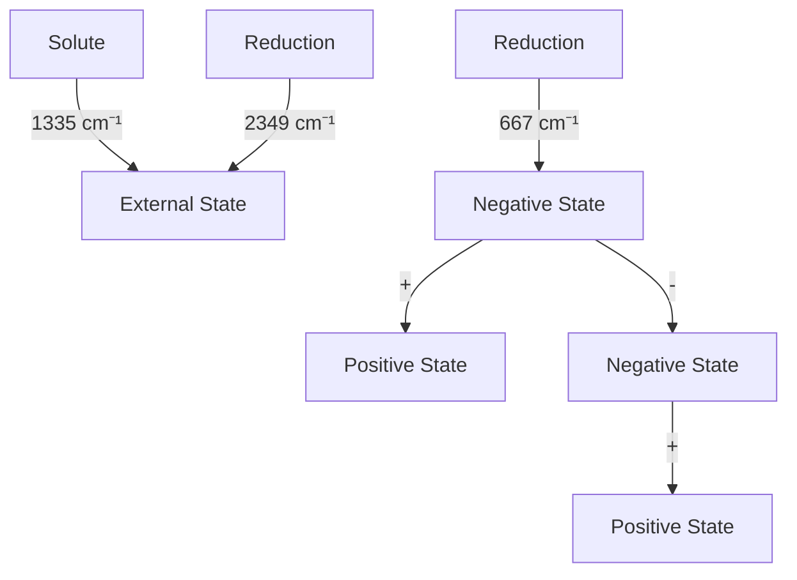

# 24 吸收和发射光谱

原始 PDF 第 688–734 页。

## 24

## 吸收和发射光谱

光与介质粒子的相互作用会使光的特性发生以下变化:因介质对光波的吸收和散射，会使光强度减弱；不同波长的光在介质中传播速度不同，并按不同的折射角散开，会发生光的折射和色散。介质粒子吸收了光子能量以后，由低能态跃迁到高能态。高能态是不稳定的，当粒子从高能态跃迁回低能态时，多余能量以光的发射、热、电、力、声、化学反应等形式进行释放。其中，光电效应和光化学反应已经在第12章中进行了介绍，光的力学效应（光镊）将在第27章介绍，本章主要介绍光的吸收和发射现象。在光与物质相互作用的过程中，各种光学现象可能同时发生，但由于样品性质各异，实验中观察到的光学现象可能以某一种为主。比如，对于理想体系，如果样品对入射光具有特异性吸收，那么光强度的减弱主要来源于光的吸收，此时可以忽略约占光吸收千分之一的光散射现象。本章所讨论的光吸收和光发射，都是指可以忽略光散射影响的理想体系。在化学和生物学研究中，电子运动状态、化学键的性质、核-电子和核-核相互作用是结构和功能分析中重要的信息，因此在实践中最常用的吸收光谱是紫外-可见吸收光谱、红外吸收光谱和磁共振吸收谱（第25章），而最常见的发射光谱是紫外-可见光区域的荧光技术。

---

24.1 光的吸收和发射

665

## 24.1 光的吸收和发射

人们对于光与物质相互作用的观察由来已久。17世纪，牛顿和惠更斯（Christiaan Huygens，1629—1695）为代表的“微粒学派”和“波动学派”之争极大促进了光学研究。19世纪初，威廉·沃拉斯顿（William Hyde Wollaston，1766—1828）和约瑟夫·冯·夫琅禾费（Joseph von Fraunhofer，1787—1826）观察到太阳光谱中的暗线，这些暗线后来被称为夫琅禾费线。对太阳光谱中神秘暗线的追寻极大地促进了经典光学理论的发展。19世纪中叶，古斯塔夫·基尔霍夫（Gustav Robert Kirchhoff，1824—1887）和罗伯特·本森（Robert Bunsen，1811—1899）等发现，每种化学元素在加热到炽热时都有自己特有的颜色或光谱，在实验室中能够重现太阳光谱中观察到的暗线，从而能够通过发射光谱识别日冕中的吸收原子，也由此开创了光谱分析这门学科。20世纪初，伴随量子力学的发展，狄拉克等提出和完善了光子发射和吸收的量子力学理论。20世纪50年代，艾伦·沃尔什（Alan Walsh，1916—1998）建立了原子吸收光谱法。自此之后，大多数的化学、生物、材料等分析实验室都会拥有一台吸收分光光度计。由于吸收或发射光谱可以反映原子或分子的能级结构、能级寿命、电子运动状态、分子的结构、化学键的性质、分子-分子之间相互作用等多方面信息，吸收光谱仪和发射光谱仪在20世纪下半叶都得到了快速发展，并为物理学、化学和生物学等许多领域提供了重要的定性或定量的分析测定方法。

按照研究对象，吸收光谱和发射光谱可分为原子光谱和分子光谱。19世纪和20世纪物理学家们的研究已经为各种元素的原子吸收光谱和发射光谱提供清晰的物理图景。在现代分析方法中，利用原子吸收光谱的元素分析法在无机化学和生物无机化学中也是常用的科学工具，本书中主要介绍分子光谱。按照第2章介绍的量子力学基本理论，分子的总能量是基本粒子及其相互作用的各种量子化能量的总和，分子中特定能级跃迁的量子化能量变化所对应的电磁波范围涵盖了从 $\gamma$ 射线到无线电波的宽阔领域（图24-1）。

## 24.1.1 光与物质相互作用的经典理论

按照经典物理理论，组成介质的原子或分子内的带电粒子被准弹性力保持在其平

图24-1 分子运动与能级跃迁所需能量的对应关系

other

| Wave Type | Energy Level | Phenomena |
| :--- | :--- | :--- |
| 无线电波 | \(10^{2}\) | 核自旋跃迁 |
| 无线电波 | 10 | 旋转运动 |
| 微波 | \(10^{-3}\) | 分子振动 |
| 红外光 | \(10^{-5}\) | 电子跃迁 |
| 可见光 | \(10^{-6}\) | 电子跃迁 |
| 近紫外线 | \(10^{-7}\) | 电离 |
| 远紫外线 | \(10^{-9}\) | 电离 |
| X射线 | \(10^{-11}\) | 电子跃迁 |
| \(\gamma射线\) | — | — |

---

666

24 吸收和发射光谱

衡位置附近，并具有一定的固有振动频率。在入射光的作用下，介质发生极化，带电粒子依入射光频率作强迫振动。由于带正电荷的原子核质量远大于电子质量，在光吸收的极短时间内可视为正电荷中心不动，而负电荷相对于正电荷作振动，负电荷中心指向正电荷中心的矢径为 $r$ 。正、负电荷电量的绝对值 $q$ 相同，构成了一个简谐振动电偶极子，其电偶极矩 $p$ 为

$$
p = q r _ {\circ}
$$

如果入射光场 $E$ 为

$$
E = E _ {0} \mathrm{e} ^ {- \mathrm{i} \omega t}, \tag {24-1}
$$

按照牛顿力学，对于原子核-电子构成的单原子体系，若-e和m分别为电子的电荷和质量，r为电子与核之间的距离，f是弹性系数，g为阻尼系数，则作强迫振动的电子的运动方程为

$$
m \frac {\mathrm{d} ^ {2} r}{\mathrm{d} t ^ {2}} = - e E - f r - g \frac {\mathrm{d} r}{\mathrm{d} t} 。
$$

上式中，等号右边的三项分别为电子受到的入射光电场强迫力、准弹性力和阻尼力。若设衰减系数 $\gamma = g / m$ ，而电子的固有振动频率 $\omega_0 = \sqrt{f / m}$ ，则上式可变为

$$
\frac {\mathrm{d} ^ {2} r}{\mathrm{d} t ^ {2}} + \gamma \frac {\mathrm{d} r}{\mathrm{d} t} + \omega_ {0} ^ {2} r = - \frac {e E}{m} _ {\circ}
$$

该方程是描述光与介质相互作用经典理论的基本方程。结合式（24-1），解此方程，得到电子在入射光场作用下的位移 $r$ 为

$$
r = \frac {- e / m}{\left(\omega_ {0} ^ {2} - \omega^ {2}\right) - \mathrm{i} \gamma \omega} E _ {0} \mathrm{e} ^ {- \mathrm{i} \omega t},
$$

则电偶极矩为 $p$ 的 $N$ 个粒子的极化强度 $P$ 为

$$
P = N p = - N e r = \frac {N e ^ {2} / m}{(\omega_ {0} ^ {2} - \omega^ {2}) - \mathrm{i} \gamma \omega} E _ {0} \mathrm{e} ^ {- \mathrm{i} \omega t}.
$$

由电磁场理论，极化强度和电场的关系为

$$
P = \varepsilon_ {0} \chi E _ {\circ}
$$

其中，$\varepsilon_0$ 为真空中的介电常数，$\chi$ 为电极化率。由此可以得到描述介质极化特性的电极化率 $\chi$ 的表达式。对于稀薄气体等理想系统，$|\chi| \ll 1$。根据电磁学理论，复折射率 $\tilde{n} = n + \mathrm{i}\eta$、介质中的相对介电常数 $\varepsilon_{\gamma}$、电极化率 $\chi = \chi' + \mathrm{i}\chi''$ 三者之间有如下关系:

$$
\widetilde {n} = \sqrt {\varepsilon_ {\gamma}} = \sqrt {1 + \chi} \cong 1 + \frac {1}{2} \chi = 1 + \frac {1}{2} \chi^ {\prime} + \frac {\mathrm{i}}{2} \chi^ {\prime \prime} = n + \mathrm{i} \eta
$$

由此可以得到复折射率实部和虚部分别为

$$
n = 1 + \frac {N e ^ {2}}{2 \varepsilon_ {0} m} \frac {\omega_ {0} ^ {2} - \omega^ {2}}{\left(\omega_ {0} ^ {2} - \omega^ {2}\right) ^ {2} + \gamma^ {2} \omega^ {2}}, \tag {24-2}
$$

$$
\eta = \frac {N e ^ {2}}{2 \varepsilon_ {0} m} \frac {\gamma \omega}{(\omega_ {0} ^ {2} - \omega^ {2}) ^ {2} + \gamma^ {2} \omega^ {2}} 。 \tag {24-3}
$$

为了更明确复折射率实部和虚部的意义，介质中沿 $x$ 方向传播的电磁波可以写作

---

24.1 光的吸收和发射

667

图 24-2 光的色散曲线和吸收曲线示意图

$$
\begin{array}{l} E = E _ {0} \exp \left[ \mathrm{i} \left(\frac {2 \pi}{\lambda} \tilde {n} x - \omega t\right) \right] = E _ {0} \exp \left(- \frac {2 \pi}{\lambda} \eta x\right) \exp \left[ \mathrm{i} \left(- \frac {2 \pi}{\lambda} n x - \omega t\right) \right] \\ = E _ {0} \exp (- k \eta x) \exp [ \mathrm{i} (- k \eta x - \omega t) ], \\ \end{array}
$$

其中 $k = 2\pi / \lambda$ 为真空中光的波数。由此可见，复折射率描述了介质对光传播特性（振幅和相位）的作用。其中，实部 $n$ 是表征介质影响光传播相位特性的量，即通常所说的折射率；虚部 $\eta$ 是表征介质影响光传播振幅特性的量，通常称为消光系数。通过 $n$ 和 $\eta$ 即可描述光在介质中传播的色散和吸收特性。由于 $n$ 和 $\eta$ 都是入射光频率的函数，根据上式可以得到 $n(\omega)$ 和 $\eta(\omega)$ 随入射光频率 $\omega$ 变化的理论曲线，即色散曲线和吸收曲线（图24-2）。对于色散曲线，固有振动频率 $\omega_0$ 附近区域为反常色散区，而远离 $\omega_0$ 的区域为正常色散区。对于吸收曲线，当 $\omega = \omega_0$ 时具有最强的共振吸收，也被称为物质的选择性吸收带；当 $\omega$ 远离 $\omega_0$ 时吸收迅速减弱，而此时 $\eta$ 很小且近似为常数的区域被称为一般吸收区（图24-2）。

对于更一般的情形，可以类似上面的过程对其它类型电偶极子的强迫振动进行推导。若测试样品中含有电荷和质量分别为 $q_{j}$ 和 $m_{j}$ 的 $N_{j}$ 个电偶极子的固有振动频率为 $\omega_{j}$，则复折射率的表达式可以写为

$$
\widetilde {n} ^ {2} = 1 + \sum_ {j} \frac {N _ {j} q _ {j} ^ {2}}{\varepsilon_ {0} m _ {j}} \frac {1}{(\omega_ {0 j} ^ {2} - \omega^ {2}) ^ {2} + \mathrm{i} \gamma_ {j} ^ {2} \omega^ {2}} \circ
$$

此时，色散曲线和吸收曲线会具有多个色散区和吸收带。

除了真空以外，介质中总是存在电偶极子的，因此除了真空以外没有任何一种介质对任何波长的电磁波均完全透明。常说的透明，也并非指没有吸收，而是只有很少的一般性吸收。也正因为此，不同的吸收光谱和发射光谱技术需要选择合适的光学材料制作光学器件，不同光谱技术使用的光学器件，特别是不同种类仪器的样品杯通常不能混用。比如，常见的石英玻璃的透光区段一般为 $180\sim 4000~\mathrm{nm}$，对紫外-可见光区是透明的，但在红外区具有强吸收。因此石英可以用来制作紫外-可见吸收光谱仪中的各种透镜等光学器件，而红外光谱仪的样品杯通常使用萤石（$\mathrm{CaF_2}$，透光波段一般为 $125\sim 9500~\mathrm{nm}$）或溴化钾等在红外区没有选择性吸收的材料制作。

（A）按照式（24-2）和式（24-3）绘制的理论色散曲线和吸收曲线。（B）以水分子的红外吸收为例，展示一般性吸收与选择性吸收的示意图。

---

668

24 吸收和发射光谱

## 24.1.2 朗伯-比尔定律

朗伯-比尔定律（Lambert-Beer law）描述了吸光物质对某一波长光吸收的程度与吸光物质的浓度及样品厚度之间的关系，是光吸收的基本定律，也是分光光度法和比色分析法等进行定量分析的理论基础。朗伯-比尔定律适用于满足以下条件的理想系统:①入射光为垂直照射的平行单色光；②样品为均相、非散射体系；③样品分子之间无相互作用；④光与样品之间只有光吸收过程，无荧光、光化学、光电效应等现象发生。对于该理想系统，假设入射光强度为 $I_{0}$ 的平行单色光，在通过光程为l的样品后，由于样品对光的吸收，透射光强度降低至I，则有

$$
\mathrm{d} I = - \alpha_ {\mathrm{a}} N I \mathrm{d} l _ {\circ}
$$

其中， $\alpha_{\mathrm{a}}$ 为吸收系数， $N$ 为样品粒子密度。对上式进行积分，易得

$$
I = I _ {0} \mathrm{e} ^ {- \alpha_ {\mathrm{a}} N l} = I _ {0} 1 0 ^ {\frac {1}{\ln 1 0} \alpha_ {\mathrm{a}} N l} = I _ {0} 1 0 ^ {- \varepsilon c l} = I _ {0} 1 0 ^ {- A},
$$

$$
A = \lg (I _ {0} / I) = \varepsilon c l _ {\circ}
$$

其中， $A$ 为吸光度， $\varepsilon$ 为摩尔吸收系数或摩尔消光系数， $c$ 为样品物质的量浓度。当 $l$ 的单位为 $\mathrm{cm}$ ， $c$ 的单位为 $\mathrm{mol / L}$ 时， $\varepsilon$ 的单位为 $\mathrm{L} \cdot \mathrm{mol}^{-1} \cdot \mathrm{cm}^{-1}$ 。

若引入上一节中所述的消光系数 $\eta$ 描述光强度的减弱，则粒子密度为 $N$ 的介质中沿 $l$ 方向传播的电磁波的光强度为

$$
I = \left| E \right| ^ {2} = I _ {0} \mathrm{e} ^ {- 2 k \eta N l},
$$

由此可知

$$
\alpha_ {\mathrm{a}} = 2 k \eta = 4 \pi \eta / \lambda_ {\circ}
$$

由于吸收系数 $\alpha_{\mathrm{a}}$ 是波长 $\lambda$ 的函数，而消光系数 $\eta$ 也与入射光频率有关，因此对于理想系统，当样品中含有多种吸光组分时，由于各组分间不存在着相互作用，则吸光度具有加和性，即在某一波长下样品的总吸光度是各组分在该波长下吸光度的加和，即

$$
A = \sum_ {i} \varepsilon_ {i} c _ {i} l _ {\circ}
$$

根据朗伯-比尔定律，当 $l$ 不变时，$A$ 与 $c$ 之间应该成正比关系。但实际测定时，标准曲线常会出现偏离朗伯-比尔定律的现象，这通常源于实验系统偏离了上述的理想系统。在生物和化学测量中，最常见的偏离原因是样品存在杂质、样品的不均一性（非均相体系）、样品浓度过高以及样品因生物化学反应随时间产生变化。一般地，测试样品应过滤以去除可能的杂质；吸光度在 $0.1 \sim 0.8$ 之间，以使得检测处于线性范围且测量误差较小。如吸光度不在此范围，可适当稀释或浓缩样品再进行测定。

## 24.1.3 光与物质相互作用的量子理论简介

通过量子理论对光与介质相互作用进行严格的定量计算可参阅电动力学等物理学专业教材。本小节主要在第2章对量子力学初步介绍的基础上，从能级角度进行简单

---

24.1 光的吸收和发射

669

的定性分析。

考虑辐射电磁场与分子的相互作用，磁相互作用一般可忽略，由于生物或化学分子的直径一般远远小于紫外-可见光范围的辐射波长，则电场只需保留线性阶而忽略高阶项，从而此时可以只考虑电偶极矩。对于多原子组成的分子，基态和激发态的波函数可近似分解成电子波函数 $\Psi_{\mathrm{el}}$ 、振动波函数 $\Psi_{\mathrm{vib}}$ 和自旋波函数的乘积。电偶极矩不依赖于自旋，或者说不同多重态间的电子跃迁禁阻，此时仅需考虑基态和激发态的电子波函数 $\Psi_{\mathrm{el}}$ 和振动波函数 $\Psi_{\mathrm{vib}}$ （图24-3）。如果用量子数 $\nu$ 和 $\nu^{\prime}$ 描述电子基态和激发态的振动波函数，则有电子基态波函数和第一激发态波函数:

$$
\Psi (\mathrm{S} _ {0}, \nu) = \Psi_ {\mathrm{el}} (\mathrm{S} _ {0}) \cdot \Psi_ {\mathrm{S} _ {0}, \mathrm{vib}} (\nu),
$$

$$
\Psi (\mathrm{S} _ {1}, v ^ {\prime}) = \Psi_ {\mathrm{el}} (\mathrm{S} _ {1}) \cdot \Psi_ {\mathrm{S} _ {1}, \mathrm{vib}} (v ^ {\prime}) 。
$$

根据弗兰克-康登原理（Frank-Condon principle），分子中电子跃迁的时间尺度远小于分子振动，电子跃迁前后的一瞬间，分子内原子核的相对距离和动量几乎与跃迁前完全一样，由此产生的态被称为弗兰克-康登态。此时，电子激发态与基态具有相似的振动能级结构。相应地，$\mathrm{S}_0 \rightarrow \mathrm{S}_1$ 的电子跃迁可形象地描述成垂直跃迁（图24-3）。吸收了光子能量的激发态通常比基态更易极化、极性更大，因此激发态键长通常大于基态键长。弗兰克-康登原理指出，在分子从它的电子基态向激发态跃

迁的过程中，基态的振动波函数与激发态的振动波函数将发生重叠，当基态和激发态的振动波函数有效重叠程度最大时，相应的跃迁发生的概率最大。基态和激发态的振动波函数重叠的程度被称为弗兰克-康登因子，而跃迁的强度与弗兰克-康登因子的平方成正比。由于基态和激发态键长不一致，因此从 $v = 0$ 到 $v' = 0$ 的跃迁发生概率很小。光吸收由跃迁偶极矩描述，即由电偶极矩在跃迁前后波函数间的期望值描述。$\mathrm{S}_0(0)\rightarrow \mathrm{S}_1(v')$ 的跃迁偶极矩

$$
\begin{array}{l} p _ {\mathrm{S} _ {0} (0) \rightarrow \mathrm{S} _ {1} (\nu^ {\prime})} = \big \langle \Psi_ {\mathrm{el}} (\mathrm{S} _ {0}) \Psi_ {\mathrm{S} _ {0}, \mathrm{vib}} (0) \mid \Psi_ {\mathrm{el}} (\mathrm{S} _ {1}) \Psi_ {\mathrm{S} _ {1}, \mathrm{vib}} (\nu^ {\prime}) \big \rangle \\ = \left\langle \Psi_ {\mathrm{el}} (\mathrm{S} _ {0}) \mid \Psi_ {\mathrm{el}} (\mathrm{S} _ {1}) \right\rangle \left\langle \Psi_ {\mathrm{S} _ {0}, \mathrm{vib}} (0) \mid \Psi_ {\mathrm{S} _ {1}, \mathrm{vib}} (v ^ {\prime}) \right\rangle , \\ \end{array}
$$

等号右边乘积中的两项即为电子跃迁偶极矩和弗兰克-康登因子。

类似地，当分子中的电子处于基态时，振动能级之间的跃迁有振动跃迁偶极矩

$$
p _ {i \rightarrow j} = \left\langle \Psi_ {i} \mid \Psi_ {j} \right\rangle 。
$$

通过量子力学计算可知，对于振动能级之间的跃迁，$\Delta v = \pm 1$ 的跃迁是被允许的，也被称为振动光谱的选择定则（选律）。

当外加电磁波照射到某个样品上时，它引起由基态到激发态的跃迁概率和激发态对于多原子组成的分子，基态和激发态的波函数可近似分解成电子波函数 $\Psi_{\mathrm{el}}$ 和振动波函数 $\Psi_{\mathrm{vib}}$ 乘积。根据弗兰克-康登原理，电子激发态与基态具有相似的振动能级结构，但激发态通常比基态更易极化、极性更大，因此激发态键长更长。光吸收和光发射可以由跃迁偶极矩描述，即由电偶极矩在跃迁前后波函数间的期望值描述。详见正文中的描述。

text_image

Ψ(S₁,v') = Ψel(S₁) · ΨS₁,vib(v')
S₁
v'=4
v'=3
v'=2
v'=1
v'=0
吸收
荧光
S₀
v=4
v=3
v=2
v=1
v=0
Ψ(S₀,v) = Ψel(S₀) · ΨS₀,vib(v)

图24-3 弗兰克-康登原理

---

670

24 吸收和发射光谱

跃迁到基态的概率相等，因此净吸收大小取决于两个能级上粒子数（布居数）分布之差。如果加上电磁波后基态和激发态的分布趋于平衡，即处于高能态的粒子数始终等于处于低能态的粒子数，这时再进行激发就不会产生净吸收，这种现象称为饱和（saturation）。分子在受到一个扰动后重新回到玻尔兹曼平衡状态的过程称为弛豫（relaxation）。对于紫外-可见-红外吸收来说，弛豫主要取决于高能态自发回到低能态的过程，一般都很迅速，因此在测试中无须过于注意弛豫时间。在磁共振波谱技术中，由于能级之间的能量差很小，自发弛豫发生的概率很低，需要样品分子之间的相互作用来完成弛豫，此时需要考虑弛豫和饱和对测试的影响（详见第25章）。

当物质中具有选择性吸收的分子被激发到高能态以后，分子从不稳定的高能态跃迁回低能态的过程中，多余能量具有多种可能的释放路径，而哪条路径为主通常取决于分子的结构和激发态的性质，以光发射方式返回基态时的发射光称为荧光（fluorescence）或磷光（phosphorescence）。雅布朗斯基图（Jabłoński diagram，也称 Perrin-Jabłoński diagram）是1933年亚历山大·雅布朗斯基（Aleksander Jabłoński, 1898—1980）提出的，描述了物质与光的相互作用过程中，吸收能量和释放能量的分子能态变化和光物理化学过程（图24-4）。

text_image

单线态激发态
S: 单线态 F: 荧光
T: 三线态 dF: 延迟荧光
A: 光吸收(激发) ISC: 系间跨越
N: 非辐射弛豫 Q: 猝灭
IC: 内转换 P: 磷光
VbR: 振动弛豫
S2 ↑
1
0
S1 ↑
5
4
3
2
1
0
S0 ↑
基态
E
10⁻¹⁵ s
10⁻¹⁵ s (10⁻⁶ s)
10⁻¹² s
IC
VbR
VbR
N
Q
dF
10⁻⁸ s
ISC
T₁
S: 单线态
T: 三线态
A: 光吸收(激发) ISC: 系间跨越
N: 非辐射弛豫 Q: 猝灭
IC: 内转换 P: 磷光
VbR: 振动弛豫
3线态激发态
N
P
10⁻¹⁵ s (10⁻⁴~10² s)
10⁻¹⁵ s (10⁻⁶ ~ 10⁻⁸ s)
S₀↑
S₀↑
S₀↑

图24-4 雅布朗斯基图

左侧的S表示单重态或单线态，右侧的T表示三重态或三线态。A代表电子吸收光跃迁。VbR是同一个电子能级的振动能级跃迁，是激发态分子中的能量再分配于多种振动模式的过程，分子通过振动跃迁获得的能量通过碰撞再转移给介质分子。IC是不同电子高能态之间的跃迁，不改变电子自旋态，被称为内转换。ISC是同一个电子能级的自旋状态发生改变的跃迁，称为系间跨越。N 和 Q 代表非辐射跃迁，激发态的多余能量转移给介质分子或猝灭剂 Q，最终以热等方式释放。F、dF 和 P 代表激发态分子的自发辐射，F 和 dF 不改变自旋状态，称为荧光；P 改变自旋状态，称为磷光；dF 表示从  $T_{1}$  回到  $S_{1}$  再次发射的延迟荧光。图中跃迁箭头旁的数值表示跃迁过程的时间尺度，其中括号内的数值表示荧光、磷光的寿命。

---

24.1 光的吸收和发射

671

在光物理化学领域，有三个关于发射光谱的早期经验法则。这三个法则并非来源于严格的理论推导，而是早期观察的经验总结，因此均存在多种例外情形（知识窗24-1）。

## 24.1.4 吸收光谱、激发光谱和发射光谱

吸收光谱是指在一个波长范围内的不同波长光源作用下，物质吸收能力（吸光度或吸收系数）随波长变化的曲线。吸收曲线中谱峰或吸收带的出现反映了物质在相应波长处具有特异性吸收。

激发光谱是指在不同波长激发光源的激发下，测量某一波长处的荧光强度的变化，然后以激发光波长为横坐标，以固定波长处的荧光强度为纵坐标所绘制的图，即为激发光谱。激发光谱反映了不同波长的激发光的相对效率。根据雅布朗斯基图可知，一般情况下激发光谱与吸收光谱正相关，选择进行测量的发射波长仅影响峰强，并不影响峰位和谱形，因此可以通过激发光谱或吸收光谱选择适当的激发波长。需要注意的是，当分子具有多个激发态时，激发光谱与吸收光谱之间的相关性可能会出现偏离。

## 知识窗24-1

## 发射光谱的三个早期经验法则

（1）斯托克斯位移（Stokes shift）。19世纪，乔治·斯托克斯（George Stokes，1819—1903）观察到，一种矿物——萤石（fluospar）在受到紫外光照射后能发出比激发光波长长的光。采用萤石这个词的词头，他把这种光命名为荧光。荧光波长比激发光长这一现象则被人称为斯托克斯位移。发射光谱中的斯托克斯位移可以用弗兰克-康登原理（图24-3）和雅布朗斯基图（图24-4）很好地进行解释。斯托克斯位移的概念也被推广到了其它光谱学领域（如拉曼光谱），观测波长比激发波长短的现象则被称为反斯托克斯位移。
（2）卡莎规则（Kasha's rule）。20世纪50年代，迈克尔·卡莎（Michael Kasha，1920—2013）通过实验和经验推导提出:分子所发射的光子（荧光或磷光）只能从激发态的最低态激发。在雅布朗斯基图中，如果分子具有多个激发态（如图24-4中的 $S_{1}$ 和 $S_{2}$ ），不同的激发态之间存在非辐射跃迁，被称为内转换。内转换速率与不同激发态之间的能量差相关。一般情况下，内转换速率往往比辐射跃迁速率快四个数量级，因此内转换在荧光发射之前就已经完成。在此情形下，卡莎规则是成立的，且可以推论出荧光的波长、寿命、峰形、强度等属性均与激发波长无关。卡莎规则的前提是内转换速率极快，当不同激发态之间的能量差很大时，卡莎规则将不再适用，这样的有机分子被称为反卡莎规则（anti-Kasha's rule）体系。

（3）镜像规则（mirror-image rule）。根据弗兰克-康登原理（图24-3），激发态和基态具有相似的振动能级分布。同时，从 $S_{0}$ 的最低振动能级跃迁到 $S_{1}$ 各振动能级的概率与由 $S_{1}$ 的最低振动能级跃迁到 $S_{0}$ 各振动能级的概率也相近，因此吸收谱与发射谱呈镜像对称关系。但当分子具有多个激发态（如图24-4中的 $S_{1}$ 和 $S_{2}$ ），或分子激发态的构型发生变化导致 $S_{0}$ 和 $S_{1}$ 的振动能级分布不同时，镜像规则将不再适用。

---

672

24 吸收和发射光谱

text_image

原子发射光谱
原子
分子
CwHxNyOz
波长/nm
原子吸收光谱

图24-5 原子光谱与分子光谱的比较

发射光谱是指固定激发光源的波长，测量不同波长处的荧光强度，然后以荧光波长为横坐标，以荧光强度为纵坐标作图，即为发射光谱。发射光谱反映了荧光中不同波长的光成分的相对强度。根据雅布朗斯基图，发射谱中的谱峰位置取决于能级结构，与在吸收带中所选择的激发波长无关，不同的激发波长仅影响峰强。

一般地，吸收谱、激发谱和发射谱都包含若干谱峰（图24-5），谱峰所能反映的主要信息包括:

（1）谱峰位置，简称峰位，通常用频率、波长或能量轴上的最大吸收位置来表示，最大吸收所对应的波长一般记为 $\lambda_{\mathrm{max}}$ ，最大发射所对应的波长一般记为

$E_{\mathrm{max}}$ 。对于光吸收来说，谱峰位置反映的是选择定则，即能态之间发生概率最大的跃迁。当入射电磁波的能量与能级之间的能量差相匹配（共振）时，吸收概率最大。

（2）谱峰宽度，通常用半高宽（full width at a half maximum，FWHM，$\Delta v_{1/2}$）或半高半宽（half width at half height，HWHH）来表示。由于原子的核外电子能级只包含了电子波函数，不涉及化学键的振动波函数，因此原子吸收光谱和原子发射光谱通常呈现窄的谱线结构，谱线之间分辨率高。每一种原子都具有特异的核外电子能级结构，因此利用原子吸收光谱和原子发射光谱中的特异谱线可以进行元素分析。分子吸收光谱和发射光谱的谱峰宽度通常远大于原子光谱（图24-5），谱峰宽度不仅与振动能级的结构有关，也与激发态寿命有关。由于谱峰具有一定的宽度，所以当两个谱峰距离过近时将产生重叠（图24-5）。
（3）谱峰强度，通常用吸收系数、吸收度、光强度或光子数来表示，$\lambda_{\mathrm{max}}$ 所对应的摩尔消光系数一般记为 $\varepsilon_{\mathrm{max}}$ 。一般地，谱峰强度与产生跃迁的分子的总数量有关。也就是说，吸收谱和发射谱都可以用于确定样品的量。发射谱的谱峰强度除了受光吸收程度和检测效率的影响以外，自发辐射概率还容易受到各种环境因素的干扰，因此一般使用吸收谱来进行定量分析。
（4）峰形。根据24.1.1节中的理论计算，理想系统中简单分子的谱峰大多是洛伦兹（Lorenz）线形。对于复杂的生物分子，由于极性溶剂和/或各向异性的影响，其谱峰经常会偏离洛伦兹线形，而更符合高斯（Gauss）线形或沃伊特（Voigt）线形。生物分子的吸收谱和发射谱通常会有严重的重叠问题，在对谱进行提高分辨率的数学处理时需要考虑峰形的影响。

---

24.2 紫外-可见吸收光谱

673

## 24.2 紫外 - 可见吸收光谱

## 24.2.1 紫外-可见吸收光谱的选择定则

紫外-可见吸收光谱也被称为电子光谱，这是因为紫外-可见光的光子能量与电子能级之间的能量差相当（图24-1），紫外-可见光可以激发分子中的电子产生能级之间的跃迁。在分子中，电子能级通常用分子轨道来描述。根据分子轨道理论（参见第2章），当两个原子形成化学键时，两个原子参与化学键形成的原子轨道将线性组合形成新的分子轨道。从电子波函数来看，线性组合就是两个原子轨道波函数的叠加或相减，使得一个分子中不同的分子轨道的能量是不同的。所以形成分子轨道以后，轨道总数量不变而轨道能级改变。其中，能量低于相应原子轨道能量的分子轨道被称为成键轨道，反之称为反键轨道，而能量相等时不形成化学键则被称为非键轨道。

在有机化合物或生物分子中，常见的分子成键轨道包括 $\sigma$ 轨道、$\pi$ 轨道和某些过渡族金属化合物中的 $\delta$ 轨道，对应的反键轨道为 $\sigma^{*}$、$\pi^{*}$ 和 $\delta^{*}$。分子中没有参与成键的电子被称为非键电子或 n 电子，主要指位于 N、O、P、S、卤素等原子的外层孤对电子。当有机化合物或生物分子吸收紫外-可见光后，外层电子主要的跃迁类型有以下三种（图 24-6）:

① 成键轨道与反键轨道之间的跃迁，如  $\sigma \rightarrow \sigma^{*}$ 、 $\pi \rightarrow \pi^{*}$ ;
② 非键电子被激发到反键轨道的跃迁，如  $n \rightarrow \sigma^{*}$ 、 $n \rightarrow \pi^{*}$ ;
③ 某些含有过渡族金属以及镧系和锕系元素的化合物中，由于配基的影响，使得原本简并的d或f轨道分裂成几组能量不等的轨道。若轨道是未充满的，当吸收光子后，电子会发生跃迁，被称为d-d跃迁和f-f跃迁。

这几种主要跃迁所需能量大小的顺序一般为:$\sigma \rightarrow \sigma^{*} > n \rightarrow \sigma^{*} > \pi \rightarrow \pi^{*} > n \rightarrow \pi^{*}$。在有机化合物和生物分子中，$\sigma \rightarrow \sigma^{*}$ 跃迁所需能量最高，一般发生在真空紫外区。如乙烷C—C键的 $\sigma \rightarrow \sigma^{*}$ 跃迁，$\lambda_{\max}$ 约为 $135 \mathrm{~nm}$（图24-6）。由于氧气在

图 24-6 有机化合物或生物分子紫外-可见吸收光谱主要的跃迁类型和波长范围

（A）紫外-可见吸收光谱的主要电子跃迁方式。（B）主要电子跃迁方式的紫外-可见吸收波长范围。

---

674

24 吸收和发射光谱

200 nm 以下的远紫外区和真空紫外区具有强吸收，以及氙灯光源的波长范围限制，一般紫外-可见分光光度计只提供约 185～850 nm 范围的单色光，因此一般无法检测  $\sigma \rightarrow \sigma^{*}$  跃迁吸收带。

N、O、S、卤素等含有 n 电子的饱和基团，如—NH₂、—OH、—SH 等，可能产生 n → σ\* 跃迁，λ\_max 在 190 nm 左右；而含有杂原子的不饱和基团，如＞C=O、＞C=S、—N=N—等，会发生 n → π\* 跃迁，λ\_max 在 300 nm 左右。n → σ\* 和 n → π\* 跃迁发生的概率均较小，因此其摩尔吸收系数较小（ε\_max < 100 L · mol⁻¹ · cm⁻¹）。

有 $\pi$ 轨道的基团，如 $>C = C < 、 -C \equiv C - 、 >C = O$ ，以及芳香族化合物的共轭体系的 $\pi$ 键等，会发生 $\pi \rightarrow \pi^{*}$ 跃迁，一般位于近紫外区，$\lambda_{\max}$ 在 $200\mathrm{nm}$ 左右，$\varepsilon_{\max}$ 通常大于 $10^{4}\mathrm{L} \cdot \mathrm{mol}^{-1} \cdot \mathrm{cm}^{-1}$，为强吸收带。由于 $\sigma \rightarrow \sigma^{*}$ 跃迁需要在真空中检测，且 $\mathrm{n} \rightarrow \sigma^{*}$ 和 $\mathrm{n} \rightarrow \pi^{*}$ 跃迁概率小，因此 $\pi \rightarrow \pi^{*}$ 跃迁是有机化合物和生物分子中最容易观测的吸收带。

## 24.2.2 紫外-可见吸收光谱给出的主要信息和影响因素

## （1）紫外-可见吸收光谱给出的主要定性和定量信息

由于紫外-可见吸收光谱主要检测样品中电子能级的跃迁，不同类型的基团通常具有不同的主要跃迁方式。因此在有机化合物结构鉴定中，谱峰的位置和强度可以用来定性分析可能存在的官能团类型。如利用紫外光谱在紫外区是否透明，可以定性分析有机化合物的分子骨架中是否含有共轭结构体系或是否含有芳香环；利用可见光区含有金属的有机化合物谱峰的精细结构，可以定性分析金属的配位情况等。由于紫外谱峰宽度很大经常造成谱峰重叠，可以利用二阶导数谱或高阶导数谱提高谱的分辨率。

从原理上来分析，由于各种有机化合物和生物分子都具有独特的化学结构和空间结构，原则上每种物质就会有其特有的、固定的吸收光谱曲线。但值得注意的是，紫外-可见吸收光谱常见的跃迁方式并不能很好地区分不同官能团，因此只根据紫外-可见吸收光谱不能完全确定有机分子的化学结构，现在也较少用于有机化合物和生物分子的结构鉴定。有机化合物的结构鉴定需要使用对化学结构更敏感的红外吸收光谱、拉曼光谱、核磁共振波谱、质谱以及其它的物理和化学方法共同进行分析。

由于仪器便宜、操作简便、灵敏度高等特点，紫外-可见吸收光谱法是最常用的定量分析方法，而24.1.2节中所述的朗伯-比尔定律是紫外-可见吸收光谱法进行定量分析的理论基础。一般情况下，紫外-可见吸收光谱法的检测限大约在 $\mu \mathrm{g} / \mathrm{mL}$ 量级，是现有光谱分析方法中灵敏度最高的技术之一。借助其高灵敏度，紫外-可见吸收光谱法常常与其它生物物理技术偶联，如分子筛、停-流仪、第19章中介绍的静态光散射技术等。

## (2) 生色团和助色团

分子中能产生强烈的特异性吸收带的基团被称为生色团或发色团（chromophore）。

---

24.2 紫外-可见吸收光谱

675

有机化合物和生物分子中的生色团一般是吸收系数较大的强吸收（通常 $\varepsilon_{\mathrm{max}} > 5000\mathrm{L}\cdot \mathrm{mol}^{-1}\cdot \mathrm{cm}^{-1}$ ）、含有不饱和键的基团。生物分子中，一些 $\varepsilon_{\mathrm{max}}$ 小于5000但大于$100\mathrm{L}\cdot \mathrm{mol}^{-1}\cdot \mathrm{cm}^{-1}$ 的基团也被称为生色团（如酪氨酸和苯丙氨酸侧链的芳香环）。由24.2.1节可知，生色团电子跃迁的方式主要为 $\mathfrak{n}\to \pi^{*}$ 或 $\pi \rightarrow \pi^{*}$ ，在生物分子中最常见的生色团是共轭体系的 $\pi$ 键。通常情况下，由于其它基团贡献较小，分子的吸收谱主要体现为生色团谱峰的线性组合。当多个生色团形成共轭体系时，生色团之间会产生相互影响。其吸收光谱与单一生色团相比，随着共轭体系变大，吸收峰红移，吸收强度增加。

广义上来说，助色团（auxochrome）指的是分子中能够改变生色团光吸收的基团。由于紫外-可见光吸收来源于分子轨道的跃迁，因此助色团中通常含有孤对电

contour

| Color | Description |
| --- | --- |
| Blue | Left region (Blue) |
| Red | Right region (Red) |
| Yellow | Center region (Yellow) |

图24-7 助色团对生色团峰位和峰强的不同影响

子，如—OH、—OR、—NR₂、—X（卤素）等。助色团的作用机制主要是影响分子轨道的基态和激发态的能量状态和稳定性等。助色团对生色团峰位或峰强产生的影响包括（图24-7）:蓝移或短移（hypsochromic shift，向短波长方向移动）、红移或长移（bathochromic shift，向长波长方向移动）、增色效应（hyperchromic effect，吸收增强）和减色效应（hypochromic effect，吸收减弱）。助色团也可能同时对峰位和峰强造成影响。如在苯环上引入—OH等取代基，通常会使得谱峰发生红移和增色。

## (3) 溶剂的影响

溶剂对紫外-可见吸收光谱的影响包括两个方面:溶剂对紫外-可见光的吸收和溶剂对样品生色团峰位、峰强和峰形的影响（也称为溶剂效应）。

由于电子跃迁方式不同，不同的溶剂在紫外-可见光区的峰位和吸收系数都有着较大区别，因此在进行紫外-可见吸收光谱测量时，要考虑选用溶剂或缓冲液对测量结果的影响。常见的极性溶剂中，水的紫外吸收基本不影响主要的生色团谱峰。常用的有机溶剂中，氯仿会影响波长小于 $247\mathrm{nm}$ 的区域，丙酮、乙醛和苯等在紫外区具有强吸收不适合作为紫外-可见吸收光谱的溶剂。

非极性溶剂分子一般不影响紫外-可见吸收光谱，而极性溶剂分子与生色团的静电相互作用或形成氢键等都会影响外层电子的能级状态。特别需要指出的是，能级结构或每个能级的稳定性是依赖于环境的，因此紫外-吸收对溶剂的极性和 $\mathrm{pH}$ 都很敏感。在极性溶剂中，激发态具有更强的极性，导致 $\pi^{*}$ 比 $\pi$ 更稳定，基态与激发态之间的能级能量差减小，因此溶液极性增强会导致 $\pi \rightarrow \pi^{*}$ 跃迁红移。同时 $\mathrm{n} \rightarrow \pi^{*}$ 跃迁，基态比激发态极性大，极性溶剂分子与 $\mathbf{n}$ 电子形成更稳定的氢键，氢键的形成会使得 $\mathbf{n}$ 电子的能级能量降低大约一个氢键的能量，非键电子的稳定也造成跃迁概率下降，因此氢键的形成会促使极性溶液中的 $\mathrm{n} \rightarrow \pi^{*}$ 跃迁蓝移和减色。

极性溶液的 $\mathrm{pH}$ 增加通常会导致紫外-可见吸收谱峰的红移。此外，如果生色团

---

676

24 吸收和发射光谱

或助色团中含有可解离的基团，$\mathrm{pH}$ 值的变化往往会造成较大影响。如苯酚在碱性介质中形成苯酚阴离子，其在紫外区的最大吸收峰 $\lambda_{\max}$ 会从 $270~\mathrm{nm}$ 红移到 $287~\mathrm{nm}$，$\varepsilon_{\max}$ 也会从 $1450~\mathrm{L} \cdot \mathrm{mol}^{-1} \cdot \mathrm{cm}^{-1}$ 增加到 $2600~\mathrm{L} \cdot \mathrm{mol}^{-1} \cdot \mathrm{cm}^{-1}$ 。类似地，酪氨酸的酚羟基侧链在碱性 $\mathrm{pH}$ 下也会发生解离，因此可以利用 $\mathrm{pH}$ 滴定的方法研究蛋白质中的酪氨酸是处于可溶蛋白质的非极性内部还是暴露于极性溶剂中。由于核酸和蛋白质都具有可解离的基团，因此在利用紫外-可见光吸收进行生物分子定量分析时，要注意 $\mathrm{pH}$ 改变可能带来的影响。

## (4) 立体效应

立体效应指因有机化合物或生物分子的空间位阻和立体构象等因素导致吸收光谱产生变化的现象。空间位阻可以影响生色团之间的相互作用或共轭效应。如同分异构体的取代基在空间排列不同，一般反式结构空间位阻较小，生色团之间能够更好地共轭，因此反式结构的分子通常具有更大的 $\lambda_{\mathrm{max}}$ 和 $\varepsilon_{\mathrm{max}}$ 。

在一些有机化合物和大多数生物大分子中，原本并不共轭的生色团（如蛋白质一级序列中距离很远的芳香环氨基酸），由于空间结构使得生色团之间互相靠近，产生相互作用，也能造成 $\lambda_{\mathrm{max}}$ 和 $\varepsilon_{\mathrm{max}}$ 的改变。这也使得处于不同构象状态（如天然态、中间态和变性态）的生物大分子的 $\varepsilon_{\mathrm{max}}$ 并不相同。因此理论上来说，使用变性态的生物大分子进行浓度测定等定量分析可以得到更准确的结果。比如对于核酸分子，双螺旋结构或更高级结构的氢键和碱基相互作用，以及 $3',5'$-磷酸二酯键的形成都造成减色效应，DNA变性以后由于减色效应消失导致其紫外吸收会变大。因此可以用紫外吸收光谱监测核酸的变性和复性过程。DNA或RNA分子的紫外吸收要小于碱基紫外吸收的总和，这也使得DNA或RNA分子水解以后的紫外吸收会变大。

## 24.2.3 紫外-可见吸收光谱在生物学中的应用

大多数糖类和饱和脂类分子中，最主要的是 $\sigma \rightarrow \sigma^{*}$ 跃迁，在近紫外区和可见光区吸收很小。也正因为此，紫外-可见吸收光谱分析通常被用来进行核酸和蛋白质的定量分析、结构变化和相互作用研究。此外，一些代谢物、金属化合物和特异性染料的紫外-可见吸收也经常被用于研究生物大分子结构变化、生化反应动力学的监测和显微成像等。例如，考马斯亮蓝R-250（R代表淡红色）和G-250（G代表淡绿色）在与蛋白质结合后 $\lambda_{\mathrm{max}}$ 红移而呈现蓝色，因此经常被用于蛋白质浓度的定量分析（Bradford方法）或凝胶电泳显色。

## (1) 核酸的紫外-可见吸收特性

核酸的主要基团包括碱基、核糖或脱氧核糖以及磷酸基团。其中，核糖或脱氧核糖和磷酸并非生色团，而碱基具有共轭双键，是核酸的主要生色团。碱基的主要吸收带在 $40\sim 290~\mathrm{nm}$ 的紫外波段。由于碱基化学结构上的差别，不同核苷酸的吸收带峰位和峰形具有较大区别，其 $\mathrm{pH}$ 依赖性也显著不同。

大多数情况下，DNA和RNA的紫外吸收曲线并无太大区别，其 $\lambda_{\mathrm{max}}$ 都在 $260~\mathrm{nm}$ 左

---

24.2 紫外-可见吸收光谱

677

右。DNA的 $\varepsilon_{\mathrm{max}}$ 的范围是 $6000\sim 8000\mathrm{L}\cdot \mathrm{mol}^{-1}\cdot \mathrm{cm}^{-1}$ RNA的 $\varepsilon_{\mathrm{max}}$ 大约在 $7000\sim 10000\mathrm{L}\cdot \mathrm{mol}^{-1}\cdot \mathrm{cm}^{-1}$ 。核酸在 $260~\mathrm{nm}$ 的吸光度常以 $A_{260}$ 或 $\mathrm{OD}_{260}$ （optical density）表示。在实践中为了方便计算，常以核酸的比吸光系数计算溶液中核酸的量。核酸的比吸光系数是指浓度为$1\mu \mathrm{g / mL}$ 核酸水溶液的 $A_{260}$ 值。天然态的双链DNA的比吸光系数为0.020，变性DNA和RNA的比吸光系数为$0.022\sim 0.024$ ，寡核苷酸的比吸光系数约为0.05。实践中，可以通过计算 $A_{260} / A_{280}$ 与 $A_{260} / A_{230}$ 的比值来评估核酸纯度，具体方法在生物化学或分子生物学等教材中已经有详细介绍。

## (2) 蛋白质的紫外-可见吸收特性

蛋白质由 20 种常见 $\alpha-$ 氨基酸残基组成。根据 $\alpha-$

line

| Wavelength (nm) | Trp \((10^{3}\) \(L \cdot mol^{-1} \cdot cm^{-1})\) | Tyr \((10^{3}\) \(L \cdot mol^{-1} \cdot cm^{-1})\) | Phe \((10^{3}\) \(L \cdot mol^{-1} \cdot cm^{-1})\) |
| --- | --- | --- | --- |
| 220 | — | ~8.0 | ~1.5 |
| 240 | ~1.6 | ~0.5 | ~0.2 |
| 260 | ~3.5 | ~0.8 | ~0.3 |
| 280 | ~5.7 | ~1.4 | — |
| 300 | ~0.5 | — | — |
| 320 | — | — | — |

图24-8 三种芳香族氨基酸的紫外吸收光谱

氨基酸的化学结构可知，常见氨基酸在可见光区域均没有明显的吸收，在远紫外区（185～230 nm）均有紫外吸收。在近紫外区，主要的生色团是三种芳香族氨基酸，即苯丙氨酸（Phe）、酪氨酸（Tyr）和色氨酸（Trp）。此外，虽然半胱氨酸在260 nm以上并没有紫外吸收，但胱氨酸或蛋白质中的二硫键在近紫外区有吸收。三种芳香族氨基酸的吸收谱特征与苯环、苯酚和吲哚环的紫外吸收谱相近（图24-8），但峰位、峰形和吸收系数会被氨基酸中的其它基团或蛋白质结构影响。

对于蛋白质来说，肽链骨架的酰胺基团在 $190\mathrm{nm}$ 的远紫外区具有强吸收，其强度大约是近紫外区吸收的一百倍左右，且 $A_{190}$ 只与肽键数量有关而与含有的氨基酸种类无关。但由于远紫外吸收容易受到仪器、样品杯、缓冲液等的影响，实践中一般采用芳香族氨基酸在 $280~\mathrm{nm}$ 的近紫外吸收（$A_{280}$）进行定量分析。由图24-8可知，蛋白质的 $A_{280}$ 主要来源于色氨酸和酪氨酸芳香环侧链的吸收，以及可能存在的二硫键的少量贡献，而苯丙氨酸在 $280~\mathrm{nm}$ 几乎无吸收。蛋白质中游离半胱氨酸和二硫键的数量可以通过生化方法测定。因此，根据蛋白质一级序列中酪氨酸、色氨酸、胱氨酸的数量 $N_{\mathrm{Tyr}}$ 、 $N_{\mathrm{Trp}}$ 、 $N_{\text{胱}}$ ，以及经天然蛋白质数据修正后的摩尔消光系数 $\varepsilon_{\mathrm{Tyr}}$ 、 $\varepsilon_{\mathrm{Trp}}$ 、 $\varepsilon_{\text{胱}}$ 就可以计算得到相应蛋白质的理论 $\varepsilon_{\lambda}$ 值:

$$
\varepsilon_ {\lambda} = N _ {\mathrm{Tyr}} \varepsilon_ {\mathrm{Tyr}} + N _ {\mathrm{Trp}} \varepsilon_ {\mathrm{Trp}} + N _ {\mathrm{胱}} \varepsilon_ {\mathrm{胱} \circ}
$$

当波长为 $280\mathrm{nm}$ 时，根据天然态蛋白质修正后的 $\varepsilon_{\mathrm{Tyr}} = 1490$ ， $\varepsilon_{\mathrm{Trp}} = 5500$ ， $\varepsilon_{\text{胱}} = 125$ ，单位为 $\mathrm{L}\cdot \mathrm{mol}^{-1}\cdot \mathrm{cm}^{-1}$ 。对于含有色氨酸的蛋白质，理论 $\varepsilon_{\lambda}$ 值的误差一般小于$5\%$ ；但对于不含有色氨酸的蛋白质，其误差可能大于 $10\%$ 。需要注意的是，该方法无法用于预测含有在紫外-可见光区有吸收的辅基或过渡族金属离子的蛋白质（如结合金属离子的各种超氧化物歧化酶）。

## （3）生物分子-过渡族金属复合物的紫外-可见吸收特性

在过渡族金属的络合物中，过渡族金属离子的紫外-可见吸收特性不仅取决于过渡族金属离子自身的性质，还取决于参与络合的配基性质和配位情况。比如，

---

678

24 吸收和发射光谱

$\left[\mathrm{Co}(\mathrm{H}_2\mathrm{O})_6\right]^{2+}$ 的配位情况是八面体， $\lambda_{\max}$ 和 $\varepsilon_{\max}$ 分别为 $513~\mathrm{nm}$ （溶液呈现红色）和$10\mathrm{L}\cdot \mathrm{mol}^{-1}\cdot \mathrm{cm}^{-1}$ ；而 $[\mathrm{CoCl}_4]^{2-}$ 的配位对称性低， $\lambda_{\max}$ 和 $\varepsilon_{\max}$ 分别为 $667~\mathrm{nm}$ （溶液呈现蓝色）和 $600~\mathrm{L}\cdot \mathrm{mol}^{-1}\cdot \mathrm{cm}^{-1}$ 。在蛋白质浓度测定中常用的BCA法（bicinchoninicacidasssy，二喹啉甲酸法）中，蛋白质在碱性环境下通过双缩脲反应将 $\mathrm{Cu^{2 + }}$ 还原成$\mathrm{Cu^{+}}$ ，而 $\mathrm{Cu^{+}}$ 可以高度特异性结合BCA钠盐，形成络合物 $\mathrm{Cu^{+}}$ -BCA以后，工作试剂由原来的苹果绿变为紫色，在 $562~\mathrm{nm}$ （溶液呈现紫色）处有最大吸光值，吸收值与蛋白质浓度成正比。利用金属离子与有机化合物或生物分子形成络合物以后，紫外-可见吸收 $\lambda_{\max}$ 和 $\varepsilon_{\max}$ 的变化（特别是可见光区的颜色变化），可以发展出多种多样的定量方法。除了应用于生物分子定量以外，还可以通过金属离子浓度滴定曲线研究生物分子-过渡族金属离子的结合常数等生物物理和生物化学性质（图24-9）。

## （4）紫外-可见吸收光谱研究生物大分子的结构变化

对于生物大分子，由于结构中氢键和立体效应的影响，天然态和变性态的 $\lambda_{\mathrm{max}}$ 和 $\varepsilon_{\mathrm{max}}$ 通常会有较大变化，可以通过测量不同状态下的 $\lambda_{\mathrm{max}}$ 和 $\varepsilon_{\mathrm{max}}$ 获得转变曲线，从而推算结构转换时的热力学常数。值得注意的是，由于生物大分子的紫外-可见吸收光谱包含了众多生色团的吸收，吸收峰的严重重叠导致谱峰较宽且对结构上的精细变化不够敏感，因此现在大多数情况下会采用对结构变化更灵敏的技术来监测生物大分子的结构变化。

## (5) 紫外-可见吸收光谱研究生化反应动力学

许多有机化合物或生物分子都具有特异的紫外-可见吸收。如果生化反应中，一种具有紫外-可见吸收反应物的浓度发生变化或者某种反应物可以特异结合染料，则可以测量不同时间的紫外-可见吸收来获得反应动力学。利用这一特性，已经发展了多种酶促反应动力学的测活方法（图24-10）。

图24-9 紫外-可见吸收光谱研究一个多肽与不同过渡族金属离子的结合（A）多肽与不同金属离子络合物的紫外-可见吸收光谱。（B）利用 $250\mathrm{nm}$ 紫外吸收的变化研究多肽与 $\mathrm{Cd^{2+}}$ 的结合常数，实线为拟合曲线。（数据自Cheng Y S, et al. J Inorg Biochem, 2005, 99(10): 1952-1962）

---

24.3 圆二色光谱

679

图 24-10 基于紫外-可见吸收的酶测活方法示意图

（A）酶与底物反应后的紫外-可见吸收光谱差谱。（B）利用特定波长处紫外-可见吸收值的变化可以获得酶动力学曲线。

## 24.3 圆二色光谱

## 24.3.1 圆二色光谱的基本原理和主要参量

## (1) 圆双折射与圆二色性吸收

当一束平面偏振光（可以看作是振幅、频率相同，旋转方向相反的两束圆偏振光）（知识窗24-2）通过介质传播时，如果介质对左旋和右旋圆偏振光折射率和光吸收的影响不同，则该介质被称为具有光学活性（optical activity），具有光学活性的物质也被称为手性物质（图24-12）。光学活性物质对折射率 $n_{左}$ 和 $n_{右}$ 的不同影响被称为圆双折射（circular birefringence），而对光吸收 $A_{左}$ 和 $A_{右}$ 的不同影响被称为圆二色性吸收、圆二色性或圆二色（circular dichroism，CD）。圆双折射和圆二色性吸收分别反映了光学活性物质对偏振光相位和幅度的影响（知识窗24-3）。

当波长为 $\lambda$ 的平面偏振光透过光程为 $l$ 的光学活性介质后，圆双折射的存在导致左旋和右旋偏振光分量的相位将不同，重新合成的平面偏振光（若光学活性介质对两者的光吸收相同）或椭圆偏振光（若光学活性介质对两者的光吸收不同）将旋转一个角度 $\alpha$ ，称为旋光性，$\alpha$ 随 $\lambda$ 变化的曲线被称为旋光色散（optical rotatory dispersion, ORD）。容易得到

$$
\alpha_ {\lambda} = \frac {\pi l}{\lambda} (n _ {1} - n _ {r}) = \frac {\pi l}{\lambda} \Delta n _ {\circ}
$$

实践中还常用比旋光度（specific rotation，$[\alpha]_{\lambda}$）、摩尔旋光度（molar rotation，$[\varphi]_{\lambda}$）和平均残基旋光度（mean residue rotation，$[\alpha_{\overline{m}}]_{\lambda}$），如果样品中光学活性物质的浓度为 $c$

---

680

24 吸收和发射光谱

## 知识窗24-2

## 偏振光的合成和分解

电磁波是横波，其互相垂直的电场矢量 $E$ 与磁场矢量 $H$ 与光波传播方向垂直。如上所述，光与物质的相互作用主要来自电偶极矩的变化，所以下面我们只考虑电场矢量。非偏振光或自然光指的是电场矢量在垂直于传播方向的平面上均匀分布[图24-11；式（24-1)]，如果电场矢量在各个方向上的分布不均匀，则是偏振光。如果电场矢量固定在某个特定的方向，电场矢量与传播方向组成的振动面始终保持在一个平面上，则被称为平面偏振光或线偏振光，可以写作

$$
E = \mathrm{j} E _ {0} \cos \omega t;
$$

如果电场矢量以顺时针方向旋转则称为右旋圆偏振光，以逆时针方向旋转则称为左旋圆偏振光，可以写作

$$
E _ {\mathrm{左}} = \frac {E _ {0}}{2} (- \mathrm{i} \mathrm{sin} \omega t + \mathrm{j} \mathrm{cos} \omega t),
$$

$$
E _ {\mathrm{右}} = \frac {E _ {0}}{2} (\mathrm{i} \sin \omega t + \mathrm{j} \cos \omega t)  .
$$

与矢量运算的规则相同，可以得到偏振光之间相互叠加的合成关系（图24-11）:

① 相同频率、相同振幅、相位也完全相同的两束平

面偏振光，合成的依然是平面偏振光；

② 相同频率、相同振幅、相位差为  $\pi/2$  的两束平面偏振光，合成的是右旋圆偏振光；
③ 相同频率、相同振幅、相位差为  $-\pi/2$  的两束平面偏振光，合成的是左旋圆偏振光；
④ 相同频率、相同振幅、相位差为  $0 \sim \pi/2$  的两束平面偏振光，合成的是椭圆偏振光；
⑤ 平面偏振光可分解为振幅、频率相同，旋转方向相反的两束圆偏振光，即  $E = E_{左} + E_{右}$ ;
⑥ 两束振幅、频率相同，旋转方向相反的偏振光也可以合成为一束平面偏振光，即 $E_{\text{左}} + E_{\text{右}} = E$
⑦ 两束圆偏振光振幅相同，但相位不同，合成的平面偏振光的偏振面旋转一个角度  $\alpha$ ;
⑧ 两束圆偏振光频率相同，旋转方向相反，但振幅不同，合成的是椭圆偏振光。如果椭圆偏振光的电场矢量分别为 $E_{\mathrm{a}}$ 和 $E_{\mathrm{b}}$ ，则合成的椭圆偏振光的椭圆率 $\theta$ 为椭圆短轴与长轴之比的反正切:

$$
\theta = \arctan \frac {\left| E _ {\mathrm{a}} - E _ {\mathrm{b}} \right|}{E _ {\mathrm{a}} + E _ {\mathrm{b}}}
$$

自然光 (非偏振光)

平面偏振光 (线偏振光)

右旋圆偏振光

左旋圆偏振光

text_image

E
E左
E右

text_image

左
右
x'
y'
α
θ

图 24-11 平面偏振光、圆偏振光及其合成与分解示意图

---

24.3 圆二色光谱

681

图24-12 旋光性与光学活性

（单位为 $\mathrm{g / mL}$），光程为 $l$ （单位为 $\mathrm{dm}$），光学活性样品分子的摩尔质量为 $m$（单位为 $\mathrm{g / mol}$），平均残基摩尔质量为 $\overline{m}$（单位为 $\mathrm{g / mol}$，一般为 $110\sim 115$），则

$$
[ \alpha ] _ {\lambda} = \frac {\alpha_ {\lambda}}{c l},
$$

$$
[ \varphi ] _ {\lambda} = [ \alpha ] _ {\lambda} \frac {m}{1 0 0},
$$

$$
[ \alpha_ {\overline {{m}}} ] _ {\lambda} = [ \alpha ] _ {\lambda} \frac {\overline {{m}}}{1 0 0} \circ
$$

类似地，可以得到圆二色性吸收 $\Delta A_{\lambda}$ 或 $\Delta \varepsilon_{\lambda}$

$$
\Delta A _ {\lambda} = A _ {1} - A _ {\mathrm{r}},
$$

$$
\Delta \varepsilon_ {\lambda} = \Delta A _ {\lambda} / c l _ {\circ}
$$

如上所述，当光学活性介质对左旋和右旋圆偏振光的光吸收不同时，入射的平面偏振光在透过光学活性介质时将变成椭圆偏振光，该椭圆偏振光的椭圆率 $\theta_{\lambda}$ 与圆二色吸收之间的关系为

$$
\theta_ {\lambda} = \frac {2 . 3 0 3 \times 1 8 0}{4 \pi} \Delta A _ {\lambda} \approx 3 3 \Delta A _ {\lambda \circ}
$$

与旋光度类似，文献中还经常使用比椭圆率（specific ellipticity，$[\Psi]_{\lambda}$）、摩尔椭圆率（molar ellipticity，$[\theta]_{\lambda}$）和平均残基椭圆率（mean residue ellipticity，$[\theta_{\overline{m}}]_{\lambda}$），易得

$$
[ \psi ] _ {\lambda} = \frac {\theta_ {\lambda}}{c l},
$$

$$
[ \theta ] _ {\lambda} = [ \psi ] _ {\lambda} \frac {m}{1 0 0} \approx 3 3 0 0 \Delta \varepsilon_ {\lambda},
$$

$$
[ \theta_ {\overline {{m}}} ] _ {\lambda} = [ \psi ] _ {\lambda} \frac {\overline {{m}}}{1 0 0} \circ
$$

需要注意的是，常见的CD光谱仪给出的测量值一般为椭圆率，单位常为mdeg，需要通过上述公式转换为文献中的常用单位。

## (2) 选择定则

光学活性物质由于结构的不对称性，可导致相关的光学跃迁涉及的电荷运动既含

---

682

24 吸收和发射光谱

## 知识窗24-3

## 旋光色散与圆二色性之间的关系

旋光性和圆二色性都是由于光学活性物质分子中的结构不对称生色团与左、右旋圆偏振光发生不同的作用所引起的。与24.1.1节中光和物质相互作用中的折射率和消光系数类似，旋光性和圆二色性是同一个光学现象中的两个相关方面。旋光性和圆二色性可以由Kronig-Kramers变换相互联系起来:

$$
\left[ \varphi (\lambda) \right] = \frac {2}{\pi} \int_ {0} ^ {\infty} \theta (\lambda^ {\prime}) \frac {\lambda^ {\prime}}{\lambda^ {2} - \lambda^ {\prime 2}} \mathrm{d} \lambda^ {\prime},
$$

$$
\left[ \theta (\lambda) \right] = \frac {2}{\pi \lambda} \int_ {0} ^ {\infty} \varphi (\lambda^ {\prime}) \frac {\lambda^ {\prime 2}}{\lambda^ {2} - \lambda^ {\prime 2}} \mathrm{d} \lambda^ {\prime}.
$$

因此，只要在测量中获得旋光色散（ORD）和圆二色性（CD）曲线的任何一个，都可以通过Kronig-Kramers变换获得另外一个，ORD和CD所能提供的信息是等价的，ORD和CD产生的基础是偏振光与物质相互作用中有选择性的吸收，因此吸收谱、ORD谱和CD谱的谱峰之间存在以下关系（图24-13）:

① 吸收谱中，每一个谱峰反映的都是生色团的选择性吸收带，吸收值均为正值，但吸收峰不能反映生色团是否具有光学活性。
② CD 谱中，只有选择性吸收存在的时候才可能观测到 CD 谱峰，但不是每一个吸收峰都存在 CD 谱峰，只有光学活性生色团才有 CD 谱峰。CD 谱峰峰形与吸收谱一致，可以为正峰也可以为负峰。CD 谱峰为正峰时称为正科顿效应，为负峰时是负科顿效应。
③ ORD 谱中，ORD 曲线在吸收谱峰或 CD 谱峰  $\lambda_{max}$  处的数值为 0，在光学活性的整个吸收带两端不能到达基线。因此，一个光学活性生色团的旋光性并不仅限于吸收带区域，而是在所有波长处都能引起旋光性。因生色团的不对称性或其所在环境诱导的不对称性产生的光学活性，使 ORD 曲线在吸收带的两侧存在着峰和谷。

与吸收谱和ORD谱相比，CD谱具有以下明显优点:$①$ 由于吸收谱均是正值，若同时存在几个吸收峰，且这些吸收峰峰宽较大时，就会产生难以分辨的谱峰重叠。$②$ 对于ORD谱，由于一个生色团在所有波长处都能引起旋光性，任意波长处的旋光性是分子中所有生色团贡献之和，且其极值处的波长与吸收谱并不一致。如果同时存在几个旋光带，就很难分析。 $③$ 没有光学活性的生色团没有CD现象，使得CD谱比吸收谱简单。同时，CD谱峰可正可负，且其 $\lambda_{\mathrm{max}}$ 与吸收谱 $\lambda_{\mathrm{max}}$ 是一致的，也相当于提高了谱的分辨率。因此在实践中，CD谱而不是吸收谱或ORD谱被广泛用于生物大分子的结构分析。

spectrogram

| Method | Peak Position (Wavelength) |
| --- | --- |
| 吸收谱 | 1 |
| 吸收谱 | 2 |
| 吸收谱 | 3 |
| CD谱 | ~0.5 |
| CD谱 | ~1.5 |
| CD谱 | ~2.5 |
| ORD谱 | ~0.5 |
| ORD谱 | ~1.5 |
| ORD谱 | ~2.5 |

图24-13 吸收谱、CD谱与ORD谱之间的关系

---

24.3 圆二色光谱

683

有平移运动（即电偶极矩 $p \neq 0$），又含有转动（即磁偶极矩 $\mu \neq 0$）。如果 $\langle p \rangle \cdot \langle \mu \rangle \neq 0$，即两个跃迁偶极矩不互相垂直时，电子被激发时将螺旋运动，螺旋的方向取决于电偶极矩和磁偶极矩两个矢量之间的夹角（图24-14）。除了电子自身的螺旋运动以外，如果两个谐振子相互耦合，总的效果是电荷的旋转与平移运动，也会产生光学活性。螺旋运动的电子与左旋和右旋圆偏振光的交变电磁场相互作用时将产生不同的影响，即产生旋光性和圆二色性吸收。对映体的磁偶极矩旋转方向相反，因此对映体的旋光性也会相反，其CD光谱也呈镜像对称关系（图24-15）。

对称结构的分子，如果 $\mu = 0$ 或电荷运动 $\langle p\rangle \cdot \langle \mu \rangle = 0$ ，则是不具有旋光性的非光学活性物质。呈现旋光性的生色团一定是不对称的——既没有对称中心，也没有对称平面，这存在两种可能:一种可能是生色团本身就是不对称的；另一种可能是由分子内周围基团的不对称微扰所引起的，如分子中的空间效应导致对称生色团的运动受限（图24-16）。

text_image

p + μ
= 
p₁ p₂
p

图24-14 电偶极矩和磁偶极矩不互相垂直（上）或谐振子耦合（下）时，电荷产生螺旋运动

line

| Wavelength (nm) | L-聚合酶 \((10^{5}\) deg \(cm^{-2}\) \(dmol^{-1})\) | D-聚合酶 \((10^{5}\) deg \(cm^{-2}\) \(dmol^{-1})\) |
| --- | --- | --- |
| 200 | ~-8 | ~7 |
| 210 | ~-19 | ~19 |
| 220 | ~-18 | ~18 |
| 230 | ~-14 | ~13 |
| 240 | ~-6 | ~4 |
| 250 | ~-1 | ~1 |
| 260 | 0 | 0 |

图24-15 对映体的旋光性相反，CD光谱呈镜像对称

(数据自 Wang Z M, et al. Nat Chem, 2016, 8(7): 698–704)

---

684

24 吸收和发射光谱

text_image

对称化合物
无光学活性
游离酪氨酸
仅具有弱光学活性
结合口袋中的酪氨酸
具有强光学活性

图24-16 无光学活性物质和光学活性生色团

第二种情况在生物大分子中更为普遍。如苯丙氨酸和酪氨酸侧链的芳香环是对称基团，因此自由的苯丙氨酸和酪氨酸分子基本没有光学活性。在具有规则结构的蛋白质中，疏水性强的苯丙氨酸和酪氨酸侧链经常位于蛋白质疏水内部，因而受到较强的疏水相互作用而不能自由旋转，此时处于规则结构中的苯丙氨酸和酪氨酸侧链的芳香环会具有明显的光学活性。

如果施加一个外加磁场，磁场会与生色团的磁偶

极矩相互作用，从而可能导致磁场下磁偶极矩的方向发生偏转，此时除了自然旋光性以外，分子中的对称生色团也可能被诱导出磁致旋光性，而不对称生色团的旋光性也可能会改变，这种技术被称为磁圆二色（magnetic CD，MCD）。

## 24.3.2 圆二色光谱的样品要求

同大多数吸收光谱一致，圆二色光谱的测试体系应为真溶液体系，即样品的主要光学现象来自圆二色性吸收，除了测试样品外，样品杯和缓冲液没有光学活性，光散射可忽略。为了进行定量计算，一般要求 $0.1 < \Delta A < 1$ ，样品的浓度在 $0.1\mathrm{mg / mL}$ 量级。CD光谱的样品杯一般为没有光学活性的石英杯，不能与紫外-可见吸收样品杯混用。常见的CD光谱样品杯的光程为 $0.1\mathrm{cm}$，对于高浓度样品可以选择短光程样品杯，而低浓度样品可以通过选择长光程样品杯增加信号的信噪比。

由于 CD 谱经常需要获得在远紫外区域的完整光谱，所以在溶剂或缓冲液选择上比紫外-可见吸收光谱严苛。溶剂或缓冲液的盐离子浓度通常会影响 CD 谱的波长下限。同时，由于生物样品的浓度一般远小于溶剂或缓冲液中有机分子的浓度，溶剂或缓冲液中的有机化合物即便只有微弱的旋光性也可能对灵敏度和信噪比造成较大影响。比如对于 1 mm 光径的样品杯，当溶剂为 4:1 的乙醇 / 甲醇、纯水、10 mmol/L 的磷酸缓冲液和 100 mmol/L 的磷酸缓冲液时，CD 谱的波长下限分别约为 200 nm、180 nm、182 nm 和 190 nm。因此，生物样品的 CD 测量一般不选用有机溶剂，而是选用低浓度和低盐的缓冲液，最常用的为低浓度的磷酸缓冲液。样品杯光程越短，溶剂或缓冲液对测试的影响越小。

## 24.3.3 圆二色光谱在生物学中的主要应用

## (1) 蛋白质的远紫外 CD

蛋白质肽链骨架的酰胺键在远紫外区具有强吸收，因此经常测量 $180\sim 250~\mathrm{nm}$ 左右的远紫外区间的CD谱来观测蛋白质肽链骨架的圆二色性，被称为远紫外CD谱（far-UV CD）。蛋白质肽链骨架的酰胺键形成了具有复杂相互作用的谐振子。由于不同的二级结构中，肽键会具有不同的二面角和空间结构，因此二级结构会对谐振子偶

---

24.3 圆二色光谱

685

极矩的空间分布造成大的影响，而三级结构和四级结构的影响则很小。正因为此，远紫外CD谱常常被用来研究蛋白质的二级结构及其变化。对标准蛋白质的研究显示，不同的二级结构具有迥异的远紫外CD谱特征（图24-17）:

① $100\%$ 的 $\alpha$ 螺旋:在 $208\sim 210\mathrm{nm}$ 和 $222\mathrm{nm}$ 呈两个极小值而出现双负特征峰谱形，在 $191\sim 193\mathrm{nm}$ 附近具有很强的正特征峰极大值；
② $100\%$ 的 $\beta$ 折叠:在 $210\sim 225\mathrm{nm}$ 间存在一个极小值而呈单负特征峰谱形，在 $190\sim 200\mathrm{nm}$ 间呈现很强的正特征峰极大值；
③ $100\%$ 的 $\beta$ 转角:在 $206\mathrm{nm}$ 附近有一个正的弱CD谱带，在$190\sim 200\mathrm{nm}$ 间没有明显的峰存在；
④ $100\%$ 无规卷曲或无序结构:在 $190\sim 200\mathrm{nm}$ 间存在一个负CD谱带，在 $220\sim 230\mathrm{nm}$ 间呈现可正可负的弱CD谱带。

一般地，含有各种二级结构蛋白质的CD谱可以看作是一定比例的 $\alpha$ 螺旋、$\beta$ 折叠、$\beta$ 转角和无规卷曲结构CD谱的线性组合，因此可以通过拟合获得蛋白质中各种二级结构的相对比例。但是值得注意的是，通过CD谱进行二级结构预测的各种算法都需要基于以下假设的前提:

line

| Wavelength (nm) | \(\alpha\)-matrix ([θ]/(10⁴ deg·cm²·dmol⁻¹)) | \(\beta\)折叠 ([θ]/(10⁴ deg·cm²·dmol⁻¹)) | \(\beta\)turn ([θ]/(10⁴ deg·cm²·dmol⁻¹)) | 无规卷曲 ([θ]/(10⁴ deg·cm²·dmol⁻¹)) |
| --- | --- | --- | --- | --- |
| 190 | ~6.7 | ~1.8 | ~-0.4 | ~-3.5 |
| 200 | ~1.5 | ~2.8 | ~0.8 | ~-4.7 |
| 210 | ~-4.4 | ~-1.8 | ~0.2 | ~-2.2 |
| 220 | ~-4.8 | ~-2.8 | ~-0.3 | ~-0.7 |
| 230 | ~-3.5 | ~-2.0 | ~-0.7 | ~-0.8 |
| 240 | ~-1.5 | ~-1.0 | ~-0.9 | ~-0.9 |
| 250 | ~-0.9 | ~-0.9 | ~-0.9 | ~-0.9 |

图24-17 蛋白质三种主要二级结构的标准CD谱形

① 基准蛋白或参考蛋白的三维结构在水溶液中保持不变；
② 各种二级结构对总谱的贡献具有可加和性；
③ 仅肽链骨架生色团和肽链二级结构对远紫外 CD 有贡献，三级结构和氨基酸残基的侧链生色团对远紫外 CD 谱的贡献可以忽略；
④ 每一个二级结构元素可用一个标准CD谱描述，组成二级结构元素的氨基酸残基的数量和周围化学环境对CD谱的影响可忽略。

这些假设在实践中可能出现不满足的情形，此时通过CD谱进行二级结构预测的准确性也就会降低。

## (2) 蛋白质的近紫外和可见光 CD

对于大多数在近紫外-可见光区域没有选择性吸收的氨基酸，也同样不会表现出圆二色性。因此蛋白质中近紫外区的圆二色性主要来自三种芳香族氨基酸。值得注意的是，虽然苯丙氨酸的紫外吸收系数 $\varepsilon$ 很小，但也可能具有明显的圆二色性。三种芳香族氨基酸和二硫键的近紫外谱没有固定的特征，CD谱峰可正可负，取决于芳香环在结构中所处的化学环境。一般地，苯丙氨酸残基的CD峰在255、261和 $268\mathrm{nm}$ 附近，酪氨酸残基的CD峰在 $277\mathrm{nm}$ 左右，而在279、284和 $291\mathrm{nm}$ 是色氨酸残基的信息，二硫键的变化信息反映在整个近紫外CD谱上（图24-18）。与紫外-可见吸收光谱相比，近紫外CD谱具有较好的分

line

| Wavelength (nm) | \([\theta m\)̄\()/(10^{3}\) deg·cm²·dmol⁻¹) |
| --- | --- |
| 250 | ~-2.0 |
| 260 | ~0.4 |
| 270 | ~1.4 |
| 280 | ~1.1 |
| 290 | ~0.6 |
| 300 | ~-0.6 |
| 310 | ~0.0 |
| 320 | ~-0.1 |
| 330 | ~-0.1 |

图24-18 近紫外CD谱反映了芳香族氨基酸残基所处的化学微环境

---

686

24 吸收和发射光谱

line

| Wavelength (nm) | \(\Delta\epsilon (A) (L \cdot\)mol⁻¹·cm⁻¹) | \(\Delta\epsilon (B) (L \cdot\)mol⁻¹·cm⁻¹) | \(\Delta\epsilon (Z) (L \cdot\)mol⁻¹·cm⁻¹) |
| --- | --- | --- | --- |
| 180 | ~25 | ~-10 | ~74 |
| 190 | ~80 | ~63 | ~-25 |
| 200 | ~-10 | ~-10 | ~-48 |
| 210 | ~-28 | ~-5 | ~-15 |
| 220 | ~-5 | ~0 | ~2 |
| 230 | ~-5 | ~0 | ~2 |
| 240 | ~-2 | ~-2 | ~2 |
| 250 | ~2 | ~-5 | ~3 |
| 260 | ~8 | ~-2 | ~5 |
| 270 | ~9 | ~3 | ~4 |
| 280 | ~5 | ~3 | ~-5 |
| 290 | ~0 | ~1 | ~-5 |
| 300 | ~0 | ~0 | ~-2 |
| 310 | ~0 | ~0 | ~0 |
| 320 | 0 | 0 | 0 |

图24-19 三种不同构型DNA的近紫外CD谱

辨率，而且谱峰强度主要取决于其在结构中的不对称程度而与 $\varepsilon$ 相关性小。因此，近紫外CD谱可以灵敏地反映蛋白质中三种芳香族氨基酸以及二硫键所处微环境的扰动，能用来研究蛋白质三级结构的精细变化。

在可见光区域，吸收光谱和CD光谱的贡献都主要来自蛋白质中的色素辅基或络合的过渡族金属离子。可见光CD光谱可以反映蛋白质-辅基相互作用、金属离子的配位情况和氧化还原状态等。

## (3) 核酸的圆二色性

碱基是平面结构，一般旋光性都比较弱，因此核苷和核苷酸单体分子在紫外区的圆二色性吸收都比较小。对于DNA和RNA，由于碱基之间的相互作用，在溶液中呈现出明显的CD谱。DNA和RNA的CD谱形状几乎不改变，在280、250、220和 $190\mathrm{nm}$ 左右呈现正或负的极大值。其中，$260\mathrm{nm}$ 附近的两个峰一般是符号相反的科顿效应。DNA和RNA的CD谱中极大值处的相对强度对构象或构型极其敏感，如DNA的A、B、Z三种构型具有显著区别，常常被用来研究DNA的构型转换（图24-19）。

## （4）圆二色光谱研究生物分子的结构变化和相互作用

远紫外和近紫外 CD 光谱可以很灵敏地给出蛋白质和核酸等生物大分子的二级结构和三级结构信息，因此被广泛用于研究蛋白质和核酸分子的平衡态折叠路径、折叠动力学、构象变化、结构转换和相互作用等（参见扩展阅读部分、第 7 章和第 9 章）。除了上面介绍的蛋白质和核酸 CD 光谱以外，一些具有强紫外-可见吸收的不对称生物小分子和处于结合态的金属离子等也具有强烈的 CD 信号，常被用来研究分子之间的相互作用和结构变化等（图 24-20）。

图24-20 不同波长范围的CD谱所反映的结构信息

text_image

190
肽链
240
芳香环及二硫键
330
血红素、辅基、金属离子等
750
分子振动 波长/nm

## 24.4 红外吸收光谱

## 24.4.1 红外吸收光谱的选择定则

红外吸收光谱（infrared spectroscopy，也简称为红外光谱或IR光谱）和拉曼光谱（参见22.4节）被统称为振动光谱。红外光谱与紫外-可见吸收光谱一样，都是研究

---

24.4 红外吸收光谱

687

样品分子对光的吸收，因此它们都是吸收光谱。大多数分子振动能级之间的能量差与电磁波谱红外区段的能量相匹配，这种电磁辐射的能量比电子能级跃迁时吸收的能量小得多。样品分子吸收紫外-可见光，引起的是电子能级之间的跃迁，因此紫外-可见吸收光谱属于电子光谱；样品分子吸收红外光引起的是振动能级和转动能级之间的跃迁，所以红外光谱是振动光谱。

红外吸收光谱是直接测量分子振动能级共振吸收能量的技术，而拉曼光谱通过拉曼散射间接探测分子振动能级的信息（图24-21）。分子的振动能级和振动模式参见22.4节。虽然红外吸收光谱和拉曼光谱都能够提供分子振动能级的信息，但由于光散射和光吸收不同的物理本质，红外吸收光谱和拉曼光谱的选择定则、样品要求和给出的谱图都会有所区别。

根据24.1节中的理论分析，在振动过程中发生振动偶极矩的变化（图24-22），从而在红外区具有选择性吸收的振动模式被称为具有红外活性。红外吸收光谱的强度主要取决于分子振动时的偶极矩变化，而偶极矩的变化又与分子的振动模式有关。一般来说，振动的对称性越高，振动偶极矩的变化越小，谱带强度就越弱。基团的极性越强，振动偶极矩在振动过程中的变化也就越大，其红外吸收就越强。因此，具有固有偶极矩的极性基团都具有明显的红外活性，如 $\geqslant \mathrm{C} = \mathrm{O}$ 、$\geqslant \mathrm{C} = \mathrm{N}-$ 、 $\geqslant \mathrm{P} = \mathrm{O}$ 等。对称基团的对称振动不改变振动偶极矩，一般没有明显的红外活性。如 $\geqslant \mathrm{C} = \mathrm{C}<$ 基团对称伸缩时，振动偶极矩的净变化为0，因此红外吸收也为0。类似地，胱氨酸的二硫键，呼吸蛋白中的双氧基团，也很难测出红外吸收。

与具有红外活性的振动模式不同，拉曼活性需要分子振动时分子极化率随之改变，也就是伴随着诱导偶极矩的变化。因此，具有对称中心的分子或基团的各种振动模式，如果有红外活性，则没有拉曼活性；反之，如果没有红外活性，则拉曼活性比较明显（图24-23）。大多数有机化合物和生物分子中的基团是没有对称中心的，因而通常都同时具有红外活性和拉曼活性。当然，具体到某个基团的某个振动模式，红外活性和拉曼活性的强弱可能有所不同。如乙烯分

text_image

E₁
虚能态
红外
瑞利散射
散射
拉曼散射
斯托克斯位移
反斯托克斯位移
E₀

图24-21 红外吸收光谱与拉曼散射的能级图

text_image

固有偶极矩
p = Σᵢqᵢrᵢ
诱导偶极矩
μ = αE

图24-22 红外吸收光谱与拉曼散射不同的选择定则

flowchart

图24-23 $\mathrm{CO}_{2}$ 分子四种振动模式具有的红外活性和拉曼活性

---

688

24 吸收和发射光谱

子的扭曲振动，极化率和振动偶极矩都不改变，则既无红外活性又无拉曼活性。

红外吸收与拉曼散射具有不同的选择定则，使得红外吸收光谱与拉曼光谱具有强互补性。比较红外吸收光谱和拉曼光谱的差异，也可以为分子振动模式的对称性提供信息。

## 24.4.2 红外吸收光谱测定的主要参数和样品要求

## (1) 振动频率

红外吸收光谱是红外吸收随入射光波长或频率变化的曲线（图24-24），一般的测试范围为中红外区，即 $4000\sim 400~\mathrm{cm}^{-1}$ 。与拉曼光谱一样，红外吸收光谱中横坐标通常以波数 $\nu^{\prime} = 1 / \lambda$ 来表示，单位一般是 $\mathrm{cm}^{-1}$ 。红外吸收光谱横坐标是分子的振动频率范围，而拉曼散射光谱横坐标反映的是拉曼散射光与入射光的频率之差。每一个红外谱峰的 $\lambda_{\mathrm{max}}$ 或 $\nu_{\mathrm{max}}^{\prime}$ 就是某一基团的一个振动模式的共振频率。影响振动频率的主要因素取决于振动模式的固有振动频率 $\omega = \sqrt{k / \mu}$，含氢官能团的折合质量最小，因此X—H（X一般为C、N、O等）的反对称伸缩振动具有最高的振动频率，而X—Y（X和Y可以是C或杂原子中的任何一个）的变角振动频率最低（参见22.4.1节）。

由于振动频率主要取决于化学键的键力常数和形成化学键原子的折合质量，因此即便有其它因素影响，不同有机物或生物分子中的同一基团的振动频率变化不大。由此，可以将有机化合物的红外吸收光谱图划分为官能团区（也称为特征区，一般为 $4000\mathrm{cm}^{-1}$ 至 $1500\mathrm{cm}^{-1}$ 左右）和指纹区（一般为 $1500\mathrm{cm}^{-1}$ 左右至 $600\mathrm{cm}^{-1}$），如图24-25所示。在官能团区，红外吸收峰具有较好的分辨率，每一个红外吸收峰都和一定的官能团相对应，不同官能团的不同振动模式在红外光谱中会呈现出固定的谱图模式。因此在有机化合物结构分析中，官能团区是指认化合物中主要官能团是否存在的主要区域，在有机化合物中，各种官能团得到特征频率可以利用分子振动模型进行理论计算，计算结果与实验数据有较好的吻合，因此官能团的指认可以参考各种官能团振动频率的理论值或与标准谱图库对照。官能团区中，对于蛋白质尤为重要的是官能团I区（$3600\sim 2700\mathrm{cm}^{-1}$）和II区（$1800\sim 1600\mathrm{cm}^{-1}$）。其中，I区的红外吸收峰

图24-24 典型的红外吸收光谱示例

spectrogram

| 波数 \((cm^{-1})\) | 吸光度 |
| --- | --- |
| 3400 | ~低 |
| 3000 | ~中 |
| 2600 | ~低 |
| 2200 | ~低 |
| 1800 | ~中 |
| 1400 | ~高 |
| 1000 | ~中 |
| 600 | ~低 |

---

24.4 红外吸收光谱

689

heatmap

| Compound | Absorption Wavelength \((cm^{-1})\) | Color |
| --- | --- | --- |
| O-H | ~3400 ~3200 | N-H |
| C-H | ~3400 ~3200 | N-H |
| 醇 | ~3500 ~3300 | N-H |
| 酚 | ~3500 ~3300 | N-H |
| 羧基 | ~3500 ~3300 | N-H |
| 酸 | ~3500 ~3300 | N-H |
| 胺 | ~3600 ~3400 | N-H |
| 酰胺 | ~3600 ~3400 | N-H |
| 炔烃 | ~3600 ~3400 | N-H |
| 烯烃 | ~3600 ~3400 | N-H |
| 烷烃 | ~3600 ~3400 | N-H |
| C=O | ~2100 ~1900 | N-H |
| 酸 | ~1800 ~1600 | N-H |
| 氯化物 | ~1800 ~1600 | N-H |
| 酸酐 | ~1800 ~1600 | N-H |
| 酯 | ~1800 ~1600 | N-H |
| 酮 | ~1800 ~1600 | N-H |
| 醛 | ~1800 ~1600 | N-H |
| 羧基 | ~1800 ~1600 | N-H |
| 酸 | ~1800 ~1600 | N-H |
| 酰胺 | ~1800 ~1600 | N-H |

图24-25 红外吸收谱的分区

主要来源于含X—H的伸缩振动，而Ⅱ区主要来源于X—Y的伸缩振动和X—H的变角振动。指纹区主要来源于X—Y的伸缩振动、弯曲振动、振动间的耦合、骨架振动等，各种吸收频率数目多，重叠严重，很难一一进行指认，但结构上的细微变化可以在指纹区谱图上有反映。

红外吸收中，除了振动能级 $v_{0} \rightarrow v_{1}$ 跃迁（称为基频）以外，还可能产生倍频、泛频、费米共振峰等。比较明显的X—H倍频峰一般出现在近红外区，不在红外吸收光谱的中红外区检测范围内，而其它复杂振动方式的峰一般都很弱，在生物大分子的红外吸收研究中可以忽略。

基团的振动频率可能受到内部因素（电子效应、氢键的影响、振动耦合以及费米共振等）和外部因素（氢键作用、浓度效应、温度效应、样品状态、制样方式以及溶剂极性等）的影响。其中电子效应包括诱导效应、共轭效应和中介效应。诱导效应指由于取代基具有不同的电负性，通过静电诱导作用，使得分子中电子云分布发生变化，从而改变了化学键的键力常数，使得基团的特征振动频率发生位移。共轭效应是指共轭体系中的电子云密度平均化，使得原来双键的电子云密度降低，键长增加，力常数变小，最后导致吸收频率向低频率方向移动。中介效应是指当含有孤对电子的原子与具有多种键的原子相连时，可以产生类似的共轭作用。氢键会使电子云密度平均化，从而使伸缩振动频率降低。分子内氢键不受浓度的影响，分子间氢键则受浓度的影响。振动耦合是当两个振动频率相同或相近的基团相邻并具有一个公用原子时，由于一个键的振动通过公用原子使另一个键的长度发生变化，产生一个微扰作用，从而形成强的振动相互作用，结果是使振动频率发生变化，一个向高频移动，另一个则向低频移动，谱带产生分裂。费米共振指当一个振动的倍频与另一个振动的基频接近

---

690

24 吸收和发射光谱

时，发生相互作用而产生很强的吸收峰或发生分裂的现象。在生物大分子中，最常见的影响因素是分子内和分子-溶剂之间氢键的形成，特别是二级结构内氢键的影响尤为显著。

## (2) 谱峰强度

与其它吸收谱类似，红外吸收光谱的纵坐标一般为吸光度 $A$ （图24-24）。文献中，纵坐标也常为透射比（常用 $T\%$ 表示），即 $I / I_0$ 。需要注意的是，根据24.1节中的理论计算，吸光度与样品的浓度成正比，因而可以用来进行定量分析，而透射光强度或透射比不能用于定量，只能用于定性分析。红外吸收峰的强度取决于相应的振动能级跃迁概率、振动时振动偶极矩变化的大小、振动模式和振动模式的对称性。由于红外吸收的吸收系数受环境因素影响很大，不同有机化合物中的基团吸收系数有着较大的区别，因此在有机化合物红外光谱图分析中，通常把红外吸收峰的强度定性分为强、中、弱。即使是同一谱图中不同的吸收带一般也不能反映各个基团的相对含量，但同一个谱峰随时间或其它参量变化的曲线可以用于研究结构转换动力学。

## (3) 红外二向色性

红外二向色性（infrared dichroism）是一个用来表征样品各向异性的一个红外光谱参量。当样品中分子随机排列时，振动偶极矩变化的方向是不重要的。但当分子取向

图24-26 多聚谷氨酸定向样品的红外吸收光谱

上图显示的是具有固定取向的 $\alpha$ 螺旋和 $\beta$ 折叠结构。下图实线和虚线红外光谱分别是入射光平行或垂直于多聚谷氨酸形成的 $\alpha$ 螺旋的轴。值得指出的是，$\beta$ 折叠会呈现出与 $\alpha$ 螺旋相反的红外二向色性。

有规则时，若样品的偶极矩与入射电磁波的电场矢量 $E$ 在一个方向上，则它们之间的相互作用最大。所以当入射电磁波的偏振面绕对称轴转动时，有序样品体系所吸收的入射红外偏振光的比例会发生变化。

为了研究晶体、分子定向的物质（如拉直的头发或蚕丝等）或有确定空间结构取向的生物大分子（如在膜中具有固定取向的 $\alpha$ 螺旋等），可以记录两个光谱:一个是当 $E$ 与晶轴平行时记录的，另一个是在 $E$ 与晶轴垂直时记录的（在拉直的头发、蚕丝等样品中则是平行和垂直于拉伸的方向）。这时，两个光谱表现出明显的差异，在一个方向上的吸收率要比另一个方向上高，这与有关化学键排列的方向有关（图24-26）。这种差异可以用二向色性比 $R = A_{//} / A_{\perp}$ 来度量，$A_{//}$ 和 $A_{\perp}$ 分别是在平行和垂直方向测定的吸光度。当 $R > 1$ 时，相应的键趋向平行于轴排列，当 $R < 1$ 时，则是垂直于轴排列。更普遍的情形，可以把振动偶极矩看作是一个空间矢量，通过不同方向的测量值之间的关系，可以推导出振动偶极矩的空间取向。

## （4）红外吸收光谱的样品要求

红外吸收光谱的样品需要对红外光波段透明，由于红外光波长大于大多数的生物分子粒径，具有很强

---

24.4 红外吸收光谱

691

的穿透性，因此红外吸收光谱的样品可以是气体、液体、固体甚至是不均一相的混合物。需要注意的是，一些常见的样品池材质（如玻璃、石英等）对红外光具有强吸收，因此红外吸收测试中一般使用在中红外区具有透明区的盐玻璃（表24-1）。

振动能级之间的能量差远低于电子能级，所以红外吸收光谱需要较高的样品浓度和增加采样次数才能获得较好的信噪比。红外吸收光谱样品的浓度一般是0.1%\~10%。

表 24-1 常见红外样品池的红外透明区

| 红外样品池材料 | 红外透明区波数 /cm-1 |
| --- | --- |
| KBr | 4000 ~ 400 |
| NaCl | 4000 ~ 600 |
| ZnSe | 4000 ~ 600 |
| ZnS | 4000 ~ 750 |
| BaF2 | 4000 ~ 800 |
| CaF2 | 4000 ~ 1100 |
| CsI | 4000 ~ 200 |

对于有机化合物，通常采用在红外区只有很少吸收带

的四氯化碳、二硫化碳、氯仿等作为液体样品的溶剂。对于生物样品，需要采用水溶液作为溶剂。水的强红外吸收正好处于官能团区的重要谱带位置，会影响样品的红外谱带。所以在生物样品的红外吸收光谱测量中，常常使用重水（$\mathrm{D}_2\mathrm{O}$）而非普通的 $\mathrm{H}_2\mathrm{O}$ 作为溶剂。由于折合质量不同，X—D 的振动频率会红移到生物分子主要吸收带一侧，有利于提高谱图质量（图 24-27）。

由于常见溶剂都具有明显的红外吸收，因此在红外吸收谱测试中，除了需要采集样品的红外吸收曲线以外，还需要采集同样条件下的溶剂或缓冲液曲线作为本底，以通过扣除本底获得样品的吸收曲线。当使用水或重水作为溶剂时，需要适当调整缓冲液谱的系数，以得到满意的谱。如果用 $\mathrm{H}_2\mathrm{O}$ 配制缓冲液，应使样品谱$2300\sim 1800~\mathrm{cm}^{-1}$ 范围内基本是平的，且波动小于信号峰中最小幅度的 $20\%$ 。如果用$\mathrm{D}_2\mathrm{O}$ 配制缓冲液， $1220~\mathrm{cm}^{-1}$ 处的 $\mathrm{D}_2\mathrm{O}$ 变角振动吸收峰应消失。

红外吸收光谱测试范围宽广，已经被广泛应用于各行各业。为了满足各种测试

line

| \(波数/cm^{-1}\) | \(H_{2}O\) Absorbance | \(D_{2}O\) Absorbance |
| --- | --- | --- |
| 3500 | ~0.1 | ~0.4 |
| 3000 | ~1.2 | ~0.1 |
| 2500 | ~0.2 | ~0.9 |
| 2000 | ~0.7 | ~0.2 |
| 1800 | ~0.4 | ~0.2 |
| 1600 | ~1.2 | ~0.8 |
| 1400 | ~0.9 | ~0.4 |
| 1200 | ~0.9 | ~0.9 |
| 1000 | ~1.2 | ~1.1 |
| 800 | ~1.2 | ~1.6 |

图24-27 溶剂为水和重水时的红外光谱图比较

---

692

24 吸收和发射光谱

需求，仪器厂商还发展了多种多样的红外测试附件，如衰减全反射（attenuated total reflection，ATR）池、漫反射附件、光声谱附件、显微红外附件等。其中，ATR光谱与吸收光谱类似，也会有特征频率的变化和强度的变化。由于ATR测试中光穿透样品的深度一般在微米量级，这使得ATR特别适合用于研究表面或界面上的样品。ATR对测量含水的生物样品也十分有利，可以将水对红外光的吸收容易控制在一定范围内，样品厚度重复性也比用透射样品池要好得多，易于扣除含水的本底。

## 24.4.3 红外吸收光谱在生物学中的应用

生物大分子通常具有大量的官能团和复杂的三维空间结构，这使得生物大分子的振动光谱中通常含有大量的简正振动，从而会造成谱峰严重重叠，很难分辨和指认每个官能团所对应的谱峰。但大多数生物大分子都是由有限的基本单元脱水缩合以后形成的，具有特定结构，基本单元的大量重复且其振动偶极矩会受到所处二级结构的影响从而表现出一致性，因此虽然生物大分子的红外吸收光谱不利于每个官能团的指

认，但能灵敏反映其高级结构的特征和变化。同时，官能团的振动频率会受到生物大分子三维空间结构中化学环境和空间位阻的影响，活泼氢的氘代也会引起振动频率较大程度的红移。这些特性使得红外吸收光谱被广泛用于生物大分子的结构变化研究。

## (1) 脂类和生物膜的振动光谱研究

脂类分子除了在生物体中起重要调控作用以外，还组成包括细胞膜和细胞内膜系统的生物膜。细胞的众多生物学功能和生化反应都发生在细胞膜上，但研究生物膜系统的生物物理技术相对较少。红外吸收光谱和拉曼光谱除了能够研究脂类分子的化学结构，以及利用二向色性研究生物膜中分子的取向外，还可以利用红外的ATR技术研究界面上膜的性质和行为。

脂类分子类别众多，通常含有特定的官能团，如长链脂肪酸中的多个—$\mathrm{CH}_2$ —基团、不饱和脂肪酸中的—$\mathrm{CH} = \mathrm{CH}-$ 、磷脂极性头部的磷酸基团、磷脂酰胆碱极性头部的三甲胺基团、固醇类化合物的甾体等等，在红外吸收光谱中都具有特征的吸收峰。如对于各种类固醇化合物，可以通过高频率处的—OH和—$\mathrm{CH}_2$ —吸收峰，以及指纹区的C—O、C=O、C=C、P—O等特征峰的出现很好地予以区分（图24-28）。

双亲性的脂类分子（如磷脂、长链脂肪酸盐、烷

spectrogram

| 物质 | 波数 \((cm^{-1})\) | 透射比 |
| :--- | :--- | :--- |
| 胆固醇 | 5000~700 | 低强度波动 |
| 7-酮基胆固醇 | 5000~700 | 低强度波动 |
| 7-酮基胆甾醇 | 5000~700 | 低强度波动 |
| 4-羟基胆固醇 | 2~16 | 低强度波动 |

图24-28 胆固醇和类固醇的红外吸收光谱

(数据自 Rosenkrantz H, et al. J Biol Chem, 1952, 195(2): 509–514)

---

24.4 红外吸收光谱

693

基羧酸盐等各种表面活性剂）在超过临界浓度以后，在水溶液中会自发形成胶束或类膜结构，在水和空气的界面，会自发形成单分子层膜结构（LB膜）。烷基链中的—C—C—、—C=C—和—CH₂—等基团的伸缩振动对构象很敏感。此外，红外吸收光谱也可以很好地根据基团特征峰区分双亲性分子的极性头部和疏水尾部。利用普通的振动光谱以及红外ATR技术，可以研究水溶液和界面上双亲性脂类分子的结构和相变、膜中各种脂类分子的相互作用（如磷脂和胆固醇的相互作用）、药物和金属离子与膜的相互作用、膜与蛋白质的相互作用等。

## (2) 核酸的振动光谱研究

振动光谱可以用于研究单链、双链和三链DNA和RNA的螺旋结构、各种RNA的特定空间结构、核酸的水化、核酸与金属离子或药物之间的相互作用、DNA不同构型之间的转换等。样品范围包括了晶体、粉末、纤维和溶液等各种状态下的单体核苷酸、寡聚核苷酸或大的DNA和RNA分子。红外吸收谱中不同区域内的振动谱特征带可以快速提供核酸各部分结构的信息，包括碱基配对、碱基堆积、螺旋结构的形成以及核酸的高级结构等信息。这些信息可以通过振动峰的位置、强度和偏振等参数反映出来。

核酸特征谱带主要出现在 $1800\sim 800~\mathrm{cm}^{-1}$ 范围内。一般地， $1800\sim 1500~\mathrm{cm}^{-1}$ 范围内有碱基的振动峰，该振动峰对碱基对和碱基堆积非常敏感。在 $1500\sim 1250~\mathrm{cm}^{-1}$ 范围内，碱基与核糖之间的振动耦合产生了反映了糖苷键转动、核酸骨架构象和核糖折叠（pucker）的核苷特异信息。核酸骨架构象沿核糖-磷酸链方向的振动产生了$1250\sim 1000~\mathrm{cm}^{-1}$ 范围内的强特征带。核糖/核糖-磷酸的振动在 $1000\sim 800~\mathrm{cm}^{-1}$ 的范围内产生了核糖折叠各种振动模式的可靠特征带。

## （3）蛋白质的振动光谱特性

与研究蛋白质和多肽的结构和构象变化的其它各种光谱学方法相比，振动光谱可以应用于更广泛的样品体系。在振动光谱中，除了可以研究具有强吸收特征峰的官能团（如芳香族氨基酸侧链）的结构特征和周围微环境以外，多肽和蛋白质中的肽链骨架会产生一系列被称为酰胺吸收带的红外吸收带（表24-2）。其中，位于大约 $1700\sim 1600~\mathrm{cm}^{-1}$ 之间的酰胺I带对于结构分析最重要，酰胺I带的 $80\%$ 贡献是来自 $\mathrm{C = O}$ 键上的伸缩振动，同时也和 $\mathrm{C = O}$ 旁的C—N伸缩振动和N—H变角振动有关。酰胺I带对与肽键有关的氢键及跃迁偶极子之间的耦合非常敏感。跃迁偶极子之间的耦合引起了酰胺I带的分裂，即包含多个具有不同共振频率的吸收峰。因此，酰胺I带对肽和蛋白质的二级结构的变化非常敏感，是研究蛋白质结构和构象变化最常用的谱带。酰胺II、III和V带也能提供蛋白质和多肽的构象信息（表24-3）。

蛋白质的各种二级结构中，大部分在红外和拉曼光谱的酰胺Ⅰ带都有特征的振动频率，但在 $\mathrm{H}_2\mathrm{O}$ 中，$\alpha$ 螺旋和无规卷曲会有谱峰重叠，而在 $\mathrm{D}_2\mathrm{O}$ 中，无规卷曲的振动频率红移到 $1643~\mathrm{cm}^{-1}$，可以跟螺旋结构的振动频率更好区分（表24-4）。对于酰胺Ⅱ带，当溶剂从 $\mathrm{H}_2\mathrm{O}$ 换为 $\mathrm{D}_2\mathrm{O}$ 时，谱峰位置将发生较大幅度的红移，因此红外光谱可以

---

694

24 吸收和发射光谱

表 24-2 蛋白质酰胺吸收带的分布和主要振动模式

| 吸收带 | 特征波数 /cm-1 | 主要振动模式 |
| --- | --- | --- |
| 酰胺A | 3300 | N—H 伸缩 |
| 酰胺B | 3100 | 酰胺II的一次泛频,费米共振 |
| 酰胺S | 1390~1400 | C—H 弯曲 + N—H 弯曲 + C—C 伸缩 |
| 酰胺I | 1610~1700 | C=O 伸缩 + N—H 弯曲 + C—N 伸缩 |
| 酰胺II | 1530~1580 | N—H 在平面中弯曲 + C—N 伸缩 |
| 酰胺III | 1200~1340 | C—N 伸缩 + N—H 在平面中弯曲 |
| 酰胺IV | 630 | O=C—N 在平面中弯曲 |
| 酰胺V | 730 | N—H 在平面外弯曲 |
| 酰胺VI | 600 | C=O 在平面外弯曲 |

表 24-3 蛋白质二级结构在红外和拉曼光谱酰胺带中的特征波数范围

单位: $\mathrm{cm}^{-1}$

<table><tr><td>二级结构</td><td>酰胺振动带</td><td>红外光谱</td><td>拉曼光谱</td></tr><tr><td rowspan="4">α螺旋</td><td>酰胺I</td><td>1648~1655</td><td>1648~1655</td></tr><tr><td>酰胺II</td><td>1540~1545</td><td>未观察到</td></tr><tr><td>酰胺III</td><td>1270~1320</td><td>1270~1320</td></tr><tr><td>酰胺V</td><td>约660</td><td>约660</td></tr><tr><td rowspan="4">β折叠</td><td>酰胺I</td><td>1630~1635(⊥),1690~1695(//)</td><td>1660~1680</td></tr><tr><td>酰胺II</td><td>1520~1525(//),1550~1555(⊥)</td><td>未观察到</td></tr><tr><td>酰胺III</td><td>1220~1235(//)</td><td>1225~1240</td></tr><tr><td>酰胺V</td><td>约700</td><td>未确定</td></tr><tr><td rowspan="4">无规卷曲</td><td>酰胺I</td><td>1655~1660</td><td>1655~1665</td></tr><tr><td>酰胺II</td><td>1550~1570</td><td>未确定</td></tr><tr><td>酰胺III</td><td>1240~1255</td><td>1240~1250</td></tr><tr><td>酰胺V</td><td>未确定</td><td>未确定</td></tr></table>

通过监测酰胺Ⅱ带谱峰强度的变化来反映氢氘交换的动力学过程（图24-29）。到目前为止，检测氢氘交换的技术主要有红外光谱、核磁共振波谱学和质谱技术。虽然红外光谱无法给出氨基酸水平的氢氘交换信息，但优势是操作简便、对样品形态包容度高、能够获得动力学信息。

由于蛋白质红外吸收光谱的谱峰半高宽一般都较大，谱峰重叠严重，特别是经常用于结构分析的酰胺Ⅰ带一般都呈现出有少量肩峰的一个大峰。在实践中，可以通过提高谱图分辨率的技术压缩谱峰半高宽或拟合分峰的方法来帮助进行定量分析（知识窗24-4）。

---

24.5 荧光光谱

695

表24-4 $\mathrm{H}_2\mathrm{O}$ 和 $\mathrm{D}_2\mathrm{O}$ 作为溶剂时，蛋白质二级结构在红外吸收光谱酰胺I带和酰胺II带的特征波数范围

单位: $\mathrm{cm}^{-1}$

<table><tr><td rowspan="2">蛋白质二级结构类型</td><td colspan="2">酰胺I带</td><td colspan="2">酰胺II带</td></tr><tr><td> $H_2O$ </td><td> $D_2O$ </td><td> $H_2O$ </td><td> $D_2O$ </td></tr><tr><td rowspan="2">α螺旋</td><td>1652(强)</td><td>1650(强)</td><td>1546(强)</td><td>—</td></tr><tr><td>1646(弱)</td><td>1644(弱)</td><td>1516(弱)</td><td></td></tr><tr><td> $3_{10}$ 螺旋</td><td>1659~1666</td><td>1659~1666</td><td>—</td><td>—</td></tr><tr><td>无规卷曲</td><td>1656</td><td>1643</td><td>1520</td><td>—</td></tr><tr><td rowspan="2">反平行β折叠</td><td>1632(强)</td><td>1632(强)</td><td>1530(强)</td><td>1450</td></tr><tr><td>1690(弱)</td><td>1675(弱)</td><td>1510(弱)</td><td></td></tr><tr><td rowspan="2">平行β折叠</td><td>1630(强)</td><td>1632(强)</td><td>1530(强)</td><td>—</td></tr><tr><td>1645(弱)</td><td>1648(弱)</td><td>1550(弱)</td><td></td></tr><tr><td rowspan="2">分子间β折叠</td><td>1610~1625(强)</td><td>1610~1625(强)</td><td>—</td><td>—</td></tr><tr><td>1670~1695(弱)</td><td>1670~1695(弱)</td><td></td><td></td></tr><tr><td rowspan="2">β转角</td><td>1660~1670(弱)</td><td>1660~1670(弱)</td><td>—</td><td>—</td></tr><tr><td>1670~1680(弱)</td><td>1670~1680(弱)</td><td></td><td></td></tr></table>

line

| 波数 \((cm^{-1})\) | \(H_{2}O\) (吸光度) | \(D_{2}O\) (吸光度) |
| --- | --- | --- |
| 1700 | ~0.15 | ~0.15 |
| 1650 | ~0.85 | ~0.95 |
| 1600 | ~0.35 | ~0.45 |
| 1550 | ~0.65 | ~0.15 |
| 1500 | ~0.35 | ~0.25 |
| 1450 | ~0.25 | ~0.75 |
| 1400 | ~0.25 | ~0.35 |
| 1350 | ~0.20 | ~0.35 |

图24-29 蛋白质形成的淀粉样纤维在 $\mathrm{H}_2\mathrm{O}$ （实线）和 $\mathrm{D}_2\mathrm{O}$ （虚线）中红外吸收光谱的酰胺I带和酰胺II带。当溶剂为$\mathrm{D}_2\mathrm{O}$ 时，酰胺I带轻微红移，而酰胺II带则显著红移。

## 24.5 荧光光谱

如图24-4所示，当分子吸收能量从基态 $\mathrm{S}_0$ 跃迁到激发态 $\mathrm{S}_1$ 后，如果以光发射途径从 $\mathrm{S}_1$ 回到 $\mathrm{S}_0$ ，则发射光被称为荧光。若分子从 $\mathrm{S}_1$ 通过系间交叉转变为三线态激发态 $\mathrm{T}_{1}$ 后，再从 $\mathrm{T}_{1}$ 通过光发射途径回到基态 $\mathrm{S}_0$ ，则发射光被称为磷光。从基态 $\mathrm{S}_0$ 跃迁到激发态 $\mathrm{S}_1$ 所需的能量可能来源于热、化学反应、紫外-可见光、红外光、X射线等。当分子仅需吸收一个激发光子，即可实现从 $\mathrm{S}_0$ 到 $\mathrm{S}_1$ 的跃迁时，这就是常见的单光子激发（参见第27章）。如24.1.3节所述，由于分子在振动能级间弛豫带来的能量

---

696

24 吸收和发射光谱

## 知识窗24-4

## 提高红外吸收光谱分辨率的几种方法

常用的提高分辨率的方法包括拟合分峰（fitting）、去卷积（deconvolution）和二阶导数（second-derivative），都已经是红外吸收光谱处理分析中的常规方法。这些方法的基础是把酰胺带看作是彼此独立的各种二级结构振动谱峰的线性叠加。由于提高分辨率的技术通常以损失一定的信噪比为代价，因此在进行相应的数学处理之前，关键之处是先要获得高质量的红外吸收光谱，在测试过程中采取措施减少空气中水分子的影响，通过多次采样提高信噪比，并合理扣除缓冲液本底。

导数谱可以通过减小谱峰半高宽提高分辨率。偶数阶导数能产生相应于吸收峰的极大值，因此它比奇数阶导数更有用。尽管四阶导数的谱线比二阶导数更窄，但由于它对原吸收曲线 $A$ 中的噪声更加敏感，谱线过于复杂，难于分析，因此很少采用。二阶导数谱峰的半高宽近似为原吸收峰半高宽的1/3，因此大大改进了分辨率。

二阶导数谱峰对峰强的影响也很容易计算得到。假设红外吸收谱为最一般情形的沃伊特近似，其数学表达式如下:

$$
A (v) = \frac {A _ {0}}{\left[ 1 + c \frac {(v - v _ {0}) ^ {2}}{w ^ {2}} \right] \exp \left[ \frac {1}{2} (1 - c) \frac {(v - v _ {0}) ^ {2}}{w ^ {2}} \right]},
$$

则容易得到

$$
\frac {\mathrm{d} ^ {2} A}{\mathrm{d} v ^ {2}} \bigg | _ {v = v _ {0}} = - \frac {2 A _ {0}}{w ^ {2}} 。
$$

其中， $A_0$ 和 $A$ 为红外吸收峰的最大峰位 $\nu_{0}$ 和频率 $\nu$ 时的吸光度， $w$ 为半高半宽（HWHH）。因此二阶导数谱中谱峰高度会受到峰宽平方的调制，越窄的原始谱峰在二阶导数谱中的相对峰高就会越高，而宽峰在二阶导数谱中可能峰强很低。在各种蛋白质二级结构中，$\alpha$ 螺旋红外谱峰的半高半宽一般为 $20 \mathrm{~cm}^{-1}$ 左右，而 $\beta$ 折叠红外谱峰的半高半宽一般为 $5 \sim 10 \mathrm{~cm}^{-1}$，使得二阶导数谱中 $\beta$ 折叠的峰更尖锐和明显。需要注意的是，谱峰宽度会受到溶剂、温度、蛋白质结构等多种因素影响，因此采用二阶导数谱进行定量计算要格外慎重。

一个红外吸收光谱可以表示为谱峰位置函数（如狄拉克 $\delta$ 函数）和谱线形状函数（洛伦兹函数或高斯函数，或两者的混合）的卷积。因此，从测得的吸收谱原则上就可以用傅里叶去卷积算法得到谱线位置函数。在去卷积计算中，需要选择合理的参数使得既提高谱峰分辨率又不引起谱峰畸变。在使用去卷积谱时需要注意，谱峰强度会在处理中很好地得到保持，但谱峰位置常常会跟原始谱中的振动频率有所差别（参见26.1.1节）。

拟合分峰是通过曲线拟合计算，将各个酰胺带进一步分解为若干个谱峰分量的合成。拟合计算所需要的参数的初始值可以如下确定:峰形可以根据实际情况选择高斯函数、洛伦兹函数或沃伊特函数等；峰的数目和峰位一般通过二阶导数谱进行确定；峰高一般通过去卷积谱确定；半高半宽以经验值作为初始值。通过迭代计算，即可将酰胺带分解为各二级结构谱峰分量的和。需要注意的是，上述定量分析方法的前提之一是不同二级结构的单位物质的量的吸收度是相等的。但这一假定并未得到验证。模型多肽多聚赖氨酸得到的结果显示，不同二级结构的单位物质的量的吸收度差别可达 $30\%$ 。此外，由于含有多个参数，曲线拟合的计算结果可能并不是唯一的，而是多解的。计算初始值的选取带有一定程度的主观性，有可能影响曲线拟合的结果。

---

24.5 荧光光谱

697

耗散，单光子激发时荧光波长要比激发光长，同理单光子激发时磷光波长也要比激发光长。然而，一些分子会存在多光子激发过程，即在极短时间内（$10^{-16} \sim 10^{-18}$ s）吸收两个甚至多个光子，实现从 $S_0$ 到 $S_1$ 的跃迁，并随后发出比激发光波长更短的荧光或磷光。通常来说，当分子跃迁到 $S_1$ 后，会在很短的时间内（约 $10^{-8}$ s）发出荧光并回到 $S_0$ ，分子发出荧光前在 $S_1$ 的停留时间（驻留时间）被称为荧光寿命。而分子抵达 $T_1$ 后，需要较长时间（通常为 $10^{-4} \sim 10^2$ s）才能发出磷光，对应的分子在 $T_1$ 的停留时间被称为磷光寿命。在有机化合物和生物分子研究中，荧光技术是常用的分析手段，而磷光技术的应用很少。本节要介绍的荧光，是指物质在吸收紫外-可见光后发出的波长较长荧光的单光子激发过程。双光子荧光在生命科学中的组织成像领域应用较多。由于光吸收是光发射的基础，产生荧光的生色团也被称为荧光团、荧光基团或荧光分子（fluorophore）。荧光的发生在24.1节中已经描述，荧光显微镜将在第26章中介绍，本节主要介绍荧光光谱的主要参数、影响因素和在生物系统中的应用。

## 24.5.1 荧光光谱的主要参数及其影响因素

## (1) 荧光峰位

发射谱中的荧光峰称为发射峰，激发谱中的荧光峰称为激发峰。在发射谱中最大荧光强度的位置称为荧光峰位，一般记为 $E_{\mathrm{max}}$ ，单位一般为 $\mathrm{nm}$ 。由于荧光峰位对环境的极性和荧光团的运动都非常敏感，因此 $E_{\mathrm{max}}$ 是荧光光谱最重要的参数之一。

由于光吸收是产生光发射的基础，因此24.2.2节中影响生色团紫外-可见光吸收的各种因素（如温度、$\mathrm{pH}$ 、周围化学环境的极性等）也都会对荧光光谱，特别是 $E_{\mathrm{max}}$ 产生影响，如温度升高通常会导致荧光峰位红移。一般来说，荧光分析的灵敏度至少要比吸收光谱高 $2\sim 3$ 个数量级，因此荧光对周围的化学环境更为敏感。环境因素除了影响荧光团的光吸收性质以外，还会通过影响激发态的性质来影响荧光光谱的性质。下面以溶剂效应来简单分析环境因素对荧光可能产生的复杂影响。

溶剂对荧光的影响可以分为一般溶剂效应（general solvent effect）和特殊溶剂效应（specific solvent effect）。一般溶剂效应涉及生色团的偶极矩与周围溶剂诱导产生的反应场（reaction field）之间的相互作用。由于生色团从基态跃迁到激发态以后，其偶极矩取向将发生变化，从而导致极性溶剂分子偶极矩整体发生取向变化。由图24-30可知，周围环境极性的增大将使得更多能量通过偶极矩之间的相互作用转移到溶剂分子，从而导致荧光团的 $E_{\mathrm{max}}$ 发生红移。特殊溶剂效应是生色团处于激发态时与溶剂发生化学反应的结果，包括形成氢键、酸碱反应、形成电子转移复合物等。形成电子转移复合物是指受到光激发时，复合物中发生电子从荧光生色团向另一个基团的转移，在光合作用过程中往往常见。特殊溶剂效应往往只需要很小浓度的反应试剂就足以产生较大影响。

与溶剂效应类似，当荧光团周围的化学环境发生变化时， $E_{\mathrm{max}}$ 也会产生较大变

---

698

24 吸收和发射光谱

图24-30 极性溶剂分子偶极矩在基态和激发态的不同取向对荧光团能级的影响

text_image

弗兰克-康登激发态 (S₁)
振动弛豫
(10⁻¹² s)
溶剂弛豫
(10⁻¹⁰ s)
基态 (S₀)
荧光团
溶剂分子
偶极子取向和
相对大小

化。因为 $E_{\mathrm{max}}$ 可以灵敏监测蛋白质结构中荧光团周围化学环境的变化，从而在蛋白质折叠（第7章）、分子相互作用（第9章）等领域得到广泛应用。利用该性质，也可以灵活设计和使用外源荧光探针。如荧光探针1-苯胺基萘-8-磺酸盐可以特异结合蛋白质的疏水暴露部位。当游离在水溶液中的ANS分子结合到蛋白质疏水部位以后，其 $E_{\mathrm{max}}$ 将蓝移，同时荧光强度增大（图24-31）。对荧光探针的浓度进行滴定，通过 $E_{\mathrm{max}}$ 或荧光强度的滴定曲线也可以推算出生物分子结合的荧光探针数量和结合常数。

## (2) 荧光寿命

根据量子力学原理，荧光强度的衰减一般为指数衰减过程。对于单指数衰减过程，光激发之后，样品的荧光强度降到 $t = 0$ 时荧光强度的1/e所需要的时间，称为

图 24-31 不同极性的溶剂对 1-苯胺基萘 -8-磺酸盐荧光的影响

text_image

己烷
环己烷
二甲苯
甲苯
乙酸丁酯
乙酸乙酯

---

24.5 荧光光谱

699

荧光寿命，常用 $\tau$ 表示，单位一般为ns。如果样品中全部分子都以发射荧光的方式回到基态，则有

$$
I (t) = I (0) \mathrm{e} ^ {- k _ {\mathrm{F}} t} = I (0) \mathrm{e} ^ {- t / \tau_ {\mathrm{F}}} 。
$$

其中， $I(0)$ 是 $t = 0$ 时的荧光强度， $I(t)$ 是 $t$ 时的荧光强度， $\tau_{\mathrm{F}}$ 为固有荧光寿命， $k_{\mathrm{F}} = 1 / \tau_{\mathrm{F}}$ 为荧光的固有衰减速率常数（图24-32）。荧光寿命反映了被激发的荧光团在最低电子激发态 $\mathrm{S}_1$ 的振动能级基态停留的平均时间。

处于激发态的分子，除了通过发射荧光回到基态以外，还会通过非辐射方式回到基态（图24-4），其结果是加快了激发态分子回到基态的过程（有时也称退激过程），结果是荧光寿命降低。如果各种非辐射方式回到基态的速率常数之和为 $\sum k_{i}$，则实际测量得到的 $\tau$ 为

line

| 时间 | 荧光 (相对强度) |
| --- | --- |
| 0 | 1.00 |
| \(\tau\) | 1/e |

图24-32 荧光寿命

$$
\tau = 1 / k = 1 / (k _ {\mathrm{F}} + \sum k _ {i}) _ {\circ}
$$

荧光寿命不仅受到荧光团的结构和动力学的影响，而且也会受荧光团所处化学环境的影响。如对于荧光探针1-苯胺基萘-8-磺酸盐，在水溶液中的荧光寿命大约在 $100~\mathrm{ps}$，而结合到蛋白质疏水部位以后，其荧光寿命会延长到 $8\sim 10\mathrm{ns}$；蛋白质中，色氨酸的荧光寿命受到蛋白质结构很大的影响，通常在 $0.1\sim 8\mathrm{ns}$ 之间变动。如果一个生物分子中存在多个结合常数不同的荧光探针结合位点，即存在强结合位点和弱结合位点，而结合常数不同通常也会导致观测到的荧光寿命不同（图24-33）。假设每个结合位点的占比为 $\alpha_{i}$，荧光寿命为 $\tau_{i}$，则有

$$
I (t) = I (0) \sum_ {i} \alpha_ {i} \mathrm{e} ^ {- t / \tau_ {i}}
$$

图24-33 分子中存在多个不同结合常数的结合位点对荧光寿命的影响

---

700

24 吸收和发射光谱

## (3) 量子产率

荧光量子产率是物质荧光特性中最基本的参数之一，它表示物质发射荧光的效率。荧光量子产率通常用 $\phi$ 来表示，定义为发射量子数 $n_{\mathrm{em}}$ 和吸收量子数 $n_{\mathrm{ex}}$ 之比，即由荧光发射造成的退激分子在全部退激分子中所占的比例，又称为荧光效率:

$$
\phi = n _ {\mathrm{em}} / n _ {\mathrm{ex}} = \tau / \tau_ {\mathrm{F} \circ}
$$

因为必须事先知道仪器的修正因子，因此 $\phi$ 的绝对值较难用实验方法测量。实际测量中大多采用相对法，即用已知量子产率的标准样品与待测样品进行比较。

荧光团的量子产率既取决于荧光团本身的结构和动力学性质，也受到所处环境的影响。对于非芳香环的不饱和烃类，辐射跃迁回到基态的概率一般都很小。对于芳香环分子，荧光的量子产率很高，且由于没有n电子，一般没有磷光途径。多个芳香环之间的刚性共轭一般都增大量子产率。杂环化合物荧光的量子产率一般很低，而磷光的量子产率相对较高。也正因此，核酸中的嘧啶和嘌呤基团一般没有荧光现象。金属离子自身一般没有荧光现象，但结合到有机分子以后经常会表现出荧光现象，据此已经发展出了多种金属离子的特异性探针。

## (4) 荧光强度

荧光强度 $F$ 取决于激发态的初始分布与量子产率 $\phi$ 的乘积，这里的 $F$ 指的是向各个方向上发射的荧光强度的总和。实际上，谱仪在光路 $90^{\circ}$ 方向所能收集的只是其中的一小部分，因此还需要乘以仪器因子 $Z$ 。根据朗伯-比尔定律和弗兰克-康登原

理，可得到在 $\lambda_{\mathrm{em}}$ 处测得的荧光强度 $F(\lambda_{\mathrm{em}})$ 为

$$
F (\lambda_ {\mathrm{em}}) = 2. 3 I _ {0} \varepsilon (\lambda_ {\mathrm{ex}}) c l \phi Z _ {\circ}
$$

其中，$\varepsilon (\lambda_{\mathrm{ex}})$ 为激发波长 $\lambda_{\mathrm{ex}}$ 处的摩尔消光系数，$c$ 为样品浓度，$I_0$ 为入射光强度，$l$ 为光程（样品池光径）。

## (5) 荧光各向异性

荧光各向异性（anisotropy）也称为荧光偏振或荧光极化（polarization）。从24.1.1节中介绍的经典物理的观点来看，电子能级的跃迁相应于一个电偶极子的振动，其振动方向和电场变化方向一致时被激发的概率最大，并随两者间夹角余弦的平方 $\cos^2\theta$ 而变化。电偶极子发射的荧光在与电偶极子方向垂直的方向上最强，而在与电偶极子平行的方向上最弱。在实际测量中（图24-34），在与入射光平行的方向收集的荧光强度为$I_{//}$，垂直方向收集的荧光强度为 $I_{\perp}$，则荧光各向异性（一般记为 $A$ 或 $r$ ）和荧光极化率（一般记为 $P$ ）分别由以下公式给出:

$$
A = r = \frac {I _ {\parallel} - I _ {\perp}}{I _ {\parallel} + 2 I _ {\perp}},
$$

text_image

光源
偏光镜
探测器
x
y
z
l⊥
l∥

图24-34 荧光各向异性的测量

---

24.5 荧光光谱

701

$$
P = \frac {I _ {\parallel} - I _ {\perp}}{I _ {\parallel} + I _ {\perp}} \circ
$$

由此可见，荧光各向异性和荧光极化率只是同一个性质的不同度量方法，它们之间可以互相转换。

对于溶液中的分子，其分布是随机的，而且从吸收到发射的时间之内，分子本身已经产生了转动，因此荧光偏振的程度将减小。在分子朝向无规律但不能自由运动的溶液中，荧光极化率的值被称为本征极化率 $P_{0}$ 或本征各向异性 $A_{0}$ 。本征各向异性 $A_{0}$ 的值由下面的公式给出:

$$
A _ {0} = \frac {2}{5} \times \frac {3 \cos^ {2} \theta - 1}{2} 。
$$

因此，当跃迁偶极矩和入射平面偏振光振动方向一致时具有最大的 $A_0 = 0.4$ ，而垂直时具有最小值-0.2。当角度为 $54.7^{\circ}$ 时 $A_0 = 0$ ，因此 $54.7^{\circ}$ 也被称为魔角（magic angle）。

溶液中的分子在激发态的寿命期间通常都会有一定的运动，此时测量值就会与 $P_{0}$ 或 $A_0$ 不等。通过测量各向异性的快速动力学曲线，可以由下式获得转动相关时间 $D_T$:

$$
A (t) = A _ {0} \mathrm{e} ^ {- t / \theta} = A _ {0} \mathrm{e} ^ {- 6 D _ {T} t} 。
$$

当荧光探针或荧光团结合到生物大分子或复杂的生物体系上时，由于复合物的分子大小远大于小分子荧光团的大小，其转动相关时间或荧光各向异性都会发生显著变化。此外，若荧光团的运动受限，其荧光各向异性也会受到明显影响。因此，利用荧光各向异性可以研究蛋白质与小分子荧光团的相互作用、蛋白质聚集或相变、生物膜的性质和相变、细胞中荧光团所处环境的变化等（图24-35）。

## (6) 荧光漂白和荧光猝灭

如果一个处于激发态的供体荧光团的能量被邻近的受体荧光团吸收，会发生荧光共振能量转移（fluorescence resonance energy transfer，FRET）现象，FRET技术在单分子测量中的应用将在第27章介绍。

利用高能激光照射样品（如一个细胞）的某一特定区域，通过光化学反应使该

区域内的荧光团不可逆地被破坏，被称为荧光漂白（photobleaching）。荧光漂白之后，由于荧光团或带有荧光团的标记分子的布朗运动，非漂白区域的荧光团向漂白区域运动使得漂白区的荧光以指数过程恢复，被称为荧光漂白恢复（fluorescence recovery after photobleaching, FRAP）。如果利用高能激光持续破坏大部分区域而只留下指定区域的荧光团，指定区域的荧光强度会以指数过程消失，被称为荧光漂白损失技术（fluorescence loss in photobleaching, FLIP）。FRAP和FLIP都可以通过测定特定区域荧光强度的随时间变化的曲线获得荧光团的迁移速率。FRAP和FLIP常常被用来研究细胞膜或细胞内部结构中分子的运动和相变过程（参见第10章）。

flowchart

图24-35 荧光各向异性的应用举例

当荧光探针或荧光团结合到生物大分子或复杂的生物体系上时，由于复合物的分子大小远大于小分子荧光团的大小，其荧光各向异性会发生显著变化。

---

702

24 吸收和发射光谱

如果溶液中的一些分子通过碰撞或相互作用，能够与荧光的辐射跃迁路径互相竞争，使得激发态的荧光团中的一部分以非辐射的弛豫过程回到基态，被称为荧光猝灭（quenching）。引起荧光猝灭的分子被称为猝灭剂（quencher），常见的猝灭剂包括氧气、碘化物、丙烯酰胺等。天然的生物系统中也普遍存在荧光猝灭现象，如光合作用中色素分子吸收光能后，通过荧光猝灭将吸收的光能以非辐射跃迁的方式进行转移；一些天然蛋白质（如动物眼睛中特异表达的晶状体蛋白）的内源荧光团会被空间上邻近的带电氨基酸猝灭，以避免发射荧光干扰眼睛细胞的生理功能等。

荧光团的量子产率、荧光强度或荧光寿命与猝灭剂浓度之间的关系可以用斯特恩-沃尔默（Stern-Volmer）方程描述:

$$
\frac {F _ {0}}{F} = 1 + k _ {\mathrm{q}} \tau_ {0} Q = 1 + K _ {\mathrm{D}} Q,
$$

其中， $F_{0}$ 和 $F$ 分别为没有猝灭剂和加入猝灭剂的荧光强度， $k_{\mathrm{q}}$ 为猝灭速率常数， $\tau_0$ 为没有猝灭剂时的荧光寿命， $Q$ 为猝灭剂浓度， $K_{\mathrm{D}}$ 为斯特恩-沃尔默猝灭常数。

根据猝灭剂的作用机制不同，荧光猝灭可分为静态猝灭、动态猝灭和混合猝灭三种情形。静态猝灭是指处于基态的荧光团与猝灭剂相互作用形成稳定的无辐射跃迁的复合物，动态猝灭是指猝灭剂与激发态的荧光团互相碰撞或发生荧光共振能量转移使荧光猝灭的现象，混合猝灭是猝灭剂的作用中既有静态猝灭也有动态猝灭。静态猝灭、动态猝灭和混合猝灭可以通过猝灭剂滴定曲线对温度响应的不同进行区分。利用荧光猝灭，可以研究生物大分子的构象变化、与小分子的相互作用等。如利用丙烯酰胺作为猝灭剂，可以研究酶在结合底物前后的构象变化或蛋白质不同折叠中间态的结构特征等。

## 24.5.2 荧光光谱的样品要求

由于荧光灵敏度极高，荧光光谱很容易受到各种因素的干扰。根据在荧光峰位和荧光寿命的分析，荧光会受到样品的温度、$\mathrm{pH}$ 值以及样品中杂质的存在等因素的影响。一般来说，这些环境因素对荧光强度的影响要远大于对荧光峰位的影响（图24-36）。因此在光谱学和成像的定量测量中，为了得到可靠的结果，实验设计和操作中需要尽可能考虑和设法减少这些因素的影响，保证样品尽量接近理想溶液体系。一些需要考虑的因素包括:

① 选择合适的样品浓度或探针浓度；
② 对样品进行过滤和抽气，避免杂质和溶氧的影响；
③ 样品处理过程中尽量避光或避免强的环境光对样品造成光损伤；
④ 在实验过程中对样品池进行温控；
⑤ 选择合适的激发光波长，避免拉曼散射等其它光学现象的影响；
⑥ 选择恰当的激发光强度，避免对荧光团产生不可逆的影响（如光漂白）；

---

24.5 荧光光谱

703

(A) 荧光团浓度过高，建议使用稀释溶液 OD≤0.05

(B) 溶剂或样品杯不干净，建议始终检查背景

(C) 出现拉曼散射峰，建议优化激发波长和滤光片

line

| Category | Value |
| --- | --- |
| 激发峰 | High |
| 拉曼散射峰 | Low |
| 样品谱 (峰值) | High |

line

| Feature | Description |
| --- | --- |
| X-axis | \(\lambda\) (Wavelength) |
| Y-axis | Intensity (Relative) |
| Curve 1 | Sample spectrum (Solid line) |
| Curve 2 | Peak (Dashed line) |
| Key Point | 激发峰 (Emission Peak) |

(D) 样品中有杂质，建议始终对样品进行过滤和脱气

图 24-36 荧光光谱实验中的常见错误和解决办法

⑦ 在对多个靶标进行多色荧光标记时，选择合适的荧光探针组和激发光波长以避免串色。

## 24.5.3 荧光光谱在生物学中的主要应用

在各种常用的光谱分析技术中，荧光光谱具有显著的特点:

① 灵敏度极高，接近于放射性同位素标记技术；
② 众多参数和衍生技术所能提供的信息量大，能够反映生物或有机分子的浓度、结构、运动、周围化学环境等信息；
③ 标记方便，标记技术多样且商品化的探针众多；
④ 适用范围广，可以应用于简单的理想溶液、离体的复杂生物分子体系、细胞、活体等多种情形。

本小节主要介绍荧光光谱在生物分子中的典型应用，荧光分析在显微镜和单分子领域的应用将在第26、27章介绍。

生物分子的荧光分析技术可以简单分为内源荧光和外源荧光。外源荧光是指生物体系内原本不存在，通过标记或外源加入的方法对生物体系中的特定物质进行研究的方法。内源荧光也称为自发荧光，是指生物分子本身具有荧光团，在不进行标记的情况下可以直接利用生物分子的荧光团进行研究。生物分子中重要的天然荧光团包括芳香族氨基酸、维生素和叶绿素等各种天然色素、NADH和FAD等辅酶以及一些稀有核苷酸或核酸类似物等。大多数的核酸分子一般没有荧光。一些稀有核苷酸或核酸类

---

704

24 吸收和发射光谱

似物（如2-氨基嘌呤和异黄蝶呤）虽然具有荧光，但在掺入核酸以后，其荧光往往会因天然碱基之间的堆积而被猝灭，因此可以通过观测这些核酸类似物荧光的猝灭来研究核酸的结构和动力学。天然荧光团在生物体内广泛存在，因此生物样品通常都有一定程度的自发荧光。天然荧光团的主要生物学功能并非是为了发射荧光，而多是生物分子的结构稳定性或功能所需。

## (1) 蛋白质的内源荧光

在近紫外区，蛋白质的主要生色团中，肽链骨架没有荧光，而三种芳香族氨基酸的摩尔消光系数和荧光量子产率都具有较大差别（表24-5；图24-37）。由于苯丙氨酸的摩尔消光系数和量子产率都非常低，且常用的蛋白质荧光激发波长（$280\sim 300\mathrm{nm}$）不在其吸收带内，因此一般都可以忽略苯丙氨酸荧光的贡献。

表 24-5 三种芳香族氨基酸在中性 pH 的水溶液中的荧光参数

| 荧光参数 | Trp | Tyr | Phe |
| --- | --- | --- | --- |
| $\lambda_{\text{ex}}/\text{nm}$ | 295 | 280 | 260 |
| $\lambda_{\text{em}}/\text{nm}$ | 约350 | 约304 | 282 |
| $\varepsilon_{\text{max}}/(\text{L} \cdot \text{mol}^{-1} \cdot \text{cm}^{-1})$ | 5600 | 1400 | 200 |
| $\phi_{\text{F}}$ | 0.13 | 0.14 | 0.02 |
| $\tau_{\text{F}}/\text{ns}$ | 约3.1 | 约3.6 | 约6.8 |
| $\varepsilon_{\text{max}} \phi_{\text{F}}$ | 728 | 196 | 4 |

图 24-37 三种芳香族氨基酸的吸收谱和发射谱

对于不含有色氨酸的蛋白质，其内源荧光光谱与自由酪氨酸荧光相似，当激发波长 $\lambda_{\mathrm{ex}} = 280~\mathrm{nm}$ 时， $\lambda_{\mathrm{em}}$ 在 $304~\mathrm{nm}$ 附近，且 $\lambda_{\mathrm{em}}$ 对蛋白质的构象状态并不敏感。酪氨酸的酚羟基侧链在碱性 $\mathrm{pH}$ 下会发生解离，不仅会影响其紫外吸收性质，也会使得其发射谱的 $\lambda_{\mathrm{em}}$ 红移到 $345~\mathrm{nm}$ 左右，与色氨酸的发射谱产生重叠。空间上相互靠近的酪氨

---

24.5 荧光光谱

705

酸侧链会形成激基缔合物（excimer），也会使得酪氨酸荧光红移到330\~340 nm。

大多数的蛋白质中都含有少量色氨酸，其内源荧光光谱主要表现出色氨酸的特征。这一方面由于色氨酸的摩尔消光系数远大于酪氨酸，从而使得色氨酸的荧光敏感度（$\varepsilon_{\mathrm{max}} \phi_{\mathrm{F}}$）远高于酪氨酸；另一方面是由于酪氨酸与色氨酸之间会发生能量共振转移。根据酪氨酸和色氨酸不同的吸收带，当激发波长 $\lambda_{\mathrm{ex}} = 280 \mathrm{~nm}$ 时，将同时激发蛋白质中的色氨酸和酪氨酸；而当 $\lambda_{\mathrm{ex}} \geqslant 295 \mathrm{~nm}$ 时，将主要激发色氨酸。相比于酪氨酸，色氨酸的荧光量子产率和发射峰位对吲哚侧链周围微环境的极性都很敏感。自由色氨酸或完全变性蛋白质中色氨酸的发射峰位 $\lambda_{\mathrm{em}}$ 一般在 $350 \mathrm{~nm}$ 附近。处于蛋白质结构时，非极性环境和结构刚性使得色氨酸 $\lambda_{\mathrm{em}}$ 会蓝移到 $320 \sim 350 \mathrm{~nm}$ 之间，并伴随着量子产率的增加和荧光寿命的延长。由于色氨酸在蛋白质结构稳定性中一般起着重要作用，以色氨酸为主要贡献者的蛋白质内源荧光光谱被认为是蛋白质三级结构的灵敏探针，常常被用来研究蛋白质的构象变化和相互作用。

根据大量实验的经验和对简化模型的理论解释，可以将蛋白质中的色氨酸分成四种主要类型（图24-38）:A&S型色氨酸的荧光峰位位于 $320\mathrm{nm}$ 左右，可能主要来源于处于蛋白质结构内部刚性的非极性核心的色氨酸；I型色氨酸的荧光峰位位于$330~\mathrm{nm}$ 左右，可能是处于蛋白质分子内部极性较低区域的色氨酸；II型色氨酸峰位在$340~\mathrm{nm}$ 附近，位于天然蛋白质分子的表面结构中但又不完全暴露于溶剂或部分暴露于溶剂中的色氨酸侧链基团；III型色氨酸峰位在 $350~\mathrm{nm}$ 左右，来源于完全暴露于水溶液中的色氨酸侧链基团。根据上述分类，可以通过谱峰拟合获得每一种类型的色氨酸荧光团在蛋白质内源荧光中的贡献。由于蛋白质中色氨酸的数量一般不多，有时可以将某种类型的色氨酸荧光团定位到一个特定的色氨酸残基。

在蛋白质的色氨酸内源荧光光谱的分析中，常常会使用参数A（parameter A）和相图分析（phase diagram）。参数A是色氨酸发射谱 $\lambda_{\mathrm{em}}$ 左右两侧的两个波长处荧光强

度的比值（如 $F_{320} / F_{365}$），简单推理可知参数A是色氨酸发射谱位置和谱图形状的一种简单度量方法。当色氨酸发射谱较宽且包含多个色氨酸荧光团组分时，由于谱峰顶部较平坦，$\lambda_{\mathrm{em}}$ 的测定误差较大，而谱峰强度受环境因素影响误差也会较大。参数A由于通过两个波长处荧光强度的比值消除了一部分误差，可以获得更光滑的曲线用于定量分析，但理论上参数A获得的结果应该与荧光峰位和荧光强度一致。相图是比较 $\lambda_{\mathrm{em}}$ 左右两侧的两个波长处荧光强度的相互依赖关系（如$F_{320}$ 和 $F_{365}$）。理论上，如果一个蛋白质处于二态构象变化的过程中，不同波长处荧光强度的变化同步而呈现线性关系。因此，如果一个蛋白质构象变化过程中存在一个或多个中间态，则相图上将呈现多条直线的线性组合。相图分析不适用于存在旁路中间态的构象

line

| Wavelength (nm) | Intensity (Sample I) | Intensity (Sample II) | Intensity (Sample III) |
| --- | --- | --- | --- |
| ~310 | Peak | — | — |
| ~325 | Peak | Peak | — |
| ~340 | — | Peak | Peak |

图24-38 四种主要的色氨酸荧光团的化学环境和发射谱

---

706

24 吸收和发射光谱

变化过程或蛋白质错误折叠形成聚集体的过程。值得注意的是，参数A和相图分析都是辅助的荧光光谱分析方法，并不会带来额外的信息，其分析结果的可靠性同样也需要其它生物物理技术的证实。

## (2) 天然色素的内源荧光

色素分子都具有对可见光强吸收的生色团，但并非都能发射出荧光。天然色素是指从动植物中提取的具有着色作用的天然物质。许多维生素（如维生素A、$\mathrm{B}_2$、$\mathrm{B}_{12}$、C等）、参与光合作用的色素分子（如叶绿素a、b、$c_1$、$c_2$，类胡萝卜素，藻胆素）、参与呼吸作用的辅酶（如NADH、FAD）等都含有荧光团（图24-39），利用荧光光谱可以鉴定色素的存在及含量、光合作用过程中能量的吸收与传递、辅酶的结合和酶作用机制等。需要注意的是，因为荧光的辐射跃迁途径会与激发态通过其它非辐射途径进行竞争，而天然色素作为辅酶广泛参与各种氧化还原反应，因此天然色素的荧光量子产率一般不高。此外，由于色素分子中通常含有不饱和键或容易被氧化还原的基团，过渡族金属离子的氧化作用或与色素分子的相互作用通常会使天然色素分子的紫外-可见吸收性质和荧光量子产率发生改变。如动物血红蛋白的血红素由于具有卟啉环而具有自发荧光，但铁离子的结合会抑制血红素的自发荧光。

## (3) 外源荧光

天然荧光分子的种类和量子产率都很有限，通常也不能对生物体系中的特定物质或区域进行研究。为了研究多数不发光的生物分子，人们广泛利用能高效稳定产生荧光的天然分子或人工设计的分子，通过外源荧光分子与所研究对象的特异性结合或化学标记，大大拓展了荧光分析在生物、化学、医学等领域的应用范围。根据分子性质的不同，外源荧光可以简单分为小分子的荧光染料、荧光蛋白和量子点等（参见第26、27章）。

图24-39 NADH和FAD的吸收谱和发射谱

小分子的荧光染料或荧光探针与所检测对象特异性相互作用或共价结合，荧光染料所处的化学微环境发生变化，从而导致其荧光性质发生改变，可以灵敏地反映所处

---

24.5 荧光光谱

707

微环境的变化。到目前为止，已经发展出了特异性检测核酸、蛋白质、淀粉样纤维、脂类和生物膜、细胞骨架系统、各种细胞器、各种离子和细胞常见代谢物、细胞内$\mathrm{pH}$ 等的多种多样的商品化荧光染料或荧光探针。选择和使用荧光染料或荧光探针时除了24.5.2节中所列的注意事项以外，还需要考虑以下影响因素:

① 不同的荧光染料由于化学结构不同，斯托克斯位移的值差别很大，如BODIPY染料只有 $10\mathrm{nm}$ 左右，而Cy系列染料有 $20\sim 30\mathrm{nm}$ 。斯托克斯位移的大小会影响荧光实验中激发波长和发射波长的选择。如果斯托克斯位移太小，就不能使用说明书中所列的激发峰位 $\lambda_{\mathrm{ex}}$ 和发射峰位 $\lambda_{\mathrm{em}}$ 进行激发和检测，以免发生干扰。
② 不同的荧光染料虽然都含有强吸收生色团，但摩尔消光系数和量子产率都差距很大。摩尔消光系数和量子产率与荧光强度有关，从而使得不同的荧光染料可能具有迥异的工作浓度。使用过浓的荧光染料会造成荧光团之间产生堆积和碰撞，都可能产生荧光猝灭，从而使荧光分析的定量关系偏离了线性范围，可能给出错误的结果。
③ 不同的荧光染料稳定性差别巨大。24.5.1节中介绍的光漂白是一种普遍现象，几乎所有的荧光团都会有漂白现象。由于化学结构和稳定性存在差异，不同染料荧光漂白的难易程度差别很大，比如荧光素很容易发生光漂白，而结构不同的AF488则比较稳定。与化学染料分子不同的是，量子点由于发光原理不同，几乎很难发生光漂白。光漂白对荧光实验的干扰性很大，特别是动态示踪相关的实验需要在不同时间点对同一样品多次激发，应选择合适的荧光染料和避免过度照射。

量子点（quantum dot）技术于20世纪70年代就引起了物理学家、化学家、电子工程学家的广泛关注，其特殊的光学性质使得它在生物医药领域也展现出越来越大的应用前景。由于量子点粒径很小（约 $1\sim 100\mathrm{nm}$），量子效应使得宏观材料的连续能带变成具有分子特性的分立能级结构，因此其光学行为与有机荧光团很相似，可以发射荧光。量子点的光吸收和光发射特征取决于量子点的体积大小，即量子点颗粒尺度越小，其吸收带和荧光发射峰位也相应蓝移。与有机荧光团相比，量子点激发谱和发射谱半高宽狭窄、斯托克斯位移大、不易光漂白等特点，但到目前为止制备工艺还比较复杂，导致成本也比有机荧光团昂贵。

荧光蛋白的发现源于对生物发光现象的研究。自1992年维多利亚水母绿色荧光蛋白（green fluorescence protein，GFP）以及1994年GFP被首次作为标签用于体内荧光标记以后，各种颜色的荧光蛋白被广泛应用于生物和医学等领域的研究。与小分子荧光染料和量子点不同，由基因编码的荧光蛋白作为一种独特的工具使细胞和器官组织的生命活动及结构能够被实时动态看到，从而在生命科学和医学等领域被广泛应用。现在发现的荧光蛋白是大约 $220\sim 240$ 个氨基酸残基组成的约 $25\mathrm{kDa}$ 的小蛋白质。荧光蛋白的荧光团由65—67位的三个氨基酸（Ser-Tyr-Gly）残基组成（编号依据维多利亚水母绿色荧光蛋白），包裹在由11个 $\beta$ 折叠形成的β桶结构中从而避免溶剂分子的猝灭。荧光蛋白的使用简便，一般将目的基因与荧光蛋白基因共同编码，从而可以通过荧光蛋白观察到目的蛋白的细胞内定位、运动、相互作用、相变等状态。除了直接观察目的蛋白以外，荧光蛋白还作为各种荧光传感器可视化细胞内酶的活

---

708

24 吸收和发射光谱

性，监测细胞内各种离子、代谢物和各种信号分子的浓度变化，以及观察启动子活性等其它重要的细胞生理活动（参见本书第三部分）。

## ※ 本章小结

本章重点介绍了生物学研究中常见的光吸收和光发射技术的基本原理、所能获得的主要参量和信息以及在生物学中的应用。从原理上来说，光吸收是众多光谱学技术的基础，因此生色团结构、吸收特性和周围环境与特定光谱技术的应用场景和所能获得的信息密切相关。由于光吸收和光发射技术可以提供生物大分子二级结构、三级结构和生色团或荧光团周围化学环境的信息，吸收光谱和发射光谱被广泛应用于生物大分子的结构变化、运动、相互作用等研究。大多数光吸收和光发射技术都非常灵敏，因此在实践中要特别注意每一种光谱学技术的样品要求，避免样品体系不纯净或测试参数不正确引入假象。此外，由于光吸收和光发射技术一般给出的是低分辨率结构信息，一方面可以参照高分辨率结构对谱图进行解析，另一方面也要避免对谱图所给信息的过度解读。近年来，光吸收和光发射技术在单分子和成像领域都快速发展，这两部分内容将在第26章和第27章中进行介绍。

## ※ 思考题

1. 光吸收、光发射和光散射技术中，哪些技术能够用来获得生物大分子的二级结构信息？哪些技术能够获得分子的大小和形状（四级结构）信息？哪些技术能够获得生色团周围化学微环境信息？
2. 荧光漂白恢复、荧光漂白损失、荧光猝灭、荧光共振能量转移在原理上有什么不同？哪些技术可以用来研究溶液体系中分子的布朗运动？哪些技术可以用来研究分子之间的相互作用？
3. 由于红外光谱和拉曼光谱都能够检测分子中振动能级跃迁相关的信息，通常也被统称为振动光谱。红外光谱和拉曼光谱在技术原理上有什么不同？所提供的信息有何不同之处？如果一个蛋白质样品分别溶解在 $\mathrm{H}_2\mathrm{O}$ 和 $\mathrm{D}_2\mathrm{O}$ 中，其红外光谱和拉曼光谱会发生哪些变化？
4. 脊椎动物晶状体中的蛋白质发生聚沉是白内障发生的主要分子机制之一。$\alpha \mathrm{A}-$ 晶状体蛋白是脊椎动物晶状体中的热激蛋白，单体分子量约为 $20\mathrm{kDa}$，在溶液中通常以平均24聚体的多分散性寡聚体存在，一级序列中存在多个酪氨酸和1个色氨酸。人类遗传学研究发现 $\alpha \mathrm{A}-$ 晶状体蛋白的R116H突变导致先天显性白内障。为了研究该突变的致病机理，请利用本书第五部分所阐述的生物物理技术，设计实验研究该突变对 $\alpha \mathrm{A}-$ 晶状体蛋白的结构和稳定性产生的可能影响。
5. 下图显示了不同核苷酸紫外-可见吸收谱，请根据核苷酸的化学结构分析不同核苷酸具有不同吸收谱的可能原因。

---

扩展阅读

709

## ※ 扩展阅读

## 图书

Lakowicz J R. Principles of fluorescence spectroscopy[M]. 3rd ed. New York: Springer, 2010.

## 综述

- Banyay M, Sarkar M, Graslund A. A library of IR bands of nucleic acids in solution[J]. Biophys Chem, 2003, 104(2):477-488.
- Dirac P M. The quantum theory of the emission and absorption of radiation[J]. Proc R Soc Lond A, 1927, 114(767):243-265.
- Edelhoch H. Spectroscopic determination of tryptophan and tyrosine in proteins[J]. Biochemistry, 1967, 6(7):1948–1954.
- Fermi E. Quantum theory of radiation[J]. Rev Mod Phys, 1932, 4(1):87-132.
- Kelly S M, Jess T J, Price N C. How to study proteins by circular dichroism[J]. Biochim Biophys Acta, 2005, 1751(2):119–139.
- Millar D P. Time-resolved fluorescence spectroscopy[J]. Curr Opin Struct Biol, 1996, 6(5):637-642.
- Pace C N, Vajdos F, Fee L, et al. How to measure and predict the molar absorption coefficient of a protein[J]. Protein Sci, 1995, 4(11):2411-2423.
- Robert J M. Vibrational spectroscopy: a “vanishing” discipline?[J]. Chem Soc Rev, 2005, 34(9):743–752.

---

710

24 吸收和发射光谱

## 研究论文

- Smith P K, Krohn R I, Hermanson G T, et al. Measurement of protein using bicinchoninic acid[J]. Anal Biochem, 1985, 150(1):76–85.
- Kypr J, Kejnovska I, Renciuk D, et al. Circular dichroism and conformational polymorphism of DNA[J]. Nucleic Acids Res, 2009, 37(6):1713–1725.
- Royer C A. Fluorescence spectroscopy[J]. Methods Mol Biol, 1995, 40:65–89.
