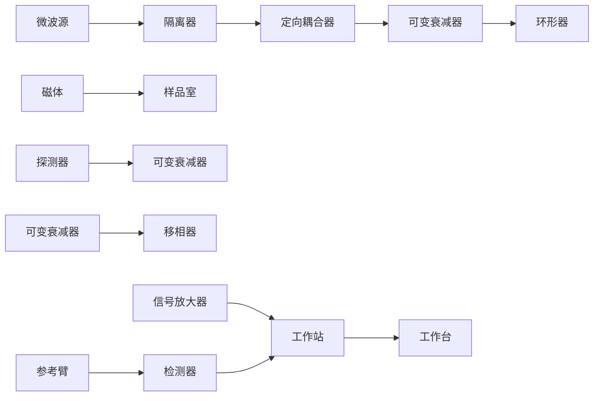

# 25 磁共振波谱

原始 PDF 第 735–766 页。

## 磁共振波谱

在结束光谱学的精彩旅程以后，我们继续踏入另一个引人入胜的领域:磁共振波谱学。不管是紫外、可见还是红外光谱，都是由外层电子的跃迁产生的。而磁共振现象顾名思义，它的出现需要外磁场的存在。此时，原子核和电子由于其固有的自旋属性将在磁场中产生能级分裂，从而能够吸收特定频率的电磁波。原子核的共振吸收发生在无线电波段，称为核磁共振；电子的共振吸收发生在微波波段，称为电子自旋共振。核磁共振部分接续第5章关于核磁的基本概念及其在结构生物学中的应用，介绍了该现象的量子力学描述、脉冲序列的原理，以及核磁方法在研究生物大分子构象动态方面的应用。电子自旋共振的部分则简要介绍了该方法的基本原理、定点自旋标记技术，及其在生物大分子结构和动态表征上的重要应用。需要特别注意的是，核磁共振的量子力学理论理解起来有一定难度，但实际上波函数和算符分别对应着线性代数中的向量和矩阵，学习中要将两者联系起来。

## 25

---

712

25 磁共振波谱

## 25.1 核磁共振波谱学

在第5章中我们介绍了核磁共振的基本理论和应用。假定有一个分子量 $15\mathrm{kDa}$ 的蛋白激酶，我们想用液态核磁共振方法来研究它的结构和功能。首先我们希望确认这个蛋白激酶是否和底物结合，以及结合强度和结合界面。我们表达 ${}^{15}\mathrm{N}$ 标记的蛋白质并采集HSQC二维谱，然后加入未标记的底物再次采集同样的二维谱。如果能观察到部分谱峰的位置或者强度发生了变化，则说明蛋白质确实和底物有结合。结合强度可以通过拟合谱峰位置（或强度）随底物浓度变化的曲线获得；结合界面可以通过将谱峰变化值映射到蛋白激酶三维结构上获得（参见5.3.4节），但要做到这一点需要利用一套三维实验指认出各个谱峰所对应的氨基酸残基（参见5.4.1节）。再进一步还可以通过一系列二维和多维实验获得结构约束，解析出蛋白激酶的溶液态三维结构。但是，若想理解这些二维和三维核磁实验的原理，必须对核磁共振的量子力学理论有一个初步认识。值得一提的是，核磁共振的量子力学描述可以作为第2章中量子力学基本理论的极佳示例。

## 25.1.1 核磁共振的量子力学描述

第5章介绍的核磁经典力学理论（参见5.2节）只能描述少数简单的核磁共振实验，比如一维氢谱。为了描述大多数更加复杂的核磁共振实验，有必要引入核磁的量子力学理论。实际上，核磁共振本质上就是带有自旋的原子核在磁场中发生的量子力学现象，只有用量子力学理论才能给出严谨完备的描述。

## (1) 核自旋的波函数和算符

和其它物理体系一样，核自旋体系的量子力学状态也是用波函数（wave function）来描述，波函数 $\Psi$ 的分布遵循薛定谔方程（Schrödinger equation）。本书第2章介绍了薛定谔方程的基本知识（2.5.2节），并着重讨论了它在电子轨道和分子键中的应用（2.5.3节）。这里我们探讨在磁场中的核自旋体系如何用该方程来描述。为方便起见，我们先简要复习薛定谔方程，并重点引入算符（operator）的概念。

算符在量子力学理论中非常重要，因为每个可观测的物理量都可以用一个对应的算符来表示。在数学上，算符是施加在某个函数上的一种运算，会产生一个新的函数。需要特别注意的是，当有多个算符存在时，算符的施加顺序是不可随意交换的。例如， $af(x)$  和  $\ln f(x)$  分别是对函数  $f(x)$  进行线性缩放和取自然对数的算符，但是  $\ln af(x) \neq a\ln f(x)$ 。

在波谱学中，最核心的观测量是共振频率，而共振频率在本质上代表的是能量 $(E=\hbar\omega)$ ，所以对于能量算符我们赋予了一个专门的名字，即哈密顿算符 $\hat{H}$ 。通常情况下 $\hat{H}$ 是随时间变化的，这时薛定谔方程是含时的 $^{*}$ :

<small>\* 与2.5.2节中的公式相比，方程中没有出现 $\hbar$ ，这是因为可以通过公式中物理量单位的选择（例如原子单位制）使得 $\hbar = 1$ 。</small>

---

25.1 核磁共振波谱学

713

$$
\mathrm{i} \frac {\partial \Psi (\boldsymbol {r} , t)}{\partial t} = \hat {H} \Psi (\boldsymbol {r}, t) 。 \tag {25-1}
$$

波函数  $\Psi(t)$  的取值是复数， $\Psi(t)$  里包含了描述该自旋体系所需要的所有状态信息。在时刻 t，体系处在某个自旋状态的概率为  $\left|\Psi(t)\right|^{2}=\Psi^{*}(t)\Psi(t)$ ，其中 “\*” 表示复共轭（知识窗 25-1）。由于我们假设在自旋空间里总是存在这么一个自旋体系，概率密度在全空间的积分必然等于 1，此即归一化的要求:

$$
\int \Psi^ {*} (\boldsymbol {r}, t) \Psi (\boldsymbol {r}, t) \mathrm{d} \boldsymbol {r} = 1,
$$

其中 $r$ 代表自旋空间变量。既然波函数里包含了自旋体系的所有状态信息，那么如何将这些信息提取出来呢？这时我们就需要对波函数施加一个合适的算符。

在核磁实验中，施加的射频场大小相对于静磁场强度可以忽略，大多数情况下 $\hat{H}$ 可被视为不随时间变化，此时薛定谔方程可以简化为如下不含时的形式:

$$
\hat {H} \Psi (\boldsymbol {r}) = E \Psi (\boldsymbol {r}) _ {\circ}
$$

根据该方程，在对波函数施加了哈密顿算符后，我们可以提取出自旋体系的能量（或者说共振频率）。

在自旋体系的量子力学描述中，除了哈密顿算符，还有两个算符特别重要，即描述自旋角动量模平方的算符 $\hat{I}^2$ 和描述自旋角动量在 $z$ 方向（即静磁场方向）分量的算符 $\hat{I}_z$ 。显然，这两个算符均可以从波函数中提取出相应的观测量，即 $\hat{I}^2\Psi = I(I + 1)\Psi$ 以及 $\hat{I}_z\Psi = m\Psi$ [参见式（5-1）和式（5-2)]。

在上述几个例子中，算符作用在波函数上得到了该波函数和某个常数的乘积。具有这样特性的波函数被称为该算符的本征函数（eigenfunction），对应的状态则称作本征态（eigenstate），而得到的常数被称为本征值（eigenvalue）。哈密顿算符的本征值即为该量子体系的能级（energy level），而哈密顿算符的本征状态则称作该体系的定态（stationary state）或者能量本征态（energy eigenstate）。

## 知识窗25-1

## 波函数的概率解释

薛定谔受到德布罗意的波粒二象性的启发，在1926年正式发表了薛定谔方程。由于该方程与经典物理学的波动方程形似，因此薛定谔将方程中的 $\Psi$ 称为波函数。有意思的是，薛定谔本人最初对波函数的物理意义也不清楚。1926年夏天，玻恩第一次提出了波函数的概率解释，即 $\Psi$ 的模平方代表粒子处在某状态的概率。这一解释破除了经典物理学的决定论思想，诠释了量子力学的统计本性，成为量子力学的基本假设之一。除了对波函数的统计诠释，玻恩还与约尔当以及海森堡共同创建了矩阵力学，而矩阵力学和薛定谔的波动力学是量子力学的不同表述形式。1932年海森堡单独获得诺贝尔物理学奖，第二年去信给玻恩表示“问心有愧”，因为工作是由三人共同完成的。而玻恩本人直到1954年才与博特共享了诺贝尔物理学奖，此时他已年过七旬，所以这是一个名副其实的迟到的诺奖。

---

714

25 磁共振波谱

我们先考虑一种简单的情况，即体系里只有一个自旋量子数为 $1/2$ 的原子核。这种情形下，存在两个本征波函数，记作 $\Psi_{\alpha}$ 和 $\Psi_{\beta}$，对应的自旋磁量子数分别为 $1/2$ 和 $-1/2$。可以证明这两个本征波函数是正交的，即 $\int \Psi_{\alpha}^{*} \Psi_{\beta} \mathrm{d}\sigma = 0$，也就是说，自旋向上和自旋向下是截然分明的状态，没有重叠的部分。一般情形下，$1/2$ 自旋核的波函数可以表示为两个本征波函数的线性叠加:$\Psi = c_{\alpha} \Psi_{\alpha} + c_{\beta} \Psi_{\beta}$。假设对单个原子核的能量进行一次测量，如果该原子核处于某个能量本征态，那么每次测量总是得到该本征态对应的能量值；如果原子核处于两个本征态的叠加，那么单次测量得到的将是两个能级中的一个，处在 $\alpha$ 能级的概率是 $|c_{\alpha}|^2$，处在 $\beta$ 能级的概率是 $|c_{\beta}|^2$。如果是对宏观样品进行能量测量，那么测量值（或者说能量算符的期望值）是 $\langle H \rangle = \int \Psi^{*}(t) \hat{H} \Psi(t) \mathrm{d}\sigma = E_{\alpha} |c_{\alpha}|^2 + E_{\beta} |c_{\beta}|^2$，注意这里利用了 $\hat{H} \Psi_{\alpha} = E_{\alpha} \Psi_{\alpha}$ 和 $\hat{H} \Psi_{\beta} = E_{\beta} \Psi_{\beta}$。如果我们测量的不是能量，而是其它观测量 $Q$，那么只要把 $\hat{H}$ 替换为 $Q$ 对应的算符 $\hat{Q}$，上述处理方式同样适用。

上面讨论的本征值和本征函数很容易令人联想到线性代数里的本征值和本征向量，它们确实有内在联系。要建立这种联系，我们需要用本征波函数作为基底，对自旋体系的状态空间进行线性化。要达到这个目的，我们首先引入狄拉克符号（Dirac notation）来简化波函数的表示形式，即波函数 $\Psi$ 可以用 $|\Psi\rangle$ 表示，而其复共轭 $\Psi^{*}$ 可以用 $\langle \Psi|$ 表示，其中“$|\rangle$”称为右矢符号（ket），“$||$”称为左矢符号（bra）。使用狄拉克符号，一个1/2自旋核的波函数可以写成下面的形式:

$$
\mid \Psi \rangle = c _ {\alpha} \mid \alpha \rangle + c _ {\beta} \mid \beta \rangle ,
$$

其中 $|\alpha\rangle$ 和 $|\beta\rangle$ 分别代表 $\alpha$ 态和 $\beta$ 态的本征函数。

左矢和右矢的乘积则代表积分操作，例如 $\int \Psi_1^*\Psi_2\mathrm{d}\sigma = \langle \Psi_1|\Psi_2\rangle$ 。而观测量 $Q$ 的期望值可以写成 $\langle Q\rangle = \int \Psi^{*}(t)\hat{Q}\Psi (t)\mathrm{d}\sigma = \langle \Psi |\hat{Q} |\Psi \rangle$ 。以 $|\alpha \rangle$ 和 $|\beta \rangle$ 作为自旋空间的正交基，那么波函数就可以表示为列向量，而波函数的复共轭则用行向量表示，其中符号“†”代表对向量或者矩阵的共轭转置运算:

text_image

y
u=[3/2]=3e_i+2e_j
e_j=[0/1]
O
x
e_i=[1/0]

图25-1 二维向量在平面直角坐标系中的表示方法

$$
\left\{ \begin{array}{l} | \alpha \rangle = \left[ \begin{array}{c} 1 \\ 0 \end{array} \right], \quad | \beta \rangle = \left[ \begin{array}{c} 0 \\ 1 \end{array} \right], \quad | \Psi \rangle = \left[ \begin{array}{c} c _ {\alpha} \\ c _ {\beta} \end{array} \right] _ {\circ} \\ \langle \alpha | = [ 1 \quad 0 ], \langle \beta | = [ 0 \quad 1 ], \langle \Psi | = [ c _ {\alpha} ^ {*} \quad c _ {\beta} ^ {*} ] = | \Psi \rangle^ {\dagger}. \end{array} \right.
$$

在与线性空间建立了联系后，一个波函数就可以类比为二维平面中的一个向量，而二维平面由两个正交基 $[1, 0]^{\mathrm{T}}$ 和 $[0, 1]^{\mathrm{T}}$ 来定义，分别是 $x$ 轴和 $y$ 轴的单位向量，如图25-1所示。

同理，归一化条件也可以用向量乘法来表达，即波函数所对应向量的模平方等于1:

$$
\langle \Psi | \Psi \rangle = \left[ \begin{array}{l l} c _ {\alpha} ^ {*} & c _ {\beta} ^ {*} \end{array} \right] \left[ \begin{array}{l} c _ {\alpha} \\ c _ {\beta} \end{array} \right] = | c _ {\alpha} | ^ {2} + | c _ {\beta} | ^ {2} = 1 _ {\circ}
$$

## (2) 自旋算符的矩阵表示

当把波函数用向量表示后，很自然地，对波函数做某

---

25.1 核磁共振波谱学

715

种运算的算符就可以用矩阵来表示。对于一个1/2自旋核来说，算符就表示为一个 $2\times2$ 的矩阵。算符的本征值和本征函数对应着矩阵的本征值和本征向量。我们可以通过两个本征向量—— $|\alpha\rangle$ 和 $|\beta\rangle$，以列向量和行向量相乘的形式人为地定义下面四种算符:

$$
\left\{ \begin{array}{l} | \alpha \rangle \langle \alpha | = \left[ \begin{array}{c} 1 \\ 0 \end{array} \right] [ 1 \quad 0 ] = \left[ \begin{array}{c c} 1 \times 1 & 1 \times 0 \\ 0 \times 1 & 0 \times 0 \end{array} \right] = \left[ \begin{array}{c c} 1 & 0 \\ 0 & 0 \end{array} \right] \equiv \hat {I} ^ {\alpha}, \\ | \alpha \rangle \langle \beta | = \left[ \begin{array}{c} 1 \\ 0 \end{array} \right] [ 0 \quad 1 ] = \left[ \begin{array}{c c} 1 \times 0 & 1 \times 1 \\ 0 \times 0 & 0 \times 1 \end{array} \right] = \left[ \begin{array}{c c} 0 & 1 \\ 0 & 0 \end{array} \right] \equiv \hat {I} ^ {+}, \\ | \beta \rangle \langle \alpha | = \left[ \begin{array}{c} 0 \\ 1 \end{array} \right] [ 1 \quad 0 ] = \left[ \begin{array}{c c} 0 \times 1 & 0 \times 0 \\ 1 \times 1 & 1 \times 0 \end{array} \right] = \left[ \begin{array}{c c} 0 & 0 \\ 1 & 0 \end{array} \right] \equiv \hat {I} ^ {-}, \\ | \beta \rangle \langle \beta | = \left[ \begin{array}{c} 0 \\ 1 \end{array} \right] [ 0 \quad 1 ] = \left[ \begin{array}{c c} 0 \times 0 & 0 \times 1 \\ 1 \times 0 & 1 \times 1 \end{array} \right] = \left[ \begin{array}{c c} 0 & 0 \\ 0 & 1 \end{array} \right] \equiv \hat {I} ^ {\beta}. \end{array} \right.
$$

我们先考察 $\hat{I}^{\alpha}$ 和 $\hat{I}^{\beta}$，将这两个算符分别作用于本征函数 $|\alpha\rangle$ 和 $|\beta\rangle$:

$$
\begin{array}{l} \left\{ \begin{array}{l} \hat {I} ^ {\alpha} | \alpha \rangle = | \alpha \rangle \langle \alpha | \cdot | \alpha \rangle = | \alpha \rangle \\ \hat {I} ^ {\alpha} | \beta \rangle = | \alpha \rangle \langle \alpha | \cdot | \beta \rangle = 0 \end{array} , \right. \\ \left\{ \begin{array}{l} \hat {I} ^ {\beta} | \alpha \rangle = | \beta \rangle \langle \beta | \cdot | \alpha \rangle = 0 \\ \hat {I} ^ {\beta} | \beta \rangle = | \beta \rangle \langle \beta | \cdot | \beta \rangle = | \beta \rangle^ {\circ} \end{array} \right. \\ \end{array}
$$

由此可见，$\hat{I}^{\alpha}$ 的本征函数为 $|\alpha\rangle$，$\hat{I}^{\alpha}$ 从 $|\alpha\rangle$ 提取出的信息为 1（即 $100\%$），从 $|\beta\rangle$ 提取出的信息为 0（即 $0\%$）；$\hat{I}^{\beta}$ 的本征函数为 $|\beta\rangle$，$\hat{I}^{\beta}$ 从 $|\alpha\rangle$ 提取出的信息为 0（即 $0\%$），从 $|\beta\rangle$ 提取出的信息为 1（即 $100\%$）。因此，$\hat{I}^{\alpha}$ 算符代表 $\alpha$ 态，$\hat{I}^{\beta}$ 算符代表 $\beta$ 态，如图 25-2 所示。这两个算符合称为投影算符（projection operator）。

我们再考察 $\hat{I}^{+}$ 和 $\hat{I}^{-}$，同样将它们分别作用于 $|\alpha\rangle$ 和 $|\beta\rangle$:

$$
\begin{array}{l} \left\{ \begin{array}{l} \hat {I} ^ {+} | \alpha \rangle = | \alpha \rangle \langle \beta | \cdot | \alpha \rangle = 0 \\ \hat {I} ^ {+} | \beta \rangle = | \alpha \rangle \langle \beta | \cdot | \beta \rangle = | \alpha \rangle , \end{array} \right. \\ \left\{ \begin{array}{l} \hat {I} ^ {-} | \alpha \rangle = | \beta \rangle \langle \alpha | \cdot | \alpha \rangle = | \beta \rangle \\ \hat {I} ^ {-} | \beta \rangle = | \beta \rangle \langle \alpha | \cdot | \beta \rangle = 0 \end{array} \right. 。 \\ \end{array}
$$

由此可见，$\hat{I}^{+}$会把 $\beta$ 态转化为 $\alpha$ 态，而 $\hat{I}^{-}$会把 $\alpha$ 态转化为 $\beta$ 态。从 $\beta$ 态到 $\alpha$ 态，磁量子数升高一个单位，因此 $\hat{I}^{+}$称作升算符（raising operator）；从 $\alpha$ 态到 $\beta$ 态，磁量子数降低一个单位，因此 $\hat{I}^{-}$称作降算符（lowering operator）。$\hat{I}^{+}$代表从高能级向低能级的跃迁，而 $\hat{I}^{-}$代表从低能级向高能级的跃迁，如图25-3所示。

$\hat{I}^{\alpha}$ 、 $\hat{I}^{\beta}$ 、 $\hat{I}^{+}$ 和 $\hat{I}^{-}$ 这四个算符矩阵彼此正交，构成了一个完备的算符空间。它们的非零元分别占据了 $2\times 2$ 的方阵的四个位置。根据四个算符的物理意义可知，方阵的主对角元代表着分布在两个能级上原子核的丰度（population），副对角元代表着能级跃迁导致的相位相干性（coherence），即核磁信号:

$$
\left[ \begin{array}{c c} \hat {I} ^ {\alpha} & \hat {I} ^ {+} \\ \hat {I} ^ {-} & \hat {I} ^ {\beta} \end{array} \right] \circ
$$

图 25-2 算符 $\hat{I}^{\alpha}$ 和 $\hat{I}^{\beta}$ 在能级图上的表现形式

chemical

Energy level diagrams showing electron transitions labeled Eα and Eβ with spin states i⁺ and i⁻

图 25-3 算符 $\hat{I}^{+}$ 和 $\hat{I}^{-}$ 在能级图上的表现形式

---

716

25 磁共振波谱

算符矩阵还可以用在笛卡尔坐标系中，这在分析核磁实验时往往更为方便。下面我们从 $\hat{I}^{\alpha}$ 、 $\hat{I}^{\beta}$ 、 $\hat{I}^{+}$ 和 $\hat{I}^{-}$ 四个算符出发来推导笛卡尔坐标系中的四个算符。首先把 $\hat{I}^{\alpha}$ 和 $\hat{I}^{\beta}$ 进行重新组合。$\hat{I}^{\alpha} + \hat{I}^{\beta}$ 代表两个能级上丰度之和，值总是为1（即 $100\%$），可以用单位矩阵 $\hat{E}$ 表示，那么有 $(\hat{I}^{\alpha} + \hat{I}^{\beta}) / 2 = \hat{E} / 2$。$\hat{I}^{\alpha} - \hat{I}^{\beta}$ 代表处于 $\alpha$ 态和 $\beta$ 态的原子核的丰度之差，所以 $(\hat{I}^{\alpha} - \hat{I}^{\beta}) / 2$ 表示 $\alpha$ 态的丰度高于 $50\%$ 的部分或者 $\beta$ 态丰度低于 $50\%$ 的部分。根据核磁共振的矢量模型，这个值与静磁场激发出的宏观磁化矢量成正比，我们把它记作 $\hat{I}_z$。由此，我们得到了两个新的算符，$\hat{E} / 2$ 和 $\hat{I}_z$。通过矩阵的加减运算可以得到 $\hat{E} / 2$ 和 $\hat{I}_z$ 的矩阵形式:

$$
\left\{ \begin{array}{l} \frac {\hat {I} ^ {\alpha} + \hat {I} ^ {\beta}}{2} = \left(\left[ \begin{array}{c c} 1 & 0 \\ 0 & 0 \end{array} \right] + \left[ \begin{array}{c c} 0 & 0 \\ 0 & 1 \end{array} \right]\right) / 2 = \frac {1}{2} \left[ \begin{array}{c c} 1 & 0 \\ 0 & 1 \end{array} \right] \equiv \frac {1}{2} \hat {E}, \\ \frac {\hat {I} ^ {\alpha} - \hat {I} ^ {\beta}}{2} = \left(\left[ \begin{array}{c c} 1 & 0 \\ 0 & 0 \end{array} \right] - \left[ \begin{array}{c c} 0 & 0 \\ 0 & 1 \end{array} \right]\right) / 2 = \frac {1}{2} \left[ \begin{array}{c c} 1 & 0 \\ 0 & - 1 \end{array} \right] \equiv \hat {I} _ {z _ {\circ}} \end{array} \right.
$$

接着我们对 $\hat{I}^{+}$ 和 $\hat{I}^{-}$ 进行重新组合。 $\hat{I}^{+}$ 代表着从高能级到低能级的跃迁，对应正的频率，即逆时针转动； $\hat{I}^{-}$ 代表着从低能级到高能级的跃迁，对应负的频率，即顺时针转动。正向和反向的转动组合起来能得到简谐振动，如图25-4所示。

图 25-4 两个沿相反方向转动的矢量可以合成为一个简谐振动的矢量

（A）如果两个转动矢量的初始位置都在正 $x$ 轴，那么得到的是在 $x$ 轴上的简谐振动。（B）如果两个转动矢量的初始位置都在正 $y$ 轴，那么得到的是在 $y$ 轴上的简谐振动。

由此，我们就得到了 $\hat{I}_{x}$ 和 $\hat{I}_{y}$ :

$$
\left\{ \begin{array}{l} \frac {\hat {I} ^ {+} + \hat {I} ^ {-}}{2} = \left(\left[ \begin{array}{c c} 0 & 1 \\ 0 & 0 \end{array} \right] + \left[ \begin{array}{c c} 0 & 0 \\ 1 & 0 \end{array} \right]\right) / 2 = \frac {1}{2} \left[ \begin{array}{c c} 0 & 1 \\ 1 & 0 \end{array} \right] \equiv \hat {I} _ {x}, \\ \frac {\hat {I} ^ {+} - \hat {I} ^ {-}}{2 \mathrm{i}} = \left(\left[ \begin{array}{c c} 0 & 1 \\ 0 & 0 \end{array} \right] - \left[ \begin{array}{c c} 0 & 0 \\ 1 & 0 \end{array} \right]\right) / 2 \mathrm{i} = \frac {1}{2 \mathrm{i}} \left[ \begin{array}{c c} 0 & 1 \\ - 1 & 0 \end{array} \right] \equiv \hat {I} _ {y ^ {\circ}} \end{array} \right.
$$

其中，$\hat{I}_y$ 项的分母多了一个 $\mathrm{i}$ 。这一点不难理解，因为沿 $x$ 轴的简谐振动和沿 $y$

轴的简谐振动只有在相位差为 $90^{\circ}$ 时才能合成为转动，即 $\hat{I}^{+} = \hat{I}_{x} + \mathrm{i}\hat{I}_{y},\hat{I}^{-} = \hat{I}_{x} - \mathrm{i}\hat{I}_{y}$ ，而虚数i就代表 $90^{\circ}$ 相移。

这四个笛卡尔坐标系算符同样构成了一个完备的算符空间。它们在能级图上对应的表示见图25-5。

当体系中有两个自旋核时，算符的矩阵形式拓展为 $4 \times 4$ ，可以由两个大小为 $2 \times 2$ 的算符矩阵进行外积获得。

text_image

Eβ
½E
îz
îx
îy
Eu

图 25-5 笛卡尔坐标系下的四个算符在能级图上的表现形式  $\hat{E}/2$  和  $\hat{I}_{z}$  代表自旋在两个能级上丰度的极化状态，其中空心圆圈表示丰度低于平均值，实心圆表示丰度高于平均值，没有圆圈代表丰度为平均值（即 50%）。 $\hat{I}_{x}$  和  $\hat{I}_{y}$  代表向上跃迁和向下跃迁的混合态，其中  $\hat{I}_{y}$  的虚线表示  $90^{\circ}$  的相移。

---

25.1 核磁共振波谱学

717

我们以 $I$ 和 $S$ 分别代表第一个和第二个自旋核。基于笛卡尔坐标系下的四个基算符 $\hat{E} / 2$ 、 $\hat{I}_z$ 、 $\hat{I}_x$ 和 $\hat{I}_y$ ，可以得到如下16个双自旋体系的标准化基算符\*: $\hat{E} / 2$ 、 $\hat{S}_z$ 、 $\hat{S}_x$ 、 $\hat{S}_y$ 、 $\hat{I}_z$ 、 $2\hat{I}_z\hat{S}_z$ 、 $2\hat{I}_z\hat{S}_x$ 、 $2\hat{I}_z\hat{S}_y$ 、 $\hat{I}_x$ 、 $2\hat{I}_x\hat{S}_z$ 、 $2\hat{I}_x\hat{S}_x$ 、 $2\hat{I}_x\hat{S}_y$ 、 $\hat{I}_y$ 、 $2\hat{I}_y\hat{S}_z$ 、 $2\hat{I}_y\hat{S}_x$ 、 $2\hat{I}_y\hat{S}_y$ 。例如，$2\hat{I}_z\hat{S}_y$ 和 $\hat{I}_z$ 可以按照如下的方法获得:

$$
2 \hat {I} _ {z} \hat {S} _ {y} = 2 \times \frac {1}{2} \left[ \begin{array}{c c} 1 & 0 \\ 0 & - 1 \end{array} \right] \textcircled {\times} \frac {1}{2} \left[ \begin{array}{c c} 1 & - \mathrm{i} \\ \mathrm{i} & 0 \end{array} \right] = \frac {1}{2} \left[ \begin{array}{c c c c} 0 & - \mathrm{i} & 0 & 0 \\ \mathrm{i} & 0 & 0 & 0 \\ 0 & 0 & 0 & \mathrm{i} \\ 0 & 0 & - \mathrm{i} & 0 \end{array} \right],
$$

$$
\hat {I} _ {z} = \hat {I} _ {z} \otimes \hat {E} = \frac {1}{2} \left[ \begin{array}{c c} 1 & 0 \\ 0 & - 1 \end{array} \right] \otimes \left[ \begin{array}{c c} 1 & 0 \\ 0 & 1 \end{array} \right] = \frac {1}{2} \left[ \begin{array}{c c c c} 1 & 0 & 0 & 0 \\ 0 & 1 & 0 & 0 \\ 0 & 0 & - 1 & 0 \\ 0 & 0 & 0 & - 1 \end{array} \right] 。
$$

类似地，$\hat{I}^{\alpha}$、$\hat{I}^{\beta}$、$\hat{I}^{+}$和$\hat{I}^{-}$这四个基算符也可以生成16个双自旋体系的基算符，此处不再赘述。

和单自旋体系类似，双自旋体系的基算符也可以用能级图来展示，图25-6给出了部分算符的能级示意图。注意 $\hat{S}_z = \hat{E}\hat{S}_z = (\hat{I}^\alpha +\hat{I}^\beta)\hat{S}_z$ ， $2\hat{I}_z\hat{S}_z = \frac{(\hat{I}^\alpha - \hat{I}^\beta)(\hat{S}^\alpha - \hat{S}^\beta)}{2} = \frac{1}{2} (\hat{I}^\alpha \hat{S}^\alpha -\hat{I}^\alpha \hat{S}^\beta -\hat{I}^\beta \hat{S}^\alpha +\hat{I}^\beta \hat{S}^\beta)$ 。而像 $2\hat{I}_y\hat{S}_x$ 这样的算符，也是进行类似的展开后再绘制能级示意图。

综上所述，单自旋体系存在4种基算符，而双自旋体系存在16种基算符。无论是单自旋还是双自旋体系，其任意一个状态都可以表示为相应基算符的线性叠加，或者说表示为相应能级示意图的线性叠加。而后者正是自旋算符的物理图像。

## （3）核磁共振的哈密顿算符和密度矩阵

如前文所述，在核磁共振中最重要的算符是哈密顿算符。哈密顿算符可以用上面

图 25-6 部分双自旋体系的算符在能级图上的表现形式

$\hat{S}_z$ 和 $2\hat{I}_z\hat{S}_z$ 代表自旋的极化状态，其中空心圆圈表示丰度低于平均值，实心圆表示丰度高于平均值。$\hat{I}^{+}$、$\hat{S}_y$、$\hat{I}^{-}\hat{S}^{\beta}$ 和 $\hat{I}^{+}\hat{S}^{-}$ 代表能级间的跃迁。

<small>\* 部分算符前的系数2是出于归一化的要求。</small>

---

718

25 磁共振波谱

介绍的基算符来表示，常用的哈密顿算符包括自由进动（free precession）、脉冲和J耦合等类型，如表25-1所示。

表 25-1 核磁共振中常用的哈密顿算符

| 算符类型 | 算符表示形式 |
| --- | --- |
| 自由进动(化学位移) | $\hat{H}_{\text{Zeeman}} = \omega_0 \hat{I}_z$(实验室坐标系)$= \Omega_0 \hat{I}_z$(旋转坐标系) |
| 脉冲 | $\hat{H}_{\text{pulse}} = \omega_1 \hat{I}_x (x\text{-pulse})$或 $\omega_1 \hat{I}_y (y\text{-pulse})$ |
| J耦合 | $\hat{H}_J = 2\pi J \hat{I}_z \hat{S}_z$(弱耦合近似) |

上面介绍的算符是用于描述单个分子中自旋体系的状态，实际的核磁样品里含有大量的分子。而核磁实验操纵和检测的是宏观磁化矢量，是全体分子中某个磁矩的宏观平均。单个分子中某个自旋核的微观磁矩总是与它的自旋角动量成正比，例如 $\mu_z\propto \hat{I}_z$ 、 $\mu_x\propto \hat{I}_x$ （参见5.2.2节）。假设单个自旋核的波函数可以表示为 $[c_{\alpha},c_{\beta}]^{\mathrm{T}}$ ，那么我们可以定义这样一个算符来表示该自旋核的状态:

$$
\mid \Psi \rangle \langle \Psi \mid = \left[ \begin{array}{c} c _ {\alpha} \\ c _ {\beta} \end{array} \right] [ c _ {\alpha} ^ {*} \quad c _ {\beta} ^ {*} ] = \left[ \begin{array}{c c} c _ {\alpha} c _ {\alpha} ^ {*} & c _ {\alpha} c _ {\beta} ^ {*} \\ c _ {\beta} c _ {\alpha} ^ {*} & c _ {\beta} c _ {\beta} ^ {*} \end{array} \right] 。
$$

对核磁样品的测量相当于对样品中所有感兴趣的自旋核所对应的算符取了系综平均（ensemble average），由此我们就得到了密度算符，其矩阵形式如下:

$$
\hat {\rho} = \overline {{| \psi \rangle \langle \psi |}} = \left[ \begin{array}{c c} \overline {{c _ {\alpha} c _ {\alpha} ^ {*}}} & \overline {{c _ {\alpha} c _ {\beta} ^ {*}}} \\ \overline {{c _ {\beta} c _ {\alpha} ^ {*}}} & \overline {{c _ {\beta} c _ {\beta} ^ {*}}} \end{array} \right] 。
$$

以单自旋体系为例（双自旋体系也可类似处理），在采用笛卡尔坐标系下的基算符时，密度矩阵可以写成

$$
\hat {\rho} (t) = a _ {\mathrm{E}} \hat {E} + a _ {x} (t) \hat {I} _ {x} + a _ {y} (t) \hat {I} _ {y} + a _ {z} (t) \hat {I} _ {z}, \tag {25-2}
$$

其中， $a_{\mathrm{E}}$ 对应体系里自旋核的总数，是一个不随时间变化的常数，我们不需要关心。$a_{x}$ 、 $a_{y}$ 、 $a_{z}$ 对应宏观磁化矢量的三个分量，即

$$
M _ {x} \propto a _ {x} (t), M _ {y} \propto a _ {y} (t), M _ {z} \propto a _ {z} (t) 。
$$

在得到某个自旋状态的密度矩阵 $\hat{\rho}$ 后，观测量 $Q$ 的期望值可以通过如下公式计算:

$$
\langle Q \rangle = \mathrm{tr} \{\hat {\rho} \hat {Q} \} = \mathrm{tr} \{\hat {Q} \hat {\rho} \},
$$

其中，tr代表矩阵的迹。在下个小节，我们将讨论在核磁实验中密度矩阵如何随时间演化。

## 25.1.2 核磁实验的脉冲序列

在运行核磁实验的时候，我们首先把核磁样品加载到磁体中央的探头线圈中，然后施加核磁脉冲序列（pulse sequence），最后检测探头线圈中产生的核磁信号。核磁脉冲序列是核磁实验的灵魂，由一系列受到精确控制的脉冲（pulse）和时间延迟

---

25.1 核磁共振波谱学

719

（delay）组成，很多核磁实验的脉冲序列还会包含梯度场（gradient field）。在核磁实验开始前，样品里的自旋体系处于平衡状态，外加磁场在样品中激发出宏观磁化矢量 $M_{z}$，根据式（25-2），其对应的密度矩阵是 $\hat{\rho}(0) = \hat{I}_{z}$。因此核磁实验本质上就是从密度矩阵 $\hat{I}_{z}$ 出发，经过脉冲序列的演化后得到可测量的新的密度矩阵。

那么密度矩阵如何在脉冲序列的作用下演化呢？在知识窗5-2中，我们从牛顿运动方程推导出了经典力学框架下描述核磁共振现象的布洛赫方程。类似地，我们也可以从含时的薛定谔方程[式（25-1）]出发推导出量子力学框架下描述核磁共振现象的刘维尔-冯·诺依曼方程（Liouville-von Neumann equation）:

$$
\frac {\mathrm{d}}{\mathrm{d} t} \hat {\rho} = - \mathrm{i} [ \hat {H}, \hat {\rho} ] _ {\circ}
$$

方程里出现的中括号代表算符的对易运算，其定义为

$$
[ \hat {A}, \hat {B} ] = \hat {A} \hat {B} - \hat {B} \hat {A} _ {\circ}
$$

这个微分方程的解是

$$
\hat {\rho} (t) = \mathrm{e} ^ {- \mathrm{i} \hat {H} t} \hat {\rho} (0) \mathrm{e} ^ {\mathrm{i} \hat {H} t},
$$

其中 $\hat{H}$ 是核磁脉冲序列运行过程中作用于自旋体系的哈密顿算符（表25-1）。这个公式的形式是 $\hat{\rho}(0)$ 被夹在两个互逆的指数算符中间，因此又称为三明治公式（sandwich formula）。在计算密度矩阵的演化时，需要把脉冲序列按脉冲和时间延迟分割成多个时间区域，各区域中 $\hat{H}$ 保持不变。在每个区域运用刘维尔-冯·诺依曼方程，即可从始态密度算符推导出终态密度算符。这样从 $\hat{\rho}(0) = \hat{I}_z$ 出发，依次运用该方程，即可获得核磁脉冲结束时待测核磁信号的密度算符。

最后，我们以HSQC实验为例，简要分析其脉冲序列（图25-7）。该脉冲序列可以分为三段:从（1）到（2），宏观磁化矢量从自旋核H传递到N；从（2）到（3），磁化矢量在 ${}^{15}\mathrm{N}$ 上进行时长为 $t_1$ 的演化；从（3）到（4），磁化矢量从自旋核N传递到H。最后在 $t_2$ 上采集FID。下面我们对这三个阶段逐一进行说明。

从（1）到（2）:

初始状态的密度矩阵算符是 $H_{z}$，经过第一个 $90^{\circ}$ 脉冲后变成 $-H_{y}$。在随后的 $2\tau_{1}$ 的时间中，由于两个同时施加的 $180^{\circ}$ 脉冲的存在，无须考虑化学位移的演化，在J耦合哈密顿量的作用下算符转化为 $2H_{x}N_{z}$。最后，两个同时施加的 $90^{\circ}$ 脉冲使得算符变为 $2H_{z}N_{y}$。在该算符中，H保持在 $z$ 轴而N转到 $xy$ 平面做进动，因此 $2H_{z}N_{y}$ 和 $N_{y}$

text_image

H
τ₁ τ₁ y
τ₂ τ₂ t₂
N
(1) (2) (3) (4)
t₁

图 25-7 NH-HSQC 的脉冲序列

窄竖条代表 $90^{\circ}$ 脉冲，宽竖条代表 $180^{\circ}$ 脉冲，浅蓝色实心横条代表去耦脉冲。时长$\tau_{1}$ 和 $\tau_{2}$ 均被设置为 $1 / (4J)$ 其中 $J$ 为 ${}^{1}\mathrm{H}$ 和 ${}^{15}\mathrm{N}$ 之间的J耦合常数。

---

720

25 磁共振波谱

一样都代表转移到 N 上的磁化矢量。

从（2）到（3）:

在此过程中由于N上未施加 $180^{\circ}$ 脉冲，因此 $2H_{z}N_{y}$ 将在N上进行化学位移的演化，而J耦合的演化无须考虑。算符经演化变成 $2H_{z}N_{y}\cos \Omega_{\mathrm{N}}t_{1}$，此时我们称算符带上了 ${}^{15}\mathrm{N}$ 化学位移的标签。

从（3）到（4）:

这是第一阶段的逆过程，算符 $2H_{z}N_{y}$ 演化为 $H_{x}$，再加上前一阶段添加的 ${}^{15}\mathrm{N}$ 化学位移的标签，在（4）这个时间点密度矩阵算符成为 $H_{x}\cos \Omega_{\mathrm{N}}t_{1}$。

最后就是FID的采集，即 $H_{x}$ 在 $xy$ 平面进动，为算符进一步带上了 ${}^{1}\mathrm{H}$ 化学位移的标签。由于在此阶段对N进行去耦，可忽略J耦合的影响。由此我们就同时测量到了N上的共振频率和H上的共振频率。

蛋白质的所有NH基团在脉冲序列的作用下同时完成上述过程，最终我们就得到了二维HSQC谱。

## 25.1.3 核磁共振的弛豫和构象动态研究

生物大分子在溶液中广泛存在从皮秒到秒以及更慢时间尺度的构象动态（知识窗25-2）。构象的动态性与生物大分子的功能息息相关，例如酶的催化、配体的识别、折叠与去折叠、别构调控、生物大分子机器的装配等。与X射线晶体衍射和冷冻电镜方法相比，核磁共振方法在研究生物大分子构象动态方面有显著的优势，在各个

## 知识窗25-2

## 蛋白质构象动态的早期研究

物理学家费曼（Richard Feynman，1918—1988）曾经说过，生命所做的一切都可以通过原子的抖动（jiggling）和摇摆（wiggling）来理解。生物大分子的功能不仅由其结构决定，也与其构象动态息息相关。在20世纪中叶蛋白质晶体结构解析方法建立后的一段时期，蛋白质分子被描绘成具有比较刚性的静态结构。到了70年代，蛋白质内在的动态性通过计算和实验方法的发展被逐步揭示出来。在计算层面，卡普拉斯（Martin Karplus，1930—2024）和合作者在1977年首次将分子动力学模拟应用在蛋白质上。该模拟以包含58个氨基酸残基的BPTI蛋白为对象，尽管使用的力场比较粗糙，在真空中进行，且时长也仅仅只有9.2皮秒，但这一开创性的工作改变了我们对于蛋白质结构相对刚性的看法。在实验层面，核磁波谱学家在同一时期通过检测BPTI蛋白和溶菌酶上芳香残基侧链亚氨基的'H谱峰，发现这些芳香环存在翻转运动。由于芳香环常常位于蛋白质的疏水核心，这些结果表明蛋白质分子很可能广泛存在着内部运动。此后，随着同位素标记方法和多维核磁谱的出现，以及脉冲序列和硬件的不断进步，核磁共振技术在生物大分子构象动态研究中发挥了关键作用，并且通过与分子动力学模拟的深度融合，为这一领域的研究提供了强有力的工具。

---

25.1 核磁共振波谱学

721

text_image

蛋白质的运动
芳香环翻转
甲基旋转 侧链摆动 二硫键反转
环区快速摆动 环区慢速摆动 化学反应动力学
化学键振动 整体翻转 局部折叠/去折叠 整体折叠/去折叠
10^-12 10^-9 10^-6 10^-3 10^0 10^3
运动的时间尺度/s
自旋弛豫（R₁, R₂, NOE） 弛豫弥散和化学交换饱和转移 ZZ-交换谱 实时 NMR
残余偶极耦合(RDC) 氢气交换

核磁共振方法

时间尺度上都有相应的核磁方法来测量（图 25-8）。

这里我们重点介绍两类这样的方法，一类是自旋弛豫方法（spin relaxation）（参见5.3.1节），另一类是基于构象交换的测量方法。前者通过对 $R_{1}$ 、 $R_{2}$ 、NOE等自旋弛豫速率的测量，可以探测皮秒到纳秒时间范围的构象动态。后者可以检测微秒到秒时间范围的构象转换，尤其是丰度低、寿命短的瞬态构象，其中包括弛豫弥散（relaxation dispersion, RD）、化学交换饱和转移（chemical exchange saturation transfer, CEST）以及ZZ-交换谱（ZZ-exchange spectroscopy）等方法。仍以前文中提到的蛋白激酶为例。酶的催化功能与其结构上的柔性息息相关，而自旋弛豫方法可以揭示该蛋白质中各个残基内部运动的幅度和快慢，有助于我们深入理解其功能。此外，蛋白激酶在生理条

件下有时候存在一个或多个低丰度构象。某些疾病相关突变或者配体结合通过改变酶蛋白在多种构象间的平衡来调控其生理功能，因此通过弛豫弥散等方法对这些低丰度构象进行原子分辨率的测量具有重要的生物学意义。

## (1) 自旋弛豫方法

$^{15}$ N 的  $R_{1}/R_{2}/NOE$  是在蛋白质中应用最为普遍的自旋弛豫方法。要理解这种方法，我们需要先解释自旋弛豫是如何与蛋白质的运动产生关联的。我们以一个包含 76 个氨基酸残基的泛素蛋白为例，这个蛋白质在水溶液中的运动过程可以通过分子动力学模拟来获得（图 25-9）。对于这类折叠得很好的蛋白质来说，存在两种运动:一种是在水溶液里随机的整体翻转运动（overall tumbling），另一种是分子的内部运动（internal motion）。在两种运动的作用下，蛋白质的每个 N—H 键都在不停地做重定向运动（reorientation）。自旋弛豫方法的目的就是获取每个 N—H 键重定向运动的幅度和快慢。

分子运动与自旋弛豫速率有密切关系。弛豫过程实际上是自旋体

图25-8 核磁共振可以在原子分辨率上表征生物大分子跨越十多个数量级时间尺度的运动这里以蛋白质分子为例，时间轴上方是蛋白质在各个时间尺度上的运动，下方是适用的核磁共振技术。

natural_image

3D ribbon diagram of a protein structure with alpha helices and beta sheets (no text or labels)

图25-9 泛素蛋白分子动力学模拟的快照三维构象上展示的是主链上每个NH基团，蓝色小球代表N原子，红色小棍代表N—H键。

---

722

25 磁共振波谱

图25-10 受运动调制的附加磁场产生的两种机制（A）附近原子核对所测核通过偶极相互作用施加的局部磁场。（B）化学位移各向异性作用，即测量核周边电子分布（这里以芳香环的离域电子为例）对外加静磁场的屏蔽作用。

系从非平衡态回到平衡态的过程。在这个过程中，除了外加的静磁场，原子核还会感受到分子运动所导致的附加磁场的波动。这种附加磁场的来源主要有两个:一个是空间上邻近的自旋核对所测原子核的偶极相互作用（dipolar interaction），即邻近核发出的磁场作用在测量核上（图25-10A）；另一个是化学位移各向异性（chemical shift anisotropy，CSA），即测量核周围电子分布对静磁场的屏蔽作用（图25-10B）。这两种作用都受到分子运动的调制，因此产生的附加磁场也随着分子运动而产生波动。这种附加磁场的波动包含了不同的频率分量，有些频率分量正好与 $^{15}$ N所在自旋体系中的能级差匹配，因此能够帮助自旋体系更快地回复到平衡态。换句话说，分子运动导致了附加磁场的波动，而这种波动包含的某些频率分量对弛豫速率产生了贡献。所以，通过分析测量到的弛豫速率，我们就可以推导出分子的运动情况。

那么，从分子运动出发该如何定量磁场波动在各个频率上的成分呢？我们先考虑偶极相互作用。对于 $^{15}\mathrm{N}$ 来说，由于紧邻的 $\mathbf{H}^{\mathrm{N}}$ 与它距离最近且旋磁比也最大，所以$^{15}\mathrm{N}$ 受到的偶极相互作用绝大多数来自 $\mathbf{H}^{\mathrm{N}}$ 。然后是 $^{15}\mathrm{N}$ 的化学位移各向异性作用。人们经过测量发现，化学位移各向异性效应最大的方向与N—H键的方向大体上是重合的。综合上述两方面的因素，N—H键的重定向运动主导了 $^{15}\mathrm{N}$ 所感受到的磁场波动。由此可见， $^{15}\mathrm{N}$ 的弛豫速率与分子运动的关系比较简单，易于进行定量分析，而且NH-HSQC谱图性质优良，因此 $^{15}\mathrm{N}$ 的自旋弛豫测量获得了广泛的应用。

下面以泛素蛋白为例来解释如何在分子运动与弛豫速率之间建立定量关系。我们首先讨论如何从泛素蛋白的分子动力学模拟轨迹计算自旋弛豫速率。在此基础上，我们才可以讨论如何从测量的自旋弛豫速率获得每个N—H键重定向运动的参数。

N—H键重定向运动可以通过自相关函数（autocorrelation function）来定量描述。对于一个随时间随机波动的信号，我们可以计算该信号与其自身沿时间轴平移 $\tau$ 之后的相关系数，而该相关系数对 $\tau$ 的函数就是自相关函数。在 $\tau = 0$ 时，两个信号完全相同，相关系数为1；当 $\tau$ 逐渐增大时，相关系数逐渐衰减，衰减的快慢反映了随机波动的快慢（图25-11）。

图25-11 自相关函数（A）随时间快速波动的信号（左）和对应的自相关函数（右）。（B）随时间慢速波动的信号（左）和对应的自相关函数（右）。

---

25.1 核磁共振波谱学

723

## 知识窗25-3

## N—H 键重定向运动的自相关函数

从分子动力学模拟出发，我们可以提取每一个 N—H 键随时间变化的轨迹，如图 25-12 所示。将这一轨迹序列平移后与其自身按下面的公式计算相关系数:

$$
C (\tau) = \left\langle P _ {2} (\boldsymbol {u} (0) \cdot \boldsymbol {u} (\tau)) \right\rangle_ {\circ}
$$

其中 $P_{2}(x) = (3x^{2} - 1) / 2$ ，是二阶勒让德函数； $\pmb {u}(0)$ 和$u(\tau)$  分别为两条轨迹的重叠部分中来自原始轨迹和来自平移  $\tau$  时间后轨迹的 NH 单位矢量。得到的随时间衰减的自相关函数可以分解为一个或多个指数衰减项  $a_{i}e^{-t/\tau_{i}}$  的加和，其中  $a_{i}$  代表第 i 个运动组分的幅度， $\tau_{i}$  代表该运动组分的特征时间。

text_image

τ₁
τ₂

图25-12 自相关函数的计算

分子动力学模拟轨迹中提取出的某个NH矢量的时间序列（第1行），以及将该矢量序列沿时间轴滑移 $\tau_{1}$ 和 $\tau_{2}$ 之后的序列（第2、3行）。

如前所述，对于泛素这类有固定三维结构的蛋白质来说，其分子内运动与蛋白质在溶液中的整体翻转运动可以被清楚地分开，并且前者被后者所调制。此时蛋白质每个N—H键的自相关函数（知识窗25-3）都是描述内部运动的自相关函数与描述整体翻转运动的自相关函数的乘积:

$$
C (t) = C _ {\mathrm{I}} (t) C _ {0} (t) \text {。}
$$

我们假定蛋白质的整体翻转是各向同性的 $^{*}$ ，其特征时间记作 $\tau_{m}$ ，那么 $C_{0}(t)=\mathrm{e}^{-t/\tau_{m}}$ 。更重要的部分是 $C_{1}(t)$ ，因为内部运动与蛋白质功能更相关。要从分子动力学轨迹得到 $C_{1}(t)$ ，我们需要把轨迹里的每个构象都转到与初始构象相同的朝向，这样就消除了整体翻转运动。如果对泛素蛋白在 $\alpha$ 螺旋、连接环和无序尾部这三个区域里各选择一个氨基酸残基的N—H键，分别代表刚性、有一定柔性和非常有柔性这三种情况，计算得到的 $C_{1}(t)$ 如图25-13所示。

这三个残基的内部运动自相关函数经过衰减后都出现了一个平台区。残基越有柔性，N—H键空间朝向的分布越分散，平台值越低。我们把平台区的高度定义为序参数（order parameter），用 $S^2$ 表示，取值范围是 $0\sim 1$ ，0代表完全无序，1代表完全刚性。位于平台区之前的衰减曲线可以分解成一个或多个指数衰减项，每个衰减项的特

<small>\* 整体形状大体上是球形的蛋白质都符合这种情况。</small>

---

724

25 磁共振波谱

scatter_3d

| Time (ns) | C(t) |
| --- | --- |
| 0 | ~0.92 |
| 500 | ~0.92 |

line

| 时间/ns | C(t) |
| --- | --- |
| 0 | ~0.75 |
| 100 | ~0.65 |
| 200 | ~0.65 |
| 300 | ~0.64 |
| 400 | ~0.63 |
| 500 | ~0.62 |

line

| 时间 (ns) | C(t) |
| --- | --- |
| 0 | ~0.15 |
| 100 | ~0.05 |
| 200 | ~0.05 |
| 300 | ~0.05 |
| 400 | ~0.05 |
| 500 | ~0.05 |

图25-13 泛素蛋白分子动力学模拟中A28、T9和G76的N—H键内部运动对应的自相关函数三个残基分别处在 $\alpha$ 螺旋、连接环和无序尾部，在蛋白质三维结构中用红色标出。每个子图还展示了N—H键中氢原子在以氮原子为中心的球面上的散点分布图。

征时间记作  $\tau_{i}^{\prime}$ ，因此  $C_{1}(t)=a_{1}\mathrm{e}^{-t/\tau_{1}^{\prime}}+a_{2}\mathrm{e}^{-t/\tau_{2}^{\prime}}+\cdots+S^{2}$ ，其中  $a_{1}+a_{2}+\cdots+S^{2}=1$ 。而完整的自相关函数可以写成:

$$
C (t) = (a _ {1} \mathrm{e} ^ {- t / \tau_ {1} ^ {\prime}} + a _ {2} \mathrm{e} ^ {- t / \tau_ {2} ^ {\prime}} + \dots + S ^ {2}) \mathrm{e} ^ {- t / \tau_ {\mathrm{m}}} = \sum_ {i} a _ {i} \mathrm{e} ^ {- t / \tau_ {i}}
$$

其中 $\tau_{i} = \frac{1}{1 / \tau_{i}' + 1 / \tau_{\mathrm{m}}}$，代表内部运动组分 $\tau_{i}'$ 被 $\tau_{\mathrm{m}}$ 调制后的结果。注意，在上式中 $S^2$ 对应的那一项可以看作幅度为 $S^2$，特征时间为无穷大的内部运动组分，因此调制后的特征时间为 $\tau_{\mathrm{m}}$。

接下来我们需要从自相关函数中获得不同频率下的分量，方法是施加傅里叶变换然后取实部，得到的函数称为谱密度函数（spectral density function）:

$$
J (\omega) = \mathrm{Re} \left(\frac {1}{5} \int_ {- \infty} ^ {\infty} \sum_ {i} a _ {i} \mathrm{e} ^ {- t / \tau_ {i}} \cdot \mathrm{e} ^ {- i \omega t} \mathrm{d} t\right) = \frac {2}{5} \sum_ {i} \frac {a _ {i} \tau_ {i}}{1 + \omega^ {2} \tau_ {i} ^ {2}}
$$

$^{15}$ N 的纵向弛豫速率  $R_{1}$  、横向弛豫速率  $R_{2}$  以及  ${}^{15}$ N 和  ${}^{1}$ H 之间的交叉弛豫速率  $\sigma_{NH}$  是由  $J(\omega)$  在不同频率分量的线性加和来决定的  $^{*}$ ，反映了分子运动导致的局部磁场波动中特定频率分量对弛豫速率所产生的贡献（知识窗 25-4）。

从自旋弛豫速率的公式出发，我们可以绘出三种自旋弛豫速率对N—H键重定向特征时间的依赖曲线（图25-14）。由图中可见， $R_{1}$ 对纳秒尺度（0.1 ns到十几纳秒）的运动比较敏感， $R_{2}$ 对慢速运动（慢于十几纳秒）很敏感，而NOE对快速运动（几百皮秒）比较敏感。生物大分子的分子量越大，在水溶液中的整体翻转运动就越慢，因而每个化学键的重定向运动也越慢，进而导致 $R_{2}$ 比较大，谱峰展宽明显。这就解释了我们在5.3.1节中提到的分子量大小对核磁测量的限制。

到目前为止，我们可以从分子动力学模拟轨迹出发，提取出每个N—H键重定向运动的特征参数，然后计算出自旋弛豫速率 $R_{1}$ 、 $R_{2}$ 和NOE。那么如果我们已经通过实验得到了这三组自旋弛豫速率，如何才能从中提取出关于NH重定向运动的特征参数呢？这时我们需要做无模型（model-free）分析（也称作Lipari-Szabo分析）。

无模型分析方法的前提条件是分子的整体翻转运动与内部运动之间有比较清晰

<small>\* 在 $R_{2}$ 表达式中有一项 $R_{ex}$ 代表化学交换的贡献，将在下文中讨论。</small>

---

25.1 核磁共振波谱学

725

## 知识窗25-4

## $^{15}$ N 自旋弛豫速率的公式

自旋弛豫速率  $R_{1}$ 、 $R_{2}$  和 NOE 可以表达为下面的公式:

$$
\left\{ \begin{array}{l} R _ {1} = \frac {d ^ {2}}{4} \left[ J (\omega_ {\mathrm{H}} - \omega_ {\mathrm{N}}) + 3 J (\omega_ {\mathrm{N}}) + 6 J (\omega_ {\mathrm{H}} + \omega_ {\mathrm{N}}) \right] + C ^ {2} J (\omega_ {\mathrm{N}}), \\ R _ {2} = \frac {d ^ {2}}{8} \left[ 4 J (0) + J (\omega_ {\mathrm{H}} - \omega_ {\mathrm{N}}) + 3 J (\omega_ {\mathrm{N}}) + 6 J (\omega_ {\mathrm{H}}) + 6 J (\omega_ {\mathrm{H}} + \omega_ {\mathrm{N}}) \right] + \frac {C ^ {2}}{6} \left[ 4 J (0) + 3 J (\omega_ {\mathrm{N}}) \right] + R _ {\mathrm{ex}} 。 \\ \sigma_ {\mathrm{NH}} = \frac {d ^ {2}}{4} \left[ 6 J (\omega_ {\mathrm{H}} + \omega_ {\mathrm{N}}) - J (\omega_ {\mathrm{H}} - \omega_ {\mathrm{N}}) \right] 。 \end{array} \right.
$$

其中， $c = \Delta_{\mathrm{N}} / \sqrt{3}$ ， $d = \mu_0\hbar \gamma_{\mathrm{H}}\gamma_{\mathrm{N}} / (4\pi r_{\mathrm{HN}}^3)$ ，分别是偶极相互作用和化学位移各向异性所对应的常数； $\Delta_{\mathrm{N}}$ 是以 $\mathrm{Hz}$ 为单位的 $^{15}\mathrm{N}$ 化学位移各向异性值， $\mu_0$ 为真空磁导率； $\omega_{\mathrm{H}}$ 和 $\omega_{\mathrm{N}}$ 分别为 ${}^{1}\mathrm{H}$ 和 $^{15}\mathrm{N}$ 的拉莫尔频率。实验测量的NOE值与 $\sigma_{\mathrm{NH}}$ 有如下关系:

$$
\mathrm{NOE} = 1 + \frac {\gamma_ {\mathrm{H}}}{\gamma_ {\mathrm{N}}} \cdot \frac {\sigma_ {\mathrm{NH}}}{R _ {1}} 。
$$

图25-14 $^{15}\mathrm{N}R_{1}$ 、 $R_{2}$ 和NOE对N—H键重定向运动特征时间的依赖曲线橙线和蓝线分别对应600MHz核磁仪和1GHz核磁仪下的模拟结果。

的界限，通常折叠得比较好的生物大分子都满足这个条件。该方法假定每个残基的内部运动只有一个主要成分 $^{*}$ 。以 ${}^{15}N$ 自旋弛豫实验为例，内部运动可由每个N—H键各自的内部运动的特征时间来代表。同时，所有的N—H键都要经历共同的整体翻转，同样可以由一个单独的整体翻转特征时间来代表。从自旋弛豫的实验数据出发，我们不仅可以得到蛋白质分子整体翻转的特征时间，更重要的是可以获得每个残基内部运动的序参数和特征时间，后两者分别反映了残基的空间动态性和时间动态性（知识窗25-5）。

<small>\* 对蛋白质的大多数残基位点，该假定都是成立的。少数位点的内部运动存在两种或更多的主要成分，此时需要用拓展的无模型方法来处理。</small>

---

726

25 磁共振波谱

## 知识窗25-5

## 无模型分析方法

假设蛋白质某个残基 N—H 键的内部运动特征时间为  $\tau_{e}$ ，并且整体翻转运动是各向同性的，特征时间记作  $\tau_{m}$ ，那么自相关函数可以写为

$$
C (t) = C _ {\mathrm{I}} (t) C _ {\mathrm{O}} (t) = [ (1 - S ^ {2}) \mathrm{e} ^ {- t / \tau_ {\mathrm{e}}} + S ^ {2} ] \mathrm{e} ^ {- t / \tau_ {\mathrm{m}}},
$$

相应的谱密度函数为

$$
J (\omega) = \frac {2}{5} \bigg [ S ^ {2} \frac {\tau_ {\mathrm{m}}}{1 + \omega^ {2} \tau_ {\mathrm{m}} ^ {2}} + (1 - S ^ {2}) \frac {\tau}{1 + \omega^ {2} \tau^ {2}} \bigg ],
$$

其中 $\tau = (1 / \tau_{\mathrm{m}} + 1 / \tau_{\mathrm{e}})^{-1}$，是内部运动受整体翻转调制后的

约化特征时间。

如果  ${}^{15}N$  自旋弛豫实验一共测到了 n 个残基的数据，那么已知的弛豫速率一共有 3n 个，未知的则有 n 个  $S^{2}$ 、n 个  $\tau_{e}$ 、1 个  $\tau_{m}$ ，共计  $2n+1$  个参数。由此我们就可以利用自旋弛豫速率的公式（知识窗 25-4）拟合出整体翻转特征时间  $\tau_{m}$  以及每个残基的  $S^{2}$  和  $\tau_{e}$ ，其中  $S^{2}$  反映每个残基在空间上的动态性，而  $\tau_{e}$  反映每个残基在时间上的动态性。

text_image

基态 ← → 激发态
95% 5%

图25-15 在基态和激发态之间转换的RNA分子

在两个状态之间碱基对发生了滑移，构象交换发生在微秒到毫秒的时间尺度内。

## (2) 弛豫弥散方法

生物大分子在溶液中除了有丰度很高、自由能最低的基态（ground state，GS）构象外，还存在着高自由能构象状态，称为激发态（excited state，ES）或者瞬态（transient state）。激发态构象由于丰度低、寿命短，难以用其它生物物理手段来表征其结构，因此有时也被称作不可见状态（invisible state）。核磁共振的弛豫弥散方法是检测激发态构象并表征其结构的强有力工具。

假定有一个核酸分子在基态和激发态之间互相转换，如果构象交换发生在微秒到毫秒时间尺度内，就适合应用弛豫弥散方法。值得注意的是，微秒到毫秒是一个非常重要的时间范围，大多数重要的生物学过程都发生在这个范围内。由于两个构象有所区别，总有一些原子核在两个构象中的化学位移有差别。我们可以用一

个两态模型来表示在两种化学位移之间切换的原子核（图25-15）。

弛豫弥散方法包括 CPMG（Carr-Purcell-Meiboom-Gill）和  $R_{1\rho}$  这两种实验。在 5.4.4 节中我们解释了中速化学交换会导致谱峰展宽（或者说  $R_{2}$  的增大），而微秒到毫秒的时间尺度通常就处于中速交换的范围。这种谱峰展宽效应也是该方法的名称中“弥散”两字的由来。为了获取化学交换的信息，我们需要用某种方法对交换产生的谱峰展宽效应进行调制，CPMG 和  $R_{1\rho}$  采用的是基于自旋回波（spin echo）的方法。假设样品中的待测原子核有的处于基态，有的处于激发态，然后我们让这些原子核经历一个自旋回波脉冲序列，那么只要在这段时间内没有发生化学交换，这些原子核由于化学位移不同所产生的分散效应将被完全消除（图 25-16A）。CPMG 方法使用由一系列等距排列的  $180^{\circ}$  脉冲组成的脉冲队列（图 25-16B）。而  $R_{1\rho}$  方法使用一段连续的长脉冲，实际上相当于多个  $180^{\circ}$  脉冲头尾相连（图 25-16C），因此与 CPMG 本质上是一样的。

---

25.1 核磁共振波谱学

727

$180^{\circ}$ 脉冲队列对谱峰展宽有抑制作用，脉冲越密集，抑制作用越显著（图25-17A、B）。当测量不同脉冲队列频率下的 $R_{2}$ 弛豫速率（$R_{2,\mathrm{eff}} = R_2 + R_{\mathrm{ex}}$），会得到一条逐渐衰减的曲线（图25-17C）。对这样的曲线进行拟合，就能获得激发态的丰度 $p_{\mathrm{B}}$、正向反

(A)

(B)

bar

| Category | Value |
| --- | --- |
| 1 | \(\pi\) |
| 2 | \(\pi\) |
| 3 | \(\pi\) |
| 4 | \(\pi\) |
| 5 | \(\pi\) |
| 6 | \(\pi\) |
| 7 | \(\pi\) |

(C)

text_image

R₁ρ

natural_image

Blue gradient vertical stripes on white background (no text or symbols)

图25-16 CPMG和 $R_{1p}$ （A）自旋回波可以消除由于化学位移不同而产生的分散效应。用两个速度不同的人代表化学位移不同的两种状态。在时间零点，两人同时出发；经过 $\tau$ 时间，两人拉开差距；然后 $180^{\circ}(\pi)$ 脉冲令两人同时折返，再经过$\tau$ 时间，两人同时回到起点。（B）CPMG方法应用了一系列等距排布的 $180^{\circ}$ 脉冲。（C） $R_{1p}$ 方法应用一段连续的长脉冲，可以等效为多个$180^{\circ}$ 脉冲头尾相连。

(A)

scatter

| Series | X (range) | Y (range) |
| --- | --- | --- |
| Blue | 0.1~0.9 | 0.1~0.9 |
| Orange | 0.2~0.8 | 0.2~0.9 |

(B)

bubble

| Series | X (range) | Y (range) |
| --- | --- | --- |
| Blue | ~0.1 ~0.9 | ~0.2 ~0.9 |
| Orange | ~0.1 ~0.9 | ~0.2 ~0.9 |
| Red | ~0.1 ~0.9 | 0~0.3 |

(C)

line

| 脉冲队列频率/Hz | P2,\(eff/s^{-1}\) |
| --- | --- |
| ~50 | ~13.4 |
| ~80 | ~10.6 |
| ~120 | ~7.4 |
| ~150 | ~6.1 |
| ~190 | ~4.5 |
| ~220 | ~4.1 |
| ~250 | ~3.7 |
| ~280 | ~3.3 |
| ~350 | ~2.6 |
| ~420 | ~2.5 |
| ~520 | ~2.1 |
| ~620 | ~2.2 |
| ~700 | ~2.2 |
| ~800 | ~2.3 |
| ~900 | ~2.2 |
| 1000 | ~2.1 |

图25-17 CPMG脉冲队列可以抑制化学交换导致的谱峰展宽

（A）低频的脉冲队列对谱峰展宽的抑制效果较小。（B）高频的脉冲队

列对谱峰展宽的抑制效果显著。（C）当存在化学交换导致的谱峰展宽效应时，测量不同脉冲队列频率下的表观 $R_{2}$ （即 $R_{2,\mathrm{eff}}$），可以得到一条衰减的曲线。增大脉冲队列频率会让 $R_{2,\mathrm{eff}}$ 逐渐接近 $R_{2}$。

---

728

25 磁共振波谱

(A)

scatter

| Category | 1H (ppm) | 15N (ppm) |
| --- | --- | --- |
| U167^ES | ~13.8 | ~160.5 |
| U167^GS | ~11.9 | ~157.5 |

图25-18 化学交换饱和转移的原理

GS代表基态，ES代表激发态。假设U167的基态谱峰位于左边谱图中的上方虚线圆圈处，而不可见的激发态谱峰位于下方虚线圆圈处，

(B)

chemical

DNA double-stranded structure with base pairing and molecular weight shifts

激发态: 3%

(C)

line

| 15N上饱和照射的位置 (ppm) | U167GS谱峰的相对强度 |
| --- | --- |
| 165 | ~1.0 |
| 160 | ~0.9 |
| 155 | ~0.4 |
| 150 | ~0.2 |
| 145 | ~0.1 |

那么当 $B_{1}$ 扫描到U167激发态谱峰的频率时，将导致U167基态谱峰峰高的降低。

应速率 $k_{1}$ 、逆向反应速率 $k_{-1}$ 以及激发态与基态的化学位移差值 ${}^{*}\Delta \omega = \omega_{\mathrm{ES}} - \omega_{\mathrm{GS}}$ 。其中$\Delta \omega$ 的信息尤为重要，因为从中我们可以得到激发态的化学位移，进而获得激发态的构象信息。

## (3) 化学交换饱和转移

CPMG对化学交换（ $k_{\mathrm{ex}}$ ）的检测范围是 $50\sim 5000~\mathrm{s}^{-1}$ ，而 $R_{1\rho}$ 的检测范围是$50\sim 100000\mathrm{s}^{-1}$ 。对于构象交换更慢的过程，可以采用化学交换饱和转移实验，其测量

范围是 $20\sim 300\mathrm{s}^{-1}$ 。该方法把很弱的连续波脉冲施加到样品上\*\*，在不同的脉冲频率下测量基态谱峰的强度。由于饱和现象，当扫描到基态谱峰的频率时会出现基态谱峰峰高的严重下降。如果存在激发态，那么当扫描到激发态谱峰的频率时，激发态信号的饱和效应会被化学交换带到基态，因此基态谱峰也会出现峰高的降低，从而实现对激发态的检测（图25-18）。

## (4) ZZ- 交换谱

如果构象交换脱离了微秒到毫秒的时间范围，达到上百毫秒到秒，这时适用的方法是ZZ-交换谱。这个时间尺度下，谱图上会同时出现代表两种状态的谱峰以及两个谱峰相交处由于交换产生的较弱的交叉峰（图25-19）。ZZ-交换谱要求激发态达到较高的丰度，如果

contour

| Feature | X-axis (ppm) | Y-axis (ppm) |
| --- | --- | --- |
| Central Cluster | -166~-162 | -166~-162 |
| Left Cluster | -162~-160 | -162~-160 |
| Right Cluster | -166~-164 | -166~-164 |

图25-19 ZZ-交换谱的示例

<small>\* 对 CPMG 方法，得到的是化学位移差值的绝对值，因此通常需要在两台不同场强的核磁仪上采集数据以确定该值的正负号。而 $R_{1\rho}$ 方法则没有这个问题。</small>

<small>\*\* 使用强度很弱的脉冲是因为脉冲越弱，在频域上的激发范围越窄，有利于它对频率的精细扫描。</small>

---

25.2 电子顺磁共振波谱学

729

丰度较低，那么交叉峰不容易被检测到。

## 25.2 电子顺磁共振波谱学

电子顺磁共振（electron paramagnetic resonance，EPR）又称电子自旋共振（electron spin resonance，ESR），是研究包含有未成对电子的顺磁性物质如自由基、过渡金属离子、空穴等的波谱学方法。自1944年苏联物理学家叶夫根尼·扎沃伊斯基（Yevgeny Zavoisky，1907—1976）首次从固体 $\mathrm{CuCl}_2\cdot 2\mathrm{H}_2\mathrm{O}$ 中检测到顺磁共振吸收现象以来，EPR技术已有80多年的历史。在这80多年中，EPR技术的基础理论、实验技术和仪器设备等诸多方面均有了很大发展。EPR技术最初被物理学家用来研究某些复杂原子的电子结构、晶体结构、原子偶极矩及分子结构等问题。20世纪60年代末，由于低温技术、自旋捕捉、原位检测和自旋标记等新技术的发展，EPR技术被逐步引入化学和生物学领域，用来研究复杂有机化合物中的化学键、电子密度分布，生物体系内的自由基以及自旋标记的生命大分子等。20世纪70年代以来，美国、德国和日本等发达国家都在不断进行仪器改进和技术创新，随着商业化EPR谱仪的推出，EPR领域得到迅猛发展。20世纪末，世界上EPR技术的发展更加活跃，进入了脉冲、多频和活体成像等EPR技术发展的新时代。随着现代科学技术的不断发展，EPR目前已在物理学、化学、材料科学、生命科学、医学等许多领域获得了越来越广泛的应用。

## 25.2.1 电子顺磁共振的基本原理

和 NMR 一样，EPR 也是磁共振波谱学的一个分支。与 NMR 主要研究原子核自旋磁矩在外磁场中的核塞曼分裂以及与射频场相互作用引起的能级间的共振跃迁不同，EPR 研究电子自旋磁矩在外磁场中的电子塞曼分裂以及与微波场相互作用引起的能级间的共振跃迁。顾名思义，EPR 现象包含三个要素:未成对电子、外加磁场和共振。对 EPR 原理的精准描述需要量子力学的理论，难度较高，因此本节尽量使用比较容易接受的语言来介绍 EPR 的基本原理。

## (1) 共振条件

宏观物质由原子或离子组成。原子或离子由原子核和核外电子组成，除 ${}^{1}\mathrm{H}$ 外，原子核由质子和中子组成。质子、中子和电子等微观粒子均具有内禀的特征即自旋磁矩，因此，宏观物质毫无例外都是磁性物质。宏观物质的磁性主要由包含于其中的未成对电子的磁矩决定，这是因为电子自旋磁矩比原子核磁矩至少大三个数量级。对于不含未成对电子的物质，根据泡利不相容原理，同一原子轨道处于成对状态的两个电子自旋方向相反，因而各轨道上由成对电子自旋运动产生的磁矩相互完全抵消，这种分子为抗磁性物质。只有含有一个或一个以上未成对电子的物质，在外磁场作用下才能呈现顺磁性，这是EPR研究的对象。

---

730

25 磁共振波谱

如果将电子的自旋看作为绕其自身轴的旋转运动，假设外静磁场 B 沿着实验坐标系的 z 方向，则自旋角动量 S 绕磁场 B 的进动轨迹描绘出一个锥面（见图 5-3）。电子自旋角动量 S 的允许值为  $\sqrt{S(S+1)}$  h，S 代表自旋量子数，其在磁场方向的分量为  $S_{z}$ ，而垂直于磁场方向的分量  $S_{x}$  和  $S_{y}$  不可单独测定。根据泡利原理，单个电子的自旋量子数  $S = \frac{1}{2}$ ，对应的磁量子数  $m_{s}$  只能取  $\pm \frac{1}{2}$  两个值， $m_{s} = \frac{1}{2}$  的自旋可用上自旋（↑）或  $\alpha$  表示， $m_{s} = -\frac{1}{2}$  的自旋可用下自旋（↓）或  $\beta$  表示，即每个轨道最多只能容纳自旋方向相反的两个电子。对 2 个或 2 个以上的未成对电子体系，总自旋量子数 S 的最大值是 1， $\frac{3}{2}$ ，2，…。 $m_{s}$  的允许值可从 -S 到 +S 依序增加一个单位，共给出  $(2S + 1)$  个沿任意方向的分量。

电子带有电荷 $e$ ，带电体的旋转会产生磁场，这样一个旋转着的电子就好比一个小磁偶极子。在力学上可用 $\mu$ 描述磁偶极矩，它具有方向性，因而是一个矢量。根据量子力学，电子的自旋磁矩 $\mu$ 和自旋角动量 $S$ 间存在如下关系:

$$
\mu = - g _ {\mathrm{e}} \mu_ {\mathrm{B}} \hat {S} _ {\circ}
$$

其中，$g$ 为无量纲因子，称为 $g$ 因子，自由电子的 $g$（即 $g_{\mathrm{e}}$）为2.0023；$\mu_{\mathrm{B}}$ 称为玻尔磁子，常作为有效磁矩的单位，量值为 $\frac{e\hbar}{2m_{\mathrm{e}}} = 9.2740 \times 10^{-24} \mathrm{~J/T}$，其中 $e$ 为电子的电荷，$\hbar$ 为约化的普朗克常量，$m_{\mathrm{e}}$ 为电子静止质量；$\hat{S}$ 为自旋角动量算符，它在磁场方向的分量为 $S_{z}$，可用它的本征值即磁量子数 $m_{\mathrm{s}}$ 表示。

根据经典电磁学，如果将一个磁偶极矩 $\mu$ 放在磁场 $B$ 中，它们之间会产生一个相互作用能 $E$:

$$
E = - \boldsymbol {\mu} \cdot \boldsymbol {B} = - \mu B \cos \theta_ {\circ}
$$

其中，$\theta$ 是 $\pmb{\mu}$ 和 $B$ 之间的夹角，负号表示它为吸引能。当 $\theta = 0$ 时，$E = -\mu B$，自旋磁矩和外磁场平行时能量最低，体系最稳定；当 $\theta = \pi$ 时，$E = \mu B$，即自旋磁矩和外磁场反平行时，能量最高，体系最不稳定。对于电子，其在磁场中的磁相互作用能可为 $E = -\pmb{\mu} \cdot \pmb{B} = -(-g_{\mathrm{e}} \mu_{\mathrm{B}} \hat{S}) \cdot \pmb{B} = g_{\mathrm{e}} \mu_{\mathrm{B}} B m_{\mathrm{s}}$。由于电子自旋磁矩在外磁场中有两种取向（$\alpha$ 和 $\beta$），其 $m_{\mathrm{s}}$ 只能取 $+\frac{1}{2}$ 和 $-\frac{1}{2}$ 两个值，对应的电子能量分别为 $E_{\alpha} = \frac{1}{2} g_{\mathrm{e}} \mu_{\mathrm{B}} B$ 和 $E_{\beta} = -\frac{1}{2} g_{\mathrm{e}} \mu_{\mathrm{B}} B$，即电子自旋磁矩在外磁场中的磁相互作用能被裂分为两个能级，这就是电子自旋磁矩在外磁场中能量的塞曼分裂。两个塞曼能级之间的间距 $\Delta E = g_{\mathrm{e}} \mu_{\mathrm{B}} B$ 随磁场强度的增加而线性增大，如图25-20所示。

用适当频率 $v$ 的电磁波（微波）可激发两个塞曼能级之间的跃迁。若电磁辐射的激发能量 $h\nu$ 正好等于两个塞曼能级之间的间距 $\Delta E$ ，即

$$
\Delta E = h \nu = g \mu_ {\mathrm{B}} B _ {\mathrm{res}}, \tag {25-3}
$$

---

25.2 电子顺磁共振波谱学

731

则处于两能级间的电子发生受激跃迁，导致部分处于低能级中的电子吸收微波的能量跃迁到高能级，这就是电子顺磁共振现象。式（25-3）称为电子顺磁共振的基本条件， $v$ 的单位是 $\mathrm{Hz}$，而 $B_{\mathrm{res}}$ 代表共振磁场的磁感应强度。塞曼能级间的跃迁，涉及电子自旋磁矩取向的改变，因此只有电磁辐射引起电子磁矩的重新取向，跃迁才能发生。为了使跃迁发生，电磁波（微波）必须在垂直于静磁场的方向上施加，使振荡磁场的一个分量垂直于静磁场。微波频率很容易满足振荡磁场垂直于静磁场的要求。

从式（25-3）可知，改变辐射频率或磁感应强度都可以满足共振条件，因而检测顺磁样品的共振吸收有两种方法。第一种是固定磁场不变，塞曼能级的间距固定，然后改变微波频率直至发生共振吸收；第二

line

| Feature | Description |
| --- | --- |
| Y-axis | E (Energy) |
| X-axis | B (Bandwidth) |
| Top panel | Semicircle energy level with slope +1/2 gμB |
| Top panel | Hyperbolic band height hν = \(g\mu B\) |
| Top panel | Horizontal slope -1/2 |
| Middle panel | Peak of the spectrum \(\chi_{2}\) |
| Bottom panel | EPR signal with peak labeled as B_res |
| Bottom panel | Vertical offset between peaks \(\Delta B_pp\) |

图 25-20 电子在外磁场中的能级分裂示意图

种方法是固定微波频率，然后改变磁感应强度。从技术角度出发，磁场均匀连续且精细的变化更容易实现，因此目前的EPR波谱仪一般采用固定微波频率，改变磁感应强度的方式来发生共振。与NMR图谱不同，EPR图谱的横坐标为磁场，一般用毫特斯拉（mT），纵坐标通常用信号强度对磁场的一阶导数曲线表示（称为一阶微分谱线），如图25-20所示。一般情况下EPR信号十分微弱，被噪声淹没，需要采取特殊的检波方式，在实际工作中，常常观测的是电子顺磁共振吸收信号的一阶微分信号。信号的高低或积分面积代表信号的强度，波峰到波谷之间的磁感应强度变化为EPR信号的线宽 $\Delta B_{\mathrm{pp}}$ 。

## (2) g 因子

在 NMR 中，处于不同化学环境的 H 原子核的共振频率有差异，产生共振吸收峰的位移，称为化学位移  $\delta$  。与化学位移  $\delta$  类似，g 值也可反映分子结构和原子结构信息。从未成对电子的顺磁共振条件  $h\nu = g\mu_{B}B$  看，h、 $\mu_{B}$  为常量，在微波频率固定后，v 亦为常量，g 值与共振磁场  $B_{res}$  二者成反比关系，因此 g 值可以表明共振磁场的大小。g 值是顺磁共振中的最重要参量之一。

$g$ 值在本质上反映出一种物质分子内局部磁场的特征，这种局部磁场主要来自轨道磁矩。自旋运动与轨道运动的耦合作用越强，则 $g$ 值对 $g_{\mathrm{e}}$ （自由电子的 $g$ 值）的增值越大，因此 $g$ 值能提供分子结构的信息。对于只含C、H、N和O的自由基，$g$ 值非常接近 $g_{\mathrm{e}}$ ，其增值只有千分之几。当单电子定域在硫原子时，$g$ 值为 $2.02 \sim 2.06$ 。多数过渡金属离子及其化合物的 $g$ 值就远离 $g_{\mathrm{e}}$ ，原因是它们原子中轨道磁矩的贡献很大。

## （3）超精细相互作用

如果顺磁分子在磁场中只有未成对电子和磁场的相互作用，从共振条件 $B_{\mathrm{res}} = h\nu / g\mu_{\mathrm{B}}$ 可知，所有EPR图谱只有一条谱线，它们的区别至多反映在g因子、线宽和线型上，而得不到更多的信息。在实际的顺磁分子中，未成对电子不仅与外磁场有相互

---

732

25 磁共振波谱

chemical

Energy level diagram showing electronic transitions with energy levels and coupling constants, alongside corresponding spectral peaks and coupling constant g=2.0023

图25-21 在固定磁场中氢原子的能级

虚线相当于在无超精细情况下 $h\nu = g\mu_{\mathrm{B}}B$ 的跃迁，实线相当于超精细结构允许的跃迁。

作用，还会与附近的磁性核之间有磁相互作用，这种未成对电子自旋和磁性核自旋的相互作用称为超精细耦合或超精细相互作用，导致处于不同环境下的电子的顺磁共振波谱之间存在十分细微的差别，并会引起谱线分裂，称为超精细线或超精细结构。两个超精细谱线之间的间距被称为超精细耦合常数 $a$ ，可用于表示相互作用的大小。通过分析谱线数目、谱线间距以及相对强度，可以判断与电子相互作用的磁性核的种类、数量及相互作用的强弱，因而有助于确定自由基等顺磁物质的分子结构。

以氢原子为例，氢原子包含一个未成对电子 $\left(S=\frac{1}{2}\right)$ 和一个核自旋量子数 $I=\frac{1}{2}$ 的氢核。氢原子

中的未成对电子在受到外加磁场 $B_{0}$ 的作用同时也受到氢核自旋磁矩的附加磁场 $B_{\mathrm{local}}$ 的作用，并因此产生对应的共振磁场 $B_{\mathrm{res}}$ :

$$
B _ {\mathrm{res}} = B _ {0} + B _ {\mathrm{local}},
$$

$$
B _ {\mathrm{local}} = a _ {0} M _ {\mathrm{I} \circ}
$$

这里的 $a_0$ 就是超精细耦合常数。

氢原子的核自旋角动量 $M_{\mathrm{f}} = \pm \frac{1}{2}$，因此就有下式:

$$
B _ {\mathrm{res}} = B _ {0} \pm \frac {1}{2} a _ {0},
$$

因此一共将产生两条谱线: $B_{\mathrm{res1}} = B_0 - \frac{1}{2} a_0$ 和 $B_{\mathrm{res2}} = B_0 + \frac{1}{2} a_0$ 。两条谱线的距离等于 $a_0$ （图25-21）。超精细结构能够反映与未成对电子相关的磁性核的数目、核自旋大小、空间排布和化学键性质等情况，是鉴别自由基品种的“指纹”信息。

## 25.2.2 电子顺磁共振波谱仪

观察EPR现象的仪器称为电子顺磁共振波谱仪。一般EPR波谱仪都是固定频率、改变磁场来实现电子顺磁共振的，因此称为扫场式。根据共振条件 $h\nu = g\mu_{\mathrm{B}}B$ ，对自由电子 $g = 2.0023$ ，当频率为 $9.8\mathrm{GHz}$ （ $1\mathrm{GHz} = 10^{9}\mathrm{Hz}$ ）时，共振磁场为0.350T$\left[1\mathrm{T} = 10^{4}\mathrm{G}\right.$ （高斯）]。实际上，当磁感应强度在几到几百mT之间改变，辐射频率与磁感应强度保持着简单的比例关系是比较容易实现的。

根据固定的频率，EPR 谱仪可以分为若干型号，最常用的 X 波段（X-band, 9\~10 GHz），其次是 Q 波段。表 25-2 列出了典型波段、频率及对应的共振磁感应强度。针对不同的研究对象，微波的波段选择也有所不同。

---

25.2 电子顺磁共振波谱学

733

表 25-2 常用 EPR 谱仪所采用的典型波段、频率及对应的共振磁感应强度

| 微波波段 | 频率范围 /GHz | 典型 EPR共振频率 /GHz | 典型 EPR磁感应强度 /mT |
| --- | --- | --- | --- |
| L | 1 ~ 2 | 1.5 | 5.4 |
| S | 2 ~ 4 | 3.0 | 110 |
| C | 4 ~ 8 | 6.0 | 220 |
| X | 8 ~ 12 | 9.5 | 340 |
| K | 18 ~ 26 | 23 | 1 820 |
| Q | 26 ~ 50 | 36 | 1 300 |
| V | 50 ~ 75 | 50 | 1 800 |
| W | 75 ~ 110 | 95 | 3 400 |

EPR波谱仪由微波桥、磁场系统、传导系统、检测系统等关键部分组成，共同实现对样品中未成对电子自旋行为的测量（图25-22）。微波桥使用速调管或耿氏二极管作为微波源，确保微波的稳定和高能输出。磁场系统包括电磁体和超导磁体，前者适用于X波段及以下的低频测量，后者则能在低温下提供高稳定性和均匀性的强磁场，适用于高频测量。传导系统通过隔离器、衰减器、环形器、波导管等器件精确控制微波的传导。样品室确保样品与微波和磁场的有效交互。探测器测量样品吸收的微波信号，放大器则增强信号以提高信噪比。数据采集系统记录并存储EPR信号，而工作站则负责调整和控制仪器的各项参数。这些组件的协同作用使得EPR谱仪能够提供样品结构和性质的详细信息。

不同的EPR谱仪可能会在具体构造和性能方面有所不同，以满足不同的研究需求。长期以来，商业化EPR波谱仪主要由欧美国家生产提供，其中性能和品种方面处于领先地位的是Bruker公司的产品。近年来，国仪量子自主研制的国产EPR波谱仪

flowchart

图25-22 电子顺磁共振波谱仪的基本组成

---

734

25 磁共振波谱

natural_image

Laboratory equipment setup with white and blue equipment, including a dual-axis device and control panel (no visible text or labels)

图25-23 商业化电子顺磁共振波谱仪

也得到较快发展。典型的 EPR 波谱仪如图 25-23 所示。

## 25.2.3 定点自旋标记技术

早期 EPR 技术要求被检测的对象是含有未成对电子的顺磁性物质。由于大多数生命物质如蛋白质、DNA 或 RNA 本质上是抗磁性的，其结构中不含未成对电子，或者其中顺磁性成分的含量非常低，限制了 EPR 技术在生命科学研究中的应用。随后人们提出可将自旋标记物（spin label，某些稳定的自由基或顺磁性的报告基团）引入到被研究样品的特定位点，从而产生 EPR 信号并进行后续的实验分析，这种方法被称为定点自旋标记（site-

directed spin labeling, SDSL)。定点自旋标记技术的发展极大拓展了 EPR 技术在生命科学中的应用。

实现生物大分子的定点自旋标记，首先要选择合适的自旋标记物。对自旋标记物的基本要求是:①它本身应容易合成并且足够稳定，其中官能团可以根据被研究分子的需要而改变；②能以某种方式结合到被研究体系的特定位点并对被研究体系的原始结构和功能扰动非常小；③标记物本身的EPR波谱相对简单，易于解释；④对所在位置周围环境的变化极为敏感，从而在实验体系中需要加入的标记物浓度很低。

目前人们已发展出多种多样的自旋标记物（图25-24）。在大多数情况下，由于氮氧自由基及其衍生物的尺寸较小和已存在多种商业化产品，氮氧自由基及其衍生物是首选的生物大分子自旋标记物。其它的自旋标记物，包括顺磁镧系金属离子、三苯甲基自由基（triarylmethyl radical）等也在蛋白质和DNA的自旋标记中得到广泛应用。

近年来，人们通过将分子生物学中的点突变技术、非天然氨基酸技术相结合，发展了多种蛋白质定点自旋标记的策略（图25-25），主要有共价标记、分子生物学融合嵌入和金属离子置换反应等。

## ① 共价标记

蛋白质定点共价标记主要是基于半胱氨酸侧链巯基的化学反应。在蛋白质中，含有氨基的赖氨酸残基的丰度较高，而半胱氨酸的丰度较低。溶剂朝向的半胱氨酸具有较高的化学反应选择性，而一个蛋白质中存在多个溶剂朝向的半胱氨酸概率更低。对于含有多个半胱氨酸的蛋白质，由于每个半胱氨酸在蛋白质三维结构中化学环境和空间结构的差异，反应活性会有差异，因此可以通过改变自旋标记物中活化基团的活性达到选择性修饰。而在目标蛋白质中没有溶剂朝向的半胱氨酸情况下，可以根据蛋白质结构，通过分子生物学手段在蛋白质的特定位点通过基因突变方法引入溶剂朝向的半胱氨酸。

另外一种共价修饰路线是以生物正交的方式在目标蛋白质的特定位点上引入非天然氨基酸，该非天然氨基酸或带有与金属离子配位的基团，能直接与顺磁金属离子配

---

25.2 电子顺磁共振波谱学

735

氮氧自由基

chemical

Chemical structure of a substituted pyrrolidone derivative with R and N-O groups

chemical

Chemical structure of a substituted pyrrolidone derivative with R and N-O- groups

chemical

Chemical structure of a substituted pyrrolidone derivative with R and N-O groups

chemical

Chemical structure of a substituted benzene derivative with R group and nitro group

图25-24 几种常见的自旋探针

镧系金属离子

chemical

Molecular structure of a gadolinium (Gd) complex with cobalt and pyridine ligands

三苯甲基自由基

chemical

Complex organic molecule structure with thiophene and thiophene rings, featuring a central metal atom bonded to multiple phenyl groups and terminal substituents.

chemical

Chemical structure of a sulfonamide derivative with MTSSL label and radical group

chemical

Chemical structure of a sulfonamide compound with a labeled protein residue

图25-25 蛋白质定点自旋标记技术

chemical

Chemical structure of a triazole derivative with labeled nitrogen atoms and a beta-1,2-dione group

chemical

Chemical structure of a copper ion (Cu²⁺) with IDA and N-H₂ groups attached to two carbonyl groups

chemical

Chemical structure of dHis-Cu²⁺-IDA complex showing copper ion binding to protein and ligand

chemical

Chemical structure of a phenyl ether derivative with labeled protein name

chemical

Chemical structure of a triazole derivative with amine and hydroxyl groups

chemical

Chemical structure of a peptide derivative with phenyl, amide, and ester functional groups

---

736

25 磁共振波谱

位，或带有叠氮或炔基，可以进一步通过点击化学进行反应，或有其它能进一步偶联的基团。

## ② 融合嵌入和金属离子置换反应

根据顺磁金属离子的配位特性和分子生物学技术，可以在蛋白质上引入顺磁金属结合中心。 $\mathrm{Cu^{2+}}$ 可以与N端的Gly和His氨基酸形成稳定配合物，因此可以在蛋白质的N端引入Gly和His两个氨基酸残基与 $\mathrm{Cu^{2+}}$ 结合，这类顺磁标记可以通过EPR研究蛋白质动态构象变化。

蛋白质上的钙离子结合位点通常具有EF手形（EF-hand）序列，人们通过优化EF手形的氨基酸序列，筛选出对顺磁稀土金属离子结合的多肽片段，并把该肽段融合到蛋白质的N端、C端或者蛋白质的某个中间环区，以此实现对顺磁稀土离子的结合。

近年来，RNA的研究日益受到重视。人们也发展了多种RNA的定点自旋标记方法，主要有固相化学合成法、模板指导酶促法、非天然碱基法等，限于篇幅，具体细节可参考扩展阅读材料。

## 25.2.4 电子顺磁共振波谱及其应用

根据微波辐照的持续性，EPR波谱仪可分成连续波谱仪（continuous wave EPR, cw-EPR）和脉冲式波谱仪（pulsed EPR）。在cw-EPR实验中，微波辐射源是连续波，而脉冲EPR实验的辐射源是短而强的微波脉冲。结合生物大分子定点自旋标记技术和EPR技术（SDSL-EPR），通过分析自旋标记物的EPR波谱，可获取生物大分子的结构、构象动态、相互作用等各种信息。下面简要介绍通过EPR实验如何获得生物大分子的局域动力学信息以及自旋标记物间的距离信息。

## (1) EPR 与局域动力学信息

相比于脉冲式波谱仪，连续波谱仪的设备费用相对较低，技术过程也相对简单，通常可在室温下开展，并具有更高的灵敏度。通过分析 cw-EPR 谱线的线型特征，通常可获取顺磁金属离子的价态、成键情况、诱导效应、共轭离域等电子效应，以及电子-电子的间距（小于 15 Å），运动相关时间  $\tau_{c}$  等信息。

氮氧自由基是生物大分子定点自旋标记中最常用的自旋标记物。由于氮氧自由基氧原子上的未成对电子（电子自旋量子数 $S = 1 / 2$ ）与其成键的氮原子（核自旋量子数 $I = 1$ ）之间存在超精细相互作用，通过SDSL技术连接到生物大分子上的氮氧自由基（如MTSL）在X波段EPR谱仪上测量得的cw-EPR谱图是典型的三线谱。由于氮氧自由基中的塞曼相互作用和超精细耦合是各向异性的，氮氧自由基相对于外磁场的方向能够影响EPR信号。反过来EPR信号也能够反映氮氧自由基的旋转扩散（rotational diffusion）运动情况。

EPR 方法能够检测的运动时间尺度跟实验的微波频率有关，高频 EPR 更容易观察非常快的运动。通常，氮氧自由基在 X 波段的 cw-EPR 谱图对分子在皮秒到微秒范围内的运动情况比较敏感，而通过使用饱和转移 EPR 方法（saturation transfer EPR）

---

25.2 电子顺磁共振波谱学

737

则能够将运动检测范围延伸至毫秒级别。因此SDSL-EPR能够检测的运动时间尺度涵盖了生物大分子执行许多重要生理功能的时间尺度。EPR探测的运动情况可分成三个层次:转动相关时间（rotational correlation time）$\tau_{\mathrm{c}}$ 为 $0.1\sim 2\mathrm{ns}$ 的快运动； $\tau_{\mathrm{c}}$ 范围为$2\sim 100~\mathrm{ns}$ 的慢运动； $\tau_{\mathrm{c}}$ 大于 $100~\mathrm{ns}$ 的极慢运动。其中，快运动和慢运动的时间尺度小于氮氧自由基的横向弛豫时间 $T_{2}$ （约为 $15\sim 30~\mathrm{ns}$ ，因此快运动和慢运动会对cw-EPR谱图的线型产生影响。反过来，cw-EPR谱图的线型能够反映分子的运动速度情况以及运动受限情况。图25-26中的EPR谱图分别对应着不同转动相关时间的氮氧自由基。当氮氧自由基旋转运动非常快时（比如水溶液中），则cw-EPR谱图表现为各向同性，三条谱峰几乎是等高的。而当氮氧自由基旋转运动逐渐减小，EPR谱图的谱线峰宽则会逐渐增大，并伴随着谱峰高度降低。而当氮氧自由基的运动非常慢，达到运动受限极限时，其EPR谱图则类似于低温冷冻样品或者固体粉末样品的“粉末谱”（powderspectrum）。

EPR 谱线线型对于蛋白质内部的运动性非常敏感。对于那些具有多种运动组分的蛋白质，或者那些在空间上与其它位点侧链发生相互作用的位点，它们的 EPR 谱图通常会呈现出多种不同的谱线形状，反映了不同的运动状态。

## (2) EPR 与距离测量

在蛋白质等生物大分子中同时标记上两个自旋标记物，就能够使用EPR方法测

图25-26 氮氧自由基的超精细相互作用以及分子内运动与线型的关系

---

738

25 磁共振波谱

量两个自旋标记物之间的距离信息。EPR方法测量距离的基本原理是相隔一定距离范围的两个自旋标记物A和B之间存在偶极-偶极相互作用 $\omega_{\mathrm{AB}}$ ， $\omega_{\mathrm{AB}}$ 由以下公式给出:

$$
\omega_ {\mathrm{AB}} (\theta , r) = - \frac {\mu_ {0} g _ {\mathrm{A}} g _ {\mathrm{B}} \mu_ {\mathrm{B}} ^ {2}}{4 \pi \hbar} \frac {1}{r _ {\mathrm{AB}} ^ {3}} (3 \cos^ {2} \theta - 1) 。
$$

其中，$\mu_0$ 是真空磁导率，$g_{\mathrm{A}}$ 和 $g_{\mathrm{B}}$ 是两个自旋标记物的 $g$ 值，$\mu_{\mathrm{B}}$ 是玻尔磁子，$\hbar$ 是约化普朗克常量，$r_{\mathrm{AB}}$ 是自旋标记物之间的距离，$\theta$ 是自旋标记物之间的矢量与磁场之间的角度。

同其它能够在生物大分子中进行距离测量的方法相比，EPR 距离测量技术具有诸多优势:①距离测量范围广（8～80 Å）；②能够在多种环境中进行检测，从室温到液氮低温，从水溶液到去污剂或者磷脂，甚至能在细胞膜原位进行距离测量；③EPR 距离测量过程中受到的干扰很少。

根据使用的 EPR 技术不同，生物大分子中的 EPR 距离测量可分为连续波 EPR 距离测量和脉冲 EPR 距离测量。

## ① 基于 cw-EPR 的距离测定

cw-EPR 距离测量适用于两个自旋标记物之间的距离为 8～25 Å，其基本原理是:较短距离（8～20 Å）的两个电子自旋之间的偶极-偶极相互作用会使得 cw-EPR 谱图发生明显的增宽效应，此时的 cw-EPR 谱图的线宽包含两部分的贡献，其中一部分是没有偶极-偶极相互作用的单自旋 cw-EPR 谱图，而另一部分就是偶极-偶极相互作用产生的增宽函数的卷积。因此，只要对增宽部分的谱图进行去卷积就可得到增宽函数，进而得到距离信息。在实际 cw-EPR 距离测量过程中，经常需要在生物大分子样品中加入甘油或者蔗糖从而提高黏度，有时甚至需要在液氮低温条件下收集蛋白质样品的 cw-EPR 谱图，其目的是降低生物大分子的整体运动，从而避免偶极-偶极相互作用被平均掉。当自旋标记物之间的距离大于 25 Å 时，偶极-偶极相互作用导致的谱线增宽变得非常微弱，cw-EPR 距离测量方法变得不再适用，此时可使用脉冲 EPR 距离测量方法。

## ② 基于脉冲 EPR 的距离测定

相比于cw-EPR，脉冲EPR距离测量方法的一般可测距离范围是 $18\sim 60\AA$ 。如果对生物大分子进行全氘代并使用氘代溶剂，在较低样品浓度下则能将可测距离极限提高到 $100\AA$ 以上甚至是 $160\AA$ 。自2000年以来，人们发展了多种脉冲EPR方法并广泛用于生物大分子的结构生物学研究，其中脉冲电子-电子双共振[pulsed electron-electron double resonance，PELDOR，又称双电子共振（double electron-electron resonance，DEER)]技术是目前最常见的生物大分子距离测定方法。如图25-27，常用的PELDOR脉冲序列包含4个脉冲，可分成观测脉冲（detection pulse）和激发脉冲（pump pulse）。PELDOR脉冲序列是一种远程检测回波的过程，该过程通过在观测频率 $\omega_{\mathrm{A}}$ （对应电子自旋A）处施加一个 $\pi /2$ 脉冲和两个 $\pi$ 脉冲，以及在激发频率 $\omega_{\mathrm{B}}$ （对应电子自旋B）处施加一个常见的翻转角度为 $\pi$ 的泵浦脉冲来产生。第二个观测脉冲在第一个脉冲之后延迟 $\tau_{1}$ 施加。随后，自旋系统的自由演化（FID）在进一步延

---

25.2 电子顺磁共振波谱学

739

spectrogram

| Feature | Description |
| --- | --- |
| Top Spectrum | Frequency spectrum with labeled peaks (π/2, π, π, π) and reference points \(\tau1\), \(\tau2\). |
| Middle Spectrum | Time delay between Hahn and Re聚焦 signals. |
| Right Spectrum | Re聚焦信号 (repeated) with labeled time delay \(\tau gate\) and time delay t. |
| Bottom Spectrum | Re聚焦信号 (repeated) with labeled time delay t. |

图25-27 PELDOR实验的四脉冲序列

迟 $\tau_{1}$ 处产生一个主要的Hahn回波（PE），其强度在进一步延迟 $\tau_{1}$ 时达到最大。第三个观测脉冲在这个回波的最大值之后延迟 $\tau_{2}$ 施加。因此，在这最后一个观测脉冲之后延迟 $\tau_{2}$ 处出现一个重聚焦回波（RE）。信号相位被调整，使得RE具有最大的正幅度。由于偶极-偶极相互作用的存在，在含有A和B两个自旋探针的体系中，通过对B自旋的反转，泵脉冲导致A自旋处的局部磁场发生变化。如果观察自旋A的回波强度，能够得到与自旋B的翻转时间（$t$）相关的多重振荡衰减信号（PELDOR信号），该信号的振荡频率和偶极-偶极相互作用有关，包含着距离信息。

PELDOR 测量得到的谱图需要通过去卷积方法或者拟合方法进行分析才能得到距离数据。虽然脉冲 EPR 的距离计算较为复杂，但相较于连续波 EPR，脉冲 EPR 的数据处理有 DeerAnalysis、DeerLab 以及基于神经网络的 DeerNet 等成熟的距离计算软件。

③ 距离信息与构象动态变化

PELDOR等实验提供的距离信息可用于生物大分子的构象动态研究，或作为结构约束用于生物大分子结构的计算模拟。例如，人们通过SDSL-EPR技术测定了不同偏向性配体引起的血管紧张素Ⅱ-1型受体（AT1R，一种G蛋白耦联受体）胞内区域10对自旋标记位点间的距离分布变化（如图25-28），结果表明不同功能组别的配体结

图25-28 基于PELDOR实验的距离分布信息用于研究偏向性激动剂引起的GPCR构象动态变化（引自Wingler L M, et al. Cell, 2019, 176(3): 468-478）

---

740

25 磁共振波谱

图 25-29 应用 PELDOR 技术开展活细胞内 RNA 结构的研究

（A）新型氮氧自由基探针。（B）双链RNA上标记的两个相距15个核苷酸的顺磁探针。（C）PELDOR在缓冲液（红色）、爪蛙卵母细胞内（橙色）、胞质提取物（蓝色）以及 $200\mathrm{mg / mL}$ 溶菌酶溶液（绿色）里测量到的探针间距。（引自Collauto A, et al. Angew Chem Int Ed Engl, 2020, 59(51): 23025-23029）

(A)

chemical

Chemical structure of EImUm molecule with labeled functional groups and stereochemistry

(B)

natural_image

Diagram of a DNA double helix structure with red nodes and a vertical double-headed arrow indicating positional difference (no text or labels)

(C)

line

| r/nm | Green Series | Blue Series | Orange Series | Red Series |
| --- | --- | --- | --- | --- |
| 2.0 | ~0.5 | ~0.3 | ~0.2 | — |
| 3.0 | ~0.5 | ~0.3 | ~0.2 | — |
| 4.0 | ~1.0 | ~0.8 | ~0.6 | ~0.4 |
| 5.0 | ~0.6 | ~0.4 | ~0.3 | ~0.1 |
| 6.0 | ~0.5 | ~0.3 | ~0.2 | — |
| 7.0 | ~0.5 | ~0.3 | ~0.2 | — |

合对AT1R的构象景观产生完全不同的效应。

## (3) 活细胞 EPR 研究

由于活细胞内环境难以在体外进行复刻模拟，直接在活细胞内原位探索生物大分子的结构和构象动态具有重要意义。谱学方法，包括NMR和EPR等，由于其非侵入性、无损伤和高选择性等特点，在活细胞原位结构研究中可发挥独特优势。

SDSL-EPR 技术是捕捉细胞内 RNA 结构和动态信息的有力手段。例如，人们将一种未成对电子被四个乙基保护的新型氮氧自由基探针引入一段双链 RNA，并通过显微注射的方法将 RNA 递送至爪蛙卵母细胞内，随后直接开展 PELDOR 实验。结果揭示，相比于体外实验，在爪蛙卵母细胞中，自由基探针间距离分布变近，表明 RNA 的双链结构在活细胞内的拥挤环境下被轻微压缩（图 25-29）。

## ※ 本章小结

核磁共振和电子自旋共振的发展历程紧密交织，互相促进。其中值得一提的是新兴的动态核极化技术。它通过激发电子自旋共振信号，并将其传递到原子核，从而实现了信号的极大增强。这一技术的出现体现了两种方法之间的紧密关联。与光的吸收和发射现象相比，核磁共振和电子自旋共振具有更长的弛豫时间，从而为方法学开发提供了广阔的空间。磁共振方法博大精深，本章只是介绍了基础知识。感兴趣的读者可以进一步阅读参考文献中的专业书籍。最后，直接测量活细胞内生物大分子的结构和动态是结构生物学的前

---

扩展阅读

741

沿方向，而两种磁共振方法都为胞内测量提供了重要工具，为我们理解生物体内复杂的分子互作及其功能带来了新的视角。

## ※ 思考题

1. 从微观上看，自旋量子数为 $1/2$ 的原子核在磁场中产生的磁矩总是分布在上下两个锥面上；从宏观上看，大量这样的自旋合成的宏观磁化矢量可以在横向射频场作用下转到 $xy$ 平面上。请描述两个锥面上的微观磁矩如何能够合成为一个在 $xy$ 平面上的宏观磁化矢量。
2. 请画出双自旋体系算符 $\hat{I}_{z}$、$\hat{I}_{x}$、$\hat{I}^{-}\hat{S}^{-}$ 和 $2\hat{I}_{x}\hat{S}_{z}$ 的能级示意图。
3. 假设你用 $600\mathrm{MHz}$ 的核磁仪测量一个8kDa的蛋白质，发现谱峰展宽非常严重，以致于多数谱峰难以清晰地辨认。请问有哪些因素可能导致这种现象？
4. 什么样的生物大分子不适合用无模型分析方法来处理它的弛豫数据？什么方法比较适合这类生物大分子？
5. 请比较核磁共振和电子顺磁共振两种方法的特点以及在应用场景上的区别。

代找电子书资源，新书可代做扫描制作加微信 asxiao90

## ※ 扩展阅读

图书

孔学谦. 固体核磁共振原理 [M]. 北京: 高等教育出版社, 2023.

苏吉虎，杜江峰.电子顺磁共振波谱:原理与应用[M].北京:科学出版社，2022.

Abragam A. The principles of nuclear magnetism[M]. Oxford: Oxford University Press, 1961.

Cavanagh J, Fairbrother W J, Palmer A G III, et al. Protein NMR spectroscopy: principles and practice[M/OL]. 2nd ed. Amsterdam: Academic Press, 2007.

Kowalewski J, Mäler L. Nuclear spin relaxation in liquids: theory, experiments, and applications[M]. 2nd ed. Boca Raton: CRC Press, 2017.

综述

Claxton D P, Kazmier K, Mishra S, et al. Navigating membrane protein structure, dynamics, and energy landscapes using spin labeling and EPR spectroscopy[J]. Methods Enzymol, 2015, 564:349–387.

Huang K Y, Fang X Y. A review on recent advances in methods for site-directed spin labeling of long RNAs[J]. Int J Biol Macromol, 2023, 239:124244.

Jeschke G. The contribution of modern EPR to structural biology[J]. Emerg Top Life Sci, 2018, 2(1):9–18.

研究论文

Collauto A, von Bülow S, Gophane D B, et al. Compaction of RNA duplexes in the

---

742

25 磁共振波谱

- cell[J]. Angew Chem Int Ed Engl, 2020, 59(51):23025-23029.
- Wingler L M, Elgeti M, Hilger D, et al. Angiotensin analogs with divergent bias stabilize distinct receptor conformations[J]. Cell, 2019, 176(3):468–478.
