们会介绍玻尔兹曼熵，并推导它与微观态数的对数的关系。熵与能量共同决定了系统处于特定宏观态的概率。进一步，我们将引入自由能的概念。熵和自由能是生物物理中非常常用和重要的概念。这些概念将帮助我们理解分子和细胞水平上发生的多种过程。

## 2.2.1 玻尔兹曼熵

一个演示微观态与宏观态的例子如图2-2所示，有 $N$ 个相同的气体分子处于一个绝热的容器中。由于每个分子都在进行独立的随机热运动，在任何时刻，给定的某个分子处于容器左侧或者右侧的概率都是 $\frac{1}{2}$ （假设左右两侧的体积相同）。我们可以用左、右两侧的分子数目（$N_{1}, N_{2}$）来区分系统的分配方式（$N_{1} + N_{2} = N$）:例如图2-2A和图2-2B就是（3，3）和（4，2）两种分配方式。不同的分配方式对应了系统不同的宏观态。由于是绝热容器（此时系统为孤立系统，不与外界交换能量与物质），所有的微观态都具有相同的能量。决定某个宏观态出现的概率只由该状态对应的微观态数 $\Omega$ 决定。

实现一种相同的构型实际上可以有很多种不同的分配分子的方案。我们可以用组合数来计算每种构型有多少种组合方案，每种组合方案称为一种微观态。这个问题相当于从 $N$ 个相同的分子中随机选取 $N_{1}$ 个分子，总的选取方案就是组合数

$$
\Omega (N _ {1}) = \frac {N !}{N _ {1} ! (N - N _ {1}) !},
$$

如图2-2C所示，函数 $\Omega(N_{1})$ 是关于 $N_{1} = \frac{N}{2}$ 对称的，并且在 $N_{1} = \frac{N}{2}$ 处取极大值。统计物理的一个基本假设是所有的微观态的出现概率都是相等的［在这个问题中，如果一个分子等概率地处于左侧或者右侧，那么任何一种微观态的概率都是$\left(\frac{1}{2}\right)^N$ ，因此一个构型出现的概率就正比于上式中的 $\Omega$ 。1877年，路德维希·玻尔兹曼（Ludwig E. Boltzmann，1844—1906）引入

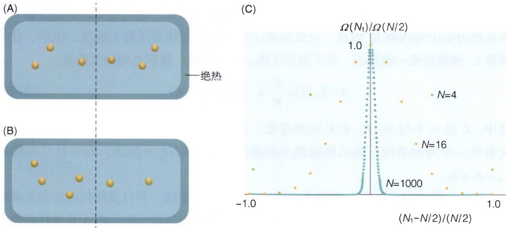

图2-2 微观态数的分布（A、B）6个分子在一个绝热容器左、右两侧的不同分布。（C）总粒子数不同的两种分布的概率。

$$
S = k _ {\mathrm{B}} \ln \Omega \tag {2-14}
$$

来表示热力学熵 $S$ 与系统特定状态下所包含的微观态数 $\Omega$ 之间的关系。对于极大的分子数 $N$，图2-2C中的函数值在 $N_{1} = N / 2$ 附近会越来越集中；相比于 $N_{1} = N / 2$ 处的概率，偏离对称轴的其它位置的概率都趋近于零。可以想见，对于热力学极限下的 $N(N \approx 10^{23})$，系统最可能的状态就是在 $N_{1} = N / 2$ 处，即左、右两边分子均匀分布的状态。

数学上，为了找到概率最大的状态，我们可以对 $\Omega$ 求最大值，根据式（2-14）的关系，也就是对玻尔兹曼熵求极大值。我们可以假设 $N$ 、 $N_{1}$ 、 $N_{2} = N - N_{1}$ 都很大，使用斯特林公式

$$
\ln N! \approx N \ln N - N, \tag {2-15}
$$

可得

$$
\begin{array}{l} S = k _ {\mathrm{B}} \ln \Omega \approx k _ {\mathrm{B}} \left(N \ln N - N - N _ {1} \ln N _ {1} + N _ {1} - N _ {2} \ln N _ {2} + N _ {2}\right) \\ = k _ {\mathrm{B}} \left(N \ln N - N _ {1} \ln N _ {1} - N _ {2} \ln N _ {2}\right) 。 \\ \end{array}
$$

使用新变量 $v = \frac{N_1}{N}$ ，则有

$$
S = k _ {\mathrm{B}} N \left[ - v \ln v - (1 - v) \ln (1 - v) \right],
$$

$S$ 的极大值由 $\frac{\mathrm{d}S}{\mathrm{d}\nu} = 0$ 决定，可得此时 $v = \frac{1}{2}$ 。我们再次验证了概率最大的宏观态就是左右两侧分子数相同的状态。这个概率最大的状态被称为平衡态。在上面的计算中，我们考察的是一个孤立系统，即不与外界交换能量与物质的系统（见图2-5A）。平衡态就是一个孤立系统熵最大的状态。如果孤立系统一开始不是处于平衡态，比如图2-2B中左侧分子比右侧多，那么经过足够长的时间后，根据概率，系统一定会到达平衡态，使得左右两侧的分子数相等。这正是热力学第二定律的熵表述形式:孤立系统的熵永不减少，并在平衡态时达到最大值。

熵有两个重要的性质:首先，熵是一个系统的状态量，满足特定的状态方程（具体见热力学中的内容）。因此，只要给定了系统的各种状态函数（能量、体积、分子数等），熵就是唯一确定的。对于理想气体，熵与能量、体积之间的关系是

$$
S = k _ {\mathrm{B}} N (\ln \frac {V}{N} + \frac {3}{2} \ln \frac {E}{3 N} + C), \tag {2-16}
$$

其中， $C$ 是一个与 $N$ 、 $V$ 、 $E$ 无关的常数。其次，熵是一个广延量。如果把两个系统看作一个大的系统，那么根据概率的乘法原理，有 $\Omega_{\mathrm{tot}} = \Omega_1\Omega_2$ ，取对数后自然有$S_{\mathrm{tot}} = S_1 + S_2$ 。

热力学第二定律的熵表述形式说明，一个孤立的系统，其自发演化的方向是熵增加的方向，直至到达平衡态。图2-3表示了两种典型的自发过程:图A是绝热容器中的理想气体自由膨胀，气体分子初始状态处于容器一侧，打开阀门后分子在容器中均匀分布；图B是两种不同分子的混合，初始状态两种分子分别位于容器两侧，打开挡板后两种分子均匀混合。

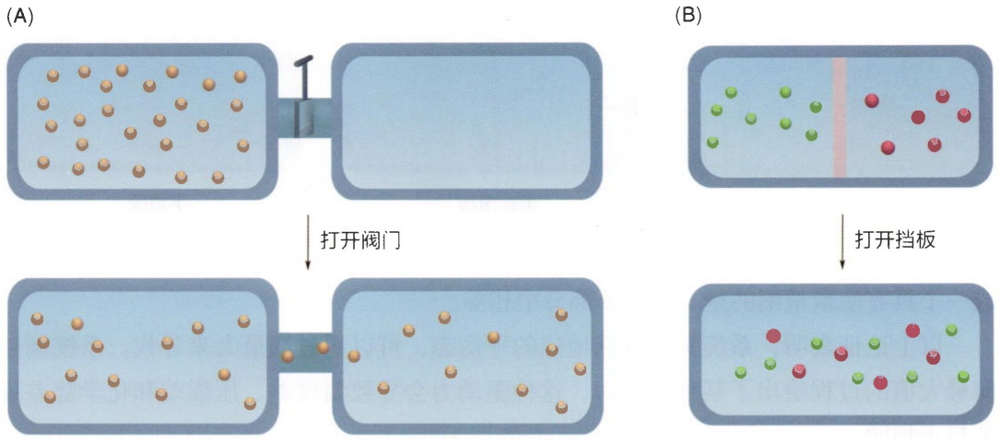

图2-3 两种典型的自发过程

（A）绝热自由膨胀。（B）两种不同的分子混合。

计算表明（见统计物理教材），不论是理想气体的绝热自由膨胀，还是两种不同分子的混合，末态熵相对于初态都是增加的，因此这两个过程都是自发进行的。在挡板打开后，系统中那些原来有序的结构（例如气体分子都处于同一侧，或者两种气体分子分别处于两侧），在这些自发的过程中消失了，系统变得更加无序。系统重新到达一个平衡态后熵增加。因此，熵可以用来度量系统的无序程度。在上面的例子中，熵越大，我们越无法预测气体分子所处的位置，因此无序度越大。熵增加的方向决定了孤立系统的演化方向，在下一节中我们将详细讨论这个问题。

## 2.2.2 孤立系统的平衡

在上一节中我们发现，如果孤立系统的两个部分之间存在粒子数目差异，系统会逐渐朝着无序度增加的方向演化并最终到达粒子分布均匀的平衡态，此时系统的熵最大。同理我们可以想象，如果孤立系统两个部分之间存在温度差异，那么根据简单的生活常识，我们会知道两个部分之间会交换能量，最终到达等温的平衡态。对于这些问题，我们统一采用最大熵原理来处理:对于两个部分系统构成的孤立系统，熵总是增加的，并且在平衡时达到熵最大。

在使用最大熵原理时，各种守恒量扮演了重要的角色。如图2-4A所示，如果系统两个部分的能量守恒时，熵极大（即平衡）的结果是两部分温度相同，这称为热平衡。当两个部分的体积守恒时，如图2-4B所示，中间滑动挡板平衡的条件是挡板两侧压强相同，这称为力学平衡。当两个部分的粒子数守恒时，如图2-4C所示，分子会在半透膜两侧交换，直至两侧的分子化学势相等，这称为化学平衡。可见，一个守恒的广延量（随系统大小增加而增加的量，如体积）其对应的平衡条件就是与之共轭的强度量（不随系统大小增加而增加的量，如压强就是体积的共轭量，两者的乘积构成一个具有能量量纲的量）在两个部分中相等。

图2-4 三种平衡条件对于可以在左右两侧交换热（A）、交换体积（B）以及交换粒子（C）的三种系统，平衡条件分别对应温度相同、力学平衡以及化学平衡。

(A)

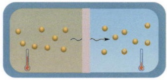

text_image

Diagram illustrating a physical process with bubbles and thermometer, showing a transition from an initial state to a final state.

(B)

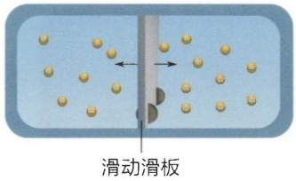

text_image

滑动滑板

(C)

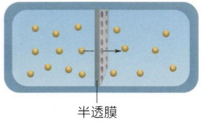

text_image

半透膜

以上论证表明，系统具有特殊地位的平衡态，可以通过熵最大来寻找。系统熵趋向最大值的过程给出了某种驱动力，这种驱动力会导致温度差、压强差和化学势差逐渐趋于相同。

## 2.2.3 自由能

在宏观态的玻尔兹曼分布中 [式（2-13）], 某个宏观态 $I$ 出现的概率可以用玻尔兹曼熵 $S_{I} = k_{\mathrm{B}} \ln \Omega_{I}$ 表示为

$$
P _ {I} = \frac {\Omega_ {I}}{Z} \mathrm{e} ^ {- \frac {E _ {I}}{k _ {\mathrm{B}} T}} = \frac {1}{Z} \mathrm{e} ^ {- \frac {E _ {I} - T S _ {I}}{k _ {\mathrm{B}} T}} = \frac {1}{Z} \mathrm{e} ^ {- \frac {A}{k _ {\mathrm{B}} T}} 。 \tag {2-17}
$$

我们又得到了一个类似玻尔兹曼分布的结果，不过这个分布中决定状态概率的不只是系统的能量，而是能量与熵综合起来的一个因子:

$$
A = E - T S, \tag {2-18}
$$

该因子被称为自由能。由于式（2-17）是在给定温度、体积和粒子数的条件下定义的，式（2-18）被称为亥姆霍兹自由能。这个系统温度 $T$ 是由热库（与系统接触但不受系统变化影响的体系）决定的，是一个恒定的值。我们称这样的系统为封闭系统，即只与热库交换能量、但不交换粒子的系统，如图2-5B所示。平衡态是概率最大的宏观态，这对应了式（2-17）的最大值，同时也是自由能[式（2-18)]的最小值。因此，亥姆霍兹自由能决定了封闭系统的自发演化方向，并且在平衡态时达到最小值。

生命系统中发生的多种化学反应过程通常都是在给定温度和压强的条件下进行的，这时我们需要使用吉布斯自由能

$$
G = E + p _ {\mathrm{r}} V - T _ {\mathrm{r}} S \tag {2-19}
$$

来描述系统的演化，其中 $p_{\mathrm{r}}$ 、 $T_{\mathrm{r}}$ 是环境［或者热库（heat reservoir）］的压强和温度，在后面的公式中我们通常会省略下标。吉布斯自由能适合用于描述粒子数目（例如化学反应）可变的系统，这样的系统可以与热库交换能量与粒子，称之为开放系统，如图2-5C所示。在自发过程中，吉布斯自由能会减小，并在平衡态时达到最小值。更一般地，如果存在外场作用，自由能可以表示为能量、熵与共轭量之间的组合:

$$
F = E - T S - \sum_ {i} X _ {i} x _ {i}, \tag {2-20}
$$

其中， $X_{i}$ 是广义力（例如压强、电压）， $x_{i}$ 是广义位移（例如体积、电荷量）。

(A)

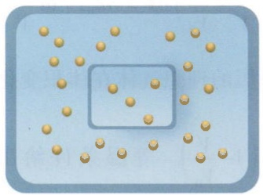

natural_image

Abstract diagram with scattered gold dots and a central blue rectangle (no text or symbols)

(B)

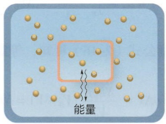

text_image

能量

(C)

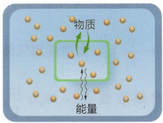

text_image

物质
能量

图2-5 孤立系统（A）、封闭系统（B）和开放系统（C）

在自由能的定义公式（2-20）中，能量与熵带有相反的符号，因此能量与熵是竞争的关系。对于一个没有随机性的力学系统（如宏观层面的生物个体的运动状态），系统平衡由能量最小决定，这个作用通常会把系统聚集到一个方向，例如重力场中的物体都倾向于到达势能最低位置。而在具有随机性的系统中，与能量最小效应竞争的是熵效应，该效应使得粒子倾向于分散到更大的空间中。能量与熵的这种竞争关系可以用于处理蛋白质折叠、胶体粒子周围的离子分布和受体-配体结合等许多生命系统中的问题。我们会在后面的章节中详细讨论这些问题。

## 2.2.4 熵效应与熵力

熵最大或者自由能极小决定了多种过程自发进行的方向。在生命体内，这些自发过程会产生类似力的效应（称为熵力）或者有序的结构。下面我们简单介绍几种情况。在后面的章节中，我们会更详细地讨论其它熵效应。

我们先考虑一个最简单的模型。如图2-6A所示，对于理想气体系统与温度为 $T_{\mathrm{r}}$ 、压强为 $p_{\mathrm{r}}$ 的热库接触，在 $x$ 方向上有一个活动的活塞导致气体的体积发生改变。根据理想气体状态方程，气体的压强 $p_{\mathrm{s}} = \frac{Nk_{\mathrm{B}}T}{V}$，活塞两侧的压强差是 $p_{\mathrm{s}} - p_{\mathrm{r}}$ 。为了维持活塞的力学平衡，必须对活塞施加一个朝右的力

$$
F = (p _ {\mathrm{s}} - p _ {\mathrm{r}}) A, \tag {2-21}
$$

其中 $A$ 是活塞的面积。如果 $F = 0$ ，气体会一直膨胀，直到 $p_{\mathrm{s}} = p_{\mathrm{r}}$ 为止，即

$$
V _ {0} = \frac {N k _ {\mathrm{B}} T _ {\mathrm{r}}}{p _ {\mathrm{r}}} \circ \tag {2-22}
$$

式（2-22）的含义是当热库的温度和压强给定时，与热库接触的理想气体在平衡时会达到特定的体积。其本质原因是每个气体分子都希望尽量大地占有体积从而增大熵，直到与热库的压强平衡为止。在式（2-21）中，如果理想气体的体积小于平衡时的体积 $V < \frac{Nk_{\mathrm{B}}T_{\mathrm{r}}}{p_{\mathrm{r}}}$，理想气体就会在

活塞上施加一个非零的力，并对外做功。这个力

(A)

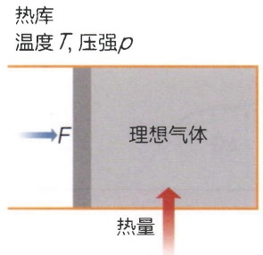

text_image

热库
温度 T, 压强ρ
理想气体
F
热量

(B)

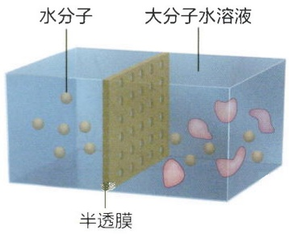

text_image

水分子
大分子水溶液
半透膜

图 2-6 两种典型的熵力

（A）理想气体系统与热库接触，交换热和体积。（B）渗透压示意图。

称为熵力。熵力做功的最大值 $W_{\mathrm{max}} = \int_{V}^{V_0}\frac{F\mathrm{d}V}{A} = Nk_{\mathrm{B}}T\int_{V}^{V_0}\left(\frac{1}{V} -\frac{1}{V_0}\right)\mathrm{d}V = Nk_{\mathrm{B}}T\left[\ln \frac{V_0}{V} -\left(1 - \frac{V}{V_0}\right)\right]$ 。根据理想气体的熵公式（2-16）可知，等温等压的理想气体在体积变化时熵改变 $\Delta S = Nk_{\mathrm{B}}\ln \frac{V_0}{V}$，而 $p\Delta V = \frac{Nk_{\mathrm{B}}T}{V_0}(V_0 - V) = Nk_{\mathrm{B}}T\left(1 - \frac{V}{V_0}\right)$ 。等温条件给出 $\Delta E = 0$ 。系统可做的最大功就是自由能的减少量:

$$
W _ {\max} = - \Delta G = - \Delta (E + p V - T S) 。
$$

因此，自由能可以被视为是热力学系统中的“势能”，它度量了系统在特定条件下（如恒温恒压）对外做功的最大潜力。在没有热运动的力学系统中，系统的能量表现为势能 $U(x)$ 。由于能量守恒，当系统从高势能状态向低势能状态转变时，势能的减少量恰好等于系统对外所做的最大功 $W = -\Delta U$ 。在存在热运动的热力学系统中，除了势能外，还有内能和熵的贡献。自由能综合考虑了这些能量形式，并反映了系统在特定条件下对外做功的有效能量。我们可以将自由能类比为一个“热力学势”，它决定了系统在热力学过程中的演化方向。就像机械系统中物体总是倾向于向势能最低的位置运动一样，热力学系统也总是自发地向自由能最低的状态演化。当系统达到最低自由能状态时，即达到热力学平衡态，此时系统对外做功的能力为零。自由能越低，系统越稳定，对外做功的潜力就越小。两种系统的类比如图2-7所示。

在细胞中，熵力的一个重要体现就是渗透压。渗透压的本质是细胞中热运动的溶质分子倾向于占有更大的体积，因此会倾向于从细胞中流出。这种浓度差导致的效应会在细胞膜上产生压强，这种压强被称为渗透压。放入纯水中的红细胞会因为渗透压破裂，许多细菌和植物需要使用坚固的细胞壁来抵抗渗透压。

理想稀溶液（溶质分子之间没有相互作用）的渗透压如图2-6B所示，一个刚性

容器被活塞分成两个腔，一侧是纯水，另一侧是含有 $N$ 个溶质分子的溶液。半透膜的特性是水分子可以通过，但是溶质分子不能通过。可以想象，由于溶质分子倾向于占据更大的体积，溶质分子会向半透膜施加压强，推动半透膜活塞朝纯水一侧运动。由于是稀溶液，我们可以近似认为溶质分子之间没有相互作用，因此我们可以把溶质近似为理想气体，溶质分子施加的压强就是

$$
p = \frac {N k _ {\mathrm{B}} T}{V} = c k _ {\mathrm{B}} T, \tag {2-23}
$$

该关系被称为范托夫关系。该关系表明，如果要阻碍半透膜朝着纯水侧移动，就要在纯水侧施加一个式（2-23）的压强，因此溶液可以对外做功，这又是一种熵力。

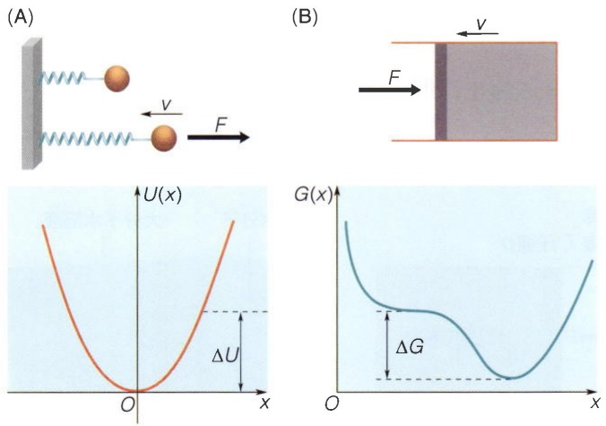

图 2-7 力学势与热力学势的对比

（A）力学系统的最大功等于势能减少量。（B）热力学系统的最大功等于自由能减少量。

一个真实细胞的渗透压有多大？细胞中的无机离子典型浓度是 $100\mathrm{mmol / L}$，用分子数和 $\mathrm{nm}^3$ 作单位，大约是0.06分子数 $/ \mathrm{nm}^3$。室温下 $k_{\mathrm{B}}T \approx 4.1\mathrm{pN} \cdot \mathrm{nm}$，因此，渗透压大约是

$$
p \approx 0. 0 6 \mathrm{nm} ^ {- 3} \times 4. 1 \mathrm{pN} \cdot \mathrm{nm} = 0. 2 4 \mathrm{pN} \cdot \mathrm{nm} ^ {- 2} \approx 2. 4 \mathrm{atm},
$$

其中 atm 是标准大气压， $1\ atm=1.013\times10^{5}\ Pa\approx0.1pN\cdot nm^{-2}$ 。也就是说，细胞的渗透压相当于几个大气压。因此，渗透压对细胞的影响极为显著。

## 2.2.5 疏水相互作用与熵效应

在上面的理想气体和稀溶液系统中，熵效应都是某种单一的成分（如气体分子、溶质分子等）要自发地占有更多的微观态而产生的，因此宏观上有自发扩散的过程。但是，我们日常生活中也能发现一些自发聚合的过程，最简单的例子就是原本因搅拌而分散均匀的油水混合物在放置长时间后会自发地分成油和水。这个分离过程并不是因为重力。实际上在太空中油和水也会分离。从表面来看，这种自发分离的过程违背了最大熵原理。但是由于系统中不只有油分子，还有水分子，两种分子之间的相互作用可能会导致总自由能并不像理想气体那么简单。

水在生命过程中如此重要的一个原因是，水是一个极性分子。水分子由一个氧原子和两个氢原子组成，其中氢原子的电子绝大多数时间都处于氧原子上，因此氢原子表现为一个裸露的质子。氧原子与两个氢原子之间的夹角是 $104^{\circ}$，大约是四面体中心与两个顶点的连线夹角。由于裸露质子的强电场，一个水分子的氧原子会与另外一个分子的氢原子相互吸引，该作用称为氢键（分子之间的成键理论本章后面还会有详细介绍）。氢键的键能大约是 $9k_{\mathrm{B}}T$，比非特异性的分子间吸引力如范德瓦耳斯力强（约为 $1k_{\mathrm{B}}T$），但是比典型的共价键（约为 $150k_{\mathrm{B}}T$）弱。氢键相互作用导致水分子会排列成四面体结构，其中氧原子位于四面体的四个顶点上，每个水分子有4个氢键（图2-8A），这正是固态冰的结构。当水从固态融化成液态时，熵效应逐渐破坏氢键结构，即便如此，在室温下水分子之间依然保留了大部分氢键（每个水分子平均有3.5个氢键），氢键网络的模型依然有效。

在水分子的四面体氢键网络中，居于中心的水分子在保持4个氢键的情况下，一共可以存在6种构型，每种构型对应水分子在四面体中的不同朝向（在图2-8中，每种构型对应中间水分子的张角朝向四面体的一条边）。当极性基团（如羟基）浸入水中，因为基团中存在可以形成氢键的原子构型，它能够参与水分子氢键网络的形成，对氢键网络影响不大，因而是亲水性的。当一个非极性分子（不存在可以形成氢键的原子构型）被引入水中时，它不能与周围的水分子形成氢键，因此限制了某些氢键的形成，降低了水分子氢键网络的构象熵，因而自由能升高，这被称为疏水效应。

详细的计算表明，每 $\mathrm{nm}^2$ 面积上非极性基团疏水自由能约为 $7k_{\mathrm{B}}T$ ，对于像 $\mathrm{O}_2$ 这样的小分子，疏水自由能与室温热运动能量相当，因此，稍微有点热扰动， $\mathrm{O}_2$ 就能够溶解于水。然而，对于大的非极性基团，如蛋白质表面积在上百 $\mathrm{nm}^2$ ，疏水自由能代价约为 $700k_{\mathrm{B}}T$ ，远大于室温热运动能量。因此，细胞中的蛋白质会折叠，并尽可能将非极性基团埋在内部。当两个非极性表面接近时，为减小疏水表面积，两个表面会紧贴在一起，看起来像是有某种力作用在两个非极性物体上，使得二者“吸”在一起。这种类似力的效应被称为疏水相互作用。在生命体中，蛋白质和脂质分子都受到亲疏水相互作用的支配，这些内容在后面的章节中会有详细的介绍。

图2-8 氢键与氢键网络（A）由氢键连接的水分子结构。（B）水分子在非极性分子表面形成的氢键网络。

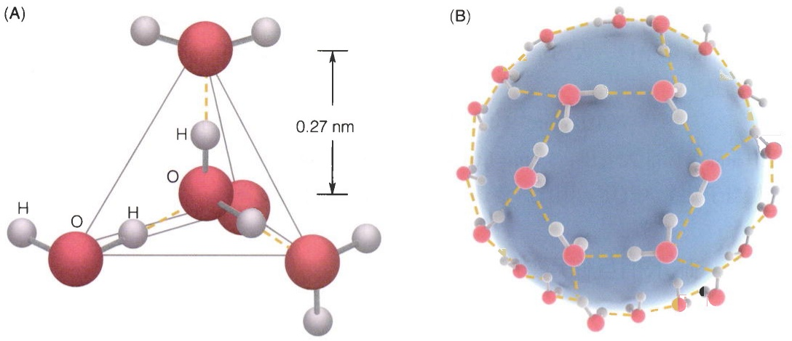

## 2.3 化学势与化学反应

在上一节中，我们引入了熵与自由能来描述有序向无序的转化过程，并利用这两个概念初步探讨了渗透压和疏水相互作用等在生物中常见的效应。在生命体内，还有一大类重要的过程是化学反应。化学反应会导致分子数目的变化，而分子数目的变化会导致系统自由能的变化。系统的自由能最终达到最小值时即达到了化学平衡。化学平衡分析是生物学中应用最广泛的定量方法。在本节中，我们将仔细讨论化学势的概念，并初步介绍化学平衡的定量描述。

## 2.3.1 理想稀溶液的化学势

对于化学反应，我们通常关心的是等温等压系统。化学反应带来的变化只有粒子数的变化。这里我们关注理想稀溶液:溶质分子的浓度足够低，从而使得溶质分子之间的相互作用可以忽略。粒子数作为一个广延量，其对应的强度量是化学势。在等温等压系统中，化学势的定义是

$$
\mu_ {i} = \left(\frac {\partial G}{\partial N _ {i}}\right) _ {T, p}, \tag {2-24}
$$

其中， $N_{i}$ 是第 $i$ 个组分的粒子数。式（2-24）中化学势的含义是，每增加一个分子，系统自由能的增加量。对于溶剂和溶质分子混合的溶液，自由能的能量部分由两种分子的内能构成，熵部分是两种分子的混合熵 $S_{\mathrm{mix}}$ ，由式（2-16）给出。因此自由能表达式是

$$
G = E _ {\mathrm{s}} N _ {\mathrm{s}} + E _ {\mathrm{p}} N _ {\mathrm{p}} - T S _ {\mathrm{mix}},
$$

其中， $N_{\mathrm{s}}$ 、 $N_{\mathrm{p}}$ 分别是溶剂和溶质的分子数， $E_{\mathrm{s}}$ 、 $E_{\mathrm{p}}$ 是溶剂和溶质分子的平均能量。在式（2-24）中，能量部分求导之后给出常数因子。对熵部分的求导会得到两项:一项是与粒子数无关的常数，另一项是正比于 $\ln c_{\mathrm{p}}$ 的项，其中 $c_{\mathrm{p}}$ 是溶质的浓度（严格的推导可以参考统计物理教材）。最终我们得到理想溶液中溶质分子的化学势 $\mu_{\mathrm{p}}$ 与溶质浓度 $c_{\mathrm{p}}$ 之间的关系:

$$
\mu_ {\mathrm{p}} = \mu_ {\mathrm{p0}} + k _ {\mathrm{B}} T \ln \frac {c _ {\mathrm{p}}}{c _ {\mathrm{p0}}}, \tag {2-25}
$$

其中 $c_{\mathrm{p0}}$ 是为了量纲引入的一个常数，通常选为参考态下的浓度。而 $\mu_{\mathrm{p0}}$ 是相对于参考浓度的标准化学势。在化学中约定参考态是每种分子组分浓度为 $1\mathrm{mol / L}$ 的状态。在式（2-25）中可以看到，浓度越高，化学势越高。式（2-25）表示特定组分的化学势，也被称为内在化学势。

## 2.3.2 化学平衡与质量作用定律

我们可以用化学势来考察一个化学反应的反应趋势。例如，对于两个分子相遇产生复合物的反应 $\mathrm{A} + \mathrm{B} \rightleftharpoons \mathrm{AB}$，如果反应开始时试管中A和B的浓度很高但是没有AB复合物，那么反应就会朝着形成复合物的方向进行；反之，如果一开始AB复合物浓度很高但是没有A和B，那么反应就会朝着复合物分解的方向进行。在足够长时间后，这两种反应所达到的最终状态没有区别，也就是达到了化学平衡态。平衡态是与初始条件无关的。但是，我们可以根据平衡条件来判断给定初始状态的系统反应发生的方向。

对于上面提到的简单化学反应 $\mathrm{A} + \mathrm{B} \rightleftharpoons \mathrm{AB}$，由于我们关心的系统通常是等温等压的，只有分子数的变化，则体系的自由能只是三种分子数的函数，即 $G = G(N_{\mathrm{A}}, N_{\mathrm{B}}, N_{\mathrm{AB}})$。每发生一次化学反应，自由能的变化是

$$
\mathrm{d} G = \frac {\partial G}{\partial N _ {\mathrm{A}}} \mathrm{d} N _ {\mathrm{A}} + \frac {\partial G}{\partial N _ {\mathrm{B}}} \mathrm{d} N _ {\mathrm{B}} + \frac {\partial G}{\partial N _ {\mathrm{AB}}} \mathrm{d} N _ {\mathrm{AB}}
$$

根据化学势的定义式（2-24），我们有

$$
\mathrm{d} G = \mu_ {\mathrm{A}} \mathrm{d} N _ {\mathrm{A}} + \mu_ {\mathrm{B}} \mathrm{d} N _ {\mathrm{B}} + \mu_ {\mathrm{AB}} \mathrm{d} N _ {\mathrm{AB}} \circ \tag {2-26}
$$

平衡时，自由能达到极小值，因此 $\mathrm{d}G = 0$ 。利用理想溶液化学势的定义式（2-25），我们会得到反应参与物的平衡浓度所满足的关系（知识窗2-3）:

$$
\prod_ {i} c _ {i, \mathrm{e}} ^ {v _ {i}} = K _ {\mathrm{eq}} \circ \tag {2-27}
$$

这里我们使用标记 $c_{i,e}$ 表示化学反应平衡时各种参与物的浓度； $\nu_{i}$ 表示反应中第 $i$ 个参与物的化学计量数；常数 $K_{\mathrm{eq}}$ 称为平衡常数（$K_{\mathrm{d}} = \frac{1}{K_{\mathrm{eq}}}$ 称为解离常数）。式（2-27）被称为质量作用定律，该定律表明，在化学反应到达平衡时，反应物浓度和生成物浓度之间满足特定的约束关系。其中常数 $K_{\mathrm{eq}}$ 是与反应参与物浓度无关的一个量。例如，在反应 $\mathrm{A} + \mathrm{B} \rightleftharpoons \mathrm{AB}$ 达到平衡时，质量作用定律给出

$$
\prod_ {i} c _ {i, \mathrm{e}} ^ {\nu_ {i}} = c _ {\mathrm{A,e}} ^ {- 1} c _ {\mathrm{B,e}} ^ {- 1} c _ {\mathrm{AB,e}} ^ {1} = \frac {[ \mathrm{AB} ] _ {\mathrm{e}}}{[ \mathrm{A} ] _ {\mathrm{e}} [ \mathrm{B} ] _ {\mathrm{e}}} = K _ {\mathrm{eq}},
$$

其中 [AB]、[A]、[B] 分别表示 AB、A 和 B 的浓度，下角标 e 表示平衡态。

对于一开始没有处于平衡的反应 [即反应物和产物浓度不满足式（2-27）的情形]，每发生一次反应所导致的自由能改变是

$$
\Delta \mu = - k _ {\mathrm{B}} T \ln K _ {\mathrm{eq}} + k _ {\mathrm{B}} T \ln \prod_ {i} c _ {i} ^ {v _ {i}} 。 \tag {2-28}
$$

## 知识窗2-3

## 由化学平衡导出质量作用定律

在到达平衡时，自由能到达极小值:

$$
\mathrm{d} G = \frac {\partial G}{\partial N _ {\mathrm{A}}} \mathrm{d} N _ {\mathrm{A}} + \frac {\partial G}{\partial N _ {\mathrm{B}}} \mathrm{d} N _ {\mathrm{B}} + \frac {\partial G}{\partial N _ {\mathrm{AB}}} \mathrm{d} N _ {\mathrm{AB}} = 0.
$$

根据化学势的定义式（2-24），上式即为

$$
\mathrm{d} G = \mu_ {\mathrm{A}} \mathrm{d} N _ {\mathrm{A}} + \mu_ {\mathrm{B}} \mathrm{d} N _ {\mathrm{B}} + \mu_ {\mathrm{AB}} \mathrm{d} N _ {\mathrm{AB}} = 0 。
$$

在计算分子数的变化  $dN_{A}$ 、 $dN_{B}$ 、 $dN_{AB}$  时，要考虑化学反应所对应的化学计量数。例如，在  $A + B \rightleftharpoons AB$  反应中，每发生一次合成反应，A 和 B 分子各减少一个时，AB 分子增加一个。一般地，我们将反应中第 i 个参与物的化学计量数记为  $v_{i}$ ，并约定反应物的化学计量数为负，生成物的化学计量数为正（例如  $v_{A} = v_{B} = -1$ ， $v_{AB} = 1$ ）。在这种约定下，每发生  $dN_{r}$  次正向反应，所对应的参与物分子数变化为  $dN_{i} = v_{i}dN_{r}$ 。例如在式（2-26）中， $dN_{A} = dN_{B} = -dN_{r}$ ， $dN_{AB} = dN_{r}$ 。利用化学势和化学计量数来表述式（2-26），则有

$$
\mathrm{d} G = (- \mu_ {\mathrm{A}} - \mu_ {\mathrm{B}} + \mu_ {\mathrm{AB}}) \mathrm{d} N _ {\mathrm{r}} = \Delta \mu \mathrm{d} N _ {\mathrm{r}} = 0.
$$

对于一般的化学反应，每一次化学反应  $dN_{r}=1$ ，化学反应反应物和产物之间的化学势差是

$$
\Delta \mu = \sum_ {i} v _ {i} \mu_ {i \circ} \tag {2-29}
$$

平衡时， $\Delta\mu=\sum_{i}v_{i}\mu_{i}=0,$

即反应正向进行和反应逆向进行的各种参与物化学势是一致的。

利用理想溶液化学势与物质浓度的关系式（2-25）我们还可以进一步化简式（2-29）。首先，我们把所有依赖于参与物浓度的项放一起，这些项都有 $v_{i}\ln c_{i}=\ln c_{i}^{v_{i}}$ 的形式；利用对数求和规则，这些项的求和 $\sum_{i}\ln c_{i}^{v_{i}}=\ln\prod_{i}c_{i}^{v_{i}}$ 。化学势中不包含浓度的项定义为 $-k_{B}T\ln K_{eq}$ 。因此式（2-29）可以进一步展开为

$$
\Delta \mu = - k _ {\mathrm{B}} T \ln K _ {\mathrm{eq}} + k _ {\mathrm{B}} T \ln \prod_ {i} c _ {i} ^ {\nu_ {i}}, \tag {2-30}
$$

平衡时 $\Delta \mu = 0$ ，从上面的表达式我们得到质量作用定律

$$
\prod_ {i} c _ {i, \mathrm{e}} ^ {v _ {i}} = K _ {\mathrm{eq}} \circ
$$

式（2-30）也给出了没有达到平衡时，发生一次化学反应（ $dN_{r}=1$ ）所导致的自由能改变。

式（2-28）表明，化学反应释放的自由能由反应物和产物的浓度以及平衡常数决定。注意对数函数中的浓度要取成无量纲的形式，即 $\frac{c_i}{1\mathrm{mol / L}}$ 。

对于 ATP 的水解反应， $ATP \rightleftharpoons ADP + P_{i}$ ，标准态测量的  $-k_{B}T \ln K_{eq} \approx -13k_{B}T$ （每分子）。在大肠杆菌中，ATP 浓度约为 5 mmol/L，ADP 浓度约为 0.5 mmol/L， $P_{i}$  的浓度约为 10 mmol/L。使用式（2-28），得到浓度部分的贡献约为 -6.9  $k_{B}T$ 。因此一分子 ATP 水解所释放的自由能  $\Delta G \approx -20 k_{B}T$ 。

## 2.4 扩散与随机运动

在之前的章节中，我们借助熵、自由能等热力学概念，介绍了判断系统是否处于平衡态的标准。然而，这些热力学量仅能提供系统的静态（或准静态）描述，无法揭示系统演化过程中的动态特征。一个系统是否处于平衡态，以及它趋向平衡态的速度，是两个不同的问题。

为了深入研究系统演化的动力学过程，我们需要引入动力学概念。动力学关注的是系统随时间的变化规律，它不仅包含那些遵循确定性规律的演化过程，如经典力学中的牛顿运动定律所描述的弹簧振动，还包括那些受到热运动影响的随机过程。这些随机运动在自然界中普遍存在，例如墨水分子在溶液中的扩散，电流经过电阻发热并耗尽电池，以及相互接触的物体经过热传导达到相同的温度。在这些过程中，有序的能量（如化学势、电势、温度差）逐渐耗散为无序的热运动。这种耗散过程是自然界中普遍存在的现象，它驱动系统趋向于更加无序、概率更大的平衡态。

在生命系统中，耗散过程扮演着至关重要的角色。细胞作为一个高度有序的开放系统，需要不断地从外界摄取能量，以维持其内部的非平衡状态。这些能量的摄取和利用都伴随着能量的耗散。因此，理解耗散过程对于深入研究生命现象具有重要意义。接下来，我们将从扩散动力学出发，介绍耗散现象的一般规律。

## 2.4.1 布朗运动与随机行走

1828年，植物学家罗伯特·布朗（Robert Brown，1773—1858）通过显微镜观察到悬浮在水中的花粉颗粒在不停地运动。这种运动的激烈程度只与颗粒大小以及水的温度相关。由普通物理学知识我们知道，布朗运动本质上是处于热运动的水分子与布朗粒子的碰撞导致的。在下面的内容中我们将说明这种碰撞将导致布朗粒子在三维空间中的随机行走，而大量粒子的随机行走表现为宏观上粒子浓度的扩散行为。

我们首先从微观的角度理解布朗运动。布朗运动的一个最基本过程是单个水分子与布朗粒子的碰撞。假设各个方向上运动是对称性的，那我们只需要考虑粒子在 $x$ 轴上的一维运动。假设在 $\Delta t$ 时间内，只有一个水分子与粒子发生碰撞。在两次碰撞之间，粒子位置的改变量为 $\Delta x$ （注意，我们假设碰撞时间是固定的）。由于碰撞的随机性，粒子每一步向左和向右的概率是相同的，均为 $1 / 2$ 。因此，粒子位置改变量的平均值 $\langle \Delta x\rangle = 0$ ，而方差 $\langle \Delta x^2\rangle$ 不为零（实际上 $\Delta x$ 服从均值为零的正态分布）。细致的计算表明，布朗粒子在空间中的均方位移（mean square displacement，MSD）与时间的关系是:

$$
\langle \Delta x ^ {2} \rangle = 2 D t _ {\circ} \tag {2-31a}
$$

在二维和三维情形下分别有:

$$
\langle \boldsymbol {r} ^ {2} (t) \rangle = 4 D t, \langle \boldsymbol {r} ^ {2} (t) \rangle = 6 D t _ {\circ} \tag {2-31b}
$$

其中 $r$ 是粒子的位移，$r^2 = x^2 + y^2 + z^2$。式（2-31）被称作布朗粒子的扩散定律（知识窗2-4）。该定律表明，粒子的均方位移随着时间线性增加，比例系数 $D$ 被称为扩散系数。扩散系数 $D$ 是一个可以由实验测量的量:记录粒子的初始位置和 $t$ 时刻的位置，进行多次实验，用均方位移除以 $2t$ 即可得到扩散系数。

布朗运动的核心假设是布朗粒子与水分子的每一次碰撞导致的运动都是随机且独立的。在细胞中，有很多过程近似满足这个假设。例如，我们可以应用布朗运动来预测高分子的空间大小。这一类问题在生物学中有重要的意义，比如DNA就是一类长链高分子，如果要把DNA分子装到噬菌体中或者整合到细胞核内，我们就需要知道自己DNA所占的空间体积。如图2-9C所示，考虑这个问题最简单的一个模型是把高分子想象成是由 $N$ 个单元连接而成的长链。每个单元都是一个长度为 $a$ 的刚性链节，而链节之间通过柔性的铰链连接，可以在空间中自由转动。该模型被称为自由连接杆模型。在平衡时，高分子上的每一个单元伸展都可以视作空间中步长为 $a$ 的随机行走。因此，分子链的首尾位移是 $R = \sum_{i=1}^{N} r_i$，其中 $r_i = (\Delta x_i, \Delta y_i, \Delta z_i)$ 是三维空间中每一步行走的位移。与扩散运动类似，我们有 $\langle R \rangle = 0$，但是均方位移 $\langle x_N^2 \rangle = \sum_{i=1}^{N} \Delta x_i^2 = Na^2$ 即 $\langle R^2 \rangle = \sum_{i=1}^{N} (\langle x_i \rangle^2 + \langle y_i \rangle^2 + \langle z_i \rangle^2) = 3Na^2$。因此在三维空间中，高分子长链的平均尺寸是

$$
\sqrt {\left\langle \boldsymbol {R} ^ {2} \right\rangle} = a \sqrt {3 N} 。
$$

以上结论说明，当高分子链节之间没有相互作用时，高分子链首尾距离与单元数平方根成正比，随着单元数增多而增加。高分子链节之间的排斥相互作用会导致高分子尺寸比 $\sqrt{N}$ 标度大，而吸引相互作用会导致尺寸比 $\sqrt{N}$ 标度小。例如，对于蛋白质，统计发现 $R \sim N^{\frac{1}{3}}$ ，这说明蛋白质的折叠不是随机行走。

## 2.4.2 扩散方程

在上一节中，我们讨论了单个粒子在水溶液中的随机运动。在细胞层面，我们通常还要处理一群粒子的运动。例如，氧气分子从血液向组织的扩散。在这些过程中，我们通常关心分子浓度的变化。与最简单的理想气体类似，我们先假设粒子之间没有

## 知识窗2-4

## 扩散定律的推导

一个巧妙的确定方差的方式是应用能量均分定理:当粒子与水分子处于热平衡时，有 $\langle v_x^2\rangle = \frac{k_{\mathrm{B}}T}{m}$ ，其中 $m$ 是布朗粒子的质量；而根据速度的定义 $\langle v_x^2\rangle = \left\langle \left(\frac{\Delta x}{\Delta t}\right)^2\right\rangle \approx$ $\frac{\langle\Delta x^2\rangle}{\Delta t^2}$ ，其中 $\Delta t$ 是两次碰撞之间的平均时间。我们得到

$$
\langle \Delta x ^ {2} \rangle = \frac {k _ {\mathrm{B}} T \Delta t ^ {2}}{m} 。
$$

在实际情况中，我们很难看到一个水分子碰撞的事件。但是容易想象，所有我们实际观察到的轨迹都是由多个这样的独立碰撞事件构成的。实验中，由于时间分辨率的限制，我们通常只能观察布朗粒子在 $t$ 时间后运动达到的位置。如图2-9A所示，假设粒子经过 $N$ 步之后达到终点位置 $x_{N}$ （因此有 $t = N\Delta t$），那么终点位置$x_{N} = \sum_{i = 1}^{N}\Delta x_{i}$ 。假设我们观测了多次这样的粒子运动轨迹（图2-9B），我们就可以得到轨迹和终点位置的分布信息。首先，终点位置的平均值:

$$
\langle x _ {N} \rangle = \langle \sum_ {i = 1} ^ {N} \Delta x _ {i} \rangle = \sum_ {i = 1} ^ {N} \langle \Delta x _ {i} \rangle = 0.
$$

在上面的第二个等号中，求和平均在 $N$ 有限时是可以交换的。粒子平均运动了多远，可以由均方位移 $\langle x_N^2\rangle =$ $\langle (\sum_{i = 1}^{N}\Delta x_i)^2\rangle$ 来定量描述，这是一个非零的项。将均方位移等式右边展开，里面会包含两类项，一类是完全平方项如 $\langle \Delta x_i^2\rangle$ ，另一类是交叉项如 $\langle \Delta x_i\Delta x_j\rangle$ 。由于两次相互碰撞之间是互相独立的，根据概率的乘法原理，有$\langle \Delta x_i\Delta x_j\rangle = \langle \Delta x_i\rangle \langle \Delta x_j\rangle = 0$ 。因此我们得到均方位移:

$$
\begin{array}{l} \langle x _ {N} ^ {2} \rangle = \langle (\sum_ {i = 1} ^ {N} \Delta x _ {i}) ^ {2} \rangle = \sum_ {i = 1} ^ {N} \langle \Delta x _ {i} ^ {2} \rangle = N \langle \Delta x ^ {2} \rangle \\ = N \frac {k _ {\mathrm{B}} T \Delta t ^ {2}}{m} = \frac {k _ {\mathrm{B}} T \Delta t}{m} t = 2 D t, \\ \end{array}
$$

其中我们使用了等式 $t = N\Delta t$ ，并定义系数

$$
D = \frac {\left\langle \Delta x ^ {2} \right\rangle}{\Delta t} = \frac {k _ {\mathrm{B}} T \Delta t}{2 m} 。
$$

该式给出了扩散系数的微观定义。

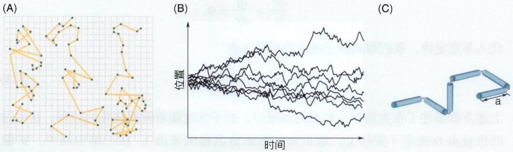

图2-9 布朗运动（A）单个布朗粒子的轨迹。（B）多个布朗粒子从同样的初始位置运动的轨迹（一维）。（C）三维高分子链的自由连接杆模型。

相互作用，对于每个粒子而言，只是在空间中独立地进行随机行走。

考虑图2-10所示的情形，大量粒子的密度分布在 $y$ 、 $z$ 方向上是均匀的，但是在 $x$ 方向上不均匀（例如有一个从左至右的梯度）。从上一节我们知道，扩散过程有一个特征长度，就是水分子与布朗粒子单次碰撞产生的平均位移 $\langle \Delta x\rangle$ 。我们可以用这个特征长度把空间划分为一个个小格子；在每一个小格子内，一个布朗粒子在 $\Delta t$ 时间内平均只发生一次碰撞，之后粒子就会等概率地进入左右相邻的格子中。这种划分标记在图2-10中。我们将空间在 $x$ 方向上以粒子随机运动步长 $\Delta x$ 做分隔。在每个体积元内，由于每个粒子都是进行随机行走，从左至右以及从右至左运动的概率都是$\frac{1}{2}$，因此，$\Delta t$ 时间内朝两个方向运动的粒子数目都是$\frac{N(x)}{2}$，这里 $N(x)$ 是中心位于 $x$ 宽度为 $\Delta x$ 的格子内的分子数目。在一个扩散时间步长 $\Delta t$ 内，位于 $x$ 位置的

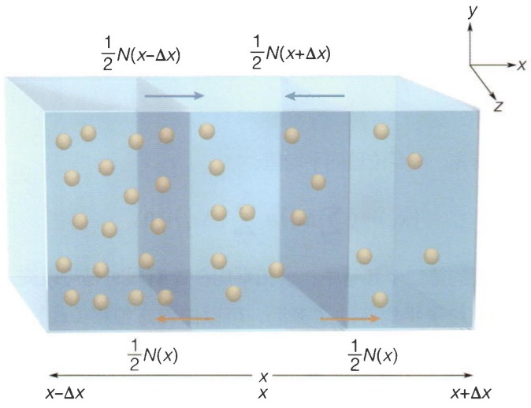

text_image

1/2N(x-Δx)
1/2N(x+Δx)
y
x
z
1/2N(x)
x-Δx
x
1/2N(x)
x+Δx

图2-10 大量布朗粒子在空间中的扩散，粒子浓度左边高右边低

体积元内粒子数变化包含流入和流出两项:① 流入项包括 $x - \Delta x$ 位置体积元内粒子向右的扩散，为 $\frac{1}{2} N(x - \Delta x)$，和 $x + \Delta x$ 位置体积元内的粒子向左扩散，为 $\frac{1}{2} N(x + \Delta x)$ （图2-10中的蓝色箭头）；② 流出项包括当前体积元内向左和向右离开的粒子数，一共为 $-N(x)$ （图2-10中的橙色箭头）。可以想象，只要位于 $x$ 位置和 $x \pm \Delta x$ 位置的粒子数目不相同，就会存在粒子的净流动。这种流动会导致局部位置的粒子浓度发生改变。可以证明，当 $\Delta x$ 和 $\Delta t$ 都很小时（见统计物理教材），单位面积上粒子的净流与浓度差异之间满足线性关系:

$$
j = - D \frac {\partial c}{\partial x}, \tag {2-32}
$$

该关系称为菲克定律。由于空间中粒子总数是守恒的，满足方程

$$
\frac {\partial c}{\partial t} + \frac {\partial j}{\partial x} = 0,
$$

代入菲克定律，我们得到粒子浓度的扩散方程

$$
\frac {\partial c}{\partial t} = D \frac {\partial^ {2} c}{\partial x ^ {2}} 。 \tag {2-33a}
$$

上述方程描述了在大量粒子构成的系统中，粒子浓度随着时间演化的过程，这个过程的快慢由 $D$ 决定（实际上，这正是扩散系数名称的来源）。在三维空间中，扩散方程是

$$
\frac {\partial c}{\partial t} = D \nabla^ {2} c, \tag {2-33b}
$$

其中拉普拉斯算符 $\nabla^2 = \frac{\partial^2}{\partial x^2} +\frac{\partial^2}{\partial y^2} +\frac{\partial^2}{\partial z^2}$ 。扩散方程是一个偏微分方程，其求解需要辅以系统的初始条件和边界条件，一般比较复杂（知识窗2-5），在本书中我们主要

## 知识窗 2-5

# 扩散方程的非平衡解及应用

如果适当地控制边界条件，式（2-32）和式（2-33）可以有一个非零的稳态解（即 $\frac{\partial c}{\partial t}=0$ ）:

$$
j (x) = j _ {0},
$$

其中 $j_0$ 是一个非零常数。这个解的含义是粒子持续地沿着一个方向流动。应用这个解的例子是细胞对环境中小分子的吸收。如图2-11所示，在这个问题中，我们可以认为环境足够大，细胞的消耗不会对环境中的小分子浓度造成影响，因此在远离细胞的区域小分子浓度保持一个固定值 $c_{0}$ （这非常类似热学中热库的概念）。细胞通过吞噬自身周围的小分子造成局部的浓度降低，从而形成浓度梯度，进而让环境中的小分子持续流向细胞。我们希望通过解扩散方程的稳态解得到稳定分布的小分子流，即 $\frac{\partial c}{\partial t} = D\nabla^2 c = 0$ 。

假设细胞是一个半径为 R 的球体，在细胞表面我们假定分子被完全吸收，即  $c(R)=0$ 。在无穷远处，分子的浓度是个恒定的值，即  $c(\infty)=c_{0}$ 。由于我们考虑的是一个球形的细胞，因此采用球坐标系  $(r,\theta,\phi)$  的扩散方程更为方便 [这里我们忽略两个角度方向  $(\theta,\phi)$  的差异]:

$$
\nabla^ {2} c = \frac {1}{r ^ {2}} \cdot \frac {\mathrm{d}}{\mathrm{d} r} \left(r ^ {2} \frac {\mathrm{d} c}{\mathrm{d} r}\right) = 0 _ {\circ}
$$

这个方程可以按如下步骤求解:首先括号内的项为常数，即  $r^{2}\frac{dc}{dr}=A$ ；对  $\frac{dc}{dr}=\frac{A}{r^{2}}$  积分，可以得到解是  $c(r)=$

$B - \frac{A}{r}$ ，其中B是积分常数。代入边界条件 $c(\infty) = c_{0}$ ，可得 $B = c_{0}$ ；而由边界条件 $c(R) = 0$ 可得 $A = c_{0}R$ 。因此分子浓度的稳态分布是

$$
c (r) = c _ {0} \left(1 - \frac {R}{r}\right) 。 \tag {2-34}
$$

在 $r = R$ 处，从环境到达细胞表面的小分子流由菲克定律[式（2-32）]给出。由于是球体，细胞总的吸收量（I）是单位表面积的流乘以细胞的总表面积:

$$
I = D \frac {\mathrm{d} c}{\mathrm{d} r} \Bigg | _ {r = R} \times 4 \pi R ^ {2} = 4 \pi D R c _ {0} 。 \tag {2-35}
$$

注意在上面的表达式中，我们计算的是从细胞外流向细胞内的分子，没有菲克定律中的负号。

根据式（2-35），细胞吸收环境中小分子的速率随细胞增大而增加，但只是尺寸 $R$ 的一次方。对于一些特定的物质，例如氧气，会随着细胞的代谢率增加而增加。代谢率一般与生物体的表面积相关，即正比于 $R^2$ 。因此随着尺寸增大，氧气的消耗速率会比氧气的吸收速率增长更快。假设代谢消耗的氧气量 $Q = \alpha R^2$ ，为了维持氧气代谢正常，细胞存在一个上限 $Q = I$ ，即

$$
R _ {\mathrm{max}} = \frac {4 \pi D c _ {0}}{\alpha} 。
$$

如果 R 过大，细胞会窒息或进入无氧代谢状态。吸收与消耗的平衡关系定性的表示在图 2-11B 中。

(A)

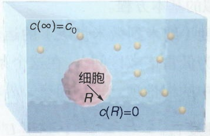

text_image

c(∞)=c₀
细胞
R
c(R)=0

(B)

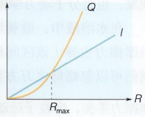

line

| Variable | Value |
| --- | --- |
| Q (at R_max) | Maximum |
| I (at R_max) | Maximum |

图 2-11 细胞对小分子的吸收

（A）球形细胞在环境中对小分子的吸收示意图。（B）细胞氧气代谢率（Q）与吸收率（I）与细胞大小（R）的关系。

讨论一些特殊情形。

只要空间中粒子的浓度不均匀，就会存在净的粒子流[式（2-32)]，从而驱动粒子在空间中重新分布。驱动这种粒子流动的本质原因在于每个粒子都是独立地在进行随机运动，但是粒子数目多的体积元流出的粒子数比粒子数目少的体积元流出的粒子数更多:这单纯就是一种熵的作用！

扩散过程一直会进行到粒子浓度在空间中均匀为止，此时系统达到平衡态。事实上， $j(x) = 0$ 就是方程（2-33）的一个特殊解，此时 $c(x) = c_0$，这个解称为系统的平衡态解。菲克定律[式（2-32）]和扩散方程[式（2-33）]表明，粒子流的后果是降低各个体积元之间的浓度差异直至平衡。因此，独立且随机的无规热运动最终会导致各种浓度差异（即浓度的空间有序性）被抹除，最终达到没有差异即无序度最大的状态。该过程的快慢由扩散系数决定。

## 2.4.3 外场中的布朗粒子

上面所讨论的布朗粒子的扩散是由于粒子与溶液中的水分子碰撞导致的，是简单的随机热运动。在生物学和化学中，布朗粒子本身还可能会处于一些外场中并受外场作用力影响，进而导致定向运动。例如带正电荷的离子在电场中会受力并朝着负极移动，如图2-12所示。可以想象，外场导致粒子的定向运动，从而在宏观上出现定向流，这种流会与产生随机运动的扩散叠加，改变粒子的浓度分布。定向运动和随机运动（即定向流和扩散流）的平衡决定了粒子浓度的最终分布。对于一个处于外场中的粒子，所受外场的力 $F = -\frac{\mathrm{d}U}{\mathrm{d}x}$，其中 $U$ 是粒子在外场中的势能。由于粒子处于水溶液中，还会受到摩擦力 $f = -\xi v = -\xi \frac{\mathrm{d}x}{\mathrm{d}t}$，其中 $\xi$ 是摩擦系数。最后，粒子还会受到水分子碰撞导致的随机力 $f_{\mathrm{r}}(t)$ 。根据牛顿第二定律，粒子的运动方程是

$$
m \frac {\mathrm{d} ^ {2} x}{\mathrm{d} t ^ {2}} = - \xi \frac {\mathrm{d} x}{\mathrm{d} t} - \frac {\mathrm{d} U}{\mathrm{d} x} + f _ {\mathrm{r}} (t) 。 \tag {2-36}
$$

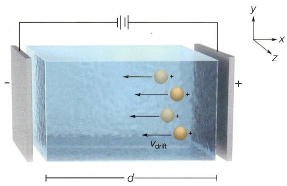

text_image

Vdrift
d
y
x
z

图2-12 有外场（例如电场）作用时布朗粒子的运动

该方程称为郎之万方程，是一个描述微观粒子在液体或气体等介质中运动的随机微分方程。郎之万方程广泛应用于物理、化学、生物等多个领域，用来描述布朗运动、扩散、噪声等现象，也是分子动力学模拟的基本方程。

在水溶液中，微观尺度（纳米到微米量级）的运动通常由摩擦力主导（该区间称为低雷诺数区间）。在这个条件下，我们可以忽略郎之万方程中的惯性项。平均而言，外场力与摩擦力平衡，即粒子运动速度 $v_{\mathrm{drift}} = \frac{F}{\xi} = -\frac{U'}{\xi}$，这里 $U' = \frac{\mathrm{d}U}{\mathrm{d}x}$。对于大量的由郎之万方程描述的布朗粒子，由外场导致的漂