移流 $j_{\mathrm{drift}} = v_{\mathrm{drift}}c(x) = -\frac{U'}{\xi} c(x)$ 。扩散流由菲克定律[式（2-32）]给出。因此总流

$$
j = j _ {\mathrm{drift}} + j _ {\mathrm{diffusion}} = - \frac {U ^ {\prime}}{\xi} c (x) - D \frac {\mathrm{d} c}{\mathrm{d} t}.
$$

再次使用粒子数守恒条件 $\frac{\partial c}{\partial t} +\frac{\partial j}{\partial x} = 0$ ，我们得到斯莫鲁霍夫斯基方程

$$
\frac {\partial c}{\partial t} = \frac {\partial}{\partial x} \left(\frac {U ^ {\prime}}{\xi} c + D \frac {\partial c}{\partial x}\right) _ {\circ} \tag {2-37}
$$

该方程描述了粒子在受力和扩散作用下运动的偏微分方程，是对扩散方程[式（2-33）]的扩展。通过求解这个方程，我们可以得到粒子在空间中的浓度（或概率）分布。

在系统达到平衡时，净流为零 $j = 0$ ，我们得到平衡时粒子浓度满足的方程

$$
D \frac {\mathrm{d} c (x)}{\mathrm{d} x} = - \frac {c (x)}{\xi} \frac {\mathrm{d} U (x)}{\mathrm{d} x} 。
$$

这个方程的解具有形式 $c(x) = C_0\mathrm{e}^{-\frac{U(x)}{D\xi}}$ ，其中 $C_0$ 是一个常数。同时根据玻尔兹曼分布，粒子在外场下的分布应满足

$$
c (x) = C _ {0} \mathrm{e} ^ {- \frac {U (x)}{k _ {\mathrm{B}} T}} 。 \tag {2-38}
$$

两种分布对应同一种平衡态，因此要求有相同的指数因子

$$
D \xi = k _ {\mathrm{B}} T _ {\circ} \tag {2-39}
$$

该关系由阿尔伯特·爱因斯坦（Albert Einstein，1879—1955）在1905年发现，称为爱因斯坦关系。式（2-39）表明，在平衡态时，布朗粒子的涨落（由扩散系数决定）与耗散（由摩擦系数决定）之间存在定量关系（一个具体应用见知识窗2-6）。

当多个粒子在外场中达到平衡时，我们会得到一个不变量 $\ln c(x) + \frac{U(x)}{k_{\mathrm{B}}T} = \ln C_0$ [对式（2-38）取对数]。这个关系表明，如果外场不为零，那么布朗粒子的浓度也会有非均匀分布。两个位置之间的浓度差 $\Delta \ln c = \ln c(x_1) - \ln c(x_2)$ 与势能差 $\Delta U = U(x_{1}) - U(x_{2})$ 满足:

$$
\Delta \ln c = - \frac {\Delta U}{k _ {\mathrm{B}} T} \circ
$$

特别地，对于电场 $\phi (x)$ 中的粒子，如果粒子带电荷为 $q$ ，那么粒子的电势能是 $q\phi (x)$ 则有浓度差

$$
\Delta \mathrm{lnc} = - \frac {q \Delta \phi}{k _ {\mathrm{B}} T} 。 \tag {2-40}
$$

式（2-40）被称为能斯特关系。该关系表明，电势差可以维持浓度差。在物理化学中，我们定义 $q\phi + k_{\mathrm{B}}T\ln c$ 为系统的电化学势，是一个具有能量量纲的量。以上分析表明，平衡时，系统没有电化学势的差异。这再一次说明了系统平衡态是抹除了任何有序性（这里的有序性来源于电化学势差异）、无序度达到最大的一种状态。

在神经元或者肌细胞中，细胞膜内外通常有较大的离子浓度差，比如钾离子。我们可以估算维持这些离子浓度差所需要的电势差。利用 $k_{\mathrm{B}}T = 25\mathrm{meV}$，并且钾离子带

## 知识窗2-6

## 分子大小决定扩散的快慢

对于水中的球体，摩擦系数  $\xi$  与球体半径 R 之间存在简单的定量关系:

$$
\xi = 6 \pi \eta R _ {\circ}
$$

该关系称为斯托克斯公式，其中  $\eta$  是流体的黏度，在室温下水的黏度大约是  $10^{-3} \, kg \cdot m^{-1} \cdot s^{-1}$ 。结合  $D\xi = k_{B}T$ ，可以得到斯托克斯-爱因斯坦关系:

$$
D = \frac {k _ {\mathrm{B}} T}{6 \pi \eta R} 。
$$

该关系表明，扩散系数与粒子大小、溶液黏度成反比。越大的粒子扩散越慢；在不同的溶液中，粒子在越黏稠的溶液中扩散越慢。这与我们的直觉相符。

根据之前的讨论，一个高分子的平均半径与单元数之间的关系是 $R \sim N^{1/2}$ 。高分子的分子量 $M$ 就是单元数乘以单元的分子量，因此有 $R \sim M^{1/2}$ 。根据斯托克斯-爱因斯坦关系，高分子扩散系数与分子量之间存在定量关系（图 2-13）:

$$
D \sim M ^ {- 1 / 2} \text {。}
$$

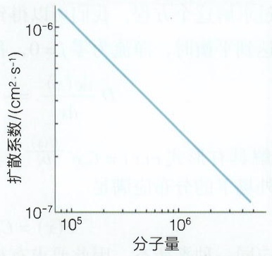

line

| 分子量 | 扩散系数 \((cm^{2} \cdot s^{-1})\) |
| --- | --- |
| \(10^{5}\) | ~\(1.5 \times 10^{-6}\) |
| \(10^{6}\) | ~\(2.5 \times 10^{-7}\) |

图2-13 扩散系数与分子量之间的关系

电荷为 $e$ ，如果细胞内外浓度差为10倍，则可以计算得到电势差为 $\Delta \phi = 58\mathrm{mV}$ 。这确实与实际测量的跨膜电势差在一个量级上。我们这里只是进行了简单的估算，在后面的章节中会更仔细地讨论这个问题。

## 2.4.4 自由能景观上的随机行走

在上一节中，我们讨论的是布朗粒子在外场中的随机运动。这种方法可以推广到生物大分子，如蛋白质、DNA的构象变化以及分子马达的运动。类似布朗运动中的外场势能 $U$ ，对于这些生物过程，根据2.2.4节中的讨论，热力学系统中的“势能”是自由能，因此我们应该采用自由能 $G$ 来描述定向的力。这时，特定反应坐标（类似布朗运动中的位移）的郎之万方程是

$$
\xi \frac {\mathrm{d} x}{\mathrm{d} t} = - \nabla G + f _ {\mathrm{r}} (t), \tag {2-41}
$$

其中 $f_{\mathrm{r}}(t)$ 是系统受到的随机力（这里我们忽略惯性）。与布朗运动类似，式（2-41）描述了系统在自由能景观（free energy landscape）上寻找自由能最低态的随机行走。自由能景观模型为我们提供了一个统一的框架，用于理解多种多样的生物过程。

例如，蛋白质折叠可以形象地描述为蛋白质分子在自由能景观的能量漏斗中进行随机行走的过程，如图 2-14A 所示。

这种自由能景观模型同样适用于化学反应。如图2-14B所示，一个分子的两种构型A和B分别对应于自由能景观上的两个极小值点，两种构型之间的转化速率分别是 $k_{A\rightarrow B}$ 和 $k_{B\rightarrow A}$ 。当反应达到平衡时，净流为零，分子处于A态和B态的概率满足 $k_{A\rightarrow B}p_{A}=k_{B\rightarrow A}p_{B}$ （该条件称为细致平衡条件）。平衡时，玻尔兹曼分布又给出 $\frac{p_{A}}{p_{B}}=\mathrm{e}^{\frac{\Delta G_{AB}}{k_{B}T}}$ ，其中 $\Delta G_{AB}=G_{B}-G_{A}$

(A)

natural_image

Illustration of a blue flower-shaped object with internal wavy lines and yellow annotations (no text or symbols)

(B)

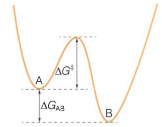

text_image

A
ΔG⁺
ΔGAB
B

图 2-14 反应动力学与自由能景观

（A）蛋白质折叠可以视为自由能景观上的随机行走。（B）化学反应对应的自由能景观。

是两种构型之间的自由能差异。综合以上两个平衡条件，我们得到反应速率满足的方程

$$
\frac {k _ {\mathrm{A} \rightarrow \mathrm{B}}}{k _ {\mathrm{B} \rightarrow \mathrm{A}}} = \mathrm{e} ^ {- \frac {\Delta G _ {\mathrm{AB}}}{k _ {\mathrm{B}} T}} = K _ {\mathrm{d}} \circ \tag {2-42}
$$

式（2-42）表明化学反应的动力学与热力学之间存在密切关系:反应速率的比值由两个状态之间的自由能差异决定，其中第二个等式来源于质量作用定律（2-27）。如果反应是通过随机运动越过A和B之间的势垒 $\Delta G^{\ddagger}$ ，那么反应速率的快慢取决于势垒的高度:

$$
k _ {\mathrm{A} \rightarrow \mathrm{B}} = k _ {0} \mathrm{e} ^ {- \frac {\Delta G ^ {\ddagger}}{k _ {\mathrm{B}} T}}, \tag {2-43}
$$

其中， $k_{0}$ 是一个常数。式（2-43）被称为克莱默斯速率公式，反映了系统在势场中通过扩散机制进行跃迁的速率。该形式与化学中的阿伦尼乌斯公式 $k = A\mathrm{e}^{-\frac{E_{\mathrm{a}}}{k_{\mathrm{B}}T}}$ 具有相同的形式， $\Delta G^{\ddagger}$ 就是该公式中的活化能 $E_{\mathrm{a}}$ 。

## 2.5 量子力学简介与量子生物学

在前面的几节中，我们都是基于经典力学来介绍统计物理如何处理微观粒子的运动行为。但是，当我们深入到原子和亚原子尺度时，经典力学不再适用。量子力学是我们理解许多生物过程和生物物理技术的必要手段。例如，荧光水母的发光特性是由其体内的荧光蛋白分子决定的。绿色荧光蛋白（GFP）的发现和应用是现代细胞生物学的重要突破性技术进展（2010年绿色荧光蛋白的发现者获得了诺贝尔化学奖）。GFP的特性是在一定波长的紫外线的照射下会发出绿色的荧光。其核心荧光基团是由Thr/Ser-Tyr-Gly环化形成的特异分子结构（图2-15）。钱永健等人通过改造GFP核心部位的氨基酸组合，形成了多种不同荧光特性的分子。为什么GFP会产生荧光？为什么改造之后的荧光蛋白会有不同的荧光特性？这些问题需要量子力学来进行解释。

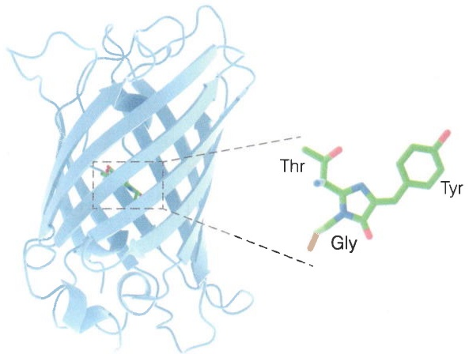

chemical

Molecular structure diagram showing protein domains with labeled amino acid residues Thr, Tyr, and Gly

图2-15 绿色荧光蛋白的结构

## 2.5.1 量子力学的发现

量子力学是分析解释微观世界里的分子、原子特性的本质原理的一门学科。量子（quantum）这个概念最早由马克斯·普朗克（Max K. E. L. Planck，1858—1947）在1900年黑体辐射的理论模型中提出。他指出，光的能量并非连续，而是由均一分布的最小单元逐个叠加起来的。这个最小的能量单元大小为 $h\nu$ ，其中 $h$ 为普朗克常量 $(h = 6.62607015\times 10^{-34}\mathrm{J}\cdot \mathrm{s})$ ， $\nu$ 是辐射电磁波的频率（Hz，

即 $\mathrm{s}^{-1}$ 。能量非连续的概念迥然不同于经典物理学的思想。这个全新的量子概念与19世纪末20世纪初实验物理学家在微观世界里的一系列重要发现相结合，掀起了现代物理学的一场革命。爱因斯坦引入“光量子”的概念成功地解释了金属只有在短于一定波长的光的照射下才能产生电流的光电效应现象。尼尔斯·玻尔（Niels Bohr，1885—1962）在约瑟夫·汤姆孙（Joseph J. Thomson，1856—1940）发现的电子和欧内斯特·卢瑟福（Ernest Rutherford，1871—1937）提出的原子核概念的基础上，提出了原子核周围的电子运动在量子化的能量轨道上，从而成功地解释了氢原子光谱的分立谱线，并建立了原子模型。路易·德布罗意（Louis Victor de Broglie，1892—1987）在爱因斯坦光子假说的基础上，提出了光既是波也是粒子，更进一步大胆地提出了所有微观粒子都具有波粒二象性，为量子力学做出了奠基性的贡献。沃纳·海森堡（Werner K. Heisenberg，1901—1976）在玻尔和马克斯·玻恩（Max Born，1882—1970）前期工作的基础上创立了量子的矩阵力学理论。海森堡还发现了著名的不确定性原理:

$$
\Delta x \cdot \Delta p \geqslant \frac {h}{4 \pi}, \tag {2-44}
$$

即粒子的位置和动量不可能被同时准确测量。薛定谔则在德布罗意波粒二象性的启发下提出了波函数和波动方程的数学表达形式，即著名的薛定谔方程（Schrödinger equation）。保罗·狄拉克（Paul A. M. Dirac，1902—1984）敏锐地意识到矩阵力学与波动方程的理论等价性，发表了《论量子力学理论》，形成了完整的量子力学理论体系。

量子力学与经典力学的重要区别概括见表2-1。

表 2-1 量子力学与经典力学的区别

| 经典力学 | 量子力学 |
| --- | --- |
| 描述宏观世界的物理学 | 描述微观世界(原子或亚原子)的物理学 |
| 能量和速度是连续的 | 能量和速度是量子化的 |
| 粒子的位置和速度可以同时精确测定 | 无法同时精确测定粒子的位置和速度(测不准原理) |
| 波和粒子是两种截然不同的物质形式 | 物质同时具有波粒二象性 |
| 用牛顿力学方程描述 | 用波函数描述 |

## 2.5.2 薛定谔方程

薛定谔方程在物理上与海森堡的矩阵动力学等价，但是对量子力学的数学描述和解释更为方便，因此在实践中得到了更为普遍的使用。在这里我们主要介绍薛定谔方程的含义和应用。为简化理解，我们使用一维的薛定谔方程:

$$
\mathrm{i} \hbar \frac {\partial \Psi (x , t)}{\partial t} = \hat {H} \Psi (x, t) = [ T + V (x) ] \psi (x) = - \frac {\hbar^ {2}}{2 m} \frac {\partial^ {2} \Psi (x)}{\partial x ^ {2}} + V (x) \Psi (x), \tag {2-45}
$$

其中，$T$ 是动能项，$V(x)$ 是势能项，$\hbar$ 是约化普朗克常量（$\hbar = h / 2\pi$），i 是虚数单位，$m$ 是粒子的质量，$\Psi(x, t)$ 则是波函数。与经典力学的运动函数不同，波函数 $\Psi(x, t)$ 描述的是微观粒子的量子态随时间的变化。波函数是一个复数，具有振幅和相位。玻恩发现，波函数的振幅平方反映的是微观粒子处于该量子态的概率 $|\Psi(x)|^2 = \Psi(x)\Psi^*(x)$，因此归一化后的波函数具有如下特性:① 全时空范围内波函数振幅的总和为 1，即 $\int \Psi^* \Psi \mathrm{d}x = 1$；② $\Psi$ 的振幅绝对值永远不会大于 1；③ $\Psi$ 在函数的任意一点都只有一个值；④ $\Psi$ 和它的一阶导函数都是连续的。

通常我们关心薛定谔方程的本征态（也是方程的不随时间演化的定态）

$$
\hat {H} \psi_ {E} (x) = E \psi_ {E} (x), \tag {2-46}
$$

其中，$\psi_{E}(x)$ 是本征值为 $E$ 的波函数。$E$ 实际上就是对应本征态的能量。对于任意时刻的波函数，我们都可以使用

$$
\Psi_ {E} (x, t) = \psi_ {E} (x) \mathrm{e} ^ {- \frac {\mathrm{i} E t}{\hbar}} \tag {2-47}
$$

来获得随时间演化的波函数。因此，求解式（2-46）获得本征态和本征能量是求解薛定谔方程的关键步骤（知识窗2-7）。

## 2.5.3 电子轨道与分子键

量子力学为解释原子和分子的结构提供了重要的理论基础。玻尔最早将量子的概念引入建立了氢原子的电子轨道模型。氢原子是最简单的原子，只由一个质子和一个电子构成，电子与质子之间有静电相互作用，电子的运动状态是量子化的。应用薛定

## 知识窗2-7

## 定态薛定谔方程的解

我们可以应用薛定谔方程尝试解析一些特殊条件下的波函数。

第一个例子是在一维空间上自由运动的粒子。因为粒子在自由运动，因此外部势能  $V(x)=0$ ，薛定谔方程简化为

$$
- \frac {\hbar^ {2}}{2 m} \frac {\mathrm{d} ^ {2} \psi}{\mathrm{d} x ^ {2}} = E \psi ,
$$

或者简化为

$$
\frac {\mathrm{d} ^ {2} \psi}{\mathrm{d} x ^ {2}} = - k ^ {2} \psi ,
$$

其中， $k=\frac{\sqrt{2mE}}{\hbar}$ 。这个方程的一般解是正弦和余弦函数的组合。这里我们使用指数形式:

$$
\psi (x) = A \mathrm{e} ^ {\mathrm{i} k x} + B \mathrm{e} ^ {- \mathrm{i} k x},
$$

其中，A、B为待定常数。本征能量 $E=\frac{\hbar^{2}k^{2}}{2m}$ 。通过能量与动量的关系 $E=\frac{p^{2}}{2m}$ ，我们得到 $p=\hbar k$ 。将 $\psi(x)$ 的解代入式（2-46）中，当B=0时，波函数代表一个向x轴正方向自由运动的粒子；当A=0时，波函数代表一个向x轴负方向运动的粒子。粒子在任何位置的概率 $\psi^{*}\psi=A^{2}+B^{2}$ 是一个常数，这意味着在动量 $p=\hbar k$ 给定的情况下，粒子在x轴上出现的概率是完全相同的，也就是粒子的空间位置无法确定！这恰恰就是海森堡不确定性原理的体现。

第二个例子是在具有明确边界的一维势阱的粒子。粒子在 $x = 0$ 到 $L$ 的区域里不受到外力，因此 $V = 0$ ，但在 $x \leqslant 0$ 和 $x \geqslant L$ 的区域里 $V = \infty$ （这被称为无限深方势阱）。我们参考上一个例子，可以解析得到当粒子在盒子里时候的波函数解为:

$$
\psi (x) = A \cos k x + B \sin k x,
$$

其中， $k = \frac{\sqrt{2mE}}{\hbar}$ 。与第一个例子不同的是，在无限深

方势阱中，边界条件

$$
\psi (0) = \psi (L) = 0,
$$

要求 A=0 。在  $kL=0,\quad\pm\pi,\quad\pm2\pi,\quad\cdots$  ，都有  $\psi(L)=0$  ，因此

$$
k _ {n} = \frac {n \pi}{L}, n = 1, 2, 3, \dots 。
$$

因此能量也是分立取值的:

$$
E _ {n} = \frac {\hbar^ {2} k _ {n} ^ {2}}{2 m} = \frac {n ^ {2} \hbar^ {2} \pi^ {2}}{2 m L ^ {2}} 。 \tag {2-48}
$$

这些波函数与能量值如图2-16所示。与经典情况截然不同的是，无限深方势阱中的量子粒子不再是随意取任何能量，它只能取一些特殊的值，我们称之为能级。其最低的能级是 $n = 1$ 时 $E_{1} = \frac{\hbar^{2}\pi^{2}}{2mL^{2}}$ ，对应的波函数 $\psi_{1}$ 称为基态；其它态的能量正比于 $n^2$ ，称为激发态。在基态时，粒子的动量 $p = \pm \frac{h}{L}$ ，因此动量的最小变化范围 $\Delta p\geqslant \frac{h}{L}$ 。粒子在盒子中的位置不确定范围 $\Delta x\approx L$ 。因此满足不确定性关系 $\Delta p\cdot \Delta x\geqslant h$ 。如果使用类似的推导对一个粒子的薛定谔函数随时间的变化进行分析，可以得到不确定性关系在能量和时间关系的表述 $\Delta E\cdot \Delta t\geqslant h$ 。

$n=2,3,\cdots$ 的波函数和能量对应的状态被称为激发态。 $n$ 越大，激发态的能级越高。从低能级进入高能级状态被称为能级跃迁。该一维盒子中的粒子若要从基态跃迁进入 $n = 2$ 的激发态，必须而且只要接受到高于$\Delta E(= E_2 - E_1 = \frac{3h^2}{2mL^2})$ 一个能量包即可，而低于 $\Delta E$ 的再多的能量包也无法实现粒子的能级跃迁。从以上的能量与能级公式可见， $\Delta E$ 与 $mL^{2}$ 成反比，故一维盒子的尺度越大，粒子的质量越大，能级的差别就越小。这个推导说明，分子轨道中电子的能级差别直接受分子轨道尺寸的影响:分子越大，其能级差别越小，需要的跃迁能量也越少。这就是具有离域电子轨道的芳香族氨基酸比无离域电子轨道的氨基酸具有更强的吸收近紫外线能力的原因。另一方面，当 $m$ 和 $L$ 大到宏观尺度时，$\Delta E$ 就会小到接近于零，这意味着不同状态之间的能量变化是连续的，也就与经典物理学一致了。

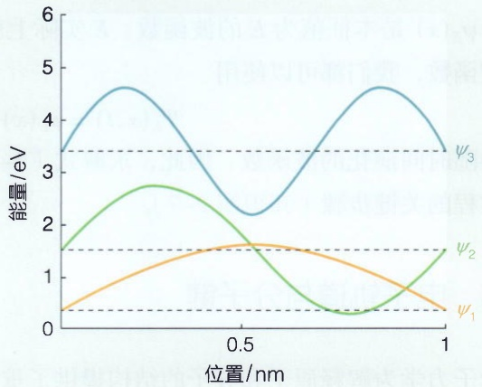

line

| Position (nm) | \(\psi1 (\)eV) | \(\psi2 (\)eV) | \(\psi3 (\)eV) |
| --- | --- | --- | --- |
| 0 | ~0.4 | ~1.5 | ~3.4 |
| 0.5 | ~1.6 | ~1.6 | ~2.2 |
| 1 | ~0.4 | ~1.5 | ~3.4 |

图 2-16 无限深方势阱中的粒子波函数与能量取值

以上对薛定谔方程的两个特例的简单数学推导及其物理学含义的解释，体现了量子力学主要是对微观世界的物理学刻画，并不排斥经典物理学对日常世界的描述。

谔方程可以对氢原子的电子轨道波函数进行解析。

氢原子由一个质量很大的、带电荷量为 $e$ 、基本上静止不动的质子（选为坐标原点）和一个质量轻得多的电子（电荷为 $-e$ ）组成。电子受到质子引力的势能函数为:

$$
V (r) = - \frac {Z e ^ {2}}{4 \pi \varepsilon_ {0}} \cdot \frac {1}{r},
$$

其中， $Z$ 是原子核的电荷数（对氢原子， $Z = 1$ ）； $\varepsilon_0 = 8.854\times 10^{-12}\mathrm{J}^{-1}\cdot \mathrm{C}^2\cdot \mathrm{m}^{-1}$ ，是介电常数； $r$ 是电子与质子之间的距离。

与上一节中讨论的一维势阱中粒子的情况类似，电子因为限制在原子核周围很小的空间里，其波函数在特定的分立能级下具有不同的特征。因为波函数表示的是电子在氢原子核附近的空间分布概率函数，因此其形状根据概率的大小呈现为云状分布，也就是常说的电子云。电子在电子云中出现概率较大的区域被称为电子轨道。不同能级的波函数具有不同的量子态，其电子轨道的形状也不同（图2-17）。

对任何原子中的某个电子，电子轨道主要由三种量子数表示，分别是主量子数 n、角量子数 l、磁量子数 m。这三种量子数的组合遵循泡利原则，并决定电子轨道的能级和形状。其中，主量子数 n 反映电子的能级分布，用自然数 1、2、3 等表示。角量子数 l 决定电子轨道具有不同的形状，对化学键和键角有重要影响，可取的值由主量子数决定: $l=0,1,2,\cdots,n-1$ ，通常我们用 s、p、d、f 等表示。磁量子数 m 决定非球对称形状的电子轨道在空间中的伸展方向，磁量子数所有可能取值由角量子数决定: $m=0,\pm1,\pm2,\cdots,\pm l$ 。另外，每个电子还有一个自旋量子数  $m_{s}=\pm\frac{1}{2}$ ，是第四个量子数。

氢原子电子的能级只由主量子数 $n$ 决定，不同能级的电子处于距离原子核不同的轨道上，又称为壳层。当电子从一个较高能级的壳层进入另一个较低能级的壳层时，即发射出相应的光子，这就是氢原子的光谱。以上这些关于电子轨道的特征描述都是由波函数决定的。

图2-17 电子轨道

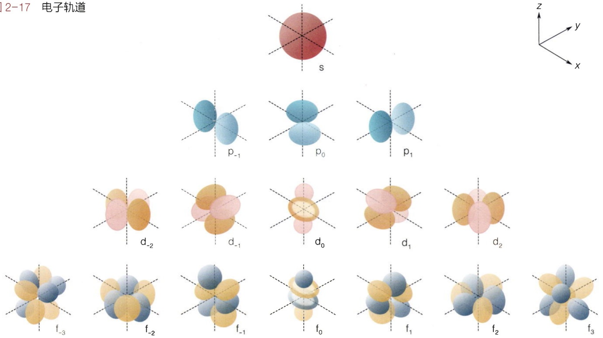

chemical

电子轨道示意图，展示多代电子结构及其对应位置标注

对于多电子的单原子体系，因为需要考虑电子之间的相斥性，无法对薛定谔方程进行精确求解，所以只能使用近似手段。当系统中存在多个电子时，必须考虑电子间的相斥性。泡利不相容原理指出，在一个原子中不可能存在两个电子共有全同的四个量子数。因此，在同一个电子轨道里（$n, l, m$）最多只能容纳两个自旋相反的电子。处于同一轨道中的一对自旋相反的电子被称为电子对。而具有相同自旋方向的多个电子在原子中尽量远离，按照轨道能级从低到高分布在不同的电子轨道中。这种电子排布规则被称为洪特定则。

对于多电子和多原子核的分子体系，薛定谔方程更加复杂，即使今天也无法进行精确解析，只能在一些近似假设的基础上进行分析。玻恩-奥本海默近似考虑到原子核的质量远大于电子，电子的运动速度远大于原子核，因此假设原子核相对电子是不动的，可以将薛定谔方程中的原子核波函数部分忽略不计。基于此假设，整个系统主要由电子的波函数加上相对不变的原子核间的排斥力决定。因此薛定谔方程不必考虑原子核的变化。电子的势能 $V$ 包括两个部分:原子核对电子的吸引力和电子之间的互斥力。对多原子核的较大分子，可以再引入一个假设:当电子靠近一个原子核时，来自其它电子的排斥力忽略不计。这样电子在分子里的轨道可以近似为多个原子轨道的线性叠加（图2-18）。这称之为分子轨道近似。基于以上近似提出的分子轨道理论是现代解释分子键尤其是共价键的主要理论。该理论认为，当原子形成分子后，电子在整个分子的分子轨道中运行；分子轨道由组成分子的多个原子决定，其轨道函数是这些原子轨道的线性叠加。比如，两个原子的s轨道线性叠加，就形成了 $\sigma_{\mathrm{s - s}}$ 共价键；两个原子的p轨道沿着对称轴方向头对头线性叠加，就形成了 $\sigma_{\mathrm{p - p}}$ 共价键；两个原子的p轨道平行相连线性叠加，就形成了 $\pi_{\mathrm{p - p}}$ 共价键。

应用分子轨道近似理论，我们可以推导出原子在形成分子轨道时要遵从的几个原则:最大重叠原则、对称性一致原则和能量相似原则。

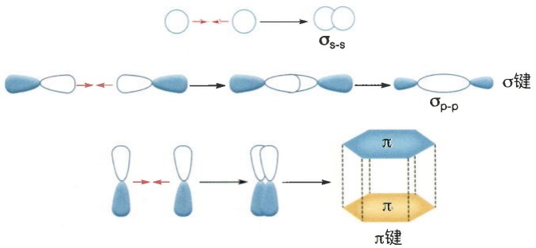

flowchart

图2-18 分子轨道是原子轨道的线性叠加

最大重叠原则:两个原子轨道的波函数线性叠加

后的概率分布密度包括波函数的乘积项，决定了分子轨道的重叠密度。波函数乘积项为正的时候，重叠密度增大。重叠密度越大，意味着电子在此分子轨道中出现的概率越高，则分子系统的能量越低，因而就形成了稳定的化学键。这种分子轨道也称为成键轨道。反之，也会存在两个原子轨道波函数的乘积项为负的情况，导致重叠密度变小，系统能量变高，反而促进原子的分离。这种分子轨道称为反键轨道。

对称性一致原则:只有对称性匹配的原子轨道按照一定的角度组合才能形成更大的原子轨道重叠，组合成分子轨道。

能量相似原则:只有能量相近的原子轨道形成重叠的可能性较大，从而组合成有效的分子轨道。成键原子轨道的能量越相近，越容易形成分子轨道。成键形成分子的能量低于成键前原子单独的能量之和。

当形成化学键的两个原子轨道能量完全相同时，分子轨道形状是对称的。而当两个原子轨道能量有差异时，分子轨道呈现为不对称的形状。其中，与分子轨道能量接近的原子对成键的贡献最大，因而分子轨道在该原子附近的电子云密度更高，该原子从而体现为对电子的较强吸引力，呈现为负电荷；对应的，另一个原子则对电子吸引力较弱，呈现为正电荷。这个化学键体现为电荷在两个原子之间的分布不均匀，呈现为化学键的极性。这种极性的化学键在电磁场中是一种偶极子，会对电磁场产生响应（图2-19）。分子轨道因为原子轨道的不同组合方式也呈现为不同的量子态，分布于不同的能级上。与原子轨道中的电子一样，在同一个分子中，电子也可以在不同的分子轨道之间实现跃迁，并伴随着能量的吸收或释放。

在一些较为复杂的分子轨道中，一个原子中的多个原子轨道常常与周边原子的轨道相重合，结果导致化学键的杂化。这被称为分子轨道杂化理论（图2-20）。碳原子是分子轨道杂化最丰富的原子之一。碳原子在分子中的轨道包括 $\mathrm{sp}^3$ 、 $\mathrm{sp}^2$ 、sp等多种杂化状态，形成了不同几何形状的化学键组合方式。多个碳原子与其它原子以不同的轨道杂化方式相互组合，形成了复杂的有机分子世界。比如，在乙烷分子中，两个碳原子通过 $\mathrm{sp}^3$ 杂化轨道里的一个轨道头对头形成 $\sigma$ 键；在乙烯分子中，两个碳原子通过 $\mathrm{sp}^2$ 杂化轨道里的一个轨道头对头形成 $\sigma$ 键，而各自余下的两个p轨道则肩并肩形成 $\pi$ 键，形成了平面排布的分子形状；在苯分子中，六个碳原子都是 $\mathrm{sp}^2$ 杂化轨道，两两形成6个 $\sigma$ 键，形成了一个六元环平面形状的分子，各自余下的一个p轨道则在环上肩并肩融合，形成了一个离域 $\pi$ 键。

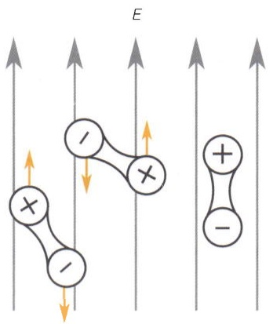

chemical

Diagram showing electron flow in a molecular system with positive and negative charges

图 2-19 偶极子对电磁场的响应

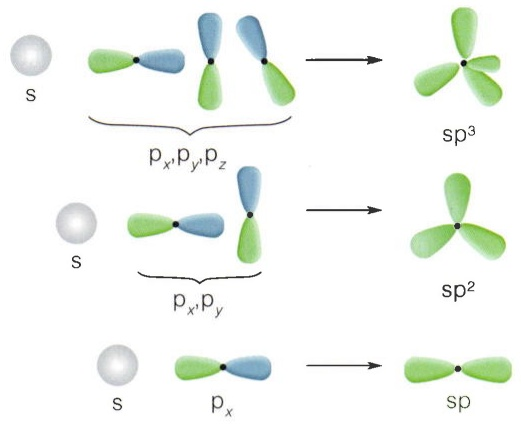

chemical

Diagram showing molecular orbital energy levels and spin states (sp³, sp², sp) with labeled p-values

图2-20 碳原子的杂化轨道

在自然界的分子中，最典型的化学键包括共价键和离子键。共价键形成主要遵循上述的分子轨道近似理论。根据以上的描述可知，共价键的形成与分子轨道的形状关系密切，因而具有方向性。共价键的方向性决定了多原子分子的形状。这也是生物分子尤其是生物大分子具有复杂的空间形状的根本原因。离子键则是因为两个能量不同的原子的高度极化，导致一个原子将另一个原子周围的电子夺走，一个原子带纯的负电荷，而另一个原子带纯的正电荷，形成了阴离子和阳离子。阴离子和阳离子靠静电相互作用吸引从而形成离子键。与共价键依赖分子轨道的形状呈现出方向性不同，两个阴阳离子之间的相互作用是没有方向性的。

氢原子与电负性较大的原子如F、O、N形成共价键后，电子云主要集中于电负性原子周围，导致氢原子呈现为较强的正电性。这样的带正电的氢原子可以与附近存在的具有较大电负性又含有孤电子对的另外一个原子产生静电相互作用，形成一种特殊的介于共价键和离子键之间的特殊类型的分子间或分子内相互作用，即为氢键。氢键因为是氢原子核与负电性的孤电子对相互作用，因而具有方向性，呈现出X—H…Y的排列，其中X和Y是同种或不同种的原子，主要是F、O、N。同时，因为O—H和N—H共价键在水分子、有机分子和生物分子中广泛存在，所以氢键广泛存在于水分子之间、水溶液以及生物大分子中，也导致了水、水溶液和生物大分子的很多独特性质。氢键在生物大分子的三维结构形成中尤其发挥着重要的作用。

## 2.5.4 电磁波的能级效应和初步光谱学

变化的电场会产生磁场，变化的磁场也会产生电场。1864年，英国科学家麦克斯韦提出，随时间周期性变化的电场将产生随时间周期性变化的磁场，反之亦然，而且这样的电场与磁场交替变化可以向周围空间扩散，从而形成了变化电磁场的传播，也就是电磁波。电磁波中电场与磁场紧密相关，对传播所到之处的带电或磁性物质会产生相应的电场或磁场效应。电磁波的传播本身不需要任何介质，任何电磁波在真空中都以相同的速度（即光速）传播。电磁波具有振幅、频率和波形等基本参数，其中，振幅体现了电磁波的强度，频率也可以根据公式 $\lambda v = c$ 换算为波长。电磁波可以发生折射、衍射、干涉等波的行为，还会因为电磁场振动的方向而呈现出偏振性。

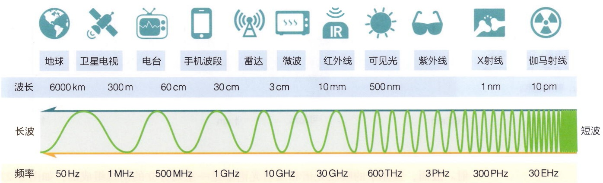

text_image

地球
卫星电视
电台
手机波段
雷达
微波
红外线
可见光
紫外线
X射线
伽马射线
波长 6000 km 300 m 60 cm 30 cm 3 cm 10 mm 500 nm 1 nm 10 pm
长波 短波
频率 50 Hz 1 MHz 500 MHz 1 GHz 10 GHz 30 GHz 600 THz 3PHz 300 PHz 30 EHz

图2-21 电磁波波谱图

光的本质就是电磁波（图2-21）。不同频率或波长的电磁波包括我们通常所说的可见光、紫外线、红外线等。X射线、$\gamma$ 射线都是波长很短的电磁波，波长较长的电磁波则包括微波、无线电波等。光不只是波，也是粒子。光的波粒二象性是物理学在20世纪初做出的最重要的发现之一。

爱因斯坦对光电效应的理论解释深刻揭示了光的粒子性。光电效应是指某些物体在光束的照射下会发射电子的物理学现象，发射出来的电子被称为“光电子”。实验中发现，对可以产生光电效应的材料，只有使用频率高于特定阈值的光进行照射才会发射光电子，而当光的频率低于阈值时，无论光束的辐照度多大都不会产生电子。另外，发射出来的光电子的能量与照射光的频率成正比而与光照强度无关；光电子的数量则与光照强度成正相关。针对光电效应的以上特点，爱因斯坦提出光量子假设，即光束是由离散的光子所组成，每个光子的能量取决于光的频率，为 $h\nu$ 。当光的频率大于某极限阈值时，单个光子的能量就足够大而使得物体表面的一个电子发生逃逸，产生光电效应。光量子的假设完美地解释了光电效应现象，进而确立了电磁波的波粒二象性。所有电磁波中光子的能量与波的频率直接相关，为 $h\nu$ 。电磁波的波长越长，其频率越低，所以能量也越低。红外线光子的能量要比紫外线光子的能量低，$\gamma$ 射线的能量则非常高。

前面介绍到氢原子的电子可以在不同能级的轨道壳层之间跃迁。这种跃迁由于轨道能级的差异，伴随着光子的吸收或发射。处于较低能级轨道上的电子在吸收了能量合适的光子时即可以实现跃迁，进入相应的高能级轨道。反过来，处于高能级轨道上的电子可以跃迁到低能级轨道上，并伴随着光子的发射。被吸收或发射的光子的能量恰好等于高低两个轨道之间的能级差。因为氢原子中的电子轨道能级是分立的，所以能级差也是分立并有明确数值的，只有符合能级差的相应频率的光子才能被吸收或发

图2-22 氢原子发射谱线图

各谱线名称:Iy，莱曼系；Ba，巴耳末系；Pa，帕申系；Br，布拉格系；Pf，蒲芬德系；Hu，韩福瑞系。

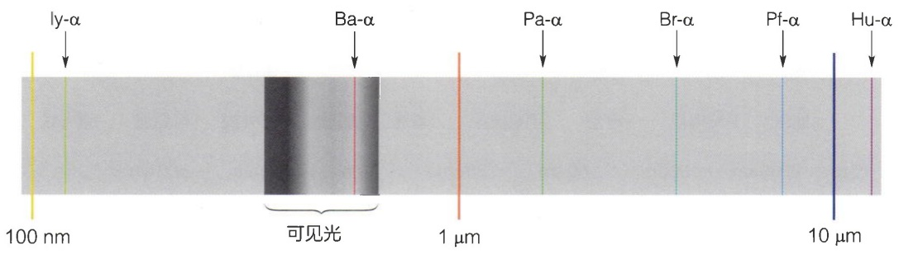

text_image

ly-α
Ba-α
Pa-α
Br-α
Pf-α
Hu-α
100 nm
可见光
1 μm
10 μm

射。故而，氢原子的吸收光谱和发射光谱都是一系列分立的谱线组成的，如图2-22所示。

与氢原子的电子轨道跃迁一样，在分子中不同轨道上的电子也会发生轨道之间的跃迁。分子轨道的能级是分立的，因此电子在轨道之间的跃迁也是量子化的。当一个分子中的电子处于能级最低的分子轨道时，该分子处于基态；当处于基态的电子吸收了一个能量匹配的光子时，跃迁到高能级的分子轨道，分子处于激发态。分子在激发态并不稳定，会迟滞一段时间后回到基态，并发射出一个能量匹配的光子，这个过程称为自发发射。处于激发态的分子也可以在一个能量匹配的光子的诱导下回到基态，伴随着两个能量和方向完全相同的光子的发射，这个过程称为激发发射。

绝大多数的分子轨道跃迁对应的光子能量在紫外线和可见光范围内，可以使用紫外线和可见光谱学进行分析。在同一个分子轨道内的分子振动能级差则主要在红外线范围内，因而可以使用红外光谱对分子的振动状态进行研究。另外，分子在空间内的转动也呈现为量子化的能级分布，其能级差比分子振动更小，可以使用红外线甚至微波等进行分析。不同的原子和分子中的原子核和电子还有一个量子特征，即它们的自旋，这些自旋也是量子化的。不同的原子核和电子呈现为不同的自旋能级。这些自旋能级会在磁场中发生响应，并形成光子能量的吸收或发射，从而可以使用磁共振谱学进行分析。

## 2.5.5 量子生物学

在第1章中，我们简单介绍了生物体与光之间的相互作用。这些相互作用是生命活动中至关重要的一个方面。从微小的细菌到高等植物和动物，生物都进化出了各种各样的感光和吸收光的机制，以适应不同的生存环境。

在生命体感光和利用光的过程中，光合色素起到了重要的作用。这些色素分子是一大类高度特化的分子，可以参与光的吸收和电子传递等过程（见第9章）。这些色素分子都有一个共同的特征:它们都含有一个相对较大的共轭双键系统。这个共轭双键系统是由交替的单键和双键组成的，这种结构使得 $\pi$ 电子可以在分子内自由移动，类似于电子在导线中的运动。共轭双键系统的结构和大小决定了 $\pi$ 电子的能级，从而决定了色素分子能够吸收特定波长的光。

当光合色素分子吸收光子后，其电子会跃迁到更高的能级。处于激发态的电子可以以多种方式释放能量，例如:以光的形式释放（荧光），以热的形式释放，或者转移给其它分子。如果激发态的电子回到基态并释放光子，那么色素分子就会发光，例如GFP的发光原理就是如此。通过改造分子结构，可以影响电子的能级，进而影响发射光的波长。此外，激发态的电子还可以将能量转移给其它分子，例如在光合作用中，电子会沿着电子传递链传递，最终用于合成ATP。有趣的是，电子在传递过程中并不需要色素分子直接接触，而是通过量子隧穿的方式穿过分子间的空隙，这是量子力学的一个奇妙现象。

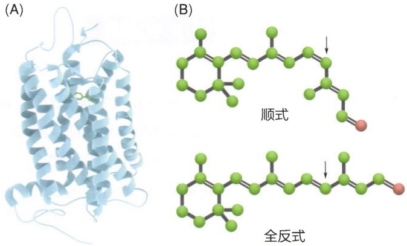

图2-23 视蛋白结构（A）与视黄醛11-顺式异构体和全反式异构体（B）

生物对光的感知也依赖于光吸收。视蛋白是一种重要的光敏蛋白，它由七个跨膜 $\alpha$ 螺旋组成，其中嵌入了一个视黄醛分子，如图2-23A所示。视黄醛分子在光照下会发生构象变化，从11-顺式异构体转变为全反式异构体，如图2-23B所示。这种构象变化会引起视蛋白构象的改变，从而激活下游的信号转导通路，最终导致视觉的产生。

## ※ 本章小结

生命体需要持续地消耗自由能来抵抗自发到达无序状态的趋势。在这一章中，我们用熵和自由能来刻画这种自发趋于无序的效应。正是这种效应的普遍存在，生命体才需要各种主动机制来维持有序的状态。在后面的章节中，我们会更仔细地讨论这些主动机制。同时，我们也简单介绍了量子力学及其在生物学中的应用。在第五部分我们会更详细地介绍相关技术应用。

## ※ 思考题

1. 平衡态中的“平衡”有字面含义:系统各个部分之间没有差异。请思考如果系统是非平衡的，可能有哪些差异。如何从熵极大原理理解这些差异的消失？
2. 在化学反应中，我们通常会引入一个反应速率来表示单位时间内一个反应发生多少次。思考这个反应速率会取决于哪些因素。在极稀的溶液中，反应参与物的扩散会限制反应速率的大小，为什么？细胞有哪些可能的方式来影响扩散进而影响反应速率？
3. 测不准原理会影响生物体的宏观行为吗？为什么？如果要实验验证生命系统的某种宏观行为（例如鸟类的导航能力）是量子效应，主要会面临哪些挑战？

## ※ 扩展阅读

图书

纳尔逊.生物物理学:信息、能量、生命[M].黎明，戴陆如，等，译.2版.上海:上海科学技术出版社，2023.

普利施克，贝格森.平衡态统计物理学:第三版[M].汤雷翰，童培庆，译.北京:北京大学出版社，2020.

Phillips R, Kondev J, Theriot J, et al. Physical biology of the cell[M]. 2nd ed. London: Garland Science, 2013.

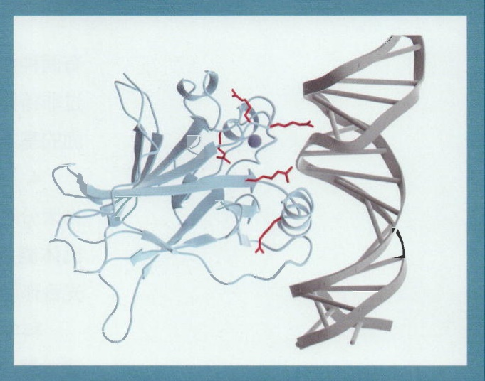

natural_image

3D ribbon diagram of a protein structure with alpha helices and beta sheets, shown against a blue background (no text or labels)

## 第二部分

## 分子生物物理

分子生物物理学在分子水平上研究生物大分子及其相互作用，阐明各种生命活动表象背后的分子基础和机制。该研究领域在理解蛋白质、核酸和其它生物分子的结构、动力学和功能方面发挥着至关重要的作用。分子生物物理学是跨学科领域，融合了物理学、化学、计算机和生物学的概念和技术。分子生物物理学的核心内容是生物分子的结构、物理性质和行为，这部分涵盖广泛的主题。本书将按照从静态结构到动态行为、从结构到功能的逻辑思路介绍相关内容。

1. 结构生物学（第3—6章）本领域重点研究生物大分子的三维结构。我们先阐述生物大分子的结构模式；再介绍三种主要结构生物学方法的入门知识，这包括X-射线晶体学、核磁共振波谱学和冷冻电子显微镜学。
2. 分子折叠及结构预测（第7、8章）生物大分子折叠成三维结构是一个热力学和动力学调控的过程。我们将介绍蛋白质和RNA折叠的基本原理，以及基于计算机模拟和人工智能的结构预测方法。
3. 生物大分子的相互作用（第9、10章）生物大分子有两种作用形式:折叠成特定的结构单元（结构域），或者通过非特异作用形成凝聚体（相分离）。我们将分别介绍这两方面的基本原理和例子。

4. 生物大分子对物理信号的应答（第11、12章）生物大分子感知力、电、磁等物理信号，改变其构象，从而使机体能应答外界的刺激。我们将结合分子马达、离子通道、光合作用等内容介绍相关生物大分子的结构和作用机制。

科学永不停息，分子生物物理学随着技术的进步一直飞速发展。从同步辐射光源的广泛应用，超高分辨率显微镜、冷冻电子显微镜的技术革命，到近几年的基于人工智能的结构预测，新技术方法的出现无不极大地推动着分子生物物理学进步。分子生物物理学是一个至关重要且充满活力的领域，它与生物化学、遗传学和细胞生物学等学科的密切关系丰富了我们对生物学的理解，导致医学、生物技术等领域的进步。当深入研究这个迷人的领域时，你们将发现丰富的知识和机会。