## 生物大分子的结构

生物大分子包括蛋白质、脱氧核糖核酸（DNA）、核糖核酸（RNA）、多糖等。蛋白质的结构丰富多彩，是各种生命活动的执行者，在基本的呼吸作用、细胞增殖、高等生物的免疫应答、神经活动等等过程中发挥作用。DNA携带遗传密码，控制生物性状，是构建生命的蓝图。RNA是传递遗传密码的信使，指导蛋白质的合成。近来研究显示，细胞转录大量没有编码蛋白质的RNA，它们同样具有重要的生物学功能。

发现并理解生物大分子的功能是生命科学的核心问题，而解析生物大分子的结构，可以透过现象看本质，揭示功能背后的机理，并为理解生物学功能提供新的视角和思路。例如，DNA 的双螺旋结构揭示了遗传信息的存储和传递机制；肌红蛋白和血红蛋白的结构揭示了机体存储和运输氧气的机制。这些生物大分子结构研究也是现代分子生物学开端的标志性事件。同时，生物大分子的结构研究在药物研发和医学领域中发挥着重要作用。例如，通过解析蛋白质的结构，可以帮助开发新药物，并优化现有的药物。

本章将介绍蛋白质、DNA、RNA以及它们复合物的基本结构。在这些大分子结构尤其是蛋白质结构中，有两个反复出现的主题。首先，结构决定功能。为了实现某种生物学功能，往往需要特定的三维结构作支撑。因此，揭示生物大分子的结构特点，洞见其功能背后的机制是生物物理研究的核心内容。其次，生物大分子结构具有可塑性，而非静止不变。这种可塑性体现在构象的变化上，有些构象变化很细微，有些则很剧烈。有些变化是由于自发的热力学涨落，有些是由于应答环境的变化和信号刺激。正是这些特点使得生物大分子结构研究重要而且有趣。

表征和测定生物大分子结构需要不同的生物物理实验方法。例如，质谱技术常用于测定蛋白质的一级结构（序列信息），吸收和发射光谱常用于分析蛋白质的二级和三级结构，而晶体学、核磁共振以及电子显微镜技术可以解析蛋白质的精细三维结构。三种常用的结构解析方法的初步介绍见第4—7章，而更多的生物物理方法介绍见第五部分。

## 3.1 蛋白质结构

本节主要介绍蛋白质的多层次结构，以及推动这些结构形成的分子相互作用力。

## 3.1.1 蛋白质一级序列决定三维结构

蛋白质是复杂的生物分子，执行广泛的功能，对许多生物过程都至关重要。如酶催化生化反应，可以成千上万，甚至百万倍地加快反应速度；抗体分子特异识别病毒、细菌等病原体，对机体有重要的免疫保护作用；分子马达移动核小体，调节基因表达，控制细胞发育分化；离子通道蛋白质调节细胞内外离子的流动，控制神经信号

的传导和效应。为什么蛋白质作为同一类的生物大分子，却具有如此丰富多样的功能呢？蛋白质的功能与其独特的结构和氨基酸序列密切相关。序列中的每个氨基酸都影响最终的三维结构，并最终确定其功能。

蛋白质序列指的是蛋白质多肽链中的氨基酸线性序列。氨基酸是蛋白质的基本组成单位。为什么一维的氨基酸序列能够控制蛋白质的三维结构？这是一个复杂的蛋白质折叠问题，涉及到蛋白质主链的肽键共价链接、侧链的非共价键作用、分子伴侣等，进一步讨论见第7章。克里斯蒂安·安芬森（Christian B. Anfinsen，1916—1995）在1958年发现核糖核酸酶A（一种切割RNA的小蛋白质）在去除变性剂后可以恢复原来活性，从而证明蛋白质折叠成天然构象所需的信息包含在其氨基酸序列中。安芬森因此获得到了1972年的诺贝尔化学奖。

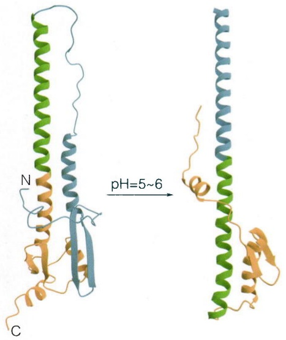

chemical

Protein secondary structure diagram showing helical conformations with labeled N and C termini, pH range 5~6

图 3-1 流感病毒 HA 细胞膜融合区在不同 pH 条件下的结构

流感病毒 HA 细胞膜融合区形成卷曲螺旋三聚体，图中显示其中一个单体的结构。左图，在中性 pH 的结构（PDB 编号:2HMG）；右图，在酸性 pH 的结构（PDB 编号:1HTM）。酸性条件下，流感病毒 HA 细胞膜融合区的 N 端（蓝色部分）往外翻，延长中央螺旋（绿色部分）；同时，C 端（橙色部分）重新折叠。

蛋白质的结构由其序列确定，但也受外在环境（如 $\mathrm{pH}$ 、温度、化学修饰和其它分子的存在）影响。例如，流感病毒血凝素蛋白（hemagglutinin，HA）的构象随 $\mathrm{pH}$ 值发生巨大变化（图3-1）。HA蛋白是流感病毒的外膜蛋白，在感染过程中，HA蛋白与宿主细胞表面的受体结合，流感病毒通过内吞作用进入宿主细胞。而病毒外膜在内吞体（endosome）与宿主细胞膜的融合则由HA的细胞膜融合区的构象变化所介导。在中性条件下，HA蛋白的细胞膜融合区被隐藏在蛋白内部；在内吞体的酸性环境中（$\mathrm{pH} = 5 \sim 6$），细胞膜融合区发生构象变化，疏水性（hydrophobic）区域暴露在蛋白表面，并与宿主细胞膜融合，从而把病毒的基因组释放到宿主细胞内。

“序列决定结构，结构决定功能”这一逻辑范式是理解蛋白质的基础。一些蛋白质在不同物种中保留了相似的功能。相应地，它们的序列中出现相同的片段，而且它们折叠成相似的三维结构。这些在演化上不变或相似的序列被称为保守序列（conserved sequence），相关蛋白被称为同源蛋白（homologous protein）。同时，蛋白质序列中也含有非保守序列，这些序列是不同蛋白质之间的差异所在，它们可以影响蛋白质的特异性。例如，RecA家族蛋白利用ATP水解能量，介导同源DNA链交换。它们在演化上高度保守，在细菌中称RecA，在古菌中称RadA，而在真核生物中被命名为Rad51。比较不同物种的RecA蛋白序列，可以发现核心序列高度保守（图3-2A），折

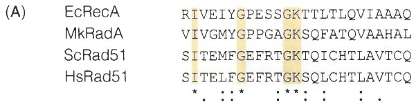

text_image

(A) EcRecA RIVEIYGPESSGKTTLTLQVIAAAQ
MkRadA VIVGMYGPPGAGKSQFATQVAAHAL
ScRad51 SITEMFGEFRTGKTQICHTLAVTCQ
HsRad51 SITELFGEFRTGKSQLCHTLAVTCQ
* . : *   : ** : : .

(B)

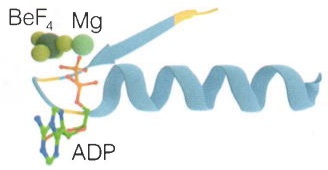

chemical

Molecular interaction diagram showing BeF4, Mg, and ADP binding to a protein secondary structure

(C)

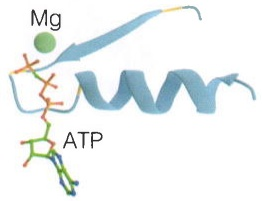

chemical

Molecular structure diagram showing Mg and ATP binding sites with a helical helix

图3-2 RecA家族蛋白序列和结构比较

（A）RecA 家族蛋白的核苷酸结合区域的多序列比对。EcRecA，大肠杆菌（Escherichia coli）RecA；MkRecA，甲烷嗜热菌（Methanopyrus kandleri）RadA；ScRad15，酿酒酵母（Saccharomyces cerevisiae）Rad51；hsRad51，人类（Homo sapiens）Rad51。“\*”表示相同的氨基酸残基，橙色高亮。“:”和“.”分别表示高度类似和类似的氨基酸残基。（B）EcRecA 核苷酸结合区域的结构（PDB 编号:3CMW）。（C）HsRad51 核苷酸结合区域的结构（PDB 编号:7EJC）。

叠成相似的结构（图3-2B、C），执行相似的功能。因此，分析蛋白质序列，并与已知蛋白对比，可以获得蛋白质功能的提示。

序列-结构-功能范式在研究基因突变相关的疾病以及蛋白工程等方面发挥作用。例如，表皮生长因子受体（EGFR）是一种位于细胞膜表面的受体酪氨酸激酶，参与细胞生长、增殖和分化等生物学过程。EGFR的突变会导致其在肺癌等恶性肿瘤中的异常表达和活化，进而引起肺癌的发生和发展。抑制EGFR激酶活性成为肺癌治疗的重要策略。第一代EGFR抑制剂吉非替尼（Gefitinib）竞争性结合EGFR的ATP结合位点，阻止其活化（图3-3）。然而，第一代EGFR抑制剂容易出现耐药性，其中一个常见抗药机制是T790M突变。药物分子虽然仍可以结合新出现的突变体，但失去相对于ATP的结合优势。人们根据EGFR激酶的结构特点，筛选设计出新一代的共价结合小分子抑制剂，如奥西马替尼（Osimertinib）。奥西马替尼不影响正常的EGFR，能够选择性地结合EGFR突变体T790M，并通过化学键与ATP结合口袋的Cys797侧链共价结合，从而锁定EGFR的失活状态。

总之，分析蛋白质的一维序列和三维结构特点，不仅可以揭示其精妙的功能机制，而且有助人们开发新型的药物。目前，对于许多蛋白质，可以根据其序列进行结构预测，其精度跟实验测量相差无几，更多讨论见本书8.1节。另一方面，通过有针对性地改变氨基酸序列，可以创建具有新的或改进功能的蛋白质，例如具有更高活性的酶或具有更高特异性的抗体。这种方法通常用于生物技术和药物开发，以创造具有特定性质的蛋白质，更多讨论见本书8.4节。

(A)

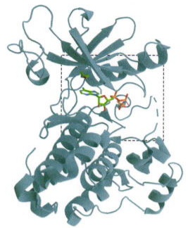

natural_image

3D protein structure visualization with alpha helices and beta sheets (no labels or text)

(B)

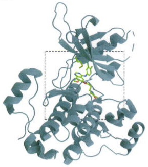

natural_image

3D protein structure visualization with alpha helices and beta sheets, no text or labels present

(C)

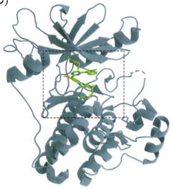

natural_image

3D protein structure visualization with alpha helices and beta sheets, no text or labels present

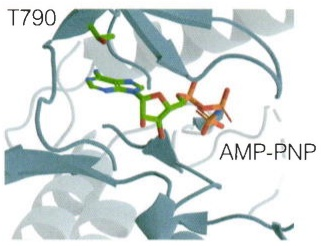

chemical

Molecular structure diagram showing T790 and AMP-PNP labeled residues in a protein binding site

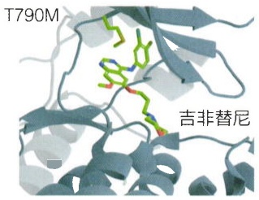

text_image

T790M
吉非替尼

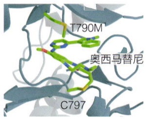

text_image

T790M
奥西马替尼
C797

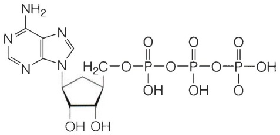

chemical

Chemical structure of a nucleoside derivative with amine and phosphate groups

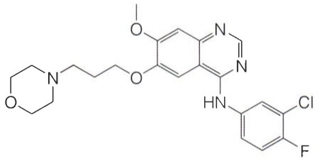

chemical

Chemical structure of a substituted quinazoline derivative with chloro, fluorine, and amide groups

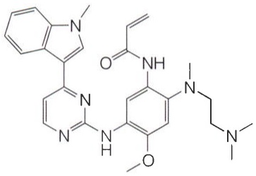

chemical

Complex organic molecule structure with indole, amide, and amide functional groups

图 3-3 EGFR 激酶部分的结构及其与小分子抑制剂的作用

(A) EGFR激酶部分结合ATP类似物（AMP-PNP）的晶体结构（PDB编号:2ITV），中图是结合口袋的放大图，下图是ATP的化学结构。（B）EGFR激酶T790M突变体结合吉非替尼的晶体结构（PDB编号:4I22），下图是吉非替尼的化学结构。（C）EGFR激酶部分结合奥西马替尼的晶体结构（PDB编号:6JX4），下图是奥西马替尼的化学结构。

## 3.1.2 蛋白质结构

## (1) 一级结构与肽键

蛋白质是以氨基酸残基为基本重复单元，通过肽键（peptide bond）链接起来的复杂生物大分子。多肽链中的氨基酸残基序列被称为蛋白质的一级结构。氨基酸由一个中心碳原子（$\mathrm{C}_{\alpha}$）、氨基（$-\mathrm{NH}_{2}$）、羧基（—COOH）和一个侧链（—R）组成（图3-4）。在自然界中存在着20种常见天然氨基酸，它们的侧链分别具有不同的化学性质，包括亲水性、疏水性、酸性、碱性等。为了方便表示，通常使用缩写字母来表示不同的氨基酸。例如，甘氨酸用字母“Gly”或者“G”表示，天冬氨酸用字母“Asp”或者“D”表示等等。氨基酸残基的侧链性质决定了蛋白质的独特结构和功能。除了甘氨酸外，其它氨基酸的中心碳原子 $\mathrm{C}_{\alpha}$ 连接有四个不同的化学基团，具有镜像异构体，即手性。天然的蛋白质中所含的氨基酸大部分是L型氨基酸。

蛋白质多肽链的主链由一个氨基酸的羧基与另一个氨基酸的氨基通过脱水反应生成一个酰胺键（肽键）而链接起来。肽键的C—N键与 $\mathrm{C = O}$ 键有单-双键共振，使得肽键具有部分双键特性，从而使得相邻的两个 $\mathrm{C}_{\alpha}$ 位于一个平面上，称之为肽平面（图3-5A）。4个相连原子的相对位置可以用二面角（dihedral angle或torsion angle）进行描述，它指前三个原子形成的平面和后三个原子平面之间的夹角（图3-5B）。沿着肽键方向的二面角（$\mathrm{C}_{\alpha} - \mathrm{C} - \mathrm{N} - \mathrm{C}_{\alpha}$）称为 $\omega$（omega），其取值只有 $0^{\circ}$ 或者 $180^{\circ}$。因为空间位阻作用，$\mathrm{C}_{\alpha}$ 碳原子位于肽键两侧的反式（trans，$\omega = 180^{\circ}$）构象较为稳定；而顺式（cis，$\omega = 0^{\circ}$）肽键非常罕见。出现脯氨酸残基时，顺式构象会常见一些（顺式脯氨酸）（图3-5C、D）。

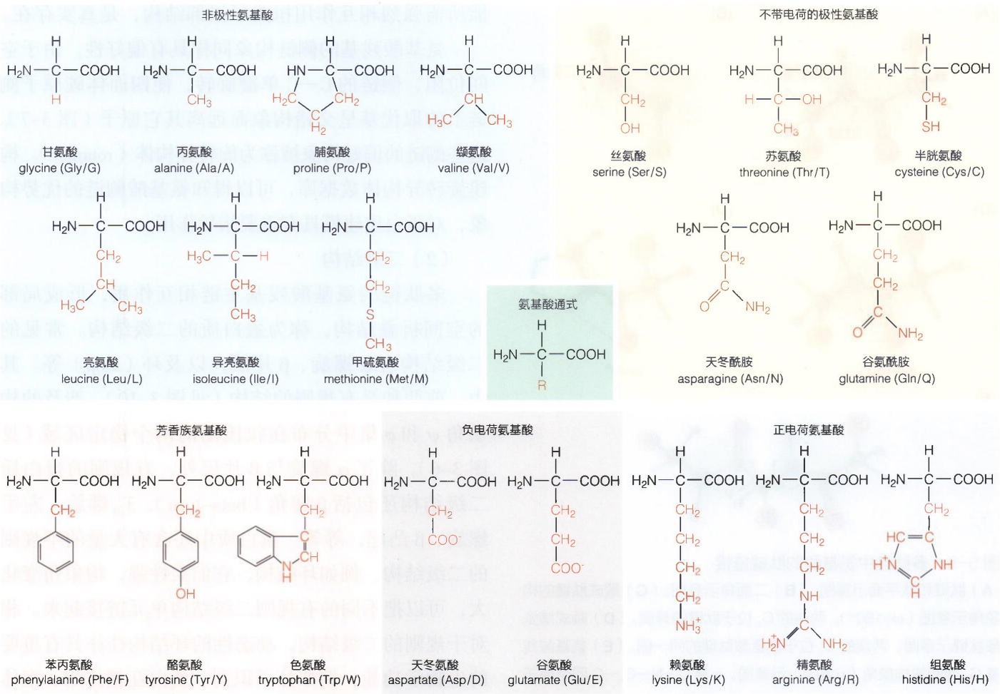

图3-4 20种常见氨基酸的化学结构及分类

多肽主链的构象可以由每个氨基酸残基 $C_{\alpha}$ 两侧的两个二面角——$\psi$（psi）和 $\varphi$（phi）来描述（图3-5E）。相对于 $\omega$ 角，$\psi$ 和 $\varphi$ 可取值范围较大。但同样由于空间位阻作用，$\psi$ 和 $\varphi$ 只能取有限范围内的值。$\psi$ 和 $\varphi$ 允许的取值区域用拉氏图（Ramachandran plot）来表示（图3-6）。拉氏图有两个主要的允许区域，对应蛋白结构中的两种主要构象类型:右手 $\alpha$ 螺旋（$\alpha$-helix）和 $\beta$ 片层（$\beta$-sheet）。此外，还有一个较小的稳定区域，对应结构中的柔性环区以及左手 $\alpha$ 螺旋（Lα）。因为没有侧链的限制，甘氨酸残基的 $\psi$ 和 $\varphi$ 允许的取值区域较大，结构柔性显著，贡献了柔性环区的大部分事例。拉氏图是实验测定的蛋白质结构模型立体化学质量评估的一个重要指标。一个高质量的结构模型，绝大部分氨基酸残基的 $\psi$ 和 $\varphi$ 角落在允许区。一些落在不允许区内的氨基酸残基，可能是由于模型构建不准确，但也有可能是蛋白质特定功能所需强烈相互作用扭曲了局部结构，是真实存在。

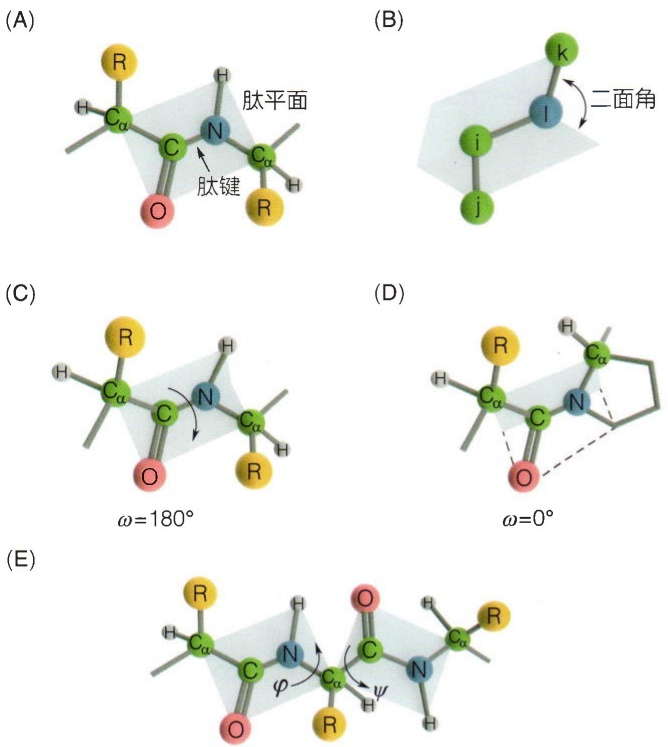

图 3-5 多肽链中氨基酸的肽键链接

（A）肽键和肽平面示意图。（B）二面角示意图。（C）顺式肽键的构象角示意图（$\omega = 180^{\circ}$）。两端的 $C_{\alpha}$ 位于肽键的异侧。（D）顺式脯氨酸肽键示意图。两端的 $C_{\alpha}$ 位于脯氨酸肽键的同一侧。（E）氨基酸残基 $C_{\alpha}$ 两侧的构象角（$\psi$ 和 $\varphi$）示意图。$\varphi$ 是 $C - N - C_{\alpha} - C$ 四个原子间的二面角，$\psi$ 是 $N - C_{\alpha} - C - N$ 四个原子间的二面角。

氨基酸残基的侧链构象同样具有偏好性。由于空间位阻，侧链的C—C单键旋转，使四面体碳原子侧链上的取代基呈交错构象而远离其它原子（图3-7）。这些侧链的偏好构象被称为旋转异构体（rotamer）。构建旋转异构体数据库，可以得知氨基酸侧链的优势构象，对蛋白质建模具有重要指导作用。

## (2) 二级结构

多肽链的氨基酸残基主链相互作用，形成局部的空间折叠结构，称为蛋白质的二级结构。常见的二级结构有 $\alpha$ 螺旋、$\beta$ 片层，以及环（loop）等。其中，前两种是有规则的结构（见图3-10），涉及的构象角 $\psi$ 和 $\varphi$ 集中分布在拉氏图的两个稳定区域（见图3-6）。除了 $\alpha$ 螺旋与 $\beta$ 片层外，有规则的蛋白质二级结构还包括 $\beta$ 转角（beta-turn）、$3_{10}$ 螺旋、左手螺旋、$\beta$ 凸起，等等。蛋白质中还含有大量的不规则的二级结构，例如环结构，它们柔性强，构象角变化大，可以把不同的有规则二级结构单元链接起来。相对于规则的二级结构，动态性的环结构往往具有重要的生物学功能，例如分子识别、蛋白互相作用、配体结合、酶催化，等等。

1951年，化学家、分子生物学创始人之一——莱纳斯·鲍林（Linus Carl Pauling，1901—1994）（知识窗3-1）根据肽键的平面性等化学特性提出了蛋白质$\alpha$ 螺旋的结构模型，从而打开了结构生物学的大门，

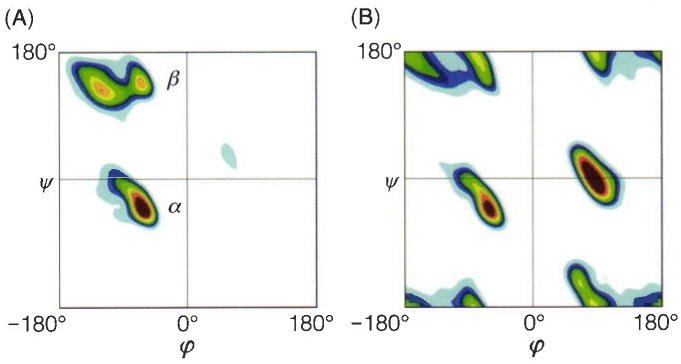

图3-6 拉氏图

（A）蛋白质中非甘氨酸残基的  $\psi$  和  $\varphi$  角度分布。（B）甘氨酸残基的  $\psi$  和  $\varphi$  角度分布。（引自 Hovmöller S, et al. Acta Crystallogr D, 2002, 58(145): 768-776）

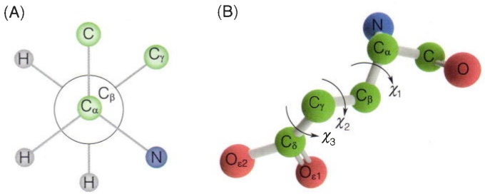

图3-7 氨基酸侧链的旋转异构体

（A）沿  $C_{\alpha}-C_{\beta}$  单键的旋转异构体的纽曼式投影图。（B）谷氨酸残基的侧链旋转异构体的扭转角（torsion angle） $\chi_{1}$ 、 $\chi_{2}$  和  $\chi_{3}$ 。

## 知识窗3-1

## 莱纳斯·鲍林

莱纳斯·鲍林，美国著名的化学家，20世纪最杰出的科学家之一。1954年因在化学键方面的工作获得诺贝尔化学奖，1962年因反对核武器的行动获得诺贝尔和平奖。

1925 年，鲍林在加州理工学院获得化学博士学位。1926 年，鲍林前往欧洲，在量子力学家尼尔斯·玻尔（Niels Bohr）和薛定谔等人的指导下学习，1927 年入职加州理工学院。鲍林提出了原子的杂化轨道理论，分析了碳原子的正四面体结构。此外鲍林还提出许多重要的化学概念和理论，如共振论、共价半径、电负性等。随后，他把研究兴趣转向生物学。

鲍林长期关注蛋白质的分子结构。20世纪30年代，人们已经知道蛋白质由氨基酸构成，氨基酸以肽键形式从一端链接到另一端。但是，多肽链如何折叠成有功能的形式是生命的秘密。1938年，鲍林解析了甘氨酸的晶体结构，这是历史上第一个得到精确解析的氨基酸结构。第二次世界大战结束后，鲍林继续研究蛋白质结构。

同一时期，英国的科学家采用自上而下策略，研究某个具体的蛋白质。例如，弗雷德里克·桑格（Frederick Sanger，1918—2013）研究胰岛素，马克斯·佩鲁茨（Max F. Perutz，1914—2002）研究血红蛋白，约翰·肯德鲁（John Cowdery Kendrew，1917—1997）研究肌红蛋白等。而鲍林则从化学键的键长、键角，肽键的平面性出发，搭建原子模型。1951年，鲍林发表工作，详细描述了α螺旋的结构（图3-8）。

鲍林提出的 $\alpha$ 螺旋结构是分子生物学的转折事件。20世纪30年代早期，人们对蛋白质这一神秘的生命物质知之甚少。而现在，分子生物学被用于提供更有效的药物，提高粮食产量，开发各种新产品。鲍林坚持用化学原理解析蛋白质结构，他摒弃了关于周期的“凑整”习惯，迅速找到方法解释冲突的数据。然而，$\alpha$ 螺旋只是一种二级结构，它不能完全解答蛋白质的功能问题。鲍林的工作启发了后续的探索，研究蛋白质的结构和功能是一个漫长而持续的过程，一直到今天。

图3-8 鲍林与其提出的 $\alpha$ 螺旋结构左图是鲍林（左）与其助手在讨论；右图是鲍林1951年提出的 $\alpha$ 螺旋结构。这个最初的模型没有考虑手性，实际上是左手螺旋结构。（左，拍摄于1951年，源自Oregon State University；右，引自Pauling L, et al. Proc Natl Acad Sci USA, 1951, 37(4): 205-211）

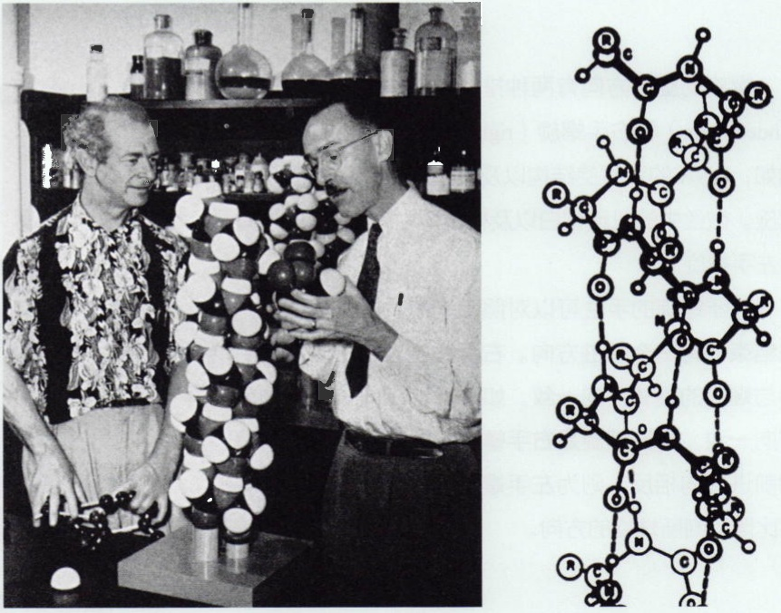

并启发了紧接着的 DNA 双螺旋结构的研究。

经典的 $\alpha$ 螺旋是右手螺旋（知识窗3-2），也称 $3.6_{13}$ 螺旋，每圈螺旋含3.6个氨基酸残基（图3-10C）。$\alpha$ 螺旋中，氨基酸残基（$i$ 残基）的主链羰基（—CO—）与下一个周期氨基酸残基（$i + 4$ 残基）的氨基（—NH—）之间形成了一个氢键，这是 $\alpha$ 螺旋的主要结构特征。每个氨基酸残基的侧链大约以 $100^{\circ}$ 的夹角指向螺旋轴外，$\mathrm{C}_{\beta}$ 原子伸向螺旋的N端，其延伸方向呈圣诞树的样子。每个氨基酸残基沿螺旋轴线有 $1.5\AA$ 的上升，一个 $\alpha$ 螺旋周期为 $5.4\AA$。

单独的 $\alpha$ 螺旋并不稳定，表皮、毛发、豪猪棘刺等的角蛋白是由两股 $\alpha$ 螺旋互相缠绕形成的卷曲螺旋（coiled-coil，图3-10D）。这种卷曲螺旋（一种三级结构）增加了角蛋白的机械强度。卷曲螺旋中，两股 $\alpha$ 螺旋的螺旋轴互相缠绕扭曲，解释了鲍林 $\alpha$ 螺旋结构的 $5.4\AA$ 周期与角蛋白 $5.1\AA$ 周期的不一致性。

不同氨基酸残基形成 $\alpha$ 螺旋的倾向性不一样，这与它们的侧链特性有关，也与周围的氨基酸相关。丙氨酸（Ala）最倾向于形成 $\alpha$ 螺旋。相反，脯氨酸（Pro）缺失形成氢键的氢原子，不利于 $\alpha$ 螺旋形成。甘氨酸由于较大的柔性，不倾向形成稳定的 $\alpha$ 螺旋。连续多个同电荷氨基酸，如多聚谷氨酸（Glu），由于电荷排斥，也不利于形成 $\alpha$ 螺旋。

另外一种有规则的二级结构是 $\beta$ 片层（图3-10B）。与 $\alpha$ 螺旋相比，$\beta$ 片层的主链更加延展，呈扇面状结构（略有起伏，不完全在一个平面上）。$\beta$ 片层中每一股

## 知识窗3-2

## 螺旋的手性

螺旋的旋转方向有两种排列方式:左手螺旋（left-handed helix）和右手螺旋（right-handed helix）（图3-9）。例如，DNA的双螺旋结构以及蛋白质中的 $\alpha$ 螺旋是右手螺旋。微丝中的肌动蛋白以及核小体中的DNA缠绕方式是左手螺旋。

判断螺旋的手性可以对照手指的方向。螺旋从开始到结束，有一个前进方向。右手握住螺旋，使四指的指向与螺旋的旋转方向一致，如果拇指指向与螺旋的前进方向一致，则该螺旋是右手螺旋；如果拇指指向与螺旋的前进方向相反，则为左手螺旋。同理，也可以通过左手比照，判断螺旋的方向。

text_image

左手螺旋
右手螺旋

图3-9 螺旋的手性

(A)

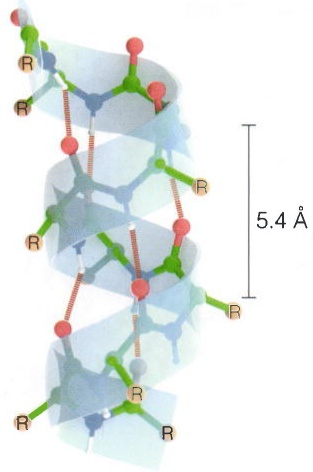

chemical

Molecular structure diagram showing a helical chain with labeled bond length of 5.4 Å

(B)

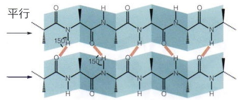

chemical

Chemical structure diagram showing parallel polymer chain with labeled bond angles (150°)

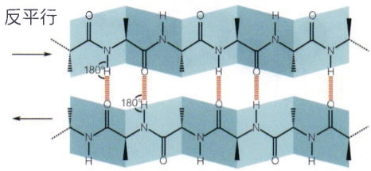

chemical

Chemical structure diagram showing a repeating unit with labeled 180H coordination sites and an arrow indicating reverse direction

图3-10 蛋白质的二级结构

(A) α螺旋结构示意图。氢键用虚线表示。(B) 平行与反平行两种类型的β片层结构示意图。(C) 经典的α螺旋（3.6$_{13}$螺旋）的原子排布示意图。(D) 人皮肤角蛋白的卷曲螺旋结构（PDB编号:6UUI）。(E) 绿色荧光蛋白β桶结构（PDB编号:6JGJ）。

(C)

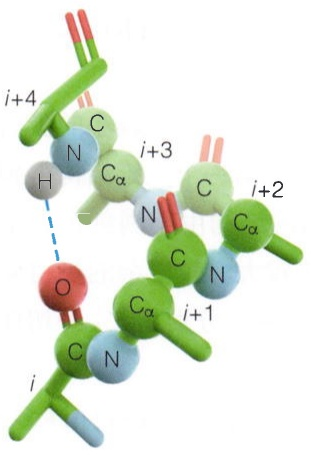

chemical

Molecular structure diagram showing carbon, nitrogen, and oxygen atoms with labeled hydrogen bonding distances (i+1 to i+4)

(D)

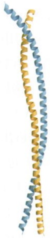

natural_image

Two helical strands in blue and yellow, no text or symbols present

(E)

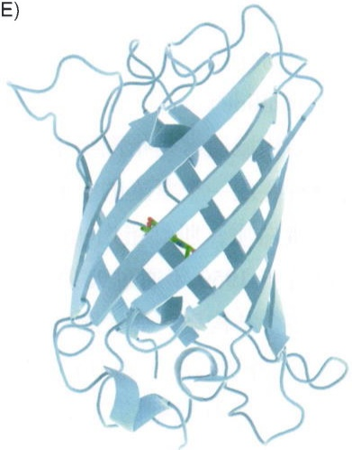

natural_image

3D ribbon diagram of a protein structure with alpha helices and beta sheets (no labels or text)

肽段称为β股（β-strand）。β股中，肽平面呈锯齿状伸展。β股之间相互平行，主链通过氢键结合，侧链R基垂直交替分布在片层的两侧。β股走向分平行（也称正平行）和反平行两种。反平行β股之间的形成氢键的原子（N—H…O）几乎在同一直线上，因此较为稳定。而平行β股之间形成的氢键不在一直线上，是一个弱氢键，稳定性较差。因此，平行β片层一般含有较多的β股，很少低于5个，而且经常被包埋在蛋白质内部。β片层的首尾β股相互作用，形成一个封闭的桶装结构，称为β桶（β-barrel，图3-10E），例如绿色荧光蛋白（GFP）。

因为空间上较大的延展性，$\beta$ 片层能够容纳一些侧链有分支的氨基酸残基。因此，Val、Ile、Leu、Phe、Tyr、Trp以及Thr等出现在 $\beta$ 片层的倾向较高。当然，侧链无分支的氨基酸残基也可以出现在 $\beta$ 片层。相反，Pro的刚性环结构限制了它的构象角。Pro不会出现在 $\beta$ 片层内部，但可以出现在 $\beta$ 片层的边缘。

## (3) 三级结构

一条多肽链的多个二级结构进一步盘绕折叠，形成特定的空间结构，称为三级结构。三级结构通常由模体（motif，又称基序）和结构域（domain）组成。多肽链的二

图3-11 蛋白质的三级结构

（A）肌红蛋白结构（PDB编号:1MBN）。氧分子和铁原子分别用红色和黄色球表示。（B）大肠杆菌的DNA聚合酶I的结构域组织（上图）和alphaFOLD2预测结构（下图）。5'-exo、3'-exo和Pol分别是5'-外切核酸酶、3'-外切核酸酶和DNA聚合酶结构域。

(A)

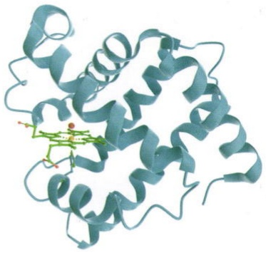

natural_image

3D ribbon diagram of a protein structure with a highlighted active site (no text or labels)

(B)

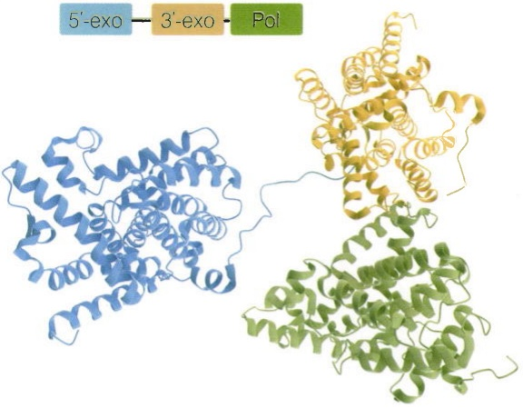

text_image

5'-exo - 3'-exo - Pol

级结构形成主要靠主链的氢键相互作用，而三级结构则涉及侧链的各种作用，如氢键、电荷作用、范德瓦耳斯力（van der Waals force，又称范德华力）、疏水作用、二硫键（disulfide bond）等。更多关于分子间相互作用的讨论见3.1.4节。

结构域通常是指围绕单一疏水核心，独立折叠的蛋白质结构。一些较小的蛋白质自身折叠成一个紧凑的空间结构，就是一个结构域，如历史上第一个三维结构得到解析的蛋白质，肌红蛋白（myoglobin，图3-11A）。肌红蛋白的结构由英国剑桥大学的肯德鲁于1959年通过X射线晶体学的方法解析出来。有些较大、较复杂的蛋白质则包含多个结构域。如大肠杆菌的DNA聚合酶I包含3个结构域，分别是 $5^{\prime}$ -外切核酸酶、 $3^{\prime}$ -外切核酸酶和DNA聚合酶结构域（图3-11B）。

常见的有规则的二级结构只有两种，但由它们为主组成的结构域有许许多多，如碱性亮氨酸拉链结构域（basic leucine zipper domain，bZIP domain）、溴结构域（bromodomain，BrD）、免疫球蛋白样结构域（immunoglobulin-like domain，Ig domain）、SH2结构域（SH2 domain）等（图3-12）。结构域因为稳定的三维结构，往往具有特定的功能。例如，bZIP结合DNA，BrD识别组蛋白尾肽，Ig结构域介导蛋白质-蛋白质相互作用，SH2识别磷酸化酪氨酸。目前，CATH数据库中收录了5000多个结构

代找电子书资源，新书可代做扫描制作加微信 asxiao90

图3-12 四种常见结构域

（A）bZIP结构域结合DNA的结构（PDB编号:1GD2）。  
（B）BrD识别组蛋白尾肽的结构（PDB编号:3UVW）。  
（C）抗体的Ig结构域识别抗原（灰色表面）的结构（PDB编号:7VUX）。  
（D）SH2结构域识别磷酸化酪氨酸结构（PDB编号:1SHB）。

(A)

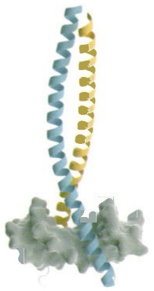

natural_image

3D protein structure visualization with alpha helices and beta sheets (no labels or text)

(B)

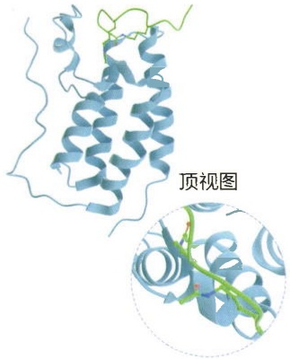

natural_image

3D protein structure diagram with a magnified inset showing secondary structure (no text or labels)

(C)

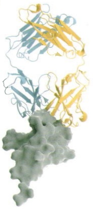

natural_image

3D protein structure visualization with alpha helices and beta sheets (no labels or text)

(D)

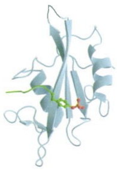

natural_image

3D protein structure visualization with alpha helices and beta sheets (no labels or text)

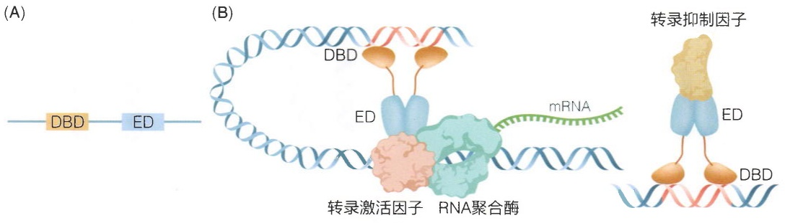

flowchart

图3-13 转录因子的结构域及其作用

（A）转录因子的两个相对独立的结构域示意图。（B）一些转录因子招募转录激活因子，促进基因表达（左）；而另一些转录因子招募转录抑制因子，沉默基因表达（右）。

域超家族。探索结构域单独以及协同作用的功能是蛋白质研究的重要内容。

一些结构域自身具有独立的功能，这一点在转录因子上尤为突出。转录因子一般包含相对独立的DNA结合结构域（DNA-binding domain，DBD）和转录效应结构域（effector domain，ED）（图3-13）。DBD识别特异DNA序列，ED招募下游效应蛋白，例如转录机器，染色质调控蛋白等。一些效应结构域促进基因表达，一些抑制基因表达，而一些则具有双重功能。DBD与ED往往没有直接相互作用，但串联起来可以调控基因表达。人基因组编码约1600种不同的转录因子，它们的DBD结构可以被准确预测，但ED结构往往可塑多变。

一些结构域单独没有功能，它们的作用是调控其它结构域的活性，或者几个结构域协同完成一个功能。例如，分子马达ISWI是调控染色质结构的蛋白，它具有多个结构域，包括自抑制结构域AutoN、ATP水解酶结构域（Lobe1和Lobe2），以及DNA结合结构域（DBD）（图3-14）。单独的Lobe1或Lobe2都不能水解ATP。ISWI结合核小体后被激活，Lobe1结合ATP，Lobe2提供催化ATP水解的元素（精氨酸手指，arginine finger），两个结构域协同作用促进ATP水解。辅助结构域调控中央ATP水解酶结构域的活性，其中，AutoN结构域锁定ISWI在自抑制构象，而DBD结构域促进ISWI结合底物。

结构域作为一个功能单元，演化的模块，可以被反复利用，出现在不同的蛋白质中，例如前边提到的bZIP结构域、Ig结构域、SH2结构域反复出现在多种蛋白质中。另一方面，要实现一个新功能，简单有效的方式不是从头演化出一个新的结构域，而是把已有的结构域配置在一起，就如上述ISWI例子。大自然更多时候不是一个从0到1的发明家，而是一个搬运工、修补匠，把不同结构域组织在一起，实现一个新的功能。

结构域内部，由相邻二级结构相互作用，排列成规则的二级结构组合体称为模体或者基序。常见的模体有β发夹（β-hairpin）、锌指（zinc finger）、螺旋-环-螺旋（helix-loop-helix，HLH）、HEAT重复（HEAT repeat）等（图3-15A）。β发夹是模体结构中最简单的一种，由两段反平行的β股和一段小环（2\~5氨基酸残基）组成。锌指模体有多种，如 $Cys_{2}His_{2}$ 、 $Cys_{4}$ 、 $Cys_{6}$ 等。锌指模体常见于转录因子，可以识别特征的DNA序列（图3-15B）。HLH由两股螺旋和螺旋间的环构成。多种 $Ca^{2+}$ 结合蛋白含有这种结构，常称为EF手相（EF-hand）。另外，许多转录因子也含有这种结构，其中一股螺旋含有碱性氨基酸残基（bHLH），可以结合DNA（图3-15C）。HEAT重复由两股螺旋和一段短环构成，多个HEAT重复模体可以形成α螺线管结构（α-solenoid）（图3-15D）。α-螺线管结构常作为活性界面结合其它蛋白质。HEAT名字来源于发现这种结构的四个蛋白质的缩写[huntingtin、elongation factor 3（EF3）、protein phosphatase 2A（PP2A）和TOR1]。

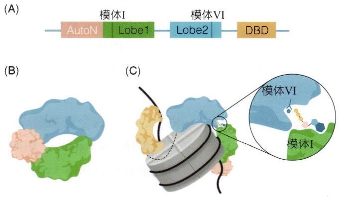

图3-14 分子马达ISWI的结构域及其活性调控机制

（A）ISWI蛋白的结构域示意图。（B）ISWI的自抑制机理模型。AutoN把水解酶结构域Lobe1和Lobe2锁定在没有活性的构象。（C）ISWI结合核小体被激活的机理模型。右图放大显示结合和水解ATP的两个关键模体。

图3-15 结构模体示意图（A）四种常见结构模体示意图。（B）前列腺受体DNA结合结构域-DNA复合物的结构（PDB编号:1R4I）。(C) Myc-MAX DNA结合结构域-DNA复合物的结构（PDB编号:1NKP)。(D) 蛋白磷酸酶2A（PP2A）的结构（PDB编号:2IAE）。

(A)

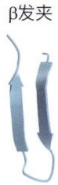

锌指

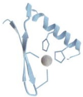

HLH

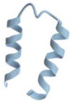

HEAT 重复

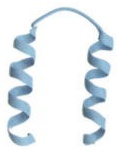

(B)

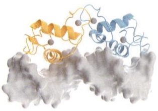

natural_image

Molecular docking visualization showing protein structure with alpha helices and beta sheets (no text or labels)

(C)

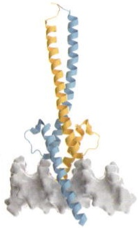

natural_image

3D ribbon diagram of a protein structure with alpha helices and beta sheets (no labels or text)

(D)

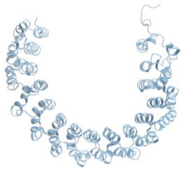

chemical

Molecular structure diagram showing a chain of blue helices with terminal groups

一些结构域内部的模体有特定的功能。例如，ISWI蛋白的解旋酶模体I（helicase motif I）结合ATP（见图3-14），以及解旋酶模体VI催化ATP水解。这些解旋酶模体在不同的解旋酶超家族蛋白质中的功能保守。分析蛋白质的模体和结构域，可以对该蛋白质的功能有初步的了解。

## (4) 四级结构

由多条（2至数百条）多肽链组成的蛋白质有第四级（最高级）的结构。每一条多肽链是一个亚基（subunit）。四级结构指多亚基蛋白质复合物中亚基的空间排布。由二、三、四个亚基组成的蛋白质聚合体分别称为二聚体（dimer）、三聚体（trimer）和四聚体（tetramer）。相同亚基组成的蛋白质通常是对称的，如钾通道四聚体，每个对称单元称为原体（protomer）。更多关于对称性的介绍见3.4.2节。

一些酶由多个功能不同的亚基构成，常被称为全酶（holoenzyme）。其中，催化亚基是功能核心，其它亚基起不同的调控作用:增强或抑制活性、靶向特定位置、招募下游分子，等等。多元复合物的四级结构改变，即一些亚基的变化引起其它亚基的变化，体现了蛋白质构象变化的协同效应（cooperativity）或者变构效应（allostery，又称别构）。更多的复合物讨论见3.4节。

## 3.1.3 结构的可塑性和动态性

蛋白质的功能与其结构密切相关，但是这不意味着为了实现某种特定功能，蛋白质只呈现一种特定的结构。实际上，蛋白质的结构可以随外界环境改变而变化。结构的可塑性对许多蛋白质的功能起重要作用。例如，血红蛋白在不同氧气浓度的变构效应；分子马达在ATP水解过程中的构象变化，离子通道在不同条件下的开关，等等。另外，蛋白质也有自发的热力学摆动（动态性），尤其是具有多结构域的蛋白质。一些负责招募作用的结构域，例如SH2结构域、溴结构域，往往通过柔性序列链接催化核心，这些招募结构域相对于催化核心的不停摆动，有助于搜索识别靶点。因此，认识到结构的可塑性和动态性才能正确理解蛋白质的工作机制。

变构是蛋白质结构可塑性的突出表现。变构效应是指调控分子结合在活性位点以外的位点，导致蛋白质构象发生变化，从而增强或抑制蛋白质活性。变构蛋白具有两个或多个不同的结合位点，即活性位点和变构位点。活性位点是底物结合的位置。变构位点是蛋白质上另外的位置，可以结合调节分子，称为变构效应子（allosteric effector）。变构调节对于新陈代谢、信号转导和基因表达等许多生物过程至关重要。

血红蛋白是一个经典的变构蛋白。血红蛋白质有4个亚基，一个亚基与氧的结合引起构象变化，从而促进其它亚基与氧的结合。这种积极的变构效应被称为协同性，它使血红蛋白能够有效地结合和释放氧气。变构蛋白的另一个经典例子是分解代谢激活蛋白（catabolite activator protein，CAP）。CAP是细菌的一种转录因子，调节糖代谢相关基因表达。CAP是同源二聚体，在基态时，关键的DNA结合螺旋被包埋，没有活性（图3-16）。在葡萄糖稀缺时，CAP被cAMP激活。cAMP与CAP结合引起构象变化，DNA结合螺旋暴露在外，使CAP与DNA结合并激活参与糖代谢的基因的转录。

可塑性和动态性是蛋白质结构的本征特性，其物理基础是形成某种构象的推动力大都是较弱的作用力，如氢键、疏水作用等，而且多肽链的柔性环区的构象角可变范围较大，它们在外力作用下容易发生改变。因此，酶等大部分蛋白质是脆弱的，在高温、机械力等作用下容易发生结构改变，失去活性。下一小节将介绍这些分子作用力。

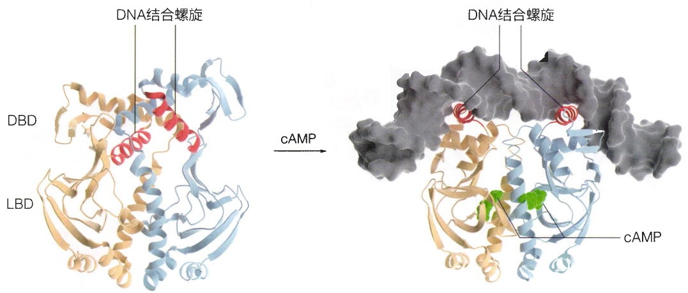

text_image

DNA结合螺旋
DBD
LBD
cAMP
DNA结合螺旋
cAMP

图3-16 CAP蛋白应答cAMP信号的变构机制（A）CAP在基态没有结合cAMP时的结构（PDB编号:3FWE）。DBD，DNA结合结构域；LBD，配体结合结构域。（B）CAP被cAMP激活后，结合DNA的结构（PDB编号:1CGP）。

## 3.1.4 形成蛋白质结构的力和能量基础

如前所述，形成蛋白质结构依赖于分子（残基）的相互作用力，包括二硫键、配位键、静电相互作用、氢键、范德瓦耳斯力和疏水作用等。这些相互作用力也是蛋白识别其它分子并发挥功能的基础。下面将进一步介绍这些相互作用力。

## (1) 二硫键

二硫键是由两个半胱氨酸在氧化条件下形成的一种共价键。二硫键的键能约 $260\mathrm{kJ / mol}$，耐热稳定，但在还原性环境中可以打开。一些分泌到细胞外的蛋白质，如核糖核酸酶A（RNase A）、胰岛素、抗体等，在胞外的氧化条件下常常形成二硫键（图3-17A），这对它们形成正确的结构和行使功能至关重要。相反，因为细胞内部的还原性环境，胞内蛋白质很少形成二硫键。

## (2) 配位键

配位键是一种特殊的共价键，其中共用的电子对由其中一个原子独自提供，常见于一些金属蛋白质。以大肠杆菌的碱性磷酸酯酶（EcAP）为例，这种由429个氨基酸组成的蛋白质形成同源二聚体（图3-17B）。每个EcAP单体含有由2个 $\mathrm{Zn}^{2+}$ 和1个

图3-17 蛋白质三维结构中的二硫键和配位键

（A）核糖核酸酶 A 结构（PBD 编号:1RNX），四对二硫键用球棒模型显示。下图是二硫键形成的化学反应。（B）碱性磷酸酯酶局部结构（PDB 编号:1ALK）。 $Mg^{2+}$ （绿色）和 $Zn^{2+}$ （灰色）的金属配位键分别放大显示。

(A)

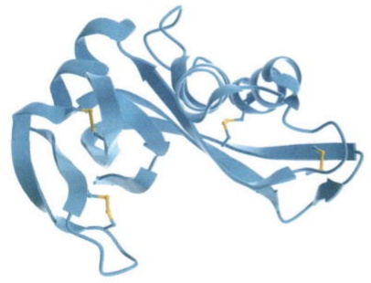

natural_image

3D ribbon diagram of a protein structure, showing alpha helices and beta sheets (no labels or text)

(B)

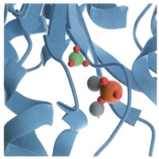

natural_image

3D molecular model of a protein structure with blue helices and colored active sites (no text or labels)

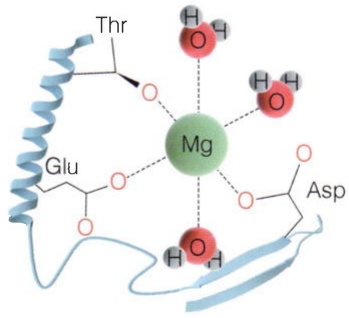

chemical

Molecular interaction diagram showing Mg binding to a protein with labeled amino acid residues (Thr, Glu, Asp)

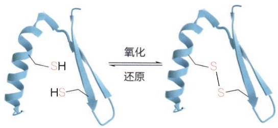

chemical

Chemical reaction diagram showing oxidation and还原 of a protein structure with labeled functional groups SH and HS

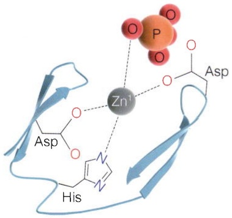

chemical

Molecular interaction diagram showing zinc ion (Zn¹) binding to a phosphorus-containing molecule with Asp and His ligands

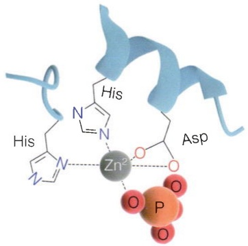

chemical

Molecular structure of a zinc complex with His and Asp ligands, showing metal centers and oxygen atoms

$\mathrm{Mg}^{2+}$ 组成的活性中心，可在核苷酸、蛋白质、生物碱等分子上去除磷酸基，在碱性（$\mathrm{pH}$ 为8.0）环境下最为有效。其中，$\mathrm{Zn}^{2+}$ 与天冬氨酸、组氨酸以及磷酸基团形成配位键；而 $\mathrm{Mg}^{2+}$ 与天冬氨酸、苏氨酸、谷氨酸以及水分子形成配位键。这些配位键中，组氨酸侧链的氮原子，天冬氨酸、苏氨酸、谷氨酸侧链的氧原子提供共用的电子对，与金属离子形成配位键，键长为 $1.8 \sim 2.5 \AA$ 。配位键对EcAP形成正确的三维结构以及酶活性具有关键作用。

## (3) 氢键

氢键（hydrogen bond）是由氢原子与电负性较高的原子，如氧、氮等形成的非共价相互作用力。在氢键中，氢原子核裸露，带有部分的正电性。这是因氢键中的氢原子与一个电负性较高的原子（氢键供体，hydrogen-bond donor）形成了一个共价键，

这种键的电子密度偏向电负性较高的原子，使得该原子带有一定的负电荷，而氢原子带部分正电。当两个分子之间存在氢键的时候，它们的极性部分会相互靠近，使得部分裸露的氢原子核与电负性较高的原子（氢键受体，hydrogen-bond acceptor）的电子相互作用，从而形成一个氢键（图3-18A）。相对于共价键，氢键是一种弱的相互作用力，如水分子间氢键键能约为 $20\mathrm{kJ / mol}$ 。

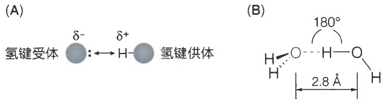

图3-18 氢键作用示意图

（A）氢键形成原理示意图。（B）水分子间的氢键作用。

氢键的形成需要满足一定的几何和电子结构要求（图3-18B）:

① 氢键供体、受体原子间的间距较短，通常小于  $3.4 \, Å$ 。例如水分子的氢键中 O—H…O 距离为  $2.8 \, Å$ ，而  $\alpha$  螺旋中主链氢键 N—H…O 距离是  $3.1 \, Å$ 。
② 氢键的形成通常需要满足一定的几何限制条件，如线性或近线性的排列方式。如反平行的  $\beta$  片层的氢键 N—H…O 键角接近  $180^{\circ}$ ，而平行的  $\beta$  片层的氢键接近  $150^{\circ}$ （作用力较弱）。
③ 电负性较高的原子作为氢键的供体和受体。除了常见的氧、氮原子外，半胱氨酸的硫原子也可以参与氢键的形成。

在蛋白质分子中，氢键非常普遍，稳定多肽链二级结构的氢键来自主链原子，而稳定三级结构的氢键通常来自侧链原子。因为需要特定的空间构造以及化学特性，氢键在生物大分子的特异识别上具有重要作用，包括核酸碱基的互补配对、蛋白质对DNA的识别、抗原-抗体识别等。

## (4) 静电相互作用

带相反电荷的离子基团产生静电吸引力（electrostatic interaction）。在生理 $\mathrm{pH}$ 条件下，精氨酸和赖氨酸的侧链带正电荷，而天冬氨酸和谷氨酸侧链带负电荷，（见图3-4）。多肽链最末端的氨基（$-\mathrm{NH}_3^+$）和羧基（$-\mathrm{COO}^-$）分别带正电和负电。一些可以电离的氨基酸残基，例如组氨酸、酪氨酸，依赖于外界环境对侧链 $\mathrm{pK_a}$ 的影响，在适合的条件下也可以带电，参与静电作用（图3-19A）。此外，带负电荷的核酸磷酸骨架以及脂质膜的磷酸基团也可以与正电荷氨基酸残基产生静电吸引力（图3-19B）。在距离和空间构型合适时，静电作用和氢键作用可以同时发生在同一离

图3-19 氨基酸残基的静电及盐桥作用

（A）正-负电荷氨基酸残基的静电作用。谷氨酸残基（Glu）带负电，赖氨酸（Lys）带正电。（B）赖氨酸与DNA磷酸骨架的静电作用。（C）天冬氨酸（Asp）与精氨酸（Arg）的盐桥作用。

(A)

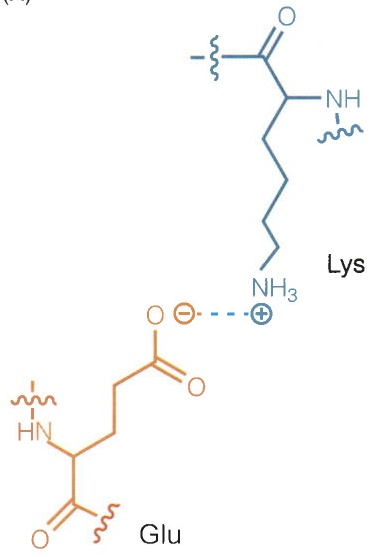

chemical

Chemical structure of a glycosylated peptide with lysine and glucose components

(B)

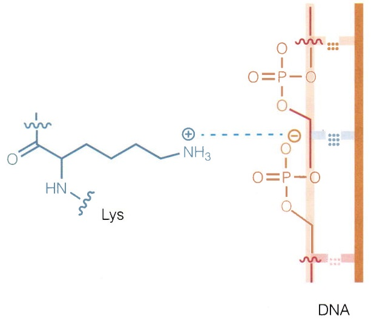

chemical

Chemical structure of lysine polymer with ammonium ion and phosphate groups, showing DNA side chain

(C)

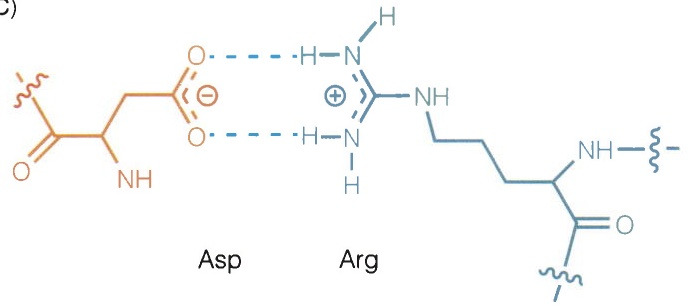

chemical

Chemical structures of Asp and Arg showing amide linkages and functional groups

子对上，这种作用也常被称为盐桥（salt bridge）或盐键（salt bond）（图3-19C）。

静电吸引力的大小可以用库仑定律描述，也就是正比于 $e^2 / \varepsilon r^2$ ，这里 $e$ 是单位电荷，$\varepsilon$ 是介电常数，$r$ 是电荷当作点电荷时两个电荷的间距。从库仑定律可知，静电吸引力与共价作用不同，是一种长程的作用，而且依赖于周围的介质环境。在水溶液中，介电常数 $\varepsilon$ 约等于80，而在蛋白质内部或者脂质双层膜中，介电常数 $\varepsilon$ 低得多（约为4）。因此，包埋在蛋白质内部，距离较近的盐桥作用产生显著的稳定作用。一般，蛋白质的盐桥的键能约为 $10\mathrm{kJ / mol}$ 。

## (5) 范德瓦耳斯力

范德瓦耳斯力是两个相邻不带电的非成键原子间的相互作用力。范德瓦耳斯力是由于电子密度的瞬态波动产生。电子密度可能暂时分布在原子核的一侧，这种转变会产生瞬时电荷，附近的原子可以被吸引或排斥（图3-20）。原子间的范德瓦耳斯力对距离变化非常敏感，在非常短的距离处是排斥力，在平衡距离为零，在大于平衡距离呈现为吸引力。这个平衡距离称为原子的范德瓦耳斯半径。不同原子有其特征的范德瓦耳斯半径（表3-1）。例如，碳原子的范德瓦耳斯半径是 $1.7\AA$ 。当两个非成键碳原子的距离小于 $3.4\AA$ ，它们互相排斥；当距离大于 $3.4\AA$ ，它们互相吸引。这解释了石墨的碳原子层间距为 $3.4\AA$ 。同理，DNA双螺旋结构中碱基对的步长为 $3.4\AA$ 。当碳原子的间距大于 $4\AA$ ，范德瓦耳斯吸引力很弱而经常被忽略。