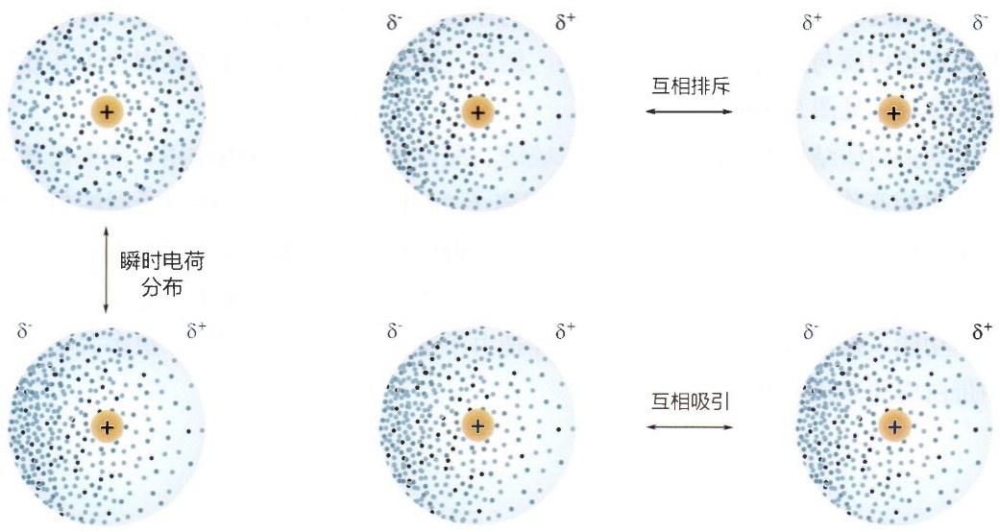

图3-20 范德瓦耳斯力示意图

瞬时电子云分布的不均匀引起原子的电荷极化，以及原子间的范德瓦耳斯作用

范德瓦耳斯力是一个弱相互作用，键能约为 1 kJ/mol。范德瓦耳斯力是非特异性的，在极性以及非极性环境都可以发生。在蛋白质等生物大分子中，范德瓦耳斯作用普遍存在，对三维结构的稳定以及生物大分子的聚集不可或缺。

## (6) 疏水相互作用

疏水相互作用是指在水性环境中，非极性（疏水）物质相互靠拢，以最小化其与水分子的接触，从而产生的驱动力和趋势。疏水相互作用的产生机制可以从水分子的结构和性质入手来解释。水分子是一个极性分子，其中的氧原子具有较强的电负性，使其形成部分负电荷，而氢原子则形成部分正电荷。这种极性使得水分子具有相互吸引的特性，形成水的氢键网络。当有非极性物质存在时，如疏水氨基酸残基（异亮氨酸、苯丙氨酸等，见图3-4），它们与水分子之间的相互作用主要是范德瓦耳斯力，相对较弱。这是因为非极性物质无法与水分子形成氢键或其它极性相互作用。相反，非极性物质相互间靠拢（范德瓦耳斯力），以释放水分子，增加系统的自由度（熵增）（图3-21）。因此，疏水相互作用与氢键、范德瓦耳斯力等作用力不同，它不是疏水基团之间形成更强的相互吸引力（焓驱动），而是水溶液的一种熵最大化效应。

在蛋白质中，疏水相互作用对于蛋白质折叠、稳定性和功能发挥至关重要。在蛋白质的折叠过程中，疏水残基会聚集在蛋白质内部，远离水相。这种聚集形成了疏水核心，有助于蛋白质的稳定性和紧密折叠。疏水相互作用还在蛋白质的功能区域起着重要作用。疏水相互作用的存在可以提供特定的疏水环境，有助于稳定和促进蛋白质与其它分子的相互作用。例如，绿色荧光蛋白的发光基团位于其 $\beta$ 桶的疏水核心（见图3-10E）。

表 3-1 一些元素的范德瓦耳斯半径

| 元素 | 范德瓦耳斯半径/Å |
| --- | --- |
| H | 1.1 |
| O | 1.5 |
| N | 1.5 |
| C | 1.7 |
| S | 1.8 |
| P | 1.9 |

(数据自 Chauvin R. J Phys Chem, 1992, 96: 9194–9197)

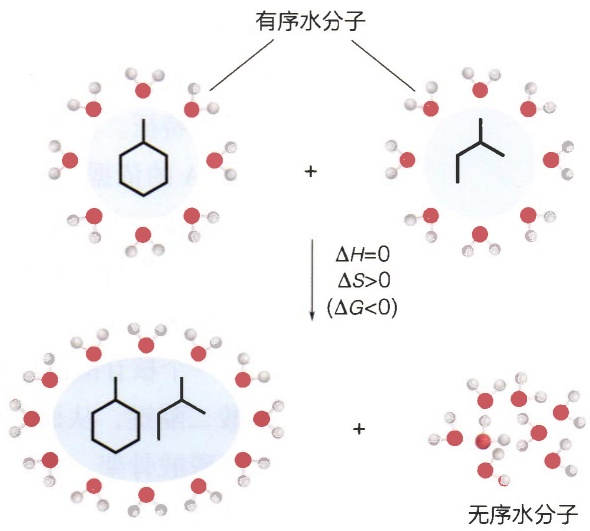

chemical

Chemical reaction diagram showing the formation of monomers from organic and non-organic water molecules, with molecular structures and enthalpy changes.

图3-21 疏水效应的热力学本质

驱动蛋白质结构形成的要素除了二硫键、配位键、氢键、静电作用、范德瓦耳斯力和疏水相互作用外，还有偶极作用和阳离子 $-\pi$ 电子作用等。这些分子间的相互作用力是蛋白质折叠成特定三维结构的基础。细胞中有另一些蛋白质不能折叠成稳定的三维结构，而是处于一种天然无序状态。这些天然无序蛋白质能聚集一起，发挥重要生物学功能。推动蛋白质聚集的机制同样是由于这些分子间的作用力。更多关于天然无序蛋白质的介绍见第10章。

## 3.2 DNA 的结构

与蛋白质千变万化的功能不同，DNA的功能单一，即储存和传递遗传信息。DNA作为遗传物质，与其独特的结构密不可分。DNA一级结构（序列）储存遗传信息，其高级结构调控遗传信息的复制、转录、重组和修复等。真核细胞中，DNA与蛋白质相互作用，形成染色质（chromatin）。染色质折叠成不同的结构，如核小体（nucleosome）、染色质环（chromatin loop）、拓扑相关结构域（topologically-associating domain，TAD），以及更大尺度的染色区室（chromatin compartment）等。这些染色质结构对调控遗传信息的可及性（accessibility）具有重要作用。本节主要介绍这些不同层次的DNA结构。

## 3.2.1 DNA 的一级结构

DNA的一级结构是指构成DNA链上的核苷酸（nucleotide）或碱基（base）的排列顺序。核苷酸是核酸的基本组成单元。DNA的核苷酸由三部分组成，分别是:碱基、脱氧核糖（deoxyribose）和磷酸（phosphate）（图3-22A）。磷酸提供DNA的酸性（负电荷）特征。核糖的 $5^{\prime}$ -羟基（—OH）与磷酸连接，而糖环（sugar ring）是区分DNA与RNA的依据。RNA的糖环上 $2^{\prime}$ -碳原子上连接一个羟基，而DNA的糖环上 $2^{\prime}$ -碳原子连接一个氢原子。因为失去了具有化学活性的羟基，DNA比较稳定，适合作为遗传物质长期保存遗传信息。而RNA反应性高，寿命比较短，适合作为中间信使，调控遗传信息在特定条件下的表达。更多关于RNA的介绍见下一节。

一个核苷酸的糖环 3'-羟基与下一个核苷酸的磷酸基团发生脱水反应，形成 3'-5' 磷酸二酯键，从而把核苷酸连接成长链聚合物（图 3-23）。核糖和磷酸组成 DNA 链的糖磷酸骨架。糖磷酸骨架具有方向性，通常书写成从 5' 开始，指向 3' 端，这也是 DNA 发生聚合反应的延伸方向。磷酸骨架不是一成不变，一些细菌的磷酸骨架可以发生化学修饰，形成磷硫酰键。这是细菌特定的“自我”信号，用于区分外来的“非

(A)

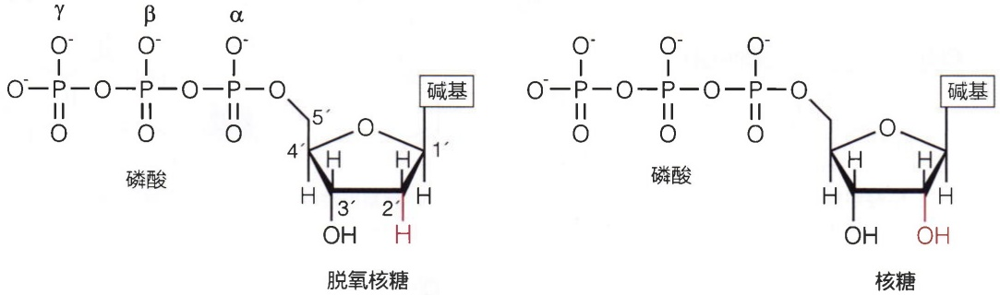

脱氧核糖核苷酸 (deoxyribosenucleotide)

核糖核苷酸 (ribosenucleotide)

图 3-22 核酸的组成元素

(A) 三磷酸核苷酸的结构。

(B) 核酸上常见碱基的结构。

(B)

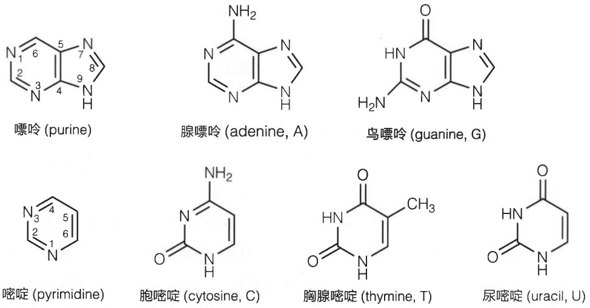

(A)

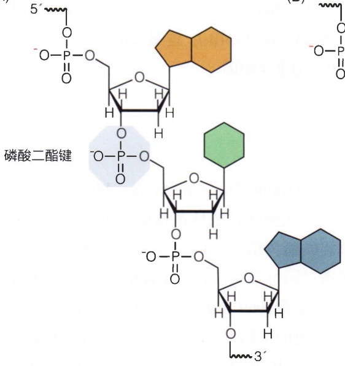

chemical

Chemical structure of phospholipid (磷酸二酯键) showing its molecular arrangement with phosphate groups and sugar moieties

(B)

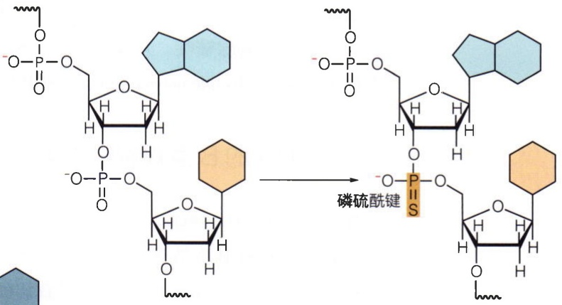

chemical

Chemical reaction diagram showing phosphorus-containing polymer chains reacting with phosphorus-sulfuride (P=S) to form a phosphorus-alkyl chain, with phosphorus hydroxyl group and hexagonal ring structure.

图3-23 DNA磷酸骨架结构

（A）DNA 通过磷酸二酯键连接成长链聚合物。（B）DNA 磷酸骨架可以发生磷硫酰化修饰。

(A)

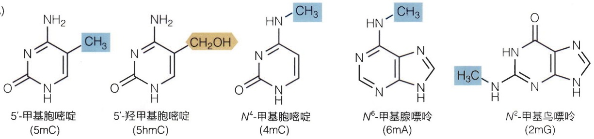

chemical

Five chemical compounds with molecular structures and their corresponding molecular weights in Chinese

(B)

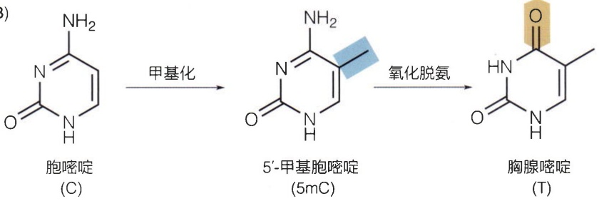

chemical

Chemical reaction pathway showing conversion of cytosine to 5'-methylpyrimidine and then to cysteine via methylation and deprotection steps

图 3-24 DNA 碱基的化学修饰

(A) 常见的 DNA 碱基的化学修饰。(B) 化学修饰引起的胞嘧啶到胸腺嘧啶的转换。

我”DNA，是细菌的一种自我保护的免疫机制。

DNA的碱基排列顺序是遗传信息的关键。DNA有四种常见的碱基，它们分别是腺嘌呤（adenine，A）、鸟嘌呤（guanine，G）、胞嘧啶（cytosine，C）和胸腺嘧啶（thymine，T）（图3-22B）。尿嘧啶（uracil，U）是RNA中常见碱基，但在少数情况下，也可以出现在DNA中。相对于磷酸骨架，DNA的碱基可以发生多种化学修饰，例如形成 $5^{\prime}$ -甲基胞嘧啶（5mC）， $5^{\prime}$ -羟甲基胞嘧啶（5hmC）， $N^4$ -甲基胞嘧啶（4mC），$N^6$ -甲基腺嘌呤（6mA）等（图3-24A）。这些化学修饰不改变DNA编码的遗传信息，但具有独特的功能。例如，5mC在细菌中保护自身的DNA不被甲基化敏感的限制性内切酶切割；而在真核细胞中，5mC是一种表观遗传信号，招募或抵抗甲基化敏感的DNA结合蛋白的结合，从而调控基因的表达。5mC形成后，容易进一步发生氧化脱氨反应，转换成胸腺嘧啶，从而改变遗传密码（图3-24B）。这是人群中引起单核苷酸多态性（single nucleotide polymorphism，SNP）的重要原因。

## 3.2.2 DNA 的 B 型双螺旋结构

20世纪40年代，奥斯瓦尔德·埃弗里（Oswald Theodore Avery，1877—1955）等发现，把从致病性肺炎链球菌提取的DNA注入到非致病性菌株中，可以把非致病菌转变成致病菌，从而推断DNA携带了致病的遗传信息。1952年，艾尔弗雷德·赫尔希（Alfred Day Hershey，1908—1997）等通过同位素实验确定无疑地指明，是DNA而不是蛋白质携带了遗传信息。赫尔希因此获得了1969年的诺贝尔生理学或医学奖。

但组成简单的DNA，它如何行使如此重要的生物学功能，存储和传递遗传信息？1953年，詹姆斯·沃森（James Dewey Watson）和弗朗西斯·克里克（Francis Harry Compton Crick，1916—2004）提出了DNA双螺旋模型，从而揭示了遗传物质的传递、转录、修复等机制的结构基础，并直接导致了分子生物学的诞生（知识窗3-3）。1962

## 知识窗3-3

# 詹姆斯·沃森与 DNA 双螺旋结构的发现

詹姆斯·沃森 1928 年出生于美国的芝加哥市。1947 年进入印第安纳大学攻读博士学位，导师是萨尔瓦多·卢里亚（Salvador Edward Luria，1912—1991，研究病毒的遗传物质结构和复制机制）与马克斯·德尔布吕克（Max Delbrück，1906—1981，和赫尔希一起获得 1969 年的诺贝尔生理学或医学奖）。

德尔布吕克、卢里亚及赫尔希等人组成一个生物学家社团“噬菌体社团”（phage group），该社团研究基因的物理本质。当时流行的观点是蛋白质是基因，可以自我复制。在“噬菌体社团”影响下，沃森知道埃弗里的实验结果，认识到遗传物质可能是DNA。1951年，沃森在意大利的一个会议上得知威尔金斯的DNA X射线衍射数据。沃森希望可以学习X射线衍射的实验方法，解析DNA的结构。随后，沃森到英国剑桥大学的分子生物学实验室（LMB）做博士后研究。在那里，沃森遇到正在攻读博士学位的克里克，两人共同研究DNA结构。起初，他们提出碱基朝外的DNA三螺旋结构。在科学交流中，另一个科学家罗莎琳德·富兰克林(Rosalind Elsie Franklin, 1920—1958) 指出这个结构的缺陷。富兰克林与威尔金斯通过 X 射线衍射方法研究 DNA 结构，并发现 DNA 是螺旋结构，至少有两股。无独有偶，1953 年 2 月，鲍林（蛋白质 α 螺旋的发现者，见 3.1 节）也提出 DNA 三螺旋结构。1953 年 4 月，沃森和克里克根据富兰克林的 DNA X 射线衍射数据，尤其是一张编号 51 的清晰的 DNA 衍射图，以及 DNA 碱基的定量关系等信息，提出了具有划时代意义的 DNA 双螺旋结构。Nature 杂志同期发表了威尔金斯和富兰克林分别报道的 DNA X 射线衍射数据，以及他们推断的 DNA 结构（图 3-25）。

1956 年，沃森到哈佛大学任教，大力推动从经典生物学到分子生物学的转变。1968 年沃森任冷泉港实验室（Cold Spring Harbor Laboratory）主任，使冷泉港实验室发展为世界重要的教育和研究机构之一。1990 年，沃森领导了人类基因组计划（Human Genome Project，HGP）。2018 年，沃森重提种族和遗传的言论。次年，冷泉港实验室取消了沃森的荣誉称号。

(A)

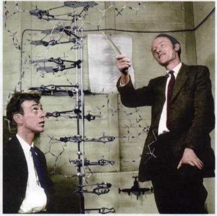

natural_image

Two men in suits observing a scientific display of aircraft models (no visible text or symbols)

(B)

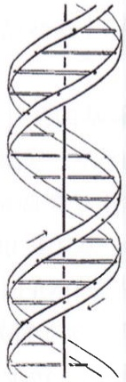

natural_image

Diagram of a DNA double helix structure with directional arrows indicating rotation (no text or labels)

图 3-25 DNA 双螺旋结构的发现

（A）沃森和克里克在搭建DNA模型。（B）沃森和克里克在1953年提出的DNA结构模型。（C）左图和右图分别是威尔金斯和富兰克林在1953年发表的DNA纤维的X射线衍射图案。

(C)

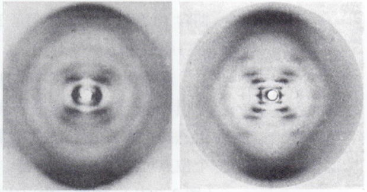

natural_image

Two circular grayscale images showing concentric rings with a central bright spot, no text or symbols present.

(A, 经 Science Photo Library 授权使用; B, 引自 Watson J D, et al. Nature, 1953, 171(4356): 737-738; C 左, 引自 Wilkins M H F, et al. Nature, 1953, 171(4356): 738-740; C 右, 引自 Franklin R E, et al. Nature, 1953, 171(4356): 740-741)

图 3-26 B 型 DNA 的双螺旋结构

（A）B型DNA的空间填充结构模型。（B）B型DNA的丝带模型。（C）B型DNA的A-T以及G-C碱基互补配对。A-T大沟边的疏水基团以及可形成氢键基团分别用蓝色和浅棕色表示。

(A)

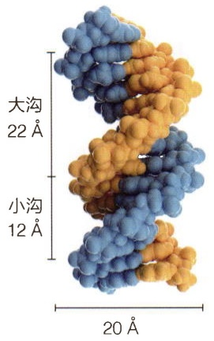

chemical

Molecular structure diagram of a DNA double helix with labeled interatomic distances

(B)

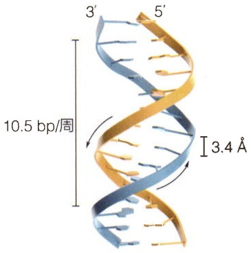

chemical

DNA double helix structure with labeled helices and size annotation

(C)

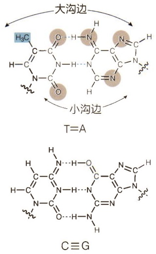

年，沃森、克里克以及莫里斯·威尔金斯（Maurice Hugh Frederick Wilkins，1916—2004）因为DNA结构的工作，共同获得了1962年诺贝尔生理学或医学奖。

沃森与克里克提出的 DNA 模型的结构特征包括以下几点（图 3-26）:

① DNA 由两条反平行的链组成，呈右手双螺旋结构，直径是  $20 \, Å$ 。
② 两条 DNA 链的碱基是互补的，它们形成特定的碱基配对。其中，一条链的碱基 A 通过 2 个氢键与另一条链的 T 配对，G 通过 3 个氢键与 C 配对。这种碱基配对方式被称为沃森-克里克碱基配对（Watson-Crick base pairing）。
③ 碱基对位于双螺旋内部，相邻碱基对通过范德瓦耳斯力以及疏水相互作用堆叠在一起。
④ 双螺旋表面有大沟（major groove）和小沟（minor groove），宽度分别为 22 Å 和 12 Å。
⑤ 相邻碱基对平面垂直于螺旋轴，间距为  $3.4 \, Å$ ，相差  $36^{\circ}$ 。一个完整螺旋的周期含 10 个碱基对，螺距是  $34 \, Å$ 。（这些结构参数非常接近细胞内 DNA 的实际螺旋周期:每周 10.5 碱基对。）

这些特征中，最关键的是碱基的互补配对原则，这为DNA的复制、同源重组以及损伤修复提供了理论依据。此外，暴露的大沟和小沟为蛋白质阅读碱基对的序列信息提供识别位点，而无需解开双螺旋结构。例如，A-T碱基对的大沟边缘含有3个位点可以参与氢键形成，一个基团提供疏水作用，而小沟边缘含有2个氢键位点（图3-26C）。因此，蛋白质在结合DNA时，经常通过氢键识别大沟边缘的特异位点，通过电荷与小沟边缘的磷酸骨架形成非特异的相互作用。DNA结构的解析揭示了生命的秘密，为遗传信息的储存、复制、转录等关键生物学过程提供了重要的指导作用，极大地推动后续分子生物学的发展。

沃森与克里克提出的DNA模型是B型DNA结构，是DNA在生理条件下主要的存在形式。DNA是柔性的，其结构可以用不同参数描述（知识窗3-4）。而且，在不同湿度、盐种类和浓度以及特定碱基组成等条件下，DNA可以形成非B型结构。

## 知识窗3-4

## DNA 的结构参数

蛋白质结构具有柔性，DNA 结构同样具有柔性。除了可以形成 B 型、A 型、Z 型结构外，DNA 在蛋白质等外力作用下可以发生形变，例如在组蛋白的作用下发生弯曲，盘绕形成核小体。可以用几组参数系统描述双螺旋结构中碱基的几何结构（图3-27）。这些参数没有考虑糖磷酸骨架的构象，只关注碱基的空间取向。例如，相邻两个碱基对的构象用6个参数描述，即移动（shift）、滑动（slide）、升起（rise）、倾斜（tilt）、滚动（roll）、扭转（twist）。两条链上的一对互补碱基不是完全平面的，1989年在英国剑桥举行的EMBO研讨会定义了6个参数描述碱基对偏离平面的构象，即剪切（shear）、拉伸（stretch）、错开（stagger）、弯曲（buckle）、螺旋（propeller）、打开（opening）。另外，碱基对保留了平面构象，但偏离了理想位置，可以用4个参数定义，即x位移（x-displacement）、y位移（y-displacement）、倾斜（inclination）、翻倒（tip）。

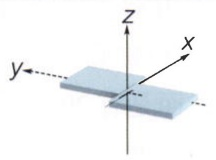

剪切 (shear, Sx)

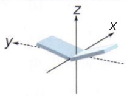

弯曲 (buckle, $\kappa$)

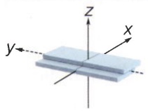

移动 (shift, Dx)

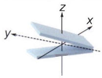

倾斜 (tilt, τ)

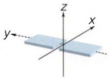

拉伸 (stretch, Sy)

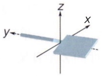

螺旋(propeller, $\pi$ )

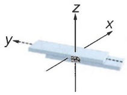

滑动 (slide, Dy)

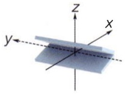

滚动 (roll, $\rho$)

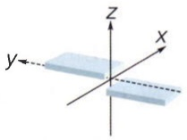

错开 (stagger, Sz)

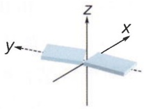

打开 (opening, $\sigma$)

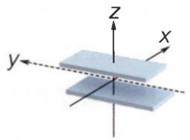

升起 (rise, Dz)

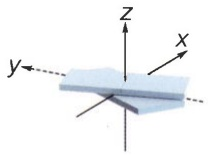

扭转 (twist, $\omega$)

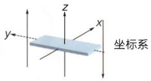

text_image

z
x
y
坐标系

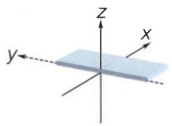

$x$ 位移 $(x$-displacement, $dx)$

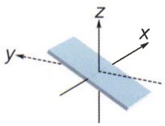

倾斜 (inclination, η)

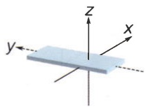

y位移 (y-displacement, dy)

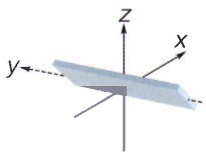

翻倒 (tip, $\theta$)

图3-27 DNA的构象参数

(数据自 Lu X J, et al. Nat Protoc, 2008, 3(7): 1213-1227)

## 3.2.3 其它非 B 型 DNA 结构

在脱水条件下，DNA可以转变成A型结构。此外，DNA与RNA配对形成杂化双螺旋时，也可以形成A型结构。A型DNA保持右手螺旋结构，但螺旋变得短而粗，一个螺旋周期含 $11\mathrm{bp}$，螺距 $28\AA$，碱基对不再垂直于螺旋轴，而是有 $20^{\circ}$ 倾斜，大沟变深而小沟变浅（图3-28）。A型结构可以在脱水条件下，例如细菌孢子内，保护DNA。一些嗜热病毒的DNA采用A型结构，可能是一种在极端环境下的适应性机制。

在高盐条件下（如 2 mol/L NaCl），或者含多聚 CG 序列，DNA 可以形成 Z 型结构。Z 型 DNA 为左手螺旋，二核苷酸为重复单元，每圈螺旋含 6 个二核苷酸（共 12 bp），螺距较大（45 Å），呈特征性的 Z 型骨架（图 3-28）。细胞内，胞嘧啶的甲基化（5mC）被认为有助于促进 B 型到 Z 型的转变，可能调控一些基因的表达。

一些非经典的DNA结构还包含3条以及4条链。在G-C、A-T形成Watson-Crick碱基配对后，其大沟边含有额外的氢键供体和受体，可以接纳第三条链，形成铰链DNA（hinged DNA，H-DNA）。例如G-C碱基对可以结合质子化的胞嘧啶 $\mathrm{C}^+$，形成 $\mathrm{C}^+ \cdot \mathrm{G}-\mathrm{C}$ 三碱基配对；A-T碱基对可以结合胸腺嘧啶，形成T·A-T三碱基配对（图3-29）。这种非Watson-Crick碱基配对方式被称为Hoogsteen碱基配对（胡斯坦碱基配对）。由于更强的磷酸骨架负电荷排斥，三链DNA结构没有双链结构稳定，RNA-DNA-DNA三链结构相对比较稳定。三链DNA是最早发现的多链DNA结构。

图3-28 B型、A型和Z型DNA结构比较

B型DNA和A型DNA的结构图来自标准结构，Z型DNA的结构图来自PBD（编号:4OCB）。

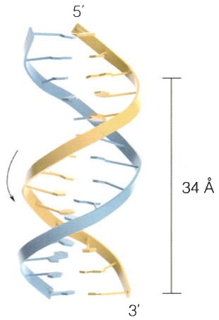

chemical

Diagram of a DNA double helix structure with labeled helices and 34 Å distance measurement

B型DNA

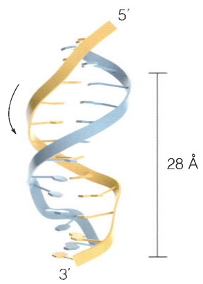

chemical

Diagram of a DNA double helix structure with labeled helices and 28 Å scale bar

A型DNA

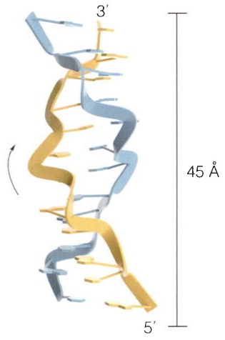

chemical

3D ribbon diagram of a protein structure with labeled helices and 45 Å distance indicator

Z型DNA

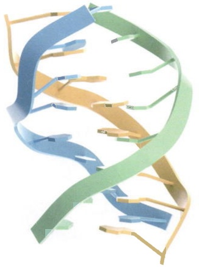

natural_image

3D ribbon diagram of a DNA double helix structure with blue and green strands (no text or labels)

(A)

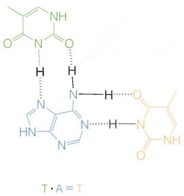

chemical

Chemical structure of a heterocyclic compound with amide and pyridine ligands, labeled T·A = T

(B)

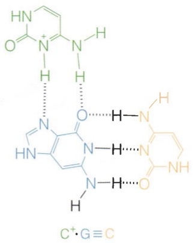

chemical

Chemical structure of a nucleoside analog with C⁺ and G≡C ligands

(C)

图 3-30 四链 DNA结构

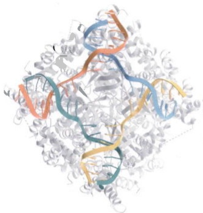

natural_image

3D protein structure visualization with alpha helices and beta sheets (no text or labels)

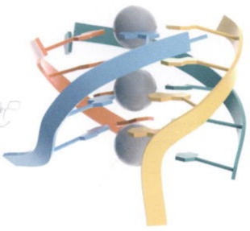

natural_image

Abstract 3D ribbon diagram with colored ribbons and spheres (no text or symbols)

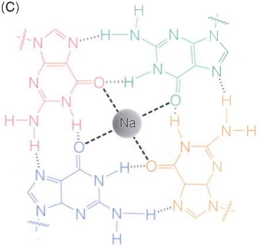

chemical

Molecular structure of sodium (Na) complex with oxygen and nitrogen ligands

图3-29 三链DNA结构蓝色和橙色DNA链发生Watson-Crick碱基配对，第三链（绿色）通过胡斯坦作用配对（PDB编号:1D3X）。

在细胞内，基因组中的嘌呤镜像重复序列有助于构成分子内的三链DNA结构。近年来，多个非编码RNA被发现结合启动子DNA，形成RNA-DNA三链结构，从而调控基因表达。

四链 DNA 结构包括 X 型的 Holliday 交叉（Holliday junction）结构以及 G 四链体（G-quadruplex）（图 3-30）。Holliday 交叉结构中，两条双链通过一个十字交叉位点连接在一起。这种结构在 DNA 发生同源重组时形成，有助于 DNA 链交换，从而形成新的遗传信息。G 四链体发生在基因组中富含 G 的序列，例如端粒 DNA 以及富含 CG 序列的启动子区。G 四链体结构异常稳定，被认为可以保护端粒 DNA 的稳定性，或者抑制基因的转录。

## 3.2.4 核小体与染色质的结构

基因组DNA在真核细胞中被折叠压缩，储存在细胞核中。例如，人的基因组含大约30亿个碱基对（bp），如果这些DNA以B型DNA形式连接起来，将长达 $2\mathrm{m}$ 。实际上，这些DNA与蛋白质形成复合物，即染色质，储存在直径只有 $10\mu \mathrm{m}$ 大小的细胞核中（图3-31）。染色质的结构是动态变化的。在细胞周期的间期，染色质结构稍松散，但也成千上万倍地被压缩。在细胞周期的分裂期，染色质固缩成染色体

（A）四链 DNA Holliday 交叉结构（PDB 编号:7OA5）。（B）G 四链体结构（PDB 编号:244D）。 $Na^{+}$ 结合在 G 四链体中央，起稳定结构作用。（C）G 四链体的平面结构

图3-31 染色质结构示意图

染色质是以核小体为基本重复单元组成的复杂DNA-蛋白质复合物。核小体排列成不同的阵列，并折叠形成不同层次结构，包括染色质环、拓扑相关结构域，以及A/B区室。

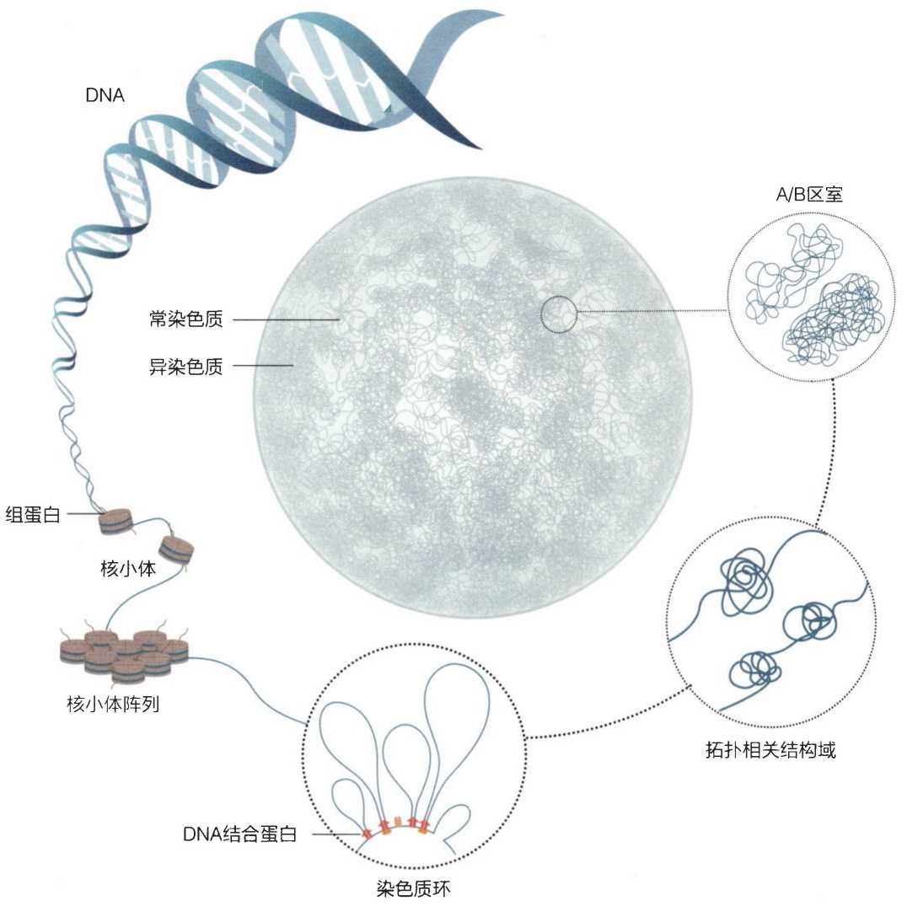

text_image

DNA
组蛋白
核小体
核小体阵列
常染色质
异染色质
A/B区室
拓扑相关结构域
DNA结合蛋白
染色质环

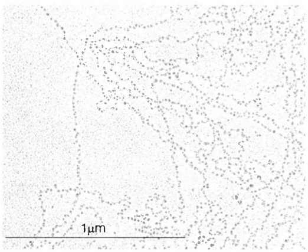

natural_image

Microscopic image showing scattered particles or structures with a 1μm scale bar (no text or symbols beyond scale indicator)

图3-32 果蝇胚胎染色质的核小体串珠结构（引自McKnight S L, et al. Cell, 1976, 8(2):305-319）

(chromosome)，呈最紧密状态。即使在同一时间，不同染色质区域压缩状态也不一样。在细胞周期间期，DNA高度压缩的区域称为异染色质（heterochromatin），而较为松散的染色质区域称为常染色质（euchromatin）。DNA折叠压缩形成染色质，不仅对遗传物质储存很重要，而且对复制、基因转录、DNA修复等产生深刻的影响。

有趣的是，染色质中的DNA缠绕组蛋白（histone），形成一个特定的重复结构单元，被称为核小体（nucleosome）。染色质经过处理，通过电子显微镜可以观察到连续的小球串在一条线上（图3-32）。每一个小球是一个核小体，核小体间的线是连接DNA（linker DNA）。这种核小体的串珠结构常被称为 $10\mathrm{nm}$ 染色质纤维，是染色质的一级结构。

核小体的核心由组蛋白八聚体组成，其中包含4种核心组蛋白H2A、H2B、H3和H4（图3-33）。约147bp的DNA以左手超螺旋形式环绕八聚体1.7圈，形成直径约 $10\mathrm{nm}$ 、高 $6\mathrm{nm}$ 的盘状结构。这种紧密缠绕的结构被称为核小体核心颗粒（nucleosome core particle，NCP）。H3-H4形成四聚体位于NCP的内部，而两个H2A-H2B二聚体分别位于NCP外围的两端。这种组蛋白布局方式使得H2A-H2B二聚体容易从核小体解离出来，具有较大的动态性（自发的以及酶促的）。DNA的螺旋轴因与组蛋白作用发生弯曲而偏离经典B型结构，但大体上保留了大沟和小沟特征及其周期性。组蛋白具有多个精氨酸和赖氨酸残基，它们带正电荷的侧链深入到DNA的小沟中，通过氢键和静电作用结合磷酸骨架，从而稳定核小体中DNA的弯曲结构。

(A)

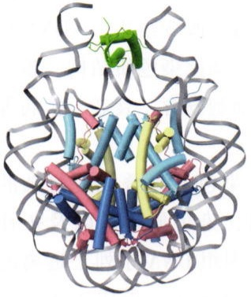

natural_image

3D protein structure visualization with alpha helices and beta sheets (no text or labels)

顶视图

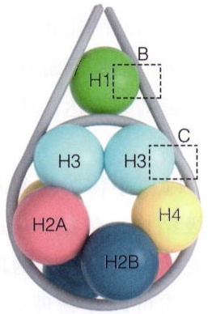

chemical

Molecular structure diagram showing labeled hydrogen atoms (H1–H4) arranged in a ring with dashed boxes highlighting specific regions.

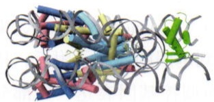

natural_image

3D protein structure visualization with alpha helices and beta sheets (no labels or text)

侧视图

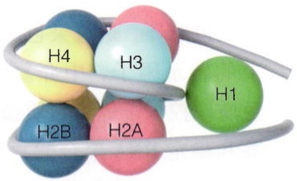

chemical

Molecular structure diagram showing labeled hydrogen atoms H1 to H4 connected by a curved ligand

(B)

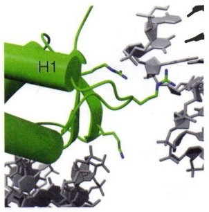

natural_image

3D protein structure visualization with green helices and gray side chains, no text or symbols present

(D)

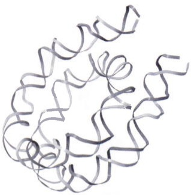

natural_image

Abstract 3D ribbon diagram of a protein structure (no text or labels)

(C)

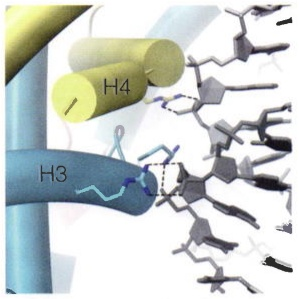

chemical

Molecular interaction diagram showing hydrogen bonding between residues H3, H4, and a central ligand

图 3-33 核小体结构

（A）核小体的顶视和侧视图（PDB编号:4QLC）。右图是组蛋白布局图。方框内结构局部放大在图（B）、（C）显示。（B）H1与DNA的相

互作用。（C）H3-H4与DNA的相互作用。图中虚线表示组蛋白与磷酸骨架之间的氢键相互作用。（D）核小体中DNA的左手超螺旋结构。

在核小体核心颗粒外周，还有接头组蛋白（linker histone）H1。H1带有更多的正电荷，与核小体进出口两端的接头DNA作用，使结构更紧凑。接头DNA连接相邻的核小体，其长度在不同染色质区域、不同物种中各不相同（10～90 bp）。

核小体中，组蛋白灵活且非结构化的 N 端尾部从核小体核心向外延伸突出。组蛋白尾部可以发生多种翻译后修饰，如乙酰化、甲基化、磷酸化以及泛素化等。这些组蛋白修饰在调节 DNA 可及性和基因表达方面发挥着至关重要的作用。

核小体不是静态结构，而是表现出动态特性。核小体的组蛋白构成、稳定性以及在基因组的定位受到多种因素的影响，包括 DNA 自身的柔性、DNA 结合蛋白、ATP依赖的染色质重塑复合物等。组蛋白尾部的翻译后修饰，例如乙酰化和甲基化，可以改变组蛋白-DNA相互作用，招募下游效应蛋白，调控染色质结构，激活或抑制基因表达，从而塑造细胞发育、衰老、疾病等过程。

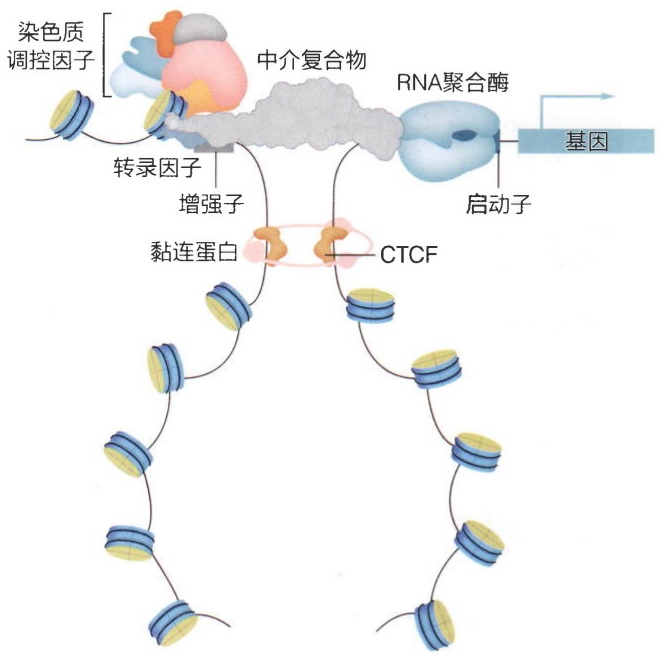

flowchart

图 3-34 染色质环结构

增强子-启动子DNA通过转录因子、染色质调控因子、中介复合物等形成染色质环结构。

以核小体为重复单元，染色质折叠成更复杂的高级结构，包括 $30\mathrm{nm}$ 纤维、染色质环，以及拓扑相关结构域等等。两段在基因组DNA序列上远离的染色质可以在物理空间上彼此靠近，形成环状结构（图3-34）。其中，一种常见的形式是增强子-启动子染色质环。通过染色质环结构，结合在增强子序列上的转录因子、中介复合物（mediator complex）、染色质调控因子等蛋白质被带到基因的启动子附近，招募和稳定RNA聚合酶，从而调控基因表达。大部分染色质环的形成需要DNA结合蛋白CTCF（CCCTC-binding factor）和黏连蛋白（cohesin）。CTCF识别特定的DNA序列，锚定在染色质环的根部；而黏连蛋白

不但作为索套分子，稳定环结构，而且作为分子马达，通过挤压作用推动染色质环的扩展。

拓扑相关结构域是一段自相互作用的染色质区域，其内部的DNA发生物理作用的频率较高，而拓扑相关结构域之间的作用较少（见图3-31）。拓扑相关结构域内部有相同的组蛋白修饰状态，一般认为这有助于调控基因表达。拓扑相关结构域的形成同样依赖于CTCF和黏连蛋白。

尽管DNA的双螺旋结构在70多年前已经被阐明，但染色质结构近10年才逐步被揭示。染色质结构在调控基因表达的作用，在发育、衰老、疾病状态下的变化规律及其机理等许多重要问题需要回答。

## 3.3 RNA结构

RNA是由核糖核苷酸（ribonucleotide）经缩合反应而形成的多聚核苷酸链生物大分子。RNA有着多种多样的功能，可在遗传编码、催化化学反应、基因表达、基因调控等过程发挥作用。RNA的突变或代谢失衡也往往导致多种疾病。RNA功能的多样性与其可形成复杂的多层次结构密不可分。和蛋白质一样，RNA的多层次结构也可划分为一级结构、二级结构、三级结构和四级结构。以tRNA为例，其多层次结构如图3-35所示。

flowchart

图3-35 tRNA的多层次结构

## 3.3.1 RNA的一级结构

RNA的一级结构指的是多聚核苷酸链中核糖核苷酸的组成、连接方式和顺序。

核糖核苷酸由碱基、核糖和磷酸三部分组成。和DNA一样，RNA也包含4种含氮碱基，其中C、A、G为DNA和RNA共有，不同的是，RNA中还包含U，DNA中的则为T。这些含氮碱基的化学结构式及各原子编号如图3-22所示。核糖（ribose）是一种五碳醛糖，有D-核糖和L-核糖两种构型，其中D-核糖是组成RNA的主要成分。为与含氮碱基的原子编号区别，核糖的各原子编号加有上撇号（'）。核糖通过其 $\mathrm{C}1^{\prime}$ 与嘌呤的N9或嘧啶的N1以C—N糖苷键连结形成核苷（nucleoside）。核苷中的核糖与磷酸以磷酸酯键连结形成核糖核苷酸（见图3-22）。

细胞内大多数核糖核苷酸是通过其核苷的核糖 C5' 羟基发生磷酸化，核糖的 C5' 羟基除可被单磷酸化形成一磷酸酯外，还可被二磷酸化或三磷酸化形成二磷酸酯或三磷酸酯。磷酸化也可发生在核糖的 C2' 或 C3' 羟基，或同时发生在 C2'/C3' 或 C3'/C5' 羟基。以核糖腺苷酸为例，除 5'- 单磷酸腺苷（AMP，又称腺苷单磷酸）、5'- 二磷酸腺苷（ADP，又称腺苷二磷酸）、5'- 三磷酸腺苷（ATP，又称腺苷三磷酸）外，还可以形成 2'- 单磷酸腺苷，3'- 单磷酸腺苷，2',3'- 环单磷酸腺苷，或 3',5'- 环单磷酸腺苷等，它们的化学结构式如图 3-36 所示。三磷酸核糖核苷酸是参与核酸合成的直接前体，也是生理储能和供能的重要分子，而其它形式的核糖核苷酸多为代谢中间产物或酶活性及代谢的调节物质。在三磷酸核糖核苷酸中，三个磷酸基团按距离核糖从近到远依次编号为 α、β 和 γ（见图 3-22）。

RNA链的走向定义为从 $5^{\prime}$ 到 $3^{\prime}$ 方向，其中每个基本核糖核苷酸单元按原子顺序包含 $5^{\prime}$ 端的磷原子到核糖的 $3^{\prime}$ 氧原子，以及核糖和碱基上的所有原子（图3-37A）。细胞利用三磷酸核糖核苷酸为底物沿 $5^{\prime}$ 向 $3^{\prime}$ 方向合成RNA，其中三磷酸核糖核苷酸的 $\alpha$ 磷原子可以亲电进攻另一核糖核苷酸或核酸分子的 $3^{\prime}$ 羟基形成磷酸二酯键，同时脱去一分子焦磷酸，而将两个核糖核苷酸的 $3^{\prime}$ 和 $5^{\prime}$ 端以 $3^{\prime}, 5^{\prime}-$ 磷酸二酯键连接在一起（图3-37B）。RNA通常为线性分子，不同核糖核苷酸之间不仅可以 $3^{\prime}, 5^{\prime}-$ 磷酸二酯键连接，也可以 $2^{\prime}, 5^{\prime}-$ 磷酸二酯键连接（图3-37C）。RNA链也可以通过 $3^{\prime}, 5^{\prime}-$ 磷酸二酯键或 $2^{\prime}, 5^{\prime}-$ 磷酸二酯键进行首尾相连，形成环状RNA（circRNA）

图3-36 核糖腺苷酸的多种形式

腺嘌呤

chemical

Chemical structure of a nucleotide sugar with phosphate group and ribose sugar, labeled in Chinese

5'-单磷酸腺苷

chemical

Chemical structure of glucose showing ribose sugar and phosphate group with labeled nucleotide positions

2'-单磷酸腺苷

chemical

Chemical structure of a sugar derivative with phosphorus and carboxylate groups, labeled as '腺嘌呤'

2',3'-环单磷酸腺苷

chemical

Chemical structure of a sugar derivative with hydroxyl and phosphorus groups, labeled as '腺嘌呤'

3'-单磷酸腺苷

chemical

Chemical structure of a nucleotide sugar derivative with phosphate group and labeled as phospholipid

3',5'-环单磷酸腺苷

(A)

chemical

Chemical structure of a nucleoside analog with labeled sugar units and glycosidic linkages

(B)

chemical

RNA聚合酶催化反应示意图，展示碱基与磷酸二甲酸结合形成磷酸二甲酸的化学反应路径

(C)

chemical

Chemical structure of a phosphate nucleotide with labeled bases and 3'-5' connection annotation

chemical

Chemical structure of a polysaccharide with labeled bases and 2'-5' connection annotation

(D)

chemical

DNA分子结构示意图，展示环形RNA与首尾相连RNA的连接及磷酸二酯键的化学结构

图3-37 RNA链的方向及核糖核苷酸间的连接方式

(图 3-37D)。

对RNA来说，组成主链骨架的磷酸和核糖对每一个核糖核苷酸都是一样的，因此RNA一级结构通常以碱基（A、C、G、U）的排列顺序从 $5^{\prime}$ 到 $3^{\prime}$ 书写。如果RNA一级结构上的特定位置可能出现一种以上的核糖核苷酸或其组合，则可用其它字母符号表示，如:R表示 $\mathrm{A + G}$；Y表示 $\mathrm{C + U}$；M表示 $\mathrm{A + C}$；K表示 $\mathrm{G + U}$；S表示 $\mathrm{C + G}$；W表示 $\mathrm{A + U}$；H表示 $\mathrm{A + C + U}$；B表示 $\mathrm{C + G + U}$；V表示 $\mathrm{A + C + G}$；D表示 $\mathrm{A + G + U}$；N表示 $\mathrm{A + C + G + U}$ 的组合，等等。

RNA链的核糖核苷酸上还可能发生化学修饰。例如在人细胞质tRNA的不同位置上发现有丰富的化学修饰（图3-38）。修饰位点可能在碱基、核糖或磷酸上。目前已鉴定的RNA化学修饰高达170种，包括核苷的甲基化修饰（如$\mathrm{m^6A}$ 、 $\mathrm{m}^{1}\mathrm{A}$ 、 $2^{\prime} - \mathrm{O - Me}$ 等）、糖基化修饰，不常见碱基如肌苷（I）、二氢尿苷（D）、假尿嘧啶

chemical

Molecular structure diagram showing nucleotide positions and corresponding amino acid residues

图3-38 tRNA上存在多种化学修饰图中仅展示了部分化学修饰。

（$\psi$）等，以及 $\alpha-$ 磷硫酰化等，这些化学修饰进一步丰富了 RNA 中核糖核苷酸的类型（图 3-39）。

相比于DNA，RNA的化学稳定性较差。RNA核糖上的 $2^{\prime}$ -OH可以形成环磷酸中间产物，导致RNA容易被水解或被核酸酶切割而降解（图3-40）。由于能够有效周转并减少细胞内RNA的活跃浓度，RNA能够调节许多重要的生物学过程。此外，RNA上的 $2^{\prime}$ -OH也使得其能够与其它RNA分子或配体形成氢键相互作用，在RNA三级结构的折叠、分子识别等过程中发挥着重要作用。

## 3.3.2 RNA 的二级结构

RNA 的二级结构指的是 RNA 链中核糖核苷酸碱基间的氢键配对范式。

在RNA中，任一核糖核苷酸的碱基要么处于未配对的单链状态，要么与其它碱基通过氢键相互作用形成碱基对或碱基三联体（base triple）。通常大多数碱基对彼此相邻并形成反平行的双螺旋结构，在某些情况下，还可进一步形成三链螺旋（triple helix）或四链体（quadruplex）结构。根据单链和双螺旋结构的穿插范式，RNA二级结构又可细分为双链（duplex）、发夹环（hairpin loop）、对称内环（symmetric internal loop）、不对称凸起（asymmetric bulge）、凸起（bulge）、二路接合（two-way junction）、三路接合（three-way junction）、四路接合（four-way junction）、吻式环（kissing loop）、假结（pseudoknot）、三链螺旋等（图3-41）。其中，假结是一类特殊的RNA二级结

图3-39 多种代表性的RNA化学修饰

chemical

Chemical reaction pathway showing the conversion of a phosphorylated sugar molecule to a modified sugar with phosphate groups, including hydroxyl and carboxylate functional groups.

图 3-40 RNA 不稳定性的结构基础