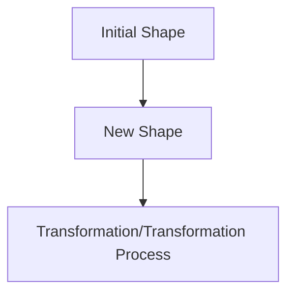

text_image

单链
双螺旋
发夹环
对称内环
不对称内环
单核苷酸凸起
三核苷酸凸起
吻式环
假结
二路接合或同轴堆积
三路接合
四路接合
三链螺旋

图3-41 RNA二级结构的类型

构，可视为同一链上的茎环结构与单链区通过碱基配对而形成。

相比于DNA，RNA中核苷酸碱基配对的模式更为多样化，粗略可分为沃森-克里克碱基配对和非沃森-克里克碱基配对（图3-42）。在RNA双螺旋中，A、U、C、

G 可以类似于双链 DNA 中的沃森-克里克碱基配对原则形成 A-U 和 G-C 碱基对，这种模式在能量上最为稳定，被称为规范碱基配对。此外，RNA 中碱基间还可以不同于沃森-克里克碱基配对的模式形成氢键配对，被称为非规范碱基配对。最常见的非规范碱基配对是鸟嘌呤（G）和尿嘧啶（U）通过两个氢键形成 G·U 摇摆碱基对（wobble base pair），G·U 碱基对的稳定性与 A-U 碱基对相当。在 RNA 中，A-U，G-C 和 G·U 这三种碱基配对最为常见，它们的三维尺寸几乎相同，互相排列组合在一起后，可以堆积形成刚性的 A 型双螺旋，具有窄而深的大沟和浅而宽的小沟（靠近 2'—OH 一侧）。

RNA 也可以通过胡斯坦碱基配对（Hoogsteen base pairing）形成比 A 型双螺旋更复杂而多样化的结构。例如，poly(U) 单链可与 poly(A-U) 双螺旋的大沟结合，第 3 个 U 可与 A-U 碱基对中的 A 进行胡斯坦配对形成 U·A-U 碱基三联体并互相堆积形成三螺旋结构。类似的，C 可以和 G-C 碱基对中的 G 通过胡斯坦配对形成 C⁺·G-C 碱基三联体（图 3-43）。与 U·A-U 碱基三联体不同，C⁺·G-C 碱基三联体对 pH 敏感，这是因为 C 的 N3 的 pKₐ 为 4.6，在酸性条件下，C 的 N3 可质子化从而可与 G 的 N7 形成氢键而稳定胡斯坦配对。因此，含 C⁺·G-C 碱基三联体的三螺旋 RNA 在低$\mathrm{pH}$ 下（如 $\mathrm{pH} = 5$）会比在中性条件下更稳定。

图3-42 RNA中沃森-克里克碱基对（G-C和A-U）和$\mathrm{G}\cdot \mathrm{U}$ 摇摆碱基对的几何构型

图3-43 RNA碱基三联体

对于一段或多段包含串联重复 G 的 RNA 序列，鸟嘌呤可通过分子内或分子间的胡斯坦氢键相互连接，形成鸟嘌呤以正方形方式排列的 G 四分体，并通过多层堆积形成 G 四链体结构（图 3-44A、B）。对于一段或多段包含串联重复 C 的 RNA 序列，在酸性条件下，C 的 N3 可质子化，从而可稳定形成 i 模体（i-motif）的四链体结构（图 3-44C、D）。

为了对RNA中不同碱基配对模式进行准确描述和分类，尼奥克利斯·莱昂蒂斯（Neocles Leontis）和埃里克·韦斯特霍夫（Eric Westhof）基于参与碱基配对的碱基相

图3-44 RNA四链体结构

(A) G 四分体俯视图，图中 M 为一价金属阳离子。(B) G 四链体侧视图。(C) C-C 配对俯视图。(D) i 模体侧视图。

chemical

Molecular structure diagram showing a central M atom surrounded by six G atoms and three R atoms, with dashed lines indicating bonds or interactions.

chemical

Diagram of a DNA double helix structure with labeled positions and mutation sites

chemical

Molecular structure diagram showing a fused ring system with labeled carbon (C), oxygen (O), and R groups, featuring dashed bonds indicating hydrogen bonding.

chemical

Diagram of a cyclic molecular structure with labeled bond lengths 3' and 5'

互作用边和氢键的取向，提出了Leontis-Westhof分类和展示系统（图3-45）。RNA中不同核苷酸的碱基总体上均为共平面的含氮杂环，根据分布于其上的氢键受体和供体，可将其分为三个边:沃森-克里克边（Watson-Crick edge，W边）、胡斯坦边（Hoogsteen edge，H边）和糖边（sugar edge，S边）。A-U、G-C以及G·U碱基对主要通过沃森-克里克边形成氢键相互作用，其它碱基对也可通过胡斯坦边或糖边形成氢键。因此，在不同碱基对中，可能出现6类相互作用边的组合，如沃森-克里克边/沃森-克里克边（W:W）、沃森-克里克边/胡斯坦边（W:H）、沃森-克里克边/糖边（W:S）、胡斯坦边/胡斯坦边（H:H）、胡斯坦边/糖边（H:S）以及糖边/糖边（S:S）。考虑到每个碱基对的两个糖苷键可能位于氢键主轴的同一侧（cis，顺式）或不同侧（trans，反式），RNA中的碱基配对方式则可分为12类。不考虑碱基互补配对原则，组成RNA的4种碱基每种均可以3种相互作用边与任意碱基互作，以及糖苷键相对于氢键主轴存在顺式和反式取向，则共有超过100种可能的非规范碱基配对形式，这也是RNA可形成多样性结构的原因之一。

(A)

(B)

顺式 W边/W边（cWW）AU碱基对

chemical

Molecular structure diagram showing two fused aromatic rings with color-coded atoms and directional arrows indicating bonds or interactions.

反式 W边/W边（tWW）AU碱基对

chemical

Molecular structure diagram showing a complex organic compound with green, blue, and red atoms

(C)

(D)

chemical

Molecular structure diagram showing labeled atoms A, G, and U with color-coded bonds

图 3-45 Leontis-Westhof 分类和展示系统

（A）RNA碱基的边。根据参与氢键的配对，碱基可以分为沃森-克里克边（W边）、胡斯坦边（H边）和糖边（S边）。（B）根据糖苷键形成的方向不同，可以分为顺式的和反式的沃森-克里克碱基配对。

（C）根据糖苷键的顺式和反式、参与形成氢键的碱基的边等，碱基配对可以分成12类碱基配对家族。图中参与形成氢键的W、H和S边分别用圆形、正方形和三角形表示，顺式和反式配对分别用实心和空心图形表示。（D）tHW/cHS AUG 碱基三联体的几何构型。

RNA的二级结构可用多种方法表示，其中最常规的是以二维平面图形表示（图3-46A），从中可直观了解RNA的序列、单链区和最常见的A-U、G-C、G·U的碱基配对模式。用Leontis-Westhof分类和展示系统表示的RNA二级结构（图3-46B），则可直观了解规范碱基配对和非规范碱基配对模式。RNA二级结构的点-括号表示法则是最常见的文本表示方法（图3-46C）。该表示法用“.”表示RNA中的单链未配对碱基，而用圆括号表示互补配对的两个碱基[其中相对靠近 $5^{\prime}$ 端的用“（”表示，而相对靠近 $3^{\prime}$ 端的用“）”表示]，假结则可以用方括号表示（其中相对靠近 $5^{\prime}$ 端的用“[”表示，而相对靠近 $3^{\prime}$ 端的用“]”表示）。由于该表示法仅采用了少数几种符号，而且可以被计算机识别，因而在很多数据库和计算软件中常用这种

图3-46 RNA二级结构的不同表示方式

（A）常规二维平面图表示。（B）Leontis-Westhof系统表示，图中红色结构为结合的小分子。（C）点-括号表示。

(A)

chemical

DNA sequencing chromatogram showing nucleotide bases and corresponding base pair annotations

(C)

GGAACCUCCGCGAAAGCGGUGAAGGAGAGGCGCAAGGUUAACCGCCUCAGGUUCC
((((((((((((...)))))(....)(((((((....)))))))))))))

(B)

chemical

RNA secondary structure diagram showing nucleotide base pairing and mutation sites

方式来表示 RNA 的二级结构。

## 3.3.3 RNA 的三级结构

RNA的三级结构指的是RNA在多种非共价键相互作用下稳定连结并折叠形成的三维空间结构。RNA在三维空间的实际结构形态并不是线性伸展的，而是按一定方式折叠盘绕形成特定的构象（conformation）。RNA构象指的是RNA分子中的原子和基团在三维空间上的排列、分布以及核苷酸链的走向。RNA构象的改变并不导致共价键的断裂和生成，稳定RNA构象的主要为非共价键相互作用，包括氢键、范德瓦耳斯力、$\pi - \pi$ 堆积作用等。

相比于蛋白质，RNA的构象具有更大的柔性。蛋白质的多肽链可看作是由一系列刚性的肽平面通过 $\alpha$ 碳原子连接而成的长链，其主链上只有 $\alpha-$ 碳原子两侧的两个单键可以自由旋转，肽平面绕 $\mathrm{C}_{\alpha}-\mathrm{N}1$ 旋转的二面角称为 $\varphi$ ，而绕 $\mathrm{C}_{\alpha}-\mathrm{C}2$ 旋转的二面角称为 $\psi$ ，因而蛋白质主链的构象可由肽平面之间的这两个二面角的角度决定。而RNA的每一个基本核苷酸单元的主链构象需要多达6个二面角（ $\alpha$ 、 $\beta$ 、 $\gamma$ 、 $\delta$ 、 $\varepsilon$ 、 $\zeta$ ）的角度决定（图3-47）。然而，由于空间位阻的存在，这些二面角的实际取值只能在有限的范围，使得柔性的RNA依然能形成某个稳定的构象。

核糖的呋喃糖环并非平面结构，通常可采取信封式和扭船式的构象，并可在不同构象态之间快速转换（图3-48A）。在核糖的信封式构象中，环上的3个碳原子和1个氧原子接近于共平面，另一个碳原子则向上折起。若 $\mathrm{C2^{\prime}}$ 或 $\mathrm{C3^{\prime}}$ 在 $\mathrm{C5^{\prime}}$ 的同一侧突出平面，分别称为 $\mathrm{C2^{\prime}-}$ 内式（ $\mathrm{C2^{\prime}-endo}$ ）和 $\mathrm{C3^{\prime}-}$ 内式（ $\mathrm{C3^{\prime}-endo}$ ）（图3-48B）。

核糖的 C1' 通过 C—N 糖苷键与嘧啶的 N1 或嘌呤的 N9 连接形成核苷，由于空间位阻的限制，碱基在糖苷键上的旋转受到限制，导致核苷能以同位（syn）和反位（anti）两种构象存在（图 3-49）。定义糖苷键的扭转角为  $\chi$ （图 3-47），对于嘌呤和嘧啶来说， $\chi$  分别为 O4'-C1'-N9-C4 和 O4'-C1'-N1-C2 的二面角。如果  $\chi = 0^{\circ}$ ，则

图3-47 RNA主链核苷酸基本单元的二面角

chemical

Chemical structure and reaction pathway of a phosphorus-containing organic molecule with labeled atoms and reaction conditions

图 3-48 RNA 核糖的基本构型

(A)

chemical

Chemical structure of a cyclic sugar molecule with hydroxyl and hydrogen substituents

β-D-核糖

natural_image

Diagram showing a curved arrow pointing from an open plane to a tilted plane, with no text or symbols present.

信封式

flowchart

扭船式

(B)

chemical

Chemical structure of a cyclic ether with labeled atoms and bonds

text_image

C5'
3'
4' O O
2' 1'
N

C3'-内式

chemical

Chemical structure diagram showing labeled atoms and bonds including C5', 4', 3', O, 2', 1', and N

C2'-内式

(A)

text_image

0°
60°
同位
4'
3'
2'
120°
180°
300°
-60°
O4'
C4
-120°
嘌呤
240°

同位 $(\chi = 0^{\circ}\pm 90^{\circ})$

(B)

chemical

Chemical structure of a nucleoside analog with hydroxyl and carboxylic acid functional groups

同位

chemical

Chemical structure of a nucleoside analog with hydroxyl and amide functional groups

反位

(C)

chemical

Chemical structure of a nucleoside analog with hydroxyl and amine functional groups

同位

chemical

Chemical structure of a nucleoside analog with hydroxyl and amino substituents

反位

text_image

0°
60°
4'
3'
2'
120°
O4'
-60°
C4
χ
C2
-120°
240°
180°
反位

反位 $(\chi = 180^{\circ}\pm 90^{\circ})$

(D)

chemical

Chemical structure of a nucleoside analog with hydroxyl and amine functional groups

同位

chemical

Chemical structure of a nucleoside analog with hydroxyl and amine functional groups

反位

(E)

chemical

Chemical structure of a nucleoside analog with hydroxyl and carbonyl groups

同位

chemical

Chemical structure of a nucleoside analog with hydroxyl and amino substituents

反位

图3-49 糖苷键及不同核苷的构型

嘌呤的N9—C4键和嘧啶的N1—C2键的投影与糖环的 $\mathrm{O}4^{\prime}$ —C1'键重叠。同位核苷（$\chi = 0^{\circ} \pm 90^{\circ}$）的碱基与戊糖环在同一个方向，反位核苷（$\chi = 180^{\circ} \pm 90^{\circ}$）的碱基与戊糖环在相反的方向。由于嘧啶环O2和戊糖环C5'之间的空间位阻，嘧啶核苷通常为反位构象。嘌呤核苷可采取两种构象，自由的嘌呤核苷（特别是鸟苷）更容易形成同位构象。

相比于双链DNA，RNA主要以单链形式存在，但RNA也可以通过分子内的碱基互补配对形成双螺旋结构，或三链螺旋结构。与自然界的DNA双螺旋至少可以形成三种构象（即A-DNA、B-DNA和Z-DNA）不同，RNA双螺旋主要以 $\mathrm{A}^{\prime}$ -RNA构象存在。对螺旋结构的描述通常需要用到如下参数: $① n$ ，围绕螺旋轴旋转一圈的碱基对数； $② h$ ，每个碱基对绕螺旋轴上升的高度； $③ t = 360 / n$ ，即每个碱基对绕螺旋轴扭转的角度； $④ p = n\cdot h$ ，即碱基对绕螺旋旋转一周上升的高度。不同核酸螺旋的结构参数如表3-2所示。

相比于DNA，RNA可形成的三级结构更加复杂多样，但它们往往都包含有易于识别且重复出现的三级结构模体（tertiary structural motif）。常见的RNA三级结构模体主要有共轴堆积（coaxial stacking）、接合点拓扑结构（junction topology）、假结、吻式环、A小沟模体（A-minor motif）、K转角（K-turn）、S转角（S-turn）、四元环-环受体（tetraloop-receptor）、核糖拉链（ribose zipper）以及金属离子等。这些结构模体充当了RNA分子的构建模块。随着更多RNA的三级结构得到解析，新的三级结构模体将被揭示。

下面举例简要介绍一些结构特征已知的RNA三级结构模体。

## (1) 共轴堆积

共轴堆积指两个RNA螺旋的末端碱基对相互堆积，导致两个螺旋的轴重合。RNA碱基对之间的 $\pi -\pi$ 堆积作用是RNA三级结构形成过程中的最主要驱动力之一。一般来说，RNA折叠会试图最大化碱基堆积作用，尤其是在螺旋的末端。如图3-50所示，tRNA三级结构中观察到的共轴堆积螺旋决定了分子的整体形状。tRNA具有三叶草形的二级结构，包含四个螺旋分别是受体臂、D臂、反密码子臂以及 $\mathrm{T}\psi \mathrm{C}$ 臂，其中D臂和反密码子臂、受体臂和 $\mathrm{T}\psi \mathrm{C}$ 臂分别以末端-末端的方式互相堆积形成两个较长的螺旋，最终使tRNA折叠为L形的三级结构。

表 3-2 不同核酸螺旋的结构参数

| 参数 | A'-RNA 双螺旋 | RNA 三链螺旋 | $A-RNA$双螺旋a | $A-RNA$双螺旋b | $B-DNA$双螺旋a | $B-DNA$双螺旋b |
| --- | --- | --- | --- | --- | --- | --- |
| 螺旋方向 | 右手螺旋 | 右手螺旋 | 右手螺旋 | 右手螺旋 | 右手螺旋 | 右手螺旋 |
| 螺旋扭曲 | 31.4°±8.1 | 30°±5.3 | 32.7° | 33.7°±4.7 | 36° | 36.2°±3.9 |
| 碱基轴升 | 2.9 ű0.1 | 2.9 ű0.2 | 2.8 Å | 2.6 ű0.3 | 3.4 Å | 3.4 ű0.3 |
| 螺距 | 32.8 Å | 35.1 Å | 31 Å | 27.5 Å | 34 Å | 33.7 Å |
| X位移 | -4.9 ű1 | -5 ű1 | -4.3 Å | -3.9 ű0.6 | 0.6 Å | 0.3 ű0.6 |
| 每圈碱基数 | 11.5 | 12 | 11 | 10.7 | 10 | 10 |
| 大沟 | 宽(8.4 ű0.3) | 宽 | 窄(4 Å) | 窄(3.1 ű0.5) | 宽(11.4 Å) | 宽(11.4 ű0.8) |
| 小沟 | 宽(9.7 ű0.7) | 宽(9 ű0.5) | 宽(11 Å) | 宽(9.9 ű0.9) | 窄(5.9 Å) | 窄(4.9 ű1.4) |
| 直径 | 24 Å(均方根偏差1.6) | 24 Å(均方根偏差1.6) | 23.3 Å | 22.9 Å(均方根偏差1.7) | 23.8 Å | 23.9 Å(均方根偏差1.0) |
| 螺旋外原子 | O2' | O2' | O2' | O2' | OP1 | OP1 |
| 糖环折叠 | C3'-内式 | C3'-内式 | C3'-内式 | C3'-内式 | C2'-内式 | C2'-内式 |

注:a，理想条件下的参数；b，实验所得的参数。

text_image

(A)
CCA末端
受体臂
D环
D臂
TψC臂
TψC环
可变环
反密码子臂
反密码子环
mRNA 5'
1 2 3
密码子
3'

图 3-50 tRNA 的二级结构与三级结构

（A）tRNA的二级结构呈三叶草形，由受体臂、D臂、反密码子臂以及$\mathrm{T}_{\psi}\mathrm{C}$臂四个螺旋组成，形成一个四路接合的结构。（B-C）tRNA的三

级结构呈L形，D臂和反密码子臂、受体臂和 $\mathrm{T}\psi \mathrm{C}$ 臂分别以末端-末端的方式互相共轴堆积形成两个较长的螺旋。图中各部分结构颜色与（A）中一致（PDB编号:6TNA）。

## (2) 接合点拓扑结构

在多路接合RNA中，接合点的拓扑结构约束了螺旋之间的相对取向，使其仅可形成有限数目的构象状态，最终通过形成三级相互作用而折叠为稳定的三级结构。

众多研究表明，接合点的拓扑结构可以显著影响共轴堆积对象的选择，因而是RNA形成特定三级结构的重要决定因素。在RNA中，紧邻的双螺旋倾向于共轴堆积，使折叠自由能最小化，而位于接合点的核苷酸往往可以通过形成非规范碱基配对，如A·G、C·C和G·U配对，进一步延伸螺旋的末端，从而作为与其它螺旋共轴堆积的界面。对于三路接合RNA，如腺苷核糖开关（图3-51），其由三个单链（J12、J23、

图3-51 三路接合腺苷核糖开关RNA的二级结构（A）与三级结构（B）

J31）连接三个螺旋（P1、P2、P3）形成。三路接合RNA中形成共轴堆积的螺旋遵循以下规则:①如果两个螺旋直接连接，而第三个螺旋与其它螺旋以较长的单链区连接，那么连续的螺旋会形成共轴堆积；②如果连接螺旋的单链区的长度是一样的，此时则主要取决于沃森-克里克碱基配对在堆积自由能上的稳定性。对于四路接合的RNA，如tRNA（图3-50），最常见的共轴堆积方式为第一个和第四个螺旋堆积，而第二和第三个螺旋堆积。

## (3) 假结

假结结构是一种在RNA中普遍存在的结构模体。假结结构可分为H型、B型和I型等。若碱基配对发生在茎环的顶环（apical loop）与单链区，称为H型假结，这也是最常见的类型。如碱基配对发生在茎环的凸起环与单链区，称为B型假结。如碱基配对发生在茎环的内环与单链区，称为I型假结。长距离的碱基配对往往导致形成第二个螺旋，通常会与紧邻的螺旋共轴堆积（图3-52）。

图 3-52 假结结构

图中 L 和 S 分别表示环（loop）和茎（stem）。

(A)

chemical

DNA sequence diagram showing nucleotide bases and complementary strands with labeled positions

(B)

chemical

Molecular structure diagram showing DNA double helix with labeled residues A-8, G-9, and G-9 (in inset)

图3-53 HIV-1病毒的二聚起始位点（DIS）RNA通过吻式环相互作用共轴堆积形成同源二聚体（PDB编号:1K9W）

0

chemical

Molecular structure diagram showing small and large hydrocarbon chains with labeled atoms A and AU

I

chemical

Molecular structure diagram showing A (small channel) and CG (large channel) with labeled atoms

II

chemical

Molecular structure diagram showing A (small channel) and CG (large channel) with labeled bonds

III

chemical

Molecular structures of A (small channel) and AU (large channel) showing atom connectivity

图 3-54 四种类型的 A 小沟相互作用

(A)

(B)

chemical

3D molecular structure diagram showing labeled amino acid residues 3', 5', and 3' with color-coded regions

图3-55 K转角结构模体的序列（A）与结构（B）

## (4) 吻式环

吻式环是由具有回文序列的茎环结构或具有互补序列的不同茎环结构的顶环之间通过沃森-克里克碱基互补配对介导形成的。吻式环在许多RNA例如tRNA与mRNA的相互识别中普遍存在（图3-50），甚至在只有两对碱基配对的情况下也可以形成稳定的环-环相互作用（图3-51）。逆转录病毒可以利用吻式发夹环相互作用起始基因组RNA的二聚过程，比较典型的例子是HIV-1病毒的二聚起始位点（dimerization initiation site，DIS），自身互补的环形成了包含六个碱基对的相互作用，并在包含凸起嘌呤的连续的螺旋内共轴堆积（图3-53）。

## (5) 小沟三联体和 A 小沟相互作用

RNA结构中可由未配对的核苷酸插入RNA双链的小沟中形成小沟三联体（minor-groove base triple）。以腺苷酸为例，插入碱基的N1-C2-N3面可以和双链中的一个或两个核苷酸上的核糖的 $2^{\prime}$-OH或者碱基形成氢键相互作用。尽管鸟苷酸、胞苷酸和尿苷酸都可以形成小沟三联体，但由腺苷酸参与的小沟三联体相互作用最为普遍的被称为A小沟相互作用。在核糖体RNA中，大量腺苷酸参与形成A小沟相互作用，甚至比参与形成长距离的沃森-克里克碱基配对更为普遍。根据小沟中腺苷酸的 $2^{\prime}$-OH取向不同，可将小沟三联体分为四种不同类型（图3-54）。其中类型I和II是特异性针对腺苷酸的，类型0和III尽管更偏向于腺苷酸，也可以是除了腺苷酸之外的其它核苷酸。A小沟模体是组成更大的三级结构模体的重要结构单元，例如在K转角和四元环受体中则有许多连续的A小沟相互作用。

## (6) K 转角 (K-turn)

K转角是一种可以将RNA螺旋轴弯折 $120^{\circ}$ 的螺旋-环-螺旋结构模体（图3-55）。K转角模体具有明显的序列特征，其中一侧螺旋是规范碱基配对，而另外一侧螺旋则含有串联的G-A非规范碱基配对，富含嘌呤的三核苷酸凸环则引起螺旋的弯折，G-A配对形成的堆积相互作用扭曲主链进而促进环中的扭结，G-A配对中的腺苷酸则互相堆积参与形成A小沟相互作用。K 转角可通过结合特异性蛋白质稳定其结构（如核糖体蛋白 L7A）。K 转角单独存在时，其扭结构象和伸展构象处于动态平衡，而高浓度的金属离子可以稳定扭结构象。因此普遍认为 K 转角不能单独为 RNA 三级结构折叠提供热力学上的驱动力，而需要与周围的蛋白质或其它三级结构相互协作。

(A)

text_image

T框茎II
dsRNA模型
S转角
凹陷的沟
凹陷的沟

(B)

chemical

3D molecular structure diagram with labeled amino acid residues and 90°/180° rotation angles

chemical

Molecular structure diagram showing labeled amino acid residues (A38, A39, A69, U68, G37, G67) in a protein binding site

chemical

3D protein structure diagram showing labeled amino acid residues (A66, A67, A68, A38, A39, G37, G67, A69)

茎II(近端)

chemical

DNA strand diagram showing homologous sequence with labeled nucleotides and a highlighted region for homologous transcription

图3-56 S转角结构模体

(A) T框核糖开关（PDB编号:6UFM）茎Ⅱ的双链RNA中S转角模体的结构。（B）S转角结构模体的三级结构。（C）S转角结构模体的二级结构，图中黄色所示为连续的5个嘌呤。

## (7) S 转角 (S-turn)

S 转角是另外一种广泛存在于核糖体 RNA、T 框（T-box）核糖开关、卫星核酶等 RNA 的三级结构模体，也被称为 E 环（loop E）或 G 凸起（bulged-G）模体，其特征是磷酸-糖骨架上存在两个连续的弯折，形成一个特征的 S 形（图 3-56）。不像 K 转角或 U 转角模体可以使得 RNA 螺旋弯折  $120^{\circ}$  或  $180^{\circ}$ ，S 转角是嵌入在 RNA 双链中的螺旋结构元件，不会引起 RNA 螺旋主链轨迹的弯曲。S 转角比典型的 RNA 双链要窄，形成两个较宽的、凹陷的沟，通常可以参与和其它蛋白质或 RNA 的相互作用。

## (8) 四元环 - 环受体模体

四元环-环受体模体通常由包含特征序列如GNRA、GANC的末端发夹环和与之对应的有多种类型的、结构复杂程度不同的环受体组成。一种最普遍的环受体是具有高度保守结构的内环模体例如11-nt模体，可以特异性地识别GAAA四元环（图3-57）；而IC3模体则特异性地结合GNRA环（N代表任意碱基，R代表嘌呤）。GAAA环与11-nt受体的相互作用特别稳定，主要包括:①GAAA环的第二个腺苷酸与受体环中形成的A-A平台（某些情况下是A-C平台）

(A)

chemical

DNA double-strand break diagram showing complementary strands with nucleotide bases and base pairing

(B)

chemical

3D molecular structure diagram showing labeled amino acid residues (3', 5') in a protein backbone

图3-57 groupI内含子P4-6结构域的四元环-环受体相互作用

图3-58 T环模体的结构

(A) group II 内含子的 T 环模体（PDB 编号:3IGI）。(B) RNase P 特异性结构域的 T 环模体（PDB 编号:1NBS）。环上的碱基用深蓝色表示。

相互堆积，并且形成氢键相互作用；②GAAA环中的其它核苷酸则与相邻的受体螺旋中的G-C碱基配对形成氢键相互作用网络。有趣的是，其它类型的环-环受体只用到了其中一种相互作用策略。

## (9) 嵌入式相互作用

类 GNRA 环也可以通过嵌入环内部形成长距离的 T 环（T-loop）三级相互作用（图 3-58）。GNRA 环的 U 转角骨架结构在结构形式上也有很多变体，包括碱基的插入甚至是碱基的缺失。在嵌入的 U 转角（T 环模体的亚型）中，环的第四个核苷酸是“缺失”的，

代替的是从结构的其它区域插入的碱基，这也使得两个模体可以一起滑动，使结构上较远的区域连接起来。

## (10) RNA 三链体结构

碱基三联体在RNA三级结构中频繁出现。三链体RNA结构可视为以沃森-克里克碱基配对形成的双链RNA通过与第三条链形成氢键而形成。碱基三联体可以在RNA双螺旋的小沟内部形成（A小沟模体），也可以在RNA双螺旋的大沟内部形成。在大沟内部的碱基三联体通常利用嘌呤的胡斯坦边参与相互作用（如U·A-U和 $\mathrm{C}^{+}\cdot \mathrm{G}-\mathrm{C}$ ）。例如在核糖体的50S亚基和30S亚基中分别有27对和10对碱基三联体，而在四膜虫groupI内含子中，活性位点包含一个四层的碱基三联体。类似地，在groupII内含子活性位点，一系列堆积的大沟三联体组成了保守的催化三联体，在反应化学中发挥着重要的作用。此外，在真核生物的剪接体的活性位点中可能也存在类似的三联体网络。胡斯坦三联体中比较普遍的是U-A·U，腺苷酸的N7与尿苷酸的N3形成氢键。碱基三联体 $\mathrm{C - G\cdot C^+}$ 与U-A·U是类似的，但是第三条链中的C必须是质子化的，这样才能与鸟苷酸的N7形成氢键。来自卡波西肉瘤相关疱疹病毒

图3-59 碱基三联体相互作用

（A）U-A·U三联体碱基配对的结构。（B）卡波西肉瘤相关病毒多聚腺苷化细胞核RNA ENE元件的结构（PDB编号:3P22），ENE RNA（蓝色）与多聚A（橙色）之间的三联体相互作用。

的多聚腺苷化 RNA（PAN）中包含着一个核表达元件（element for nulcear expression，ENE），可以阻止 mRNA 的降解，ENE 包含一个由尿苷酸组成的内部环与 mRNA 的多聚 A 尾相互作用形成三联体 U-A·U 结构（图 3-59）。

## (11) RNA 四链体结构

富含串联重复鸟嘌呤的 RNA 序列可以形成 G 四链体（G-quadruplex）结构（图 3-60）。形成 G 四链体的基本结构单元是 G 四分体（G-quartet），由 4 个 G 通过 Hoogsteen 氢键连接形成环状平面，两层或以上的四分体则通过  $\pi-\pi$  堆积形成 G 四链体。根据参与形成 G 四链体的 RNA 链的数目，可分为分子内（intramolecular）、双分子（bimolecular）或四分子（tetramolecular）等不同类型；根据G四链体RNA链的方向，可将结构分为平行和反平行。端粒DNA包含有串联重复的鸟苷酸序列，可以被转录为可形成G四链体的长非编码RNA[端粒重复RNA（telomeric repeat-containing RNA，TERRA)]，通过抑制端粒酶和染色质重塑调控端粒的长度。 $\mathrm{K}^{+}$ 可以稳定G四链体的结构，位于四链体中心的 $\mathrm{K}^{+}$ 可被鸟苷酸上的氧螯合。越来越多的证据表明G四链体结构在调控mRNA的翻译和一些前体mRNA（pre-mRNA）的剪接中发挥着重要作用。

图3-60 RNA碱基四链体相互作用

（A）人端粒重复RNA（TERRA）四链体的结构（PDB编号:3IBK）。  
（B）G四链体结构的俯视图，蓝色球代表 $\mathsf{K}^{+}$，蓝色虚线代表氢键相互作用。

## (12) 核糖拉链

一条 RNA 链上的不同区域或两条不同的、反平行的 RNA 链上多个连续的核苷酸通过核糖上的 2'-OH 形成的氢键相互作用网络被称为核糖拉链（图 3-61）。核糖拉链最早在核酶的晶体结构中被发现，其在稳定核酶的核心结构中发挥重要作用。在多种具有序列特征的三级相互作用模体如环-环受体模体、吻式发夹环和 S 转角模体等中，核糖拉链可作为“胶水”发挥辅助作用维持整个三级结构的稳定性。尽管大多数的核糖拉链形成是不依赖序列的，但一些类型的核糖拉链模体仅存在于特定的序列中，其形成受到周围结构的影响。

## (13) 金属离子 - 核心模体

RNA的折叠及其稳定性对所处溶液环境中的离子条件非常敏感。普遍认为生理条件下的单价阳离子可以促进RNA二级结构的形成，而 $\mathrm{Mg}^{2+}$ 可以稳定RNA的三级结构，但在RNA结构中单价阳离子和二价阳离子还有多种不同的作用。在核酶的活性位点和一些折叠结构域中普遍存在可特异性螯合金属离子的结构元件。其中一个例子是M框核糖开关，其可特异性结合和感知 $\mathrm{Mg}^{2+}$ （图3-62）。由于M框晶体结构的分辨率较高，人们可以深入分析M框RNA与单价和二价阳离子的相互作用。在

图3-61 RNA结构中的核糖拉链

(A) group I 内含子的 P456 结构域中的核糖拉链。
(B) Group II 内含子中连接 I、II、III 结构域的核糖拉链网络（PDB 编号:3IGI）。

图 3-62 M 框核糖开关 RNA 内螯合的金属离子结合位点

（A）二价金属离子（灰色小圆）可以与A101、C102、A103的磷酸氧以及U104的O4、两个 $\mathrm{H}_2\mathrm{O}$ （红色小圆）形成配位键。（B）图（A）中所展示的金属离子结合位点的结构环境（PDB编号:3PDR）。

其中一个金属离子结合位点，三个磷酸氧和鸟苷酸上的一个酮氧参与金属离子配位，使得RNA主链骨架相互靠近（磷酸间的距离分别为 $5.3\AA$ 和 $5.4\AA$），最终产生一个非常紧凑折叠的区域。

## 3.3.4 RNA 的四级结构

RNA四级结构指的是RNA与其它生物大分子（蛋白质、DNA、RNA等）形成的复合体中各亚基的空间排布以及亚基间接触部位的布局和相互作用。

RNA可以与自身相互作用形成同源二聚体或多聚体。例如来自HIV-1基因组上的DIS RNA可以通过吻式发夹相互作用形成对称的同源二聚体，这对于逆转录病毒基因组RNA的包装过程非常必要。如图3-53所示，DIS RNA顶环上的六个核苷酸通过沃森-克里克碱基配对相互作用，与两个螺旋共轴堆积。环上的另外两个碱基AG向外凸起并互相堆积，通过螺旋的大沟对称地加入到两个螺旋中。另外一个例子则是来自噬菌体 $\phi 29$ 的前头RNA（prohead RNA，pRNA）所形成的同源寡聚体（图3-63）。噬菌体 $\phi 29$ 利用ATP依赖的DNA包装马达将约 $20\mathrm{kb}$ 的基因组包装在衣壳中。pRNA的环可以与包装马达的其它元件相互作用，包括驱动DNA进入衣壳的ATP酶和将包装马达连接到衣壳的头尾连接器。单独的pRNA原体（174个核苷酸）可以通过两个不同的RNA序列之间的吻式发夹相互作用，发生寡聚化，形成封闭的五聚体或六聚体，其中一个pRNA原体的凸起B23（螺旋2和螺旋3之间的凸起）和邻近pRNA原体的L4环相互作用，如此循环直到最后一个pRNA原体的B23与第一个pRNA原体的L4环相互作用。尽管相互作用只发生在四个碱基配对之间，但是由此形成的4bp的双链却可以与pRNA原体的P4与P3形成连续的共轴堆积相互作用，从而维持其结构的稳定性。

不同的RNA分子之间也可以组装成RNA-RNA复合物以执行特定的生理功能。其中一个例子是来自细菌的核糖核酸酶P（RNase P）与底物tRNA形成的复合物（图3-64A）。RNaseP是一种核糖核酸内切酶，其主要功能是移除前体tRNA的 $5^{\prime}$ 端的先导序列，其结构由催化结构域和特异性结构域组成。RNaseP可以识别tRNA的共轴堆积的接受臂和T臂，两者之间存在众多的相互作用包括 $\mathrm{T}\psi \mathrm{C} / \mathrm{D}$ 环与S结构域之间的碱基堆积，A小沟相互作用及核糖拉链等。此外，tRNA的 $3^{\prime}$ 端NCCA序列可以与RNaseP的催化结构域中的L15环通过碱基配对相互作用，该结合受到金属离子和L15区域的核糖拉链作用的稳定。另外一类典型的例子是T框核糖开关与其所识别的tRNA配体的复合物（图3-64B、C）。T框核糖开关是一大类普遍存在于革兰氏阳性细菌mRNA的 $5^{\prime}$ 非翻译区（UTR）上的结构元件，可以特异性地结合tRNA并感知其末端的氨酰化状态，进而发生不同构象状态的转变，最终在转录水平或翻译水平调控下游基因的表达。T框核糖开关与tRNA之间存在三处（转录型）或两处（翻译型）直接的结合位点。其中tRNA的反密码子区和T框的specifier区域结合，tRNA $3^{\prime}$ NCCA末端与T框表达平台（expression platform）结构域的凸起区域结合。虽然这两部分相互作用分别只包含 $3\sim 4$ 个碱基配对，但是其可以进一步被其它相互作用包括共轴堆积、A小沟相互作用、S转角结构模体等进一步稳定。

(A)

chemical

DNA secondary structure diagram showing nucleotide bases and helices with labeled positions

(B)

chemical

3D molecular structure diagram showing labeled helices P1' to P4' in a ring-like arrangement

图3-63 RNA形成的寡聚体

（A）两个pRNA单元的二级结构示意图，其中一个pRNA的凸起B23和另一个RNA的L4形成分子内的吻式发夹相互作用。（B）基于噬菌体前头的冷冻电镜图像重构的五聚体pRNA模型图。每个pRNA单体由P1、P2、P3和P4四个螺旋组成。

(A)

natural_image

Illustration of a protein structure with green and blue highlighted regions (no text or labels)

(B)

natural_image

Illustration of a green leafy branch with surrounding light blue shapes (no text or symbols)

(C)

natural_image

Illustration of a chain of folded paper with green and blue segments (no text or symbols)

图3-64 RNA-RNA复合物

(A) RNase P 与底物 tRNA 形成的复合物（PDB 编号:3Q1Q）。(B) 转录型 T 框核糖开关与 tRNA 复合物（PDB 编号:6POM）。(C) 翻译型 T 框核糖开关与 tRNA 复合物（PDB 编号:6UFG）。

## 3.4 生物大分子复合物结构

生命机体复杂多元，生命过程错综关联。为了完成一个生物学过程，多个生物大分子往往组装在一起形成复合物，连接多个中间步骤，协调作用，形成一个精妙的分子机器。从功能角度，复合物整体大于各部分之和。组成复合物的亚基单独可能不具有活性，或者具有复合物的一部分功能。生物大分子复合物的三维结构解析，有助于揭示复合物组成和发挥功能的机制，阐明生命的最深层次的奥秘。

## 3.4.1 生物大分子可组成大小不同的分子机器

与蛋白质一样，复合物的功能也千差万别，展现不同的特征尺寸。细胞内一些超大复合物直径达 $20\mathrm{nm}$，分子量 ${}^{*}$ 超1MDa，有些甚至形成直径大于 $100\mathrm{nm}$ 的巨大分子机器（图3-65）。随着复合物越来越大，分析其结构变得越来越具有挑战性，所使用的研究工具也随之经历着日新月异的发展，最近10年冷冻电子显微镜技术被广泛使用。

前面提到，核小体核心颗粒大小约 $10\mathrm{nm}$，由约147bp DNA与8个核心组蛋白形成蛋白质-DNA复合物，分子量约 $200\mathrm{kDa}$。DNA携带遗传信息，而组蛋白提供DNA压缩存储的基质，从而调控遗传信息的可及性。这样，核小体复合物把存储和调控遗传信息读取整合在一起。1997年，核小体高分辨率晶体结构的解析为染色质组装、基

图3-65 大小不同的生物大分子复合物

N, 核小体（PDB 编号:1KX5）；P, RNA 聚合酶Ⅱ（PDB 编号:116H）；R，核糖体（PDB 编号:4UG0）；核孔复合物（PDB 编号:7R5K）。图中各复合物以相同比例缩小。（藻胆体-捕光复合物-光系统图像由隋森芳惠赠；非洲猪瘟病毒颗粒图像由饶子和惠赠）

text_image

N P R 剪接体 藻胆体-捕光复合物-光系统 核孔复合物 非洲猪瘟病毒颗粒
10 nm

<small>\* 分子量（molecular weight, $M_{\mathrm{r}}$）和分子质量（molecular mass）是两个不同的概念。分子质量是指分子的实际质量，国际单位制下其单位为 $\mathrm{kg}$，涉及生物大分子时，常用道尔顿（Da）作为质量单位。1 Da被定义为 ${}^{12}\mathrm{C}$ 原子质量的 $1/12$（$1.6605402 \times 10^{-27} \mathrm{~kg}$）。分子量是指分子质量与 ${}^{12}\mathrm{C}$ 原子质量的 $1/12$ 之比，无量纲。当分子质量以 Da 为单位时，其数值与分子量数值相同。为兼顾学科领域习惯和行文需要，本书不再刻意区分“分子量”和“分子质量”这两个概念。</small>