## 5.1 核磁共振技术的发展历史

1921年斯特恩（Otto Stern）提出可以通过在不均匀磁场下测量原子束的分裂来验证角动量空间量子化的假说。在合作者盖拉赫（Walther Gerlach）的协助下斯特恩在1922年完成了著名的斯特恩-盖拉赫实验，证实原子的角动量在磁场中的空间取向是量子化的，并测量了银原子的磁矩（图5-1）。1933年斯特恩成功测量了氢原子核（即质子）的磁矩。因其所发展的原子束方法以及对质子磁矩的发现和测量，斯特恩独享了1943年诺贝尔物理学奖。

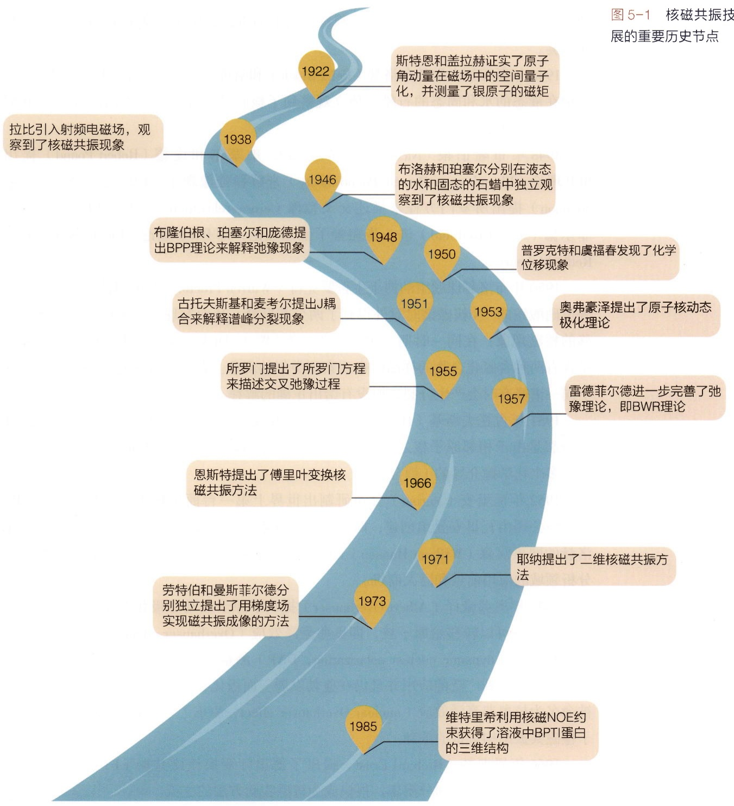

state_timeline

| 年份 | 事件 |
| --- | --- |
| 1922 | 斯特恩和盖拉赫证实了原子角动量在磁场中的空间量子化，并测量了银原子的磁矩 |
| 1938 | 拉比引入射频电磁场，观察到了核磁共振现象 |
| 1946 | 布洛赫和珀塞尔分别在液态的水和固态的石蜡中独立观察到了核磁共振现象 |
| 1948 | 布隆伯根、珀塞尔和庞德提出BPP理论来解释弛豫现象 |
| 1950 | 普罗克特和虞福春发现了化学位移现象 |
| 1951 | 古托夫斯基和麦考尔提出J耦合来解释谱峰分裂现象 |
| 1953 | 奥弗豪泽提出了原子核动态极化理论 |
| 1955 | 所罗门提出了所罗门方程来描述交叉弛豫过程 |
| 1957 | 雷德菲尔德进一步完善了弛豫理论，即BWR理论 |
| 1966 | 恩斯特提出了傅里叶变换核磁共振方法 |
| 1971 | 耶纳提出了二维核磁共振方法 |
| 1973 | 劳特伯和曼斯菲尔德分别独立提出了用梯度场实现磁共振成像的方法 |
| 1985 | 维特里希利用核磁NOE约束获得了溶液中BPTI蛋白的三维结构 |

图5-1 核磁共振技术发展的重要历史节点

1924年泡利（Wolfgang Pauli）提出了描述微观粒子量子属性的新自由度，即后来所命名的自旋量子数。两年后他又引入泡利矩阵（Pauli matrix）作为自旋算符。1945年泡利因其提出的泡利不相容原理独享了诺贝尔物理学奖。

1929年拉比（Isidor Rabi）在跟随斯特恩做了两年博士后之后在哥伦比亚大学建立了分子束实验室。随后拉比改进了斯特恩的分子束实验，通过引入射频电磁场观察到核磁共振现象。因其在核磁共振测量方法上的贡献，拉比独享了1944年诺贝尔物理学奖。

1946年斯坦福大学的布洛赫（Felix Bloch）和哈佛大学的珀塞尔（Edward Purcell）分别在液态的水和固态的石蜡中独立观察到了核磁共振现象，两人因此分享了1952年诺贝尔物理学奖。

1948年布隆伯根（Nicolaas Bloembergen）、珀塞尔和庞德（Robert Pound）提出BPP理论（Bloembergen-Purcell-Pound theory）来解释弛豫现象；1955年所罗门（Ionel Solomon）提出所罗门方程来描述交叉弛豫（cross-relaxation）过程；1957年，雷德菲尔德（Alfred Redfield）进一步完善了弛豫理论，即BWR理论（Bloch-Wangsness-Redfield theory）。

1950年布洛赫课题组的博士生普罗克特（Warren Proctor）和中国博士后虞福春在测量硝酸铵的 ${}^{14}\mathrm{N}$ 核磁谱时意外得到了两个共振峰，从而发现了后来被命名为化学位移的核磁现象；在同一时期，MIT的迪金森（W.C.Dickinson）在用核磁共振方法测量含有两种含氟化合物的样品时也观察到类似的现象。普罗克特和虞福春还首次发现了同一谱峰有时会产生分裂，但没有给出正确的解释。

1951年古托夫斯基（Herbert Gutowsky）和麦考尔（David McCall）提出核磁谱峰的分裂是由于相邻原子核之间的J耦合；同年拉姆齐（Norman Ramsey）和珀塞尔提出了多个化学键介导的J耦合。

1952年瓦里安（Varian）公司研制出世界上第一台商用核磁共振仪Varian HR-30。该公司由瓦里安兄弟创建，两兄弟中的罗素·瓦里安（Russell Varian）曾经是布洛赫的同事汉森（William Hansen）的实验助手，因而敏锐地意识到核磁共振在化学分析领域的应用前景和巨大商机。

1953年奥弗豪泽（Albert Overhauser）提出了原子核动态极化的理论，认为电子的极化状态可以转移给原子核，即奥弗豪泽效应（Overhauser effect）。基于该效应的动态核极化（dynamic nuclear polarization，DNP）测量可以极大提高核磁共振的灵敏度，近年来得到广泛的应用并且仍在蓬勃发展。而极化状态在原子核之间的转移后来被命名为核奥弗豪泽效应（nuclear Overhauser effect，NOE），在30年后成为生物大分子核磁共振结构解析的基础。

1966年恩斯特（Richard Ernst）提出了傅里叶变换核磁共振（FT-NMR）方法。该方法由于高灵敏度和分辨率，很快成为核磁实验方法的主流。

1958年到1959年，安德鲁（Edward Andrew）和洛（Irving Lowe）分别提出了魔角旋转（magic angle spinning）；1972年，派因斯（Alexander Pines）和沃（John Waugh）提出了交叉极化（cross polarization）。这两个技术对于固体核磁技术的发展至关重要。

1961 年亚伯拉罕（Anatole Abragam）出版了 The Principles of Nuclear Magnetism 一书，系统总结并重新阐述了核磁共振理论，成为核磁发展史上里程碑式的著作。

1971年耶纳（Jean Jeener）首次提出了二维核磁共振实验的构想，但当时的硬件水平无法实现这一实验；1976年在苏黎世联邦理工大学任职的恩斯特与耶纳合作，实现了耶纳提出的COSY二维核磁共振实验。恩斯特因其发明的傅里叶变换核磁共振方法以及在核磁理论方面的卓越贡献，独享了1991年诺贝尔化学奖。

1971年美国科学家达马迪安（Raymond Damadian）发现实验鼠体内的肿瘤组织和正常组织由于弛豫时间不同，核磁信号有明显不同。1973年，美国科学家劳特伯（Paul Lauterbur）和英国科学家曼斯菲尔德（Peter Mansfield）分别独立地发表文章，提出了用梯度场实现磁共振成像的原理。1974年劳特伯获得活鼠的核磁共振图像，1976年曼斯菲尔德获得世界上第一幅人体断层像。两人于2003年分享了诺贝尔生理学或医学奖。

1985年苏黎世联邦理工大学的维特里希（Kurt Wüthrich）利用核磁NOE现象得到氢原子间的距离约束，解析出溶液中BPTI蛋白完整的三维结构。该方法最初仅适用于分子量较小的蛋白质和多肽；而 $40\sim 50\mathrm{kDa}$ 以上的生物大分子由于谱峰展宽和严重重叠，难以进行谱峰指认和后续的结构解析。为了缓解这个问题，维特里希和合作者发明了TROSY核磁实验，将适用于核磁研究的分子大小推进到 $100\mathrm{kDa}$ 以上。凭借着用核磁方法解析蛋白质三维结构的开创性贡献，维特里希与质谱科学家共享了2002年诺贝尔化学奖。

从上世纪80年代末到90年代初，${}^{15}\mathrm{N}$ 和 ${}^{13}\mathrm{C}$ 的同位素标记日渐普及。核磁科学家们利用异核同位素标记，开发了三维和四维的核磁共振实验，极大减轻了核磁谱峰的重叠问题，使得生物大分子的核磁结构解析和动力学研究得到高速的发展。

回顾核磁共振的百年发展史，可以看到技术的发展不是几位诺贝尔奖得主就能够实现的，而是一代代才华横溢的科学家和工程师们合力建造了核磁共振方法的大厦。部分研究者之间的师承关系也令人印象深刻，例如斯特恩的博士后拉比改进了老师的分子束方法，开创性地引入了横向射频脉冲，至今仍是核磁技术的基石。另外，布洛赫实验室的普罗克特和虞福春意外发现了化学位移现象后，在布洛赫的帮助下正确解释了化学位移的来源，这使得他们的工作比迪金森在同时期观察到 $^{19}\mathrm{F}$ 化学位移现象的工作影响更为深远。代找电子书资源，新书可代做扫描制作加微信 asxiao90

## 5.2 核磁共振的原理

## 5.2.1 核磁共振的基本概念

在外磁场作用下，自旋非零的原子核产生的磁矩在空间取向上不是任意的，而是需要满足量子化的条件，即采取两个或更多特定的倾角，对应于不同的能级。这时如果在垂直于外加磁场的方向上施加射频电磁波，那么当电磁波的频率与两个能级的能量差匹配时，原子核会吸收电磁波并从低能量状态跃迁到高能量状态；当停止施加电磁波后，原子核会释放出能量并回到原来的状态。这就是核磁共振现象。正如其字面含义所示，核磁共振现象有三个要素:外加磁场、原子核、共振。这里我们简要讨论磁场，而另两个要素则在下面几个小节中阐释。

要产生可测量的核磁现象需要施加很强的外加静磁场，并且磁场的空间均匀度和时间稳定性都必须达到很高的要求。商用核磁共振仪所用的静磁场大小在 $7\sim 28\mathrm{T}$ 的范围。要理解这个场强有多大，我们可以将它与其它常见的磁场作对比:地磁场的大小在 $50\sim 60~\mu \mathrm{T}$，冰箱贴表面的磁场大小约在 $5\mathrm{mT}$，工业上常用的磁铁通常在1T以下。换个方式来说，一把铁质扳手在靠近核磁共振仪时可以产生数百公斤的吸力！要产生如此强的均匀磁场，核磁共振仪所采用的方法是在超导状态下对金属线圈施加很大的电流，而超导现象则通过将线圈置入液氦的极低温度中来实现。

## 5.2.2 原子核的自旋

原子核具有不同的物理属性，例如大小、质量、电荷和自旋。与核磁共振现象直接相关的属性是原子核的自旋。按照经典力学的观点，自旋指的是原子核绕自身高速旋转，由此产生了自旋角动量。由于原子核带正电，旋转后产生电荷环流，可以等

效为一个电流线圈（图5-2）。电流线圈在磁场中具有磁矩，倾向于沿着外磁场方向取向，于是在不同取向之间就产生了能量差异。但这种经典力学的视角无法解释一些重要的实验现象，例如氢原子核的自旋角动量（或者磁矩）只有两种朝向:要么顺着磁场方向，要么逆着磁场方向。而在量子力学的框架下，这些实验现象都能得到合理的解释。具体来说，自旋是原子核的内禀属性，以自旋量子数 $I$ 来表征。$I$ 可以取非负的整数或半整数，具体取值由原子核的质子数 $p$ 和中子数 $n$ 决定。当 $p$ 和 $n$ 均为偶数时，$I = 0$，例如 ${}^{12}\mathrm{C}$ 和 ${}^{16}\mathrm{O}$；当 $p$ 和 $n$ 均为奇数时，$I$ 为正整数，例如 ${}^{14}\mathrm{N}$；当 $p$ 和 $n$ 是一奇一偶时，$I$ 为半整数，例如 ${}^{1}\mathrm{H}$、${}^{13}\mathrm{C}$ 和 ${}^{15}\mathrm{N}$。$I = 0$ 的原子核不会产生核磁共振现象。常用于核磁共振测量的原子核如表5-1所示。

原子核自旋角动量 $I$ 的方向由右手定则确定（图5-2），其大

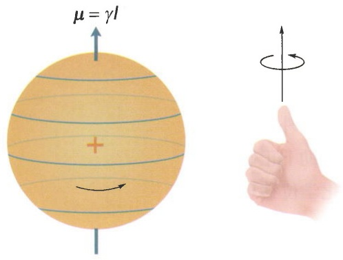

text_image

μ = γI

图5-2 原子核自旋的经典物理图像带正电的原子核绕自身旋转产生了电荷环流，从而产生了磁矩。电荷环流的方向和自旋角动量以及磁矩的方向遵循右手定则。

表 5-1 能够产生核磁共振信号的常用原子核

| 原子核 | I | $\gamma / (s^{-1} \cdot T^{-1})$ | 天然丰度/% |
| --- | --- | --- | --- |
| $^{1}H$ | 1/2 | $2.6752 \times 10^{8}$ | 99.99 |
| $^{2}H$ | 1 | $4.107 \times 10^{7}$ | 0.012 |
| $^{13}C$ | 1/2 | $6.728 \times 10^{7}$ | 1.07 |
| $^{14}N$ | 1 | $1.934 \times 10^{7}$ | 99.63 |
| $^{15}N$ | 1/2 | $-2.713 \times 10^{7}$ | 0.37 |
| $^{17}O$ | 5/2 | $-3.628 \times 10^{7}$ | 0.038 |
| $^{19}F$ | 1/2 | $2.518 \times 10^{8}$ | ~100 |
| $^{23}Na$ | 3/2 | $7.081 \times 10^{7}$ | ~100 |
| $^{31}P$ | 1/2 | $1.0839 \times 10^{8}$ | ~100 |
| $^{113}Cd$ | 1/2 | $-5.961 \times 10^{7}$ | 12.22 |

小是量子化的，由自旋量子数 I 决定:

$$
\mid I \mid = \hbar \sqrt {I (I + 1)} 。 \tag {5-1}
$$

其中 $\hbar$ 为约化普朗克常数（reduced Planck constant）。当原子核置于静磁场中时，自旋角动量的空间取向也是量子化的。定义静磁场的方向为 $z$ 轴，则自旋角动量的 $z$ 分量为

$$
I _ {z} = \hbar m _ {\circ} \tag {5-2}
$$

其中 m 为自旋磁量子数（下文中简称为磁量子数），取值从 -I 到 I 且间隔为 1，即  $m = -I, -I + 1, \cdots, I - 1, I$ 。

核磁实验中最常见的是自旋量子数为 $1 / 2$ 的原子核（$^{1}\mathrm{H}$、$^{13}\mathrm{C}$、$^{15}\mathrm{N}$ 等），其角动量大小为 $\hbar \sqrt{\frac{1}{2} \left(\frac{1}{2} + 1\right)} = \frac{\sqrt{3}}{2} \hbar$，而其 $z$ 分量可以取两个值:$-\frac{1}{2} \hbar$（当 $m = -\frac{1}{2}$ 时）和

$\frac{1}{2} \hbar$ （当 $m = \frac{1}{2}$ 时），所以角动量与 $z$ 轴之间必然有一个倾斜角 $\theta$ （图5-3）。该角度满足关系式 $\cos \theta = 1 / \sqrt{3}$，因此 $\theta \approx 54.7^\circ$。这意味着角动量只能有两种取向，要么分布在上锥面，要么分布在下锥面，且两个锥面的锥角均为 $54.7^\circ$ 左右。对应于 $m = \frac{1}{2}$ 的取向称作自旋向上，定义为 $\alpha$ 态；对应于 $m = -\frac{1}{2}$ 的取向称作自旋向下，定义为 $\beta$ 态。

自旋角动量会产生磁矩，磁矩  $\mu$  与自旋角动量成正比: $\mu = \gamma I$ 。比例系数  $\gamma$  由原子核的种类决定，称为旋磁比（gyromagnetic ratio）。常用原子核的旋磁比见表 5-1。磁矩  $\mu$  在静磁场  $B_{0}$  中的能量为

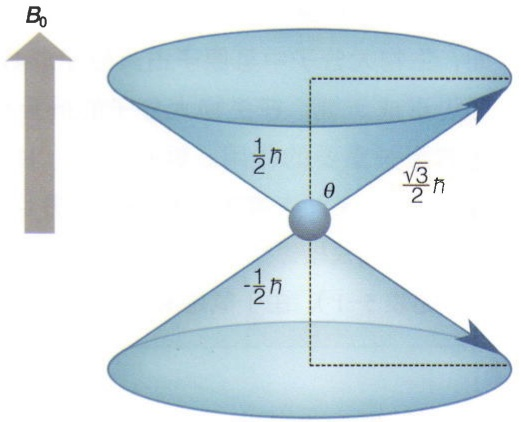

text_image

B₀
½ħ
θ
√3/2ħ
-½ħ

图5-3 自旋为 $1 / 2$ 的原子核在磁场中只有两种取向

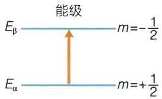

text_image

能级
Eβ
m=-1/2
Eα
m=+1/2

图 5-4 自旋为 1/2 的原子核所对应的能级图

$$
E = - \boldsymbol {\mu} \cdot \boldsymbol {B} _ {0} = - \mu_ {z} B _ {0} = - \gamma I _ {z} B _ {0} = - \gamma \hbar m B _ {0} 。 \tag {5-3}
$$

仍以 $1 / 2$ 自旋核为例，假定 $\gamma$ 值为正，那么 $\alpha$ 态比 $\beta$ 态能量低，这时两个能级间的能量差为 $\Delta E = \hbar \gamma B_0$ ，如图5-4所示。

我们定义 $\omega_0 = \gamma B_0$ ，称为拉莫尔频率（Larmor frequency）$^*$。这样能量差就可以写为 $\Delta E = \hbar \omega_0$ 。显然，$\omega_0$ 代表能级跃迁时系统吸收或者发射的电磁波频率。习惯上人们以氢原子核的拉莫尔频率来标定核磁仪。例如 $600\mathrm{MHz}$ 核磁仪意味着氢原子核（${}^{1}\mathrm{H}$）在该仪器中的拉莫尔频率为 $600\mathrm{MHz}$，对应的磁感应强度是 $14.1\mathrm{T}$。${}^{13}\mathrm{C}$ 和 ${}^{15}\mathrm{N}$ 的 $\gamma$ 值分别是 ${}^{1}\mathrm{H}$ 的大约 $1/4$ 和 $1/10$（见表5-1和知识窗5-1），因此它们在 $600\mathrm{MHz}$ 核磁仪中的拉莫尔频率约为 $150\mathrm{MHz}$ 和 $60\mathrm{MHz}$。

核磁共振是一种灵敏度很低的检测技术，其原因可通过玻尔兹曼分布定律（Boltzmann distribution law）来解释。在平衡状态下处于 $\alpha$ 态的原子核数目 $N_{\alpha}$ 比处于 $\beta$ 态的数目 $N_{\beta}$ 多，比值为

$$
\frac {N _ {\alpha}}{N _ {\beta}} = \exp \left(\frac {\Delta E}{k _ {\mathrm{B}} T}\right) = \exp \left(\frac {\hbar \omega_ {0}}{k _ {\mathrm{B}} T}\right) \approx 1 + \frac {\hbar \omega_ {0}}{k _ {\mathrm{B}} T} \tag {5-4}
$$

如果在 $300\mathrm{K}$ 温度下用 $600\mathrm{MHz}$ 核磁仪测量氢原子核，那么 $N_{\alpha} / N_{\beta} \approx 1 + 0.000096$ 。也就是说，此时 $\alpha$ 态的核比 $\beta$ 态仅仅多了不到万分之一，而核磁信号正是由这近万分之一的原子核数量差所产生的。这种低灵敏度导致了核磁测量对样品量的需求比较大。

## 知识窗5-1

## 氢原子核与核磁共振

氢在元素周期表中位列第一，是宇宙中最常见的化学元素，其身影遍布化学小分子和生物大分子。例如，生物大分子中氢原子占其原子总数的一半左右，通过形成氢键，在生物大分子的折叠和功能发挥中起着至关重要的作用。氢原子核（${}^{1}\mathrm{H}$）也称为质子（proton），天然丰度高达 $99.99\%$，并且具有最高的旋磁比，因而是核磁共振研究中最灵敏最易于测量的原子核（见表5-1）。由于氢是最小的原子，只有一个电子，无论使用 X 射线晶体衍射还是冷冻电镜都难以检测，但是核磁共振恰恰是对氢原子检测最为灵敏的技术，与另两种技术形成了优势互补。由于其在分子中分布的广泛性、检测的便捷性，以及对结构和构象变化的高度敏感性，氢原子核成为了核磁共振研究中最常用和最重要的原子核。如果没有氢原子核，很难想象核磁共振的世界将会是何种景象。从这个意义上，可以说氢原子是上苍送给核磁共振的礼物。

<small>\* 严格来说，拉莫尔频率通常定义为 $-\gamma B_0$ ，以便其正负可直接对应进动方向的正负。详情见知识窗5-2。</small>

## 5.2.3 核磁共振的矢量模型

核磁共振的矢量模型是用来描述和理解核磁共振现象的一个经典物理模型。这个模型通过分析原子核自旋的总磁矩在磁场中的行为，帮助我们理解核磁共振的基本原理。下面仍以1/2自旋核为例。在核磁样品中存在极大数量的原子核，它们要么自旋向上，要么自旋向下，其磁矩只能分布于锥角固定的两个圆锥面上。在平衡状态下，上锥面（$\alpha$ 态）的原子核比下锥面（$\beta$ 态）的略多一点，因此总磁矩在 $z$ 方向的分量是向上的；而在每个锥面上，磁矩位于锥面何处是完全随机的，因此总磁矩在 $xy$ 平面上的分量为零。由此便产生了一个沿正 $z$ 轴方向的总磁矩（图5-5）。我们将单位体积里的总磁矩定义为宏观磁化矢量，用 $M$ 表示，这种描述方法称为核磁共振的矢量模型。在核磁实验中，我们所操纵和观测的正是这个宏观磁化矢量。

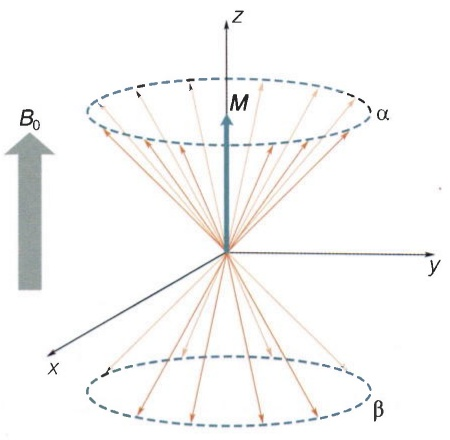

text_image

B₀
M
α
z
y
x
β

## 5.2.4 核磁信号的产生

下面我们以最简单的一维氢谱实验为例解释核磁信号是如何获得的。早期的核磁共振仪采用扫频（改变入射电磁波的频率）或扫场（改变静磁场的强度）的方式来测量共振频率，而现代核磁仪使用脉冲傅里叶变换的方式进行测量。如图5-6所示，在样品被静磁场激发出宏观磁化矢量并达到平衡后，从横向施加一个射频脉冲信号。当脉冲信号的频率匹配待测原子核的拉莫尔频率时，宏观磁化矢量转向 $xy$ 平面，系统偏离平衡态。当脉冲信号撤除后，宏观磁化矢量从 $xy$ 平面逐渐回到 $z$ 轴，在此过程中产生随时间振荡的可检测信号，直到系统恢复至平衡态，此时振荡信号衰减至零。最后，对检测到的时域信号做傅里叶变换，就能获得频域上的核磁共振谱。整个过程可以类比为向一个平静的湖面投入小石子（施加射频脉冲信号），湖面产生小涟漪（振荡衰减的信号），最后对小涟漪做傅里叶频谱分析即得到水波的振动频率。

那么为什么横向的射频脉冲可以让磁化矢量转向 $xy$ 平面？要回答这个问题，我们需要研究宏观磁化矢量在静磁场中的运动规律。根据布洛赫方程（知识窗5-2），当磁化矢量偏离 $\pmb{B}_0$ 的方向时，将绕着 $\pmb{B}_0$ 以拉莫尔频率旋转。这种转动类似于陀螺

图 5-6 一维核磁共振氢谱实验的原理

（A）对装在核磁管里的样品施加静磁场 $B_{0}$ ，激发出宏观磁化矢量M；然后应用射频脉冲信号（标记有 $\pi/2$ 的蓝色矩形），记录随时间振荡衰减的信号；最后对时域信号应用傅里叶变换，获得频域上的核磁共振谱。（B）傅里叶变换核磁共振方法可以类比于在湖面上激起涟漪，检测涟漪的振动频率。

(A)

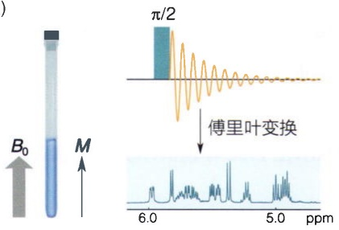

text_image

B₀
M
π/2
傅里叶变换
6.0
5.0
ppm

(B)

natural_image

Close-up of a droplet creating a ripple effect on a water surface (no text or symbols visible)

的进动（precession），即陀螺的自转轴偏离重力方向时，除了保持高速自转外，其自转轴同时还绕着重力方向转动。因此，宏观磁化矢量的这种转动我们也称之为进动（知识窗5-3）。

## 知识窗 5-2

## 布洛赫方程

当外磁场与磁矩不共线时，磁场对磁矩将产生一个力矩，使得磁矩发生转动。类比于描述物体平动的牛顿运动方程（动量对时间的导数等于作用力），物体转动的动力学方程可以表述为角动量对时间的导数等于力矩:

$$
\frac {\mathrm{d} \boldsymbol {I}}{\mathrm{d} t} = \boldsymbol {\mu} \times \boldsymbol {B} _ {\circ}
$$

方程两边同乘以  $\gamma$ ，并把“微观”的  $\mu$  替换为“宏观”的 M，我们得到

$$
\frac {\mathrm{d} \boldsymbol {M}}{\mathrm{d} t} = \gamma \boldsymbol {M} \times \boldsymbol {B} _ {\circ} \tag {5-5}
$$

式（5-5）即著名的布洛赫方程（Bloch equation）。对该方程进行求解得到

$$
\left\{ \begin{array}{l} M _ {z} (t) = M _ {z} (0) \\ M _ {x y} (t) = M _ {x y} (0) \mathrm{e} ^ {- \mathrm{i} \omega_ {0} t} \end{array} \right. \tag {5-6}
$$

从式（5-6）可知，宏观磁化矢量 M 在静磁场中将绕着磁场以角速度  $-\omega_{0}$  进行转动，这里  $\omega_{0}$  为拉莫尔频率（如图5-7所示）。由于 $\omega_0$ 前的负号会带来不便，人们重新定义了拉莫尔频率，即 $\omega_0 = -\gamma B_0$ 。在该定义下，$M$ 的角速度即拉莫尔频率 $\omega_0$ 。注意 $\gamma$ 和 $\omega_0$ 都是可正可负的，$\omega_0$ 为正代表逆时针转动（在图中从上往下观察），为负代表顺时针转动。

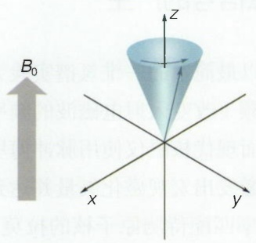

text_image

B₀
x
y
z

图 5-7 宏观磁化矢量的进动

当宏观磁化矢量偏离 z 轴后将绕着静磁场做进动，类似于陀螺偏离竖直方向后产生的进动。

## 知识窗 5-3

## 珀塞尔的诺贝尔奖获奖演说

布洛赫教授已经向大家展示了如何在一滴水中检测原子核的进动。这种实验在我们的实验室里已经司空见惯了，然而我还没有失去对这种现象的好奇和喜悦。这种精妙的运动竟然存在于我们周围所有的普通事物中，但是只有寻找它的人才能发现它。我记得，在我们第一次实验的冬天，就在七年前，我用新的眼光看雪。这些雪就躺在我的家门口——我看到了一大堆的氢原子核在地球磁场中静静地做进动。在某一瞬间把世界看成是丰富而奇特的东西，这是许多科学发现给予科学家的私人馈赠。

——珀塞尔在 1952 年诺贝尔奖获奖演说的开场白

假设偏转的宏观磁化矢量不存在进动，那么只要在横向额外施加一个静磁场 $B_{1}$，即可造成磁化矢量依照右手定则从 $z$ 轴出发绕着 $B_{1}$ 向 $xy$ 平面转动（图5-8A）。但实际上宏观磁化矢量一旦偏离 $z$ 轴，就会绕 $z$ 轴以拉莫尔频率做高速进动。此时 $B_{1}$ 必须在 $xy$ 平面上追随磁化矢量同样以拉莫尔频率旋转（此即共振条件），才能够使磁化矢量正常转向 $xy$ 平面。最终的效果是，宏观磁化矢量将经历螺旋线的轨迹倒向 $xy$ 平面（图5-8B）。为了在技术上达到这一效果，只需要把 $B_{1}$ 从一个静磁场改为一个交变磁场（或者说电磁波）即可，因为一个在 $xy$ 平面上绕 $z$ 轴旋转的磁场在 $x$ 轴或者 $y$ 轴上的投影正是交变磁场，两者等效（知识窗5-4）。

可以看到，我们在这里从经典力学的角度解释了核磁体系的“共振”，和前面从能级跃迁的角度所做的量子解释交互辉映，启人深思。

最后，介绍核磁共振中的一个重要现象:饱和（saturation）。具体是指在自旋体系处于平衡状态时，横向射频场以同样的机率诱导上行的跃迁和下行的跃迁，由于 $\alpha$ 态的核数目多于 $\beta$ 态，因此上行的跃迁数目也多于下行的跃迁数目，最终两个能级上的自旋核数目趋同。

(A)

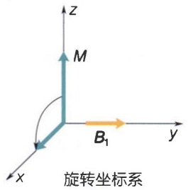

text_image

z
M
B₁
y
x
旋转坐标系

(B)

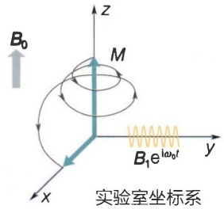

text_image

B₀
M
B₁e^{lω₀f}
实验室坐标系
x
y
z

图 5-8 在旋转坐标系中的恒定横向磁场（A）与在实验室坐标系中的交变横向磁场（B）对磁化矢量的影响

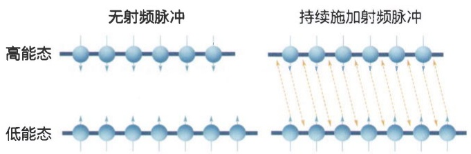

flowchart

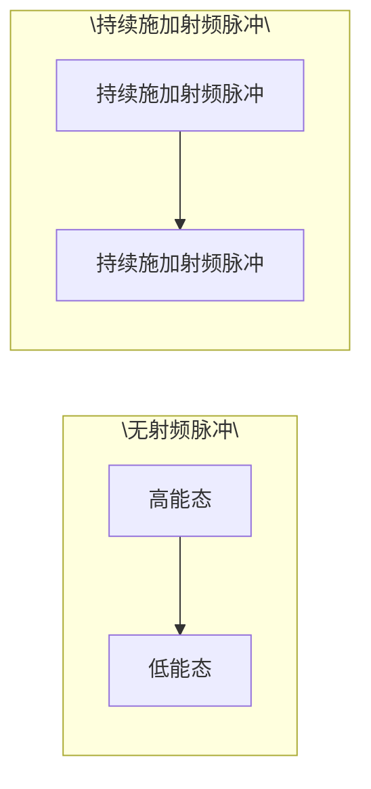

图5-9 核磁共振的饱和现象

如果长时间地施加 $B_{1}$，那么这个 $B_{1}$ 会以同样的概率诱导 $\alpha$ 态到 $\beta$ 态的跃迁以及 $\beta$ 态到 $\alpha$ 态的跃迁。随着时间的推移，处于两个能级上的自旋核数量逐渐接近，最终导致 $M_{z} = 0$（图5-9）。此时自旋体系达到了饱和，不再产生核磁信号。

## 知识窗5-4

## 射频脉冲导致宏观磁化矢量转动的进一步解释

当宏观磁化矢量处于平衡态时，为了让它向 $xy$ 平面旋转，简单的想法是施加一个横向的恒定磁场 $\pmb{B}_{1}$，但这种方式显然行不通。如图5-10所示，$\pmb{M}$ 一旦偏离 $z$ 轴，就会绕 $z$ 轴以拉莫尔频率高速进动。假设 $\pmb{B}_{1}$ 沿 $y$ 轴放置，根据右手定则，相当于有一个人站在 $x$ 轴上用绳子拉动 $\pmb{M}$。当 $\pmb{M}$ 转到了正 $x$ 轴一侧时，$\pmb{M}$ 确实可以被拉离 $z$ 轴；可是当 $\pmb{M}$ 转到了负 $x$ 轴一侧时，$\pmb{M}$ 又被绳子拉回 $z$ 轴了（图5-10A）。要解决这个问题，我们可以让人站在一个圆台上，而圆台也绕着 $z$ 轴以拉莫尔频率旋转。此时，圆台成为一个旋转坐标系（rotating frame），在圆台上的人眼里，M不再有进动，因此可以被顺利地拉离z轴（图5-10B）。

在核磁实验里，要实现转动圆台的效果，我们只需把施加的恒定磁场 $B_{1}$ 替换为交变磁场，即让 $B_{1}$ 以角频率 $\omega_0$ 在 $y$ 轴上做简谐振动。简谐振动可以分解成一个逆时针转动和一个顺时针转动的叠加，其中顺时针转动实现了圆台的效果，而逆时针方向由于其转动与 $M$ 的转动加倍地不同步，所以对 $M$ 运动的影响可以忽略不计。

如果在旋转坐标系里观察，M 从 z 轴出发，按右手定则绕着 y 轴转向 x 轴（图 5-8A）；如果在实验室坐标系里观察，M 则是一边以拉莫尔频率进动，一边绕着 y 轴转向 x 轴，呈现出螺旋形的轨迹（图 5-8B）。

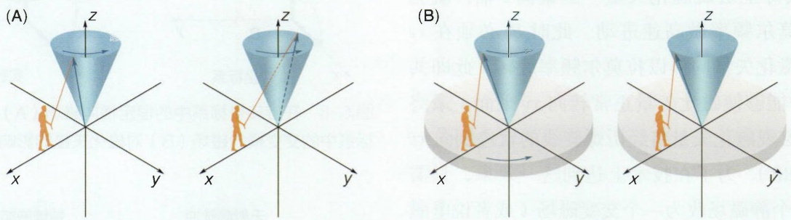

图5-10 射频脉冲对宏观磁化矢量的作用

（A）横向的恒定磁场无法将磁化矢量拉离 $z$ 轴。（B）横向的交变磁场在频率匹配拉莫尔频率时可以将磁化矢量拉离 $z$ 轴。B图左侧是实验室坐标系，右侧是以圆台为参照的旋转坐标系，人站在以拉莫尔频率转动的圆台上。

## 5.3 核磁共振实验

## 5.3.1 一维核磁谱的原理

有了核磁共振的理论知识，我们接下来就可以具体解释一维和二维核磁共振实验。我们先了解一下核磁共振仪的硬件组成。现代的核磁共振仪主要由超导磁体（magnet）、探头（probe）、机柜（console）和控制电脑四部分组成（图5-11）。磁体呈圆柱形，中央有一个贯通的竖直空腔。探头从下方插入空腔，而核磁样品从上方孔道进入，在气流控制下递送到探头的检测线圈中央。圆柱形容器被分隔为两部分，内腔

图5-11 核磁共振仪的组成

（A）从左至右:超低温平台、磁体和探头、机柜、控制电脑。（B）磁体和探头的剖面示意图。探头位于下方，磁体内灌注有液氦（深蓝色）和液氮（浅蓝色）。

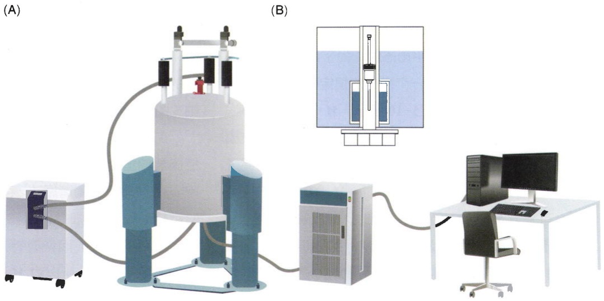

natural_image

Laboratory setup with equipment including a cylindrical apparatus, control unit, and computer monitor (no visible text or labels)

灌注液氦，超导线圈浸泡在其中并包围着竖直空腔。超导效应使得线圈能承载很大的恒定电流，从而产生极强的竖直向上的静磁场。容器的外腔灌注液氮，可以大幅降低内腔中液氦的挥发 $^{*}$ 。机柜里有射频信号发生器、射频信号接收器和模数转换器等重要部件。

在核磁实验中，特定的脉冲序列（pulse sequence）从控制电脑发送到射频信号发生器，生成精确的射频脉冲信号，经功率放大后施加在探头里的激发线圈上，产生横向的电磁波脉冲。如上文所述，横向电磁波如果频率与待测原子核的拉莫尔频率匹配，可以让宏观磁化矢量向着 $xy$ 平面运动。如果控制射频脉冲的长度，使得磁化矢量到达 $xy$ 平面时脉冲结束，那么磁化矢量就停留在 $xy$ 平面上进行进动。我们将这种脉冲叫作 $90^{\circ}$ 脉冲，因为在它的作用下磁化矢量的有效转动角度为 $90^{\circ}$ 。此时原来的激发线圈被接入到检测电路中，成为检测线圈。进动的磁化矢量在 $xy$ 平面上的分量将在检测线圈中激发出感生电动势，也就是核磁信号。核磁信号经由探头附近的前置放大器放大后，送入机柜中的射频信号接收器进一步放大，然后被模数转换器转换为数字信号，再送到控制电脑中进行后续处理。

在核磁信号的检测过程中，磁化矢量不会一直在 $xy$ 平面上进动，而是逐渐返回平衡态。自旋体系在受扰动偏离平衡态后重新回到平衡态的过程称为弛豫（relaxation）。从实验室坐标系观察，在弛豫过程中磁化矢量一边进动一边（A）磁化矢量被转到 $xy$ 平面后将逐渐沿着螺旋线轨迹返回平衡态。（B）磁化矢量在返回 $z$ 轴平衡态的过程中，其纵向分量 $M_z$ 和横向分量 $M_{xy}$ 对时间的变化曲线分别是指数恢复曲线（上）和指数衰减曲线（下）。它们的特征时间 $T_{1}$ 和 $T_{2}$ 定义为达到距离目标值的 $1 / \mathrm{e}$ 所需要的时间，$\mathrm{e}$ 为自然常数。

(A)

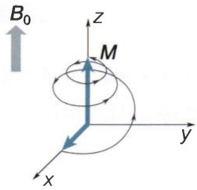

text_image

B₀
z
M
y
x

(B)

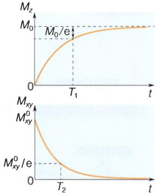

line

| Time (t) | Mz (M) | Mxy (M) |
| --- | --- | --- |
| 0 | 0 | M^0_xy |
| T_1 | M_0/e | — |
| T_2 | — | M^0_xy/e |

图 5-12 核磁共振的弛豫过程

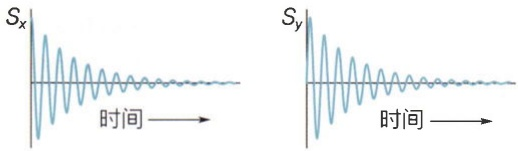

图 5-13 核磁信号的正交检测

$M_{xy}$ 在 $x$ 轴上的分量（左）和 $y$ 轴上的分量（右）都是振荡衰减的时域信号。两者合并才是完整的核磁信号。

回到沿 $z$ 轴的平衡态（图5-12A）。如果把 $M$ 分解到纵向分量 $M_z$ 和横向分量 $M_{xy}$，那么 $M_z$ 从零开始随着时间以指数曲线恢复到平衡态 $M_0$，而 $M_{xy}$ 从 $M_{xy}^0$ 出发随着时间以指数曲线衰减到零。前者称为纵向弛豫（longitudinal relaxation），后者称为横向弛豫（transverse relaxation）。由指数恢复曲线和指数衰减曲线可以分别定义特征时间 $T_1$ 和 $T_2$ （图5-12B），以及弛豫速率 $R_1 (=1/T_1)$ 和 $R_2 (=1/T_2)$。

在 $M$ 的两个分量中，能产生核磁信号的是 $xy$ 平面上的分量 $M_{xy}$ 。$M_{xy}$ 绕着 $z$ 轴以拉莫尔频率旋转，并逐渐衰减。$M_{xy}$ 可以进一步分解到 $x$ 轴和 $y$ 轴上，同时进行检测（知识窗5-5），得到振荡衰减的核磁信号 $S_x$ 和 $S_y$ （图5-13）。

接下来需要通过傅里叶变换将时域信号转换成最终的频域信号。在做变换前，先把 $x$ 分量信号 $S_{x} = S_{0}\cos \omega_{0}t\cdot \mathrm{e}^{-R_{2}t}$ 和 $y$ 分量信号 $S_{y} = S_{0}\sin \omega_{0}t\cdot \mathrm{e}^{-R_{2}t}$ 合成为一个复数信号（注意:这里的 $R_{2}$ 是上文中定义的磁化矢量在 $xy$ 平面上衰减的速率），

$$
S (t) = S _ {x} (t) + \mathrm{i} S _ {y} (t) = S _ {0} \mathrm{e} ^ {\mathrm{i} \omega_ {0} t} \cdot \mathrm{e} ^ {- R _ {2} t} = S _ {0} \mathrm{e} ^ {(\mathrm{i} \omega_ {0} - R _ {2}) t}, \tag {5-7}
$$

<small>\* 液氦的价格远高于液氮的价格。</small>

## 知识窗5-5

## 为什么需要同时检测 $x$ 分量和 $y$ 分量

假设只检测 $x$ 分量，则无法区分顺时针和逆时针转动，也即无法区别频率的正负，如图5-14所示。此外，两个分量可以组装成复数，使得核磁信号具有相位信息。

逆时针转动

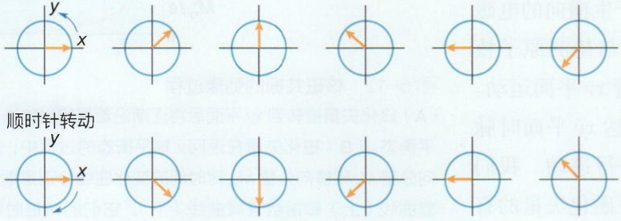

text_image

y
x
顺时针转动
y
x

图5-14 核磁信号正交检测的必要性

如果  $M_{xy}$  从 x 轴的位置开始进动，那么它在逆时针旋转时（上）和顺时针旋转时（下），在 x 轴上的投影信号是完全一样的。

得到的复数形式的振荡衰减信号称为自由感应衰减（free induction decay，FID）。对式（5-7）进行傅里叶变换，就得到频域上的信号:

$$
\begin{array}{l} F (\omega) = \int_ {0} ^ {\infty} S _ {0} \mathrm{e} ^ {(\mathrm{i} \omega_ {0} - R _ {2}) t} \cdot \mathrm{e} ^ {- \mathrm{i} \omega t} \mathrm{d} t = S _ {0} \int_ {0} ^ {\infty} \mathrm{e} ^ {[ \mathrm{i} (\omega_ {0} - \omega) - R _ {2} ] t} \mathrm{d} t \\ = S _ {0} \frac {R _ {2}}{R _ {2} ^ {2} + (\omega - \omega_ {0}) ^ {2}} - \mathrm{i} S _ {0} \frac {\omega - \omega_ {0}}{R _ {2} ^ {2} + (\omega - \omega_ {0}) ^ {2}} 。 \tag {5-8} \\ \end{array}
$$

式（5-8）的实部是洛伦兹函数的形式，称为吸收峰型（absorptive），函数曲线如图5-15所示。通常核磁谱仅展示实部分部分。

在核磁共振的谱图分析中，共振峰的峰高（peak height）和半峰宽（half-width）是两个重要参数。峰高与噪声幅度的比值是信噪比，反映核磁谱的灵敏度（sensitivity）；

半峰宽也简称峰宽（linewidth），决定了谱峰的尖锐程度，反映的是核磁谱的分辨率（resolution）。从式（5-8）可以推导出半峰宽等于 $2R_{2}$ （知识窗5-6）。换句话说，FID衰减得越快，共振峰的半峰宽越大（图5-16）。容易证明，如果FID的初始幅值不变，那么共振峰的面积也不变。所以，半峰宽越大，峰高就越小。

这是一个很重要的结论，解释了液态核磁共振技术在测量大分子量的生物分子时为什么会面临很大的挑战。分子量越大，生物大分子在溶液里的翻转越慢，导致弛豫速率 $R_{2}$ 越大（参见25.1.3节），即峰宽越大。图5-17展示了蛋白质分子量从8 kDa增加到100 kDa的过程中，酰胺区域一维氢谱的模拟结果。可以看到，50 kDa的蛋白质氢谱已经展宽得非常严重，到100 kDa就难以分辨了。

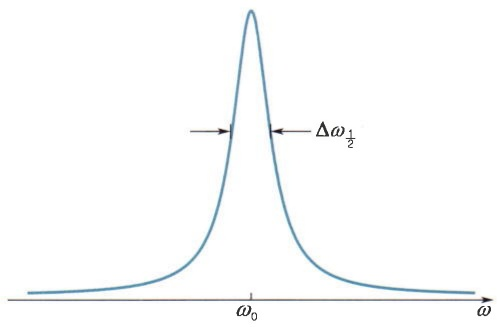

contour

| Feature | Description |
| --- | --- |
| Peak Position | \(\omega_{0}\) |
| Peak Height | \(\Delta\omega_{1}/_{2}\) |

图 5-15 核磁共振的吸收峰

频率为  $\omega_{0}$  的 FID 信号经过傅里叶变换得到的吸收峰，图上标识出的宽度是半峰宽。

## 知识窗 5-6

## 如何推导半峰宽的大小

对式（5-8）的实部做如下变形:

$$
S _ {0} \frac {R _ {2}}{R _ {2} ^ {2} + (\omega - \omega_ {0}) ^ {2}} = S _ {0} \frac {R _ {2} / R _ {2} ^ {2}}{\left[ R _ {2} ^ {2} + (\omega - \omega_ {0}) ^ {2} \right] / R _ {2} ^ {2}} = S _ {0} \frac {1 / R _ {2}}{1 + \left(\frac {\omega - \omega_ {0}}{R _ {2}}\right) ^ {2}}
$$

由此可见，当 $\omega = \omega_0 \pm R_2$ 时，信号下降到峰值的一半，也就是说，半峰宽 $\Delta \omega_{1/2} = 2R_2$。

## 5.3.2 化学位移

在图5-17所示的酰胺区域的氢谱中，共振峰远远不止一个。为什么同样是氢原子核的共振峰，甚至连氢所在的基团都相同，但共振频率却如此不同呢？原因在于这些核所处的环境有所差别。原子核周围分布着电子云，在外磁场的作用下，核外电子围绕磁场产生运动，催生出次生磁场。该次生磁场部分屏蔽了外加磁场。在一个分子里不同位置上的氢核所处的化学环境是不一样的，因此每个氢核周围电子云的分布也呈现出差异性，导致对外部静磁场的屏蔽程度不同。这样每个氢核感受到的实际磁感应强度都有所不同，共振频率也就有些微的差别。这个现象称为化学位移(chemical shift)。

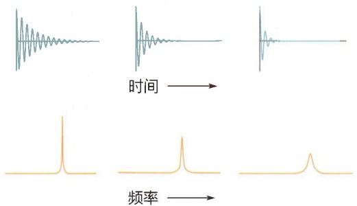

text_image

时间
频率

图 5-16 横向弛豫速率与半峰宽的关系不同的弛豫速率 $R_{2}$ 下得到的核磁谱峰。从左至右，$R_{2}$ 逐渐增大（上），核磁谱峰的峰高逐渐降低，峰宽逐渐增加（下）。

理论上我们可以用共振频率来定量描述化学位移现象，但在

实践中很不方便，体现在:①共振频率与静磁场的磁感应强度成正比，因此同一样品在不同场强的核磁仪测量到的共振频率是不一样的，给比较结果带来了不便；②同种原子核的共振频率区别很小，往往在有效数字好多位后才会有差异。为了解决这些问题，人们把化学位移 $\delta$ 作了如下定义:

$$
\delta = \frac {\omega - \omega_ {\mathrm{ref}}}{\omega_ {0}} \times 1 0 ^ {6} 。 \tag {5-9}
$$

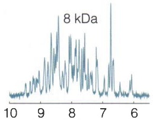

spectrogram

| X | Y |
| --- | --- |
| ~9.5 | ~0.8 |
| ~8.2 | ~0.7 |
| ~7.3 | ~1.0 |

化学位移/ppm

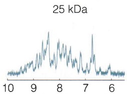

line

| X | Y |
| --- | --- |
| 10 | ~0.1 |
| 9 | ~0.3 |
| 8 | ~0.4 |
| 7 | ~0.2 |
| 6 | ~0.1 |

化学位移/ppm

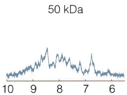

line

| X | Y |
| --- | --- |
| 10 | ~0.2 |
| 9 | ~0.5 |
| 8 | ~0.8 |
| 7 | ~0.4 |
| 6 | ~0.2 |

化学位移/ppm

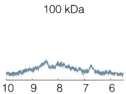

line

| X | Y |
| --- | --- |
| 10 | ~0.2 |
| 9 | ~0.4 |
| 8 | ~0.5 |
| 7 | ~0.3 |
| 6 | ~0.2 |

化学位移/ppm

图5-17 不同分子量的蛋白质样品在酰胺区域的模拟一维氢谱

其中 $\omega_{\mathrm{ref}}$ 是样品中参考小分子共振峰的频率。采用这样的定义后，我们测量的是待测峰和参考峰的频率差值，使得微小的差异可以凸显出来。以拉莫尔频率 $\omega_0$ 做分母则保证了不同核磁仪的测量结果可以直接比较。由于这样得到的比值非常小，所以又放大了 $10^{6}$ 倍，因此化学位移的单位是ppm（part per million）。

在有机小分子样品中，通常使用四甲基硅烷（tetramethylsilane，TMS）作为参考小分子。在生物样品中，则通常使用水溶性比较好的DSS（2,2-dimethyl-2-silapentane-5-sulfonic acid）。

化学位移对生物大分子的构象变化非常敏感。构象改变会导致待测原子核周围电子云分布的不同，进而影响屏蔽作用。因此，化学位移里蕴含着丰富的结构信息。化学位移受多种因素的影响。当所测原子核的自身或相邻核经历了氢键形成或破坏、互变异构、电负性改变等能够引起电子云重分布的过程，化学位移将产生很大的变化。在空间上靠近的基团对化学位移也会造成显著影响:芳香环基团通过环流效应（ring-current effect）在待测核上产生附加磁场；带电基团通过电场极化效应（electric-field-induced polarization effect）改变待测核周围的电子云分布。两者都会导致化学位移发生明显改变。此外，一些物理因素如溶剂、温度、$\mathrm{pH}$ 等也会影响化学位移。

蛋白质、DNA 和 RNA 的一维氢谱如图 5-18 所示。

蛋白质分子的一维氢谱可以提供蛋白质的折叠信息。当蛋白质折叠得比较好，那么在酰胺基区域（6.5～10.5 ppm），谱峰分布得比较均匀（图5-18A）；如果蛋白质以无序区域为主，其酰胺基的谱峰会集中在8～8.5 ppm的一个比较窄的区域内（图5-18B）。产生该现象的原因是无序蛋白处于构象的快速切换中，化学位移被平均化从而趋向于往中间靠拢。DNA和RNA分子的一维氢谱可以提供核酸二级结构的信息，这主要反映在亚氨基区域（10～15 ppm），因为只有稳定配对的碱基才会在这个区域产生鸟嘌呤（guanine）和尿嘧啶（uracil）的共振峰（图5-18C、D；知识窗5-7）。

## 5.3.3 J耦合

在核磁共振谱中，有时本应以单峰形式出现的谱峰会发生分裂现象，其产生的原因是该原子核与经由一个或者多个化学键相连的另一个原子核之间可以通过化学键发生核自旋的相互作用，称为自旋-自旋耦合（spin-spin coupling）或者J耦合（J-coupling）。这种相互作用会影响所测核自旋的能级结构，从而引起谱峰的分裂（图5-19）。J耦合的大小由分裂谱峰的距离来衡量，单位为 $\mathrm{Hz}$ 。值得注意的是，J耦合的数值与外加磁场的大小无关，而化学位移在以 $\mathrm{Hz}$ 为单位时与外加磁场的大小成正比。

J耦合导致的谱峰分裂的数目和相对峰高取决于跟所测原子核耦合的原子核数目。例如在一维氢谱中，如果一个质子与邻近的两个质子发生相同大小的J耦合，它的谱

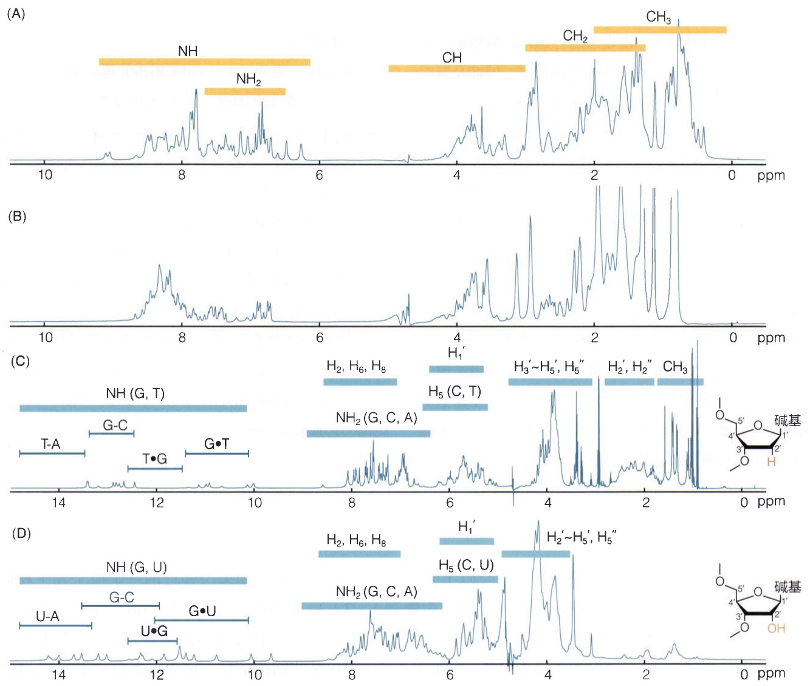

图5-18 蛋白质、DNA和RNA的一维氢谱

（A）折叠蛋白样品的核磁谱。（B）无序蛋白样品的核磁谱。（C）发夹DNA样品的核磁谱，谱图左侧谱峰代表碱基配对中G和T的亚氨基，

右端展示了脱氧核苷酸的结构。（D）发夹RNA样品的核磁谱，谱图左侧谱峰代表碱基配对中G和U的亚氨基，右端展示了核苷酸的结构。

## 知识窗5-7

## 沃森 - 克里克碱基配对的实验验证

在沃森与克里克于 1953 年揭示了革命性的 DNA 双螺旋结构之后，对这一模型的关键特征——碱基配对的实验验证也随之如火如荼地展开。1959 年胡斯坦（Karst Hoogsteen）解析了含有 9-甲基腺嘌呤和 1-甲基胸腺嘧啶的共晶结构，观察到腺嘌呤和胸腺嘧啶采取了与沃森-克里克碱基对迥异的配对模式，后来被命名为胡斯坦配对（Hoogsteen basepair）（参见3.2.3节）。60年代，晶体衍射学家们陆续解析了包含嘌呤和嘧啶的衍生物或寡核苷酸链的共晶结构，发现涉及鸟嘌呤和胞嘧啶的共晶结构形成了预期的沃森-克里克碱基对，但涉及腺嘌呤和胸腺嘧啶（或尿嘧啶）的共晶结构则无法形成这样的碱基对，并且在大多数情况下，倾向于形成胡斯坦碱基对。这些实验结果以及同时期Z型DNA的发现，为DNA双螺旋结构模型蒙上了一层阴影，一时间质疑声此起彼伏。其中一位怀疑者是鲍林，他认为诺贝尔奖颁给沃森等人为时过早，因为DNA三维结构的实验证据还存在争议。

到了70年代，正是液态核磁共振首先为沃森-克里克碱基对，特别是A-T（和A-U）的经典配对提供了宝贵的实验支持。对tRNA和双链寡核苷酸的核磁测量发现，在生理溶液条件下这些样品的一维谱在亚氨基区域呈现出特征峰，这些谱峰的化学位移与沃森-克里克碱基对的化学位移计算值相符，但是与胡斯坦碱基对的计算值有显著差异。

1973 年，里奇（Alexander Rich）等人解析了包含 A-U 和 G-C 配对的两条二核苷酸形成的晶体结构，该结构展现出期待已久的右手双螺旋和沃森-克里克碱基对。这是人们第一次直接观察到涉及腺嘌呤的沃森-克里克经典配对，而这一结构也被誉为“原子分辨率的双螺旋”。沃森在收到论文预印本后马上给里奇打电话，告诉他:“二十年来，我第一次睡了个好觉！”

1980 年，迪克森（Richard Dickerson）等人第一次解析了真正的 B 型 DNA 双螺旋的高分辨率晶体结构。该 DNA 链被设计为包含 12 个核苷酸的回文序列:C-G-C-G-A-A-T-T-C-G-C-G，这就是著名的迪克森十二聚体 DNA（Dickerson dodecamer）。至此，DNA 双螺旋结构的实验验证被画上了完美的句号。

代找电子书资源，新书可代做扫描制作加微信 asxiao90

峰将分裂为峰高 $1:2:1$ 的三重峰（图5-20A）；如果与邻近的三个质子发生相同大小的J耦合，谱峰将分裂为峰高 $1:3:3:1$ 的四重峰（图5-20B）。因此，J耦合提供了关于分子结构的信息，在有机小分子包括药物分子的鉴定和分析中尤其重要。

对于生物大分子，J耦合也可以提供某些结构信息。例如，蛋白质中 $\mathrm{H}^{\mathrm{N}}$ 与 $\mathrm{H}^{\alpha}$ 之间有三个化学键相连，其耦合常数 $^{3}J(\mathrm{H}^{\mathrm{N}},\mathrm{H}^{\alpha})$ 与蛋白质主链二面角的关系由卡普拉斯

(A)

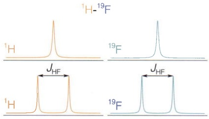

other

| Sample | Chemical Shift Difference (JHF) |
| --- | --- |
| Top Left | ~0.25 |
| Top Right | ~0.25 |
| Bottom Left | ~0.25 |
| Bottom Right | ~0.25 |

(B)

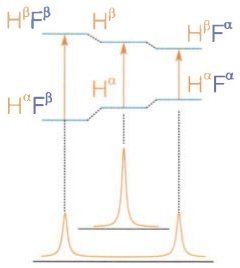

chemical

Feynman diagram showing electronic states H^αF^β and H^βF^α with spin-parity labels

图 5-19 J 耦合导致的谱峰分裂

（A）对于HF分子，${}^{1}\mathrm{H}$ 和 ${}^{19}\mathrm{F}$ 之间的J耦合导致它们各自出现相同赫兹数的谱峰分裂。（B）以 ${}^{1}\mathrm{H}$ 的谱峰为例，相邻的 ${}^{19}\mathrm{F}$ 如果自旋向上则导致 ${}^{1}\mathrm{H}$ 的 $\alpha$ 态和 $\beta$ 态能级差变小，如果自旋向下则导致能级差变大。

(A)

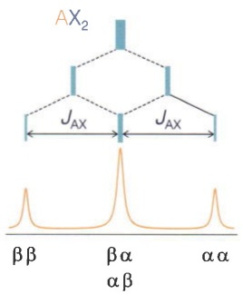

text_image

AX₂
JAX
JAX
ββ βα αβ
αα

(B)

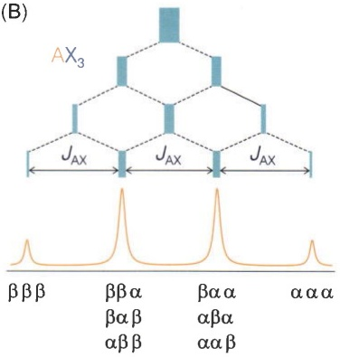

text_image

(B)
AX₃
JAX
JAX
JAX
βββ
ββα
βαα
ααα
βαβ
αββ
βαα
αβα
ααβ
ααα

图 5-20 J 耦合产生的裂峰数与邻近核数目的关系

（A）两个邻近核的自旋状态有4种排列，产生峰高为1:2:1的三个裂峰。（B）三个邻近核的自旋状态有8种排列，产生峰高为1:3:3:1的四个裂峰。