实并非如此。第一个问题是，样品倾转的角度并不能覆盖完整的角度空间（从 $-90^{\circ}$ 到 $+90^{\circ}$），从而导致部分方向上的投影信息缺失。造成这一问题的原因是，当倾转角度过大时，样品台的边缘会对电子束形成遮挡，从而阻碍成像。通常来讲，冷冻电镜常用的拍摄角度在 $\pm 60^{\circ}$ 之间。此外，由于样品台的不稳定性和精度误差，在实验中所测量到的角度信息并不十分准确，并且由于样品台的抖动和样品的漂移等因素，样品的位置也经常会在数据采集的过程中发生变化。这些偏差也都需要借助后期的图像处理和分析来进行矫正。第二个问题涉及辐照损伤。在冷冻电镜成像中，为了避免辐照损伤对生物样品的结构造成破坏，人们通常采用低剂量成像的方式来对样品进行成像（知识窗6-7）。而低剂量成像就好像在微弱星光的夜晚中对一个物体进行拍照，图像的信噪比是非常低的。过低的信噪比会导致后续的图像处理分析变得非常困难。对于单颗粒成像技术，在不破坏天然结构的基础上所有的辐照都被施加到一张图像上去，图像的信噪比是被最大化的。而对于冷冻电子断层成像来说，同样的剂量需要被分配到数十张照片上去，从而使得每张照片的信噪比都很低，显著增加了后续处理的难度。此外，在前两个问题的基础上，高频信号的衰减也是比较显著的。一方面，当有一定厚度的样品随着倾转角的增大，电子在样品中需要穿透的厚度也是不断增加的，进一步降低了高频信号的信噪比；另一方面，累积的辐照损伤，也导致后采集的照片的高频信号会有更多的衰减。这也是人们发展了多种不同的数据采集策略来优化能获得的信号质量的主要原因（图6-12）。

## 6.5.2 缺失楔与投影信息缺失问题

在实际应用中，受到样品本身条件或者数据采集策略的限制，生物样品三维重构经常面临无法获取某些角度上的投影的问题，进而导致三维信息不完整而产生一些三维图像解释上的困难。常见的有缺失锥和缺失楔问题（图6-13）。缺失锥是傅里叶空间中的中心截面无法覆盖到一个锥形区域，其产生是因为样品投影方向近似分布在一个角度空间中的环形区域上。缺失锥问题常见于单颗粒技术中，通常与蛋白质上某些特定区域吸附到气液界面上造成的优势取向有关。缺失楔是冷冻电子断层成像技术所

## 知识窗6-7

## 生物样品的辐照剂量和损伤

在高能电子的辐照之下，生物样品会从电子束中吸收能量，或受到入射电子束电磁场的影响，而发生结构性的破坏或变化。在常规冷冻电镜的成像条件下，辐照损伤的程度与所受到的电子辐照的总量有关，通常用单位面积上辐照的电子个数作为剂量的衡量单位。研究发现，在数百 keV 能量的电子辐照之下，生物样品所能承受的辐照总剂量，通常在 20～100 个/Ų 之间。

图6-13 三维重构（傅里叶空间）中的缺失楔和缺失锥

（A）缺失楔是楔形顶点过傅里叶空间原点的一对楔形信息缺失区域。图中的每条线表示一个傅里叶空间的截面，线上的圆点示意性地表示截面上的像素。（B）缺失锥是在傅里叶空间中围绕某个轴的关于傅里叶空间原点对称的一对近似锥形的信息缺失区域（图中因为遮挡，只显示出了一个缺失锥）。

(A)

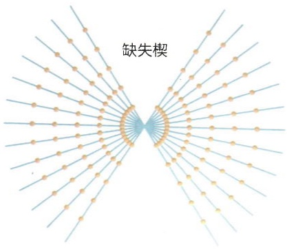

text_image

缺失楔

(B)

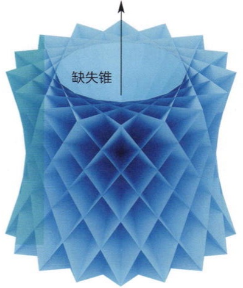

text_image

缺失锥

面临的主要问题，其产生的原因是样品台无法倾转到高角度。

缺失楔和缺失锥问题都是对应在某个方向上的结构信息缺失，从而在最终的三维重构中导致相应方向上出现模糊或结构密度的拉长变形。为了能够清晰显示出信息缺失的影响，这里以一张菊花的二维图像为例（图6-14），按照中心截面定理通过其投影［二维图像沿某个方向的投影是一条强度有变化的线，此二维投影过程也被称为拉东变换（Radon transform）］来重构菊花。在重构时，我们通过减少特定方向的投影来引入缺失楔。当投影信息只能覆盖 $\pm 60^{\circ}$ 的区间时，尽管菊花的轮廓还是清楚的，但是其中的一些具体细节已经无法被看清，主要体现在上下方向（沿信息缺失方向）上的一些细节弥散，导致水平或接近水平方向上的花瓣都看不清楚了。另一方面，使用较大的投影角度步长，也会引入一些条纹状的图像缺陷。

图6-14 缺失楔和采样不足造成的图像缺陷

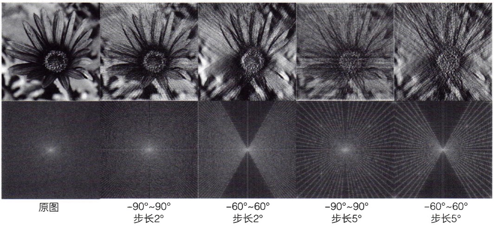

text_image

原图
-90°~90°
步长2°
-60°~60°
步长2°
-90°~90°
步长5°
-60°~60°
步长5°

## 6.6 微晶电子衍射技术

微晶电子衍射技术是利用冷冻电镜的衍射模式来获取晶体样品的衍射信息，并进行结构解析的技术。由于电子衍射与X射线衍射形成的光学过程是几乎相同的，所以使用电子衍射技术解析结构的基本原理与X射线晶体学技术也基本一致。单纯从散射角度看，电子衍射与X射线衍射之间存在的差别主要是它们与样品（或者说原子）的相互作用不同。如果用原子散射振幅来衡量这种差别，电子的原子散射振幅 $f_{\mathrm{e}}$ 和X射线的原子散射振幅 $f_{\mathrm{X}}$ 符合下述关系:

$$
f _ {\mathrm{e}} = 2. 3 8 \times 1 0 ^ {- 1 0} \left(\frac {\lambda}{\sin \theta}\right) ^ {2} (Z - f _ {\mathrm{X}}) 。
$$

其中，$\lambda$ 为入射电子波长，$\theta$ 为散射角，$Z$ 为原子序数。在电镜的应用范围内，$\sin \theta / \lambda$ 的范围在 $0.2 \sim 1 \AA^{-1}$ 区间内，$f_{\mathrm{e}}$ 是 $f_{\mathrm{X}}$ 的 $10^{3} \sim 10^{4}$ 倍，进一步考虑到强度与这个振幅是平方关系，电子衍射强度通常比 X 射线的衍射强度高 $10^{6} \sim 10^{8}$ 倍。X 射线光子与样品中原子的相互作用是一种弱相互作用。这使得在使用 X 射线来研究晶体结构时，需要晶体样品足够大（通常需要数微米的尺寸）才能激发出足够的可以被探测到的衍射信息以解析结构。而电子本身是带电粒子，与样品中的原子核和核外电子具有强烈的相互作用，属于强相互作用范畴。因此，即使非常微小的，小至数十纳米的蛋白质晶体，在电子束的辐照下都能激发出可被探测到的显著的衍射信号，满足结构解析的要求。因此，人们把那些难以长大的晶体，尝试用冷冻电镜的电子衍射模式来获取衍射强度信息并进行结构解析，产生了微晶电子衍射技术。由于上述技术特点，微晶电子衍射技术是 X 射线晶体学技术的一个重要补充，为包括蛋白质和小分子药物在内的有机晶体结构解析提供了一个电子光学解决方案。

## 6.7 冷冻电镜技术的发展史及发展趋势

冷冻电镜技术的发展贯穿了整个透射电子显微学技术的发展过程。德国物理学家恩斯特·鲁斯卡（Ernst Ruska，1906—1988）在1931年前后制造出世界上第一台透射电子显微镜（图6-15A）之后，人们很快就用它来观察生物样品。但是当把一个棉花纤维样品放到透射电镜中（图6-15B），在高能电子的辐照之下样品很快就因为辐照损伤和在真空中脱水被破坏掉了。这是人们使用透射电镜观察生物样品的最初尝试。因此，要想使用透射电镜来观察生物样品，就需要把生物样品冷冻起来以及使用低剂量的辐照来进行成像。

在随后的几十年中，透射电子显微镜的分辨率被快速提高，并在1950年前后基本上实现了原子分辨率（无机材料成像）。但是因为生物样品的特殊性，直接在透射电镜中观察生物样品仍然具有非常大的困难。这时人们想到的解决方案是通过对生物样品染色，将重金属盐渗透到生物样品中，并脱水替代掉样品中的生物物质，从而将

图6-15 第一台电子显微镜和早期对棉花纤维的电镜成像

（A）世界上第一台透射电子显微镜的设计图和实物图。（B）使用第一台透射电子显微镜拍摄的载网上的棉花纤维照片。（A，引自鲁斯卡的诺贝尔奖获奖演说；B，引自Marton L. Nature, 1934, 133(3372): 911）

(A)

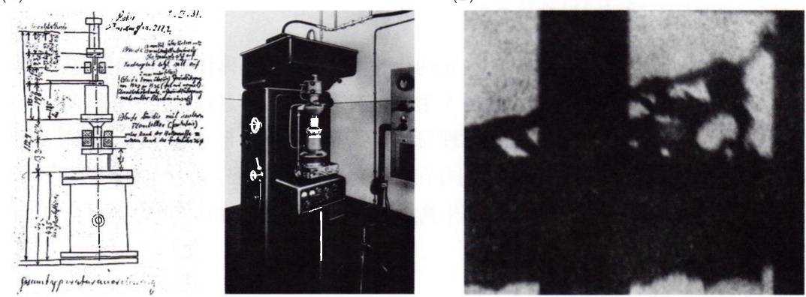

(B)

生物样品转化为可在真空和常温条件下承受高剂量电子辐照的样品。这个时期人们使用染色的方式观察到了各种人类组织以及病毒的微观精细结构（图 6-16），尽管其分辨率并不能达到原子分辨率，通常在几纳米尺度，但是已经显著高于光学显微镜所能达到的分辨率。

然而，要想获得高至原子分辨率级别的生物样品结构解析，就不能采用染色的间接方法，需要对生物样品进行直接的成像和观察。从上世纪70年代开始，相关的努力获得了显著的进展。美国科学家肯尼思·泰勒（Kenneth Taylor）和罗伯特·格

(A)

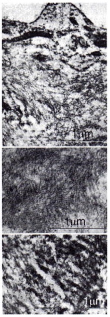

natural_image

Microscopic cross-section images showing layered material structures with 1μm scale bars (no text or symbols beyond scale indicators)

(B)

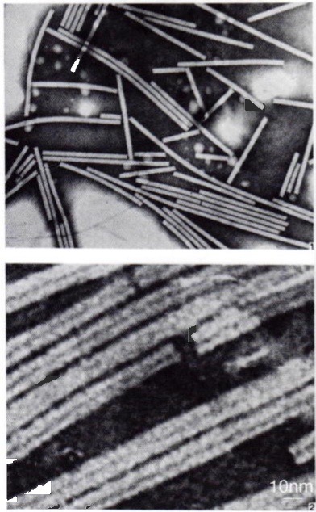

natural_image

Microscopic images showing nanoscale structures with parallel lines and a 10nm scale bar (no text or symbols beyond scale indicator)

图6-16 早期对染色生物样品的电镜成像

（A）神经组织中的淀粉样沉淀蛋白（amyloid）纤维的染色透射电镜照片。（B）烟草花叶病毒（TMV）的染色透射电镜照片。（A，引自Cohen A S, et al. Nature, 1959, 183(4669): 1202-1203；B，引自Brenner S, et al. Biochim Biophys Acta, 1959, 34: 103-110）

莱泽（Robert Glaeser）在1974年成功地实现了对含水蛋白质晶体的电子衍射，观察到了高至3 Å分辨率的衍射强度信息（图6-17A）。这说明生物样品是可以在电子光学条件下实现接近原子分辨率的结构信息获取的。1975年，理查德·亨德森（Richard Henderson）和奈杰·昂温（Nigel Unwin）使用类似的技术获得了非染色紫膜蛋白晶体的三维重构，观察到了膜蛋白中的跨膜α螺旋结构（图6-17B）。然而到此时为止，这些成功的尝试仍然仅限于二维蛋白质晶体。对于溶液中的蛋白质大分子颗粒的研究仍然需要进一步的冷冻样品制备技术支持。

早在20世纪30年代，人们就已经知道，水在一定的快速冷冻条件下可以形成一种非晶态冰，而不仅仅是我们常见的晶态冰。这种非晶态冰也被称为玻璃态冰，其中的水分子是无规则分布的，类似于液态水中的分子分布状态。并且，在玻璃态冰的形成过程中，冰不会像晶态冰形成时一样发生膨胀和内溶物的析出，从而避免破坏周围的生物结构。因此，如何制备出满足冷冻电镜成像所要的非晶态冰样品成为实现冷冻电镜技术的关键一环。1980年，雅克·杜波谢特（Jacques Dubochet）和阿拉斯戴尔·麦克道尔（Alasdair McDowall）发现使用具有高比热的液态乙烷可以实现对极微量水的快速冷冻，形成玻璃态的冰。对于冷冻电镜样品制备来讲，除了要获得玻璃态的冰之外，还需要样品非常薄。这是因为电子和物质的强相互作用，使得电子在样品中的穿透能力很差，过厚的样品将导致电子束无法穿透样品或者被样品强烈吸收和多次散射，从而破坏使用透射电镜成像的基本条件。1982年，杜波谢特提出了一种可以快速生成样品水膜并使用液态乙烷将其冷冻到玻璃态的方法（图6-18），奠定了冷冻电镜样品制备技术的基础。目前这一技术仍然是人们制备单颗粒样本的基本技术。后来高压冷冻技术和冷冻切片技术的发展，又进一步推动了对组织和细胞类样品的冷冻制备。

(A)

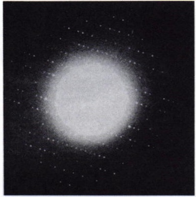

natural_image

Astronomical image showing a bright central celestial object surrounded by diffuse stars against a dark background (no text or symbols)

(B)

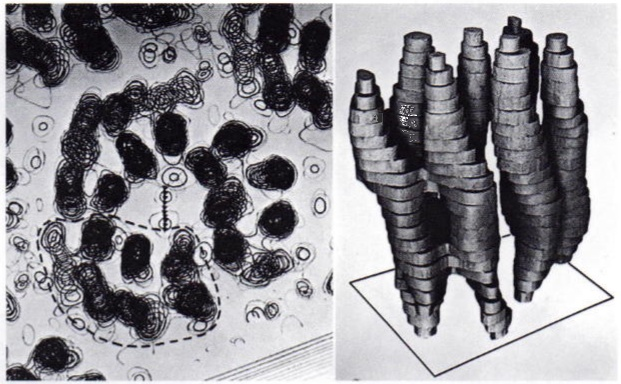

natural_image

Microscopic view of cellular structures with a 3D model of cylindrical cells (no text or labels visible)

图6-17 早期的冷冻晶体衍射和蛋白质结构重构（A）含水蛋白质晶体的电子衍射。（B）紫膜蛋白质晶体的三维重构截面密度图和三维展示图。（A，引自Taylor K A, et al. Science, 1974, 186(4168): 1036-1037; B, 引自Henderson R, et al. Nature, 1975, 257(5521): 28-32）

除了高分辨率透射电镜和样品制备技术之外，冷冻电镜技术的实现还需要图像处理方法的支持。首要的是如何从电镜拍摄的二维照片重构出三维的结构。1968年，克拉格提出中心截面定理，奠定了将透射电镜生成的二维图像重构出三维结构的数学原

理。然而要想实现生物大分子的三维重构，还需要大量的计算分析处理以及三维重构计算。为了解决这些计算中遇到的问题，在随后的几十年里人们不断地发展各种针对冷冻电镜三维结构分析的计算算法和计算工具。阿希姆·弗兰克（Joachim Frank）团队研发的SPIDER软件是最早期软件之一。冷冻电镜技术对图像处理分析算法和软件有强烈依赖，这也是不同于其它透射电镜技术的显著特色。

20世纪80年代前的这些技术积累，奠定了冷冻电镜技术的基础。在随后的几十年中，冷冻电镜技术迅速发展并逐渐走入普通的生物学实验室。然而，在很长一段时间内冷冻电镜的分辨率并不像人们期待的那么高，通常只能达到纳米或亚纳米水平的分辨率。在这个分辨率下，只能看到蛋白质复合物的外部轮廓

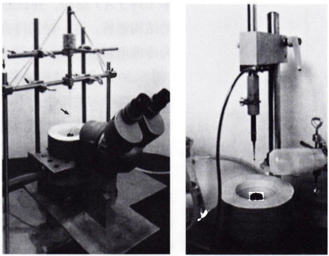

图6-18 早期的冷冻电镜样品制备装置实物图

(引自 Dubochet J, et al. Q Rev Biophys, 1988, 21(2): 129–228)

图6-19 不同分辨率下的生物大分子结构

以 $\beta-$ 半乳糖苷酶为例作图，该蛋白质具有D2对称性。图中灰色的密度图由彩色的蛋白质原子模型计算得到，并分别低通滤波到下方标注的分辨率。

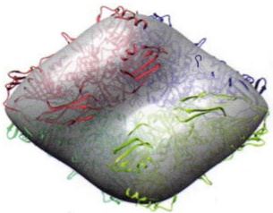

natural_image

3D rendered abstract shape with red, green, and blue curved lines on a gray background (no text or symbols)

60 Å

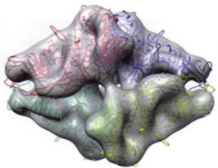

natural_image

3D molecular surface model with color-coded regions (no text or labels visible)

20 Å

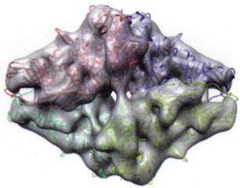

natural_image

3D rendered molecular surface model with color-coded regions (no text or labels)

15 Å

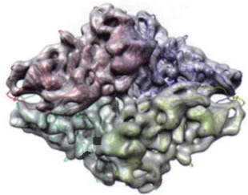

natural_image

3D molecular surface model with color-coded regions (no text or labels visible)

10 Å

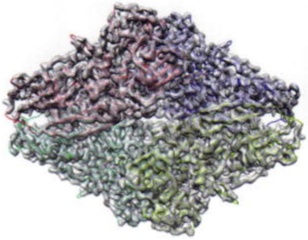

natural_image

3D molecular surface model showing layered structure with color-coded regions (no text or labels)

5 Å

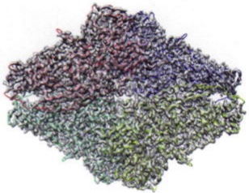

natural_image

Colorful 3D molecular cluster visualization with no visible text or labels

3 Å

或者部分的二级结构信息（图6-19）。虽然透射电镜很久以前就已经可以实现对原子分辨率水平的结构信号的成像，但是在冷冻电镜生物样品成像的条件下，如大视野、低剂量和大离焦成像条件，常规的电镜相机无法有效记录到高分辨率的结构信号，从而限制了冷冻电镜三维重构的分辨率。而要获得更高的分辨率，冷冻电镜技术面临的主要瓶颈是相机问题。

在上述背景之下，直接电子探测相机的概念被提出并获得了快速发展。2013年前后，高帧率直接电子探测、电子计数和图像漂移校正等多项电镜相机技术获得巨大突破，使得记录生物样本的高分辨率结构信号成为可能。同一时期，最大似然估计和贝叶斯统计推断方法广泛应用于单颗粒三维重构，也使三维重构计算的精度和柔性结构三维分类的能力获得大幅提高。在这些技术突破的共同支持下，冷冻电镜技术首次解析了包括20S蛋白酶和TrpV1在内的多个中等分子量蛋白质复合物的近原子分辨率（约 $3\AA$ ）结构，并在随后几年中迅速带动了一大批积攒多年的重要蛋白质复合物的结构解析。这一时期冷冻电镜单颗粒技术向近原子或原子分辨率的技术突破，被称为冷冻电镜技术的“分辨率革命”。2013年也成为冷冻电镜单颗粒技术发展的分水岭（图6-20）。随后越来越多的新技术方法被引入冷冻电镜领域，例如电压相位板技术、基于深度学习的蛋白质柔性结构分析和自动结构建模技术等，使得冷冻电镜单颗粒技术成为结构生物学中至关重要的结构解析技术，并对基于结构的药物设计产生了明显的推动作用。

随着冷冻电镜单颗粒技术的日臻成熟，人们对冷冻电镜技术的期望从解析提纯出来的蛋白质结构，逐渐转向解析处于细胞原位的生物大分子结构，后者相应的技术即冷冻电子断层成像技术。在结构生物学中，用于解析生物大分子高分辨率结构的技术手段主要有三种，包括冷冻电镜单颗粒技术、X射线蛋白质晶体学技术以及核磁共振技术。这三项技术都涉及蛋白质的提纯，甚至结晶的处理。这些处理都导致蛋白质在结构解析时已脱离细胞的原生生理环境，从而存在无法反映生理状态下的真实结构的问题，也无法体现细胞内周围物质相互作用条件下的结构状态。而要解决这些问题，冷冻电子断层成像技术是最佳的解决方案。2016年人们通过冷冻电子断层成像技术在近原子分辨率水平上解析了未成熟的HIV病毒中的衣壳蛋白结构，证明了冷冻电子断层成像技术也是一种可以实现高分辨率蛋白质结构解析的工具。并且随着基于聚焦离子束切割技术的发展，细胞样品切片的制备技术也获得了快速发展，显著促进了冷冻电子断层成像技术在细胞或组织结构解析方面的应用。到目前为止，冷冻电子断层成像技术仍然处在快速发展期，在实际应用中还面临巨大的技术挑战。但是冷冻电子断层成像技术本身所体现出来的巨大潜力，使其成为未来冷冻电镜技术发展的主要方向。

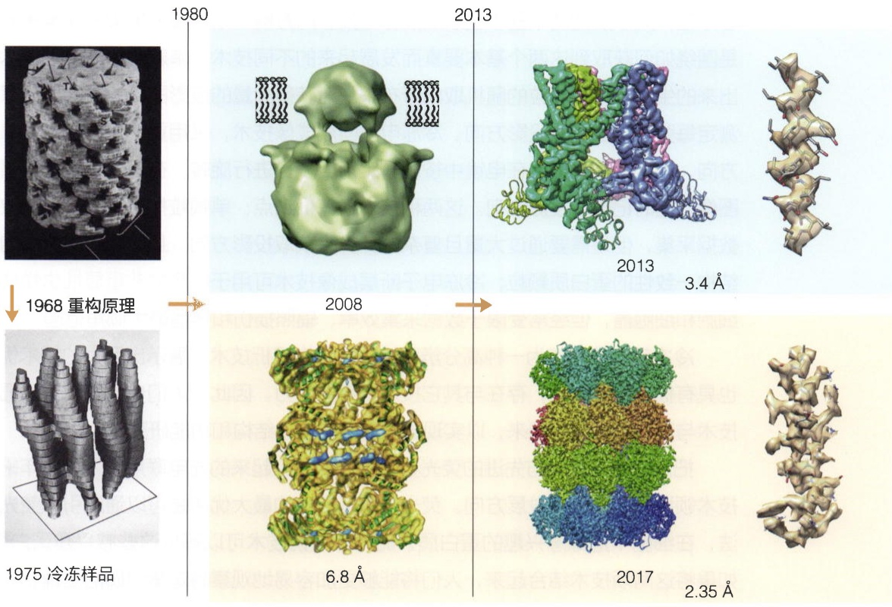

text_image

1968 重构原理
1975 冷冻样品
1980
2008
2013
2013
3.4 Å
6.8 Å
2017
2.35 Å

图6-20 冷冻电镜结构解析分辨率的逐步提高和里程碑时间点

图中展示了不同时间阶段解析出来的代表性蛋白质结构，包括1968年的第一个噬菌体尾部结构，1975年的紫膜蛋白的穿膜区结构，以及TrpV1和嗜热古菌20S蛋白酶分别在不同时期（2008年及以后）解

析的结构。（上左，引自 De Rosier D J, et al. Nature, 1968, 217(5124): 130-134；上中，引自 Moiseenkova-Bell V Y, et al. PNAS USA, 2008, 105(21): 7451-7455；下左，引自 Henderson R, et al. Nature, 1975, 257(5521): 28-32；下中，引自 Rabl J, et al. Mol Cell, 2008, 30(3): 360-368.）

## ※ 本章小结

本章概括介绍了生物大分子结构解析的冷冻电子显微学方法。更多的方法细节见第26章。在本章中我们介绍了冷冻电镜技术所依赖的基本原理，包括电镜的光路、衬度形成的基本原理，以及三维重构的基本原理和基本方法。中心截面定理是冷冻电镜技术的核心原理，其涉及的两个基本要素是投影与投影的方向。单颗粒分析和冷冻电子断层成像就是围绕如何获取到这两个基本要素而发展起来的不同技术。单颗粒冷冻电镜技术利用提纯出来的生物大分子颗粒的随机取向分布来快速获得大量的投影图像，并结合计算的方法来测定每张投影图像的投影方向。冷冻电子断层成像技术，采用更加主动的方式来控制投影方向，把要观察的样品在电镜中按照一定角度步长进行旋转，在每个角度下拍照获得投影图像，同时记录下投影方向。这两种技术各有优缺点:单颗粒技术可以实现高效率的投影数据采集，但是需要通过大量且复杂的计算来获取投影方向，且只能用于提纯的具有高度结构一致性的蛋白质颗粒；冷冻电子断层成像技术可用于任意的非重复性生物样本，例如细胞和细胞器，但经常受限于数据采集效率、辐照损伤和样品最大倾角范围。

冷冻电镜技术作为一种高分辨率的生物结构解析技术，展示出巨大的技术优势，本身也具有极大的灵活性，存在与其它技术融合的潜力。因此，人们也始终在尝试把冷冻电镜技术与其它技术结合起来，以实现更加全面的生物结构和功能研究。

把冷冻电镜技术与先进的荧光显微镜技术结合起来的光电联用技术是近年来冷冻电镜技术领域的一个热点发展方向。荧光显微镜技术的最大优点是可以通过引入荧光标记的方法，在细胞中追踪感兴趣的蛋白质。而冷冻电镜技术可以解析这些感兴趣蛋白质的结构。如果将这两项技术结合起来，人们将能够更加容易地观察特定蛋白质的生理状态结构以及与周围蛋白质的相互作用关系。

另外一项可能的技术融合是冷冻电子断层成像技术与质谱技术的融合，冷冻电子断层成像技术解析出来的细胞结构都是电子密度。图像中只有密度的强弱之分，而没有成分的信息。在没有足够的结构信息条件下很难从中分析出样品的组成成分。如果能够结合质谱技术，对冷冻电镜样品中的微观区域进行分析以确定其中生物大分子的组成成分，将大大促进我们对细胞内微观生理过程和结构的理解。

## ※ 思考题

1. 透射电子显微镜和普通光学显微镜有什么异同点？使用电子束作为光源会带来哪些优势和问题？
2. 要解析蛋白质或细胞的三维结构，为什么需要用透射电镜而不是扫描电镜？
3. 为什么目前的单颗粒技术相对于冷冻电子断层成像技术更容易获得高分辨率？
4. 如何理解衍射分析技术和成像技术的共同点？

## ※ 扩展阅读

## 图书

赫什，豪伊，尼科尔森，等.薄晶体电子显微学[M].刘安生，李永洪，译.北京:科学出版社，1983.

Frank J. Three-dimensional electron microscopy of macromolecular assemblies[M].

2nd ed. New York: Oxford University Press, 2006.

## 综述

Kühlbrandt W. The resolution revolution[J]. Science, 2014, 343(6178):1443-1444.

Orlova E V, Saibil H R. Structural analysis of macromolecular assemblies by electron microscopy[J]. Chem Rev, 2011, 111(11):7710-7748.

## 研究论文

- De Rosier D J, Klug A. Reconstruction of three dimensional structures from electron micrographs[J]. Nature, 1968, 217(5124):130–134.
- Dubochet J, Adrian M, Chang J J, et al. Cryo-electron microscopy of vitrified specimens[J]. Q Rev Biophys, 1988, 21(2):129–228.
- Henderson R, Unwin P N T. Three-dimensional model of purple membrane obtained by electron microscopy[J]. Nature, 1975, 257(5521):28-32.
- Li X M, Mooney P, Zheng S, et al. Electron counting and beam-induced motion correction enable near-atomic-resolution single-particle cryo-EM[J]. Nat Methods, 2013, 10(6):584-590.
- Scheres S H. A Bayesian view on cryo-EM structure determination[J]. J Mol Biol, 2012, 415(2):406-418.

## 7

## 生物大分子的折叠

前面章节介绍了生物大分子结构及其解析方法。本章从蛋白质和RNA的折叠入手，介绍单个生物大分子的折叠规律。生物物理学家和蛋白质化学家过去几十年间通过在试管里深入探究蛋白质的折叠和去折叠过程，并结合突变体的生物化学研究和原子分辨率的结构解析，揭示了维持蛋白质稳定性的基本相互作用力以及蛋白质稳定性和功能的关系。这部分内容已经在经典生物物理教科书中进行了深入详尽的探讨。本章的重点放在蛋白质折叠中涉及生物物理学原理的方面，而对上述经典的研究内容、理论和技术只浅显涉及。RNA的折叠过去在教科书中少有涉及，因此本章对于该内容也作了初步介绍。值得一提的是，单分子技术是研究蛋白质和RNA等生物大分子折叠过程的利器，感兴趣的读者请参阅本书第27章。

## 7.1 蛋白质折叠

前面的第3章详细探讨了蛋白质的一级、二级、三级和四级结构。其中提到蛋白质的一级序列决定了蛋白质的三维结构，从物理化学角度这是一个蛋白质折叠问题。早在上个世纪50年代，克里斯蒂安·安芬森（Christian Anfinsen，1916—1995）等通过研究核糖核酸酶A（ribonuclease A）的结构与功能提出决定蛋白质三级结构的信息包含在其一级氨基酸序列中。安芬森也是因为这个重要发现而获得了1972年诺贝尔化学奖（知识窗7-1）。在70多年的研究进程中，“蛋白质折叠问题”可以被归结为三个主要层面:①蛋白质折叠的热力学问题，即在原子相互作用下氨基酸序列如何形成稳定存在的天然态结构；②蛋白质折叠的动力学问题，即蛋白质如何以及多快从无序的未折叠状态到达其天然构象，涉及到折叠的速度和路径；③蛋白质结构预测的计算方法问题，即怎样从一级序列出发预测天然状态下的蛋白质空间结构。本节内容主要涵盖蛋白质折叠问题的前两个层面，而第三个层面将在第8章中专门进行讲解。

纵观整个蛋白质结构生物学历史，绝大部分的研究对象都是能够在接近内源条件下折叠成具有相对稳定三维结构的结构域、蛋白质或蛋白质复合物。而在世纪之交，无法形成稳定三维结构的固有无序蛋白质/多肽序列，伴随着核磁共振技术的发展和高场核磁共振波谱仪的普及而逐步被结构生物学家所重视。本节第一部分（7.1.1节和7.1.2节）所讨论的对象集中在具有相对稳定三维结构的结构域或蛋白质，而无序蛋白质的特性在第二部分（7.1.3节）有简要介绍，第三部分（7.1.4节）则简单介绍蛋白质稳定性检测所用的技术。

## 7.1.1 蛋白质折叠的热力学和动力学

蛋白质的折叠过程是由物理化学的基本原理驱动的。在这个过程中，蛋白质分子从无序的线性多肽链转变为特定的三维结构，这个结构通常是蛋白质执行其功能所必需的。本小节将讨论蛋白质折叠背后的热力学和动力学原理。

## (1) 吉布斯自由能与热力学稳定性

蛋白质折叠的热力学基础是能量最小化原则，即蛋白质分子自发地向自由能最低的状态折叠。根据玻尔兹曼分布定律，对于任何一个具有相对稳定构象的蛋白质而言，尽管折叠态是自由能最低的状态，蛋白质也有一定概率处于完全去折叠的高能量构象。我们把稳定折叠的状态称为天然态或者完全折叠态（native/folded state，N）而把后者称为完全去折叠态（unfolded/denatured state，U），将蛋白质折叠前后的吉布斯自由能变化（$\Delta G_{\text{折叠}}$）定义为:

$$
\Delta G _ {\mathrm{折叠}} = G _ {\mathrm{N}} - G _ {\mathrm{U}} = \Delta H - T \Delta S _ {\circ} \tag {7-1}
$$

其中，$\Delta H$ 表示折叠过程中焓的变化，反映了分子间相互作用的能量（如氢键、疏水相互作用等），通常为负（意味着形成分子间相互作用释放能量）；$\Delta S$ 表示熵的变化，反映系统的无序度，通常也为负（折叠态可取的空间构型数目远远小于去折叠态可取

## 知识窗7-1

# 蛋白质折叠问题的研究历程

蛋白质的折叠是一个极具挑战的物理化学过程。正如赛勒斯·利文索尔（Cyrus Levinthal，1922—1990）在1969年提出的著名悖论（Levinthal's paradox，也称利文索尔佯谬）中所指出的:如果蛋白质折叠是随机的，那么一个包含150个氨基酸的多肽链可能具有的构象数量将是天文数字，遍历这些构象所需要的时间可能比宇宙的年龄还要长；然而，实际的蛋白质折叠过程可在毫秒到小时的时间尺度内完成。蛋白质折叠问题一直是生物化学和生物物理领域的重要研究课题，人们对该问题的探索已有近百年的历史。

早在1931年，中国科学家吴宪（1893—1959）在《中国生理学杂志》（Chinese Journal of Physiology）上发表了关于蛋白质变性机理的论文，这是首次在世界上提出蛋白质变性理论。其要点是，天然可溶蛋白质的紧密构型由分子内的次级键所维持，而变性则是由于这些键的破坏。20世纪60年代，安芬森发现牛胰核糖核酸酶A在变性后能够自发重新折叠。由此他提出了蛋白质折叠的热力学假说，认为蛋白质的天然构象由其氨基酸序列决定（即蛋白质的一级结构决定其高级结构），且该构象代表了其系统自由能的最低状态。这一假说为理解蛋白质折叠的驱动力提供了重要的理论框架。1958年，中国科学院上海生物化学所启动“人工合成牛胰岛素”项目，邹承鲁团队成功解决了天然胰岛素两条多肽链的拆合及二硫键正确配对问题，将重组牛胰岛素恢复天然活性的概率提升至 $10\%$ ，并于1966年实现了结晶牛胰岛素的人工全合成。这一成就不仅标志着人工合成蛋白质的重要进展，也为蛋白质折叠研究奠定了重要的实验基础。

20世纪八九十年代，涌现出了众多关于蛋白质折叠的理论模型，代表性的如能量景观模型，认为蛋白质折叠由自由能驱动，沿漏斗形自由能阱滑向天然态。人们通过各种实验手段鉴定到许多蛋白质折叠过程的中间体，证明了蛋白质折叠并不是完全随机，而是遵循一定的路径和机制。分子伴侣的发现是蛋白质折叠研究的另一个重要里程碑。1987年，约翰·埃利斯（John Ellis）提出了“分子伴侣”的概念，这些分子伴侣在蛋白质折叠过程中起到辅助作用，帮助新生肽链正确折叠。分子伴侣的发现表明蛋白质折叠在体内的调控远比溶液体系中的自发折叠复杂得多，进一步丰富了我们对蛋白质折叠机制的理解。20世纪末，科学家发现蛋白质错误折叠与多种疾病密切相关，包括阿尔茨海默病、帕金森病和克-雅病等。这些发现引发了对蛋白质错误折叠及其生物学后果的深入探索，推动了对淀粉样蛋白的研究，并成为药物开发的重要方向。

除了蛋白质折叠实验及理论、方法的发展，随着计算技术的进步，尤其是深度学习的应用，蛋白质结构预测迎来了重大突破。谷歌的 AlphaFold 项目在 2020 年宣布通过深度学习模型准确预测了大量蛋白质的三维结构。这一成就被认为解决了蛋白质折叠问题中的一个关键挑战，极大地加速了结构生物学等领域的进展。

的空间构型数目）； $T$ 是热力学温度。根据自由能定义， $\Delta G$ 依赖于焓 $\Delta H$ 和熵 $\Delta S$ 值的变化，自由能变化有可能是正值，也有可能是负值。只有当 $\Delta G_{\text{折叠}}$ 为负时，蛋白质折叠才是自发的。同时， $\Delta G_{\text{折叠}}$ 的大小也反映了蛋白质的热力学稳定性，对于能够自发折叠的蛋白质而言，其绝对值越大（说明折叠态与去折叠态之间的能量差异越大），蛋白质就越稳定。

蛋白质的天然态通常是自由能最低的状态，因此在生理条件下，蛋白质会自发地从去折叠态向天然态转变，最终形成一个具有疏水内核的致密结构。然而在完全去折叠状态下，一些内埋的疏水侧链基团暴露，分子结构变得松散，导致生物活性丧失、黏度增加、溶解度改变、扩散速度减慢，以及其它物理化学性质的变化，这就是所谓的“蛋白质变性”。蛋白质变性的本质就是蛋白质分子的次级键被破坏，导致天然构象的解体。变性作用一般不涉及共价键的断裂（二硫键除外），蛋白质的一级结构保持完整。

特别需要指出的是，虽然天然态蛋白质结构比去折叠态更加稳定，但是一般情况下二者之间的能量差别很小，通常在 $5\sim 10\mathrm{kcal / mol}^*$ 。相比之下，蛋白质内部一个氢键的强度就约为 $1\sim 4\mathrm{kcal / mol}$ ，这意味着蛋白质通常处于一个“边缘稳定性”（marginal stability）状态。这种边缘稳定性使得蛋白质对外部环境变化（如温度、 $\mathrm{pH}$ 值或盐浓度）较为敏感，容易发生变性。同时，蛋白质对自身的突变也较为敏感，某些突变（例如在疏水内核中引入带电或者亲水残基）可能会显著破坏蛋白质内部残基间的紧密堆积，从而使蛋白质变得不稳定，甚至导致错误折叠和功能丧失。然而，这种边缘稳定性也是必要的，因为如果蛋白质过于稳定，其结构可能会刚性过强而灵活性不足，这反而不利于其正常功能的发挥。因此，蛋白质的边缘稳定性是在漫长的演化过程中为适应蛋白质的两大需求——既要保持足够的稳定性来维持其结构与构象，又要保留必要的灵活性以适应功能需求——而发展出来的结果。

单结构域的简单蛋白质折叠态和去折叠态在天然溶液环境里不断发生交换反应，即折叠/去折叠反应是可逆的。简单蛋白质的稳定性也可以用一个简单两态模型作定量表征:

$$
\mathrm{U} \leftrightarrow \mathrm{N} _ {\circ}
$$

其中，去折叠态和折叠态的相对丰度分别是 $f_{\mathrm{U}}$ 和 $f_{\mathrm{N}}$， $f_{\mathrm{U}} + f_{\mathrm{N}} = 1$ 。 $f_{\mathrm{N}}$ 和 $f_{\mathrm{U}}$ 的比值决定了蛋白质在折叠与去折叠状态之间的平衡，即蛋白质折叠反应的平衡常数 $K_{\mathrm{eq}}$ 由以下公式定义:

$$
K _ {\mathrm{eq}} = \frac {f _ {\mathrm{N}}}{f _ {\mathrm{U}}} \quad \circ
$$

蛋白质折叠反应自由能变化 $\Delta G_{\text{折叠}}$ 也可以表征为:

$$
\Delta G _ {\mathrm{折叠}} = - R T \ln K _ {\mathrm{eq}} = - R T \ln \frac {f _ {\mathrm{N}}}{f _ {\mathrm{U}}} = - R T \ln \frac {f _ {\mathrm{N}}}{1 - f _ {\mathrm{N}}} 。 \tag {7-2}
$$

由此可知，如果我们能够测定在某一温度和溶液条件下蛋白质折叠态、去折叠态的相对丰度，就能够计算出该条件下蛋白质的热力学稳定性。具体方法我们将在7.1.4节中进行学习。

## (2) 动力学与折叠路径

蛋白质折叠不仅是热力学驱动的过程，也是一个受动力学影响的动态过程。多肽链长度、氨基酸序列的复杂性以及折叠过程中是否存在中间态等，都会影响到蛋白图中 $\Delta G_{\text{折叠}}$ 的大小决定了蛋白质的稳定程度，而蛋白质折叠/去折叠的快慢由能量势垒决定:$\Delta G_{\mathrm{F}}^{\ddagger}$ 越大则 $k_{\mathrm{f}}$ 越小，$\Delta G_{\mathrm{U}}^{\ddagger}$ 越大则 $k_{\mathrm{u}}$ 越小，反之亦然。

<small>\* $1\mathrm{cal}\approx 4.18\mathrm{J}_{\circ}$ 下同。</small>

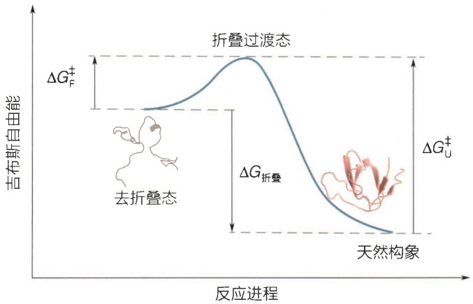

line

| 阶段 | 变量 |
| --- | --- |
| 去折叠态 | \(\Delta G_F^ \pm\) |
| 天然构象 | \(\Delta G_U^ \pm\) |
| 折叠过渡态 | \(\Delta G_F^\pm\) |
| 谷积过程 | \(\Delta G_\)折叠 (峰值) |

图7-1 蛋白质折叠/去折叠过程中涉及的自由能变化及能量势垒

质折叠的速率。例如，小型单链蛋白质往往能够快速自发折叠，而大型、复杂的多亚基蛋白质可能需要更长的时间，甚至依赖分子伴侣帮助折叠。蛋白质并不是通过完全随机的探索过程进行折叠，而是通过特定的、有序的路径完成折叠。

我们将去折叠态和折叠态在天然溶液环境里相互转换的反应速率常数称为 $k_{\mathrm{f}}$ 和 $k_{\mathrm{u}}$ 。其中，$k_{\mathrm{f}}$ 表示蛋白质从去折叠态进入折叠状态的速率常数，而 $k_{\mathrm{u}}$ 表示蛋白质从折叠状态返回去折叠状态的速率常数。$k_{\mathrm{f}}$ 和 $k_{\mathrm{u}}$ 的大小由蛋白质折叠或者去折叠过程中必须克服的能量势垒（$\Delta G^{\ddagger}$）的大小所决定（图7-1；参见2.4.4节）（读者可以类比酶催化反应中涉及的速率常数以及反应活化能）。

在平衡状态下，蛋白质的折叠速率等于其去折叠

速率，因此去折叠态和折叠态的相对丰度和反应速率常数间有如下关系: $f_{U}k_{f}=f_{N}k_{u}$ 。其中， $f_{U}$  和  $f_{N}$  是折叠反应的热力学参数， $k_{f}$  和  $k_{u}$  则是折叠反应的动力学参数。因此，式（7-2）还可以改写成:

$$
\Delta G _ {\mathrm{折叠}} = - R T \ln \frac {k _ {\mathrm{f}}}{k _ {\mathrm{u}}} 。 \tag {7-3}
$$

上述的两态模型对很多蛋白质结构来说有点简化，往往在完全去折叠态和完全折叠态之间会有中间状态或者称为折叠中间态（intermediate state，I）:

$$
\mathrm{U} \leftrightarrow \mathrm{I} \leftrightarrow \mathrm{N} _ {\circ}
$$

有些蛋白质的折叠中间态也能够承担重要生化功能（如Ras蛋白的折叠中间态能够与鸟嘌呤核苷酸交换因子相互作用，细胞色素c的折叠中间态可以在细胞凋亡中发挥作用），因此对整个蛋白质的完全折叠态、完全去折叠态及重要中间状态的构象全景（landscape）的鉴定和研究具有重要意义（知识窗7-2）。

此外，“折叠中间态”需要与“折叠过渡态”进行区分。前者是折叠过程中可能出现的稳定或半稳定状态；而后者指的是蛋白质从去折叠状态向天然状态转变的过程中，必须克服的高能量峰值状态（图7-1），该状态不稳定且瞬间即逝。过渡态决定了折叠过程的速率，因为蛋白质必须通过这一状态才能完成折叠。当过渡态存在较高的能量势垒时，即使蛋白质的热力学稳定性较高，也需要花费较长的时间完成折叠（$k_{\mathrm{f}}$ 值较小）。另一方面，对去折叠过程而言，如果去折叠需要克服的能量势垒较高，即使其去折叠状态在热力学上只比天然态稍微稳定，去折叠过程也会很慢（$k_{\mathrm{u}}$ 值较小），因此蛋白质在天然态下会保持较长时间。这就涉及另外一个重要概念——蛋白质的“动力学稳定性”，指蛋白质在折叠状态下保持稳定的时间长短，主要由去折叠速率常数 $k_{\mathrm{u}}$ 决定。动力学稳定性可以补充热力学稳定性，解释为何有些蛋白质在热力学上虽然不太稳定，但在折叠态下依然可以存在很长时间。

## 知识窗7-2

## 描述蛋白质折叠的自由能景观模型

1995 年，彼得·沃林斯（Peter Wolynes）等人首次提出自由能景观（free energy landscape）的概念，为解释蛋白质折叠中的多样性和动力学复杂性提供了新的框架。经过多位科学家的不断完善，它成为目前广泛接受的能量景观模型（图 7-2）。该假说认为，多肽链的折叠是一个由自由能驱动的过程，通过一个类似漏斗形状的自由能阱“下滑”形成天然构象，这一过程同时伴随着多肽链构象熵的减少。漏斗顶部宽阔部分代表了蛋白质去折叠态，处于无序状态，拥有大量可能的构象。漏斗底部代表了蛋白质的天然态，这是自由能最低的状态，蛋白质在这里达到功能性折叠的稳定状态。漏斗中间的凹凸不平部分代表了蛋白质折叠过程中遇到的局部自由能极小值，这些区域会导致蛋白质暂时停留在一些折叠中间态，形成所谓的“动力学陷阱”，使折叠速度变慢或者折叠失败。分子伴侣（见 7.1.2 节）在体内可以帮助蛋白质逃离这些陷阱，帮助蛋白质正确折叠。能量景观模型还可以解释蛋白质聚集和错误折叠的现象:当“动力学陷阱”过深时，蛋白质被锁定在部分折叠态，非天然接触可能会导致错误折叠或聚集，某些蛋白质甚至可能形成更为稳定的淀粉样纤维（amyloid）。能量景观模型提供了对利文索尔佯谬的部分解释。由于蛋白质折叠受自由能降低驱动，因此蛋白质并不会探索所有的构象，而是通过较短路径“滑动”至自由能最低的天然态，从而大大缩短了折叠时间。同时，该模型认为多肽链可以通过多种路径折叠成天然构象，实验也表明许多蛋白质确实存在多条折叠路径，这种多路径可选的特性为蛋白质在不同环境条件下正确折叠提供了稳健性。

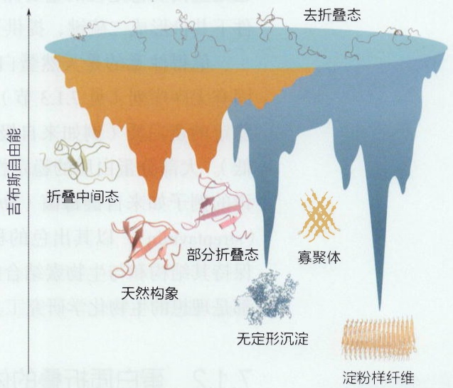

flowchart

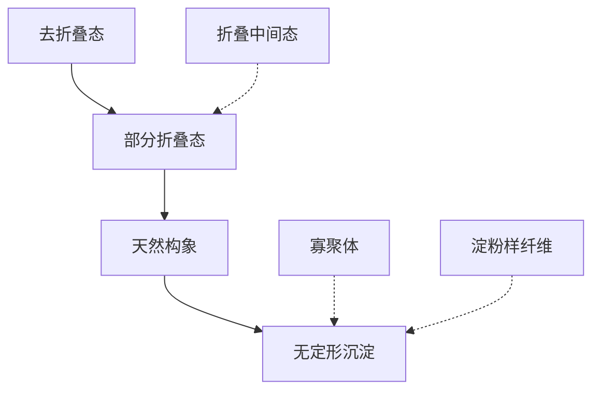

图7-2 描述蛋白质折叠过程的漏斗状能量景观模型

前述理论适用于单结构域的小型蛋白质。然而，大多数大型蛋白质分子由多个结构域组成，每个结构域可能独立存在，并且具有各自不同的稳定性。在完整的分子中，这些结构域之间常发生相互作用。因此，当这些大型蛋白质发生去折叠时，往往需要首先打破结构域之间的相互作用，然后再依次使各个结构域完全展开。正因为如此，大型蛋白质的去折叠过程往往比单域蛋白质复杂得多。

从式（7-1）和式（7-2）可见，蛋白质的热力学稳定性由折叠态和去折叠态下的自由能 $G_{\mathrm{N}}$ 和 $G_{\mathrm{U}}$ 共同决定，且平衡条件下折叠态的相对丰度越大，相应蛋白的稳定性越高。从式（7-3）可见，对稳定性高的蛋白质而言，其折叠速率常数也会远大于去折叠速率常数。在生理条件下，$k_{\mathrm{f}}$ 和 $k_{\mathrm{u}}$ 因蛋白质的不同而变化，但一般来说，蛋白质的折叠速率通常比去折叠速率要快得多。对于小型的单结构域蛋白质而言，典型的折叠速率范围通常是 $1\sim 10\mathrm{s}$ ，而去折叠速率通常要慢一个或两个数量级。

从微观层面来看，疏水相互作用、氢键、静电作用、范德瓦耳斯力和二硫键等多种相互作用共同决定了蛋白质的稳定性（参见3.1.4节）。疏水相互作用在这中间扮演主导角色，一般认为疏水相互作用是水溶液环境下球形蛋白质折叠的主要驱动力，疏水残基远离溶液环境并向蛋白质核心的包埋过程导致了结构的快速形成。然而蛋白质的折叠绝非简单地掩埋疏水残基、暴露亲水残基的过程，在包括氢键在内的多种作用力的共同驱使下，残基侧链在蛋白质内部像形成三维拼图一样相互填补，形成紧密的三维结构。其中，氢键在维持蛋白质的二级结构（如 $\alpha$ 螺旋和 $\beta$ 片层）中发挥关键作用。带电氨基酸之间的静电相互作用，特别是盐桥，能够显著增强蛋白质的结构稳定性，尤其是在高温或者高盐等极端环境下。范德瓦耳斯力虽然较弱，但在蛋白质内部原子间的紧密堆积中不可忽视。二硫键不仅可承担功能（比如参与氧化还原反应），也是蛋白质稳定性的重要保证，特别是对于分泌蛋白或者膜蛋白而言。通过在氧化条件下共价形成二硫键，提供了额外的结构稳定性。

值得注意的是天然蛋白质的稳定性有一个较大的范围，从鲜有稳定三维结构的固有无序序列（见7.1.3节），到微稳定的蛋白质，再到相对稳定的蛋白质，以及超级稳定的蛋白质（例如来自极端环境的热稳定蛋白质，$\Delta G_{\text{折叠}}$能达到-15 kcal/mol或更低）。大部分蛋白质的稳定性属于前三种情形，超级稳定的蛋白质比较少见，耳熟能详的例子如来自链霉菌（Streptomyces avidinii）的生物素结合蛋白质——链霉亲和素（streptavidin），以其出色的稳定性而闻名。链霉亲和素能在广泛的温度和pH条件下保持其结构和与生物素结合的亲和力。链霉亲和素的稳定性使其在许多实验和应用中都是理想的生物化学研究工具。

## 7.1.2 蛋白质折叠的体内机制

蛋白质的折叠和去折叠是两个非常基本且彼此关联的过程，不仅仅是物理化学驱动的结构转变，还与细胞中生物大分子的拥挤效应、局部环境的变化以及蛋白质的翻译、运输、降解等过程紧密相关。生物化学家过去几十年的研究积累了大量相关知识，生物化学教材里有非常详尽的讲解，简要概括如下:①作为中心法则的最后步骤，蛋白质按照其一级序列以线性构象进行翻译，然后经过自发的或者辅助的折叠过程形成相对稳定的三维结构，并且有相当一部分蛋白质存在边翻译边折叠的现象。②蛋白质的翻译在细胞质中进行，但某些蛋白质需要在内膜系统、细胞膜上或者细胞外发挥作用。这些蛋白质在合成完成后需要经历穿越磷脂双分子层的运输过程，这个过程通常需要蛋白质处于部分或者完全去折叠的状态，这种去折叠过程可能是自发的，也可能需要“去折叠酶”或者分子伴侣的辅助。一旦穿越膜结构，这些蛋白质通常会在适当的细胞位置重新折叠。③当蛋白质错误折叠或遭遇应激条件时，细胞内的分子伴侣可以通过特定机制帮助蛋白质重新折叠，这一过程常依赖ATP水解提供的能量驱动。④大量研究表明，完成使命的蛋白质最终在水解阶段的构象主要是去折叠