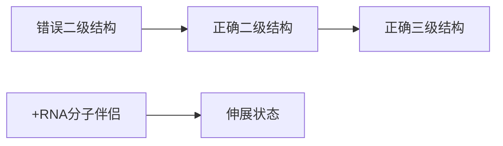
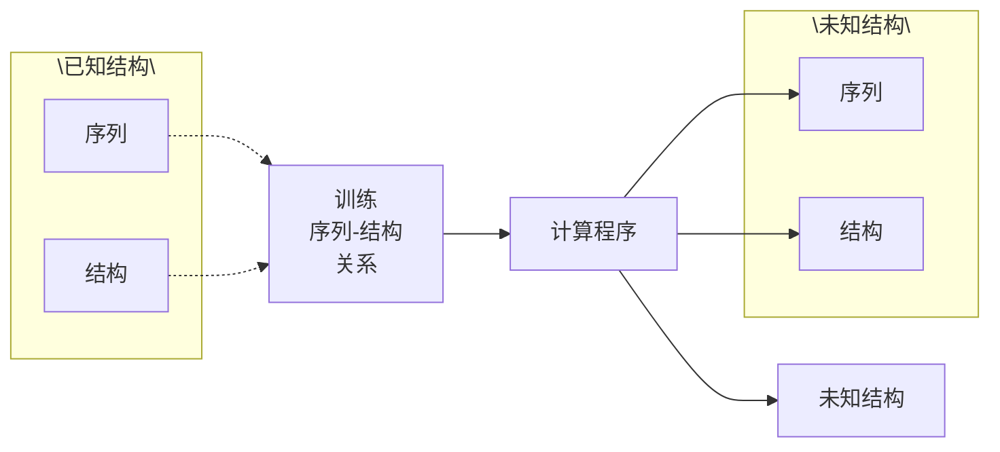
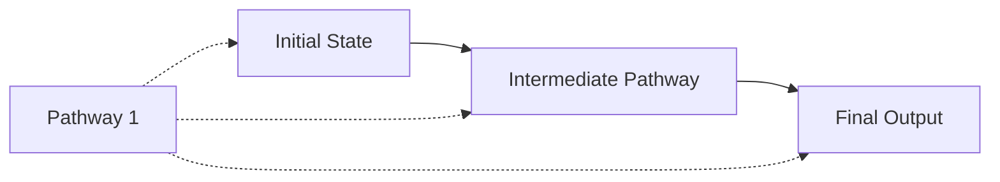
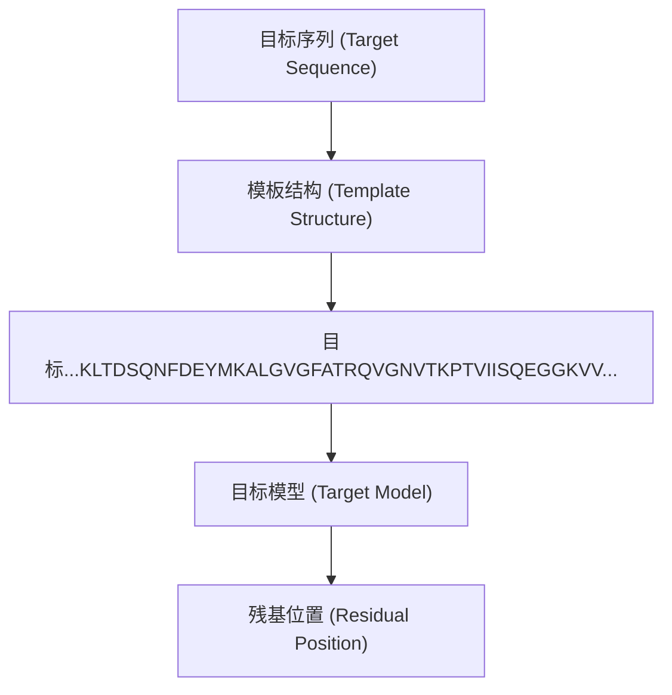
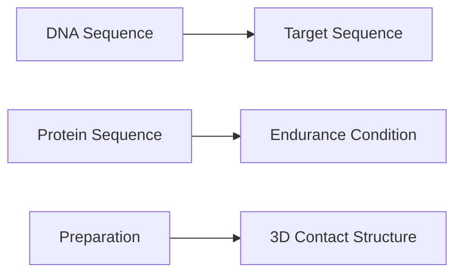
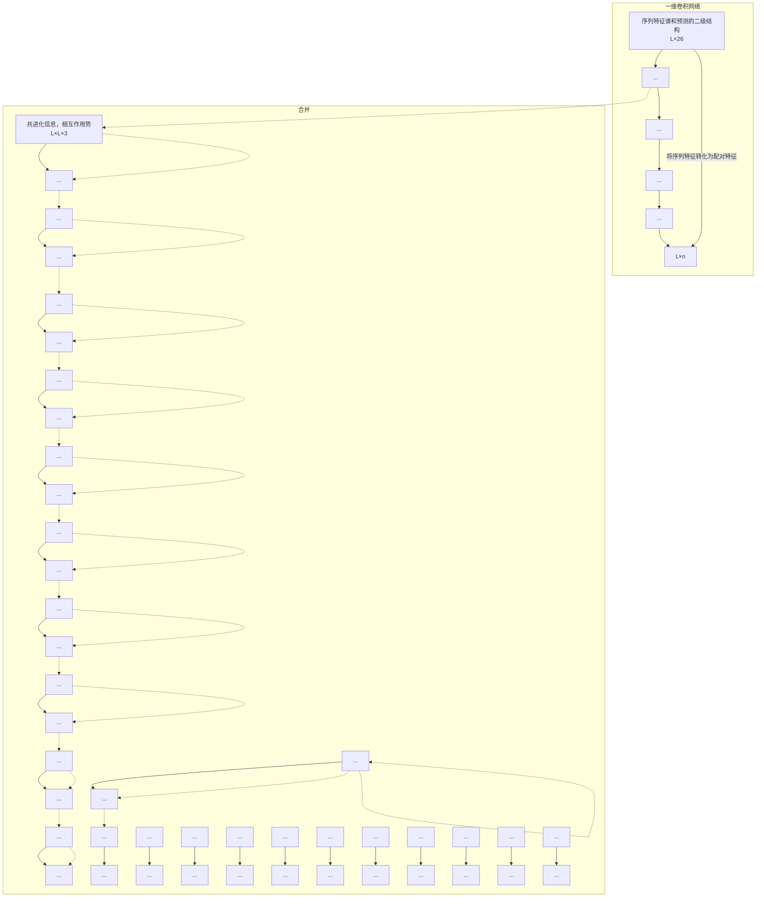
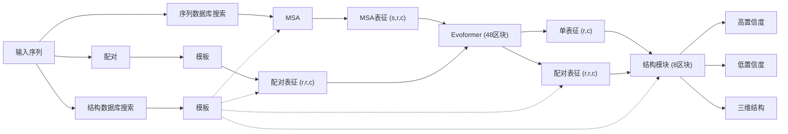
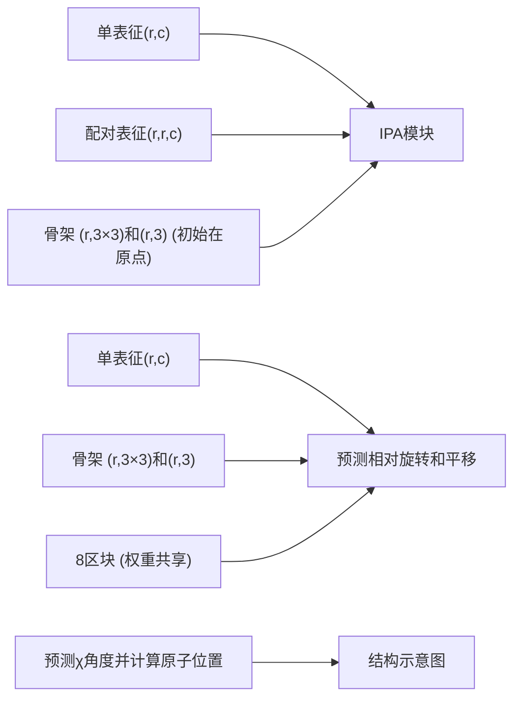

## (3) RNA 分子伴侣蛋白

在细胞内，蛋白质的折叠经常需要分子伴侣蛋白的帮助，那么RNA在胞内的折叠也有分子伴侣蛋白的帮助吗？早在上世纪70年代中期，人们就发现在实验体系中加入非特异结合RNA的蛋白质片段可以促进错误折叠的tRNA转变为正确构象。此后随着RNA折叠理论的发展，人们发现比较复杂的RNA在折叠中经常会陷入错误折叠中间体的势阱中。从这些中间体到正确的三维结构需要某些双螺旋区域的解开和新螺旋的形成，花费的时间从毫秒到小时不等，严重影响了RNA正常执行其功能。尽管有时候RNA可以采取一种称为“链置换”（strand displacement/strand exchange）的策略来加快结构的重排，即双螺旋的一条链被RNA其它部分的一条单链直接取代，但这种现象只在部分RNA的折叠中被观察到，并非一种普遍机制。从RNA折叠的基本原理出发，结合早期的实验发现，RNA分子伴侣蛋白的假说在90年代中期被提出，并在之后十多年里随着越来越多具有RNA分子伴侣活性的蛋白质被发现而得以证实。

RNA 分子伴侣蛋白可以分为两大类，即不依赖 ATP 的类型和依赖 ATP 的类型。作为辅助 RNA 折叠的普遍机制，这两类分子伴侣蛋白大多通过与 RNA 的非特异性相互作用发挥功能，能够大幅降低从错误折叠构象转变为正确构象需要克服的能垒，并且不出现在最终的 RNA 结构中（图 7-15）。不依赖 ATP 的 RNA 分子伴侣蛋白的表面普遍富集正电荷，通过与 RNA 磷酸骨架的静电相互作用来促进 RNA 原有二级结构

的破坏，从而大大加快二级结构的重组和新结构的生成。依赖 ATP 的 RNA 分子伴侣蛋白具有解旋酶活性，是核酸解旋酶超家族 2 的成员。这类蛋白质通过水解 ATP 供能，在 RNA 链上定向移动，从而解开折叠中间体的螺旋结构。DEAD 框（DEAD-box）蛋白质家族是最常见的依赖 ATP 的 RNA 分子伴侣蛋白。

近年来，随着适用于细胞内检测的小分子探针的开发，化学探测方法（chemical probing）在研究RNA体内折叠中得到越来越广泛的应用。初步研究结果表明，RNA在体内和体外经常会折叠成不同的结构。目前体内RNA折叠的研究还处于起步阶段，但未来必将为RNA结构和功能的研究带来全新的认识。需要强调的是，体外研究方法和体内研究方法有各自的优缺点，互为补充。同时这两种方法之间仍然存在一定的空白区域。类体外环境（in vivo-like）可以为复杂环境中RNA的折叠研究提供定量且可控的手段，有望弥补这一空白。

flowchart

图7-15 RNA分子伴侣不存在（实线）和存在（虚线）时RNA折叠的自由能曲线

这里仅展示一种简化情况，即RNA折叠过程只包含四种状态:错误的二级结构、去折叠态、正确的二级结构和正确的三级结构。RNA分子伴侣大大降低了去折叠态的自由能，以及从错误的二级结构到去折叠态的能垒和从去折叠态到正确的二级结构的能垒。

## ※ 本章小结

蛋白质存在完全折叠态和完全去折叠态之间的平衡。完全折叠态具有稳定的三维结构，而完全去折叠态则导致蛋白质失去生物活性并改变其物理化学性质。蛋白质的变性是由次级键的破坏引起的，不涉及除二硫键以外的共价键断裂。简单蛋白质的折叠和去折叠反应是可逆的，可以用两态模型进行定量描述。然而，对于多结构域蛋白质，其折叠和去折叠过程可能更为复杂。

蛋白质的稳定性由折叠态和去折叠态的自由能共同决定，其中疏水作用在稳定性中起主导作用。天然蛋白质的稳定性范围很大，从无序序列到微稳定、相对稳定和超级稳定的蛋白质都存在。

蛋白质折叠不仅是一个由热力学驱动的过程，同时也是受动力学影响的动态过程。在体内，蛋白质的折叠受到细胞微环境的多重调控。例如，蛋白质可能在核糖体上边翻译边折叠，这种协同过程使得局部结构在多肽链完全合成之前开始形成。分子伴侣能够帮助新生肽链避免动力学陷阱并正确折叠，防止错误折叠和聚集。

蛋白质折叠与RNA折叠有很大的区别:RNA的折叠是分层次的，大体上是二级结构首先形成，随后才是三级结构的形成；蛋白质的折叠则不具有这样明显的层次，其二级结构和三级结构的形成是耦合在一起的，两部分互相影响、互相依赖。

RNA由于普遍存在带负电的磷酸基团，其折叠非常依赖金属离子的存在，而且不同的金属离子在RNA的折叠和功能执行中发挥的作用也不一样。

在蛋白质和RNA的折叠研究中，体外实验和体内实验各有优势，互为补充。

## ※ 思考题

1. 蛋白质的折叠和去折叠过程对于细胞内的生物过程具有重要意义。请举例说明蛋白质折叠状态如何影响其功能和命运。
2. 疏水相互作用在蛋白质的稳定性中起主导作用。为什么疏水相互作用能够稳定蛋白质的折叠态？
3. 大蛋白质的折叠和去折叠过程可能更为复杂。请探讨大蛋白质相对于简单蛋白质在折叠和去折叠过程中可能面临的挑战，并提出可能的解决方案。
4. 请简述金属离子如何影响 RNA 的折叠和功能。
5. 体内环境中 RNA 的折叠经常有 RNA 结合蛋白的参与。请问 RNA 结合蛋白对 RNA 折叠的自由能曲面有何影响？
6. 蛋白质和 RNA 的折叠都会受到突变的影响。以单点突变为例，请问突变对于折叠的影响在蛋白质上和 RNA 上有什么不同，为什么？

## ※ 扩展阅读

## 研究论文

- 胡昕炜，王志珍，王磊.“后AlphaFold时代”的蛋白质折叠问题[J].科学通报，2023,68(22):2943-2950.
- 阮青云，黄莘，孟子钧，等.蛋白质稳定性计算设计与定向进化前沿工具[J].合成生物学，2023，4(1):5-29.
- 唐宇琦，叶松涛，刘嘉，等.分子伴侣作用下的蛋白质稳定与进化[J].合成生物学，2022，3(3):445-464.
- Dill K A, Ozkan S B, Shell M S, et al. The protein folding problem[J]. Annu Rev Biophys, 2008, 37:289-316.
- Hartl F U, Bracher A, Hayer-Hartl M. Molecular chaperones in protein folding and proteostasis[J]. Nature, 2011, 475(7356):324-332.
- Herschlag D. RNA chaperones and the RNA folding problem[J]. J Biol Chem, 1995, 270(36):20871-20874.
- Nassar R, Dignon G L, Razban R M, et al. The protein folding problem: the role of theory[J]. J Mol Biol, 2021, 433(20):167126.
- Pace C N, Scholtz J M. Measuring the conformational stability of a protein[J]. Protein Struct Pract Approach, 1997, 2:299–321.
- Pyle A M. Metal ions in the structure and function of RNA[J]. J Biol Inorg Chem, 2002, 7(7):679–690.
- Sclavi B, Sullivan M, Chance M R, et al. RNA folding at millisecond intervals by synchrotron hydroxyl radical footprinting[J]. Science, 1998, 279(5358):1940–1943.

## 8

# 生物大分子的 结构预测和模拟

生物大分子的结构决定其功能。研究者发展了一系列实验技术来解析生物大分子的结构（第4章），但目前用实验手段解析的结构仅占已知生物大分子的极小部分；另一方面，高通量测序技术的发展积累了海量生物大分子的序列。因此，发展计算的方法，根据序列来预测生物大分子的结构具有重大意义。本章中，8.1节和8.2节将分别介绍蛋白质与RNA的结构预测。

作为生命活动的主要承担者，蛋白质在细胞中不是孤立存在的，蛋白质与其它生物分子的相互作用是沟通蛋白质结构与其功能的桥梁。8.3节将介绍得到蛋白质结构之后，如何分析其与小分子或大分子（DNA、RNA、其它蛋白质）的相互作用。

在天然存在的生物大分子功能之外，通过生物大分子设计可以得到具有更符合人类需求的功能、甚至是全新功能的生物大分子。其关键是从给定的功能或结构，推导出相应的氨基酸序列，8.4节将展开介绍。

多肽链通过折叠形成三维结构以及与其它生物分子结合形成复合物都离不开物理化学原理，8.5节将介绍如何用计算的方法进行模拟。

## 8.1 蛋白质结构预测

我们知道，相当多的蛋白质通过形成特定的三维结构来行使功能。知道了蛋白质的三维结构，人们就能更好地理解它工作的分子机理。不幸的是，使用实验手段解析蛋白质结构（比如蛋白质晶体学、冷冻电镜、核磁共振等）非常耗时耗力。截止到2023年，蛋白质数据库（Protein Data Bank，PDB）中仅仅有不到20万个实验解析的蛋白质分子结构。与之相对的是蛋白质的序列被确定的速度很快，同一时间点，蛋白质序列库中已经有数十亿已知的序列。实验测量无法弥补结构和序列数据的差距，因此唯一的解决途径是发展算法根据序列预测结构。

如图8-1所示，蛋白质结构预测的通用方式是开发一种计算机算法，能够实现从蛋白质序列到三维结构间的映射。这种算法可以根据物理原理、统计方法或机器学习模型建立，其中含有一些待定的参数。这些参数可以通过对已知序列和结构的蛋白质

（如PDB中的结构）进行计算和模拟，与实验结果拟合来优化。充分优化后，算法就可以用于预测了。给算法输入一条蛋白质序列，算法可以迅速输出与序列对应的三维结构。优秀的结构预测算法能够准确地拟合蛋白质序列和结构间的映射关系，帮助人们理解蛋白质折叠的机理，同时也能推动蛋白质设计领域的发展。

## 8.1.1 理论基础——安芬森法则

为什么能根据氨基酸序列预测蛋白质的三维结构呢？生物化学家克里斯蒂安·安芬森（Christian B. Anfinsen，1916—1995）结合蛋白质变性和复性实验结果，提出蛋白质的氨基酸序列决定其三维结构，即著名的安芬森法则（Anfinsen's dogma）:至少对小的球状蛋白质，蛋白质的天然态结构是由其氨基酸序列决定的。

在理解安芬森法则前，我们先要明确什么是自由能曲面（free energy landscape）。如图8-2所示，曲平面上的每一个点代表蛋白质的一个构象，高度则表示每个构象的自由能。通过这种表示，所有可能的蛋白质构象构成了空间中的一个曲面［数学定义为流形（manifold）］，即自由能曲面。

安芬森法则强调了三点:首先，天然态构象是曲面上的自由能最低点，这样就保证了折叠过程是自由能下降的过程，符合热力学第二定律；其次，天然态使用计算机算法根据已知序列和结构信息的蛋白质数据进行拟合，以定量描述序列和结构间的映射关系；应用于未知结构蛋白质时，可以直接根据序列预测结构。

flowchart

图8-1 蛋白质结构预测算法示意图

flowchart

图8-2 自由能曲面示意图

天然态构象对应自由能最低点，带箭头的曲线则描述蛋白质可能的折叠路径。

构象是曲面上唯一的稳定点，没有其它构象能达到与天然态近似的自由能；最后，从曲面上任一点出发到天然态都可以找到一条动力学可及的路径，沿路径的能垒可以被热运动克服（折叠路径往往需要跨越较小的局部能垒，能垒高度往往在 $k_{\mathrm{B}}T$ 量级，其中 $k_{\mathrm{B}}$ 为玻尔兹曼常量，$T$ 为温度）。后两条要求保证了新生肽链能够在有限的时间内折叠，形成唯一的天然态构象。在实际情况中，自由能面上也可能有被高能垒包围的“孤立”区域，这时就需要分子伴侣来辅助蛋白质折叠。

## 8.1.2 基于物理的结构预测方法

根据安芬森法则，蛋白质的天然态构象对应于自由能曲面上的全局最小值点。但是通过确定自由能最低点来预测蛋白质结构有很大的难度，主要原因是自由能计算需要考虑结构动态涨落（由此产生了构象熵）的贡献，因此准确计算往往需要复杂而且长时间的模拟。在实际应用中，常用计算相对简单的势能评判天然态构象，即假定天然态构象的势能应小于任何一种非天然态构象。

如图8-3，我们可以用势能曲面来描述折叠过程。曲面上的每个点都对应一种构象，而纵坐标则为系统的势能（把上图自由能曲面中的纵轴替换为势能）。因此蛋白质结构预测或折叠问题，实际等价于在能量曲面上找到势能最低的点（构象）。由于蛋白质通常含有较多原子（$N > 500$），这造成势能曲面所在空间的维度很高。虽然结构预测可以简化为对一个高维空间的势能函数的全局最小值搜索问题，但在空间维度很大时，这样的数学问题仍然是很难解决的。

要通过优化势能实际解决结构预测问题，需要两个必要条件，即有效的空间搜索算法和合理准确的势能计算方法。由于需要搜索的变量空间维度很高，如果不能使用

line

| 阶段 | 能量 |
| --- | --- |
| 局部最低点 (左) | ~中等 |
| 局部最低点 (右) | ~低 |
| 全局最低点 (右) | ~低 |

图8-3 蛋白质结构预测的数学表示

横坐标表示不同的构象状态，纵坐标对应每个构象的势能。由于天然态对应全局能量最低点。蛋白质结构预测可以简化为在高维构象空间中搜索全局能量最低点的过程。由于构象空间维度很高，存在多个局部能量最低点。因此合理的结构预测算法需要尽量避免陷入局部最低点，尽可能在有限时间内访问到全局能量最低点对应的势阱附近。同时需要建立准确的势能函数，可以正确评估各个构象状态间的势能高低关系。

有效的搜索算法，那么很难在可行的时间尺度内访问到天然态结构附近的构象。分子生物学家赛勒斯·利文索尔（Cyrus Levinthal，1922—1990）曾提出著名的利文索尔佯谬（Levinthal's paradox）:如果蛋白质以随机方式搜索各种可能构象的方式进行折叠，那么找到天然态构象平均需要花费天文数字的时间（知识窗8-1）。而实际上自然界的蛋白质折叠过程通常发生在毫秒至秒量级的时间内。显然，蛋白质在折叠过程中不是采取随机搜索构象的方式。同样，有效的搜索算法应该和实际折叠过程一样，即在尽量短的时间内到达天然态构象。除有效的搜索算法外，合理准确的势能计算也是结构预测必不可少的条件。首先，依据现有的势能计算方法，天然态构象的势能必须是能量曲面的全局最低点。其次，合理的势能计算方法应该保证构象距离天然态越近则能量越低，这样即使搜索算

## 知识窗8-1

## 利文索尔的估算

假设一条多肽链含有102个氨基酸残基。由于多肽链在折叠过程中保持化学键的键长和键角不变，因此蛋白质在折叠过程中实际改变的是每个非末端氨基酸残基的二面角 $\varphi$ 和 $\psi$ （共100对）。从拉氏图（Ramachandran plot）上看，每一对 $\varphi$ 和 $\psi$ 的取值可能落在三个区域（$\alpha$区、β区和左手螺旋α区）之一。据此我们可以保守地估计，假设每个残基有三个可能构象状态，那么整个构象空间至少含有 $3^{100}\approx5\times10^{47}$ 个可能构象状态。假设蛋白质每秒能访问 $10^{13}$ 个构象状态，那么蛋白质访问所有构象状态的时间为 $5\times10^{34}$ 秒，即 $10^{27}$ 年。

法只能偶然到达天然态附近，由于这里能量较低，系统会倾向于停留在附近，并进一步向天然态构象靠近。换言之，合理的势能计算方法会使能量曲面的表面产生一定的梯度，从而自然诱导蛋白质折叠到天然态构象。

## (1) 搜索算法

目前常用的搜索算法包括分子动力学模拟和蒙特卡罗模拟。分子动力学模拟把蛋白质折叠过程视为一个确定性过程，基于牛顿定律驱使蛋白质的动能和势能间相互转化。蒙特卡罗模拟则是一种利用马尔可夫随机过程和概率模型模拟确定性事件的计算方法。这两种搜索算法的具体描述见8.5节“生物大分子的化学计算与模拟”。分子动力学模拟法用物理模型处理结构随时间的连续变化，模拟事件与真实事件的时间关联度更高，但是对计算资源的需求量更大。蒙特卡罗模拟的演化轨迹不需要符合真实物理过程，方案比较灵活，可以模拟目标分子在不同构象态之间的不连续跃迁，因此，在需要快速搜索构象空间，并到达天然态构象附近时经常使用蒙特卡罗模拟法。当到达天然态构象附近后，再进一步搜索天然态构象时，可以采用分子动力学模拟或者步幅较小的蒙特卡罗模拟。这两种模拟方法都被广泛应用于实际结构预测中。

## (2) 势能计算

依据玻恩-奥本海默近似（Born-Oppenheimer approximation），在对电子的量子力学波函数进行平均后，大分子体系的能量可以表示为所有原子核空间位置的函数。通常用力场（force field）来表示这种函数关系。力场通常可以分为物理力场和统计力场。分子动力学模拟多采用物理力场，而蒙特卡罗模拟多采用统计力场，这里我们主要介绍后者。以往的研究表明，通过系统分析已有的蛋白质结构（如PDB中的结构）而得到的统计力场可以较好地辅助蛋白质结构预测。因为这种力场起源于对数据库的统计分析，所以称为统计力场。

建立统计力场的基本原则是假设蛋白质的进化过程非常缓慢，接近热力学平衡，经历进化产生的蛋白质遵从玻尔兹曼分布，即某种蛋白质结构发生的概率

$$
P \propto \exp \left(- \frac {E}{k _ {\mathrm{B}} T}\right) _ {\circ}
$$

## 知识窗8-2

## 统计力场的修正

在统计力场中，由于在 3D 空间中任意一对原子间的距离原本就不是均匀分布的，而这种背景分布显然与蛋白质构象的选择或蛋白质折叠无关，因此需要引入参考态对统计势能进行修正，以去除背景分布的影响。简单的统计力场可以通过如下公式计算:

$$
E = - \sum_ {i <   j} R T \log \frac {P (r _ {i j})}{P _ {\mathrm{ref}} (r _ {i j})} 。
$$

其中，R 为普适气体常量，T 为温度， $r_{ij}$  表示两个原子（i 和 j）间的距离，而 P 则表示这两个原子在 PDB 中保持当前距离时的概率，ref 表示参考态。以统计势能 DFIRE 为例，参考态的概率分布  $P_{ref}$  采用了理想气体模型来描述任意一对原子间距离间的背景分布。

这里， $E$ 是该结构的势能， $k_{\mathrm{B}}$ 为玻尔兹曼常量， $T$ 为温度。基于这一假设，如果我们能统计出一种结构在自然界中发生的概率（通常用PDB中的概率来近似），就可以反向计算出其对应的势能（知识窗8-2）。在最简单的统计力场中，系统的总能量由每个原子对间的作用能加和得到。而每对原子间的作用能与该对原子在PDB中以当前距离出现的概率的负对数成正比。

早期的结构预测算法多采用物理模型。不幸的是，纯粹基于物理模型的结构预测算法无法达到令人满意的预测精度。随着越来越多的蛋白质结构被解析出来，人们开始在预测模型中融入基于数据的统计信息以提升预测精度。实际上，物理模型中广泛使用的统计力场中已经采用了数据库的统计信息。接下来我们将介绍更多使用统计信息进行蛋白质结构预测的方式。

## 8.1.3 统计信息的运用

结合PDB中现有蛋白质结构的统计信息，人们发展出了多种较为经典的蛋白质结构预测方法。这些方法主要分为基于模板的方法和不依赖模板的方法。

## (1) 基于模板的方法

基于模板的方法，其主要思路是针对需要预测结构的目标蛋白，在PDB中搜索到一个与之序列相似或折叠类型相似的蛋白质结构（称为模板），然后依据模板蛋白的结构建立目标蛋白的结构模型。主要包括比较建模法［comparative modeling，或称同源建模法（homology modeling）］和穿线法（threading）。

比较建模法的基本依据是:当两个蛋白质的氨基酸序列具有较高相似度时，二者有很高概率具有相似的结构。比较建模法通常要求在蛋白质结构数据库中存在一个已知结构的蛋白质，其氨基酸序列与目标蛋白的相似度大于 $30\%$ 。对大多数情况，只要能找到序列相似度较高的模板，则预测的结构与实际结构往往非常相似。

如图8-4所示，结构预测的第一步是选定合适的模板结构，即与目标蛋白序列同源的已知结构，并对二者进行序列比对（sequence alignment）。由于二者的序列高度相似，因此，如果在模板蛋白中两个氨基酸残基的空间距离较近，则这两个氨基酸残基在目标蛋白中的对应残基有很高概率距离较近。通过这样的对应关系，应该能找到许多对残基间的空间限制。如果有足够的空间限制，则可以使用分子动力学模拟程序，找出所有满足以上空间限制的可能构象。这种方法与核磁共振实验中的结构解析非常相似。在核磁共振实验中（见第5章），通过NOESY谱，可以找到空间距离较近的原子对（二者具有NOE效应）。在建立好所有的几何约束后，核磁共振实验也采用分子动力学模拟程序试图找到所有满足这些几何约束的构象。

穿线法的理论依据是:自然界只含有一定数目的蛋白质拓扑结构（或者叫折叠类型）。比如，目前已知的所有蛋白质结构域在拓扑结构层面上大约有2000个（知识窗8-3）。在假定目标蛋白会采取一种已知的蛋白质拓扑结构的前提下，可以把目标蛋白与已知的拓扑结构一一比较，并依据序列比对，把目标蛋白的序列编织到已知的拓扑结构（模板）上。

flowchart

图8-4 比较建模法流程示意图

首先对目标序列和模板蛋白进行序列比对，然后根据模板结构和序列比对结果确定目标蛋白内部残基间的空间约束，最后使用分子模拟技术找到符合约束的结构模型。

穿线法的命名非常形象，我们可以把蛋白质序列想象成一串念珠，把模板的主链结构想象成三维空间中的一条复杂曲线（图8-5）。穿线法的思路就是把念珠一颗一颗穿入代表模板结构的曲线中。在这个过程中需要序列比对的打分（通常要求目标蛋白与模板的序列相似度大于 $15\%$ ）指导穿线过程，即每一颗念珠大致上落在曲线的哪个区域。使用穿线法通常会建立多个结构模型，最后必须依据已有的知识，构建打分函数，对这些模型打分。以前通常使用由统计力场计算所得的模型势能函数进行打

分。随着技术的发展，也逐渐出现基于机器学习和深度学习的打分函数，包括从序列预测的二级结构与真实二级结构的相似性等，它们往往能大幅度提升穿线法的预测精度。

## (2) 不依赖模板的方法

当PDB中不存在任何模板结构与目标蛋白有$15\%$ 以上的序列相似度时，无法使用比较建模或者穿线法。这时只能退而求其次，使用从头开始法（ab initio）进行结构预测。从头开始法，顾名思义，是假蛋白质主链结构用抽象的曲线表示。建模过程中，把表示目标序列的一系列念珠（abcdef……）穿入表示主链的曲线中。

text_image

d c a
e f b
b
a
b c
d e f
c b a
d e f

图 8-5 穿线法示意图

## 知识窗8-3

## 蛋白质结构域的拓扑结构种类

多年来，人们对蛋白质结构进行分类研究时发现，在结构域层面上，现有蛋白质只展现出有限的拓扑结构类别。主流的结构域分类数据库包括SCOP和CATH。我们以SCOP为例展示。该数据库以熟悉蛋白质结构的专家识别为主，将现有结构域按照类（class）、折叠类型（fold）、超家族（superfamily）和家族（family）四个层次逐层分类。最新版的SCOPe v2.08数据库（SCOP extended，2022年9月）在折叠类型、超家族和家族这三个类别中的计数分别为1257、2067和5084。反之，目前PDB中已经积累了接近20万个分子结构。因此，在漫长的进化过程中，自然界只保留了几千种较为稳定的结构域拓扑结构用于行使功能。蛋白质设计方面的研究表明，通过人工设计可以找到自然界未使用的稳定结构。那么现存的数千种天然态结构是如何通过进化筛选出来的？这个问题目前还是未解之谜。

定蛋白质的折叠完全可以由自然界的物理化学规律引导完成。在这种方法中，通常使用任意起始构象，然后用分子动力学或蒙特卡罗模拟引导蛋白质的构象向势能更低的方向变化，模拟过程中出现的最低能量构象被认为是描述天然态结构的较好模型。

理论上，从头开始算法中不应该使用任何数据库的统计信息。但是研究发现，适度加入统计信息能有效地提高预测的准确度。其中一个著名的从头开始算法是ROSETTA算法，由美国华盛顿大学戴维·贝克（David Baker）实验室开发。该算法使用片段组装法（fragment assembly）预测结构。其基本思路如下:虽然在PDB中找不到在整体结构域层面上与目标蛋白序列相似的模板结构，但是可以退而求其次，在更短的片段层面上搜索这些片段的模板结构。

目标序列的每9个残基组成一个片段，比如:残基1—9组成的片段，按照其氨基酸序列可以在数据库中搜索到很多可能的片段结构。类似的，残基2—10、3—11等片段都可以找到多个可能的模板结构。把这些片段拼接起来应该可以得到目标蛋白的可能结构模型。拼接的过程通过蒙特卡罗模拟完成，在每一步尝试改变构象后通过统计力场衡量当前结构的势能，并按照Metropolis算法完成构象更新。经过长时间的模拟，最终找到的最低能量构象作为可以接受的预测结构。

尽管这些基于已知蛋白质结构的统计信息提高了蛋白质结构预测的表现，但正如前文提到过的，已知蛋白质结构的数量远远少于已知蛋白质序列的数量。能否从海量的蛋白质序列中提取统计信息，来指导蛋白质结构预测呢？

## 8.1.4 共进化信息的引入

我们可以从蛋白质序列数据库中找到与目标蛋白质有同源关系的多条蛋白质，然后推导出多重序列比对（multiple sequence alignment，MSA）。MSA反映了该蛋白质的

进化历史，其中包括氨基酸残基间的互作信息，称为共进化信息（coevolutionary information）。

如图8-6所示，如果两个氨基酸残基在空间中形成重要的物理相互作用，能够有效地稳定蛋白质的三维结构，那么这对残基在进化上应该有保守关系。在上例中，可以看到这对残基在MSA中形成类似R-D和K-E的静电相互作用（精氨酸R和赖氨酸K为正电残基，天冬氨酸D和谷氨酸E为负电残基）或类似W-V的疏水相互作用（色氨酸W和根据多重序列比对中残基间的关联突变，可以推断两个残基在蛋白质结构中是否形成物理接触。

flowchart

图8-6 从关联突变推断出的残基间物理接触

缬氨酸 V 为疏水残基）。因此，反过来说，如果在 MSA 中能观测到两个残基间的关联突变，则可以推断出二者可能在三维空间中形成物理接触。从 MSA 中得到的大量类似信息可以建立目标蛋白残基对间的几何约束，然后通过基于能量函数的折叠程序建立符合这些几何约束的蛋白质三维结构模型。除了残基对之间的距离，后来的方法还能从 MSA 中挖掘出更多信息，大幅提升了对于二级结构和主链二面角的预测准确性。实际上，我们可以把 MSA 看作自然界在漫长进化过程中所做的生物学实验。由于这些实验数据与结构数据库中的信息互补，因此只要序列比对的深度足够（即 MSA 中的序列数目足够多），那么使用共进化信息在理论上可以大幅度提升结构预测的精度。

事实上，基于共进化信息的方法早在上世纪90年代已有人提出。比如可以使用诸如互信息（mutual information）等信息学指标从MSA中寻找有用的信息。但是一方面早期的序列数据不足，另一方面互信息等方法仅仅考虑了一对残基间的作用而忽略了蛋白质序列的整体信息，因而这些方法不太成功。进入21世纪后，随着测序技术的发展，已知蛋白质序列的数目大大超过了结构的数目，为共进化类方法的发展提供了充足的保障。2011年起，有人开始使用基于概率图的马尔科夫随机场（Markov random field）模型，提出了一种名为直接关联分析（direct coupling analysis，DCA）的方法。该方法把蛋白质结构简化为一个无向图（图8-7），其中每个氨基酸残基为一个节点，用节点间的边表示两个残基间的直接相互作用。使用MSA数据训练这种概率模型，可以有效消除互信息中的噪声，提取出残基间的接触信息。从这种方法预测出的残基接触信息中，人们可以抽取出高质量的结果，制作成伪势能（pseudo energy）函数加入诸如ROSETTA等程序中，并改善结构预测的精度。

基于DCA的方法的主要缺陷在于模型中待学习的参数过多，因此严重依赖于MSA的质量。当MSA质量较高时，预测的残基接触很准确。但是当MSA中序列数量小于 $5L$ （$L$ 为序列长度）时，预测结果的噪声就非常高，很难获得有用的信息。

图8-7 马尔科夫随机场中使用无向图描述残基间相互作用

每个残基用一个节点（node）表示，节点间的边（edge）则表示残基间的相互作用。模型中，系统的总能量是节点（代表单体能量）和边（代表二体能量）的线性组合，权重系数为待优化参数。假设系统状态的概率分布符合玻尔兹曼分布，可以推断出节点间的关联矩阵（依赖于待优化参数）。通过比较理论计算的关联矩阵和MSA中实际观测的残基间关联矩阵，可以逐步优化模型参数。

## 8.1.5 深度学习算法

从蛋白质结构预测领域的历史发展中，人们可以清晰地看到从物理模型到统计模型再到机器学习模型的进程。近年来，主流的深度学习模型以人工神经网络为基础，通过对基本模块的深度堆积能更有效地提取数据中的信息。

如前所述，基于DCA的统计类方法虽然做出了很大的创新，但是仍不能把蛋白质结构预测的精度提高到令人满意的程度。2017年起，逐渐有人把深度神经网络（deep neural network）引入到蛋白质结构预测领域，发展出了基于共进化信息的残基接触预测算法，其中代表性方法为RaptorX-Contact。如图8-8所示，该方法把DCA类模型输出的残基互作信息当作二维图像处理，再结合一维序列信息后使用深度神经网络预测残基接触图谱（contact map）。RaptorX-Contact显著提高了残基接触预测的精度，在CASP12竞赛中首次应用，就把预测结果中打分最高的top $L / 5$ （$L$ 为序列长度）对残基接触的预测准确率从 $20\%$ 提升到 $50\%$ ，在两年后的CASP13竞赛中又提升到了$70\%$ 。根据CASP官方评估，以预测的残基间接触为约束进行结构预测时，对很多蛋白质可以达到精准建模。

其后，RaptorX-Contact 又进行了进一步拓展，直接预测残基间的距离，而非残基间接触（此前，残基间接触定义为一对残基间距离小于 8 Å）。显然，直接预测距离可以更有效地辅助结构建模。谷歌（Google）公司旗下的 DeepMind 团队开发的 AlphaFold1 就采用了这种设计，使用一个超深的神经网络预测残基间距离。AlphaFold1 把这些预测结果制作成伪势能函数，通过能量优化确定最优构象。在 CASP13 竞赛中，

图8-8 RaptorX-Contact示意图

RaptorX-Contact 使用图像识别领域中发展较为成熟的残差卷积神经网络（residual convolutional neural network, ResNet）进行残基接触预测。卷积（convolution）操作通过加权平均（权重为待优化参数），把图片中目标像素的邻居信息整合进来。跨过两个2D卷积层的直连箭头代表残差（residual）操作，可以保证卷积网络的学习能力不会随网络深度而饱和。最终预测的图像为残基接触图谱，每一个点的灰度值代表该点对应的行和列所处的氨基酸残基之间形成物理接触的概率。

flowchart

## 知识窗8-4

## 蛋白质结构预测算法的评估:CASP 竞赛

过去几十年来发展出了花样繁多的结构预测算法，如何评估它们的性能呢？为解决这一问题，约翰·莫尔特（John Moult）等人在1994年发起了CASP竞赛，全称为蛋白质结构预测的关键评估（Critical Assessment of Structural Prediction of proteins, CASP）。该竞赛每两年举办一次，截至2022年已经举办至第15届。每次竞赛前，组织者预先收集一些尚未发表的实验结构数据，在网站上公布这些蛋白质的氨基酸序列。世界上任何组织或个人都可以参加比赛，但是参赛者不知道结构信息。在评估预测结果时，评估者也不知道参赛者的身份。通过这样的双盲测试，CASP竞赛可以尽量公平地比较各种预测算法的优劣，对蛋白质结构预测领域的发展起到了重要的推动作用。

AlphaFold1 一举夺魁，蛋白质结构预测领域也进入了全新的时代（知识窗 8-4）。

## 8.1.6 划时代的方法:AlphaFold2

2020年的CASP14竞赛中，绝大部分参赛团队仍沿用了之前的思路，即先用超深神经网络预测残基间距离或其它几何关系，然后再使用ROSETTA等从头开始方法搜索符合预测几何关系的蛋白质构象。DeepMind团队开发的AlphaFold2再次取得新的突破，它通过采用一个端到端预测的神经网络，直接从氨基酸序列预测结构。AlphaFold2的模型经过充足的训练后，对大部分单结构域的蛋白质可以做到精准预测，预测精度与实验解析的精度持平，彻底改变了蛋白质科学领域的研究现状。

相比于 AlphaFold1，AlphaFold2 最大的创新是采用了端到端预测的架构。以前的模型采用两步法，先预测几何约束，再根据预测结果建立三维结构模型，但这种方式会导致第一步预测的误差累积到第二步。端到端的预测架构把两步统一到一个神经网络架构中，通过统一训练可以有效地消除误差积累问题。如图 8-9 所示，该模型中的 Evoformer 和结构模块（structure module）可以分别对应于以前两步法预测的两个步骤。

此外，AlphaFold2的模型采用了自然语言处理领域发展起来的Transformer架构，能够更好地处理序列信息。如图8-9所示，模型含有两个分支:一维信息从MSA获取，二维信息从结构模板获取。二者通过Evoformer这一Transformer架构频繁地进行信息交互。这种模式可以更全面地利用MSA和结构模板中的信息。从这个角度看，AlphaFold2实际上采用了一种全新的模式把共进化方法和基于模板的建模方法整合到一起，并使它们优势互补。从另一个角度看，一维信息可以近似认为是每个氨基酸残基的局部化学环境，二维信息则可以认为是氨基酸残基间的相互作用。残基的局部化学环境决定了残基间的相互作用，同时残基间互作也会改变残基的局部化学环境。因此，Evoformer的架构设计能充分反映蛋白质主链折叠过程中的这种物理特性。

flowchart

图8-9 AlphaFold2模型架构示意图

模型的输入为MSA和模板信息，输出为预测的三维结构。Evoformer类似以前的深度卷积模型（见图8-8），通过整合MSA和模板信息提取残基间互作信息。结构模块则采用神经网络架构代替了以前根据预测的几何约束进行三维建模的步骤。Evoformer采用了Transformer架构。Transformer 是自然语言处理领域中发展起来的新型神经网络架构。传统的卷积神经网络和循环神经网络等架构需要通过深度堆叠才能允许时序上距离较远的单元间发生信息交互。Transformer 则在每一步都允许这种信息交互，因此在处理语言以及类似于语言的氨基酸序列时更有优势。

AlphaFold2的结构模块也采用了创新性的设计（图8-10）。首先它针对每个氨基酸残基建立了局部坐标系，在网络中预测每个局部坐标系的平移和旋转。根据坐标系的平移和旋转可以计算出原子的三维坐标，最终又可以通过注意力机制与一维信息进行交互，也就是说，氨基酸残基的三维坐标与每个残基的化学微环境之间可以相互影

响。此外，AlphaFold2还采用了多种人工智能工程化技术，使预测精度有进一步改善，最后实现了蛋白质结构的精确预测。

flowchart

图8-10 AlphaFold2中结构模块的示意图

在结构模型中，针对每个氨基酸残基都建立了一个局部坐标系（图中的三角形），神经网络预测这些局部坐标系在每一步的平移和旋转，经过转化为全局坐标系的坐标后更新每个原子的位置，这些三维空间中的位置信息可以通过注意力机制与一维信息进行信息交互。

总体而言，AlphaFold2的成功建立于生物物理学对蛋白质折叠机理的认识以及蛋白质结构预测领域大量前期积累的基础上，更反映了数据驱动的人工智能方法（包括合理的人工智能模型和强大的人工智能实践）作为一个革命性新工具的强大能力。不过具体到蛋白质结构预测来说，AlphaFold2并没有解决该领域的所有问题，比如动态结构、蛋白质复合物结构等，还有无法搜索到高质量MSA的蛋白质结构等。即使仅考虑单链蛋白质的静态结构，AlphaFold2对于人类全蛋白质组的结构预测只有约 $36\%$ 的区域是高置信度的。生物物理学在蛋白质结构预测和蛋白质折叠领域的探索步伐不应该停止，未来可以在更接近生理功能的状态下进行蛋白质结构预测。

## 8.2 RNA 结构预测

蛋白质是生命活动的主要承担者，而核糖核酸（RNA）作为中心法则中承上启下的分子，我们也需要获取其结构才能更好地理解其功能。RNA分子结构易变，在不同细胞环境中可能形成不同的构象；传统的结构解析方法（如X射线晶体学、核磁共振和冷冻电镜技术等）很难解析复杂的RNA结构，更无法解析细胞内的RNA结构。随着二代测序技术的发展，出现了使用酶或小分子探针高通量地解析RNA结构的方法，包括核糖核酸酶酶切、小分子修饰，以及近端RNA交联等。这些方法可以用来获取体内复杂多变的RNA结构信息，但它们目前仅能得到部分RNA结构信息（主要是部分二级结构信息），无法获得完整的RNA二级和三级结构。

在用实验方法对RNA结构进行研究的同时，从20世纪70年代以来，研究人员还发展了一系列RNA结构的计算预测方法，这是本节的主要内容。

## 8.2.1 RNA 结构基础

前面 3.3 节已经介绍过 RNA 结构的层次，这里简单回顾一下（图 8-11）:

一级结构:碱基（A、C、G、U）的排列顺序。

二级结构:RNA 分子中不同碱基之间通过氢键形成的互补配对。

三级结构:RNA 的完整三维结构，涉及 RNA 链在空间中的弯曲、扭转和远程互作等形态。

理想情况下，我们希望能够预测 RNA 的三级结构，因为它代表了 RNA 的最终功能状态。然而，计算 RNA 的三级结构具有高度挑战性，目前相关方法还不够成熟。另一方面，RNA 分子的结构稳定性主要体现在其二级结构上，而且功能性二级结构在进化过程中通常是保守的。了解RNA二级结构，能够提供许多关于其功能的有用信息，并有助于鉴定非编码RNA。

图8-11 RNA一级、二级和三级结构

chemical

DNA double helix structure diagram showing structural components and sequence of nucleotides labeled A, G, C, U with key elements like outer ring, multiple branch, and cleavage sites.

接下来我们着重介绍 RNA 二级结构预测，然后介绍 RNA 三级结构预测。

## 8.2.2 RNA 二级结构预测

根据RNA二级结构预测方法的原理和发展历程，可以将它们大致划分为基于物理能量的方法、基于进化信息的方法和基于机器学习的方法。

## (1) 基于物理能量的方法

基于物理能量的方法的基本原理是:生物分子在自由折叠过程中形成的最稳定结构对应其最低自由能状态。在RNA分子中，形成稳定二级结构的主要驱动力是碱基配对（包括沃森-克里克配对和GU配对），其形成的氢键会释放能量，从而降低分子的自由能。此外，相邻的碱基对在空间上会形成堆积（stacking），进一步释放能量。这种由多个连续碱基对形成的双链螺旋结构是RNA二级结构稳定的关键。因此，可以通过搜索不同的折叠方式，找到释放最大能量的RNA结构。

早期的计算模型相对简单粗糙，主要通过最大化氢键数目来预测最小自由能对应的结构。随后的研究不断优化和改进计算RNA分子自由能的公式和参数，包括考虑最近邻碱基配对堆积效应所释放的能量等。这些参数可以从实验测定的热力学数据中推导得出，一组被广泛使用的热力学模型参数是在2004年发布的Turner 2004。

为了找到具有最小自由能的结构，我们可以通过穷举RNA的所有折叠方式，并使用上述模型计算每种折叠方式的自由能。然而，穷举法的时间效率非常低，对于较长的RNA分子来说，无法在合理的时间内完成折叠方式的列举和计算。在20世纪70年代，以色列籍计算生物学家Ruth Nussinov提出一种可以快速计算最小RNA折叠自由能的算法。

我们用一个简单的玩具模型来描述 Nussinov 算法。在这个模型中，我们寻找具有最大碱基配对数的 RNA 结构。假设  $x_{i}, x_{i+1}, x_{i+2}, \cdots, x_{j}$  是我们要折叠的核苷酸序列，并将其记为  $x_{[i; j]}$ 。我们已经计算了所有更短子序列  $x_{[m; l]}$ （其中 i < m < l < j）的最大碱基配对数，对于更长的序列有四种情况:①②位置 i（或 j）上的碱基未形成任何配对，此时  $x_{[i; j]}$  的结构就是  $x_{[i+1; j]}$ （或  $x_{[i; j-1]}$ ）的结构加上一个未配对的位置 i（或 j）的核苷酸；③位置 i 和 j 上的核苷酸  $x_{i}$  和  $x_{j}$  可以形成一对配对碱基，此时  $x_{[i; j]}$  的结构就是  $x_{[i+1; j-1]}$  的结构加上一个配对的 i - j 核苷酸对；④如果  $x_{i}$  和  $x_{j}$  都形成碱基配对，但不是互相配对，则我们的结构必须由两个子结构组成，换句话说，存在一个位置 k（其中 i < k < j），使得我们的结构可以分解为一个  $x_{[i; k]}$  上的子结构和另一个  $x_{[k+1; j]}$  上的子结构。

对于每个子结构，我们可以再次进行上述操作；通过不断重复这些步骤，最终可以找到具有最大碱基配对数的RNA结构。可以看出，上面描述过程事实上是一个递归，其分解如图8-12A或者下面的递归式所示: