(A)

(B)

图11-20 听觉产生机制与听觉受体

（A）静纤毛尖端机械电传感通道结构模式图。（B）秀丽隐杆线虫TMC1-TMIE-CALM1复合体三维结构（PDB编号:7USW）。（A，改编自Liu Q L, et al. Cell Mol Life Sci, 2021, 78(21/22): 6823-6850）

可能是MET通道的孔道蛋白基因。迄今，已经解析了来自线虫的TMC1、TMIE和CAM1复合体的结构（图11-20B）:TMC1为760个氨基酸组成的10次跨膜蛋白，TMIE是一个含有153个氨基酸的两次跨膜蛋白，CIB2是一个含187个氨基酸、有3个结合钙离子的EF手结构（EF hand）的可溶蛋白。但TMC1的孔道区以带正电的氨基酸居多，不能解释MET通道为非选择性阳离子通道这一功能特性。另外，TMIE和TMC1结合区富集磷脂分子，说明磷脂信号分子参与调控MET通道。结构生物学实验发现PCDH15和LHFPL5形成复合体，PCDH15是一个 $290\mathrm{kDa}$ 的单次跨膜蛋白，LHFPL5是一个含214个氨基酸的4次跨膜蛋白，它们可能调控顶链的力学稳定性，但是两个复合体如何结合和行使功能还尚未可知。

## 11.4.3 其它类型的力学受体

细菌中的机械门控通道MscL和MscS是最早被鉴定到的机械门控离子通道家族（图11-21A、B），能够保护细菌避免因渗透压改变而导致膨胀破裂。研究发现，把纯化的MscL蛋白重组到脂双层中，能影响负压刺激而引起离子通透，揭示了MscL能直接感受膜张力的变化而开放，基于此，研究人员提出了该类通道感知外力的脂膜张力门控模型。

果蝇的瞬时受体电位（transient receptor potential，TRP）通道家族成员NOMPC参与介导果蝇触觉感知。该通道的胞质区存在4个含29个锚蛋白的锚蛋白重复结构域（ankyrin repeat domain）（图11-21C）。该结构形成螺旋束并与微管连接，以类似弹簧的方式将微管的力传递给孔道区。因此，NOMPC通道符合拴绳拉力模型。此外，线虫的退化蛋白（degenerin）或上皮钠通道（DEG/ENaC）家族成员MEC-4可以参与线虫的触觉感知，其力学感知需要依赖其它的细胞骨架成分。

双孔钾通道（two-pore domain potassium channel，K2P）是在哺乳动物中鉴定到的

图11-21 多种类型力学受体的三维结构

（A）甲烷藻MscL关闭状态（4Y7K）与开放中间状态（4Y7J）结构。（B）大肠杆菌MscS关闭状态（2OAU）与开放中间状态（2VV5）结构。（C）黑腹果蝇NOMPC三维结构（5VKQ）。（D）人源K2P1钾通道三维结构（3UKM）。（E）拟南芥OSCA1.1三维结构（6JPF）。（F）人源TMEM63A三维结构（8EHW）。括号内字母和数字组合指PDB编号。

(A)

text_image

A)
关闭状态
153 kDa
开放中间状态

(C)

natural_image

3D molecular structure visualization with color-coded helices and binding site (no text or symbols)

(B)

text_image

D)
关闭状态
216 kDa
开放中间状态

natural_image

3D molecular structure visualization with 128 kDa scale indicator, showing protein backbone and side chains (no text or symbols on diagram)

(E)

natural_image

Molecular structure visualization with blue and yellow chains, labeled 175 kDa (no text or symbols on the diagram itself)

(F)

natural_image

3D molecular structure visualization with 93 kDa label, showing protein backbone and secondary structure elements (no text or symbols beyond label)

机械门控钾通道（图11-21D）。但不同于PIEZO通道，K2P的作用是介导钾离子流到胞外而使细胞膜超极化，抑制神经元兴奋。K2P的门控过程符合脂膜张力门控模型。

TMEM63/OSCA家族是新近鉴定发现的一类机械门控离子通道家族，能直接被脂膜张力的改变而激活，但其激活所需要的力要高于PIEZO1/2，属于高阈值机械门控离子通道。植物中表达的OSCA形成二聚体（图11-21E），每个亚基有离子通透孔区。而哺乳动物TMEM63被发现以单体形式存在（图11-21F），且需更大的力才能被激活。TMEM63/OSCA在生物体或细胞中的力学感知功能还有待深入研究。

## ※ 本章小结

从微小的原核生物到复杂的哺乳动物如人类，生命体系巧妙地运用丰富多样的分子马达作为能量转换的媒介，通过高效地水解ATP等储能分子或是依靠质子浓度梯度，实现化学能向机械能的转变。这一能量转换过程不仅支撑着细胞内的物质运输、肌肉收缩等基本活动，还参与构建从细胞分裂到器官运动的各种复杂动态过程。在这一系列精密的生命活动中，力的感知扮演着不可或缺的角色，而多种力敏感蛋白/受体作为传感器，能够捕捉到极微弱的皮牛级别的力变化。在无须额外能量输入的情况下，力敏感蛋白仅凭结构的变化便能实现信号的转换与传递，使得细胞能够精确地响应外界压力、剪切力以及扭转力等，保证了生物体对环境的精细感知和恰当响应，展现了生命体系对物理环境的高度适应性，体现出生命过程与物理原理的交汇之美！

## ※ 思考题

1. 细胞内各种分子马达产生的力大多在几皮牛到几十皮牛的范围，请思考其原因。
2. 在细胞内，有的蛋白质力学稳定性很高，需要几百皮牛的力才能解折叠；有些蛋白质力学稳定性较低，只需要几皮牛就能解折叠。力学稳定性和生物功能之间是否存在内在关联？
3. 力能够直接影响基因表达吗？
4. 力敏感受体感受力有多少种不同的方式？为什么不同受体会采用不同的机制感受力？
5. 是否还存在尚未被鉴定发现的力学受体？如何去鉴定发现？

## ※ 扩展阅读

图书

菲利普斯，康德夫，塞里奥特.细胞的物理生物学[M].涂展春，王伯林，译.北京:科学出版社，2012.

张凯.膜蛋白结构动力学[M].2版.北京:科学出版社，2024.

Doi M. Introduction to polymer physics[M]. Oxford: Clarendon Press, 1996.

Jacobs C R, Huang H, Kwon R Y. Introduction to cell mechanics and mechanobiology[M]. New York: Garland Science, 2013.

Park S, Chen Y. Mechanics of biological systems: introduction to mechanobiology and experimental techniques[M]. San Rafael: Morgan & Claypool Publishers, 2019.

综述

Evans E. Probing the relation between force—lifetime—and chemistry in single molecular bonds[J]. Annu Rev Biophys Biomol Struct, 2001, 30:105–128.

Guo Y Y, Yan J, Goult B T. Mechanotransduction through protein stretching[J]. Curr Opin Cell Biol, 2024, 87:102327.

Huang Y H, Chen T, Chen X D, et al. Decoding biomechanical cues based on DNA sensors[J]. Small, 2024, 20(21):e2310330.

Jin P, Jan L Y, Jan Y N. Mechanosensitive ion channels: structural features relevant to mechanotransduction mechanisms[J]. Annu Rev Neurosci, 2020, 43:207–229.

- Liu B Y, Chen W, Zhu C. Molecular force spectroscopy on cells[J]. Annu Rev Phys Chem, 2015, 66:427–451.
- Murthy S E, Dubin A E, Patapoutian A. Piezos thrive under pressure: mechanically activated ion channels in health and disease[J]. Nat Rev Mol Cell Biol, 2017, 18(12):771–783.
- Wang Y N, Yan J, Goult B T. Force-dependent binding constants[J]. Biochemistry, 2019, 58(47):4696-4709.
- Xiao B. Mechanisms of mechanotransduction and physiological roles of PIEZO channels[J]. Nat Rev Mol Cell Biol, 2024, 25(11):886–903.
- Zhu C, Chen W, Lou J Z, et al. Mechanosensing through immunoreceptors[J]. Nat Immunol, 2019, 20(10):1269–1278.
- Bustamante C, Marko J F, Siggia E D, et al. Entropic elasticity of  $\lambda$ -phage DNA[J]. Science, 1994, 265(5178):1599–1600.
- Hu Y R, Li H Y, Zhang C, et al. DNA-based ForceChrono probes for deciphering single-molecule force dynamics in living cells[J]. Cell, 2024, 187(13):3445-3459.
- Jo M H, Meneses P, Yang O, et al. Determination of single-molecule loading rate during mechanotransduction in cell adhesion[J]. Science, 2024, 383(6689):1374–1379.
- Liu B Y, Chen W, Evavold B D, et al. Accumulation of dynamic catch bonds between TCR and agonist peptide-MHC triggers T cell signaling[J]. Cell, 2014, 157(2):357-368.
- Marshall B T, Long M, Piper J W, et al. Direct observation of catch bonds involving cell-adhesion molecules[J]. Nature, 2003, 423(6936):190–193.
- Smith S B, Cui Y, Bustamante C. Overstretching B-DNA: the elastic response of individual double-stranded and single-stranded DNA molecules[J]. Science, 1996, 271(5250):795-799.
- Smith S B, Finzi L, Bustamante C. Direct mechanical measurements of the elasticity of single DNA molecules by using magnetic beads[J]. Science, 1992, 258(5085):1122–1126.
- Yang X, Lin C, Chen X, et al. Structure deformation and curvature sensing of PIEZO1 in lipid membranes[J].Nature, 2022, 604(7905):377–383.
- Zhang X H, Chen H, Le S M, et al. Revealing the competition between peeled ssDNA, melting bubbles, and S-DNA during DNA overstretching by single-molecule calorimetry[J]. Proc Natl Acad Sci USA, 2013, 110(10):3865-3870.

## 研究论文

## 生物大分子的电磁学

电磁相互作用力是自然界四大基本作用力之一。从本书之前的章节中我们已经认识到，电磁作用力支配了绝大部分生物系统在微观尺度的运作。例如，蛋白质结构的形成主要取决于蛋白质分子内部及环境中电荷的相互作用。那么在宏观尺度上，生物分子如何产生并响应电磁场？这将是本章的主要议题。从物理学中我们知道，电场与磁场可以相互激发。麦克斯韦（James C. Maxwell，1831—1879）在法拉第（Michael Faraday，1791—1867）、安培（André-Marie Ampère，1775—1836）等人的实验基础上总结出了麦克斯韦方程，以一组偏微分方程描述了电磁场的动力学性质。从麦克斯韦方程出发，人们认识到变化的电场、磁场可以形成在空间中传播的电磁波。例如，光就是一种特殊的电磁波。在本章中我们将分别从电场、磁场和光三个角度探讨生物大分子与它们的关系。

细胞可以产生并响应电压。这是本章 12.1 节和 12.2 节探讨的内容。对生物电的研究从一开始就与物理领域对电现象的研究密不可分。例如，意大利物理学家伏打（Alessandro Volta，1745—1827，电化学电池的发明人）长期投入对生物电的研究中，德国物理学家亥姆霍兹（Hermann von Helmholtz，1821—1894）是世界上最早测量出神经动作电位传导速度的人。细胞产生电的核心分子元件是离子通道——一种能够允许特定离子跨细胞膜流动的膜蛋白。而细胞响应外界电场变化则主要是通过一类特殊的离子通道——电压门控离子通道。离子通道是动物神经系统进行计算的基本元件之一，介导了几乎一切复杂的人类认知活动。本章将系统性介绍离子通道的动力学特性以及实现这些特性的蛋白质结构基础。

相比于生物电而言，人们对生物分子与磁场相互作用的研究还比较初步。12.3节将主要介绍生物分子的磁性及其对强度为特斯拉（T）数量级强磁场的响应。一些生物分子的磁学特性已在医学领域得到应用，例如核磁共振成像可以利用不同状态下血红蛋白分子的磁性差异来对出血状况进行诊断。生物对相对较弱的磁场（如地磁场， $10^{-5}$ T 数量级）如何响应？大量的实验证实地磁场对生物导航有重要意义，但其分子机制目前尚不明确。12.3节介绍了目前比较流行的几种生物分子感应弱磁场的假说。

光从本质上来讲是一种电磁波，而太阳光是整个地球生态系统的能量源泉，因此研究生物对光的响应至关重要。12.4节将介绍植物、微生物和动物分别通过何种分子机制来响应光。虽然植物、微生物、动物在演化上差异巨大，但它们响应光的分子机制有一个共同点，即通过与蛋白质结合的小分子物质（如叶绿素、视黄醛）来吸收光。在不同生物体中，这些小分子吸收光后会使得与它们结合的蛋白质复合物产生一系列不同的变化。在植物中，光能主要通过光合作用过程被转化为化学能，诱导水的裂解并激发电子传递，在微生物和动物中则主要是通过直接或间接的方式产生离子流动。12.4节将系统性介绍这些小分子如何吸收光以及如何激发下游的生物反应。

## 12.1 生物大分子产生电

## 12.1.1 离子浓度梯度与细胞膜的膜电位

如何高效地进行计算？什么样的信号能够快速、精准地在大量的运算单元之间进行传递？生物演化和人类工程师都选择了电。依赖于电信号的神经系统，使得生物能够快速响应瞬息万变的环境，最终产生了我们人类丰富多彩的认知活动。值得一提的是，在非常早的演化时期，生物可能就开始利用电信号。在约5亿年前的寒武纪，包括节肢动物在内的各种新的生物类群大量涌现。当时有很多节肢动物的软体部分在合适的地质条件下形成了化石，它们的神经系统结构与现今存活的节肢动物极其相似。虽然我们现在已经不可能去研究5亿年前生物的生理学，但是基于结构的相似性，我们有理由推测那时的动物已经开始采用电信号作为运算的基础。

在人类发明的计算设备中，电信号的主要载体是金属和半导体中的电子。但是生物主要是由有机物构成的，细胞质和细胞间质本质上都是溶液。因此，生物电信号的载体是溶液中的离子。细胞膜是疏水的脂双分子层，带电的离子不能自由穿过。如果细胞膜两侧的离子浓度不平衡，比如细胞内阳离子浓度比细胞外低，那么在细胞膜内、外就会产生电位差，这种电位差称为膜电位。细胞膜两侧的离子浓度之所以不平衡，是因为细胞膜上有一些蛋白质，能够逆浓度梯度跨膜转运离子。这种转运是与离子自然流动的趋势相反的，所以需要消耗能量。这些消耗能量转运离子的膜蛋白叫作离子泵。动物细胞表达很多种离子泵，其中最重要的一类就是钠钾ATP酶（$\mathrm{Na^{+}/K^{+}}$ ATPase）。20世纪50年代初，电生理领域的先驱——英国神经科学家艾伦·霍奇金（Alan Hodgkin，1914—1998）和安德鲁·赫胥黎（Andrew Huxley，1917—2012）发现枪乌贼神经细胞内钾离子浓度较高，而细胞外钠离子浓度较高。霍奇金进一步发现，如果用氰化物阻断了呼吸作用，耗尽了细胞里的作为主要能量载体的ATP，这种浓度梯度就会消失。他推测，细胞膜上有一种依赖ATP的酶，能够转运钠离子和钾离子。这种酶后来在1957年被丹麦生物学家延斯·斯科（Jens Christian Skou，1918—2018）从螃蟹的外周神经中成功分离出来，即钠钾ATP酶。钠钾ATP酶利用水解ATP的能量产生一系列构象变化，向胞外转运钠离子，向胞内转运钾离子（图12-1A）。

钠钾ATP酶不仅建立了钠离子和钾离子在细胞膜两侧的浓度梯度，对其它离子的浓度梯度也至关重要，这主要依赖于一类叫作协同转运蛋白（cotransporter）的膜蛋白。协同转运蛋白允许一种离子顺浓度梯度自然流动，然后借助这一过程中产生的构象变化将另一种离子逆浓度梯度运输。例如，钠/钙交换蛋白（$\mathrm{Na^{+} / Ca^{2 + }}$ exchanger）允许钠离子由细胞外流至细胞内，同时利用这个过程中的能量，将钙离子由细胞内运输至细胞外，维持细胞内的低钙离子浓度。钾/氯同向转运蛋白（$\mathrm{K^{+} / Cl^{-}}$ symporter）则允许钾离子由细胞内流至细胞外，同时利用这个过程中的能量，将氯离子也由细胞内运输至细胞外，维持细胞内的低氯离子浓度。可见，细胞膜内外钙离子、氯离子浓度梯度的建立，都是间接地利用了钠钾ATP酶水解ATP的能量。

钠钾ATP酶对钠离子、钾离子的转运数量并不是均等的，它每水解1个ATP分子，会将3个钠离子从细胞内运输至细胞外，将2个钾离子从细胞外运输至细胞内（图12-1A）。这样，每个周期当中，细胞外就会比细胞内多1个阳离子，这样细胞内就会逐渐积累负电荷，使得细胞内电位低于细胞外电位。这一特性被称为钠钾ATP酶的“生电性”。动物细胞的确在静息状态下有负的膜电位，例如，哺乳动物神经元的静息电位通常在 $-70\mathrm{mV}$ 左右。但是，如果只考虑钠钾ATP酶本身，不能解释为什么膜电位会稳定在 $-70\mathrm{mV}$ 。钠钾ATP酶为什么不会源源不断地扩大细胞膜两侧的钠、钾离子浓度差，同时依靠生电性产生越来越大的膜电位呢？这是因为细胞膜上除了像钠钾ATP酶这样的离子泵，还有一类膜蛋白叫做离子通道。离子通道相当于在细胞

图12-1 钠钾ATP酶与离子浓度梯度的建立

（A）钠钾 ATP 酶水解 ATP，跨膜转运钠离子、钾离子。

(B) 钠钾 ATP 酶与离子通道一起形成离子在细胞膜内外浓度梯度的平衡态。

(A)

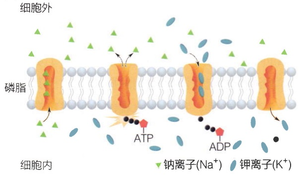

text_image

细胞外
磷脂
细胞内
钠离子(Na⁺)
钾离子(K⁺)
ATP
ADP

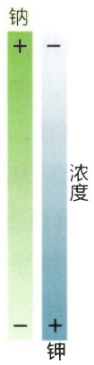

text_image

钠
+
-
浓度
- + 钾

(B)

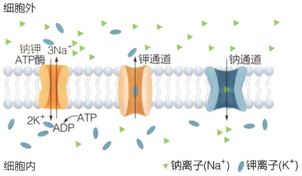

text_image

细胞外
钠钾
ATP酶
3Na+
2K+
ADP
ATP
钾通道
钠通道
细胞内
钠离子(Na+)
钾离子(K+)

膜上开了一个孔，允许离子跨过细胞膜流动。离子通道通常具有离子选择性，即只允许特定的一种或几种离子从其中流过。离子通道不消耗能量，离子的流动完全是顺应其热力学趋势的。例如，如果细胞膜上有一些开放的钾通道，因为钾离子在细胞内浓度高，钾离子会顺着浓度梯度向细胞外扩散。但是钾离子会不会一直扩散直至内外浓度相等呢？不会的。因为除了浓度差导致的扩散之外，钾离子的运动还受到电场的影响。负的膜电位意味着从膜外指向膜内的电场，钾离子本身带正电荷，在这一电场的作用下有向细胞内运动的趋势。当钾离子内外浓度差减小到一个特定的值时，其浓度差产生的向外流动的趋势恰好抵消了电场使它向内流动的趋势，这样钾离子就不再有净流动，实现了动态平衡。在细胞膜上不仅存在钾通道，也存在钠通道等其它离子通道。细胞的静息电位是各种离子泵（也包括协同转运蛋白）和离子通道综合产生的平衡态（图12-1B）。哺乳动物细胞的静息电位通常是负的，即细胞内电位低于细胞外电位，这称为细胞膜的极化，膜电位升高称为“去极化”（depolarization），降低称为“超极化”（hyperpolarization）。

离子在电解质中运动是生物细胞产生电信号的最本质的物理过程。上面我们已经定性地分析了影响离子运动的两个最主要的因素:①浓度梯度产生的扩散趋势；②电场作用下离子的定向漂移。只有定量描述离子在电解质中的运动规律，我们才有可能对相关的一系列生物问题，比如离子通道的特性，产生深入的理解。德国物理学家瓦尔特·能斯特（Walther Nernst，1864—1941）和马克斯·普朗克（Max Planck，1858—1947）最早对这一问题提供了数学描述:

$$
J = J _ {\mathrm{diffusive}} + J _ {\mathrm{electric}} = - D \cdot \nabla c + D \cdot \frac {z e}{k _ {\mathrm{B}} T} \cdot c \cdot E \cdot n _ {\circ} \tag {12-1}
$$

其中， $J$ 为通量，即单位时间内流过单位面积的离子数量； $J_{\mathrm{diffusive}}$ 为扩散通量；$J_{\mathrm{electric}}$ 为定向漂移通量； $D$ 为扩散系数； $c$ 为浓度； $\nabla c$ 为浓度梯度，在一维条件下，$\nabla c = \frac{\mathrm{d}c}{\mathrm{d}x}$， $x$ 是空间距离； $z$ 为离子所带的电荷数； $e$ 为电子电量； $k_{\mathrm{B}}$ 为玻尔兹曼常量； $T$ 为温度； $E$ 为电场强度； $n$ 为曲面法向量。（注:遵从电磁学一般习惯，本书中通量统一定义为标量，离子流过特定曲面的方向由预先定义的该曲面的法向量方向和通量的正负符号共同决定。）

式（12-1）称为能斯特-普朗克方程。该方程的第一项描述的就是扩散，即扩散通量 $J_{\mathrm{diffusive}}$ 正比于浓度梯度的相反数（菲克定律）。对于扩散的这一特性，2.4.2节已有详细阐释［参见式（2-32)]，这里不再赘述。能斯特-普朗克方程的第二项描述的是离子在电场作用下的定向漂移，这项告诉我们:定向漂移通量 $J_{\mathrm{electric}}$ 正比于电场强度。从宏观的角度，这可以理解为离子在溶液中的定向漂移遇到的阻力正比于其漂移速度（drift velocity），相关的分析参见2.4.3节。这里，我们从微观的角度对定向漂移速度与电场的关系做出另一种推导（知识窗12-1）。能斯特-普朗克方程是电场作用下离子在溶液中运动的基本规律。我们在下一小节将具体探讨如何利用能斯特-普朗克方程推导出离子通道的动力学性质。

## 知识窗12-1

# 离子在电场作用下的定向漂移速度

我们研究的离子是在溶液中而不是真空中移动，它不可能在电场的作用下无休止地加速，而是会不断地与溶液中的其它分子发生碰撞，每次碰撞之后，速度都会改变。通量 $J$ 衡量的是离子在经历了无数次碰撞过程中的平均速度。电场强度 $\pmb{E}$ 正比于离子在电场中受到的力。事实上，$z \cdot e \cdot E = q \cdot E$（$q$ 为电量），就是离子受到的电场力。按照牛顿定律，力正比于加速度。离子漂移的平均速度为什么会与电场力使离子产生的加速度成正比呢？我们下面就来计算这个平均速度（图12-2）:

$$
\langle \boldsymbol {v} \rangle = \langle \boldsymbol {u} _ {i} + \boldsymbol {a} \cdot \tilde {t} \rangle = \langle \boldsymbol {u} _ {i} \rangle + \boldsymbol {a} \cdot \langle \tilde {t} \rangle = \langle \boldsymbol {u} _ {i} \rangle + \boldsymbol {a} \cdot \tau , \tag {12-2}
$$

这里〈〉表示计算平均值。其中，〈v〉为漂移速度； $u_{i}$  为每次碰撞后的速度；a 为加速度，根据电场力的计算公式以及牛顿第二定律，可知  $a=\frac{qE}{m}$ ； $\tilde{t}$  为任意取一个时间点，距离上一次碰撞之间的时间间隔。特别需要注意的是， $\tilde{t}$  和图 12-2 中的  $t_{i}$  含义不同。 $t_{i}$  的含义是:每次碰撞发生时，距离上一次碰撞的时间。基于碰撞的独立性， $\tilde{t}$  和  $t_{i}$  拥有完全相同的概率分布，也就有同样的均值，即

$$
\tau = \langle \tilde {t} \rangle = \langle t _ {i} \rangle = \frac {\sum_ {i = 1} ^ {N} t _ {i}}{N} 。
$$

$\tau$ 是两次碰撞之间的平均间隔时间，称作弛豫时间（relaxation time）。$\tau$ 的具体计算超出了本教材的范围，有兴趣的读者请参考统计物理学的教科书。但是 $\tau$ 有两点性质是容易理解的:① $\tau$ 与离子在溶液中扩散的能力是呈正相关的。离子扩散越容易，就表明离子受到其它分子的阻碍越小，也就是与其它分子碰撞的频率越低，即 $\tau$ 越大。这就是为什么在式（12-1）中第二项里有扩散系数 $D$ 。② $\tau$ 与溶液中各种粒子的布朗运动速度负相关。这是因为布朗运动速度越快，粒子就更容易撞在一起，$\tau$ 也就越小。温度是布朗运动平均动能的度量。这就是为什么在式（12-1）中第二项的分母里有温度 $T$ 。

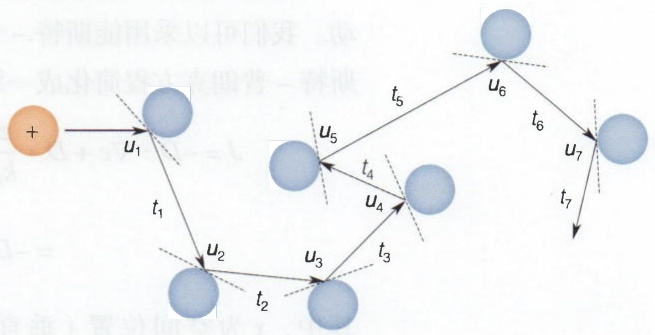

flowchart

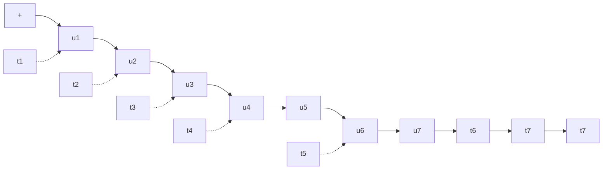

图 12-2 离子在电场作用下定向漂移，同时与溶液中的其它分子不断碰撞

当离子的质量远小于溶剂分子时，式（12-2）最右边的第一项等于0。这是因为此时碰撞时离子会被溶剂分子完全“反射”，反射角在各个角度分布概率相等。当碰撞次数很大时，不同方向的 $u_{i}$ 就会相互抵消。

综合以上分析，即可推出: $\langle\boldsymbol{v}\rangle=\boldsymbol{a}\cdot\tau=\frac{q\boldsymbol{E}}{m}\cdot\tau$ 。

当离子的质量较大时，进一步分析可以发现上面的公式仍然成立，只是需要对  $\tau$  作相应的修正。此时， $\tau$  的含义不再是两次碰撞的平均间隔时间，而是比这个平均间隔时间更长。在这种情况下，决定  $\tau$  的是离子多次碰撞后，原有初速度衰减为 0 的时间。

离子在电场作用下的平均漂移速度与电场力产生的加速度成正比，这看似有些反直觉，这一现象的本质原因是和溶液中其它分子的碰撞会不停地“重置”一个离子的速度。

## 12.1.2 离子通道的动力学性质

离子通道可以被想象成一个细胞膜上的孔道，离子通过这个孔道，跨越细胞膜流动。我们可以采用能斯特-普朗克方程描述离子在离子通道内的运动。这时我们把能斯特-普朗克方程简化成一维的形式:

$$
\begin{array}{l} J = - D \cdot \nabla c + D \cdot \frac {z e}{k _ {\mathrm{B}} T} \cdot c \cdot E \cdot n = - D \cdot \frac {\mathrm{d} c (x)}{\mathrm{d} x} + D \cdot \frac {z e}{k _ {\mathrm{B}} T} \cdot c (x) \cdot \frac {V _ {\mathrm{m}}}{\Delta L} \\ = - D \cdot \frac {\mathrm{d} c (x)}{\mathrm{d} x} + D \cdot \frac {z F}{R T} \cdot c (x) \cdot \frac {V _ {\mathrm{m}}}{\Delta L} 。 \tag {12-3} \\ \end{array}
$$

其中，$x$ 为空间位置（垂直于细胞膜的方向），我们这里定义细胞内 $x = 0$ ，细胞外 $x = \Delta L$ ，$\Delta L$ 是细胞膜的厚度；$c(x)$ 为沿 $x$ 方向上的离子浓度；$V_{\mathrm{m}}$ 为膜内外电位差，即膜电位。由于我们研究的是宏观的电学特性，出于习惯，我们将第二项里的参数转化为比较宏观的参数:我们在第二项分子分母同时乘以阿伏伽德罗常量 $(N_{\mathrm{A}})$，即 $1\mathrm{mol}$ 粒子的数量，这样就将 $e$ 转化为 $F$ （法拉第常数，即 $1\mathrm{mol}$ 电子的电量，$F = e \cdot N_{\mathrm{A}}$），将 $k_{\mathrm{B}}$ 转化为 $R$ （普适气体常量，$R = k_{\mathrm{B}} \cdot N_{\mathrm{A}}$）。重新排列式（12-3）得到:

$$
\frac {\mathrm{d} c (x)}{\mathrm{d} x} - \frac {z F}{R T} \cdot \frac {V _ {\mathrm{m}}}{\Delta L} \cdot c (x) + \frac {J}{D} = 0 _ {\circ} \tag {12-4}
$$

式（12-4）是一个关于 $c(x)$ 的一阶常微分方程，遵循常微分方程的标准解法（知识窗12-2），可以得到该方程在特定边界条件下的解析解［见式（12-9)]。

因为我们研究的是离子通道的电学性质，所以相比于通量，我们更关心流过离子通道的电流密度（current density）。因为电流密度的定义是单位时间内流过单位面积的电量，我们只需要将通量 $J$ 乘以 $1\mathrm{mol}$ 离子所携带的电量，即可得到电流密度 $J_{\mathrm{current}}$ :

$$
J _ {\mathrm{current}} = z F J = \frac {D z ^ {2} F ^ {2} V _ {\mathrm{m}}}{R T \Delta L} \cdot \frac {c _ {\mathrm{in}} - \exp \left(- \frac {z F}{R T} \cdot V _ {\mathrm{m}}\right) \cdot c _ {\mathrm{out}}}{1 - \exp \left(- \frac {z F}{R T} \cdot V _ {\mathrm{m}}\right)} 。 \tag {12-10}
$$

式（12-10）是描述离子通道中电流密度与膜电位、离子浓度之间关系的基本方程。最早得出这个方程的是美国神经科学家戴维·戈德曼（David Goldman，1910—1998）和英国神经科学家艾伦·霍奇金、伯纳德·卡茨（Bernard Katz，1911—2003），因此这个方程被称作GHK电流密度方程。从GHK电流密度方程出发，可以推出关于离子通道的一系列重要性质。例如我们之前提到，当离子通道开放时，如果时间足够长，离子浓度和膜电位最终会达到稳态，即离子的净流动等于0。那么稳态时的离子浓度梯度与膜电位有什么关系呢？我们只需要在GHK电流密度方程里，加入$J_{\mathrm{current}} = 0$ 这个条件，即可得到:

$$
c _ {\mathrm{in}} - \exp \left(- \frac {z F}{R T} \cdot V _ {\mathrm{E}}\right) \cdot c _ {\mathrm{out}} = 0 \Rightarrow V _ {\mathrm{E}} = \frac {R T}{z F} \cdot \ln \frac {c _ {\mathrm{out}}}{c _ {\mathrm{in}}} \tag {12-11}
$$

## 知识窗12-2

## 能斯特 - 普朗克方程一维形式的解析解

式（12-4）具有 $\frac{\mathrm{dy}}{\mathrm{dx}} + ay + b = 0$ 这样的形式。回顾基本的微积分方法，我们知道可以将这个方程重构为:

$$
\frac {1}{a} \cdot \frac {\mathrm{d} \left(y + \frac {b}{a}\right)}{\mathrm{d} x} + \left(y + \frac {b}{a}\right) = 0,
$$

因此该方程的通解具有以下形式:

$$
y + \frac {b}{a} = \mathrm{e} ^ {- a (x + m)} 。
$$

将这个解代入式（12-4）得到:

$$
c (x) = \exp \left[ \frac {z F}{R T} \cdot \frac {V _ {\mathrm{m}}}{\Delta L} \cdot (x + m) \right] + \frac {R T \Delta L}{z F V _ {\mathrm{m}}} \cdot \frac {J}{D} 。 \tag {12-5}
$$

为了确定参数 $m$ ，我们代入边界条件:

$$
c _ {\mathrm{in}} = c (0) = \exp \left(\frac {z F}{R T} \cdot \frac {V _ {\mathrm{m}}}{\Delta L} \cdot m\right) + \frac {R T \Delta L}{z F V _ {\mathrm{m}}} \cdot \frac {J}{D}, \tag {12-6}
$$

$$
c _ {\mathrm{out}} = c (\Delta L) = \exp \left[ \frac {z F}{R T} \cdot \frac {V _ {\mathrm{m}}}{\Delta L} \cdot (\Delta L + m) \right] + \frac {R T \Delta L}{z F V _ {\mathrm{m}}} \cdot \frac {J}{D}, \tag {12-7}
$$

其中， $c_{in}$  和  $c_{out}$  分别是细胞膜内、外的离子浓度。

式（12-6）与式（12-7）相减，再代入式（12-6），得到:

$$
c _ {\mathrm{in}} = c (0) = \frac {c _ {\mathrm{in}} - c _ {\mathrm{out}}}{1 - \exp \left(\frac {z F}{R T} \cdot V _ {\mathrm{m}}\right)} + \frac {R T \Delta L}{z F V _ {\mathrm{m}}} \cdot \frac {J}{D} 。 \tag {12-8}
$$

重新排列式（12-8），我们即可将 $J$ 解出，即

$$
J = \frac {D z F V _ {\mathrm{m}}}{R T \Delta L} \cdot \frac {c _ {\mathrm{in}} - \exp \left(\frac {z F}{R T} \cdot V _ {\mathrm{m}}\right) \cdot c _ {\mathrm{out}}}{1 - \exp \left(\frac {z F}{R T} \cdot V _ {\mathrm{m}}\right)} 。 (1 2 - 9)
$$

式（12-11）叫作能斯特方程（Nernst equation），它描述了离子平衡电位（$V_{\mathrm{E}}$）与浓度梯度的关系。选择性通透某种离子的通道开放之后，膜电位就向该离子的平衡电位趋近。当膜电位达到平衡电位时，离子将不再有净流动。从能斯特方程中可以看出，当一种阳离子的细胞外浓度高于细胞内浓度时，平衡电位是正值，反之为负值。由于钠钾ATP酶的存在，细胞外的钠离子浓度高，而细胞内的钾离子浓度高。因此，哺乳动物神经细胞中钠离子的平衡电位约为 $+55\mathrm{mV}$，钾离子的平衡电位约为 $-90\mathrm{mV}$。

能斯特方程所描述的平衡电位是只有一种离子时的情况。细胞膜上有很多不同的离子通道，当它们同时开放时，最终达到的平衡电位是各种离子综合作用的结果，即

$$
\sum_ {s} J _ {\mathrm{current}, s} = \sum_ {s} \left[ \frac {D _ {s} z _ {s} ^ {2} F ^ {2} V _ {\mathrm{m}}}{R T \Delta L} \cdot \frac {c _ {\mathrm{in} , s} - \exp \left(- \frac {z _ {s} F}{R T} \cdot V _ {\mathrm{m}}\right) \cdot c _ {\mathrm{out} , s}}{1 - \exp \left(- \frac {z _ {s} F}{R T} \cdot V _ {\mathrm{m}}\right)} \right] = 0, \tag {12-12}
$$

其中，$s$ 指不同的离子，$D_{s}$ 是不同离子的扩散系数。当不同离子携带电荷相同时，从式（12-12）中可以推出:

$$
\Delta V _ {\mathrm{E}} = \frac {R T}{z F} \cdot \ln \frac {\sum_ {s} \frac {D _ {s}}{\Delta L} c _ {\mathrm{out,s}}}{\sum_ {s} \frac {D _ {s}}{\Delta L} c _ {\mathrm{in,s}}} = \frac {R T}{z F} \cdot \ln \frac {\sum_ {s} P _ {s} c _ {\mathrm{out,s}}}{\sum_ {s} P _ {s} c _ {\mathrm{in,s}}}, \tag {12-13}
$$

其中，一种离子的扩散系数除以细胞膜厚度定义为渗透性 $P_{s} = \frac{D_{s}}{\Delta L}$ 。

式（12-13）叫做GHK电压方程，它描述了多种离子通道并存时的平衡电位。从式（12-13）中可以看出一种离子的渗透性越大，细胞的膜电位就越接近这种离子的平衡电位。哺乳动物的神经元在静息状态下，钾离子的渗透性远大于钠离子的渗透性（$P_{\mathrm{K}^{+}}: P_{\mathrm{Na}^{+}} \approx 1:0.04$），因此神经元的静息电位更接近钾离子的平衡电位，约为 $-70\mathrm{mV}$。

GHK电流密度方程所描绘的离子通道电流-电压关系还是非常复杂的。在很多时候，为了方便研究生物学问题，我们希望能以一种相对简单的形式对GHK电流密度方程进行近似，用一些我们熟悉的简单电路元件模拟离子通道的特性。离子通道的主要作用是使得膜电位趋近于平衡电位，因此我们可以把离子通道想象成一个电压为平衡电位（ $V_{\mathrm{E}}$ ）的电池。同时，离子通道允许离子跨膜流动，并对离子流动产生一定的阻力，因此可以把离子通道想象为一个遵循欧姆定律的电阻。综合起来看，我们希望能把离子通道简化成一个串联的电池和电阻（图12-3），即

$$
I = g (V _ {\mathrm{m}} - V _ {\mathrm{E}}), \tag {12-14}
$$

其中， $I$ 为电流， $g$ 为电导， $V_{\mathrm{m}}$ 为膜电位， $V_{\mathrm{E}}$ 为平衡电位。式（12-14）本质上是GHK电流密度方程[式（12-10)]的一阶近似。在大多数情况下，研究细胞中的离子通道时，使用这个近似的方程就足以满足需求。式（12-14）相当于把GHK电流密度方程在平衡电位附近做泰勒展开。泰勒展开里一阶项的系数等于电流在平衡电位处对电压的导数。对式（12-10）求导数，同时把式（12-11）代入，得到:

$$
g = \frac {\mathrm{d} I}{\mathrm{d} V _ {\mathrm{m}}} \Big | _ {V _ {\mathrm{m}} = V _ {\mathrm{E}}} = P S \cdot \frac {z ^ {2} F ^ {2}}{R T} \cdot \frac {c _ {\mathrm{out}} \cdot c _ {\mathrm{in}}}{c _ {\mathrm{out}} - c _ {\mathrm{in}}} \cdot \ln \frac {c _ {\mathrm{out}}}c _ {\mathrm{in}}, \tag {12-15}
$$

其中， $S$ 为细胞膜面积。根据式（12-15），离子通道的电导并不仅仅与离子以及离子

图 12-3 钾、钠通道的电流 - 电压关系

GHK 电流密度方程是对离子通道的精确描述。串联电池、电阻的简化模型是 GHK 电流密度方程的一阶近似。

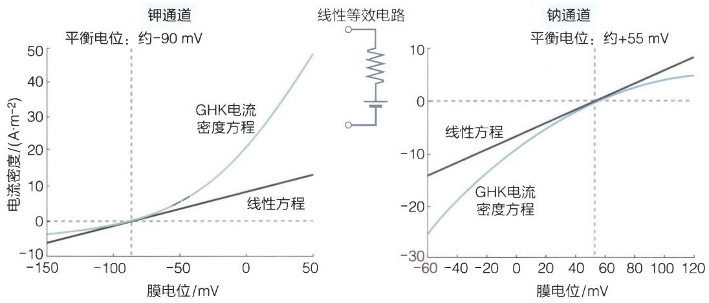

通道自身的属性相关，也受到细胞内外离子浓度的影响（渗透性 $P = \frac{D}{\Delta L}$ 才是离子以及离子通道自身的物理属性）。当然，在细胞内外离子浓度变化不大情况下，我们经常把一个离子通道的电导近似认为是一个固定的值。

从图12-3中可以看出，当膜电位与平衡电位相差较远时，GHK电流密度方程会显著偏离式（12-14）所描述的线性方程。如果平衡电位为负（如钾通道），则膜电位高时（去极化），电流比线性方程所预测的电流更大；膜电位低时（超极化），电流比线性方程所预测的电流更小。反之，如果平衡电位为正（如钠通道），则膜电位高时（去极化），电流比线性方程所预测的电流更小；膜电位低时（超极化），电流比线性方程所预测的电流更大。离子通道的这种非线性性质称为戈德曼整流（Goldman rectification）。

## 12.1.3 离子通道离子选择性的结构基础

离子通道只允许特定的一种或几种离子通过，这称为离子选择性。离子选择性对离子通道的功能有重要意义。如果没有离子选择性，就不可能利用不同离子的平衡电位实现膜电位向特定的方向变化。离子通道如何做到只允许特定的离子通过呢？离子的大小并不能够完全解释离子通道的离子选择性。比如钾通道只允许钾离子通过，钠离子却不能通过，但是钠离子比钾离子要小。是什么样的通道结构可以实现特异性地通过较大的钾离子而不是更小的钠离子呢？这长久以来是一个谜团。有趣的是，解答这个科学谜题的最初线索并不来源于对钾通道的结构解析，而是来自一个意想不到的领域——毒理学。

季铵盐，例如四乙基胺（TEA）离子，是一类常见的神经毒剂。对季铵盐毒性的认识远远早于离子通道的发现。早在1868年，英国毒理学家克伦·布朗（Crum Brown，1838—1922）和托马斯·弗雷泽（Thomas Fraser，1841—1920）就发现很多种季铵盐都能够导致动物神经麻痹。当1952年霍奇金和赫胥黎报道了动作电位的离子通道基础之后（见12.2.1节），很多科学家利用霍奇金和赫胥黎的实验方法，投身到了探索神经毒剂作用机制的研究之中。在美国国立卫生研究院工作的两位日本科学家田崎一二（Ichiji Tasaki，1910—2009）和萩原生长（Susumu Hagiwara，1922—1989）在1957年最早认识到TEA是钾通道的特异性阻断剂。离子通道的阻断剂有两种类型:竞争性抑制剂和非竞争性抑制剂。竞争性抑制剂是指该抑制剂和离子本身竞争通道的孔道（pore），从而阻挡离子流通。非竞争性抑制剂是指该抑制剂与离子通道非孔道的位置结合，通过改变蛋白质的构象，影响孔道形态，阻断离子流通。可以看出，竞争性抑制剂通常是离子本身的类似物，只有这样才能与孔道结合，与离子形成竞争。例如，铯离子（$\mathrm{Cs^{+}}$）就是钾通道的竞争性抑制剂。TEA作为一种有机物，其分子结构与钾离子大不相同，其分子大小远远大于钾离子（图12-4），难以看出和钾离子有任何相似性。从这点上说，TEA不太可能是竞争性抑制剂。但令人惊讶的是，美国神经科学家克雷·阿姆斯特朗（Clay Armstrong）等人通过一系列动力学实验清晰地证明了，TEA恰恰是钾通道的竞争性抑制剂。这是为什么呢？

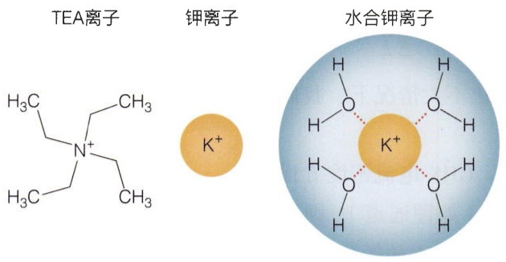

chemical

Chemical structure of potassium chloride (K⁺) showing TEA, platinum, and water chloride ions with labeled atoms and bonds

图 12-4 四乙基胺（TEA）离子与钾离子

阿姆斯特朗等人提出了一个精妙的想法:进入钾通道的并不是孤立的钾离子，而是通过配位键和周围的水分子结合的水合钾离子（图12-4）。水合钾离子会被离子通道中的氨基酸残基脱水，然后流过离子通道。TEA中的氮和乙基靠共价键结合。TEA之所以能竞争性阻断钾通道，是因为它是一个永远无法被“脱水”的水合钾

离子类似物。

阿姆斯特朗进一步合成了一系列TEA衍生物，在TEA之后接上了长短不一的碳链“尾巴”。碳链是疏水的，可以与蛋白质中疏水的部分结合。在1971年的一篇论文中，阿姆斯特朗将这些TEA衍生物注射入细胞内部，观察哪一种衍生物与钾通道的结合能力最强。依靠碳链作为“尺子”，阿姆斯特朗提出:钾通道孔道靠近细胞内侧的部分，有一长度约为 $9\sim 12$ 个烃基的疏水区域（或更长，因为阿姆斯特朗当时并未测试更长的碳链）。

阿姆斯特朗对钾通道结构的推测是否正确呢？这些结构特性又和离子选择性有什么关系呢？这要等近30年之后才见分晓。

1987年，美国神经科学家叶公杼（Lily Jan）与其研究团队在果蝇中克隆了一个名为Shaker的基因，这是一个钾通道蛋白质的基因，也是被测序的首个钾通道。Shaker基因的发现不仅开启了离子通道的功能和结构研究，也推动了神经科学和心脏生物学等领域的发展。其对于离子通道的研究，具有深远的生理学和医学意义。后来基于膜片钳技术的发明，人们对钾通道有了进一步的认识。但是由于缺乏结构信息，针对其工作机理的理解仍然不清楚。直到1998年罗德里克·麦金农（Roderick MacKinnon）通过X射线晶体学解析了首个钾通道的结构。阿姆斯特朗为麦金农实验室1998年发表在Science杂志上的文章撰写了新闻评述，称“生物物理学家的梦想终于实现”。

钾通道能够特异性地选择钾离子通过，甚至能够排除比钾离子更小的钠离子。那么，它的离子选择性是如何实现的呢？钾通道的三维结构给出了答案。如图12-5所示，钾通道的结构呈现同源四聚体，四个亚基围绕中心轴对称排列（参见图3-66），形成一个中心孔道，即钾离子通过路径。孔道的两端呈现负电性，帮助吸引钾离子；孔道的中段呈现疏水性，可以使钾离子快速通过。钾离子在通过钾通道前被8个水分子包围，呈水合形式。这8个水分子分布在钾离子两侧各4个，TEA恰好是模仿了钾离子和其一侧的4个水分子。钾通道的入口处，存在一个被称为选择性过滤器（selectivity filter）的结构。钾通道的选择性过滤器包含一个高度保守的特定序列（GYG基序），位于选择性过滤器的内腔，形成一个狭窄的通道，对于钾通道的离子选择性至关重要。选择性过滤器的主链羰基氧原子形成了4个钾离子结合位点。由于钾通道是四聚体，每个羰基在孔道中排列成4个一组的平面结构。当钾离子位于两组羰基中间时，上下两组羰基刚好模拟了水合钾离子周围的8个水分子，在三维空间上与钾离子完美匹配，而其它离子无法匹配通过该选择性过滤器，从而实现了离子选择性。虽然比钾离子尺寸小的钠离子不会被选择性过滤器卡在外面，但是由于固定的选择性过滤器无法收缩到足以正确结合较小的钠离子，钠离子无法与选择过滤器完美匹配，使得去水合的能量消耗更高，因此不适合通过钾通道。钾通道的选择性过滤器只有 $12\AA$ 的长度，孔道的其余部分则更宽。在离子选择性过滤器下方是一个疏水的腔，可以减少钾离子与通道的紧密相互作用，有利于提高钾离子通量。因此，钾通道中央的疏水区域在保证离子通道的选择性和电导率之间的平衡中起到了关键的作用。钾通道孔道区域的这些结构特征，与阿姆斯特朗之前通过生理学、药理学实验做出的推测是非常契合的。

(A)

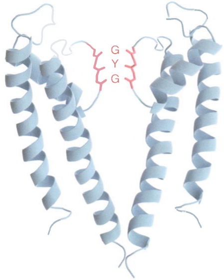

chemical

3D protein structure diagram showing alpha-helices with labeled residues G, Y, and G

(B)

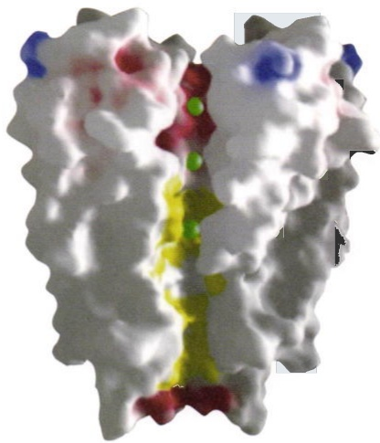

natural_image

3D molecular surface model with color-coded regions (no text or labels visible)

(C)

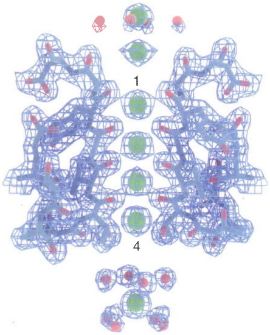

chemical

Molecular structure diagram showing a complex network with labeled atoms and bonds, including green and red spheres representing atoms in specific regions.

图12-5 钾通道的结构和离子选择性过滤器

麦金农的这一工作为钾离子传导和选择性提供了结构基础，极大地推进了我们对钾通道的理解。他们的发现不仅解释了这些通道如何允许钾离子通过，而且还揭示了这些通道如何阻止其它离子通过。这些发现为进一步研究离子通道的功能以及开发新的药物提供了基础。麦金农因此获得了2003年诺贝尔化学奖。

后来，除了钾通道，其它离子通道的结构也被解析，如电压门控钙通道 $\mathrm{Ca_V}$ 等，进一步推进了人们对离子通道机制的理解。钙通道和钾通道的底物不同，特异性的离子选择性是由不同的选择性过滤器来实现的。与钾通道不同，钙通道的选择性过滤器内腔中心包含四个高度保守的氨基酸残基（EEEE或者EEDD）（图12-6）。这些带负电的氨基酸残基与二价的钙离子发生更稳定的电荷相互作用，从而选择性地允许钙离子通过。

（A）钾通道的选择性过滤器（GYG基序）（PDB编号:1BL8）。（B）钾通道孔道处氨基酸残基的电性（蓝色:正电；红色:负电；黄色:疏水）。（C）钾离子（绿色小球）在选择性过滤器内部的位置（PDB编号:1K4C）。（B，引自Doyle, et al. Science, 1998, 280(5360): 69-77）

图 12-6 电压门控钙通道 $Ca_{v}1.1$ 的选择性过滤器

P1、P2为形成孔道口选择性过滤器的两段结构域，S5、S6为组成孔道的跨膜结构域。Ⅰ、Ⅱ、Ⅲ、Ⅳ分别标记电压门控钙通道中的4个同源结构域。图中绿色小球代表钙离子（PDB编号:3JBR）。

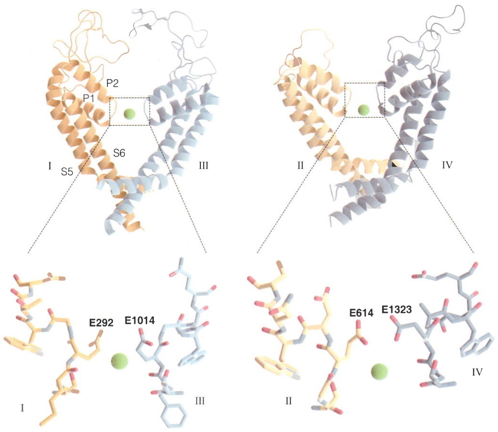

## 12.2 生物大分子感应电

## 12.2.1 电压门控离子通道的动力学

12.1节主要讨论了生物细胞如何利用离子浓度梯度产生电压。那么细胞能否响应膜电位的变化呢？18世纪意大利著名生理学家路易吉·加尔瓦尼（Luigi Galvani，1737—1798）注意到，当带静电的解剖刀触碰到青蛙的神经时，会引发该神经所支配的肌肉产生震颤。加尔瓦尼猜想:动物神经可以传导电压的变化，最终引发肌肉收缩。加尔瓦尼后来通过一系列实验证实了这一猜想。加尔瓦尼是研究生物电现象的先驱，被认为是电生理学之父。他的工作不仅极大地推动了科学的发展，在文化史上也有重要地位。现在英语里的常用词galvanize（激发、振奋）就来自他的名字。受加尔瓦尼启发，很多欧洲的生理学家进一步深入研究了神经系统响应电的机理。德国生理学家埃米尔·杜布瓦-雷蒙（Emil du Bois-Reymond，1818—1896）发现，当外界的刺激达到一定程度时，会激发神经细胞自发产生电位变化，这称为动作电位（action potential）。动作电位可以沿着神经传导。但是，动作电位是怎么产生的？什么样的生物分子能响应电压的变化？这些基本的问题长时间没有得到解答。