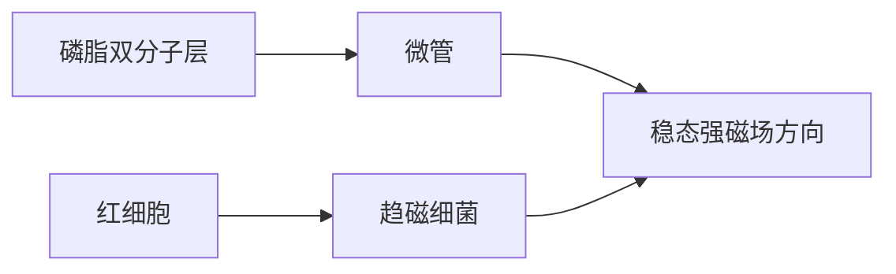
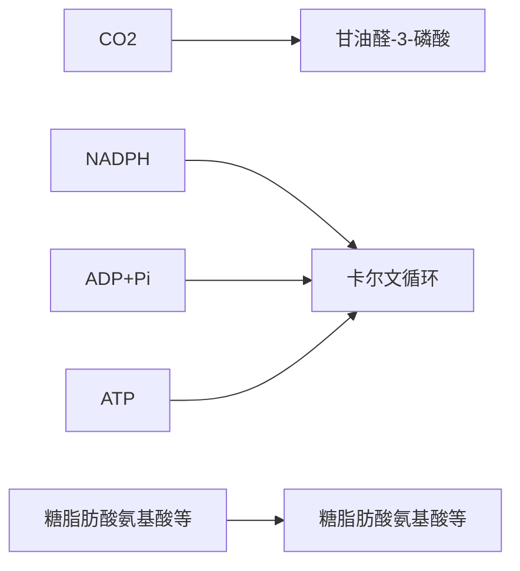

1952年，划时代的突破出现了。英国神经科学家霍奇金和赫胥黎在Journal of Physiology杂志四月份的那一期上，连续发表5篇论文，系统地揭示了动作电位产生的生物物理机制。通过一系列精妙的生理学实验，他们利用数学方法推测了产生动作电位的离子通道的各种性质。这一年，距离第一个离子通道的基因被测序还有35年，距离人类第一次解析钾通道的结构还有46年，距离人类第一次解析钠通道的结构还有59年。一切科学研究的终极追求都是揭示自然现象背后的统一原理。例如，物理学家进行了长期的天文学观测，最终由牛顿根据前人积累的大量行星轨道数据，提出了万有引力定律。生物学的大部分领域目前还处在较为初期的发展阶段，很多研究主要侧重数据的积累。霍奇金和赫胥黎的工作是生物学领域里为数不多的从实验现象向数学理论的升华，不仅为后来离子通道的研究奠定了基础，也激励了一代又一代的科学家投身到以数学、物理的方法研究生物体系的事业中。

霍奇金和赫胥黎以枪乌贼的巨大轴突为研究对象。枪乌贼巨大轴突的直径约$600\mu \mathrm{m}$，如此粗的轴突使得霍奇金和赫胥黎可以将两根银电极缠绕在玻璃毛细管上（毛细管直径约 $70~{\mu\mathrm{m}}$），插入轴突的内部（图12-7）。利用这两根银电极，霍奇金和赫胥黎在巨大轴突中开展了一系列电压钳（voltage clamp）实验。霍奇金和赫胥黎所使用的电压钳这一实验技术最早由美国神经科学家霍华德·柯蒂斯（Howard Curtis，1906—1972）和肯尼斯·科尔（Kenneth Cole，1900—1984）发明。在电压钳实验中，一根电极用于测量膜电位，另一根用于注射电流。反馈放大器是一个运算放大器（operational amplifier），运算放大器的基本性质使得膜电位和指令电压时时保持一致，如果不一致，放大器的输出端会产生反馈电流，改变膜电位至指令电压。这一装置可以实现快速将膜电位钳制在实验者任意设定的电压值。如果离子通道的电导率发生变化，钳制膜电位所需要的反馈电流也就会随之发生变化。因此，将膜电位钳制在不同电压上，测量反馈电流的大小，就可以确定离子通道的电流-电压关系。通过改变细胞外溶液的钾离子、钠离子浓度，能够区分出钾通道、钠通道的电流。霍奇金和赫胥黎发现:神经轴突上的钾通道、钠通道的电导都会随膜电位的变化而发生变化。这些离子通道能响应膜电位，称为电压门控离子通道（voltage-gated ion channel）。电压门控离子通道是神经细胞产生动作电位的核心。

图12-7 枪乌贼巨大轴突中的电压钳实验（A，改编自Hodgkin et al. Journal of Physiology, 1952, 116(4): 424-448）

(A)

text_image

(A)
电极在巨大
轴突中的照片

text_image

电压电极 电流电极
玻璃毛细管
直径:70 μm
电压电极末端
绝缘胶
电流电极末端

(B)

flowchart

霍奇金和赫胥黎用一系列数学方程描述了电压门控离子通道的特性。我们先来看霍奇金和赫胥黎对电压门控钾通道的描述:

$$
I _ {\mathrm{K}} = \overline {{g}} _ {\mathrm{K}} \cdot n ^ {4} \cdot (V _ {\mathrm{m}} - V _ {\mathrm{K}}), \tag {12-16}
$$

$$
\frac {\mathrm{d} n}{\mathrm{d} t} = \alpha_ {n} (V _ {\mathrm{m}}) \cdot (1 - n) - \beta_ {n} (V _ {\mathrm{m}}) \cdot n, \tag {12-17}
$$

$$
\alpha_ {n} (V _ {\mathrm{m}}) = \frac {0 . 0 1 (1 0 - \Delta V)}{\mathrm{e} ^ {\frac {1 0 - \Delta V}{1 0}} - 1}, \tag {12-18}
$$

$$
\beta_ {n} (V _ {\mathrm{m}}) = 0. 1 2 5 \cdot \mathrm{e} ^ {- \frac {\Delta V}{8 0}} 。 \tag {12-19}
$$

其中， $I_{K}$  为钾离子电流； $\bar{g}_{K}$  为钾通道最大电导（即细胞中全部钾通道开放时的电导）；n 为决定钾通道开放概率的门控参数； $V_{m}$  为膜电位； $V_{K}$  为钾离子平衡电位； $\alpha_{n}$ 、 $\beta_{n}$  为门控参数 n 随时间变化的动力学参数，它们本身是膜电位  $V_{m}$  的函数； $\Delta V$  为膜电位去极化值， $\Delta V = V_{m} - V_{rest}$ （ $V_{rest}$  是细胞膜静息电位）。

式（12-16）是对离子通道基本性质的一阶近似描述，我们在上一节已经讨论过[见式（12-14)]。其中 $\overline{g}_{\mathrm{K}}\cdot n^{4}$ 是开放的钾通道的电导。这个公式里的 $n$ 是一个随时间变化的参数，$n^4$ 是钾通道开放的概率。值得注意的是，这里的指数4是霍奇金和赫胥黎根据实验数据拟合的结果，他们根据这个结果推测:电压门控钾通道有4个能感受膜电位的“激活门”，每个门有“开放”、“关闭”两种状态。这4个激活门是独立的，只有当它们全都处于“开放”状态时，整个离子通道才是开放的。

式（12-17）是对每个激活门在两种状态之间切换的动力学描述，遵循基本的质量反应定律，$\alpha_{n}$、$\beta_{n}$ 是这个可逆过程的反应速率。$\alpha_{n}$、$\beta_{n}$ 都与膜电位有关，这是离子通道“电压门控”的基础。式（12-18）和式（12-19）具体描述了 $\alpha_{n}$、$\beta_{n}$ 与膜电位的关系。这两个公式的形式是经验方程，霍奇金和赫胥黎在他们的论文中写道，采用这两个公式首先是为了拟合实验数据，其次是因为这样的方程形式与GHK电流密度方程有一定相似性［见式（12-10）］。为什么霍奇金和赫胥黎会期待电压门控参数的动力学特性会类似于用于描述电荷在恒场中运动的GHK电流密度方程呢？这是因为在那个时代，有一种流行的“载流子”（carrier）假说，即认为离子能够跨越细胞膜运动是因为膜上有一些本身带电荷的生物大分子（如蛋白质），这些大分子自身能够在电场作用下从细胞膜的一侧运动到另一侧，并在细胞膜两侧与特定离子发生结合或分离，从而实现将离子跨膜运输。基于此种理论，霍奇金和赫胥黎猜测载流子的动力学会遵循GHK电流密度方程。当然，他们自己的实验结果表明了 $\alpha_{n}$ 与 $\beta_{n}$ 并不遵循GHK电流密度方程。同时结合其它结果，霍奇金和赫胥黎逐渐形成了后来被证明正确的离子通道理论。之后人们发现，如果假定电压门控离子通道需要在电场作用下越过特定能垒实现构象变化，可以从自由能的角度推导出相似的形式。从式（12-18）和式（12-19）中可以看出，膜电位越高（去极化），$\alpha_{n}$ 越大，$\beta_{n}$ 越小，$n$ 也就向增大的方向移动。这意味着电压门控钾通道会被膜电位的去极化所激活。

我们接下来再来看霍奇金和赫胥黎对电压门控钠通道的描述:

$$
I _ {\mathrm{Na}} = \overline {{g}} _ {\mathrm{Na}} m ^ {3} h (V _ {\mathrm{m}} - V _ {\mathrm{Na}}) \tag {12-20}
$$

$$
\frac {\mathrm{d} m}{\mathrm{d} t} = \alpha_ {m} (V _ {\mathrm{m}}) \cdot (1 - m) - \beta_ {m} (V _ {\mathrm{m}}) \cdot m \tag {12-21}
$$

$$
\frac {\mathrm{d} h}{\mathrm{d} t} = \alpha_ {h} (V _ {\mathrm{m}}) \cdot (1 - h) - \beta_ {h} (V _ {\mathrm{m}}) \cdot h \tag {12-22}
$$

$$
\alpha_ {m} (V _ {\mathrm{m}}) = \frac {0 . 1 (2 5 - \Delta V)}{\mathrm{e} ^ {\frac {2 5 - \Delta V}{1 0}} - 1} \tag {12-23}
$$

$$
\beta_ {m} (V _ {\mathrm{m}}) = 4 \mathrm{e} ^ {- \frac {\Delta V}{1 8}} \tag {12-24}
$$

$$
\alpha_ {h} (V _ {\mathrm{m}}) = 0. 0 7 \mathrm{e} ^ {- \frac {\Delta V}{2 0}} \tag {12-25}
$$

$$
\beta_ {h} (V _ {\mathrm{m}}) = \frac {1}{\mathrm{e} ^ {\frac {3 0 - \Delta V}{1 0}} + 1} \tag {12-26}
$$

式（12-20）至式（12-26）中的大部分参数与式（12-16）至式（12-19）中类似，这里就不再重复解释了。从这两组公式中，可以看出电压门控钠通道和电压门控钾通道相比，有以下两点显著不同:①式（12-20）中，根据实验数据拟合的结果，$m$ 的指数是3而不是4（$m$ 是钠通道激活门开放的概率）。霍奇金和赫胥黎据此推测，电压门控钠通道有3个独立的“激活门”，当这3个门都打开时，钠通道就开放了。与钾通道一样，电压门控钠通道也会被膜电位的去极化激活。②和钾通道相比，影响电压门控钠通道开放的因素多了一个参数 $h$ 。霍奇金和赫胥黎在实验中观察到，膜电位去极化引发的钠电流只能持续很短的时间，随即快速消失。也就是说，钠通道在激活后会很快失活。从式（12-25）和式（12-26）中看出，与 $m$ 相反，膜电位越高（去极化），$h$ 越向减小的方向移动。参数 $h$ 描述了钠通道的“失活门”。

式（12-16）至式（12-26）称作霍奇金-赫胥黎方程（Hodgkin-Huxley equation），它们系统描述了电压门控离子通道的动力学。通过对实验数据的拟合，霍奇金和赫胥黎推测，电压门控钾通道有4个能感受电压的激活门，电压门控钠通道则有3个激活门和1个失活门。霍奇金和赫胥黎的所有这些推测，与几十年以后分子生物学、结构生物学的发现惊人地一致（参见12.2.2节）。

需要说明的是，霍奇金和赫胥黎只是研究了枪乌贼巨大轴突上的电压门控钾、钠通道。并不是所有的电压门控钾、钠通道都具有完全相同的性质。例如，第一个被测序的钾通道Shaker就是有一个失活门的通道，会在膜电位较高时快速失活。

从霍奇金-赫胥黎方程出发，可以通过数学建模复现神经元的动作电位。当细胞膜在外界输入的刺激下发生去极化时，钠通道开放得会越来越多，钠离子流入细胞内。当膜电位去极化达到一个阈值时，被激活的电压门控钠通道产生的流向细胞内的电流会超过所有通道产生的流向细胞外的电流，进入“正反馈”状态。这时即使没有外界输入，细胞膜也会自我去极化，导致膜电位快速升高（图12-8）。这种由膜电位去极化引发的膜电位的进一步去极化，称为再生性电活动（regenerative activity）。随着膜电位的升高，越来越多的电压门控钠通道会失活，同时电压门控钾通道会开放。最终，钾离子外流会超过钠离子内流，动作电位达到顶峰，膜电位开始复极化，直至恢复到静息电位，一个动作电位完成，整个过程需1\~2 ms。这时，大部分电压门控钠通道都已经失活，即使有外界的输入，细胞也不会再产生动作电位，这称为不应期（refractory period）。钠通道会逐渐从失活状态恢复到关闭但可以被激活的状态，这时如果外界刺激仍旧能够使膜电位超过阈值，细胞将产生下一个动作电位。钠通道的失活特性对于动作电位的产生和传导意义重大。如果钠通道不能快速失活，膜电

line

| 时间 (ms) | 钠通道电导 \((mS \cdot cm^{-2})\) | 钾通道电导 (mV) | 膜电位 (mV) |
| --- | --- | --- | --- |
| 0 | ~0 | ~-65 | ~-65 |
| 1 | ~30 | ~-25 | ~30 |
| 2 | ~0 | ~-65 | ~-80 |
| 3 | ~0 | ~-65 | ~-75 |

图 12-8 动作电位的离子基础

位就会长时间维持在去极化水平上，或者由于和钾通道的相互作用形成平滑的振荡，而不能产生动作电位那样离散的、快速的脉冲。

动作电位是神经元传导信息的基础。动作电位沿轴突传导时，具有“全或无”的性质，每个动作电位的波形几乎都是完全一样的。这相当于一个数字信号，保证了神经信号传递的可靠性。

## 12.2.2 电压门控的结构基础

上一节提到，电压门控离子通道响应膜电位变化而改变构象，从而调节其打开或关闭，将膜电位转变为下一步的电流变化，产生再生性电活动，从而促成电信号的传递。在这个过程中，某些流入细胞的离子（如钙离子）同时发挥着第二信使的作用，进一步调控下游生化信号通路。电压门控离子通道的这一特性使得其在神经元和肌肉组织等的兴奋性细胞中起着至关重要的作用。那么，电压门控是如何实现的？下面以经典的电压门控钾通道和钠通道为例介绍电压门控的结构基础。

电压门控离子通道具有感受电压的独特结构域称为电压感受器（voltage sensing domain，VSD）。电压感受器对膜电位的依赖性几乎可以像开关一样，仅在几十毫伏的电压下就能从“关”状态变为“开”状态。这种对电压的严格依赖性是因为当电压感受器从关闭状态切换到开启状态时，电压感受器上的电荷［称为门控电荷（gating charge）］会发生跨膜运动。在经典的电压门控离子通道中，4个电压感受器总共具有12到14个门控电荷。这些电荷来自电压感受器的第四个跨膜螺旋（S4）上带有正电荷的氨基酸——主要是精氨酸，偶尔是赖氨酸。

经典的电压门控钾通道（$\mathrm{K_V}$ 通道）由同源四聚体组成，每个单体包含6个跨膜螺旋，称为S1-S6。$\mathrm{K_V}$ 通道由一个中心的离子传导孔道和外周四个电压感受器组成。其中，S1至S4组成了电压感受结构域，4个S5和S6共同形成了离子通过的孔道结构域（pore domain）（图12-9）。在静息状态，通道的4个S6螺旋的胞内侧通过疏水氨基酸侧链相互作用形成胞内门控，使通道处于关闭状态。在电压感受器的S4螺旋上，每三个残基位置上有一个带正电荷的精氨酸或赖氨酸残基，作为门控电荷。每个电压感受器又通过细胞内表面横向的S4-S5连接螺旋与孔道结构域连接。膜电位的变化作用在S4上的带正电荷的残基上，引发S4及和其相邻的结构发生构象变化。当膜电位去极化时，膜内电势升高，图12-10中电压感应器中红色的S4螺旋上的带正电氨基酸响应膜电势变化可以相对其它部分（S1-S3）发生向胞外侧的移动，这会对S4-S5连接处施加力，带动其横向运动，进一步使得孔道结构域的S5和S6发生向外扩张的构象变化。当胞内门控区域的疏水氨基酸互相远离，孔道半径超过离子半径的时候，中心孔道结构域打开，使得离子能够顺利通过，进而通道处于开放状态。 $\mathrm{K}_{\mathrm{V}}$ 通道4个亚基的VSD的运动是独立的。只有当4个亚基的VSD全部在膜电位去极化的作用下移动到“开放”位置时，整个通道的孔道才开放。这是霍奇金-赫胥黎方程中钾通道有4个“门”的结构基础。

(A)

text_image

孔道结构域
S4
电压感受结构域

(B)

text_image

电压感受结构域
孔道结构域
选择性过滤器
S1 S2 S3 S4+++++
S5 S6
N C

图 12-9 电压门控离子通道电压门控结构域及单个亚基的拓扑结构

（A）每个亚基中的跨膜螺旋S1-S4组成电压感受结构域，来自4个亚基的S5和S6共同组成孔道结构域。（B）每个亚基包含6个跨膜螺旋S1-S6，其中S4富含带正电的氨基酸残基，在电压门控中起重要作用。

电压门控钠通道（$\mathrm{Na}_{\mathrm{V}}$ 通道）和电压门控钙通道（$\mathrm{Ca}_{\mathrm{V}}$ 通道）与 $\mathrm{K}_{\mathrm{V}}$ 通道的结构特征相似，但在真核生物中它们的通道亚基由一条多肽链组成，包含4个同源结构域（I-IV），每个结构域包含6个跨膜螺旋S1-S6。这相当于是把四聚体 $\mathrm{K}_{\mathrm{V}}$ 通道的4个亚基编码在了同一段基因里。与 $\mathrm{K}_{\mathrm{V}}$ 通道类似，每个同源结构域里的S1至S4为电压感受结构域，4组S5和S6共同形成了离子孔道。4组S4螺旋上同样包含门控电荷，形成独特的 $3_{10}$ 螺旋，使得其带正电氨基酸残基基本朝向电压感受结构域内侧。门控电荷的电压依赖性运动由电压感受器上的一些保守残基协助，包括S2上的两个极性残基和一个芳香族残基，以及S3上的一个天冬氨酸残基。这些残基在功能上被定义为电荷转移中心（charge transfer center），能够与S4上的带正电氨基酸残基形成动态

图12-10 $K_{\mathrm{v}}$ 通道电压门控的结构基础

为便于理解，图中仅显示四聚体通道两个对角线上的亚基。

(A)

chemical

Molecular structure diagram showing protein domains with labeled helices S1–S7 and N termini

关 $\longleftrightarrow$ 开

(B)

chemical

Diagram of a protein complex showing helical structures with labeled domains S1–S6 and N, and a K+ ion binding site

text_image

III-IV 接头
M
F
L
S6IV
S6III
VSDIV
VSDIII
20°
III-IV 接头
M
F
L
中心孔道
VSDI
VSDII
90°
VSDIV
S5IV
S4-S5IV
F
M
L
III-IV 接头
S6IV
S6III
S4-S5III

图 12-11 Na $_{v}$ 1.4 通道快速失活机制

图中标注了电鳗钠通道EeNav1.4四个同源结构域中的电压感受器（VSD）。第3、4个同源结构域之间的III-IV接头的LFM基序插入中心孔道附近区域，引起钠通道的失活。该结构是通道处于失活状态下获得的，但通道的中心孔道区域由于去垢剂分子（图中未显示）的堵塞作用仍处于开放状态，因此该结构实际更接近通道预失活的状态（PDB编号:5XSY）。

相互作用网络，从而稳定电压感受器在不同状态下的构象。

此外，$\mathrm{Na}_{\mathrm{V}}$ 通道有一个独特的快速失活机制，即在通道打开后不久（$1 \sim 2 \mathrm{~ms}$ 内），无论膜电位如何，通道都会因失活而自动关闭，从而防止钠离子持续流入，帮助维持细胞膜稳态。来自电鳗的钠通道结构首次揭示了钠通道的失活机制（图12-11）。在该结构中，位于通道同源结构域Ⅲ和IV之间的连接区域Ⅲ-IV接头（Ⅲ-IV linker）的快速失活基序LFM（由Leu-Phe-Met三个疏水残基组成，对应人源钠通道中的IFM基序）嵌入同源结构域Ⅲ和IV的S6和S4-S5之间的疏水区域。LFM基序并不直接阻塞孔道，而是通过挤入 $\mathrm{S6}_{\mathrm{III}}$ 和 $\mathrm{S6}_{\mathrm{IV}}$ 附近的凹槽，推动孔道关闭，从而实现钠通道的快速失活。在膜复极化时，Ⅲ-IV接头发生构象变化离开嵌入区域，通道从失活状态恢复，为下一次去极化做好准备。

钠通道的4个同源结构域里的VSD的功能不是完全相同的。通过特异性的突变每个结构域的VSD，科学家们发现钠通道前3个结构域的VSD与通道孔道的开放/关闭相关性较大，而第4个结构域的VSD的运动与通道的失活密切相关。第4个结构域的VSD移动到“开放”状态，是钠通道失活的限速步骤。这解释了为什么霍奇金-赫胥黎方程中钠通道有3个“激活门”和1个“失活门”。从蛋白质结构的角度看，钠通道4个结构域的VSD为什么会有不一样的作用目前还缺乏完善的解释，有待进一步研究。

## 12.2.3 电压依赖的配体门控离子通道

除了12.2.1节和12.2.2节介绍的电压门控离子通道以外，神经元中还有一类配体门控离子通道（ligand-gated ion channel）也受到膜电位的调控，这类离子通道在学习记忆等多种认知活动中发挥着重要作用。为了理解这类离子通道的特性，我们首先需要了解什么是配体门控离子通道。

配体门控离子通道是参与神经元之间信号传递的重要分子。神经元主要依靠电信号计算信息，但是不同神经元之间的信号传递，主要不是通过直接的电场的传导，而是借助化学信号。英国神经科学家卡茨和澳大利亚神经科学家约翰·埃克尔斯（John Eccles，1903—1997）等最早深入揭示了这一过程的机制（图12-12）。神经元之间的连接结构称为突触（synapse）。哺乳动物神经系统中，大多数突触在突触前神经元的轴突（axon）与突触后神经元的树突（dendrite）或胞体（soma）之间形成。突触前神经元的轴突在形成突触的位置会形成膨大的结构，称为突触结（synaptic bouton）。突触结内聚集着很多脂膜包裹的囊泡（vesicle）。囊泡内含有特定的小分子化合物，称为神经递质（neurotransmitter），是神经细胞之间传递信息的载体。动作电位传导至突触结时，会激活电压门控钙通道。在静息状态下，细胞内的钙离子浓度是很低的。钙通道的开放会引发钙离子大量流入细胞内。钙离子通过一系列生化信号通路，最终导致突触囊泡与细胞膜融合，将神经递质释放到细胞外。突触后神经元的细胞膜上分布着大量能够结合这些神经递质的离子通道，即配体门控离子通道。配体门控离子通道与它们的配体（即神经递质）结合后开放，产生电流，从而改变突触后神经元的膜电位。这样，神经元之间就完成了从电信号到化学信号再到电信号的转换。

text_image

突触囊泡
电压门控
钙通道
突触前
神经元
突触间隙
神经递质
突触后
神经元
神经递质
受体

图12-12 突触的结构与功能

不同的突触前神经元能释放不同类型的神经递质。这些神经递质和配体门控离子通道结合后，可以特异性地使不同离子流过细胞膜。由于不同离子有不同的平衡电位，神经递质有的能使突触后神经元的膜电位去极化，称为兴奋性的神经递质，有的能使突触后神经元的膜电位超极化，称为抑制性的神经递质。在哺乳动物的神经系统中，分布最广泛的兴奋性神经递质就是谷氨酸。结合谷氨酸的配体门控离子通道，称为谷氨酸受体（glutamate receptor）。谷氨酸受体由4个亚基构成，每个亚基有7个跨膜结构域，4个亚基中间形成一个离子可以流过的孔道。谷氨酸受体的细胞外侧有一个庞大的结构域，用以和谷氨酸结合。谷氨酸与这个结构域结合后，会引发构象变化，打开谷氨酸受体中间的孔道。谷氨酸受体是阳离子通道，它允许钠离子、钾离子流过（有些类型的谷氨酸受体还允许钙离子流过），但不允许阴离子如氯离子流过。从12.1节中我们已经知道:神经元膜静息电位约为 $-70\mathrm{mV}$ ；钠离子平衡电位约为 $+55\mathrm{mV}$，钠离子内流导致细胞膜去极化；钾离子平衡电位约为 $-90\mathrm{mV}$，钾离子外流导致细胞膜超极化。谷氨酸受体同时允许这两种离子流过，其综合的平衡电位约为$0\mathrm{mV}$，与静息电位比，仍然起去极化的作用。

通过药理学研究，人们发现谷氨酸受体有多种类型，不同的人工合成的药物，能够特异性地激活不同类型的谷氨酸受体。其中有一类谷氨酸受体，能被 $N-$ 甲基-D-天冬氨酸（NMDA）所激活，称为NMDA受体。NMDA受体被发现后不久，人们就意识到它与其它类型的谷氨酸受体相比，有两个奇怪的性质:①NMDA受体会被细胞外的镁离子所阻断；②NMDA受体有很强的电压依赖性，当膜电位较低时（细胞膜超极化），即使与谷氨酸结合，NMDA受体也不产生电流。人们一开始对这两个性质背后的机制并不清楚，提出了各种假说，比如:镁离子可能与谷氨酸螯合，从而抑制NMDA受体结合谷氨酸；NMDA受体可能与电压门控离子通道一样，包含感应电压的结构域，因此可以响应膜电位的变化。

1984年，英国神经科学家马克·迈耶（Mark Mayer）、美国神经科学家加里·韦斯特布鲁克（Gary Westbrook）和彼得·格思里（Peter Guthrie）一起对NMDA受体的这两个特性提出了正确的解释。他们发现，NMDA受体的这两个特性其实是相互联系的。如果去除了细胞外的镁离子，NMDA受体就不再有电压依赖性了（图12-13）。回顾12.1.2节中的式（12-14），我们可以把一个离子通道的电流-电压关系近似描述成线性: $I = g \cdot (V - V_{\mathrm{E}})$ 。从图12-13中可以看出，当细胞外有 $1\mathrm{mmol / L}$ 镁离子时，NMDA受体的电流-电压关系显著偏离线性，呈J形，即膜电位较低时，电流减小。当细胞外镁离子浓度为0时，NMDA受体的电流-电压关系接近线性，仍然剩余的一些非线性是由于细胞内一些阴离子（如有机酸类离子）对孔道的阻断效应。迈耶、韦

图 12-13 NMDA 受体的电压依赖性与胞外镁离子浓度的关系

(数据自Mayer M L, et al. Nature, 1984, 309(5965): 261-263)

(A)

line

| 膜电位/mV | 电流/nA |
| --- | --- |
| -80 | ~-0.8 |
| -70 | ~-0.9 |
| -60 | ~-1.1 |
| -50 | ~-1.3 |
| -40 | ~-1.5 |
| -30 | ~-1.4 |
| -20 | ~-1.2 |
| -10 | ~-0.7 |
| 0 | 0 |
| +5 | ~0.6 |
| +10 | ~0.9 |
| +15 | ~1.4 |
| +20 | ~2.2 |
| +25 | ~3.2 |

(B)

scatter

| 膜电位/mV | 电流/nA |
| --- | --- |
| -80 | ~-0.75 |
| -70 | ~-0.72 |
| -60 | ~-0.68 |
| -50 | ~-0.62 |
| -40 | ~-0.55 |
| -30 | ~-0.45 |
| -20 | ~-0.35 |
| -10 | ~-0.25 |
| 0 | 0 |
| 10 | ~0.25 |
| 20 | ~0.55 |
| 30 | ~0.95 |

斯特布鲁克和格思里根据这一结果提出:镁离子能够“堵住”NMDA受体的孔道，阻断电流；当膜电位升高时，电场能使镁离子向细胞外迁移，镁离子被移出NMDA受体的孔道，NMDA受体开放。NMDA受体响应膜电位的方式与电压门控离子通道完全不同，电压变化并不会导致NMDA受体的蛋白质构象变化，而是通过影响镁离子的阻断效应来控制NMDA受体的电导。

NMDA受体的开放既需要配体（谷氨酸）又需要膜电位去极化。突触前神经元需要产生动作电位，释放谷氨酸；突触后神经元的膜电位也需要升高，去除镁离子的阻断。只有突触前、突触后神经元同时有电活动，NMDA受体才能显著开放。这表明NMDA受体是一个同时性检测器（coincidence detector）。这一性质使得NMDA受体在动物学习记忆等认知活动中发挥重要作用。学习记忆的一个重要物质基础是神经元之间的突触强度产生变化，这称为突触可塑性（synaptic plasticity）。突触强度是如何受到神经元活动影响的呢？1949年，加拿大心理学家唐纳德·赫布（Donald Hebb，1904—1985）在《行为的组织》（The Organization of Behavior）一书中提出:突触强度的改变应该与突触前后神经元活动的相关性有关；在一定时间窗口内，如果突触前后的神经元都具有较强活动，突触的强度就会增强（fire together，wire together）。这一类型的突触可塑性后来被称为赫布型可塑性（Hebbian plasticity）。NMDA受体作为一个同时性检测器，为赫布型可塑性提供了分子基础。当突触前后的神经元都具有较强活动时，NMDA受体开放，钙离子流入细胞内（NMDA受体对钙离子通透）。钙离子会和细胞内的钙调蛋白（calmodulin）结合，激活 $\mathrm{Ca^{2+}}$ /钙调蛋白依赖性蛋白激酶Ⅱ$(\mathrm{Ca^{2+}}/\mathrm{calmodulin}$ -dependent kinase II, CaMK II）。CaMK II会激活下游一系列生化信号通路，最终增加突触后神经元细胞膜上的谷氨酸受体的电导及数量，提高突触强度。

## 12.3 生物大分子对磁场的响应

迄今为止，已有大量磁场诱导的生物效应被相继报道，例如知更鸟和信鸽等生物对地磁场的感应，以及各种类型磁场对人体产生的潜在危害性和有益作用。然而，想要解释引起这些生物学效应的原因却十分困难，这需要人们更好地了解其潜在的物理、化学和生物学机制。所有的物质都会响应外加磁场，有的响应很强，有的却可以忽略不计，这一方面取决于外加磁场的强度和类型等，另一方面则取决于物质本身的磁性。

外加磁场可以分为稳态磁场和时变磁场两大类。稳态磁场也称稳恒磁场或静磁场，指的是强度和方向等参数不随时间变化的磁场，例如稀土永磁铁和超导磁体等产生的磁场；时变磁场指的是强度和/或方向等参数随时间而变化的磁场，其中根据其变化频率可分为低频磁场和射频磁场等。例如，输电线中工频磁场为低频磁场，而手机和微波炉所产生的磁场为射频磁场。根据强度和方向等参数是否随空间变化，磁场可以分为均匀磁场和非均匀磁场。从磁感应强度角度，人们可以将磁场大致分为

text_image

人类大脑
骨骼肌
人类心脏
地磁场
手机
永磁体
磁共振成像
超导、水冷和混合磁体
fT
pT
nT
μT
mT
T
10^-15
10^-14
10^-13
10^-12
10^-11
10^-10
10^-9
10^-8
10^-7
10^-6
10^-5
10^-4
10^-3
10^-2
10^-1
10^0
10^1
10^2

图12-14 与生物相关的不同类型磁场及其强度示例

$1\mathrm{mT}$ （ $1\mathrm{T} = 10^{4}\mathrm{G}$ ）以下的弱磁场， $1\mathrm{mT}$ 至 $1\mathrm{T}$ 的中等磁场，以及 $1\mathrm{T}$ 以上的强磁场。图12-14列举了一些常见磁场的磁感应强度。例如，目前地球磁场大约为 $25\sim 65~\mu \mathrm{T}$ （根据所处位置会有所不同）。事实上，地磁场属于亚稳态场，因为其强度会随着太阳风等因素而产生变化。而人体用磁共振成像（MRI）设备包含了稳态均匀磁场（一般在 $0.2\sim 7\mathrm{T}$ ）、梯度磁场以及射频脉冲磁场。

## 12.3.1 生物大分子磁性变化及其在医疗中的应用

生物样品与其它物质一样，根据其磁性不同，可以大致分为抗磁、顺磁和铁磁性物质等（图12-15）。抗磁性物质具有负的磁化率（$\chi$），其内部磁场与外加磁场方向相反。事实上，抗磁性是所有物质都具有的基本属性，是由于物质中运动的电子在外磁场作用下，受磁感应而表现出的特性。所有抗磁性物质都不存在不成对的电子自旋，其自旋磁矩因相互抵消而对磁矩无贡献，所以其磁性只由电子的轨道运动所决定。当暴露于外部磁场时，电子轨道运动发生进动，会产生与外部磁场相反的净磁矩，因此磁化率为负值。生物体内大多数成分都为弱抗磁性，包括水、脂质和大多数蛋白质。

顺磁性材料具有较小的正磁化率，可以沿外加磁场方向被磁化。顺磁性材料包括一些具有自由电子的金属以及具有未配对电子的分子，例如氧分子 $\mathrm{O}_2$ 和一氧化氮NO等。铁磁性材料具有较大的磁化率，并且在无外加磁场时即存在自发磁化（原子磁矩按照一定规律呈有序排列）和磁畴（铁磁性物质内部磁化方向一致的小区域）。在外

图 12-15 不同磁性物质在有无外加磁场时的原子自旋示意图

黑色箭头显示原子磁矩，红色箭头显示外加磁场方向。H，磁场强度。

部磁场被移除后，铁磁性材料仍可保持不同程度的磁化状态。值得注意的是，金属离子在生理状态下并非铁磁性。例如，人体中的铁大多以二价或三价铁离子的形式与血液中的血红蛋白结合，以及存在于肝、脾和大脑等器官的铁蛋白中。骨骼肌的肌红蛋白中也有少量的铁，这些铁离子具有顺磁性而非铁磁性。目前除了趋磁细菌中的磁小体和某些细胞中的铁氧化物外，生物体内是否还有其它内源性铁磁性物质并不明确，仍需进一步探究。

表12-1列出了生物系统中一些具有代表性的抗磁、顺磁和铁磁性物质，这是理解不同生物学效应以及磁场相关技术应用的基础。我们可以看出，对于同一生物样品而言，伴随其生理状态的变化会发生磁性的转变。例如，含氧红细胞具有抗磁性，而脱氧红细胞抗磁性减弱，这主要是由于它们的血红蛋白处于不同状态所致。氧合血红蛋白和碳氧血红蛋白具有抗磁性，因为它们缺乏未配对电子，而脱氧血红蛋白（亚铁血红蛋白）每个铁原子含有四个未配对电子，因此具有顺磁性。事实上，这种血氧水平依赖的效应已被临床磁共振成像用于脑功能成像，以及新鲜或陈旧性出血相关的诊断。此外，疟原虫消化血红蛋白的产物为顺磁性的高自旋氧化血红素，但正常的低自旋氧合血红蛋白为抗磁性。因此，被寄生的红细胞与正常的含氧红细胞能够被分离开来，这将选择性地分离出具有高自旋血红蛋白形式的细胞，并可以利用磁场从感染患者的血液中富集。

表 12-1 生物系统中具有代表性的抗磁、顺磁或铁磁性物质

| 磁性 | 生物样品和相关物质 |
| --- | --- |
| 抗磁性 | 水、碳氧血红蛋白、氧合血红蛋白、正常组织和大多数细胞 |
| 顺磁性 | 氧气、亚铁血红蛋白、脱氧血红蛋白、铁蛋白、包括超氧化物和羟基自由基在内的一些活性氧（ROS） |
| 铁磁性 | 磁小体，包括磁铁矿在内的氧化铁 |

## 12.3.2 生物大分子对强磁场的响应

目前发现的生物体内的分子大多为较弱的抗磁或顺磁性，只有在外加磁场的情况下才能表现出来，并且随着外加磁场的增大而增强。除特定金属离子外，蛋白质分子的磁性与其结构同样密切相关。其中研究较多的是细胞骨架微管。微管是由微管蛋白二聚体连接形成的纤维状细长原丝组成的大分子复合物，存在于所有真核细胞并对细胞分裂等基本过程起着至关重要的作用。研究显示，微管的有序排列组装结构使其具有较强的抗磁各向异性，为强磁场下细胞纺锤体的取向和细胞分裂的变化提供理论基础。早在1936年，鲍林就提出了芳香环诱导的环状电流可以引起芳香分子的抗磁各向异性。而非芳香族分子尽管没有局部环形电流，其抗磁各向异性可由原子之间建立的局部各向异性之和所形成。当氨基酸被组装成 $\alpha$ 螺旋时，所有的肽键都位于与螺旋轴平行的平面内，因此其总磁化强度是由沿主轴的单个磁化强度加和而成。微管蛋白二聚体具有相对较高比例并沿长轴方向排列的 $\alpha$ 螺旋结构，且进一步沿长轴形成纤维状的具有较强抗磁各向异性的微管细胞骨架。而微管在磁场中的各向异性导致了爪蟾卵裂在 $16.7\mathrm{T}$ 稳态强磁场下发生了取向变化，以及人类细胞纺锤体的形态和取向也在 $27\mathrm{T}$ 稳态强磁场下发生变化。这些强磁场对微管和细胞分裂影响的研究，提示了强磁场暴露可能会对胚胎发育有一定的潜在危害。目前可以确定的是，微管、脂质双分子层、红细胞、趋磁细菌等都可以在不同强度的磁场下发生磁各向异性导致的取向改变（图12-16）。

flowchart

图12-16 生物结构在稳态强磁场中的取向

大多数生物体整体而言磁性较弱，且其内部组成非常复杂。

我们在这里简要介绍了几种已知的生物样品磁性，表明了不同状态的生物样品可以显示出不同的磁学特性。然而，目前此方面的研究还在起始阶段，尤其是生理条件下活体生物的磁学特性。此外，由生物电产生的微弱磁场也催生了心磁图、脑磁图和经颅磁刺激等现代医学技术的发展，为癫痫、抑郁和心脏功能异常等的诊断和治疗提供了新模式。因此，系统研究生物体的磁学特性，不仅可以为磁场诱导的生物效应提供机理解释，而且对开发基于生物磁场的相关医学技术至关重要。

相比于生物大分子对强磁场的响应，对生物大分子响应弱磁场（如地磁场）的机制研究目前还很初步，相关的一些假说见知识窗12-3。

## 12.4 生物大分子对光的吸收与感应

## 12.4.1 光合作用过程中的光能吸收、传递和转换

太阳光是一种电磁辐射，它所提供的能量对于地球表面大多数有机体的生存至关重要。地球表面所接收到太阳光的分光照度（spectral irradiance；指辐射到单位表面积上的单位波长光的照度，单位为 $\mathrm{W} \cdot \mathrm{m}^{-2} \cdot \mathrm{nm}^{-1}$）随着波长的不同而有所差异，其中可见光区的分光照度最高，在 $0.8 \sim 1.4 \mathrm{~W} \cdot \mathrm{m}^{-2} \cdot \mathrm{nm}^{-1}$ 之间。地球表面生态系统中以植物、藻类和蓝细菌为代表的初级生产者（primary producer）能够捕获光能并将其转化为化学能，用于驱动将二氧化碳（$\mathrm{CO}_{2}$）和水（$\mathrm{H}_{2} \mathrm{O}$）转化为葡萄糖等生物可利用分子的生物化学反应过程。据估计，全球海洋和陆地的初级生产者每年总共产出的有机物净生产量为1049亿吨碳，其中陆地和海洋大约各贡献一半。

地球上可以进行光合作用的生物广泛分布在细菌、古菌和真核生物三个域（domain）。绿硫细菌（如Chlorobium）是一类古老的光合生物，可以利用叶绿素来捕获光能并进行一种简单的不产生氧气的光合作用，属于非放氧型的光合生物。蓝细菌（如Synechococcus）是一类含有叶绿素和藻胆素（phycobilin）的放氧型光合生物，也是海洋和其它水体中最常见的原核微生物。衣藻（Chlamydomonas）是一类真核单细胞绿

## 知识窗12-3

## 生物磁感应的几种假说

生物系统如何感知微弱的地磁场并将这一信息转变成生理反应，在过去的几十年中已有大量研究。总体而言，虽然人们对此还有诸多争议，但目前主要有四种不同的假说，包括基于隐花色素（CRY）的自由基对机制假说、磁铁矿假说、电磁感应假说以及潜在的磁受体（MagR）假说（图12-17）。有证据表明，很多物种的磁感应可能是以自由基对为主，但不排除同时也使用其它机制，或者不同物种可能采用了不同磁感应机制。并且在漫长的复杂生物系统与地磁场的相互作用历史中，也可能存在着其它尚未被发现的机制，还有待人们进行不断地探索。

图 12-17 生物磁感应的几种假说

（A）基于隐花色素（CRY）的自由基对机制假说。鸟类视网膜中的CRY蛋白保守的色氨酸残基与发色团黄素腺嘌呤二核苷酸（FAD），形成一对供体（donor，D）与受体（acceptor，A）。供体与受体间形成自由基对。外部磁场会影响自由基对的单线态（S）和三线态（T）之间相互转换，从而影响鸟的视觉信号。该假说在欧洲知更鸟中研究较多。（B）磁铁矿假说认为生物体内通过生物矿化产生的磁性颗粒赋予了动物感知磁场的能力，例如趋磁细菌中由结晶的氧化铁（磁铁矿）组成的链状磁小体结构。（C）电磁感应假说可能是某些海洋生物磁感应的一个选择。由于海水十分有利于传输电流，所以当导电材料在不平行于磁场的任何方向移动时，就会导致带正电荷和负电荷的粒子迁移到物体的相对两侧而产生一个电压，称为“霍尔效应”。而鲨鱼等的特殊电感受器官洛伦齐尼瓮能够检测并响应生物体通过方向偏离的稳态磁场时导致的电荷电位异常。（D）磁受体假说认为，CRY和磁受体（MagR，即ISCA1铁硫蛋白）两者形成的复合物共同构成生物指南针。该假说在信鸽中研究较多。注:虽然CRY和MagR蛋白都是广谱表达，但有研究认为其在鸟类视网膜细胞中的表达与磁感应相关。

藻，也是放氧型的光合生物，在水体和土壤中广泛存在。以拟南芥（Arabidopsis）为代表的陆地维管植物是多细胞真核生物，可以通过叶肉等组织细胞内的叶绿体进行放氧型的光合作用。分子演化研究结果提示，植物和绿藻可能起源于12亿前的一个共同绿色系祖先，而绿色系生物（绿藻和陆生植物）、红藻（Rhodophytes）和灰胞藻（Glaucophytes）的共同祖先可能是16亿年前蓝细菌与一种真核细胞发生内共生后演化出来的真核光合生物。

光合作用是由一系列的光物理、光化学和生物化学步骤耦联起来的复杂过程，可以分为四个主要步骤（图12-18）:①色素分子吸收光子能量并产生一种激发电子态；②色素分子的激发态能量逐级传递并被反应中心俘获，用于驱动电荷分离和电子跨膜转运，并最终形成跨膜的电化学梯度和还原型能量物质以储存后续生物合成所需的能量；③放氧复合物催化水分子裂解，放出氧气和质子；④光合作用前期产生的高能电子和化学能被用于碳固定过程，从而将大气中的二氧化碳转化为还原态的产物，并进一步用于合成有机化合物分子。因为本章内容主要侧重在生物大分子与光的相互作用，因此侧重介绍前两个步骤。后两个步骤的具体细节请参考生物化学相关教科书。

从本质上来说，光合作用过程中涉及光子吸收和电子传递等关键步骤都是量子力学事件，因而我们需要应用量子力学的一些基础概念和原理来理解光合作用的物理学基础。量子理论早期的一个主导思想是波粒二象性，即光和物质在特定的实验条件下会显示出根据宏观经验描述的粒子状（particle-like）或波状（wave-like）的性质。光可以被认为是光子的集合，其中光子的能量 $E$ 与光的波长 $\lambda$ 之间的关系可以通过以下公式描述:$\lambda = hc / E$，其中 $h$ 为普朗克常量（Planck constant），$c$ 是光速。根据这个关系式，我们知道光子能量越小，光的波长越长；光子能量越大，光的波长越短。色素分子吸收光波的波长与分子尺寸有关，通常分子越大，吸收波长越长（知识窗12-4）。

在光合作用过程中，色素分子作为约束电子的“盒子”而发挥吸收光能和传递激发能的作用，并且可以作为传递电子的载体。色素分子是一类不同于蛋白质、核酸、糖类或脂质的有机化合物分子，需要通过一套复杂的生物合成过程来生成。图12-19A显示光合作用过程中最重要的几种色素分子的化学结构。这些光合色素中最广为人知的是叶绿素，它与血红蛋白中的血红素都具有相似的卟啉环结构。不同色素分子的共

图12-18 光合作用过程中的四个主要步骤

chemical

Molecular structure of a compound under sunlight, showing green and pink atoms with functional groups

①

色素分子吸收光能后激发

text_image

激发能
e⁻

②

激发能传递和电子转运过程

chemical

Chemical reaction diagram showing water splitting into oxygen and ammonium ions

③

裂解水放氧过程

flowchart

④

二氧化碳固定过程

## 知识窗12-4

## 分子尺寸与吸收波长的关系

为了理解分子尺寸与吸收波长（或能量）之间的关系，我们可以试着将分子简化为约束电子的盒子模型。根据海森堡不确定性关系式:$\Delta p \Delta x \approx \hbar$ ($\hbar = \frac{h}{2\pi}$，$p$ 为动量，$x$ 为位置)，一个粒子的位置和动量无法同时被确定。如果电子被约束在一个尺寸 $\Delta x = a$ 的区域，将 $p \approx \hbar / a$ 代入 $E = \frac{p^2}{2m}$ ($p = mv$，$E = \frac{1}{2} mv^2 = \frac{p^2}{2m}$，其中 $p$ 是电子的动量，m 是质量，v 是电子的速度，E 是电子的能量），得到  $E \approx \frac{\hbar^{2}}{2ma^{2}}$  。从这个关系式中，我们可以了解到分子尺寸与约束能（或该分子吸收光的波长）有关:分子尺寸越大，约束能就越小，所吸收的光的波长也就越长。

(A)

chemical

Three chemical structures of compounds: Tyrosine (a), β-toluenesulfonate (β-toluenesulfonate), and Toluene Red Bull (Toluene Red Bull), showing their respective molecular formulas.

(B)

line

| 波长 (nm) | 到达地球的太阳光 | 叶绿素b | 叶绿素a | \(\beta胡萝卜素\) | 藻红蛋白 | 藻青蛋白 |
| --- | --- | --- | --- | --- | --- | --- |
| 350 | ~15 | — | — | — | — | — |
| 450 | ~85 | ~65 | ~5 | ~25 | ~15 | ~5 |
| 550 | ~75 | ~5 | ~5 | ~60 | ~10 | ~20 |
| 650 | ~60 | ~15 | ~10 | — | — | ~65 |
| 750 | ~30 | — | — | — | — | — |

图12-19 光合作用中吸收光能的色素分子

（A）叶绿素a、β胡萝卜素和藻红胆素（phycoerythrobilin）的化学结构。浅蓝色阴影覆盖区为各个分子中的共轭 $\pi$ 体系。（B）不同色素分

子的吸收光谱。对于叶绿素a来说，其吸收峰为 $660\mathrm{nm}$ （红区）和$430~\mathrm{nm}$ （蓝区），而在绿色区段（ $495\sim 570~\mathrm{nm}$ ）的吸收很低，因而呈现为绿色。

同特征是它们都含有一个相对较大的共轭双键体系。这些分子波函数中结合的电子能够在共轭体系 $\pi$ 轨道中自由移动。

色素分子共轭体系的大小决定了其中结合的 $\pi$ 电子的能级。不同色素分子会显示出具有各自特征的吸收光谱（图12-19B）。色素分子吸收光的波长与分子能级态之间的能量差值有关，其关系可通过以下方程描述:

$$
h c / \lambda = E _ {2} - E _ {1} \tag {12-27}
$$

将色素分子中的电子从较低能级的HOMO分子轨道激发到下一个更高能级的LUMO分子轨道所需的最小激发能经常被称为HOMO-LUMO差值，其中HOMO指最高已占据的分子轨道（highest occupied molecular orbital），LUMO指最低未占据的分子轨道（lowest unoccupied molecular orbital）。通常色素分子中共轭原子数越多，HOMO-LUMO差值越小，将电子从最高已占据的能态激发到最低未占据的能态所需要吸收光的波长越长（图12-20）。这个经过简化的用于描述共轭原子数目与吸收光波长之间关系的模型，是为了方便大家理解色素分子盒对可激发电子的约束如何决定其能级和吸收光的波长。只有更细致地考虑色素分子的多种量子力学特征，才能更好地与实际数据吻合。

色素分子中的电子吸收光子的能量被激发后，激发能需要逐级传递给反应中心，诱导电荷分离的发生和驱动电子转运过程，进而形成跨膜的质子电化学梯度，从而将能量以充了电的“生物电池”形式储存。跨膜的质子电化学梯度可以驱动ATP合酶合成ATP，另外电子传递过程还会产生还原型的能量物质，如NADPH。如图12-21所示，色素分子中激发态电子的能量可能以四种不同的方式被转换（其中前两种方式无法直接为光合作用过程中的生物合成贡献有用的能量）:①以热能的形式耗散掉；②以比吸收光波长更长的光子形式放出荧光；③电子激发态能量的传递，通常指发生在捕光复合物中色素分子之间的激发能传递，以及捕光复合物的激发能向反应中心色

heatmap

| 原子数目 | 波长/nm |
| --- | --- |
| 2 | ~10 |
| 5 | ~100 |
| 10 | ~250 |
| 15 | ~400 |
| 20 | ~550 |
| 25 | ~700 |
| 30 | ~850 |

图12-20 色素分子原子数与吸收光波长之间的关系图

该图显示将一个色素分子简化为一个线性的原子链模型（原子间距设定为0.1 nm），用于计算HOMO-LUMO差值，进而使用该能级差值来计算相应的波长。

素分子传递的过程；④在光合反应中心发生的电荷分离以及电子从供体侧分子向受体侧分子逐步传递。

激发能在色素分子之间传递的过程是光合作用捕光过程中的重要步骤。一个单独的色素分子1 s所能吸收的光子只有数十个[详细的计算和推导过程见罗布·菲利普斯（Rob Phillips）等编写的《细胞的物理生物学》（Physical Biology of the Cell，2nd ed，2012:736-737）。注:一个叶绿素分子的截面边长约1 nm，截面积约为 $1\ nm^{2}$ ，在 $1000\ W/m^{2}$ 的光照下约有2500个光子能够撞击到单个叶绿素分子，其中只有1%的光子能够被色素分子吸收]。如果反应中心特殊对叶绿素分子只能通过光子的直接撞击而激发的话，那么整个光合作用体系在大部分时间里是空闲的，效率会很低。然而，实际情况是光合生物通过利用一个被