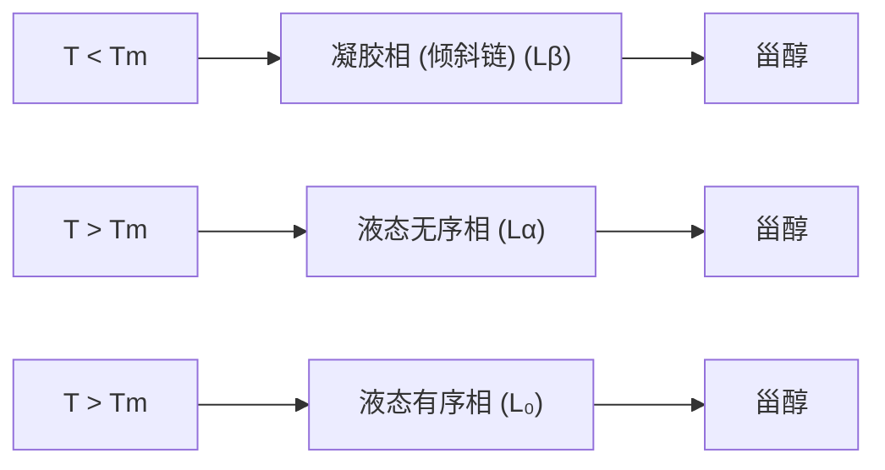

（DPPE）的相变温度高于极性头部基团更大的二棕榈酰磷脂酰胆碱（DPPC），它们的相变温度分别为 $63^{\circ}\mathrm{C}$ 和 $41^{\circ}\mathrm{C}$ 。可见，饱和磷脂酰乙醇胺通过氢键进一步稳定，其相变温度比同等磷脂酰胆碱高约 $20^{\circ}\mathrm{C}$ 。

④ 甾醇含量 胆固醇等甾醇对脂质膜的相变行为有显著的影响。与磷脂相比，胆固醇是一种小而刚性的分子，除了一个羟基外，大部分都是疏水的。当添加到凝胶相（$\mathrm{L}_{\beta}$）的脂质中时，胆固醇会破坏碳氢链高度有序的堆积结构，从而使膜结构液化。相反，当添加到液态无序相（$\mathrm{L}_{\alpha}$）的脂质中时，胆固醇和酰基链之间的疏水作用使得酰基尾部更紧密的堆积，从而使脂质凝固。在这两种情况下，高浓度的胆固醇都会使脂质形成一个中间相，即液态有序相（$\mathrm{L}_{\mathrm{o}}$）。在 $\mathrm{L}_{\mathrm{o}}$ 相中，磷脂尾部具有与 $\mathrm{L}_{\beta}$ 相类似的有序性，但保持着类似于 $\mathrm{L}_{\alpha}$ 相的侧向流动性（图15-8）。

生物膜是由不同成分的脂质组成的异质混合物，其酰基长度、不饱和程度和极性头部各不相同。因此，与单脂研究中看到的尖锐的相变温度峰相比，膜脂质相变发生的温度范围要宽得多。

flowchart

图15-8 甾醇诱导的脂质相变

## 15.2.3 脂质相多态性的生物学意义

生物膜是由丰富多样的脂质组成的，这些脂质形成不同相的能力在调节膜相关细胞活动中发挥重要的作用，比如特殊膜结构的形成、膜蛋白功能的调节、膜融合等。

生物膜主要以双分子层的形式存在，但非双分子层也越来越多地被观察到。在显微镜下，视网膜色素上皮细胞的内质网和膀胱上皮细胞的质膜中都观察到了 $\mathrm{H}_{\mathrm{II}}$ 相形态。在表皮角质细胞的内质网和黄化质体的原片层体中也发现了立方相结构。此外，高度弯曲的膜，如内质网网络的小管、线粒体内膜或类囊体基粒边缘等，被认为富含有利于 $\mathrm{H}_{\mathrm{II}}$ 相形成的脂质。相变发生在多种细胞过程中。例如，在叶绿体的形成过程中，上文提到的黑暗生长的幼苗根细胞中的黄化质体，它们的原片层体为立方相，在光照诱导下立方相会转变为片层相，即叶绿体的类囊体膜。

膜融合（membrane fusion）是细胞内囊泡运输的一个重要过程。大量研究表明，$\mathrm{Ca^{2+}}$ 是启动膜融合的必要条件。在细胞内高 $\mathrm{Ca^{2+}}$ 浓度条件下，PS和PA等酸性（带负电荷）磷脂更倾向于形成倒六方相  $H_{II}$  结构。 $Ca^{2+}$  诱导的膜内倒胶束或倒六方相（ $H_{II}$ ）构象的形成会导致膜的形态发生变化，并进一步介导膜融合的发生（图 15-9）。

图15-9 倒胶束或倒六方相介导的膜融合过程模型

chemical

Diagram showing molecular structure transformation from a ring to a cyclic structure with labeled components

## 15.3 生物膜的动态变化

## 15.3.1 脂质对膜形态的影响

膜中脂质的不对称组成促使脂质双分子层发生许多形态变化。PC和PS等圆柱形脂质可形成平坦的平面单层。而PE、PA、DAG、神经酰胺或心磷脂等倒锥形脂质具有较小的极性头部，为了使头部基团靠得更近，富含这些倒锥形脂质的单层会产生负弯曲。相反，像溶血磷脂酰胆碱（LPC）和磷酸磷脂酰肌醇（PIns）这种头部基团

较大的锥形脂质则会使单层向远离头部基团的方向弯曲，从而产生正曲率（图15-10）。因此，引入锥形或倒锥形脂质可在膜中引入正曲率或负曲率。大的正曲率膜可稳定正六方相 $\mathrm{H}_{\mathrm{I}}$ ，而大的负曲率膜可稳定倒六方相 $\mathrm{H}_{\mathrm{II}}$ 。膜曲率的形成对许多细胞过程的调节是必不可少的，如内质网、高尔基体、分泌囊泡等细胞器的形成。

## 15.3.2 蛋白质对膜形态的影响

尽管脂类可以影响膜的形状，但细胞中膜曲率形成的主要作用还是来自对特殊蛋白质的招募。这些蛋白质含有能够产生、感知或稳定膜曲率的基序。目前已知的膜重塑机制主要有三种（图15-11）。

text_image

磷脂种类:
PC/PS
头部基团大小:
2
PA/PE/DAG
小
2
LPC
大
1
酰基链数量:
正曲率
负曲率
双层膜
细胞质
侧小叶

图 15-10 脂质形状对膜曲率的影响

图15-11 蛋白质重塑膜形态的三种主要机制

第一种机制是蛋白质施加机械力使膜变形。驱动蛋白和肌球蛋白等分子马达可以附着在膜上，当它们沿着细胞骨架移动时可以将膜拉出（图15-11A）。或者，当膜附着在聚合的微管或肌动蛋白丝上时，也会被拉出（图15-11B）。根据理论估算，拉出半径为 $30\mathrm{nm}$ 的管状膜需要 $20~\mathrm{pN}$ 的力，这可以由大约10个分子马达产生。丝状伪足（filopodium）、伪足（pseudopodium）和轴突生长锥（axonal growth cone）等是通过这种机制形成的。

第二种机制是支架蛋白与膜结合从而迫使膜弯曲（图15-11C）。这类蛋白包括网状蛋白外壳、COPI、COPⅡ等。支架蛋白形成高度弯曲的表面，其凹面与脂质极性头部具有很强的亲和力。因此，支架蛋白通过弯曲表面与脂膜相互作用，从而迫使双分子层采用相同的曲率。这种情况下，蛋白质支架的刚性比膜的弯曲刚性高，而且膜与蛋白质附着的能量超过膜弯曲所需的能量。

第三种机制是蛋白质插入到膜中引起膜曲率的改变（图15-11D）。具有锥形或倒锥形形状的整合膜蛋白可以围绕其形状塑造相关的膜，例如电压门控钾通道、烟碱型乙酰胆碱受体等。此外，蛋白质也可以将它们的疏水结构域插入到双层膜的一侧，从而扩大一侧小叶的表面，导致曲率的变化。这些结构域通常是具有双亲螺旋，例如载脂蛋白（apolipoprotein）、爱普辛蛋白（epsin）、BAR超家族蛋白［Bin/amphiphysin/Rvs（BAR）protein］等。

最后，让我们简要关注一下BAR结构域，其名称来源于最早发现该结构域的一些蛋白质Bin、amphiphysin、Rvs（图15-12）。含有BAR结构域的蛋白质是细胞膜曲率的关键调节因子，参与了许多重要的细胞任务，从产生膜曲率和维持复杂的膜几何形状，从内吞、膜转运到丝状伪足的形成、线粒体和自噬体的成形等。香蕉状的BAR结构域二聚化形成具有内在曲率的模块。BAR结构域上成簇排列着带正电荷的碱性

（A、B）蛋白质施加机械力使膜变形。（C）支架蛋白与膜结合从而迫使膜弯曲。（D）蛋白质插入到膜中引起膜曲率的改变。

text_image

内吞蛋白 (endophilin) (N-BAR)
FCHo2 (F-BAR)
IRSp53 (I-BAR)
侧面观
顶面观

图15-12 不同BAR蛋白二聚体的结构

残基，因此它们可以与带负电荷的磷脂，如磷脂酰丝氨酸和磷脂酰肌醇-4,5-二磷酸（$\mathrm{PIP}_2$）等，形成静电相互作用，从而与膜结合。大多数BAR结构域还含有一个N端双亲螺旋，因此被称为N-BAR，这增强了它们的曲率感知和曲率生成能力。此外，F-BAR（FCH-BAR）含有一个外周卷曲螺旋（coiled coil），它可以识别浅的正曲率膜，而近乎扁平但具有反向曲率的I-BAR（inverse-BAR）则与浅的负弯曲的膜相互作用。BAR蛋白与膜相互作用的方式包括BAR结构域的静电吸引、双亲螺旋的浅插入以及在某些条件下BAR寡聚体的支架作用。在BAR蛋白浓度较低的条件下，它倾向于结合到膜上曲率和自身曲率接近的位置，因此可以感知膜曲率的存在。当BAR浓度较高时，它可以结合到膜上并将膜塑造成与自身曲率接近的形状。

## 15.3.3 膜的流动性

生物膜模型在经历了几十年的发展后于1972年提出的流体镶嵌模型中体现了膜的流动性（知识窗15-1）。流体镶嵌模型指出，膜是由脂质和蛋白质组成的二维流体组件。流体状态是指黏度较低、刚性较弱、分子可在流体介质中自由运动的状态。与液体相比，在流体膜中，膜组分的分子运动在方向和速度上受到相对限制。膜流动性是功能膜的基本要求。膜的渗透性、吞噬作用、内吞作用、信号转导等过程都需要膜的流动性。功能性整合膜蛋白也需要足够的膜流动性，以实现细胞功能（包括运输、分裂和分化）所需的多种转化。膜中的分子可以在膜平面上横向扩散、绕自身轴线旋转、横穿双分子层或发生构象变化。大部分膜以片层液晶 $\mathrm{L}_{\alpha}$ 相存在。膜会调节其脂质成分，以保持最适的膜流动性，从而发挥其功能并保持其完整性。

尽管识别膜脂质、蛋白质和糖类的巨大多样性本身就是一项艰巨的任务，但膜动力学才是最大的挑战，这涉及各种膜组分之间如何相互作用。20世纪60年代后，技术的巨大进步极大地推进了膜动力学的研究。核磁共振、电子自旋共振等技术以及共聚焦显微术、荧光漂白恢复、荧光共振能量转移、荧光相关光谱和单颗粒示踪等基于荧光的技术都有助于可视化和监测膜动态。

## 知识窗15-1

## 生物膜模型的演变历史

1925年，埃弗特·霍尔特（Evert Gorter，1881—1954）和弗朗索瓦·格伦德尔（François Grendel，1897—1969）发现从红细胞膜中提取出的脂质所形成的单分子层面积大致相当于原来红细胞总表面积的两倍，因此他们提出细胞膜是由双层脂类分子组成。10年后，詹姆斯·达尼埃利（James F. Danielli，1911—1984）和休·达夫森（Hugh Davson，1909—1996）以脂质双分子层作为膜模型的基础提出了Davson-Danielli模型（又称为Paucimolecular模型）。他们发现细胞膜除了有脂分子外还吸附有蛋白质，因此将膜描述为由蛋白质-磷脂-蛋白质形成的“三明治”式结构，即夹在两层球蛋白之间的脂质双分子层。1957年，詹姆斯·罗伯特森（James D. Robertson，1922—1995）提出了单位膜（unit membrane）模型。罗伯特森是一位电镜学家，他通过电镜首次直接观察到了膜的结构，其图像类似于三夹层结构的“铁轨”。因此，罗伯特森将单位膜定义为“宽度约75 Å，两条平行的宽25 Å的深色带被一条宽约25 Å的浅色带分隔开”，中央的浅色带是双层脂质分子，两侧的深色带是单层蛋白质分子，并且蛋白质分子是展开的，而不像 Paucimolecular 模型提出的蛋白分子呈球型。20 世纪 60 年代，研究光合作用的植物学家安德鲁·本森（Andrew A. Benson，1917—2015）和研究线粒体氧化磷酸化的领军人物戴维·格林（David E. Green，1910—1983）提出了无脂双层膜模型，称为脂蛋白亚基模型（lipoprotein subunit model）。发生光合作用的类囊体膜和进行氧化磷酸化的线粒体内膜都是蛋白质高度富集的特殊膜，因此脂蛋白亚基模型认为膜是没有脂质双分子层的脂蛋白单分子层。前面提到的这些早期的膜模型都存在一些问题，尤其是没有考虑到膜的不对称性或动态性。1972 年，西摩·辛格（Seymour J. Singer，1924—2017）和加思·尼克森（Garth L. Nicolson）提出了流体镶嵌模型（fluid mosaic model）。该模型首次认识到生物膜是动态的、流动的和不断变化的。根据这一模型，脂质双分子层形成一个液体基质，球状蛋白质在其中漂浮。蛋白质或附着在膜表面，或穿过膜，在脂质基质中呈镶嵌状。即使在今天，这一模型仍然适用，能够解释大多数生物过程和现象。

## (1) 膜组分的运动方式

膜组分分子在膜上有多种不同类型的运动方式，包括旋转异构运动（gauche-trans transition）、旋转运动（rotational motion）、侧向扩散（lateral diffusion）、翻转运动（transverse motion）等（图15-13）。

① 旋转异构运动 在膜脂质成分的聚亚甲基链中，亚甲基残基围绕C—C键的自由旋转频率很高（图15-14）。在低温条件下，磷脂双分子层的结晶相和凝胶相中，反式构象更受青睐。在反式构象中，聚亚甲基链是笔直的圆柱形，导致聚亚甲基链紧密堆积。插入一个或多个邻位交叉构象会使链的形状和尺寸发生严重变形，导致表面积增大和长度缩短。因此，在较高温度下，出现邻位交叉构象的概率会增加。
② 旋转运动 膜中的脂质和蛋白质分子都沿着垂直于膜平面的轴线做旋转运动。脂质酰基链的长轴与相邻链之间存在范德瓦耳斯相互作用。相反，极性头基通过静电作用与水和其它邻近的极性分子相互作用。同样，膜蛋白的跨膜结构域与非极性脂质相互作用，而暴露在膜表面的结构域则通过静电作用与脂质极性头基和水环境相互作用。因此，分子在双分子层中的旋转受到的限制要比在大体积水或大体积碳氢化合物中的限制大得多。计算得出的旋转运动发生的频率为:对于脂质体中的磷脂（分子量约为700）来说约为 $10^{9}\mathrm{s}^{-1}$，而对于分子量约为100000的蛋白质来说则小于 $10^{6}\mathrm{s}^{-1}$。

text_image

侧向扩散
翻转
旋转异构 旋转

图15-13 膜脂质的运动方式

图15-14 旋转异构运动

③ 侧向扩散 扩散是分子在动能驱动下的随机运动。脂质和蛋白质可在膜平面上侧向扩散。分子在双分子层平面上的运动或扩散由

侧向扩散系数 $D_{\mathrm{T}}$ 描述， $D_{\mathrm{T}}$ 由时间间隔 $\Delta t$ 内的均方侧向位移给出:

$$
r ^ {2} = 4 D _ {\mathrm{T}} \Delta t _ {\circ} \tag {15-1}
$$

侧向扩散可通过荧光漂白恢复技术进行可视化。在脂质体中，膜组分的侧向扩散系数范围为 $10^{-8} \sim 10^{-13} \mathrm{~cm}^2/\mathrm{s}$，这为脂质体提供了不受限制的均质二维基质。蛋白质和脂质在生物膜中的侧向流动性比在合成膜中要慢得多，这是由于高度的分子关联、膜结构域的分离、与细胞骨架成分的相互作用等限制了分子的运动。

膜组分的侧向扩散会产生许多功能性后果。仅举几例:在激素、神经递质或抗原触发的信号转导级联过程中，侧向扩散促进了蛋白质与蛋白质之间的相互作用；配体结合的受体在包被的凹坑中扩散，导致其内吞；介导膜融合；在线粒体和叶绿体中分别通过细胞色素 $c$ 和质体色素等移动载体进行电子传递；在细胞分裂和细胞发育过程中提供方向性。

④ 翻转运动 脂质分子从双分子层的一个界面到另一个界面的翻转运动是一个相当缓慢的过程，尤其是极性分子，它们必须穿过不利的疏水内部。胆固醇和磷脂的翻转时间超过6天。

## (2) 影响膜流动性的因素

① 脂质组成 不饱和程度、脂肪酰基链长度以及胆固醇和鞘脂的比例都会影响膜的流动性。在脂肪酰基链中引入顺式双键的不饱和度会在链中产生扭结，使磷脂间无法太紧密堆叠而留有一定空间，从而增加无序性和膜流动性，而饱和或反式不饱和脂肪酰基链的增加则会降低膜流动性。通过疏水相互作用稳定的酰基链长度增加会导致更有序的堆积，从而降低膜流动性。胆固醇/磷脂或鞘脂/磷脂比率的增加也会导致膜流动性下降。

胆固醇是膜流动性的重要调节剂。胆固醇是由一系列融合环组成的刚性平面结构，一端连接碳氢链，另一端连接羟基（见图15-2）。因此，胆固醇和其它膜脂一样，具有亲水和疏水两极，可以在脂质双分子层中定位。羟基与磷脂酰羰基相互作用，而胆固醇的刚性体则与邻近磷脂的酰基链尾部并列，通过疏水相互作用增加膜中的有序性。在高温条件下，由于胆固醇填充了相邻酰基链之间的间隙，因此增加了膜的刚性，降低了膜的流动性。而在低温条件下，由于胆固醇具有坚硬的环状结构，它可以阻止任何高阶堆积，降低从液相到凝胶相的相变温度，从而阻止膜从液相向凝胶相的转变。一些等离子体膜（如神经髓鞘膜）含有高浓度的脂质，可在凝胶相中形成双层膜，胆固醇的存在可使这些膜保持液相。

如前所述，在液态无序相（$\mathrm{L}_{\alpha}$）和片层凝胶相（$\mathrm{L}_{\beta}$）中加入胆固醇，都会形成新的相——液态有序相（$\mathrm{L}_{\mathrm{o}}$）（见图15-8）。在液态有序相中，旋转和侧向扩散速率与液态无序相类似，但酰基链主要处于全反式构象，因此，堆积参数与片层凝胶相（$\mathrm{L}_{\beta}$）类似。在细胞中，富含胆固醇的 $\mathrm{L}_{\mathrm{o}}$ 相与脂筏密切相关。

② 温度 温度变化对膜流动性的影响已在细菌和蓝藻中得到证实。膜流动性会随着温度的降低而降低，而高温则会使膜流动。
③ 渗透压 在加入聚乙二醇、甘油、蔗糖或氯化钠的高渗透胁迫下对磷脂囊泡进行的研究表明，高渗透胁迫导致膜流动性降低，与低温胁迫相似。盐胁迫是抑制植物和微生物生长和存活的主要环境因素之一，会导致膜流动性降低。因此，能在高渗透压条件下生存的生物，如能在高盐培养基中生长的酵母菌株Zygosaccharomyces rouxii，或在盐胁迫条件下生长的植物，都会产生适应膜流动性降低的机制。流动性较高的精子膜能够在冷冻保存期间承受高渗透压条件。
④ $\mathrm{Ca^{2+}}$ 和其它二价阳离子据观察，细胞内 $\mathrm{Ca^{2+}}$ 浓度随信号通路或神经传导而波动，可调节膜细胞质一侧的膜流动性。细胞内 $\mathrm{Ca^{2+}}$ 的增加会增加膜的有序性并降低膜的流动性。$\mathrm{Ca^{2+}}$ 通过与细胞质一侧带负电荷的膜脂结合而降低膜的流动性。

## 15.3.4 膜融合与膜分裂

生物膜通过膜融合和膜分裂（membrane fission）这两个相反的过程不断重塑，它们分别导致两膜合二为一和一膜一分为二（图15-15）。膜融合和膜分裂对细胞生理功能至关重要，并协调着许多基本过程，如细胞通信、细胞器生成和包膜病毒感染。膜包裹的细胞内区室通过含有货物的运输囊泡相互通信，运输囊泡从供体区室通过出芽和分裂产生，移动到受体区室，并与受体膜融合以运送货物。在细胞内，线粒体不断进行着膜融合和膜分裂的循环，从而调控其整体形态并维持其正常功能。包膜病毒感染细胞时，病毒膜与细胞质膜融合，将病毒基因组直接送入细胞质，或者，病毒首先被内吞（通过细胞质膜分裂产生的内体），然后膜与内体膜融合，将病毒基因组释放到胞质中。

膜融合和膜分裂都涉及融合/分裂部位的膜弯曲，这需要对膜结构进行显著扰动。所有生物膜的核心结构元素都是稳定的脂质双分子层，其结构完整性主要由脂质分子脂肪链之间强大的疏水相互作用来维持。这些强大的疏水作用力会对任何弯曲和重塑膜事件产生阻力。因此，必须为膜提供足够的能量才能使其变形和融合/分裂。膜的融合和分裂过程由专门的蛋白质介导，它们有能力操纵脂质双分子层结构，并帮助膜克服融合/分裂途径中的若干能量障碍。这些核心融合/分裂蛋白经常与脂质或其它调节蛋白合作，促进膜重塑事件，使融合/分裂在正确的时间和地点发生。

flowchart

图15-15 膜融合和膜分裂是相反的膜重塑过程

## (1) 膜融合的中间态

膜融合经过一系列连续的阶段，包括膜的靠近和接触、膜的破坏和合并，最终形成和扩大融合孔（fusion pore），使最初由两层膜界定的水相之间得以沟通。对无蛋白质和蛋白质驱动的膜融合反应的理论预测以及体外和体内观察结果都一致认为，膜融合经历了中间沙漏状半融合茎（hemifusion stalk）结构的形成，在这种结构中，双层膜的外单层混合在一起，而内单层保持分离。然后，茎结构的径向扩展使内单层膜接触，最终会导致融合孔的打开（图15-15）。

对聚乙二醇介导的小型脂质体融合的动力学分析提供了与导致膜融合的中间阶段相关的特征时间和能量。一旦通过聚乙二醇建立了脂质体对接，外单层的混合就会在 $10\mathrm{s}$ 的时间尺度上发生，随后是内单层的混合，同时还有水内容物的混合，两者发生的特征时间都是 $150~\mathrm{s}$，但脂质混合在内容物混合之前就结束了。据估计，聚乙二醇介导的外单层混合（相当于颈环的形成）的活化能约为 $60k_{\mathrm{B}}T$，而内容物混合（相当于融合孔的形成）的活化能约为 $40k_{\mathrm{B}}T$。在用表面力仪器（surface forces apparatus, SFA）监测聚乙二醇介导的支撑脂质双分子层融合的实验中，在双分子层接触 $3\mathrm{min}$ 后就观察到了茎结构。

半融合和融合孔结构取决于融合膜外单层和内单层中存在的脂质的几何特性。具有倒锥形几何形状的脂质（如PE）有利于膜的负弯曲（向疏水链一侧弯曲），因此当它们存在于外单层时会促进半融合。相反，具有锥形几何形状的脂质，如溶血磷脂酰胆碱（LPC），会引起膜正弯曲（向头基方向弯曲），因此当它们存在于内单层时，会促进融合孔的形成（见图15-10）。膜张力也在驱动膜融合方面发挥作用。例如，巨脂质体的渗透膨胀被证明可诱导其与平面膜的融合并促进融合孔的打开。

## (2) SNARE 复合物介导的膜融合

除了涉及线粒体或内质网膜的同型融合事件外，所有细胞内融合反应都是由可溶性 $N-$ 乙基马来酰亚胺敏感因子附着蛋白受体（soluble $N$-ethylmaleimide-sensitive factor attachment protein receptor，SNARE）家族的蛋白质介导的。目前有关SNARE蛋白功能的分子机制的知识来自大量有关参与突触囊泡融合的SNARE蛋白的遗传和生化数据。神经元的通信依赖于突触前质膜与突触囊泡融合所释放的神经递质和激素。突触囊泡融合涉及囊泡SNARE蛋白（vesicular SNARE，v-SNARE）VAMP2（存在于突触囊泡膜上）与靶SNARE蛋白（target SNARE，t-SNARE）syntaxin1和SNAP25（存在于突触前质膜上）的配对，以形成桥状的反式SNARE复合物（或SNAREpin），使突触囊泡与其靶膜对接并进一步发生融合（图15-16）。在线虫、蝇和小鼠等多种模式生物中，单个SNARE的缺失会严重影响神经传导。在体外，当v-SNARE蛋白

flowchart

This diagram illustrates the molecular mechanism of a protein complex involving VAMP2, SNARE, and 20S complexes, showing interactions between Habc structure, translation states (synthoquinin1, SNAP25), and phosphorylation states (NSF(ATP), α-SNAP).

图15-16 SNARE复合物的组装和解聚过程详解见正文。

VAMP2和t-SNARE二聚体syntaxin1/SNAP25被重组到两个不同的人工囊泡（脂质体）中时，它们也会通过形成SNARE复合物诱导脂质体对接和融合。突触SNARE蛋白还能介导两个同源细胞群之间的融合，这两个细胞群表面分别表达有v-SNARE蛋白VAMP2和t-SNARE蛋白syntaxin1和SNAP25。这些数据清楚地表明，SNARE复合物是细胞内膜融合的核心机器。

SNARE 蛋白的分子结构相对简单。它们的特征是都含有一个由 60～70 个残基组成的在演化上非常保守的区域，称为 SNARE 基序。VAMP2 和 syntaxin1 都含有一个 SNARE 基序和一个 C 端跨膜结构域（TMD），两者之间通过一段富含正电荷残基的序列相连。SNAP25 包含两个 SNARE 基序，中间由一个灵活的环结构连接，它通过棕榈酰化作用锚定在膜上。许多 SNARE 蛋白（如 syntaxin1）还包含一个自主折叠的 N 端结构域 Habc 结构域，具有重要的调控功能。突触 SNARE 复合物的 X 射线晶体结构显示，v-SNARE 蛋白和 t-SNARE 蛋白可以组装形成高度稳定的四螺旋束（four-helix bundle）结构，其中 VAMP2 和 syntaxin1 的 SNARE 基序各贡献一个螺旋，而 SNAP25 的两个 SNARE 基序则贡献两个螺旋。在这种结构中，SNARE 基序平行排列，即其 N 端位于螺旋束的一端，C 端位于螺旋束的另一端（图 15-16）。体外和体内的研究表明，膜的融合起始于分别位于囊泡膜和目标膜上的v-SNARE蛋白和t-SNARE蛋白的配对结合，它们首先形成反式SNARE复合物（SNARE蛋白的跨膜区位于两个独立的膜上），并继续以类似拉链的方式从SNARE基序的N端（膜远端）向C端（膜近端）进一步组装，最终形成完整的四螺旋束的顺式SNARE复合物（SNARE蛋白的跨膜区位于同一个膜上）。SNARE的组装过程可以产生足够的能量以克服脂双层的能量障碍，从而将它们所在的膜拉近、紧密结合并最终完成膜融合。对包含跨膜结构域（TMD）的突触SNARE复合物的X射线结构分析进一步表明，SNARE拉链一直延伸到膜内，这表明v-SNARE和t-SNARE蛋白的C端组装与膜融合在功能上是耦合的。膜融合后形成的顺式SNARE复合物高度稳定，可耐受高达 $90^{\circ}\mathrm{C}$ 的温度，并且可以抵抗去垢剂的破坏作用。因此，顺式SNARE复合物的解聚需要非常高的能量，在细胞内这种能量由六聚体ATP酶NSF（$N$-ethylmaleimide-sensitive factor，$N-$乙基马来酰亚胺敏感性融合蛋白）提供。NSF通过适配蛋白 $\alpha$-SNAP与SNARE结合形成20S复合体，随后利用水解ATP产生的能量解聚SNARE螺旋束，从而使单个SNARE在膜融合反应中可以循环使用。

研究者利用表面力仪器测量重组有 t-SNARE 或 v-SNARE 蛋白的两个双层膜，阐明了拉链 SNARE 蛋白的能量与距离的关系。当双层膜相距 10 nm 时，SNARE 基序开始相互作用，最终形成一个高能量、部分组装、膜桥接的 SNARE 复合物，释放出  $35 k_{B} T$  的能量，而在其膜近端仍然有 30% 是非结构化的。单分子原子力显微镜（atomic force microscope，AFM）对固定在固体支撑物上的 SNARE 蛋白之间的测量也预测 SNARE 的结合能量约为  $30 k_{B} T$ 。使用光镊或磁镊在单分子水平上进行的力学测量证实了部分组装的 SNARE 复合物的存在，并进一步观察到膜近端组装在所施加的拉力减小时的情况，这种拉力模仿了膜融合过程中两个接近的双层膜之间的排斥力。在先 N 端组装再 C 端组装的两步 SNARE 复合物拉链过程中释放的总能量估计为  $65 k_{B} T$ 。而据预测，两层脂质双分子层融合所需的能量为  $100 \sim 150 k_{B} T$ 。这些结果表明，少数 SNARE 复合物的组装就能为膜融合提供足够的能量。然而，关于膜融合所需的 SNARE 复合物的最小数量仍存在激烈的争论。体外脂质体融合实验表明，一个 SNARE 复合物就足够了，而体内囊泡外排实验估计需要 2～8 个复合物。脂质体与脂质双分子层纳米盘（nanodisc）之间的新型体外融合系统可能会调和这些看似矛盾的结果，因为该系统显示，1 个 SNARE 复合物就足以引发脂质双分子层的混合，而至少需要 3 个 SNARE 复合物才能介导有效的内容物混合。

SNARE介导的膜融合在各种实验体系中都被证明包含中间半融合状态，这些实验体系包括体外脂质体和脂质体-平面双分子层融合实验，以及对突触活动区的突触囊泡的原位电子断层成像和附着在质膜上的海胆皮质颗粒的体内荧光成像。与这些实验观察结果相一致，分子动力学模拟也确定了半融合中间态，并且它的形成只需要单个SNARE复合物。在这些模拟中，至少2个SNARE复合物的协同作用促进了从半融合到融合孔打开的过渡。此外，在模拟结束时，SNARE蛋白一直被拉链拉入其跨膜区，这与SNARE复合物的晶体结构非常吻合。

## (3) 膜分裂

和膜融合相比，人们对模型系统中膜分裂的研究要少得多，主要是因为人们认为膜分裂和膜融合的途径是相互对称的，因此膜分裂可以按照与膜融合相同的理论框架来描述:必须克服能量障碍才能达到一个被称为半分裂的中间体。不过，融合与分裂之间有一个本质区别:连接两个待分离区室的膜必须收缩才能进行分裂。由于这一收缩步骤，人们推测膜的机械特性会极大地影响分裂的能量障碍，从而调控膜分裂的动力学。膜分裂要求脂质双分子层发生局部变形和重塑，以便在不损害母体双分子层完整性的情况下形成一个独立的膜包裹区。事实上，新生囊泡的分裂必须在不允许囊泡内腔与外界环境直接接触的情况下进行，因为即使形成一个小孔也会导致囊泡内容物的泄漏。

与膜融合事件类似，膜分裂也被认为是通过类似半分裂的途径进行的。经由半分裂状态完成的膜分裂途径可归纳如下（见图15-15）:①出芽，形成一个收缩的颈部，裂变颈部的膜层相互靠近。据理论估计，这种膜间距在网格蛋白包被的芽（clathrin-coated bud）中小于 $3\mathrm{nm}$ ；②半分裂状态的形成，接触的单层膜合并形成半分裂结构，类似于半融合茎；③半分裂结构衰变，分裂反应完成。

膜分裂需要脂质双分子层发生局部变形。双分子层是弹性薄片，会受到不同类型应力（stress）的影响，包括拉伸/压缩、弯曲和脂质尾部的倾斜。张力调节整个膜横向的拉伸/压缩，在细胞中可通过肌动蛋白细胞骨架等进行调节。曲率在形成高度弯曲的囊泡和小管结构中起着关键作用。脂质倾斜或脂质碳氢链变形以适应膜核心的填充缺陷，对于导致膜融合或分裂的事件发生至关重要。每种形变都与不同的能量变化有关，并以弹性系数为特征，这些系数取决于形成双层的脂类的物理化学性质。

招募到膜出芽部位的蛋白质和脂质如何使膜分裂成为能量和力学上可行的过程？如上所述，导致膜形变的因素会产生弹性应力，因此，弹性能量会储存在双分子层中。要压缩或膨胀一层膜，也需要靠外力做功来帮助膜形变。同样的道理也适用于双分子层弯曲和脂质倾斜。发生膜分裂，系统的总自由能（储存在膜中的弹性能量加上外力做的功）会减少，因此，分裂完成后系统的总自由能总是低于分裂开始前的能量。

另外，虽然分裂后状态相对于分裂前状态在能量上是有利的，但有时候巨大的能量障碍会使系统停留在芽/管状态。从物理角度来看，很难预测分裂过程中双层膜转变的能量分布。不过，可以计算半分裂中间体的能量，这是膜的热涨落必须跨越的能量障碍。通过计算可以估算出一个典型的过渡时间，即热涨落为膜提供足够能量以克服能量障碍并产生半分裂中间体的时间尺度。虽然没有直接测量，但根据实验间接测量和理论论证，人们认为高达 $40k_{\mathrm{B}}T$ 量级的能垒将导致动力学上可行的分裂状态。由于最终条件的能量低于半分裂能量，一旦形成半分裂状态，分裂过程的完成应该是自发的。

与驱动膜融合反应的蛋白质相比，那些参与膜分裂的蛋白质被发现得更晚，而且它们的鉴定花费了更长的时间。这一定程度上是因为没有通用的膜分裂机制，而且膜分裂蛋白位于膜分裂颈部的外部还是内部涉及不同的机制，这与细胞内膜融合反应大多数都由SNARE蛋白所介导非常不同。科学家们已经分离出两种膜分裂机器，并试图解读膜分裂反应的共同机制:发动蛋白（dynamin）和转运必需内体分选复合物Ⅲ（endosomal sorting complex required for transport-Ⅲ，ESCRT-Ⅲ）。这两种机器都在膜的狭窄颈部工作以使膜变形，但发动蛋白位于颈部之外，而ESCRT-Ⅲ位于颈部内部。发动蛋白是典型的参与膜分裂的蛋白家族，但它特定于质膜上的内吞途径，并可能在高尔基体反面网状结构中发挥作用。ESCRT-Ⅲ主要在膜远离细胞质方向的形变和分裂中发挥作用，如多囊体（multivesicular body，MVB）的形成、胞质分裂、病毒出芽等过程。然而对于细胞内（特别是在高尔基体、内质网或内体）发生的许多膜分裂反应，我们仍然不清楚其中有哪些蛋白质参与，这些膜分裂反应的发生机制有待我们进一步探索。

## 15.3.5 膜出芽的数学模型

当膜分裂发生时，首先要形成一个狭窄的颈部使膜层相互靠近，原本扁平的膜上因此形成一个囊泡，并最终从细胞膜表面脱落，类似于母代通过分裂的方式产生一个小的子代，所以称为出芽。许多重要的生物学现象如网格蛋白介导的内吞作用、病毒对细胞的入侵都需要经历此过程。

为描述膜的形变，德国物理学家沃尔夫冈·黑尔弗里希（Wolfgang Helfrich）于1973年从液晶的弹性理论出发，提出膜的弹性理论。由于构成膜的磷脂分子在层内的流动性，它们的行为类似于液晶，即分子在空间的位置排列上表现为无序，但是在取向上保持有序。当膜发生弯曲时，邻近的磷脂分子的取向发生变化，由此可以引发类似于液晶理论中分子取向发生变化所产生的弹性能。如果忽略膜的厚度而将膜视为一

图 15-17 膜的弹性理论

（A）描述膜形变的黑尔弗里希理论。在这一理论中，细胞膜被近似成没有厚度的二维曲面，其弯曲能可以表示成曲面的平均曲率 $H = (c_{1} + c_{2}) / 2$ 和高斯曲率 $K = c_{1}c_{2}$ 的函数，其中 $c_{1} = 1 / R_{1}$ 和 $c_{2} = 1 / R_{2}$ 为曲面上一点的两个主曲率。（B）球冠示意图。图中浅蓝色部分表示球冠， $r$ 表示球冠所在球体的半径， $\theta$ 表示球冠的张角， $h$ 表示球冠的高度， $a$ 表示球冠底面半径。

个二维曲面，那么该弹性能可以表示为曲面上一点的主曲率 $1 / R_{1}$ 和 $1 / R_{2}$ 的函数，如图15-17A所示。平衡态下膜的形状是使得包括弹性能在内的系统总的自由能达到最小的状态。在本节中，我们将利用膜的弹性理论介绍相分离、自发曲率、吸附三种作用介导的出芽机制。为简单起见，我们假设膜在出芽过程中保持球冠形状，如图15-17B所示。该理论的数学基础见知识窗15-2，下面着重于应用该理论解释不同的出芽现象背后统一的物理学思想，即出芽能否自发发生取决于系统总的自由能作为球冠张角 $\theta$ 的函数是否单调递减。

## (1) 相分离介导的出芽

当两种不同的物质混合后，如果不同组分的分子之间存在排斥相互作用，两种物质会发生相分离，例如油和水。在两相的接触面上会产生表

## 知识窗 15-2

## 膜弹性理论

膜弹性理论的基本思想是:当膜产生的曲率相比于膜厚度的倒数（约 $1 / 5\mathrm{nm}^{-1}$ ）非常小时，可以将膜视为二维曲面而忽略其厚度，其单位面积的弯曲能 $f_{\mathrm{b}}$ 可以表示为曲面的平均曲率 $H$ 和高斯曲率 $K$ 的函数:

$$
f _ {\mathrm{b}} = \frac {\kappa}{2} (2 H - c _ {0}) ^ {2} + \overline {{\kappa}} K,
$$

其中，平均曲率 $H = (1 / R_{1} + 1 / R_{2}) / 2$ 是两个主曲率 $1 / R_{1}$ 和 $1 / R_{2}$ 的平均值，高斯曲率 $K = 1 / (R_{1}R_{2})$ 是它们的乘积，如图15-17A所示。这里 $\kappa$ 和 $\bar{\kappa}$ 是用来衡量膜硬度的性质参数，分别称为弯曲模量和高斯曲率弯曲模量，而 $c_{0}$ 称为膜的自发曲率，它来自组成膜的磷脂双分子层两层分子之间的不对称性，从而使膜倾向于发生弯曲。这一不对称性可以是磷脂的组成成分不同、磷脂成分比例不同或附着蛋白不同等多种因素。总的弹性能是弯曲能密度 $f_{b}$ 在曲面上的积分

$$
E _ {\mathrm{b}} = \int_ {\mathrm{A}} f _ {\mathrm{b}} \mathrm{d} A _ {\circ}
$$

其中 dA 表示曲面 A 的面积微元。对于如图 15-17B 所示的半径为 r 的球冠形状的膜，其两个主曲率  $1/R_{1}$  和  $1/R_{2}$  都是 1/r，因此其弯曲能

$$
E _ {\mathrm{b}} = \left[ \frac {1}{2} \kappa \left(\frac {2}{r} - c _ {0}\right) ^ {2} + \overline {{\kappa}} \frac {1}{r ^ {2}} \right] A,
$$

其中， $A = 2\pi r^2 (1 - \cos \theta)$ 为球冠的面积。注意到若$c_{0} = 0$ ，则 $E_{\mathrm{b}} = (4\pi \kappa +2\pi \overline{\kappa})(1 - \cos \theta)$ ，即球冠的弯曲能只和张角 $\theta$ 有关，而与半径 $r$ 无关。在正文中为简化计算，高斯曲率所贡献的自由能被忽略不计。

面张力，倾向于缩小两相的接触面积。类似的，当我们将膜视为一个二维的几何曲面时，膜上的某个区域的组分与其它区域不同，在相的边界线上也存在线张力，倾向于缩短两相的接触线的长度。如果这个线张力足够大，那么边界线会不断缩短，从而将该区域挤成一个小囊泡，完成出芽（图15-18A）。

为将上述物理原理定量化，考虑如图15-18A所示的膜，其中黄色区域的组分不同于蓝色区域，在两组分的交界线（红色曲线）上产生的线张力 $\gamma$ 倾向于缩短接触线的长度 $L = 2\pi a$ ，这里 $a$ 为球冠的底面半径。其所对应的线张力能正比于接触线的长度 $L$ ，即 $E_{\gamma} = \gamma L$ 。黄色区域的膜的弯曲能可以表示为 $E_{\mathrm{b}} = 4\pi \kappa (1 - \cos \theta)$ 。总能量为线张力能与弯曲能之和:

$$
E _ {\mathrm{tot}} = E _ {\gamma} + E _ {\mathrm{b}} = 4 \pi \kappa \left(1 - \cos \theta + \lambda \cos \frac {\theta}{2}\right), \tag {15-2}
$$

其中 $\lambda = \frac{\sqrt{A / \pi}}{2\kappa / \gamma}$ 为一个无量纲数，$A$ 表示黄色区域所占据的膜的面积。图15-18A展示了总能量作为球冠张角 $\theta$ 的函数。当 $\lambda$ 较小时，$E_{\mathrm{tot}}$ 作为 $\theta$ 的函数是单调递增的，这意味着出芽状态（$\theta = \pi$）所对应的自由能是最高的，因此无法自发地发生出芽。当 $\lambda$ 逐渐增加时，出芽状态所对应的能量开始降低，但在平坦的状态（$\theta = 0$）和出芽状态（$\theta = \pi$）之间仍然存在一个能垒。当这个能垒的能量远大于热运动的能量 $k_{\mathrm{B}}T$ 时，出芽无法发生。直到当 $\lambda >\lambda_{c} = 4$ 时，即当线张力 $\gamma >\frac{8\kappa}{\sqrt{A / \pi}}$ 时， $E_{\mathrm{tot}}$ 作为 $\theta$ 的函数单调递减，出芽可以自发发生。从该条件可以看出，面积越大的膜，发生出芽所需要的线张力反而越小。

(A)

natural_image

Three circular diagrams showing a yellow ring on blue and red surfaces, with no text or symbols present.

(B)

natural_image

Three circular diagrams showing hexagonal structures with gold wireframe, no text or symbols present

(C)

natural_image

Three stylized green spheres with gradient shading, arranged horizontally on a white background (no text or symbols)

line

| \(\theta\) | \(\lambda=0\) | \(\lambda=2\) | \(\lambda=4\) | \(\lambda=6\) |
| --- | --- | --- | --- | --- |
| 0 | 0 | 0 | 0 | 0 |
| \(\pi\) | ~2.0 | ~0.1 | ~-2.0 | ~-3.0 |

line

| \(\theta\) | \(c_{0}\sqrt{A_{0}}=1\) | \(c_{0}\sqrt{A_{0}}=4\) | \(c_{0}\sqrt{A_{0}}=4\sqrt{\pi}\) |
|---|---|---|---|
| 0 | 0 | 0 | 0 |
| ~\(1.5\pi\) | ~2 | ~-8 | ~-18 |
| \(2\pi\) | ~8 | ~-7 | ~-23 |
| \(\pi\) | ~19 | ~-3 | ~-25 |

line

| \(\theta\) | \(\mu/\sigma=0.9\) | \(\mu/\sigma=1\) | \(\mu/\sigma=1.1\) |
|---|---|---|---|
| 0 | 0 | 0 | 0 |
| \(2/\pi\) | ~8 | ~-12 | ~-45 |
| \(\pi\) | ~15 | ~-24 | ~-87 |

图 15-18 三种不同的出芽机制

（A）相分离介导的膜出芽。膜的黄色部分和蓝色部分由于组分不同，在两相的接触线（左图红色曲线）上产生线张力，倾向于缩短接触线的长度。若线张力相对于膜的弯曲刚度（即参数 $\lambda$ ）足够大，系统的总能量 $E_{\mathrm{tot}}$ 作为球冠张角 $\theta$ 的函数单调下降（右图绿色和橙色曲线），出芽可以发生。（B）自发曲率介导的膜出芽。膜的部分区域因为有网格蛋白覆盖从而存在自发曲率，倾向于使膜发生弯曲。当蛋白质产生

的自发曲率 $c_{0}$ 足够大时，系统的能量随球冠张角单调递减，从而发生出芽。（C）吸附介导的膜出芽。球形颗粒如病毒因为表面附着有受体，倾向于吸附在膜上。当吸附强度 $\mu$ 足够强时，膜可以将球形颗粒完全包裹，完成出芽过程。由于出芽能否自发发生取决于能量在不同$\theta$ 下的相对变化而非绝对大小，能量曲线被上下平移以保证 $\theta = 0$ 处的总能量为0。

## (2) 自发曲率介导的出芽

当网格蛋白介导的胞吞作用发生时，网格蛋白在膜的局部区域上富集，并形成球状的笼形结构（图15-18B）。网格蛋白的这种作用可以用膜弹性理论中的自发曲率 $c_{0}$表示。当自发曲率 $c_{0}$ 足够大时，即网格蛋白所产生的膜曲率足够大时，出芽可以自发发生。假设出芽过程中，膜上网格蛋白覆盖的区域面积 $A$ 保持不变，其表面张力能$E_{\sigma} = \sigma A$ 正比于膜的表面积。总能量是弯曲能和表面张力能之和:

$$
E _ {\mathrm{tot}} (\theta) = E _ {\mathrm{b}} + E _ {\sigma} = \frac {1}{2} \kappa A \left[ \left(\frac {2}{r} - c _ {0}\right) ^ {2} + \frac {2 \sigma}{\kappa} \right] 。 \tag {15-3}
$$

总能量作为张角 $\theta$ 的函数如图15-18B所示。对于不同的自发曲率，总能量的最小值所对应的 $\theta$ 并不相同。从式（15-3）可知，当自发曲率为 $c_{0}$ 时，若 $2 / r = c_{0}$，$E_{\mathrm{tot}}(\theta)$ 达到最小值。据此，由球冠的半径 $r$ 与面积 $A$ 之间的关系 $A = 2\pi r^{2}(1 - \cos \theta)$，我们可以得到球冠的张角 $\theta$ 与自发曲率的关系 $c_{0}\sqrt{A} = 4\sqrt{\pi}\sin \frac{\theta}{2}$ 。特别地，当自发曲率 $c_{0}\sqrt{A} = 4\sqrt{\pi}$ 时，总能量最小值对应的球冠张角 $\theta = \pi$，出芽完成。

## (3) 吸附调控的出芽

当病毒颗粒入侵细胞时，由于表面附着有与细胞质膜具有很强吸附作用的蛋白质，可以通过内吞作用将自身包裹在囊泡内，从而进入细胞内部。为描述这一出芽过程，假设病毒颗粒呈半径为 $r$ 的球形。当该球形颗粒吸附到细胞质膜上后，质膜可以将其包裹，从而呈球冠形状（图15-18C）。此时，质膜的总能量除了含有膜的弯曲能$E_{\mathrm{b}}$ 与表面能 $E_{\sigma}$ 之外，还包含了与颗粒之间相互作用的吸附能 $E_{\mathrm{a}} = -\mu A$ 。这里 $\mu$ 表示质膜与颗粒之间单位面积的吸附能，称为吸附强度。质膜的总能量 $E_{\mathrm{tot}} = E_{\mathrm{b}} + E_{\sigma} + E_{\mathrm{a}}$ 作为球冠张角的函数如图15-18C所示。当吸附强度 $\mu$ 较小时，能量最低点对应的张角 $\theta = 0$ ，即质膜保持平坦。当吸附强度 $\mu >\frac{1}{2}\kappa \left(\frac{2}{r}\right)^2 +\sigma$ 时， $E_{\mathrm{tot}}(\theta)$ 的能量最小值从$\theta = 0$ 变为 $\theta = \pi$ ，且之间没有能垒阻碍，出芽可以自发发生。由此可以看出，越大的球形颗粒反而只要越低的吸附能就能被包裹。

## ※ 本章小结

在寻找将细胞与环境分离以及将真核细胞分隔成具有不同性质的区域的过程中，演化选择了一种似乎具有普遍性的设计:由脂质分子构成的双分子层。这种设计具有一些物理特性，这些特性对于一个与环境不断进行交换的高度动态的系统来说尤其有利。由于脂质的两亲性，脂质双分子层能自发地自我组装；在生理温度下，脂质双分子层具有流动性和可变形性，允许发生较大的形状变化，并且能够发生融合和分裂。本章从生物膜的组成入手，介绍了脂质自发组装成膜的机制、脂质相的多态性，并详细描述了膜的动态性及其影响因素，以及膜出芽的三种力学机制。这些膜的生物物理特性对于膜结构的维持和功能的行使至关重要。然而，由于生物系统的复杂性，至今仍有很多问题没有得到解决，例如对于膜融合过程仍然缺乏完善的模型。实验和计算技术的不断发展将提供对膜生物物理更准确和深入的定性和定量理解。

## ※ 思考题

1. 生物膜上的脂质如何维持膜的结构和功能？
2. 与生物膜相互作用的蛋白质有哪些特性？
3. 如何理解生物膜的流动性及其对膜功能的影响？
4. 脂质形状对脂质相的形态和生物膜的形态的影响有哪些？
5. 蛋白质如何介导生物膜形态的改变？
6. 高斯曲率弯曲模量对于膜出芽过程有什么影响？
7. 影响膜融合的因素有哪些？这些因素在膜融合过程中发挥怎样的作用？

## ※ 扩展阅读

图书

Bassereau P, Sens P. Physics of biological membranes[M]. Cham: Springer, 2018.

综述

Akimov S A, Molotkovsky R J, Kuzmin P I, et al. Continuum models of membrane fusion: evolution of the theory[J]. Int J Mol Sci, 2020, 21(11):3875.

Campelo F, Malhotra V. Membrane fission: the biogenesis of transport carriers[J]. Annu Rev Biochem, 2012, 81:407-427.

Deserno M. Fluid lipid membranes: from differential geometry to curvature stresses[J]. Chem Phys Lipids, 2015, 185:11–45.

Harayama T, Riezman H. Understanding the diversity of membrane lipid composition[J]. Nat Rev Mol Cell Biol, 2018, 19(5):281–296.

Koynova R, Tenchov B. Transitions between lamellar and nonlamellar phases in membrane lipids and their physiological roles[J]. OA Biochem, 2013, 1(1):1–12.

Seifert U, Berndl K, Lipowsky R. Shape transformations of vesicles: phase diagram for spontaneous-curvature and bilayer-coupling models[J]. Phys Rev A, 1991, 44(2):1182-1202.

Shibata Y, Hu J J, Kozlov M M, et al. Mechanisms shaping the membranes of cellular organelles[J]. Annu Rev Cell Dev Biol, 2009, 25:329–354.

研究论文

Helfrich W. Elastic properties of lipid bilayers—theory and possible experiments[J]. Z Naturforsch C, 1973, 28(11):693–703.

Ouyang Z C, Helfrich W. Instability and deformation of a spherical vesicle by pressure[J]. Phys Rev Lett, 1987, 59(22):2486–2488.