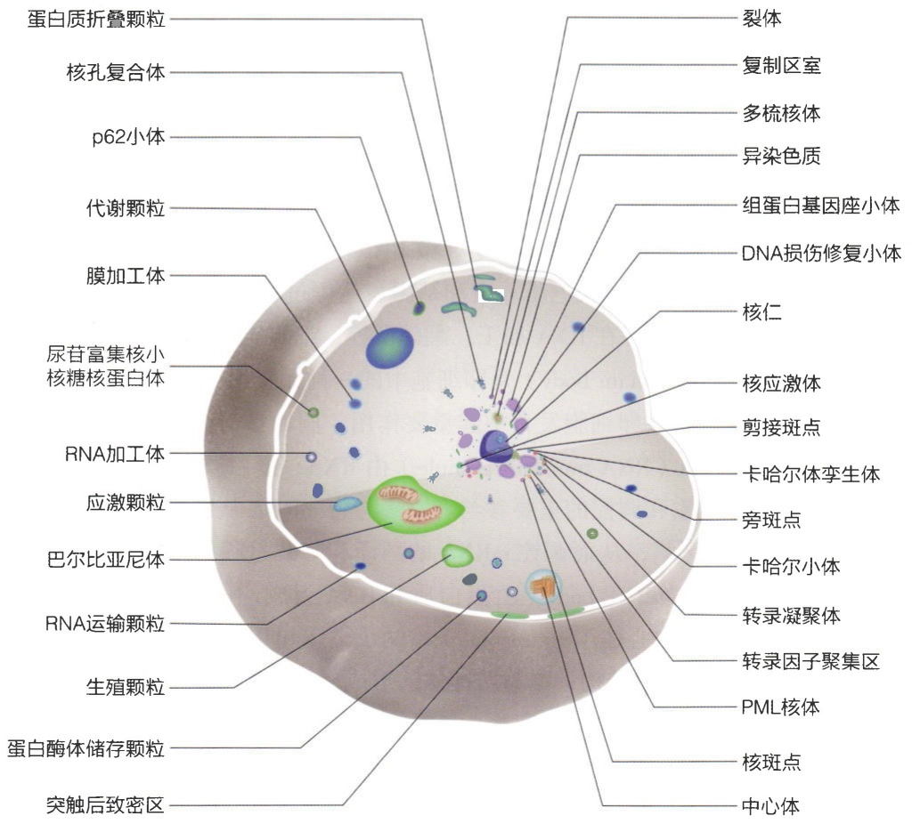
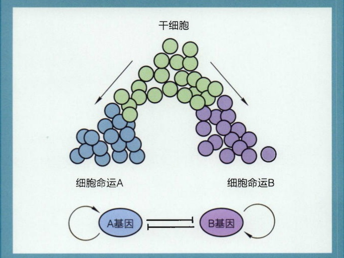
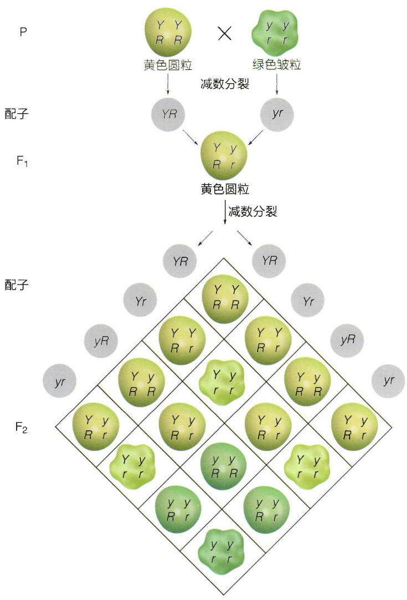
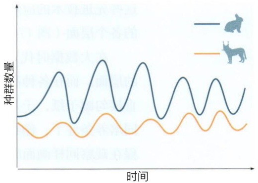
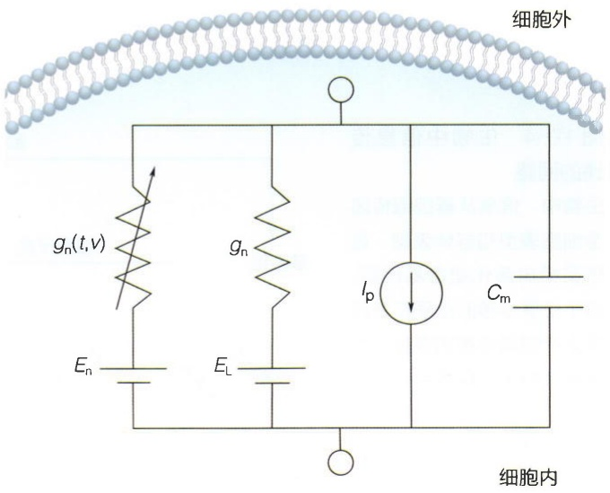
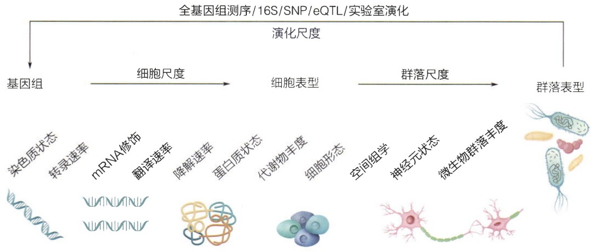
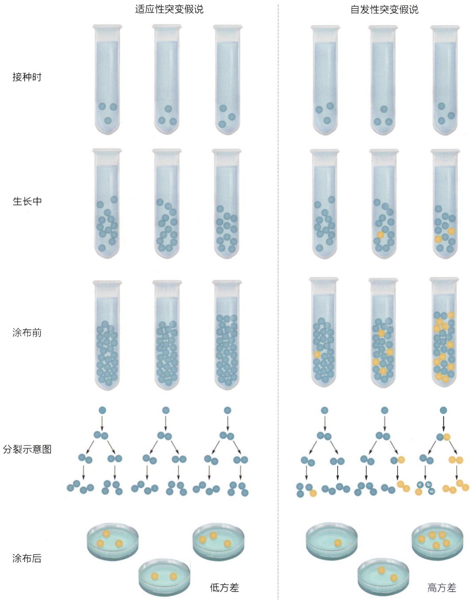
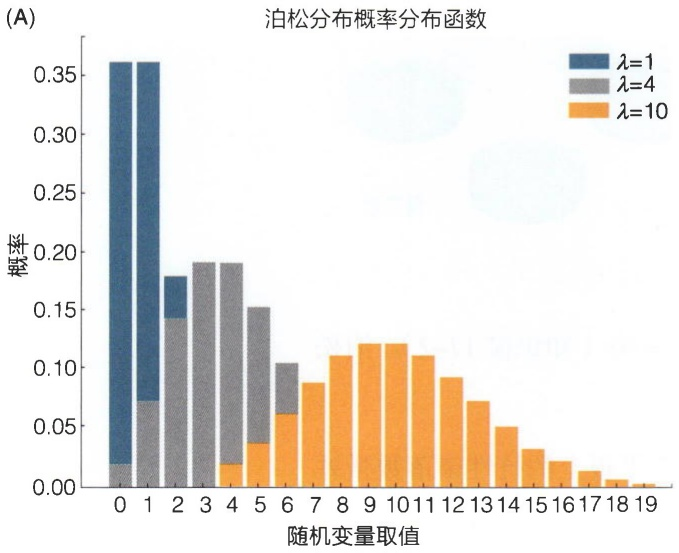
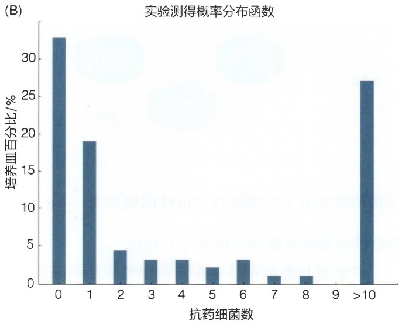

## 16.8.3 细胞质中的无膜细胞器

细胞质中由有膜细胞器占据了大量的空间，除此之外，还有诸多无膜细胞器占据部分剩余空间。这些无膜细胞器包括应激颗粒、生殖颗粒、P颗粒、巴尔比亚尼体以及RNA运输颗粒等（图16-2I）。

## (1) 应激颗粒

应激颗粒分布于细胞质中，是一类无膜包被的液态凝聚体，像核仁一样具有多相结构，至少包含一个稳定的核心结构和动态的外壳结构，其颗粒直径为 $0.1\sim 2\mu \mathrm{m}$ 。在细胞暴露于不利的环境应激条件时（例如热激、氧化应激、病毒感染、渗透压应激、紫外线照射等），应激颗粒会快速形成。应激颗粒的组装主要是由液-液相分离驱动的。

应激颗粒的形成与翻译抑制的信号通路密切相关。首先，在应激条件下，翻译起始被抑制，随后多核糖体分解，暴露的RNA优先与RNA结合蛋白结合，由于这些RNA结合蛋白通常含有固有无序区域，具有较强的参与液-液相分离能力，因此可以通过液-液相分离驱动应激颗粒的组装，生成应激颗粒的核心结构。接下来，其它蛋白质和RNA可以通过蛋白质-蛋白质、蛋白质-RNA和RNA-RNA相互作用进一步招募到应激颗粒中。

## (2) 细胞质中其它无膜细胞器

除了应激颗粒之外，细胞质中还有很多其它无膜细胞器。生殖颗粒是存在于几乎所有动物生殖细胞中的无膜细胞器，对于生殖细胞的发育至关重要。在秀丽隐杆线虫中，胚芽颗粒由至少四个毗邻的无膜细胞器组成，包括P颗粒、变异中心（mutator foci）、SIMR小体（SIMR foci）和先天免疫颗粒（Z granule）。其中，P颗粒是最重要的一个，含有大量的RNA，包括转录因子、微RNA（microRNA）和蛋白质编码RNA等，可能参与生殖细胞分化、染色质重组和基因表达等过程。RNA加工体（P-body）由多种蛋白质和RNA组成，在RNA加工、翻译调控、细胞应激反应等方面发挥重要作用。巴尔比亚尼体（Balbiani body）是卵细胞中的一种无膜细胞器，由大量线粒体、蛋白质和RNA组成，它在卵细胞发育中起重要作用，例如参与卵细胞的营养、生长和分化。RNA运输颗粒（RNA transport granule）由RNA、蛋白质和RNA结合蛋白组成，是细胞内RNA运输和调控的重要参与者，参与将mRNA从细胞核运输到细胞质中或定位到特定细胞区室，从而调控mRNA的翻译和降解过程。尿苷富集核小核糖核蛋白体（uridine-rich snRNP body）由蛋白质和RNA组成，可能参与蛋白质折叠、RNA加工和细胞凋亡。中心体（centrosome）由两个微体和几个中心粒（centriole）组成，是细胞有丝分裂的重要结构，参与纺锤体的形成，负责将复制后的染色体均匀地分配到两个子细胞中。蛋白酶体储存颗粒（proteasome storage granule）由蛋白酶体、蛋白酶体底物和蛋白酶体辅因子组成，是细胞内蛋白质降解的重要场所，参与细胞内蛋白质的降解，维持蛋白稳态。代谢颗粒（metabolic granule）由多种代谢酶和底物组成，是细胞内代谢的重要场所，参与细胞内代谢反应，为细胞提供能量和物质。p62小体（p62 body）由p62蛋白和被泛素化修饰的蛋白质组成，参与自噬过程和调节细胞应激反应。

## 16.8.4 生物膜附着的无膜细胞器

无膜细胞器可以通过其组分与跨膜蛋白或脂膜的相互作用，在细胞质膜或内膜表面形成，呈现为膜簇（membrane cluster）状（图16-2J）。例如，肾小球足细胞足突之间的肾小球足突蛋白聚集，与肾小球滤过功能有关。T细胞表面的T细胞受体聚集由多个TCR分子及其互作蛋白组成，可增强T细胞对抗原的识别和反应，在T细胞激活和功能中起重要作用。突触后致密区（post-synaptic density）由无膜细胞器构成，包括突触前小体、突触前膜囊泡、突触后致密体等，是神经信号传递的关键区域。微丝斑块（actin patch）由微丝和聚合蛋白组成，通常位于细胞质膜附近，参与细胞的运动、信号传导和细胞极性维持。蛋白质折叠颗粒（TIS granule）位于内质网腔内，富含参与蛋白质折叠、修饰和分泌的蛋白质，参与调控蛋白质折叠。膜加工体（Sec body）是由内质网出口位点合并形成的无膜应激诱导组装体，参与蛋白质折叠、修饰和运输。核孔复合体位于核膜中，是细胞核与细胞质之间物质交流的唯一通道。信号斑点由受体、激酶、转录因子等各种蛋白质组成，主要位于细胞质、细胞质膜或有膜细胞器表面，参与信号传导。黏着斑（focal adhesion）是由细胞质膜上的受体蛋白、细胞内信号蛋白和细胞骨架蛋白组成的细胞与细胞外基质之间的连接结构，参与调控细胞迁移、细胞增殖和细胞分化等多种细胞活动。

图 16-10 细胞中代表性的无膜细胞器

text_image

蛋白质折叠颗粒
核孔复合体
p62小体
代谢颗粒
膜加工体
尿苷富集核小核糖核蛋白体
RNA加工体
应激颗粒
巴尔比亚尼体
RNA运输颗粒
生殖颗粒
蛋白酶体储存颗粒
突触后致密区
裂体
复制区室
多梳核体
异染色质
组蛋白基因座小体
DNA损伤修复小体
核仁
核应激体
剪接斑点
卡哈尔体孪生体
旁斑点
卡哈尔小体
转录凝聚体
转录因子聚集区
PML核体
核斑点
中心体

现将本章提到的无膜细胞器总结在图16-10中。

## ※ 本章小结

本章展示了细胞内主要的有膜细胞器和多种代表性的无膜细胞器（图16-2和图16-10），并对经典的细胞器进行了具体描述。然而，这些细胞器在细胞中不是孤立存在的，而是将整个细胞空间划分成多个功能各异的物理实体。

作为物理实体，这些区室化的结构和细胞骨架（详见第14章）一起为细胞提供了力学的支撑，从而为细胞形态的多样性提供了物理基础。另一方面，细胞空间区室化为细胞内多种生物化学反应的发生提供了独立的空间，通过富集或隔离反应所需底物、酶等分子，精准地调控生物化学反应的发生与否及其速率。对于多步的生物化学过程，不同区室之间的直接、高效、有序的物质和信息交流，使得细胞内不同生化过程可以搭建出满足于生物生长发育所需的复杂性网络，确保细胞的正常运行和适应性反应。

需要指出的是，这种区室化的存在导致细胞里产生了区域内物理、化学性质上的不连续性，使得发生的物理化学过程偏离经典均匀溶液条件下的线性模型，而产生诸多非线性过程（具体例子见19.3、19.4和19.5节）。引入数学上微分的概念，将细胞所包含的三维空间分为一个个的小组分，区室化的结果则是区室边界上发生了特定物理化学性质的突变，如特定分子的浓度、生化反应速率、流动性、黏稠度等，从而满足生物生长发育所需的复杂性。通过对本章的学习，笔者希望读者在了解细胞区室化的概念之后，在研究特定生物学问题的过程中能够从非线性、非均匀的角度给出自己的思考。

## ※ 思考题

1. 请搜集典型的细胞透射电镜照片，分别粗略估算各种细胞器占整个细胞的体积比。
2. 请搜集典型的细胞核透射电镜照片，粗略估算核仁占整个细胞核的体积比。
3. 请搜集典型的细胞透射电镜照片，估算内质网膜面积与细胞膜面积的大致比例。
4. 请举例一种无膜细胞器并讨论其物理状态。

## ※ 扩展阅读

书籍

Alberts B, Johnson A, Lewis J, et al. Molecular biology of the cell[M]. 6th ed. New

York: Garland Science, 2014.

## 综述

Banani S F, Lee H O, Hyman A A, et al. Biomolecular condensates: organizers of cellular biochemistry[J]. Nat Rev Mol Cell Biol, 2017, 18(5):285–298.

Shin Y, Brangwynne C P. Liquid phase condensation in cell physiology and disease[J]. Science, 2017, 357(6357):eaaf4382.

## 研究论文

Alberti S, Gladfelter A, Mittag T. Considerations and challenges in studying liquid-liquid phase separation and biomolecular condensates[J]. Cell, 2019, 176(3):419–434.

flowchart

## 第四部分

## 定量生物学导论

定量生物学导论部分的特点在于用物理的思维和数学的语言来描述、刻画和理解生命活动，在不失严谨性的同时力求让同学们开阔眼界，领略学科交叉的魅力。在这一部分，我们并不要求同学们全面掌握生命科学各领域中所使用的数理知识，而是希望大家体会到它们在现代生物学研究中可以为我们做些什么（第17章）。我们主要关注数学如何帮助我们建立基本生物过程的数学模型（第18章），以及简单网络与复杂网络的动力学模型（第19和20章），并最终总结对出生命系统特征的定量理解（第21章）。细心的读者会发现，本书第二部分“分子生物物理”和第三部分“细胞生物物理”中的很多内容都应用了这一部分的知识，这也说明定量模型已经被广泛地应用到了分子与细胞生物学等多个领域的前沿研究中。任何一门自然科学的成熟过程都有一个共同的特点，那就是找到其中的数学语言。生命科学的定量化，以及与其它定量科学的交叉融合是当前生命科学革命的主要动力。这一部分非常值得生命科学方向的本科生们关注并仔细研读，从而为今后的研究打下良好基础。

# 定量模型

几个世纪以前，伽利略、开普勒、牛顿等众多伟大的科学家把天文实验数据与数学模型相结合，开启了现代科学的大门，并在物理学的世界里大放异彩，使得很多人类的美好梦想得以成为现实。21世纪以来，随着生物技术的迅速发展和生物知识的不断积累，生物学实验数据与数学模型的结合变得愈发紧密，定量生物学的大门也就此开启。

数学可以视为从命题中推导逻辑结果的工具。它坚持严谨、准确的逻辑以及对数量信息的精确处理，与普通的直观判断不同。如果初始命题是正确的，那么数学推导出的结论将是真实的。为了让数学发挥作用，我们需要先将分析的重点放在较为简单的系统上，从中挑选出关键的变量并提出明确的假设。这种方法在物理学中已经成功应用了几个世纪，但在传统生物学研究中却较为少见。不过，时代正在改变，数学模型正被越来越多的生命科学的前沿研究所使用，在解读复杂生命体系的运作机制等方面发挥着不可估量的作用。本章中，我们将先回顾科学史，从孟德尔的豌豆杂交实验到现今的生物大数据研究，在生物学的发展历程中不断体会定量模型对探索生物规律的必要性；再具体学习定量模型在简单估算、卢里亚-德尔布吕克实验和二态系统中的妙用，进而深化对定量生物学的理解。

## 17.1 定量模型的必要性

## 17.1.1 生物学历史上的定量模型

历史上，从孟德尔遗传实验到分子生物学诞生，再到生物技术革命，生物学的发展历程中常常能看到定量模型（知识窗17-1）的影子。下面，让我们一起来看几个有趣而重要的例子。

首先，是孟德尔的豌豆杂交实验（图17-1）。为了推翻已有的“融合遗传”理论，证明遗传因子是颗粒性的遗传单位，孟德尔将纯种高茎豌豆和纯种矮茎豌豆作为亲本，杂交两代，得到了子一代全部高茎、子二代高矮之比为 $3:1$ 的数据，通过定量的结果雄辩地证实了自己的假设。此后，他又同时研究两对相对性状的遗传，得到纯合亲本杂交，子二代 $9:3:3:1$ 的数据，这可以由遗传因子的颗粒性得到完美的解释。由以上两个具有定量思想的实验，孟德尔两大定律——分离定律、自由组合定

```mermaid
graph TD
  subgraph Group_F1
  A["黄色圆粒"] --> B["YR"]
  C["绿色皱粒"] --> D["yr"]
  B --> E["Y y R r"]
  D --> E
  E --> F["黄色圆粒"]
  end

  subgraph Group_F2
  G["Y Y R r"] --> H["Y y R r"]
  I["Y y R r"] --> J["Y y R r"]
  K["Y y R r"] --> L["Y y R r"]
  M["Y y R r"] --> N["Y y R r"]
  O["Y y R r"] --> P["Y y R r"]
  Q["Y y R r"] --> R["Y y R r"]
  S["Y y R r"] --> T["Y y R r"]
  U["Y y R r"] --> V["Y y R r"]
  W["Y y R r"] --> X["Y y R r"]
  Y["Y y R r"] --> Z["Y y R r"]
  AA["Y y R r"] --> AB["Y y R r"]
  AC["Y y R r"] --> AD["Y y R r"]
  AE["Y y R r"] --> AF["Y y R r"]
  AG["Y y R r"] --> AH["Y y R r"]
  AI["Y y R r"] --> AJ["Y y R r"]
  AK["Y y R r"] --> AL["Y y R r"]
  AM["Y y R r"] --> AN["Y y R r"]
  AO["Y y R r"] --> AP["Y y R r"]
  AQ["Y y R r"] --> AR["Y y R r"]
  AS["Y y R r"] --> AT["Y y R r"]
  AU["Y y R r"] --> AV["Y y R r"]
  AW["Y y R r"] --> AX["Y y R r"]
  A --> B
  C --> D
  E --> F
  F --> G
  G --> H
  H --> I
  I --> J
  J --> K
  K --> L
  L --> M
  M --> N
  N --> O
  O --> P
  P --> Q
  Q --> R
  R --> S
  S --> T
  T --> U
  U --> V
  V --> W
  W --> X
  X --> Y
  Y --> Z
  Z --> AA
  AA --> AB
  AB --> AC
  AC --> AD
  AD --> AE
  AE --> AF
  AF --> AG
  AG --> AH
  AH --> AI
  AI --> AJ
  AJ --> AK
  AK --> AL
  AL --> AM
  AM --> AN
  AN --> AO
  AO --> AP
  AP --> AQ
  AQ --> AR
  AR --> AS
  AS --> AT
  AT --> AU
  AU --> AV
  AV --> AW
  AW --> AX
  AX --> AZ
  end
```

flowchart

图17-1 两对相对性状的遗传

律被发现，遗传学大门就此敞开。

第二，是描述种间关系的猎物-捕食者模型（Lotka-Volterra model）（图17-2）。对于捕食者与被捕食者（如草原上的猞猁和兔子）的数量变化，可以使用一组简单的微分方程描述:

$$
\frac {\mathrm{d} x}{\mathrm{d} t} = a x - \beta x y, \frac {\mathrm{d} y}{\mathrm{d} t} = - \delta y + \gamma x y _ {\circ}
$$

其中 $x$ 、 $y$ 分别代表兔子和猞猁的数目， $ax$ 、 $-\delta y$ 分别为它们的自然增长率（猞猁没有了猎物就会因为缺少食物资源而饿死，因此自然增长率为负）， $-\beta xy$ 、 $\gamma xy$ 则描述被捕食和捕食对它们数目的影响。这个模型不仅可以阐明捕食者和被捕食者的数量变化机制，还可以通过一些修正考虑生态系统中密度制约、时滞等复杂因素，从而运用到生态学的各个领域。这些方程组中蕴含的吸引子、混沌等数学现象代表的生物学规律，至今仍被积极探索。

第三，是DNA双螺旋结构的发现。1953年克里克和沃森发现DNA双螺旋结构是生命科学乃至整个自然科学史上最重要的里程碑之一，而这一发现同样是生物学中定量实验的结果（虽然对于分子结构的研究可以认为是“生物学在微观层面还原为了物理或化学”）。通过对X射线透过晶体形成的衍射图样进行数学上的分析，可以推断

## 知识窗 17-1

## 生物学定量模型

生物学定量模型可以分为描述性模型和机制性模型。前者用统计学算法处理大量数据，通过进行拟合、聚类等分析，重点在于发掘出数据背后的关联，将其归纳总结为函数、网络等模型。后者根据对现象的认识来解释它的逻辑因果，并据此写出方程描述其动力学变化。作为真实情况的简化，所有模型都有其适用范围，但对无论哪一种模型，我们都希望它能在尽可能大的范围内指导我们理解现象、预测规律。作为最成功的描述性模型之一，上世纪提出的中心法则总结了迄今发现的几乎所有生物的遗传信息流动规律；流行病学的 SIR 机制模型及诸多变体，在历次疫情中都是最有力的武器。正文中介绍的猎物-捕食者模型，则是生态学领域中经典的机制性模型。

出晶体中的原子排布、分子结构，物理学家出身的克里克由此提出了螺旋形分子衍射的通用数学理论。而在看到DNA分子的衍射图片后，他和生物学家沃森通力合作，依据自己先前的理论，很快就得到了正确的DNA双螺旋模型，由此开启了现代分子生物学的时代。

第四，是膜电导模型和霍奇金-赫胥黎模型（图17-3；另见12.2.1节）。在沃森和克里克研究DNA的同期，霍奇金和他的学生赫胥黎在1952年发表了他们开创性的神经电信号研究。神经系统中，电脉冲信号被不断地激发、传播，使生物能够响应外界刺激。霍奇金和赫胥黎使用玻璃微电极在枪乌贼的巨大轴突（有人类神经的千倍粗）上首次测量到了神经内外的电位差和变化的电信号。而他们意识到，为了解读这些定量、连续的电信号数据，定量的数学模型是必不可少的。分析数据建立模型的过程中，他们预言了“离子通道”的存在，并构建了膜电导模型，其要素如图17-3所示:细胞膜的磷脂双分子层提供电容 $C_{\mathrm{m}}$ ；同时存在着离子泵等主动转运离子的蛋白质提供恒流源 $I_{\mathrm{p}}$ ，门控离子通道提供非线性的电导 $g_{\mathrm{n}}(t,v)$ 和常开的泄漏离子通道提供线性的电导 $g_{\mathrm{L}}$ ，以及相应离子的膜内外电化学梯度带来的等效电动势 $E_{\mathrm{n}}$ 和 $E_{\mathrm{L}}$ 。基于这些组件写出电学微分方程而构建的数学模型被称为霍奇金-赫胥黎模型，能够成功解释和描述动作电位的产生和恢复以及信号在神经纤维上的传播。随着技术的进步，“离子通道”假说也随着由玻璃微电极改进而成的、小到可以对单个离子通道检测的“膜片钳”的发明而得到证实。霍奇金和赫胥黎最初的实验仅涉及钠离子和钾离子，但霍奇金-赫胥黎模型的普适性使之能够扩展到其它各类离子通道，时至今日依然是神经电生理学中的基本模型。

line

| Time | Blue Line (Population) | Orange Line (Population) |
| --- | --- | --- |
| 1 | ~0.2 | ~0.15 |
| 2 | ~0.3 | ~0.1 |
| 3 | ~0.4 | ~0.15 |
| 4 | ~0.2 | ~0.1 |
| 5 | ~0.3 | ~0.15 |
| 6 | ~0.4 | ~0.1 |
| 7 | ~0.2 | ~0.15 |
| 8 | ~0.3 | ~0.1 |
| 9 | ~0.4 | ~0.15 |
| 10 | ~0.2 | ~0.1 |
| 11 | ~0.3 | ~0.15 |
| 12 | ~0.4 | ~0.1 |
| 13 | ~0.2 | ~0.15 |
| 14 | ~0.3 | ~0.1 |
| 15 | ~0.4 | ~0.15 |
| 16 | ~0.2 | ~0.1 |
| 17 | ~0.3 | ~0.15 |
| 18 | ~0.4 | ~0.1 |
| 19 | ~0.2 | ~0.15 |
| 20 | ~0.3 | ~0.1 |
| 21 | ~0.4 | ~0.15 |
| 22 | ~0.2 | ~0.1 |
| 23 | ~0.3 | ~0.15 |
| 24 | ~0.4 | ~0.1 |
| 25 | ~0.2 | ~0.15 |
| 26 | ~0.3 | ~0.1 |
| 27 | ~0.4 | ~0.15 |
| 28 | ~0.2 | ~0.1 |
| 29 | ~0.3 | ~0.15 |
| 30 | ~0.4 | ~0.1 |
| 31 | ~0.2 | ~0.15 |
| 32 | ~0.3 | ~0.1 |
| 33 | ~0.4 | ~0.15 |
| 34 | ~0.2 | ~0.1 |
| 35 | ~0.3 | ~0.15 |
| 36 | ~0.4 | ~0.1 |
| 37 | ~0.2 | ~0.15 |
| 38 | ~0.3 | ~0.1 |
| 39 | ~0.4 | ~0.15 |
| 40 | ~0.2 | ~0.1 |
| 41 | ~0.3 | ~0.15 |
| 42 | ~0.4 | ~0.1 |
| 43 | ~0.2 | ~0.15 |
| 44 | ~0.3 | ~0.1 |
| 45 | ~0.4 | ~0.15 |
| 46 | ~0.2 | ~0.1 |
| 47 | ~0.3 | ~0.15 |
| 48 | ~0.4 | ~0.1 |
| 49 | ~0.2 | ~0.15 |
| 50 | ~0.3 | ~0.1 |
| 51 | ~0.4 | ~0.15 |
| 52 | ~0.2 | ~0.1 |
| 53 | ~0.3 | ~0.15 |
| 54 | ~0.4 | ~0.1 |
| 55 | ~0.2 | ~0.15 |
| 56 | ~0.3 | ~0.1 |
| 57 | ~0.4 | ~0.15 |
| 58 | ~0.2 | ~0.1 |
| 59 | ~0.3 | ~0.15 |
| 60 | ~0.4 | ~0.1 |
| 61 | ~0.2 | ~0.15 |
| 62 | ~0.3 | ~0.1 |
| 63 | ~0.4 | ~0.15 |
| 64 | ~0.2 | ~0.1 |
| 65 | ~0.3 | ~0.15 |
| 66 | ~0.4 | ~0.1 |
| 67 | ~0.2 | ~0.15 |
| 68 | ~0.3 | ~0.1 |
| 69 | ~0.4 | ~0.15 |
| 70 | ~0.2 | ~0.1 |
| 71 | ~0.3 | ~0.15 |
| 72 | ~0.4 | ~0.1 |
| 73 | ~0.2 | ~0.15 |
| 74 | ~0.3 | ~0.1 |
| 75 | ~0.4 | ~0.15 |
| 76 | ~0.2 | ~0.1 |
| 77 | ~0.3 | ~0.15 |
| 78 | ~0.4 | ~0.1 |
| 79 | ~0.2 | ~0.15 |
| 80 | ~0.3 | ~0.1 |
| 81 | ~0.4 | ~0.15 |
| 82 | ~0.2 | ~0.1 |
| 83 | ~0.3 | ~0.15 |
| 84 | ~0.4 | ~0.1 |
| 85 | ~0.2 | ~0.15 |
| 86 | ~0.3 | ~0.1 |
| 87 | ~0.4 | ~0.15 |
| 88 | ~0.2 | ~0.1 |
| 89 | ~0.3 | ~0.15 |

图17-2 兔子和猞猁数量变化的示意图

text_image

细胞外
gₙ(t,v)
Eₙ
Eₗ
Iₚ
Cₘ
细胞内

图 17-3 膜电导模型

由此可见，在生物学研究的历史上，定量模型虽然较为少见，但也曾在描述生命规律、理解生命机制等方面发挥过非常重要的作用。

## 17.1.2 大数据时代

21世纪开端，生物数据在各领域的爆发式积累为定量生物学带来了新的机遇与挑战。现代生命科学的进步很大程度上是技术驱动的，新的观测工具和高通量技术的引入极大地丰富了研究者的数据来源。从基因组学到蛋白质组学，从脑科学到生态学，这些先进技术的应用使我们能够从切实的数据中窥探生命的奥秘，深入研究生物系统的各个层面（图17-4）。

在大数据时代之前，生命科学中的理论很大程度上还停留在“思辨”和“定性”的层面。而在各种高通量组学和影像技术被引入后，实验的初步结果不再能被简单地直接勾画于纸，于是对数据的定量分析开始成为研究者们的基本技能。例如，两种不同培养条件下，癌细胞中哪些基因具有差异性的表达，又富集在哪些通路？人和黑猩猩在观察同样画面时哪些脑区的神经元活动存在显著的差异，而这些差异又可能和哪些基因序列相关？特别是，生物系统中普遍存在着噪声和随机性，如何排除干扰，得出可靠的结论？要回答这些问题，我们可以运用统计学的思维和方法对数据进行建模，挖掘其背后的生物学规律。

这些海量的数据不仅仅对研究者们的统计技能提出要求，也将生物的复杂性更具体地呈现出来。例如，尽管中心法则告诉我们蛋白质由DNA转录、翻译而来，但并不足以回答转录、翻译和降解这三个过程哪个对蛋白质丰度起主导作用——而高通量

图 17-4 生物中信息传递的回路

生物中，信息从基因组传递至细胞表型和群体表型，最终又经由演化塑造基因组。这个信息传递的过程在各尺度上产生着海量的数据，为研究者们深入探索中心法则的细节、生态系统的动态和生物多样性的起源提供了丰富的资源和机会。

flowchart

的转录物、核糖体足迹、蛋白质组测序数据能对这个问题给出定量回答。又例如，研究者们曾经认为微生物难以产生如有性繁殖的生物那样的基因多样性，然而，随着测序技术特别是环境宏基因组测序的飞速发展，人们开始意识到大量跨物种的水平基因迁移塑造了微生物群落惊人的多样性。生物学是一门实践科学，而大数据本身往往揭露出让人意想不到的复杂性和多样性。

大数据不仅仅能带给我们之前未能描绘到的有趣现象，更有潜力在结合现代信息科技后揭示复杂生物现象背后的机制。近年来，人工智能的蓬勃发展为此提供了新的可能性。一方面，人工智能中重要的门类——神经网络的基本构架是受脑科学研究启发而来；另一方面，机器学习的一些领域注重“因果推断”，在数据量足够的前提下，可以发现隐藏在庞大数据集中的模式和关联，推断可能的因果性网络。例如，一些研究利用单细胞测序数据从细胞分化发育中推断基因调控网络，从而预测对细胞命运进行重编程的新方法。又如，一些研究从微生物的宏基因组数据出发，利用机器学习方法推断微生物之间的互作关系，并设计具有治疗效果的人工菌群。这些数据驱动的机制性模型方法为分子生物学、微生物学和医学等领域提供了新的研究途径和应用前景。

## 17.1.3 定量模型对于解释、预测和规律发现的帮助

如果回想所有的生物学课本，你会发现里面可以被称为定律的要远少于数学和物理学，而且发现时间也往往更晚——牛顿等人早在17世纪便为数理大厦奠基，而经典遗传学定律要等到19世纪才开始被陆续发现。这当然不是因为历史上的生物学家不如他们的数理同行刻苦。生物系统由多个层次组成，从分子、细胞到整个种群，每一层都是由复杂调控机制构成的巨大网络，温度、pH等理化条件甚至内禀的随机性造成的影响都会被放大。因此比起数学与物理学研究的非生命系统，生物系统的复杂度更高，对外部环境更敏感，有着更大的不确定度。这些纷繁错杂的噪声让背后的规律扑朔迷离，因此历史上对许多生物现象的研究长期局限于“一事一议”的经验描述。

数学模型以数字、符号和函数来代表真实世界的某个系统。从孟德尔时代一直到当下的大数据时代，定量模型一直都在科学研究领域发挥着重要的作用，它们对于解释、预测和规律发现都提供了极大的帮助。

首先，定量模型可以更加精确地解释生物现象。定量模型是从纷乱的现象与数据中抽丝剥茧，让规律“吹尽黄沙始到金”的利器。既然生物学实验数据往往随机性更强、涨落更大，那么用合适的统计学方法分析数据消弭噪声尤为必要。“纯合高茎矮茎杂交，子二代9:3:3:1”、“菌落数目为长尾分布，方差远高于均值”显然比“纯合高茎矮茎杂交，子二代有的高有的矮”、“菌落数目差别很大”更接近现象蕴含的规律。对如今的生物大数据时代来说，数据处理更为重要。一组DNA序列，处理前它们只是长短不一的ATCG的无序排列，但经过恰当的打分比对，就可以重现这些基因的演化脉络。

其次，定量模型能够揭示生物系统的普遍规律，从而预测生物系统在不同条件下的行为。生物规律不仅隐匿在单个系统的复杂性中，还隐匿在这些系统浩如烟海的数量中。孟德尔总结了豌豆的遗传规律，那么果蝇的遗传也是如此吗？枪乌贼的神经元放电规律被霍奇金和赫胥黎解释了，那么人的细胞也满足吗？如果这些科学家的工作只是对自己观察到的现象进行经验的描述，那么这些问题的答案就无法预言。而正是他们对现象机制的定量解释大大延拓了规律的适用范围，使之超脱实验对象的限制。孟德尔等科学家首先对现象背后的核心要素建模，如独立的遗传因子，并根据已有的实验现象，用数学或物理的语言描述它的性质，演绎出造成现象的机制与过程。通过如此假说-演绎法得到的规律，它的数学物理推导对任一系统都是普适的，那么对于其它实验外的生命体系，只要规律的核心假说仍适用，就可以断言这个新系统里仍满足该规律。定量模型抓住了一类现象的主要矛盾，把这类现象在不同场景间的具象差异抽象简化为便于修改的参数，揭示出不同实例背后的一般性规律。

最后，定量模型可以很好地进行跨尺度理解。生物学涉及多个尺度，从分子到细胞、组织，甚至生态系统。定量模型可以帮助建立不同尺度之间的联系，促进对整体系统行为的理解。这种综合性的视角有助于发现在不同尺度间的相互作用和影响。

总之，定量模型在解释、预测和规律发现方面都扮演着关键角色。它们不仅可以帮助我们更好地理解现实世界，还可以指导决策和创新，从而推动科学和社会的进步。然而，需要注意的是，模型的意义在于以简代繁，定量模型一定是从最简化的参数设置开始建立，并在与实验数据的亲密互动中不断发展和完善。因此在使用已有的定量模型时需要谨慎分析和评估。

## 17.2 定量模型的简单案例

## 17.2.1 简单估算

热力学的奠基人之一——威廉·汤姆孙（William Thomson，1824—1907，又称开尔文勋爵），在1883年的一次演讲中说:“只有当你能够测量你所谈论的事物，并用数字来表达它时，你才对它有所了解；要是你无法进行测量，也无法用数字来表达时，你对事物的了解是贫乏和不令人满意的:因为这只是知识的起点，但你的思维还没有进入科学的状态，无论涉及的是什么领域。”

就如开尔文所述，“数字”给人带来理解。在生命科学领域，研究者们常谈论“生物学直觉”——这种敏锐的洞察力能够帮助研究者快速形成假设、对现象提出合理的解释、并指导实验设计和数据分析，却也让人感觉它仿佛是一种类似于音乐或数学天赋一样难以捉摸的存在。事实上，尽管这种“感觉”无法被直接学到，但生物学直觉仍然是建立在扎实的科学知识和长期训练的经验基础上的。

生物学直觉的基础之一，就是对生命科学中“数字”和“数字之间关系”的领会。对于领域中常见的数字的了解，是构建基于数字的直觉的第一步。这些数字并不需要非常精确，只要有一个大致的数量级和范围就足够。例如，如果你经常使用大肠杆菌作为实验模式生物，你可能需要知道一个典型的细菌细胞（如大肠杆菌）的大小以微米为数量级，在良好的营养条件下，大肠杆菌处于对数生长期。这意味着它们大约每 $20\mathrm{min}$ 分裂一次；在 $\mathrm{OD}_{600}$ （$600\mathrm{nm}$ 波长处的吸光度）为1的培养液中，每毫升大约有 $10^{9}$ 个细胞；在富营养的对数生长期，一个大肠杆菌细胞中大约有 $10^{5}$ 个核糖体。对这些常见数量级的了解，可以帮助实验者快速估算自己获取的数据是否存在较大误差。

而对数字之间关系的计算，则能够为研究者提供对生物过程之间关联性的理解，帮助研究人员迅速而直观地设计实验，并理解生物系统的运作方式。就以上一段中的数字为例——对于培养细菌来说，若最开始每毫升培养液中有1个大肠杆菌细胞，那么 $t\mathrm{h}$ 后，这个浓度则为 $2^{3t}$ 个 $/ \mathrm{mL}$ 。若要培养大肠杆菌至较适合实验的浓度 $(\mathrm{OD}_{600} \approx 1)$，大概需要 $\frac{\ln 10^9}{3\ln 2} \approx 10\mathrm{h}$ ——若是要第二天一早8点做实验，前一天晚上9—10点左右开始养菌可能是比较合适的。

可要是一直养下去养个两三天，那么 $2^{3t}$ 个/mL这个估算还能用吗？若认为大肠杆菌的体积处于 $1\mu \mathrm{m}^3$ 这个量级，且密度和水相当，则一个大肠杆菌的质量约为 $10^{-12}\mathrm{g}$ 。若是这么计算，两天共计 $48\mathrm{h}$ 后，这一毫升培养液中的大肠杆菌将达到 $10^{-3}\times 10^{-12}\times$ $2^{3\times 48}\approx 2\times 10^{28}\mathrm{kg}$，是地球质量的3000多倍，这显然是荒谬的。于是，在这个数量级估算之后，即使是完全不了解微生物生长的人，也能得出这么一个推断:指数生长是不会持续下去的。那么，是什么在大约 $10\mathrm{h}$ 后开始限制细菌生长，又可以用什么数学方程对这个过程进行抽象描述呢？当读者开始思考这个问题时，就会进入理论生态学中最基础的逻辑斯蒂增长的领域了。

细胞的生长本质上是其生物量的增加。蛋白质占了大肠杆菌细胞干重（约为 $3 \times 10^{-13} \mathrm{~g}$）的一半左右，胞内蛋白质浓度在不同生长条件下保持恒定（这又是一些值得记住的数字），于是，蛋白质总质量 $M$ 的增长速率可以近似地代表细胞的生长速率。若需要 $20 \mathrm{~min}$ 将蛋白质总质量翻倍，并设氨基酸平均质量为 $m = 1.8 \times 10^{-22} \mathrm{~g}$，那么，这段时间内细胞需要增加数量级为 $\frac{M}{m} = \frac{1.5 \times 10^{-13}}{1.8 \times 10^{-22}} \approx 10^{9}$ 个氨基酸，即蛋白质总质量的增长速率 $\nu$ 的数量级为:每秒 $10^{6}$ 个氨基酸。

若细胞中共有 $R$ 个核糖体，以平均 $k$ 个氨基酸每秒的速率在mRNA上进行翻译，那么有:

$$
v = R \cdot k _ {\circ} \tag {17-1}
$$

从中可得 $k = v / R$ ，而研究表明富营养条件下的 $R$ 处于 $10^{5}$ 这个数量级。由此，我们竟然可以从细菌的生长速率、细胞干重、总核糖体数量这些较为宏观并易于测量的量中，估计出了中心法则中一个重要的微观时间尺度——翻译的速率约为10个氨基酸每秒。实际测量中，大肠杆菌翻译的速率确实落在 $10\sim 20$ 个氨基酸每秒的区间。这个粗略的数量级估计，是有效且高效的。

事实上，式（17-1）还提示了另一个重要的数字关系——细胞中的核糖体越多，生长速率越快，且这个关系可能近似线性。这个线性正相关在实验中被确证，是细菌的“生长率”（growth rate）中的重要基石。

## 17.2.2 卢里亚-德尔布吕克实验和理论

噬菌体（phage）是侵袭细菌的病毒，它们将自己的遗传物质注入细菌，从而在细菌体内迅速产生新的噬菌体。马克斯·德尔布吕克（Max Delbrück，1906—1981）、萨尔瓦多·卢里亚（Salvador Luria，1912—1991）和阿尔弗雷德·赫尔希（Alfred Hershey，1908—1997）在对噬菌体的研究中应用了遗传学概念并结合了概率统计的方法，从而为遗传学中的一系列未解之谜带来了新的启示，并因此获得了1969年的诺贝尔生理学或医学奖。例如，1943年，卢里亚和德尔布吕克结合实验和概率统计分析证明，在细菌中，遗传突变是在缺乏选择压力的情况下产生的，而不是对选择压力的响应。要知道在那时候，虽然遗传和突变的观念已经得到普遍接受，但是连DNA的结构还未曾被揭示，而卢里亚和德尔布吕克利用巧妙的实验设计，结合定量模型的构建，以及对实际数据的分析，就已经可以发现遗传突变的诸多重要性质。

卢里亚和德尔布吕克的这项工作主要关心的问题是，细菌具有遗传性的突变是在环境变化之前就存在的，还是在环境变化后适应发展出的。在实验中，他们将少量大肠杆菌接种到不同的培养管，在经过一段时间的生长后，每个培养管中取等体积的液体分别接种到含有噬菌体的平板上，并测量每个平板上抗性菌落的数量，即最终可以抵抗噬菌体侵染的菌落个数（图17-5）。可是该怎么来分析这些数据呢？

如果细菌对病毒的抗性是在接触噬菌体的时候被诱导激活的，而不是在接触之前就已经由可遗传的突变引起的，那么每个平板上应该包含大致相同数量的抗性菌落，因为每个培养皿上的细菌接受噬菌体处理时间较短，并且条件一致（图17-5）。这只是一种直观，但是由于随机性的存在，即使这个假设是成立的，各个平板上包含的抗性菌落数目也不可能是完全相同的，那么当这种“不完全相同”达到怎样的程度，我们就可以否定这个假设呢？又或者说如果该假设成立，这种“不完全相同”又该是在什么幅度内呢？这就需要定量的模型和分析了。

假设转移到含有噬菌体的平板上的每个培养液里都含有 $N$ 个大肠杆菌细胞，且每个细胞有概率 $p$ 被激活成具有抗性，于是概率论告诉我们，这 $N$ 个大肠杆菌细胞中具有抗性的细胞数量服从二项分布（知识窗17-2）。对于二项分布，其平均值可以计算出来，等于 $Np$ ，其方差也可以计算出来，等于 $Np(1 - p)$ 。由于每个细菌具有抗性的概率 $p$ 非常小，且在0和1之间，所以方差会几乎等于平均值。因此如果实验数据上计算出的方差远大于平均值，就说明这种环境诱导激活的抗性理论是错误的。

其实，从实验数据中不仅仅可以得到均值和方差的关系，还可以得到近似的分布。二项分布当 $N$ 很大时是很难计算的，也无法真正拟合实验上测得的分布，因此数学家证明了当 $N$ 很大、$p$ 很小的时候，二项分布可以近似为泊松分布，即这 $N$ 个大肠杆菌细胞中有 $k$ 个细胞具有抗性的概率为 $\frac{\lambda^k}{k!}\mathrm{e}^{-\lambda}$，其中 $\lambda = Np$（知识窗17-2）。泊松分布的重要特点就是平均值等于方差。

图17-5 卢里亚-德尔布吕克实验的流程和原理在实验中，都是从少量细菌细胞开始培养，待细胞生长一段时间后进行涂布操作，也就是接触噬菌体。左图是适应性突变假说，即在涂布前各个细菌细胞间是没有区别的，涂布后所产生的对病毒具有抗性的突变是在接触噬菌体后随机发生的，因此不同培养皿之间的涂布效果差异不大，方差较小。右图是自发突变假说，即在涂布前有些细菌细胞就发生了自发突变，产生了对病毒的抗性，且这种突变是可以遗传的，因此最终不同培养皿之间的涂布效果差异很大，产生了较高的方差。黄色表示抗性个体。

卢里亚和德尔布吕克在实验中发现的情况就是:每个平板上的抗性菌落数量差异很大，方差远大于均值，而且看起来也不是泊松分布（图17-6）。因此他们得到结论，遗传突变是在接触噬菌体之前就存在的。

为了进一步分析遗传突变到底是怎么遗传的，突变率到底是多少，卢里亚和德尔布吕克进一步建立了较为复杂的含时间演变的遗传突变模型，并推导出了根据实验数

## 知识窗17-2

## 二项分布与泊松分布

二项分布我们并不陌生，抛多次硬币，正面朝上的次数就服从二项分布。普遍来说，进行每次只有2种可能结果（比如某细菌是否具有抗性）的随机试验，在单次试验中某一结果有概率p发生，那么独立地重复N次时，该结果发生的次数X便服从二项分布:

$$
P (X = k) = \frac {N !}{k ! (N - k) !} p ^ {k} (1 - p) ^ {N - k},
$$

对任意  $k=0,1,\cdots,N$ 。

由这个表达式，我们很容易得出二项分布的均值为 $Np$ ，方差为 $Np(1 - p)$ 。从这个表达式出发，如果我们记 $\lambda = Np$ ，可以发现在 $N$ 很大、$p$ 很小时，表达式近似为:

$$
P (X = k) \approx \frac {(N p) ^ {k}}{k !} (1 - p) ^ {N} \approx \frac {\lambda^ {k}}{k !} \mathrm{e} ^ {- \lambda}.
$$

这便是泊松分布的表达式，其中用到了自然对数的极限 $\lim_{n\to \infty}\left(1 - \frac{1}{n}\right)^{an} = e^{-a}$ 。这里只展示了一种直观的近似，但实际上，我们可以严格证明二项分布的上述极限是泊松分布，如果读者感兴趣，不妨参考概率论教材。泊松分布只有 $\lambda$ 这一个参数，其平均值和方差均为 $\lambda$ 。泊松分布也是生活中常见的分布，例如产品的瑕疵数、每天接到的电话数都近似服从泊松分布。如正文所述，在德尔布吕克和卢里亚的理论分析中，就是用泊松分布来建模适应性突变假设下涂布后培养皿中抗药细菌数的分布。

据计算突变率的方法，当年他们得到的突变率在后来被证实和真实的DNA分子突变率很接近。这一数学模型比较复杂，直到近些年还有数学家、统计学家和遗传学家在研究和发展它，这里就不作过多介绍了。

bar_stacked

| 随机变量取值 | \(\lambda=1\) (概率) | \(\lambda=4\) (概率) | \(\lambda=10\) (概率) |
| --- | --- | --- | --- |
| 0 | ~0.36 | ~0.02 | — |
| 1 | ~0.36 | ~0.07 | — |
| 2 | ~0.18 | ~0.14 | — |
| 3 | — | ~0.19 | — |
| 4 | — | ~0.19 | ~0.02 |
| 5 | — | ~0.15 | ~0.04 |
| 6 | — | ~0.10 | ~0.06 |
| 7 | — | — | ~0.09 |
| 8 | — | — | ~0.11 |
| 9 | — | — | ~0.12 |
| 10 | — | — | ~0.12 |
| 11 | — | — | ~0.11 |
| 12 | — | — | ~0.09 |
| 13 | — | — | ~0.07 |
| 14 | — | — | ~0.05 |
| 15 | — | — | ~0.03 |
| 16 | — | — | ~0.02 |
| 17 | — | — | ~0.01 |
| 18 | — | — | ~0.01 |
| 19 | — | — | ~0.005 |

图 17-6 泊松分布和实验测得的概率分布函数图

（A）参数分别为1、4、10的泊松分布概率分布函数图，可见都是单峰的分布，且随着参数的增大，分布的峰值也在向右移动。（B）图中

bar

| 抗药细菌数 | 培养皿百分比 (%) |
| --- | --- |
| 0 | ~32.5 |
| 1 | ~19 |
| 2 | ~4.2 |
| 3 | ~3 |
| 4 | ~3 |
| 5 | ~2 |
| 6 | ~3 |
| 7 | ~1 |
| 8 | ~1 |
| 9 | 0 |
| >10 | ~27 |

数据来自卢里亚和德尔布吕克最早的文献（参见章末扩展阅读），是他们实验中测到的真实数据，与A图对比，可见并非泊松分布，且方差很大。